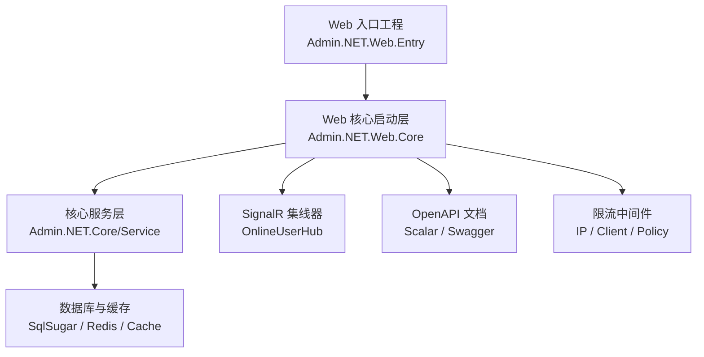
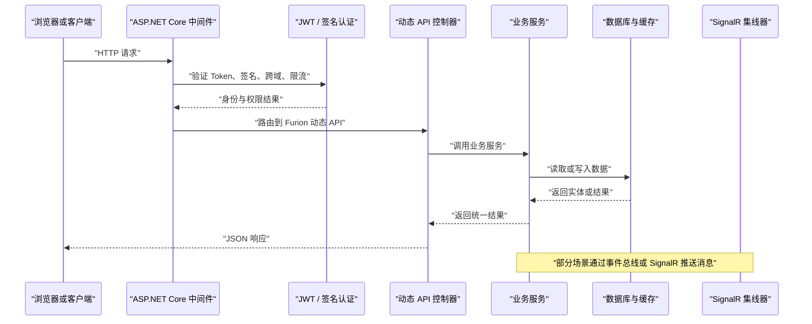
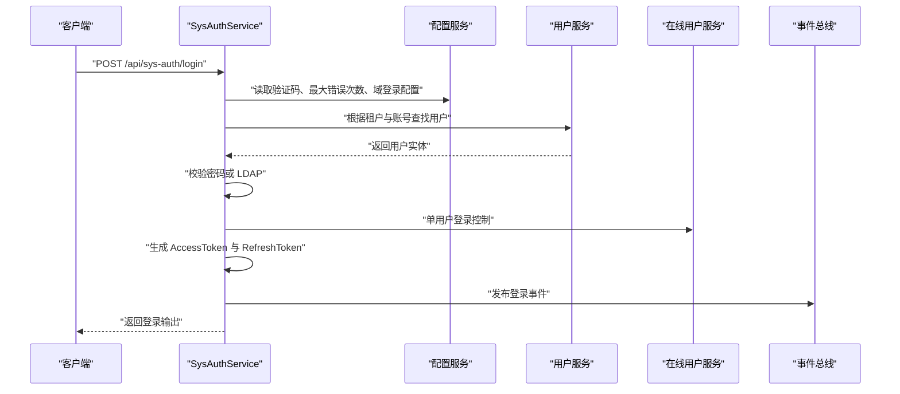
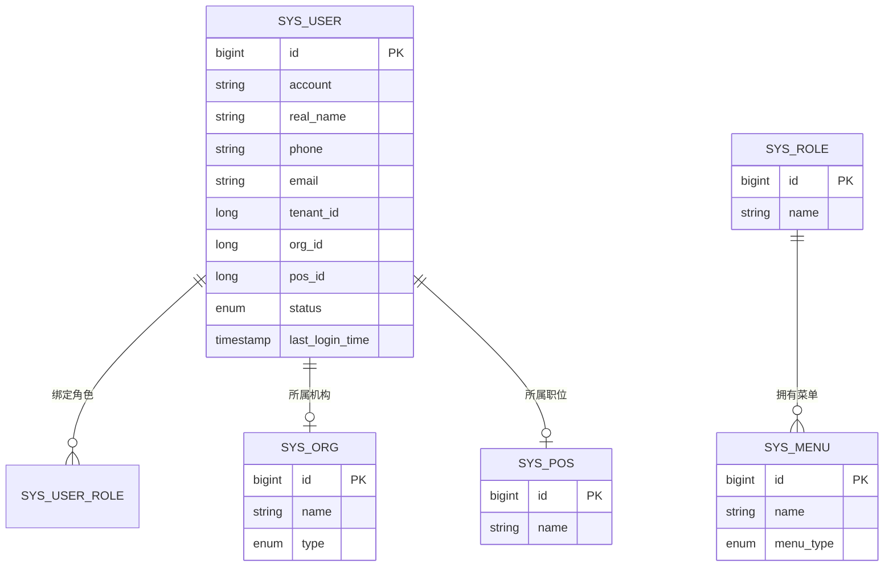
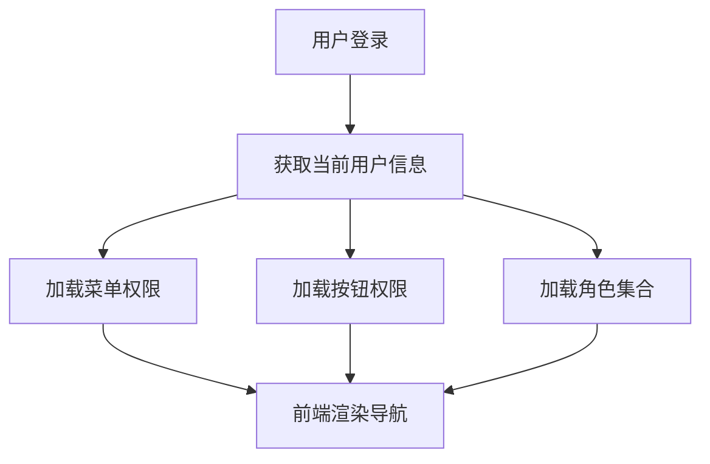
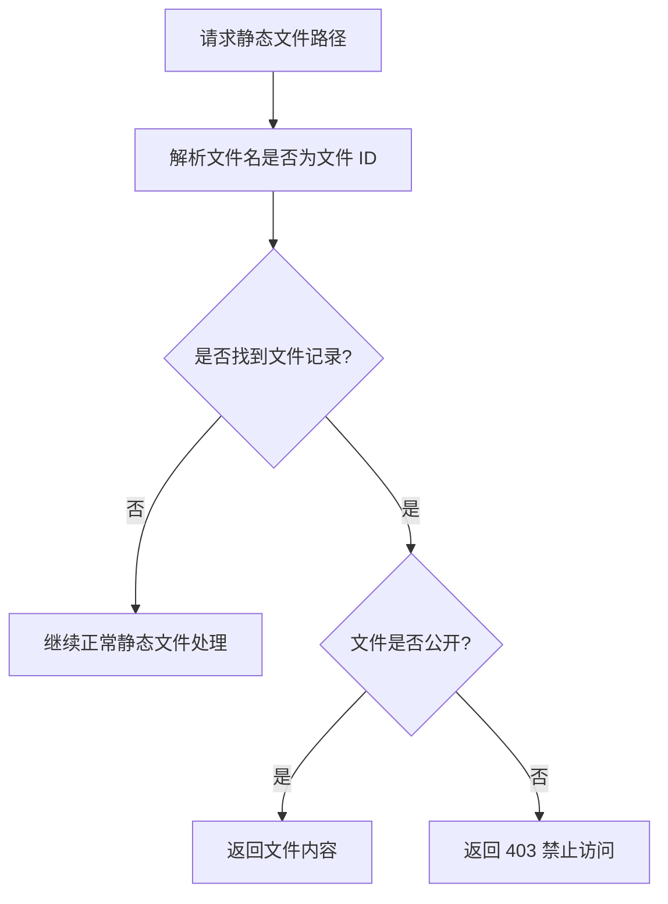
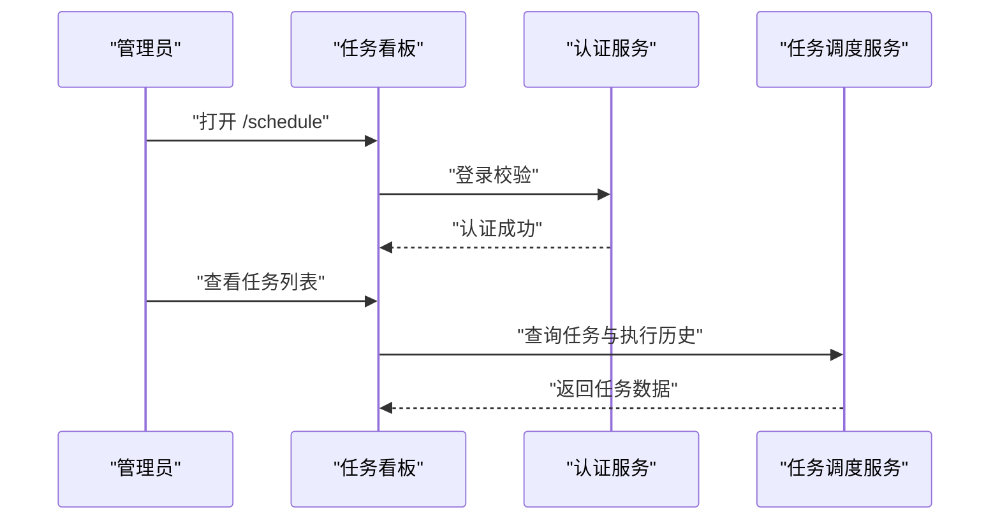
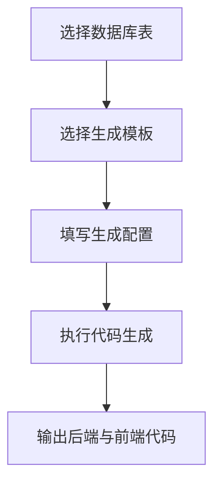
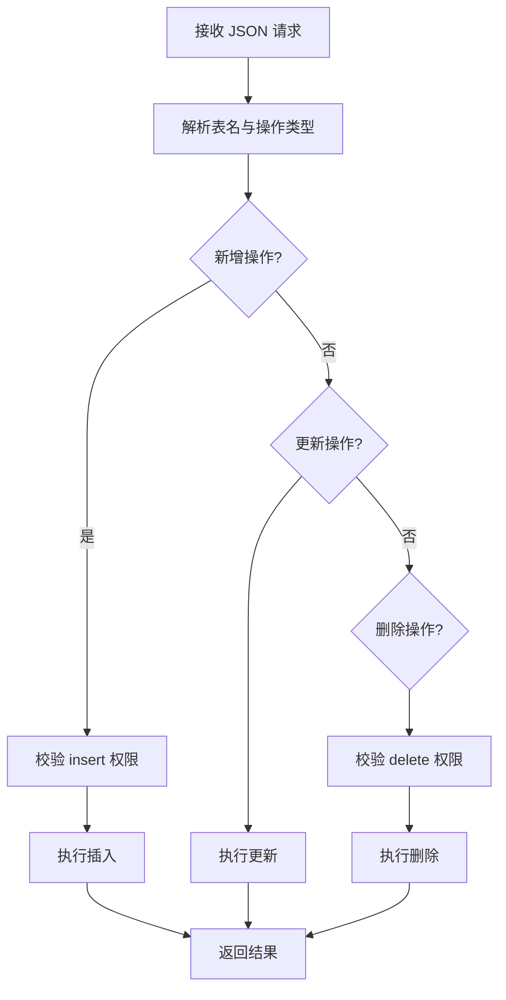
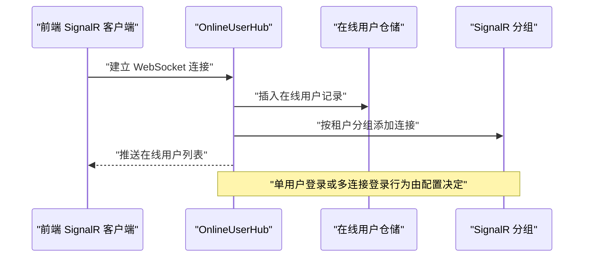

# API 接口文档

<cite>
**本文引用的文件**   
- [README.md](file://README.md)
- [Startup.cs](file://Admin.NET/Admin.NET.Web.Core/Startup.cs)
- [HomeController.cs](file://Admin.NET/Admin.NET.Web.Entry/Controllers/HomeController.cs)
- [SysAuthService.cs](file://Admin.NET/Admin.NET.Core/Service/Auth/SysAuthService.cs)
- [APIJSONService.cs](file://Admin.NET/Admin.NET.Core/Service/APIJSON/APIJSONService.cs)
- [IOnlineUserHub.cs](file://Admin.NET/Admin.NET.Core/Hub/IOnlineUserHub.cs)
- [OnlineUserHub.cs](file://Admin.NET/Admin.NET.Core/Hub/OnlineUserHub.cs)
</cite>

## 目录
1. [简介](#简介)
2. [项目结构与运行入口](#项目结构与运行入口)
3. [整体架构与请求流程](#整体架构与请求流程)
4. [认证与授权接口](#认证与授权接口)
5. [用户管理接口](#用户管理接口)
6. [权限与菜单接口](#权限与菜单接口)
7. [系统管理接口](#系统管理接口)
8. [文件管理接口](#文件管理接口)
9. [任务调度与定时任务](#任务调度与定时任务)
10. [代码生成接口](#代码生成接口)
11. [开放平台与 OAuth 2.0](#开放平台与-oauth-20)
12. [APIJSON 动态查询接口](#apijson-动态查询接口)
13. [SignalR 实时通信接口](#signalr-实时通信接口)
14. [接口版本、限流与安全](#接口版本限流与安全)
15. [Swagger 与 OpenAPI 使用指南](#swagger-与-openapi-使用指南)
16. [客户端集成示例](#客户端集成示例)
17. [常见问题排查](#常见问题排查)
18. [结论](#结论)

## 简介
Admin.NET 是基于 ASP.NET Core、Furion 和 SqlSugar 的通用权限开发框架，提供多租户、权限管理、任务调度、消息通知、文件管理、代码生成、日志审计、限流控制、OAuth 2.0 开放授权等能力。当前仓库已完成前端移植，业务前端入口为 `Web/apps/web-antdv-next/`；后端 API 由 `Admin.NET.Admin.NET.Web.Core` 统一启动，服务实现集中在 `Admin.NET.Admin.NET.Core/Service`。

本仓库 README 明确：
- 后端入口为 `Admin.NET/Admin.NET.Web.Entry/`。
- 前端入口为 `Web/apps/web-antdv-next/`。
- 集成验收使用 PostgreSQL。
- Swagger 用于生成系统接口文档，并支持 Knife4jUI 皮肤。
- 限流采用 AspNetCoreRateLimit。
- 开放授权支持 OAuth 2.0。

**章节来源**
- [README.md:1-144](file://README.md#L1-L144)

## 项目结构与运行入口
从仓库结构看，后端以 `.NET` 应用工程组织，核心分层如下：

**图表来源**
- [Startup.cs:1-442](file://Admin.NET/Admin.NET.Web.Core/Startup.cs#L1-L442)
- [README.md:1-144](file://README.md#L1-L144)

### 关键路径
| 类型 | 路径 | 说明 |
|---|---|---|
| 后端入口工程 | `Admin.NET/Admin.NET.Web.Entry/` | 应用启动、控制器模板、静态资源、Docker 配置等 |
| Web 核心启动层 | `Admin.NET/Admin.NET.Web.Core/Startup.cs` | JWT、SignalR、限流、响应压缩、Swagger、路由、中间件 |
| 核心服务层 | `Admin.NET/Admin.NET.Core/Service/**` | 认证、用户、角色、菜单、文件、任务、字典、租户、日志等服务 |
| 实时通信 | `Admin.NET/Admin.NET.Core/Hub/**` | SignalR Hub 与在线用户广播 |
| 业务前端 | `Web/apps/web-antdv-next/` | Vite + pnpm workspace 中的主前端应用 |

**章节来源**
- [README.md:1-144](file://README.md#L1-L144)
- [Startup.cs:1-442](file://Admin.NET/Admin.NET.Web.Core/Startup.cs#L1-L442)

## 整体架构与请求流程
Admin.NET 的请求处理链路大致如下：

**图表来源**
- [Startup.cs:1-442](file://Admin.NET/Admin.NET.Web.Core/Startup.cs#L1-L442)
- [SysAuthService.cs:1-514](file://Admin.NET/Admin.NET.Core/Service/Auth/SysAuthService.cs#L1-L514)

### 统一响应格式
启动层注册了统一结果提供者，因此大多数 REST 接口会返回框架封装的统一响应体。具体字段需结合 Furion 与 Admin.NET 的 `AdminResultProvider` 约定，但常见语义包括：
- 成功状态码
- 业务数据
- 错误消息
- 时间戳或追踪标识（视配置而定）

由于本仓库未直接展示 `AdminResultProvider` 的实现细节，实际字段应以运行时生成的 OpenAPI 文档为准。

**章节来源**
- [Startup.cs:1-442](file://Admin.NET/Admin.NET.Web.Core/Startup.cs#L1-L442)

## 认证与授权接口
Admin.NET 使用 JWT 作为主要认证方式，并通过全局授权开关保护接口。登录成功后，服务端会将 `access-token` 与刷新令牌写入响应头；客户端应将其保存并在后续请求中携带。

### 登录相关接口概览
| 接口 | HTTP 方法与路径 | 认证要求 | 说明 |
|---|---|---|---|
| 账号密码登录 | `POST /api/sys-auth/login` | 匿名 | 用户名加密码登录，支持验证码与 LDAP 校验 |
| 手机号登录 | `POST /api/sys-auth/loginPhone` | 匿名 | 短信验证码登录后签发 Token |
| 获取刷新 Token | `GET /api/sys-auth/getRefreshToken` | 匿名 | 使用旧 `accessToken` 换取新 Token |
| 退出系统 | `POST /api/sys-auth/logout` | 已登录 | 将 Token 加入黑名单并发布登出事件 |
| 获取登录账号信息 | `GET /api/sys-auth/getUserInfo` | 已登录 | 返回当前用户、机构、职位、按钮权限、角色等信息 |
| 获取验证码 | `GET /api/sys-auth/getCaptcha` | 匿名 | 返回图形验证码 Base64 与过期时间 |
| 用户注册 | `POST /api/sys-auth/userRegistration` | 匿名 | 按租户注册方案创建用户 |

### 登录流程时序

**图表来源**
- [SysAuthService.cs:1-514](file://Admin.NET/Admin.NET.Core/Service/Auth/SysAuthService.cs#L1-L514)

### 认证安全要点
- 密码传输使用 SM2 加密，服务端解密后比对。
- 登录失败会记录错误次数，超过阈值则拒绝登录。
- 支持域登录，LDAP 账号通过外部服务验证。
- 单用户登录可限制同一账号同时在线会话。
- 退出时把 Token 加入黑名单，避免已注销 Token 继续有效。
- Token 有效期、刷新 Token 有效期由系统配置决定。

**章节来源**
- [SysAuthService.cs:1-514](file://Admin.NET/Admin.NET.Core/Service/Auth/SysAuthService.cs#L1-L514)
- [Startup.cs:1-442](file://Admin.NET/Admin.NET.Web.Core/Startup.cs#L1-L442)

## 用户管理接口
用户管理涉及用户实体、机构、职位、角色绑定及按钮权限。服务层通过 `SysUserService`、`SysOrgService`、`SysPosService`、`SysRoleService`、`SysUserMenuService` 等协作完成 CRUD、批量操作与状态管理。

### 用户管理常用能力
| 功能 | 典型行为 | 说明 |
|---|---|---|
| 用户查询 | 分页、条件筛选、树形机构过滤 | 通常走分页列表接口 |
| 新增用户 | 必填字段校验、租户隔离 | 可由管理员或注册流程创建 |
| 修改用户 | 更新基本信息、联系方式、头像等 | 受角色与数据权限控制 |
| 删除用户 | 逻辑删除或物理删除 | 需具备删除权限 |
| 批量处理 | 批量启用、禁用、删除 | 通过批量参数提交 |
| 状态管理 | 启用、禁用、冻结 | 影响登录与可见性 |
| 权限绑定 | 绑定角色、机构、职位 | 控制菜单、按钮与数据范围 |

### 用户信息模型关系

**图表来源**
- [SysAuthService.cs:201-514](file://Admin.NET/Admin.NET.Core/Service/Auth/SysAuthService.cs#L201-L514)

### 接口设计建议
- 所有写操作应携带租户上下文，避免跨租户误操作。
- 批量接口应限制单次数量，防止超大事务导致性能问题。
- 状态变更应记录操作日志，便于审计。
- 用户敏感字段在公开接口中应脱敏。

**章节来源**
- [SysAuthService.cs:201-514](file://Admin.NET/Admin.NET.Core/Service/Auth/SysAuthService.cs#L201-L514)

## 权限与菜单接口
权限体系包含角色、菜单、按钮三类权限。登录成功后，用户信息接口会返回当前用户的按钮集合与角色集合，前端据此渲染菜单和操作按钮。

### 权限相关能力
| 能力 | 说明 |
|---|---|
| 菜单管理 | 维护目录、菜单、按钮标识 |
| 角色管理 | 给角色分配菜单与数据权限 |
| 用户权限 | 用户继承角色权限，并可叠加机构数据权限 |
| 按钮权限 | 登录后返回按钮权限码，控制前端操作按钮显示 |
| 水印与租户 | 水印文字可能来自租户配置，并与用户姓名拼接 |

### 权限数据流

**图表来源**
- [SysAuthService.cs:201-514](file://Admin.NET/Admin.NET.Core/Service/Auth/SysAuthService.cs#L201-L514)

**章节来源**
- [SysAuthService.cs:201-514](file://Admin.NET/Admin.NET.Core/Service/Auth/SysAuthService.cs#L201-L514)

## 系统管理接口
系统管理涵盖配置、字典、租户、缓存、枚举、服务器监控、数据库连接、日志、语言、区域、常量、进程信息等能力。这些接口通常面向管理员，需要较高权限。

### 系统管理接口分类
| 分类 | 典型接口或服务 | 用途 |
|---|---|---|
| 配置管理 | `SysConfigService`、`SysTenantConfigService`、`SysUserConfigService` | 系统参数、租户参数、用户偏好 |
| 字典管理 | `SysDictTypeService`、`SysDictDataService` | 固定选项值管理 |
| 租户管理 | `SysTenantService` | 多租户生命周期与启用状态 |
| 缓存管理 | `SysCacheService` | 查看、清理缓存键 |
| 枚举管理 | `SysEnumService` | 枚举定义与翻译 |
| 服务器监控 | `SysServerService` | CPU、内存、磁盘、网络 |
| 数据库管理 | `SysDatabaseService` | 连接信息与基础诊断 |
| 日志管理 | `SysLogOpService`、`SysLogExService`、`SysLogVisService` | 操作日志、异常日志、访问日志 |
| 语言与区域 | `SysLangService`、`SysRegionService` | 多语言与地区数据 |
| 其他系统能力 | `SysConstService`、`SysProcService` | 常量、进程信息 |

### 注意事项
- 系统配置类接口通常需要管理员角色。
- 字典与枚举适合只读展示，修改需严格审批。
- 缓存与进程接口在生产环境应关闭或限制访问。
- 日志接口应避免导出完整敏感信息。

**章节来源**
- [Startup.cs:1-442](file://Admin.NET/Admin.NET.Web.Core/Startup.cs#L1-L442)

## 文件管理接口
文件管理支持上传、下载、预览、删除，底层通过对象存储服务抽象，支持本地存储、阿里云 OSS、腾讯云 COS 等扩展。

### 文件接口能力
| 能力 | 说明 |
|---|---|
| 上传文件 | 支持普通文件、图片、附件，返回文件元数据 |
| 下载文件 | 根据文件 ID 下载原始文件 |
| 预览文件 | 对图片或可预览文件进行在线预览 |
| 删除文件 | 删除文件记录与物理文件 |
| 公共与私有文件 | 非公开文件需鉴权访问 |

### 静态文件鉴权流程

**图表来源**
- [Startup.cs:200-442](file://Admin.NET/Admin.NET.Web.Core/Startup.cs#L200-L442)

**章节来源**
- [Startup.cs:200-442](file://Admin.NET/Admin.NET.Web.Core/Startup.cs#L200-L442)

## 任务调度与定时任务
Admin.NET 集成分布式作业调度组件，并提供任务看板界面。任务服务通过 `SysJobService`、`SysScheduleService` 暴露任务控制与监控能力。

### 任务相关能力
| 能力 | 说明 |
|---|---|
| 任务定义 | 创建、编辑、删除定时任务 |
| 任务启停 | 启动、暂停、恢复、停止任务 |
| 执行监控 | 查看最近执行历史、成功失败状态 |
| 集群支持 | 通过集群 ID 启用分布式调度 |
| 看板界面 | `/schedule` 路径的任务可视化界面 |

### 任务看板接入

**图表来源**
- [Startup.cs:200-442](file://Admin.NET/Admin.NET.Web.Core/Startup.cs#L200-L442)

**章节来源**
- [Startup.cs:200-442](file://Admin.NET/Admin.NET.Web.Core/Startup.cs#L200-L442)

## 代码生成接口
代码生成能力由 `SysCodeGenService`、`SysCodeGenConfigService`、`SysTemplateService` 等提供服务端逻辑，配合前端模板配置一键生成前后端代码。

### 代码生成能力
| 能力 | 说明 |
|---|---|
| 模板管理 | 维护生成模板与前端控件映射 |
| 表结构读取 | 读取数据库表结构并映射为实体 |
| 生成配置 | 设置命名规则、包名、模块、权限标识 |
| 代码生成 | 生成后端服务、控制器、前端页面等 |
| 自定义扩展 | 基于模板引擎扩展生成规则 |

### 代码生成流程图

**章节来源**
- [Startup.cs:1-442](file://Admin.NET/Admin.NET.Web.Core/Startup.cs#L1-L442)

## 开放平台与 OAuth 2.0
Admin.NET 启用 OAuth 2.0 开放授权，并支持第三方登录。启动层注册了 OAuth 中间件，允许外部系统以标准协议对接。

### OAuth 相关点
| 项目 | 说明 |
|---|---|
| 启用方式 | 启动层调用 OAuth 扩展方法 |
| 协议标准 | 遵循 OAuth 2.0 开放标准 |
| 第三方登录 | 可用于微信等平台登录 |
| 与 JWT 的关系 | OAuth 回调完成后通常仍转为系统内部 Token 或会话 |

**章节来源**
- [README.md:1-144](file://README.md#L1-L144)
- [Startup.cs:1-442](file://Admin.NET/Admin.NET.Web.Core/Startup.cs#L1-L442)

## APIJSON 动态查询接口
`APIJSONService` 提供了一个统一的动态查询入口，支持按表查询、新增、更新、删除，并内置权限校验。该接口适合快速原型或低代码场景，但不建议直接暴露给不可信客户端。

### APIJSON 接口表
| 方法 | 路径 | 参数位置 | 说明 |
|---|---|---|---|
| POST | `/api/api-json/get` | Body: JSON 对象 | 统一查询入口，支持指定数据库 |
| POST | `/api/api-json/get/{table}` | Route: 表名，Body: JSON 对象 | 按表查询，自动补充总计字段 |
| POST | `/api/api-json/add` | Body: 表对象或数组 | 新增单条或批量新增 |
| POST | `/api/api-json/update` | Body: 表对象 | 更新单表数据 |
| POST | `/api/api-json/delete` | Body: 表对象 | 删除数据，支持条件与批量 |

### APIJSON 查询限制
- `count` 分页数量默认限制最大 1000。
- 新增与删除会检查角色权限。
- 删除接口若未配置 delete 权限会抛出错误。
- 查询参数中的调试字段会被移除。

### APIJSON 权限校验流程

**图表来源**
- [APIJSONService.cs:1-215](file://Admin.NET/Admin.NET.Core/Service/APIJSON/APIJSONService.cs#L1-L215)

**章节来源**
- [APIJSONService.cs:1-215](file://Admin.NET/Admin.NET.Core/Service/APIJSON/APIJSONService.cs#L1-L215)

## SignalR 实时通信接口
Admin.NET 使用 SignalR 提供在线用户管理与站内消息推送。Hub 位于 `/hubs/onlineUser`，连接时需要携带有效的 JWT Token。

### SignalR 接口能力
| 方法 | 方向 | 说明 |
|---|---|---|
| `OnConnectedAsync` | 服务端 | 连接建立时注册用户、分组、广播在线列表 |
| `OnDisconnectedAsync` | 服务端 | 断开连接时清理记录与缓存 |
| `ForceOffline` | 客户端调用 | 强制下线指定连接 |
| `ClientsSendMessage` | 客户端调用 | 向某个用户发送消息 |
| `ClientsSendMessageToAll` | 客户端调用 | 向所有人发送消息 |
| `ClientsSendMessageToOther` | 客户端调用 | 向除本人外的某些人发送消息 |
| `ClientsSendMessageToUsers` | 客户端调用 | 向指定用户组发送消息 |
| `OnlineUserList` | 服务端推送 | 推送在线用户列表变化 |

### 连接与分组机制

**图表来源**
- [OnlineUserHub.cs:1-193](file://Admin.NET/Admin.NET.Core/Hub/OnlineUserHub.cs#L1-L193)
- [IOnlineUserHub.cs:1-38](file://Admin.NET/Admin.NET.Core/Hub/IOnlineUserHub.cs#L1-L38)

### 消息格式建议
虽然仓库未给出前端消息 DTO 的完整定义，但从 Hub 方法可知消息主体通常包含：
- 发送者标识
- 接收者标识
- 消息内容
- 消息类型
- 时间戳

实际字段应以前端 `MessageInput` 与后端消息服务契约为准。

**章节来源**
- [OnlineUserHub.cs:1-193](file://Admin.NET/Admin.NET.Core/Hub/OnlineUserHub.cs#L1-L193)
- [IOnlineUserHub.cs:1-38](file://Admin.NET/Admin.NET.Core/Hub/IOnlineUserHub.cs#L1-L38)
- [Startup.cs:200-442](file://Admin.NET/Admin.NET.Web.Core/Startup.cs#L200-L442)

## 接口版本、限流与安全
### 接口版本管理
当前仓库未显式使用 URL 版本前缀如 `/api/v1/...`，而是通过 Furion 的动态 API 与 SpecificationDocument 分组管理接口。版本演进建议：
- 新增破坏性变更时使用独立分组或路径前缀。
- 保持向后兼容的旧接口至少保留一个过渡期。
- 在 OpenAPI 文档中标注废弃接口。

### 速率限制
启动层注册了 IP 限流、客户端限流与策略限流：
- `UseIpRateLimiting`
- `UseClientRateLimiting`
- `UsePolicyRateLimit`

这意味着接口可能因频率过高被拒绝，常见错误为 429 或框架统一限流响应。

### 安全防护
| 安全措施 | 实现位置 | 说明 |
|---|---|---|
| JWT 认证 | Startup | 全局启用授权，支持 Query Token 与 Hub access_token |
| 签名认证 | Startup | 通过 SignatureAuthentication 支持开放接口签名 |
| 跨域控制 | Startup | 使用 CORS 中间件 |
| 响应压缩 | Startup | Brotli 与 Gzip 压缩 |
| 错误页与 HSTS | Startup | 生产环境启用异常处理器与 HTTPS 强约束 |
| 静态文件鉴权 | Startup | 非公开文件返回 403 |
| 限流 | Startup | IP、客户端、策略限流 |
| 事件总线 | Startup | 支持 Redis/RabbitMQ 事件源与重试执行器 |

**章节来源**
- [Startup.cs:1-442](file://Admin.NET/Admin.NET.Web.Core/Startup.cs#L1-L442)

## Swagger 与 OpenAPI 使用指南
Admin.NET 通过 SpecificationDocument 构建 OpenAPI 文档，并使用 Scalar UI 暴露文档界面。

### 文档访问路径
| 用途 | 路径 | 说明 |
|---|---|---|
| OpenAPI 文档 UI | `/sapi` | Scalar 文档界面 |
| 任务看板 | `/schedule` | 定时任务可视化界面 |
| 首页控制器 | `Home/Index` | 默认 MVC 控制器，当前返回视图 |

### 登录 Swagger
`SysAuthService` 提供了 Swagger 登录检查与提交接口：
- `/api/swagger/checkUrl`：返回当前是否已登录。
- `/api/swagger/submitUrl`：提交用户名和密码完成登录。

### 文档说明
- 文档遵循 OpenAPI 3.0。
- 文档标题为 Admin.NET。
- 文档注入由 SpecificationDocumentBuilder 分组管理。
- 文档页会附加法律声明提示。

**章节来源**
- [Startup.cs:200-442](file://Admin.NET/Admin.NET.Web.Core/Startup.cs#L200-L442)
- [SysAuthService.cs:400-514](file://Admin.NET/Admin.NET.Core/Service/Auth/SysAuthService.cs#L400-L514)
- [HomeController.cs:1-29](file://Admin.NET/Admin.NET.Web.Entry/Controllers/HomeController.cs#L1-L29)

## 客户端集成示例
以下示例为概念性集成流程，不直接粘贴仓库源码。

### 登录并保存 Token
1. 调用登录接口获取响应头中的 `access-token` 与刷新 Token。
2. 将 `access-token` 保存到浏览器存储或应用状态。
3. 后续每个请求在 Header 中携带 `Authorization: Bearer <access-token>`。
4. 如果接口支持 URL 参数 Token，也可通过 `?token=...` 传递，但推荐优先使用 Header。

### 刷新 Token
1. 调用获取刷新 Token 接口，传入旧 `accessToken`。
2. 若 Token 有效且不在黑名单，返回新的 Token。
3. 用新 Token 替换本地存储。

### 退出登录
1. 调用退出接口。
2. 服务端将 Token 加入黑名单。
3. 客户端清除本地 Token 与用户信息。

### SignalR 连接
1. 使用 WebSocket 连接 `/hubs/onlineUser`。
2. 在连接字符串或查询参数中携带 `access_token`。
3. 订阅 `OnlineUserList` 事件更新在线用户列表。
4. 调用 `ForceOffline`、`ClientsSendMessage*` 等方法推送消息或踢人。

**章节来源**
- [SysAuthService.cs:201-514](file://Admin.NET/Admin.NET.Core/Service/Auth/SysAuthService.cs#L201-L514)
- [OnlineUserHub.cs:1-193](file://Admin.NET/Admin.NET.Core/Hub/OnlineUserHub.cs#L1-L193)
- [Startup.cs:1-442](file://Admin.NET/Admin.NET.Web.Core/Startup.cs#L1-L442)

## 常见问题排查
| 现象 | 可能原因 | 处理建议 |
|---|---|---|
| 登录失败提示密码错误次数过多 | 连续输错密码触发缓存限制 | 等待缓存过期或联系管理员重置 |
| 登录后无菜单或按钮 | 角色或按钮权限未配置 | 检查用户角色、菜单权限与按钮权限 |
| 文件预览返回 403 | 文件为非公开文件 | 改为公开文件或走鉴权下载接口 |
| 接口频繁 429 | 触发限流 | 降低请求频率或调整限流策略 |
| SignalR 无法连接 | Token 无效或未传 `access_token` | 检查 JWT 与 Hub 连接参数 |
| OpenAPI 文档无法登录 | Swagger 登录接口未正确调用 | 使用 `/api/swagger/submitUrl` 提交凭证 |
| 租户切换后权限异常 | 当前租户上下文未更新 | 重新获取用户信息或刷新 Token |

**章节来源**
- [SysAuthService.cs:1-514](file://Admin.NET/Admin.NET.Core/Service/Auth/SysAuthService.cs#L1-L514)
- [Startup.cs:200-442](file://Admin.NET/Admin.NET.Web.Core/Startup.cs#L200-L442)

## 结论
Admin.NET 的 API 体系以 Furion 动态 API 为核心，围绕用户、角色、菜单、租户、文件、任务、日志、字典、配置等管理能力展开。认证依赖 JWT，实时通信依赖 SignalR，文档通过 OpenAPI 与 Scalar 暴露，限流与签名认证提供额外安全边界。对于实际项目集成，建议：
- 以 OpenAPI 文档为最终接口契约。
- 在客户端统一处理 Token、刷新与黑名单。
- 对高频接口启用限流与缓存。
- 对敏感接口启用签名与最小权限原则。
- 使用真实 PostgreSQL 环境完成端到端联调。