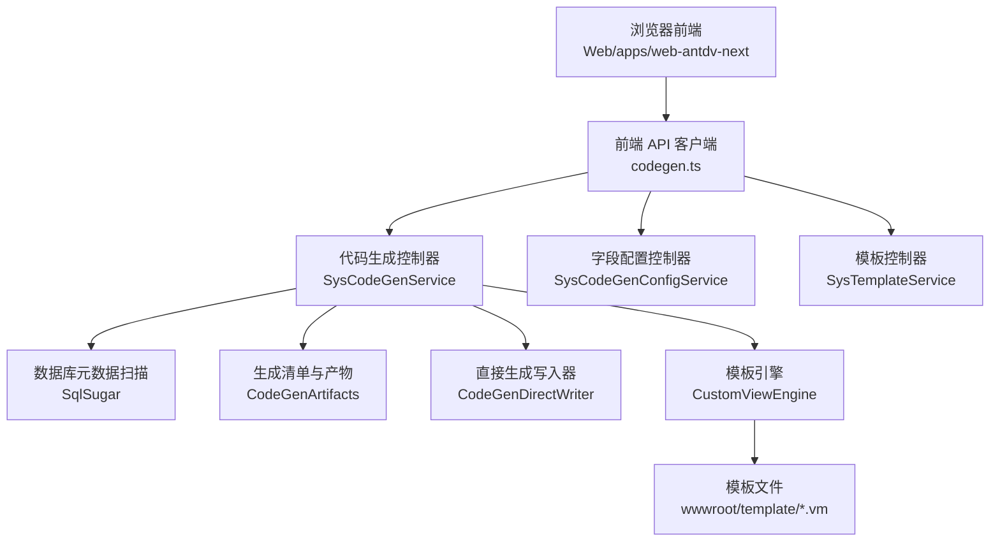
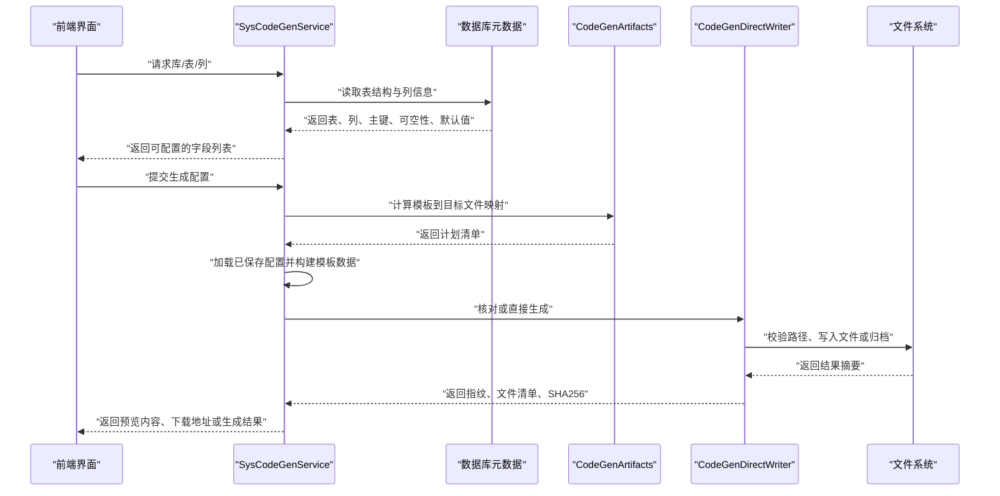
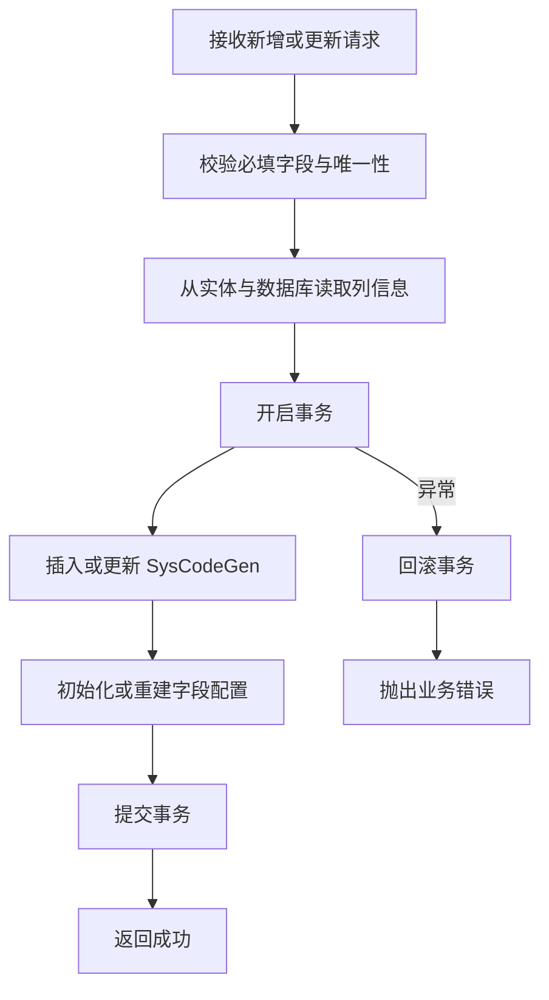
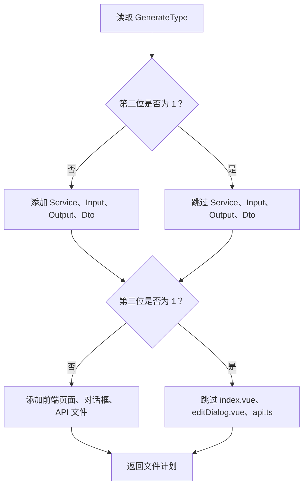
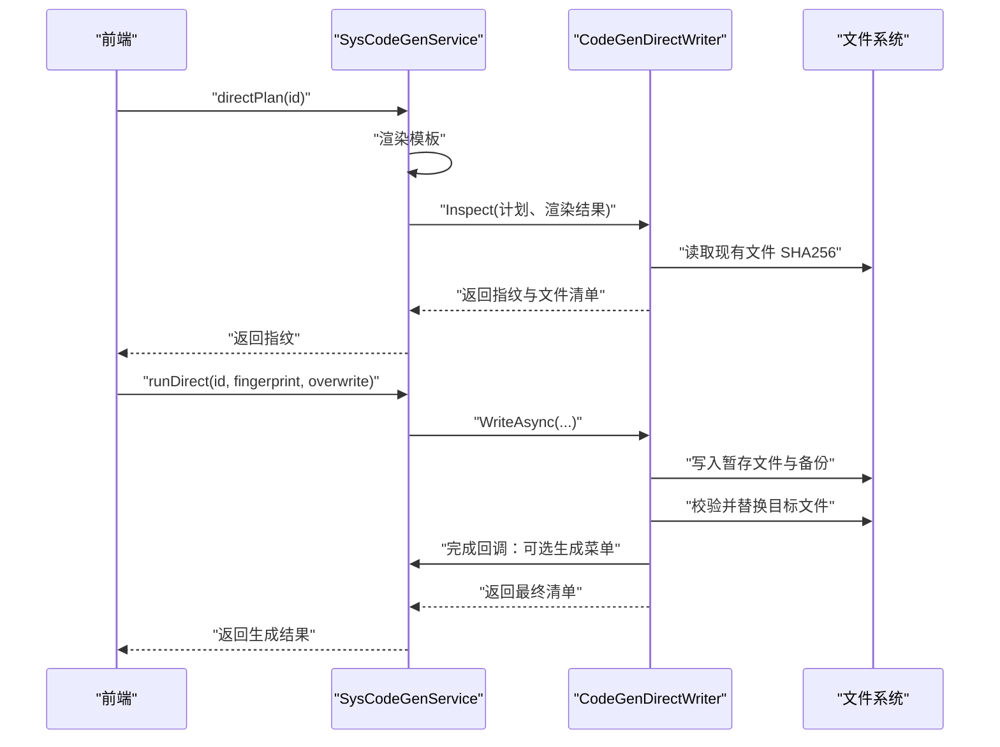
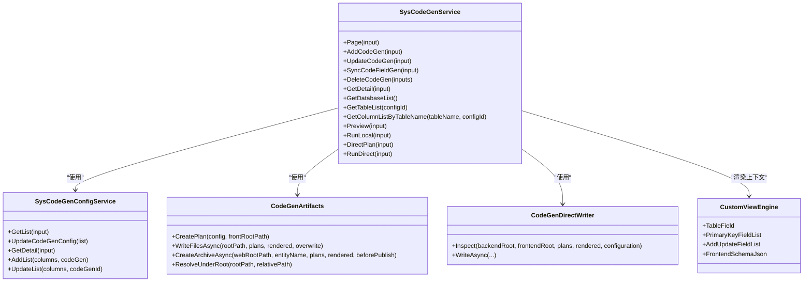

# 代码生成接口

<cite>
**本文引用的文件**   
- [SysCodeGenService.cs](file://Admin.NET/Admin.NET.Core/Service/CodeGen/SysCodeGenService.cs)
- [SysCodeGenConfigService.cs](file://Admin.NET/Admin.NET.Core/Service/CodeGen/SysCodeGenConfigService.cs)
- [CodeGenInput.cs](file://Admin.NET/Admin.NET.Core/Service/CodeGen/Dto/CodeGenInput.cs)
- [CodeGenOutput.cs](file://Admin.NET/Admin.NET.Core/Service/CodeGen/Dto/CodeGenOutput.cs)
- [CodeGenConfig.cs](file://Admin.NET/Admin.NET.Core/Service/CodeGen/Dto/CodeGenConfig.cs)
- [SysCodeGen.cs](file://Admin.NET/Admin.NET.Core/Entity/SysCodeGen.cs)
- [SysCodeGenConfig.cs](file://Admin.NET/Admin.NET.Core/Entity/SysCodeGenConfig.cs)
- [CodeGenArtifacts.cs](file://Admin.NET/Admin.NET.Core/Service/CodeGen/CodeGenArtifacts.cs)
- [CodeGenDirectWriter.cs](file://Admin.NET/Admin.NET.Core/Service/CodeGen/CodeGenDirectWriter.cs)
- [CustomViewEngine.cs](file://Admin.NET/Admin.NET.Core/Service/CodeGen/CustomViewEngine.cs)
- [CodeGenOptions.cs](file://Admin.NET/Admin.NET.Core/Option/CodeGenOptions.cs)
- [CodeGenUtil.cs](file://Admin.NET/Admin.NET.Core/Utils/CodeGenUtil.cs)
- [CodeGenHelper.cs](file://Admin.NET/Admin.NET.Core/Utils/CodeGenHelper.cs)
- [SysTemplateService.cs](file://Admin.NET/Admin.NET.Core/Service/Template/SysTemplateService.cs)
- [SysTemplate.cs](file://Admin.NET/Admin.NET.Core/Entity/SysTemplate.cs)
- [codegen.ts](file://Web/apps/web-antdv-next/src/api/system/codegen.ts)
- [index.vue](file://Web/apps/web-antdv-next/src/views/system/codeGen/index.vue)
- [codegen-model.ts](file://Web/apps/web-antdv-next/src/views/system/codeGen/codegen-model.ts)
</cite>

## 目录
1. [简介](#简介)
2. [项目结构](#项目结构)
3. [核心组件](#核心组件)
4. [架构总览](#架构总览)
5. [详细接口说明](#详细接口说明)
6. [依赖关系分析](#依赖关系分析)
7. [性能与并发特性](#性能与并发特性)
8. [模板开发与变量参考](#模板开发与变量参考)
9. [版本管理、冲突解决与向后兼容](#版本管理冲突解决与向后兼容)
10. [故障排查指南](#故障排查指南)
11. [结论](#结论)

## 简介
本文件面向 Admin.NET 的代码生成能力，聚焦以下范围：
- 数据库表扫描接口：库列表、表列表、列信息、字段映射、外键与字典/枚举关联。
- 模板管理接口：通用模板的分组、查询、预览、渲染与 CRUD。
- 代码生成接口：保存配置、同步字段、预览、下载归档、直接生成到本地磁盘。
- 生成规则：后端 C# Entity / Service / Input / Output / Dto，前端 Vue 3 + TypeScript 页面、对话框与 API。
- 命名约定、模板变量、条件生成、路径安全校验、菜单与权限自动生成。
- 自定义模板开发、最佳实践以及版本管理与冲突处理策略。

该文档以当前仓库源码为依据，前端业务入口为 `Web/apps/web-antdv-next`，后端代码生成逻辑集中在 `Admin.NET.Admin.NET.Core.Service.CodeGen`。

## 项目结构
代码生成相关的主要目录与职责如下：

**图表来源**
- [SysCodeGenService.cs:201-300](file://Admin.NET/Admin.NET.Core/Service/CodeGen/SysCodeGenService.cs#L201-L300)
- [SysCodeGenConfigService.cs:1-137](file://Admin.NET/Admin.NET.Core/Service/CodeGen/SysCodeGenConfigService.cs#L1-L137)
- [SysTemplateService.cs:1-120](file://Admin.NET/Admin.NET.Core/Service/Template/SysTemplateService.cs#L1-L120)
- [CodeGenArtifacts.cs:1-164](file://Admin.NET/Admin.NET.Core/Service/CodeGen/CodeGenArtifacts.cs#L1-L164)
- [CodeGenDirectWriter.cs:1-177](file://Admin.NET/Admin.NET.Core/Service/CodeGen/CodeGenDirectWriter.cs#L1-L177)
- [codegen.ts:1-49](file://Web/apps/web-antdv-next/src/api/system/codegen.ts#L1-L49)

**章节来源**
- [SysCodeGenService.cs:1-200](file://Admin.NET/Admin.NET.Core/Service/CodeGen/SysCodeGenService.cs#L1-L200)
- [codegen.ts:1-49](file://Web/apps/web-antdv-next/src/api/system/codegen.ts#L1-L49)

## 核心组件
| 组件 | 职责 | 关键行为 |
|---|---|---|
| `SysCodeGenService` | 代码生成主控制器 | 提供分页、新增、更新、删除、详情、数据库/表/列扫描、预览、打包下载、直接生成、菜单生成等能力。 |
| `SysCodeGenConfigService` | 字段级配置服务 | 提供字段列表、批量更新、新增、删除；保证事务与乐观锁式更新。 |
| `CodeGenArtifacts` | 生成清单与产物 | 根据 `GenerateType` 计算模板到目标文件的映射，校验路径边界，创建归档或写出文件。 |
| `CodeGenDirectWriter` | 直接生成写入器 | 基于指纹核对、暂存备份、原子替换、失败回滚、符号链接保护。 |
| `CustomViewEngine` | 模板渲染上下文 | 聚合表字段、选择器、导入导出、唯一约束、默认值、前端 Schema JSON 等模板变量。 |
| `SysTemplateService` | 通用模板管理 | 提供模板分页、获取、预览、渲染、增删改查和分组查询。 |
| `CodeGenOptions` | 代码生成配置项 | 控制实体程序集、基类、前后端输出根目录、应用命名空间等。 |
| `CodeGenUtil` / `CodeGenHelper` | 数据类型与命名工具 | 将数据库类型映射到 .NET 类型，支持 Oracle、PostgreSQL、MySQL、达梦等。 |

**章节来源**
- [SysCodeGenService.cs:1-200](file://Admin.NET/Admin.NET.Core/Service/CodeGen/SysCodeGenService.cs#L1-L200)
- [SysCodeGenConfigService.cs:1-137](file://Admin.NET/Admin.NET.Core/Service/CodeGen/SysCodeGenConfigService.cs#L1-L137)
- [CodeGenArtifacts.cs:1-164](file://Admin.NET/Admin.NET.Core/Service/CodeGen/CodeGenArtifacts.cs#L1-L164)
- [CodeGenDirectWriter.cs:1-177](file://Admin.NET/Admin.NET.Core/Service/CodeGen/CodeGenDirectWriter.cs#L1-L177)
- [CustomViewEngine.cs:1-200](file://Admin.NET/Admin.NET.Core/Service/CodeGen/CustomViewEngine.cs#L1-L200)
- [SysTemplateService.cs:1-120](file://Admin.NET/Admin.NET.Core/Service/Template/SysTemplateService.cs#L1-L120)
- [CodeGenOptions.cs:1-39](file://Admin.NET/Admin.NET.Core/Option/CodeGenOptions.cs#L1-L39)
- [CodeGenUtil.cs:1-200](file://Admin.NET/Admin.NET.Core/Utils/CodeGenUtil.cs#L1-L200)
- [CodeGenHelper.cs:1-200](file://Admin.NET/Admin.NET.Core/Utils/CodeGenHelper.cs#L1-L200)

## 架构总览
代码生成整体流程分为三个阶段：元数据准备、模板渲染、产物发布。

**图表来源**
- [SysCodeGenService.cs:201-502](file://Admin.NET/Admin.NET.Core/Service/CodeGen/SysCodeGenService.cs#L201-L502)
- [CodeGenArtifacts.cs:1-164](file://Admin.NET/Admin.NET.Core/Service/CodeGen/CodeGenArtifacts.cs#L1-L164)
- [CodeGenDirectWriter.cs:1-177](file://Admin.NET/Admin.NET.Core/Service/CodeGen/CodeGenDirectWriter.cs#L1-L177)

## 详细接口说明

### 代码生成主接口：`/api/sysCodeGen`
由 `SysCodeGenService` 暴露。主要能力包括：

| 接口 | HTTP | 输入 | 输出 | 说明 |
|---|---|---|---|---|
| 分页列表 | POST `/api/sysCodeGen/page` | `CodeGenInput` | `SqlSugarPagedList<SysCodeGen>` | 按表名、业务名模糊过滤。 |
| 新增配置 | POST `/api/sysCodeGen/add` | `AddCodeGenInput` | 无 | 校验表名唯一，先核验字段，再插入主配置并初始化字段配置。 |
| 更新配置 | POST `/api/sysCodeGen/update` | `UpdateCodeGenInput` | 无 | 校验表名唯一、记录存在；可选择更新菜单标题；重新初始化字段配置。 |
| 同步字段 | POST `/api/sysCodeGen/syncField` | `UpdateCodeGenInput` | 无 | 锁定原配置，仅刷新字段元数据，保留用户选项。 |
| 删除配置 | POST `/api/sysCodeGen/delete` | `DeleteCodeGenInput[]` | 无 | 批量删除字段配置与主配置。 |
| 详情 | GET `/api/sysCodeGen/detail` | `QueryCodeGenInput.id` | `SysCodeGen` | 查询单条生成配置。 |
| 数据库列表 | GET `/api/sysCodeGen/databaseList` | 无 | `DatabaseOutput[]` | 返回多库连接配置。 |
| 表列表 | GET `/api/sysCodeGen/tableList/{configId}` | `configId` | `TableOutput[]` | 根据实体映射与数据库表信息返回可用表。 |
| 列列表 | GET `/api/sysCodeGen/columnListByTableName/{tableName}/{configId}` | `tableName`, `configId` | `ColumnOuput[]` | 返回物理列、.NET 类型、属性映射、注释。 |
| 后端命名空间 | GET `/api/sysCodeGen/applicationNamespaces` | 无 | `string[]` | 返回允许生成的后端命名空间。 |
| 预览 | POST `/api/sysCodeGen/preview` | `SysCodeGen` | `Dictionary<string,string>` | 渲染模板但不写文件。 |
| 下载到本地 | POST `/api/sysCodeGen/runLocal` | `SysCodeGen` | `{url, manifest, sha256}` | 生成 ZIP 归档并放到 WebRoot/CodeGen。 |
| 直接生成核对 | POST `/api/sysCodeGen/directPlan` | `BaseIdInput.id` | `CodeGenDirectPlan` | 不写文件，只返回目标文件、现有 SHA256 与指纹。 |
| 直接生成执行 | POST `/api/sysCodeGen/runDirect` | `CodeGenDirectInput` | `CodeGenDirectPlan` | 按指纹原子写入，可选覆盖，失败回滚。 |

#### 新增与更新配置流程

**图表来源**
- [SysCodeGenService.cs:45-160](file://Admin.NET/Admin.NET.Core/Service/CodeGen/SysCodeGenService.cs#L45-L160)
- [SysCodeGenConfigService.cs:70-137](file://Admin.NET/Admin.NET.Core/Service/CodeGen/SysCodeGenConfigService.cs#L70-L137)

**章节来源**
- [SysCodeGenService.cs:45-200](file://Admin.NET/Admin.NET.Core/Service/CodeGen/SysCodeGenService.cs#L45-L200)
- [CodeGenInput.cs:1-199](file://Admin.NET/Admin.NET.Core/Service/CodeGen/Dto/CodeGenInput.cs#L1-L199)
- [CodeGenOutput.cs:1-83](file://Admin.NET/Admin.NET.Core/Service/CodeGen/Dto/CodeGenOutput.cs#L1-L83)

### 数据库表扫描接口

| 接口 | 输入 | 输出 | 行为 |
|---|---|---|---|
| 获取数据库库集合 | 无 | `DatabaseOutput[]` | 从 `DbConnectionOptions.ConnectionConfigs` 返回数据库连接标识。 |
| 获取数据库表集合 | `configId` | `TableOutput[]` | 扫描实体程序集，结合 SqlSugar 表信息返回可用表。 |
| 获取列集合 | `tableName`, `configId` | `ColumnOuput[]` | 返回数据库列、主键、可空性、默认值、.NET 类型、属性映射、字典类型。 |

列映射过程：
1. 通过 `DbMaintenance.GetTableInfoList` 与 `GetColumnInfosByTableName` 获取物理表与列。
2. 根据 `EnableUnderLine` 决定是否对表名或列名做下划线转换。
3. 匹配实体属性：优先匹配 `SugarColumn.ColumnName`，其次匹配属性名（考虑下划线转驼峰）。
4. 自动识别枚举字段、字典字段、外键字段，并回填 `DictTypeCode`、`Fk*` 字段。

**章节来源**
- [SysCodeGenService.cs:201-360](file://Admin.NET/Admin.NET.Core/Service/CodeGen/SysCodeGenService.cs#L201-L360)
- [CodeGenUtil.cs:1-200](file://Admin.NET/Admin.NET.Core/Utils/CodeGenUtil.cs#L1-L200)
- [CodeGenHelper.cs:1-200](file://Admin.NET/Admin.NET.Core/Utils/CodeGenHelper.cs#L1-L200)

### 字段配置接口：`/api/sysCodeGenConfig`
由 `SysCodeGenConfigService` 暴露。

| 接口 | HTTP | 输入 | 输出 | 说明 |
|---|---|---|---|---|
| 获取字段列表 | GET `/api/sysCodeGenConfig/list` | `CodeGenConfig.codeGenId` | `CodeGenConfig[]` | 按顺序返回字段配置，处理下拉显示列拆分。 |
| 更新字段配置 | POST `/api/sysCodeGenConfig/update` | `CodeGenConfig[]` | 无 | 批量更新，带主配置与字段快照锁。 |
| 获取字段详情 | GET `/api/sysCodeGenConfig/detail` | `CodeGenConfig.id` | `SysCodeGenConfig` | 查询单条字段配置。 |

字段更新采用“先读锁、后比较、再更新”的方式：如果某行更新影响行数不为 1，则抛出“字段配置已变化”错误，要求前端重新加载。

**章节来源**
- [SysCodeGenConfigService.cs:1-137](file://Admin.NET/Admin.NET.Core/Service/CodeGen/SysCodeGenConfigService.cs#L1-L137)
- [CodeGenConfig.cs:1-200](file://Admin.NET/Admin.NET.Core/Service/CodeGen/Dto/CodeGenConfig.cs#L1-L200)

### 模板管理接口：`/api/sysTemplate`
由 `SysTemplateService` 暴露，用于通用模板管理。

| 接口 | HTTP | 输入 | 输出 | 说明 |
|---|---|---|---|---|
| 获取模板列表 | POST `/api/sysTemplate/page` | `PageTemplateInput` | `SqlSugarPagedList<SysTemplate>` | 分页查询模板。 |
| 获取模板 | GET `/api/sysTemplate` | `code` | `SysTemplate` | 按编码获取模板。 |
| 预览模板内容 | POST `/api/sysTemplate/proview` | `ProViewTemplateInput` | `string` | 渲染模板内容。 |
| 增加模板 | POST `/api/sysTemplate/add` | `AddTemplateInput` | 无 | 校验名称、编码唯一性。 |
| 更新模板 | POST `/api/sysTemplate/update` | `UpdateTemplateInput` | 无 | 校验名称、编码唯一性。 |
| 删除模板 | POST `/api/sysTemplate/delete` | `BaseIdInput` | 无 | 删除模板。 |
| 获取分组列表 | GET `/api/sysTemplate/groupList` | 无 | `string[]` | 返回分组名称。 |
| 渲染模板内容 | POST `/api/sysTemplate/render` | `RenderTemplateInput` | `string` | 使用内置视图引擎渲染模板。 |

模板渲染会将 `@(...)` 语法转换为模型属性访问，并注入常用 .NET 命名空间。

**章节来源**
- [SysTemplateService.cs:1-200](file://Admin.NET/Admin.NET.Core/Service/Template/SysTemplateService.cs#L1-L200)
- [SysTemplate.cs:1-63](file://Admin.NET/Admin.NET.Core/Entity/SysTemplate.cs#L1-L63)

### 代码生成规则与模板类型

#### 支持的生成方式
`GenerateType` 决定生成哪些文件。系统内部校验允许的生成方式集合，常见模式包括：
- 后端 Service、Input、Output、Dto。
- 前端 index 页面、编辑对话框、API 调用文件。
- 直接生成模式与归档下载模式。

具体判断逻辑在 `CodeGenArtifacts.CreatePlan` 中：第二位数字控制是否跳过后端文件，第三位数字控制是否跳过前端文件。

**图表来源**
- [CodeGenArtifacts.cs:17-60](file://Admin.NET/Admin.NET.Core/Service/CodeGen/CodeGenArtifacts.cs#L17-L60)

#### 生成的后端文件
- `Service.cs`：实体 Service。
- `Input.cs`：新增/修改输入模型。
- `Output.cs`：查询输出模型。
- `Dto.cs`：通用数据传输对象。

#### 生成的前端文件
- `index.vue`：列表页。
- `editDialog.vue`：新增/编辑对话框。
- `api.ts`：前端 API 调用封装。

#### 命名约定
- 后端命名空间必须位于 `BackendApplicationNamespaces` 白名单。
- 实体名称即 `TableName`，需要是合法的 C# 标识符。
- 后端路径格式为 `<NameSpace>/Service/<EntityName>`。
- 前端路径格式为 `<frontRoot>/src/views/<PagePath>/<lowerEntityName>`。
- 前端 API 路径格式为 `<frontRoot>/src/api/<PagePath>/<lowerEntityName>.ts`。

**章节来源**
- [CodeGenArtifacts.cs:17-120](file://Admin.NET/Admin.NET.Core/Service/CodeGen/CodeGenArtifacts.cs#L17-L120)
- [CodeGenOptions.cs:1-39](file://Admin.NET/Admin.NET.Core/Option/CodeGenOptions.cs#L1-L39)
- [SysCodeGenService.cs:503-620](file://Admin.NET/Admin.NET.Core/Service/CodeGen/SysCodeGenService.cs#L503-L620)

### 模板变量与条件生成

#### 模板数据模型
模板渲染时使用的上下文由 `CustomViewEngine` 与 `SysCodeGenService.RenderTemplateAsync` 共同构造，主要变量包括：

| 变量 | 含义 |
|---|---|
| `ConfigId` | 数据库库定位器。 |
| `BusName` | 业务名称。 |
| `PagePath` | 前端页面目录。 |
| `NameSpace` | 生成命名空间。 |
| `EntityNamespace` | 真实实体命名空间。 |
| `EntityNamespaces` | 实体及其关联类型命名空间集合。 |
| `ClassName` | 实体类名。 |
| `LowerClassName` | 小写首字母的类名。 |
| `AuthorName` | 作者姓名。 |
| `ProjectLastName` | 命名空间末段。 |
| `TableField` | 全部字段。 |
| `PrimaryKeyFieldList` | 主键字段。 |
| `AddUpdateFieldList` | 可新增/编辑字段。 |
| `ImportFieldList` | 可导入字段。 |
| `UploadFieldList` | 上传字段。 |
| `QueryWhetherList` | 查询字段。 |
| `DropdownFieldList` | 下拉选择字段。 |
| `ApiTreeFieldList` | 树形选择字段。 |
| `DefaultValueList` | 有默认值的字段。 |
| `HasJoinTable` | 是否存在外键或树选择。 |
| `HasDictField` | 是否存在字典字段。 |
| `HasEnumField` | 是否存在枚举字段。 |
| `HasConstField` | 是否存在常量选择字段。 |
| `HasLikeQuery` | 是否存在模糊查询。 |
| `FrontendSchemaJson` | 前端表单与表格共享的字段契约 JSON。 |

#### 条件生成
模板可使用上述布尔变量进行条件分支，例如：
- 根据 `HasJoinTable` 决定是否生成外键查询。
- 根据 `HasDictField`、`HasEnumField`、`HasConstField` 决定是否引入字典、枚举或常量服务。
- 根据 `ImportFieldList`、`UploadFieldList` 决定是否生成导入、上传功能。
- 根据 `PrimaryKeyFieldList` 生成主键查询条件。

**章节来源**
- [CustomViewEngine.cs:1-200](file://Admin.NET/Admin.NET.Core/Service/CodeGen/CustomViewEngine.cs#L1-L200)
- [SysCodeGenService.cs:503-620](file://Admin.NET/Admin.NET.Core/Service/CodeGen/SysCodeGenService.cs#L503-L620)

### 直接生成与归档下载

#### 归档下载
`runLocal` 会：
1. 渲染模板。
2. 计算文件计划。
3. 写入临时目录。
4. 压缩为 ZIP。
5. 移动至 `webRoot/CodeGen`。
6. 返回下载地址、清单与 SHA256。

#### 直接生成
`directPlan` 与 `runDirect` 提供受保护的本地文件写入：
- 先核对模板结果完整性。
- 检查目标路径是否合法。
- 生成指纹。
- 暂存新文件与备份。
- 校验现有文件 SHA256。
- 原子替换文件。
- 可选生成菜单。
- 失败时回滚已写入文件。

**图表来源**
- [SysCodeGenService.cs:360-502](file://Admin.NET/Admin.NET.Core/Service/CodeGen/SysCodeGenService.cs#L360-L502)
- [CodeGenDirectWriter.cs:1-177](file://Admin.NET/Admin.NET.Core/Service/CodeGen/CodeGenDirectWriter.cs#L1-L177)

**章节来源**
- [CodeGenArtifacts.cs:60-164](file://Admin.NET/Admin.NET.Core/Service/CodeGen/CodeGenArtifacts.cs#L60-L164)
- [CodeGenDirectWriter.cs:1-177](file://Admin.NET/Admin.NET.Core/Service/CodeGen/CodeGenDirectWriter.cs#L1-L177)

## 依赖关系分析

**图表来源**
- [SysCodeGenService.cs:1-792](file://Admin.NET/Admin.NET.Core/Service/CodeGen/SysCodeGenService.cs#L1-L792)
- [SysCodeGenConfigService.cs:1-137](file://Admin.NET/Admin.NET.Core/Service/CodeGen/SysCodeGenConfigService.cs#L1-L137)
- [CodeGenArtifacts.cs:1-164](file://Admin.NET/Admin.NET.Core/Service/CodeGen/CodeGenArtifacts.cs#L1-L164)
- [CodeGenDirectWriter.cs:1-177](file://Admin.NET/Admin.NET.Core/Service/CodeGen/CodeGenDirectWriter.cs#L1-L177)
- [CustomViewEngine.cs:1-200](file://Admin.NET/Admin.NET.Core/Service/CodeGen/CustomViewEngine.cs#L1-L200)

**章节来源**
- [SysCodeGenService.cs:1-792](file://Admin.NET/Admin.NET.Core/Service/CodeGen/SysCodeGenService.cs#L1-L792)
- [CodeGenArtifacts.cs:1-164](file://Admin.NET/Admin.NET.Core/Service/CodeGen/CodeGenArtifacts.cs#L1-L164)

## 性能与并发特性
- 字段同步与字段更新使用数据库事务与行级锁，避免并发覆盖。
- 直接生成使用信号量串行化同一时间段的文件写入，防止并发覆盖。
- 归档下载使用临时目录与原子移动，减少部分写入导致的不完整下载。
- 预览与生成共用已保存配置，避免重复解析实体与字段。
- 数据库表扫描不使用缓存，确保切换库时正确反映当前连接。

[本节为通用性能说明，不直接分析具体代码片段]

## 模板开发与变量参考

### 模板位置
内置模板位于 `Admin.NET.Web.Entry/wwwroot/template`，主要包括：
- `Service.cs.vm`
- `Input.cs.vm`
- `Output.cs.vm`
- `Dto.cs.vm`
- `index.vue.vm`
- `editDialog.vue.vm`
- `dataModal.vue.vm`

### 模板语法
- 模板使用 Razor 风格视图引擎。
- 模板变量来自 `CustomViewEngine` 与 `CodeGenRenderModel`。
- 通用模板服务支持 `@(...)` 形式的属性访问。

### 自定义模板开发指南
1. 确认 `GenerateType` 对应的模板文件名。
2. 在 `CodeGenArtifacts.CreatePlan` 允许的模板范围内扩展，或通过后端配置调整生成计划。
3. 使用 `CustomViewEngine` 提供的字段集合，如 `TableField`、`PrimaryKeyFieldList`、`AddUpdateFieldList`。
4. 使用 `FrontendSchemaJson` 生成前端表单与表格契约。
5. 使用 `EntityNamespaces` 动态引入实体命名空间。
6. 使用 `HasJoinTable`、`HasDictField`、`HasEnumField`、`HasConstField` 控制条件生成。
7. 模板结果为 UTF-8 文本，不能为空。
8. 输出路径必须通过 `CodeGenArtifacts.ResolveUnderRoot` 校验，防止路径穿越。

### 最佳实践
- 保持 `GenerateType` 与模板一致：后端文件对应 `.cs.vm`，前端文件对应 `.vue.vm` 或 `.ts.vm`。
- 不要直接修改生成后的业务代码；应修改模板或使用增量更新策略。
- 字段开关统一使用 `Y` / `N`。
- 外键字段需配置 `fkConfigId`、`fkEntityName`、`fkLinkColumnName`、`fkDisplayColumnList`。
- 树选择器需额外配置 `pidColumn`。
- 打印模板通过 `printType` 与 `printName` 控制，不参与代码生成文件计划。

**章节来源**
- [CustomViewEngine.cs:1-200](file://Admin.NET/Admin.NET.Core/Service/CodeGen/CustomViewEngine.cs#L1-L200)
- [CodeGenArtifacts.cs:17-120](file://Admin.NET/Admin.NET.Core/Service/CodeGen/CodeGenArtifacts.cs#L17-L120)
- [SysCodeGenService.cs:503-620](file://Admin.NET/Admin.NET.Core/Service/CodeGen/SysCodeGenService.cs#L503-L620)

## 版本管理、冲突解决与向后兼容

### 生成代码的版本管理
- 归档下载包含 `manifest` 与 `sha256`，可用于追踪一次生成产物的完整性。
- 直接生成返回 `fingerprint`，用于证明生成参数、模板结果和目标文件状态未变化。
- 前端每次发起直接生成前必须先调用 `directPlan`，拿到指纹后再调用 `runDirect`。

### 冲突解决
- 字段配置更新失败时，服务端返回“字段配置已变化”，前端需重新加载。
- 直接生成发现目标文件 SHA256 与预期不一致时，拒绝写入并要求重新核对。
- 覆盖写入必须显式传入 `overwrite=true`，否则已有文件会阻止生成。
- 菜单更新时，若旧菜单标题变更，会尝试迁移菜单标题。

### 向后兼容
- 前端 API 客户端 `codegen.ts` 定义了 `CodeGenDraft`、`CodeGenField`、`CodeGenRow` 等类型，与后端 DTO 保持一致。
- 字段标志 `whetherTable`、`whetherAddUpdate`、`whetherImport`、`whetherRequired`、`whetherSortable`、`whetherQuery`、`whetherRetract` 作为稳定开关。
- 选择器类型包括 `Radio`、`Checkbox`、`DictSelector`、`EnumSelector`、`ConstSelector`。
- 外键类型包括 `ForeignKey`、`ApiTreeSelector`。
- 旧版菜单推导逻辑保留，前端会根据菜单 `name` 推导 `pagePath`。

**章节来源**
- [CodeGenArtifacts.cs:60-164](file://Admin.NET/Admin.NET.Core/Service/CodeGen/CodeGenArtifacts.cs#L60-L164)
- [CodeGenDirectWriter.cs:1-177](file://Admin.NET/Admin.NET.Core/Service/CodeGen/CodeGenDirectWriter.cs#L1-L177)
- [codegen.ts:1-49](file://Web/apps/web-antdv-next/src/api/system/codegen.ts#L1-L49)
- [codegen-model.ts:1-81](file://Web/apps/web-antdv-next/src/views/system/codeGen/codegen-model.ts#L1-L81)

## 故障排查指南

| 现象 | 可能原因 | 处理建议 |
|---|---|---|
| 同步字段失败 | 配置 ID、表名或实体不匹配 | 刷新页面后重试，确保主配置未被外部修改。 |
| 字段配置更新失败 | 并发修改导致乐观锁失败 | 关闭配置窗口，重新加载字段列表。 |
| 预览结果为空 | 模板缺失或模板渲染结果为空 | 检查 `template/*.vm` 是否存在，检查模板条件分支。 |
| 直接生成提示指纹变化 | 生成参数、模板结果或目标文件发生变化 | 重新调用 `directPlan`，不要复用旧指纹。 |
| 直接生成提示目标文件已存在 | 未开启覆盖且文件已存在 | 明确设置 `overwrite=true`，或先确认文件差异。 |
| 直接生成失败 | 路径非法、符号链接、目录被占用或写入回滚失败 | 检查生成根目录配置、清理 `.adminnet-codegen-*` 暂存目录。 |
| 生成命名空间无效 | 不在 `BackendApplicationNamespaces` 白名单 | 修改 `CodeGenOptions` 或选择已配置命名空间。 |
| 实体不存在 | 实体程序集未配置或实体未标记为表 | 检查 `EntityAssemblyNames`、`SugarTable` 注解。 |
| 外键字段配置无效 | 关联实体或显示列不存在 | 检查 `fkEntityName`、`fkLinkColumnName`、`fkDisplayColumnList`。 |

**章节来源**
- [SysCodeGenService.cs:120-200](file://Admin.NET/Admin.NET.Core/Service/CodeGen/SysCodeGenService.cs#L120-L200)
- [SysCodeGenConfigService.cs:40-120](file://Admin.NET/Admin.NET.Core/Service/CodeGen/SysCodeGenConfigService.cs#L40-L120)
- [CodeGenDirectWriter.cs:100-177](file://Admin.NET/Admin.NET.Core/Service/CodeGen/CodeGenDirectWriter.cs#L100-L177)
- [CodeGenArtifacts.cs:120-164](file://Admin.NET/Admin.NET.Core/Service/CodeGen/CodeGenArtifacts.cs#L120-L164)

## 结论
Admin.NET 的代码生成接口围绕“数据库元数据 → 字段配置 → 模板渲染 → 产物发布”这一主线设计。它既支持传统的 ZIP 归档下载，也支持带指纹校验的直接生成；既支持后端 C# 代码生成，也支持前端 Vue 3 + TypeScript 页面生成。通过 `CodeGenArtifacts` 的路径与安全校验、`CodeGenDirectWriter` 的事务式文件操作、以及 `CustomViewEngine` 的结构化模板变量，系统在易用性与安全性之间取得平衡。

对于二次开发者，推荐优先使用字段配置界面调整生成规则，而不是直接修改生成代码；如需扩展输出，应通过模板扩展与 `GenerateType` 控制，并结合指纹与清单机制进行版本管理。