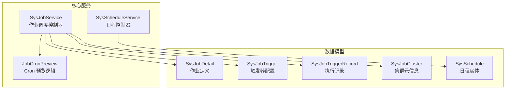
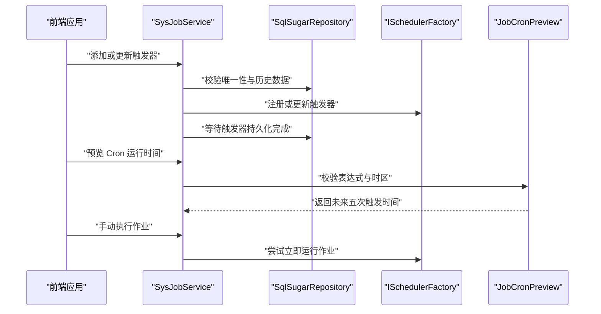
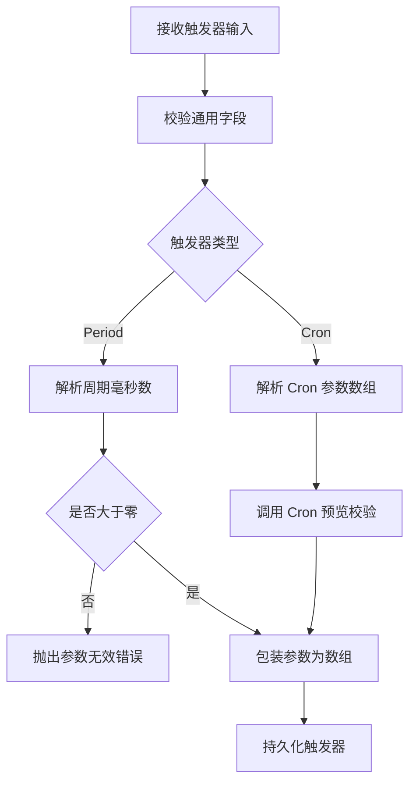
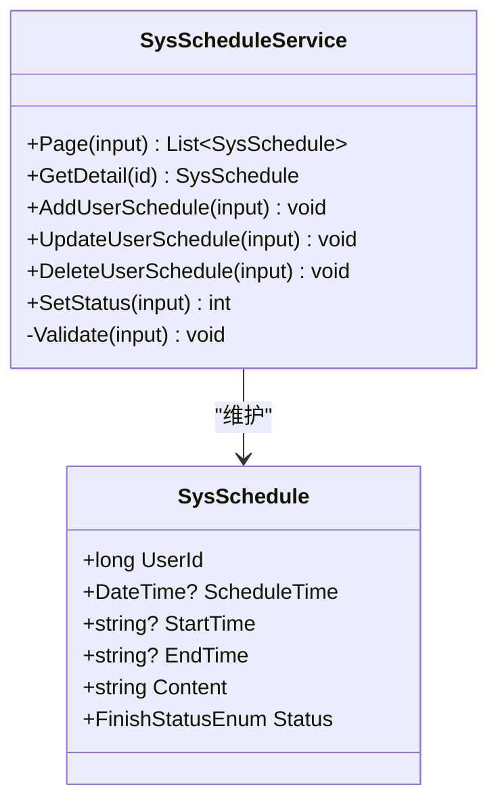
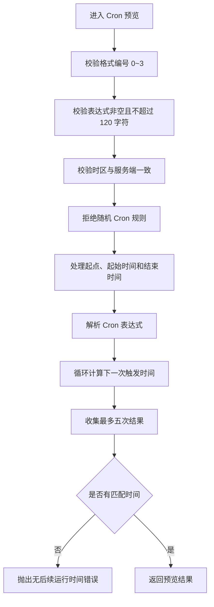
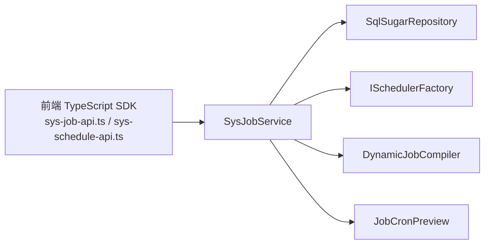

# 任务调度接口

<cite>
**本文引用的文件**   
- [SysJobService.cs](file://Admin.NET/Admin.NET.Core/Service/Job/SysJobService.cs)
- [SysScheduleService.cs](file://Admin.NET/Admin.NET.Core/Service/Schedule/SysScheduleService.cs)
- [SysJobDetail.cs](file://Admin.NET/Admin.NET.Core/Entity/SysJobDetail.cs)
- [SysJobTrigger.cs](file://Admin.NET/Admin.NET.Core/Entity/SysJobTrigger.cs)
- [SysJobTriggerRecord.cs](file://Admin.NET/Admin.NET.Core/Entity/SysJobTriggerRecord.cs)
- [SysJobCluster.cs](file://Admin.NET/Admin.NET.Core/Entity/SysJobCluster.cs)
- [SysSchedule.cs](file://Admin.NET/Admin.NET.Core/Entity/SysSchedule.cs)
- [JobCronPreview.cs](file://Admin.NET/Admin.NET.Core/Service/Job/JobCronPreview.cs)
- [JobRecordTests.cs](file://Admin.NET/Admin.NET.Test/Schedule/JobRecordTests.cs)
- [JobCronPreviewTests.cs](file://Admin.NET/Admin.NET.Test/Schedule/JobCronPreviewTests.cs)
- [sys-job-api.ts](file://Web/apps/web-antdv-next/src/api-services/apis/sys-job-api.ts)
- [sys-schedule-api.ts](file://Web/apps/web-antdv-next/src/api-services/apis/sys-schedule-api.ts)
</cite>

## 目录
1. [简介](#简介)
2. [项目结构](#项目结构)
3. [核心组件](#核心组件)
4. [架构总览](#架构总览)
5. [详细组件分析](#详细组件分析)
6. [依赖关系分析](#依赖关系分析)
7. [性能与扩展性](#性能与扩展性)
8. [故障排查指南](#故障排查指南)
9. [结论](#结论)
10. [附录：接口清单与数据模型](#附录接口清单与数据模型)

## 简介
本文件面向 Admin.NET 的任务调度能力，围绕“定时任务管理、调度器控制、执行监控”三个维度整理后端 API 文档。当前代码库中涉及两类相关概念：

- **作业调度系统（Job）**：基于 Furion.Schedule 的作业调度，支持 Cron 触发器、HTTP 作业、动态脚本作业、触发器状态控制、集群信息表、运行记录等。
- **日程表（Schedule）**：个人日程业务实体，提供按用户和租户隔离的增删改查及状态设置接口，不属于后台任务调度引擎，但常被前端用于展示“计划事项”。

本文重点解析 `SysJobService` 暴露的作业调度接口，并补充 `SysScheduleService` 的日程接口说明；同时结合测试用例解释 Cron 预览行为、触发器参数校验、运行记录清理策略等实现细节。

## 项目结构
任务调度相关的后端能力集中在 `Admin.NET.Admin.NET.Core` 模块：

**图示来源**
- [SysJobService.cs:12-16](file://Admin.NET/Admin.NET.Core/Service/Job/SysJobService.cs#L12-L16)
- [SysScheduleService.cs:12-21](file://Admin.NET/Admin.NET.Core/Service/Schedule/SysScheduleService.cs#L12-L21)
- [SysJobDetail.cs:10-87](file://Admin.NET/Admin.NET.Core/Entity/SysJobDetail.cs#L10-L87)
- [SysJobTrigger.cs:10-147](file://Admin.NET/Admin.NET.Core/Entity/SysJobTrigger.cs#L10-L147)
- [SysJobTriggerRecord.cs:10-72](file://Admin.NET/Admin.NET.Core/Entity/SysJobTriggerRecord.cs#L10-L72)
- [SysJobCluster.cs:10-41](file://Admin.NET/Admin.NET.Core/Entity/SysJobCluster.cs#L10-L41)
- [SysSchedule.cs:10-52](file://Admin.NET/Admin.NET.Core/Entity/SysSchedule.cs#L10-L52)

**章节来源**
- [SysJobService.cs:12-16](file://Admin.NET/Admin.NET.Core/Service/Job/SysJobService.cs#L12-L16)
- [SysScheduleService.cs:12-21](file://Admin.NET/Admin.NET.Core/Service/Schedule/SysScheduleService.cs#L12-L21)

## 核心组件
| 组件 | 职责 | 关键行为 |
|---|---|---|
| `SysJobService` | 作业调度 API 入口 | 作业增删改查、触发器管理、作业启停、手动执行、暂停所有作业、唤醒调度器、持久化、Cron 预览、集群列表、运行记录分页、清空记录 |
| `SysScheduleService` | 个人日程管理 API 入口 | 按当前用户和租户隔离的日程查询、新增、更新、删除、状态设置 |
| `JobCronPreview` | Cron 表达式预览服务 | 校验表达式格式与时区、计算未来五次触发时间、限制随机规则、验证时间窗口 |
| `SysJobDetail` | 作业定义持久化模型 | 作业编号、分组、类型、程序集、描述、并发开关、注解扫描、额外属性、创建类型、脚本代码 |
| `SysJobTrigger` | 触发器配置持久化模型 | 触发器编号、所属作业、触发器类型、参数、起止时间、运行次数、错误次数、重试配置、启动行为 |
| `SysJobTriggerRecord` | 触发器执行记录模型 | 作业编号、触发器编号、运行序号、最近下次时间、状态、结果、耗时、创建时间 |
| `SysJobCluster` | 作业集群元信息模型 | 集群编号、描述、状态、更新时间 |
| `SysSchedule` | 日程实体模型 | 用户、租户、日期、起止时间、内容、完成状态 |

**章节来源**
- [SysJobService.cs:12-16](file://Admin.NET/Admin.NET.Core/Service/Job/SysJobService.cs#L12-L16)
- [SysScheduleService.cs:12-21](file://Admin.NET/Admin.NET.Core/Service/Schedule/SysScheduleService.cs#L12-L21)
- [SysJobDetail.cs:10-87](file://Admin.NET/Admin.NET.Core/Entity/SysJobDetail.cs#L10-L87)
- [SysJobTrigger.cs:10-147](file://Admin.NET/Admin.NET.Core/Entity/SysJobTrigger.cs#L10-L147)
- [SysJobTriggerRecord.cs:10-72](file://Admin.NET/Admin.NET.Core/Entity/SysJobTriggerRecord.cs#L10-L72)
- [SysJobCluster.cs:10-41](file://Admin.NET/Admin.NET.Core/Entity/SysJobCluster.cs#L10-L41)
- [SysSchedule.cs:10-52](file://Admin.NET/Admin.NET.Core/Entity/SysSchedule.cs#L10-L52)

## 架构总览
从调用链看，前端通过 Swagger 生成的客户端调用后端动态 API，再由 `SysJobService` 协调 SqlSugar 数据访问、Furion 调度工厂、动态脚本编译器和 Cron 预览服务。

**图示来源**
- [SysJobService.cs:86-125](file://Admin.NET/Admin.NET.Core/Service/Job/SysJobService.cs#L86-L125)
- [SysJobService.cs:206-219](file://Admin.NET/Admin.NET.Core/Service/Job/SysJobService.cs#L206-L219)
- [SysJobService.cs:357-363](file://Admin.NET/Admin.NET.Core/Service/Job/SysJobService.cs#L357-L363)
- [SysJobService.cs:313-317](file://Admin.NET/Admin.NET.Core/Service/Job/SysJobService.cs#L313-L317)

## 详细组件分析

### 作业调度管理接口
`SysJobService` 是任务调度的核心控制器，提供作业生命周期管理和触发器控制。

#### 作业定义 CRUD
| 接口 | HTTP 路径 | 方法 | 输入 | 输出 | 说明 |
|---|---|---|---|---|---|
| 获取作业分页列表 | `/api/sysJob/pageJobDetail` | POST | `PageJobDetailInput` | 分页 `JobDetailOutput` | 支持按作业编号、分组、描述模糊查询；聚合触发器列表并还原触发器参数 |
| 获取作业组名称集合 | `/api/sysJob/listJobGroup` | GET | 无 | `List<string>` | 返回已持久化的作业分组 |
| 添加作业 | `/api/sysJob/addJobDetail` | POST | `AddJobDetailInput` | 无 | 支持内置、HTTP、脚本三种创建类型；脚本类型会编译并校验 `JobDetailAttribute` |
| 更新作业 | `/api/sysJob/updateJobDetail` | POST | `UpdateJobDetailInput` | 无 | 不允许变更既有任务的创建类型；脚本代码变化时重新编译并更新调度详情 |
| 删除作业 | `/api/sysJob/deleteJobDetail` | POST | `DeleteJobDetailInput` | 无 | 同步移除调度引擎中的作业，并删除作业及触发器记录 |

**章节来源**
- [SysJobService.cs:40-80](file://Admin.NET/Admin.NET.Core/Service/Job/SysJobService.cs#L40-L80)
- [SysJobService.cs:86-189](file://Admin.NET/Admin.NET.Core/Service/Job/SysJobService.cs#L86-L189)

#### 触发器管理
| 接口 | HTTP 路径 | 方法 | 输入 | 输出 | 说明 |
|---|---|---|---|---|---|
| 获取触发器列表 | `/api/sysJob/getJobTriggerList` | GET | `JobDetailInput.JobId` | `List<SysJobTrigger>` | 按作业编号查询触发器 |
| 添加触发器 | `/api/sysJob/addJobTrigger` | POST | `AddJobTriggerInput` | 无 | 校验触发器编号唯一、起止时间、重试参数；Cron 触发器会预校验表达式 |
| 更新触发器 | `/api/sysJob/updateJobTrigger` | POST | `UpdateJobTriggerInput` | 无 | 校验归属不变、触发器唯一；清理无效年份后更新调度器与数据库 |
| 删除触发器 | `/api/sysJob/deleteJobTrigger` | POST | `DeleteJobTriggerInput` | 无 | 先从调度器移除，再清理数据库记录 |

**章节来源**
- [SysJobService.cs:194-261](file://Admin.NET/Admin.NET.Core/Service/Job/SysJobService.cs#L194-L261)

#### 调度器控制接口
| 接口 | HTTP 路径 | 方法 | 输入 | 输出 | 说明 |
|---|---|---|---|---|---|
| 暂停所有作业 | `/api/sysJob/pauseAllJob` | GET | 无 | 无 | 全局暂停调度器 |
| 启动所有作业 | `/api/sysJob/startAllJob` | GET | 无 | 无 | 全局恢复调度器 |
| 暂停作业 | `/api/sysJob/pauseJob` | POST | `JobDetailInput` | 无 | 暂停指定作业 |
| 启动作业 | `/api/sysJob/startJob` | POST | `JobDetailInput` | 无 | 启动指定作业 |
| 取消作业 | `/api/sysJob/cancelJob` | POST | `JobDetailInput` | 无 | 取消正在执行的作业 |
| 执行作业 | `/api/sysJob/runJob` | POST | `JobDetailInput` | 无 | 立即触发一次作业执行 |
| 暂停触发器 | `/api/sysJob/pauseTrigger` | POST | `JobTriggerInput` | 无 | 暂停某个触发器 |
| 启动触发器 | `/api/sysJob/startTrigger` | POST | `JobTriggerInput` | 无 | 启动某个触发器 |
| 强制唤醒作业调度器 | `/api/sysJob/cancelSleep` | POST | 无 | 无 | 唤醒调度器线程 |
| 强制触发所有作业持久化 | `/api/sysJob/persistAll` | POST | 无 | 无 | 主动持久化调度器状态 |

**章节来源**
- [SysJobService.cs:266-355](file://Admin.NET/Admin.NET.Core/Service/Job/SysJobService.cs#L266-L355)

#### Cron 预览接口
| 接口 | HTTP 路径 | 方法 | 输入 | 输出 | 说明 |
|---|---|---|---|---|---|
| 预览 Cron 运行时间 | `/api/sysJob/cronPreview` | POST | `CronPreviewInput` | `CronPreviewOutput` | 校验表达式、格式、时区和时间窗口，返回未来最多五次触发时间 |

**章节来源**
- [SysJobService.cs:357-363](file://Admin.NET/Admin.NET.Core/Service/Job/SysJobService.cs#L357-L363)
- [JobCronPreview.cs:12-59](file://Admin.NET/Admin.NET.Core/Service/Job/JobCronPreview.cs#L12-L59)

#### 集群与运行记录接口
| 接口 | HTTP 路径 | 方法 | 输入 | 输出 | 说明 |
|---|---|---|---|---|---|
| 获取集群列表 | `/api/sysJob/getJobClusterList` | GET | 无 | `List<SysJobCluster>` | 读取作业集群元信息 |
| 获取作业触发器运行记录分页列表 | `/api/sysJob/pageJobTriggerRecord` | GET | `PageJobTriggerRecordInput` | 分页 `SysJobTriggerRecord` | 按作业编号、触发器编号过滤，按主键降序 |
| 清空作业触发器运行记录 | `/api/sysJob/clearJobTriggerRecord` | POST | 无 | 无 | SQLite 使用删除语句，其他数据库使用截断表 |

**章节来源**
- [SysJobService.cs:438-489](file://Admin.NET/Admin.NET.Core/Service/Job/SysJobService.cs#L438-L489)
- [JobRecordTests.cs:20-55](file://Admin.NET/Admin.NET.Test/Schedule/JobRecordTests.cs#L20-L55)

### 触发器参数与 Cron 语法
触发器参数由服务端在保存前进行严格校验：

- 通用字段：结束时间必须晚于起始时间；最大触发次数、最大错误次数、重试次数、重试间隔不能为负数。
- Cron 触发器：参数必须是长度为 2 的数组，第一个元素为 Cron 表达式字符串，第二个元素为 Cron 格式编号；会调用 `JobCronPreview.Preview` 再次校验。
- 周期触发器：参数必须是可以解析为正整数的毫秒值。
- 参数存储：最终统一以 JSON 数组形式包装后写入数据库。

**图示来源**
- [SysJobService.cs:378-408](file://Admin.NET/Admin.NET.Core/Service/Job/SysJobService.cs#L378-L408)
- [JobCronPreview.cs:12-59](file://Admin.NET/Admin.NET.Core/Service/Job/JobCronPreview.cs#L12-L59)

**章节来源**
- [SysJobService.cs:378-408](file://Admin.NET/Admin.NET.Core/Service/Job/SysJobService.cs#L378-L408)

### 个人日程管理接口
`SysScheduleService` 提供个人日程管理，不是后台任务调度引擎，但常被误认为“定时任务”。其核心约束包括：

- 所有操作都按当前用户 ID 和租户 ID 过滤。
- 新增日程时会强制使用请求中的日期作为日程日期。
- 时间字段使用 `HH:mm` 格式，且结束时间必须晚于开始时间。
- 内容长度限制为 1 至 256 个字符。
- 状态使用完成状态枚举，非法值会返回错误码。

**图示来源**
- [SysScheduleService.cs:12-140](file://Admin.NET/Admin.NET.Core/Service/Schedule/SysScheduleService.cs#L12-L140)
- [SysSchedule.cs:10-52](file://Admin.NET/Admin.NET.Core/Entity/SysSchedule.cs#L10-L52)

**章节来源**
- [SysScheduleService.cs:28-140](file://Admin.NET/Admin.NET.Core/Service/Schedule/SysScheduleService.cs#L28-L140)
- [SysSchedule.cs:10-52](file://Admin.NET/Admin.NET.Core/Entity/SysSchedule.cs#L10-L52)

### Cron 表达式语义与预览规则
根据 `JobCronPreview` 和对应测试，Cron 预览具有以下特性：

- 支持的格式编号为 0、1、2、3。
- 表达式不能为空，且长度不能超过 120 个字符。
- 只允许使用服务器本地时区；传入不同 `TimeZoneId` 会被拒绝。
- 不支持随机 Cron 规则；包含 `R` 或 `H` 的规则会直接报错。
- 起点时间默认取当前时间或起始时间；若起点早于 1901 年或晚于 2098 年则报错。
- 如果设置了时间窗口，结束时间必须晚于起始时间。
- 引擎从 `StartTime` 之后计算首次触发，不包含起点本身。
- 每次预览最多返回未来五次匹配时间；若在窗口内没有后续时间则报错。

**图示来源**
- [JobCronPreview.cs:12-59](file://Admin.NET/Admin.NET.Core/Service/Job/JobCronPreview.cs#L12-L59)
- [JobCronPreviewTests.cs:20-79](file://Admin.NET/Admin.NET.Test/Schedule/JobCronPreviewTests.cs#L20-L79)

**章节来源**
- [JobCronPreview.cs:12-59](file://Admin.NET/Admin.NET.Core/Service/Job/JobCronPreview.cs#L12-L59)
- [JobCronPreviewTests.cs:20-79](file://Admin.NET/Admin.NET.Test/Schedule/JobCronPreviewTests.cs#L20-L79)

## 依赖关系分析
`SysJobService` 同时依赖数据访问层、调度引擎、动态脚本编译器和 Cron 预览服务；前端通过 Swagger 生成 TypeScript SDK 调用后端接口。

**图示来源**
- [SysJobService.cs:12-16](file://Admin.NET/Admin.NET.Core/Service/Job/SysJobService.cs#L12-L16)
- [sys-job-api.ts:1-200](file://Web/apps/web-antdv-next/src/api-services/apis/sys-job-api.ts#L1-L200)
- [sys-schedule-api.ts:1-200](file://Web/apps/web-antdv-next/src/api-services/apis/sys-schedule-api.ts#L1-L200)

**章节来源**
- [SysJobService.cs:12-16](file://Admin.NET/Admin.NET.Core/Service/Job/SysJobService.cs#L12-L16)
- [sys-job-api.ts:1-200](file://Web/apps/web-antdv-next/src/api-services/apis/sys-job-api.ts#L1-L200)
- [sys-schedule-api.ts:1-200](file://Web/apps/web-antdv-next/src/api-services/apis/sys-schedule-api.ts#L1-L200)

## 性能与扩展性

### 并发与优先级
- 作业定义中的 `Concurrent` 字段表示是否允许并行执行；默认值为允许。
- 代码中没有发现显式的“任务优先级队列”或“优先级调度器”实现；因此不应把“优先级”理解为后端调度引擎的优先级排序机制。
- 对于需要串行执行的作业，应在作业内部实现互斥逻辑，或通过关闭并发、配合分布式锁来实现顺序执行。

### 失败重试与超时
- 触发器层面提供 `NumRetries` 和 `RetryTimeout`，表示重试次数和重试间隔毫秒数。
- 触发器还提供 `MaxNumberOfErrors`，可用于限制最大错误次数。
- 作业级别未在当前源码中发现统一的执行超时控制字段；如需强超时保障，应在作业实现中自行管理超时。

### 分布式与集群
- 存在 `SysJobCluster` 表，用于记录作业集群编号、描述、状态和更新时间。
- 当前 `SysJobService` 的集群接口仅返回集群列表，未发现自动加入、心跳、选举、分布式锁或故障转移的具体实现代码。
- 多实例部署时，应结合外部分布式锁、消息队列或调度中心方案实现跨进程一致性；不要把当前集群表解读为完整的分布式调度实现。

### 执行监控与审计
- 运行记录表记录作业编号、触发器编号、运行序号、最近下次时间、触发器状态、本次执行结果和执行耗时。
- 前端可通过分页接口查看最近执行记录，并结合耗时字段做简单性能分析。
- 当前代码未暴露统一的“告警通道集成接口”，可在上层服务或作业回调中接入通知系统。

### 最佳实践
1. **任务命名与分组**：使用稳定、可识别的 `JobId` 和合理分组，便于监控和权限控制。
2. **避免高频 Cron**：对秒级或分钟级任务谨慎评估负载，必要时合并批处理。
3. **开启并发前先评估幂等性**：并行执行要求作业具备幂等性或内部并发控制。
4. **优先使用持久化触发器**：确保触发器保存成功后再启用，避免重启后丢失计划。
5. **保留执行历史**：定期清理旧记录，但不要频繁清空生产环境运行日志。
6. **区分业务日程与后台任务**：`SysSchedule` 是个人日程，不应被当作后台任务调度入口。

[本节为通用指导，不直接分析具体代码行]

## 故障排查指南

### Cron 表达式预览失败
常见原因：
- 格式编号不在 0~3 范围内。
- 表达式为空或过长。
- 使用了服务端不支持的随机 Cron。
- 时区与服务端不一致。
- 时间窗口无效或没有未来触发时间。

建议排查步骤：
1. 先调用 `cronPreview` 接口，确认表达式能被正确解析。
2. 检查 `Format` 是否与表达式语法匹配。
3. 检查是否传入了非本地时区。
4. 缩小时间窗口，确认是否存在未来触发点。

**章节来源**
- [JobCronPreview.cs:12-59](file://Admin.NET/Admin.NET.Core/Service/Job/JobCronPreview.cs#L12-L59)
- [JobCronPreviewTests.cs:20-79](file://Admin.NET/Admin.NET.Test/Schedule/JobCronPreviewTests.cs#L20-L79)

### 触发器保存后仍未生效
可能原因：
- 调度器尚未持久化触发器。
- 作业未加载到调度引擎。
- 触发器参数无效。

建议排查步骤：
1. 调用 `getJobTriggerList` 确认触发器是否持久化成功。
2. 调用 `pageJobDetail` 查看作业是否出现在调度器中。
3. 检查触发器参数是否符合 Cron 或周期触发器格式。
4. 使用 `persistAll` 强制持久化，或重启应用后重试。

**章节来源**
- [SysJobService.cs:206-219](file://Admin.NET/Admin.NET.Core/Service/Job/SysJobService.cs#L206-L219)
- [SysJobService.cs:410-433](file://Admin.NET/Admin.NET.Core/Service/Job/SysJobService.cs#L410-L433)

### 执行记录无法清空
可能原因：
- 数据库为 SQLite，不能使用标准截断表命令。
- 雪花主键表不存在自增序列。

建议排查步骤：
1. 确认数据库类型。
2. 使用后端提供的 `clearJobTriggerRecord` 接口，该接口对 SQLite 做了特殊处理。
3. 不要直接在 SQLite 上执行截断表命令，以免破坏主键序列。

**章节来源**
- [SysJobService.cs:461-472](file://Admin.NET/Admin.NET.Core/Service/Job/SysJobService.cs#L461-L472)
- [JobRecordTests.cs:20-55](file://Admin.NET/Admin.NET.Test/Schedule/JobRecordTests.cs#L20-L55)

### 手动执行作业失败
可能原因：
- 作业不存在或未加载到调度器。
- 调度器返回失败状态。

建议排查步骤：
1. 先调用 `startJob` 启动作业。
2. 确认作业存在于调度器。
3. 再调用 `runJob` 手动执行。
4. 检查作业日志和运行记录。

**章节来源**
- [SysJobService.cs:313-317](file://Admin.NET/Admin.NET.Core/Service/Job/SysJobService.cs#L313-L317)

## 结论
Admin.NET 的任务调度能力以 `SysJobService` 为核心，提供作业定义、触发器配置、调度控制、Cron 预览、集群信息和执行记录查询等能力。其 Cron 预览逻辑严谨，触发器参数校验覆盖 Cron 和周期两种模式，运行记录支持分页和清理。日程接口 `SysScheduleService` 则专注于个人日程业务，不具备后台任务调度语义。

在实际生产中，建议将任务设计为幂等、可观测、可重试；对高频任务做好限流和批处理；对分布式场景补充外部分布式锁与告警机制；并对 Cron 表达式、并发开关、重试策略和执行历史建立统一规范。

[本节为总结性内容，不直接分析具体代码行]

## 附录：接口清单与数据模型

### 作业调度接口总览
| 分类 | 接口 | 路径 | 方法 | 主要用途 |
|---|---|---|---|---|
| 作业管理 | 添加作业 | `/api/sysJob/addJobDetail` | POST | 创建内置、HTTP 或脚本作业 |
| 作业管理 | 更新作业 | `/api/sysJob/updateJobDetail` | POST | 更新作业定义，禁止变更创建类型 |
| 作业管理 | 删除作业 | `/api/sysJob/deleteJobDetail` | POST | 删除作业及其触发器 |
| 作业管理 | 获取作业分页列表 | `/api/sysJob/pageJobDetail` | POST | 查询作业及触发器 |
| 作业管理 | 获取作业组名称集合 | `/api/sysJob/listJobGroup` | GET | 查询分组 |
| 触发器管理 | 获取触发器列表 | `/api/sysJob/getJobTriggerList` | GET | 按作业查询触发器 |
| 触发器管理 | 添加触发器 | `/api/sysJob/addJobTrigger` | POST | 创建 Cron 或周期触发器 |
| 触发器管理 | 更新触发器 | `/api/sysJob/updateJobTrigger` | POST | 修改触发器参数 |
| 触发器管理 | 删除触发器 | `/api/sysJob/deleteJobTrigger` | POST | 删除触发器 |
| 调度控制 | 暂停所有作业 | `/api/sysJob/pauseAllJob` | GET | 全局暂停 |
| 调度控制 | 启动所有作业 | `/api/sysJob/startAllJob` | GET | 全局恢复 |
| 调度控制 | 暂停作业 | `/api/sysJob/pauseJob` | POST | 暂停单个作业 |
| 调度控制 | 启动作业 | `/api/sysJob/startJob` | POST | 启动单个作业 |
| 调度控制 | 取消作业 | `/api/sysJob/cancelJob` | POST | 取消执行 |
| 调度控制 | 执行作业 | `/api/sysJob/runJob` | POST | 手动触发 |
| 调度控制 | 暂停触发器 | `/api/sysJob/pauseTrigger` | POST | 暂停触发器 |
| 调度控制 | 启动触发器 | `/api/sysJob/startTrigger` | POST | 启动触发器 |
| 调度控制 | 强制唤醒作业调度器 | `/api/sysJob/cancelSleep` | POST | 唤醒调度器 |
| 调度控制 | 强制触发所有作业持久化 | `/api/sysJob/persistAll` | POST | 持久化状态 |
| 调度控制 | 预览 Cron 运行时间 | `/api/sysJob/cronPreview` | POST | 校验并预览触发时间 |
| 监控 | 获取集群列表 | `/api/sysJob/getJobClusterList` | GET | 查看集群元信息 |
| 监控 | 获取作业触发器运行记录分页列表 | `/api/sysJob/pageJobTriggerRecord` | GET | 查看执行历史 |
| 监控 | 清空作业触发器运行记录 | `/api/sysJob/clearJobTriggerRecord` | POST | 清理运行日志 |

**章节来源**
- [SysJobService.cs:40-489](file://Admin.NET/Admin.NET.Core/Service/Job/SysJobService.cs#L40-L489)
- [sys-job-api.ts:1-200](file://Web/apps/web-antdv-next/src/api-services/apis/sys-job-api.ts#L1-L200)

### 日程管理接口总览
| 接口 | 路径 | 方法 | 说明 |
|---|---|---|---|
| 增加日程 | `/api/sysSchedule/add` | POST | 按当前用户和租户创建日程 |
| 删除日程 | `/api/sysSchedule/delete` | POST | 删除本人日程 |
| 获取日程详情 | `/api/sysSchedule/detail/{id}` | GET | 查询本人日程详情 |
| 获取日程列表 | `/api/sysSchedule/page` | POST | 按日期范围查询本人日程 |
| 更新日程 | `/api/sysSchedule/update` | POST | 更新本人日程 |
| 设置日程状态 | `/api/sysSchedule/setStatus` | POST | 设置完成状态 |

**章节来源**
- [SysScheduleService.cs:28-140](file://Admin.NET/Admin.NET.Core/Service/Schedule/SysScheduleService.cs#L28-L140)
- [sys-schedule-api.ts:1-200](file://Web/apps/web-antdv-next/src/api-services/apis/sys-schedule-api.ts#L1-L200)

### 关键数据模型摘要
| 模型 | 关键字段 | 含义 |
|---|---|---|
| `SysJobDetail` | `JobId`、`GroupName`、`JobType`、`AssemblyName`、`Concurrent`、`IncludeAnnotation`、`Properties`、`CreateType`、`ScriptCode` | 作业定义、并发开关、创建类型、脚本代码 |
| `SysJobTrigger` | `TriggerId`、`JobId`、`TriggerType`、`Args`、`StartTime`、`EndTime`、`NumberOfRuns`、`MaxNumberOfRuns`、`NumberOfErrors`、`MaxNumberOfErrors`、`NumRetries`、`RetryTimeout`、`StartNow`、`RunOnStart`、`ResetOnlyOnce` | 触发器编号、参数、起止时间、运行计数、重试策略、启动行为 |
| `SysJobTriggerRecord` | `JobId`、`TriggerId`、`NumberOfRuns`、`LastRunTime`、`NextRunTime`、`Status`、`Result`、`ElapsedTime`、`CreatedTime` | 执行记录、结果、耗时、创建时间 |
| `SysJobCluster` | `ClusterId`、`Description`、`Status`、`UpdatedTime` | 集群编号、描述、状态、更新时间 |
| `SysSchedule` | `UserId`、`TenantId`、`ScheduleTime`、`StartTime`、`EndTime`、`Content`、`Status` | 个人日程用户、租户、时间、内容和完成状态 |

**章节来源**
- [SysJobDetail.cs:10-87](file://Admin.NET/Admin.NET.Core/Entity/SysJobDetail.cs#L10-L87)
- [SysJobTrigger.cs:10-147](file://Admin.NET/Admin.NET.Core/Entity/SysJobTrigger.cs#L10-L147)
- [SysJobTriggerRecord.cs:10-72](file://Admin.NET/Admin.NET.Core/Entity/SysJobTriggerRecord.cs#L10-L72)
- [SysJobCluster.cs:10-41](file://Admin.NET/Admin.NET.Core/Entity/SysJobCluster.cs#L10-L41)
- [SysSchedule.cs:10-52](file://Admin.NET/Admin.NET.Core/Entity/SysSchedule.cs#L10-L52)