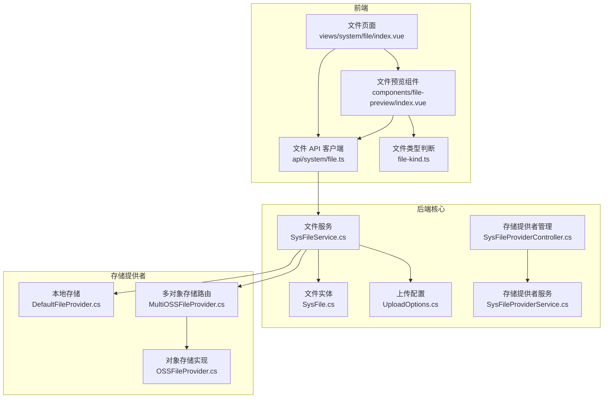
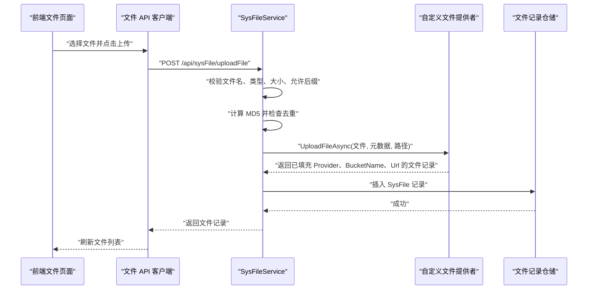
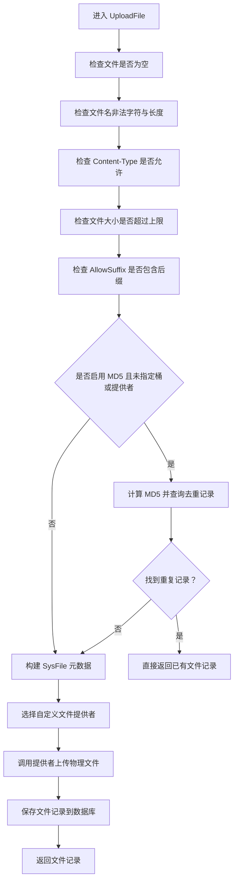
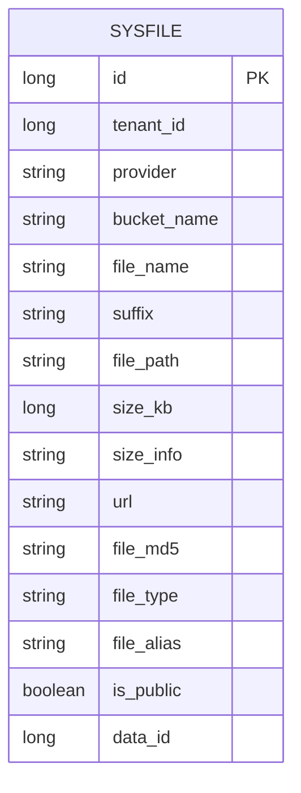
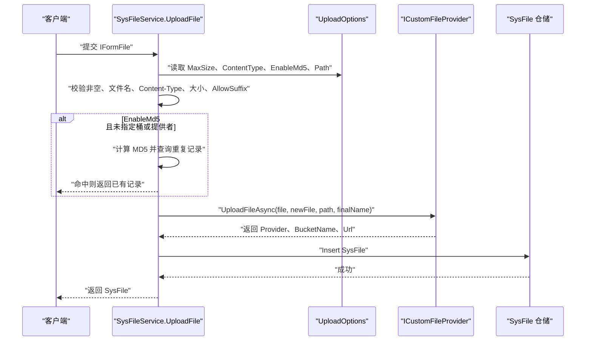
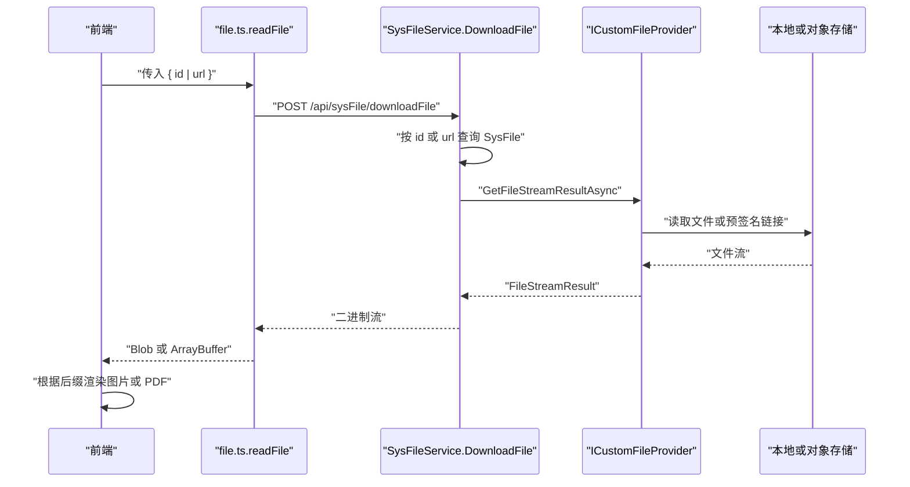
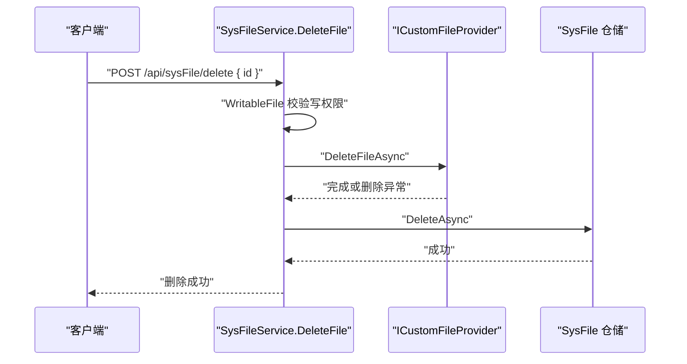

# 文件管理接口

<cite>
**本文引用的文件 **
- [SysFileService.cs](file://Admin.NET/Admin.NET.Core/Service/File/SysFileService.cs)
- [FileInput.cs](file://Admin.NET/Admin.NET.Core/Service/File/Dto/FileInput.cs)
- [DefaultFileProvider.cs](file://Admin.NET/Admin.NET.Core/Service/File/FileProvider/DefaultFileProvider.cs)
- [MultiOSSFileProvider.cs](file://Admin.NET/Admin.NET.Core/Service/File/FileProvider/MultiOSSFileProvider.cs)
- [OSSFileProvider.cs](file://Admin.NET/Admin.NET.Core/Service/File/FileProvider/OSSFileProvider.cs)
- [SysFileProviderController.cs](file://Admin.NET/Admin.NET.Core/Service/File/SysFileProviderController.cs)
- [SysFileProviderService.cs](file://Admin.NET/Admin.NET.Core/Service/File/SysFileProviderService.cs)
- [SysFile.cs](file://Admin.NET/Admin.NET.Core/Entity/SysFile.cs)
- [UploadOptions.cs](file://Admin.NET/Admin.NET.Core/Option/UploadOptions.cs)
- [file.ts](file://Web/apps/web-antdv-next/src/api/system/file.ts)
- [index.vue](file://Web/apps/web-antdv-next/src/views/system/file/index.vue)
- [preview/index.vue](file://Web/apps/web-antdv-next/src/components/file-preview/index.vue)
- [file-kind.ts](file://Web/apps/web-antdv-next/src/components/file-preview/file-kind.ts)
- [file-management.md](file://docs/frontend/file-management.md)
- [FileIsolationTests.cs](file://Admin.NET/Admin.NET.Test/File/FileIsolationTests.cs)
- [file-contract.spec.ts](file://Web/apps/web-antdv-next/e2e/file-contract.spec.ts)
</cite>

## 目录
1. [简介](#简介)
2. [项目结构与边界](#项目结构与边界)
3. [核心能力总览](#核心能力总览)
4. [系统架构与组件关系](#系统架构与组件关系)
5. [API 定义](#api-定义)
6. [详细组件分析](#详细组件分析)
7. [权限、防盗链与访问控制](#权限防盗链与访问控制)
8. [存储提供者与配置](#存储提供者与配置)
9. [前端集成示例](#前端集成示例)
10. [性能与容量规划](#性能与容量规划)
11. [故障排查指南](#故障排查指南)
12. [结论](#结论)

## 简介
本文档基于当前源码，对 Admin.NET 的文件管理能力进行 API 级说明。后端以 `SysFileService` 为核心控制器，通过 `ICustomFileProvider` 抽象统一本地存储、多对象存储以及 SSH 等实现；前端以 `web-antdv-next` 为业务入口，提供文件列表、上传、编辑、下载和预览能力。文档覆盖：

- 文件上传：基础上传、Base64 上传、头像与签名上传、MD5 去重。
- 文件下载与预览：流式下载、按 Id 或 Url 下载、图片、PDF、Office、音视频预览。
- 文件删除：物理删除逻辑及数据库记录清理。
- 存储提供者：本地存储、阿里云 OSS、腾讯云 COS、MinIO 及多桶策略。
- 文件大小限制与格式验证：服务端 `UploadOptions` 与前端校验规则。
- 权限控制：公开文件与租户隔离读取，写操作受租户与身份约束。
- 版本控制与配额：当前仓库未实现原生版本控制与配额统计，本文给出扩展建议。

注意：当前仓库没有分片上传、断点续传、并发上传、批量打包下载等专用接口；这些能力需要在前端或服务端扩展实现。

## 项目结构与边界
文件功能由后端核心服务、实体模型、配置选项与多个文件提供者组成；前端通过页面、API 客户端和通用预览组件协作。

**图表来源**
- [SysFileService.cs:1-493](file://Admin.NET/Admin.NET.Core/Service/File/SysFileService.cs#L1-L493)
- [SysFile.cs:1-104](file://Admin.NET/Admin.NET.Core/Entity/SysFile.cs#L1-L104)
- [UploadOptions.cs:1-60](file://Admin.NET/Admin.NET.Core/Option/UploadOptions.cs#L1-L60)
- [DefaultFileProvider.cs:1-89](file://Admin.NET/Admin.NET.Core/Service/File/FileProvider/DefaultFileProvider.cs#L1-L89)
- [MultiOSSFileProvider.cs:1-255](file://Admin.NET/Admin.NET.Core/Service/File/FileProvider/MultiOSSFileProvider.cs#L1-L255)
- [OSSFileProvider.cs:1-81](file://Admin.NET/Admin.NET.Core/Service/File/FileProvider/OSSFileProvider.cs#L1-L81)
- [SysFileProviderController.cs:1-199](file://Admin.NET/Admin.NET.Core/Service/File/SysFileProviderController.cs#L1-L199)
- [SysFileProviderService.cs:1-200](file://Admin.NET/Admin.NET.Core/Service/File/SysFileProviderService.cs#L1-L200)
- [file.ts:1-45](file://Web/apps/web-antdv-next/src/api/system/file.ts#L1-L45)
- [index.vue:1-200](file://Web/apps/web-antdv-next/src/views/system/file/index.vue#L1-L200)
- [preview/index.vue:1-137](file://Web/apps/web-antdv-next/src/components/file-preview/index.vue#L1-L137)
- [file-kind.ts:1-35](file://Web/apps/web-antdv-next/src/components/file-preview/file-kind.ts#L1-L35)

**章节来源**
- [SysFileService.cs:1-493](file://Admin.NET/Admin.NET.Core/Service/File/SysFileService.cs#L1-L493)
- [SysFile.cs:1-104](file://Admin.NET/Admin.NET.Core/Entity/SysFile.cs#L1-L104)
- [UploadOptions.cs:1-60](file://Admin.NET/Admin.NET.Core/Option/UploadOptions.cs#L1-L60)
- [file-management.md:1-25](file://docs/frontend/file-management.md#L1-L25)

## 核心能力总览
| 能力 | 后端接口 | 前端调用 | 行为说明 |
|---|---|---|---|
| 分页查询文件 | `POST /api/sysFile/page` | `filePage` | 支持文件名、路径、后缀、时间范围、租户过滤；公开文件可被所有用户读取，私有文件受租户隔离。 |
| 上传文件 | `POST /api/sysFile/uploadFile` | `uploadFile` | 校验非空、文件名、内容类型、大小、允许后缀；可选 MD5 去重；根据配置写入本地或多对象存储。 |
| Base64 上传 | `POST /api/sysFile/uploadFileFromBase64` | 无直接封装 | 解析 Base64 数据并转为普通上传流程。 |
| 多文件上传 | `POST /api/sysFile/uploadFiles` | 无直接封装 | 逐个调用单文件上传。 |
| 头像上传 | `POST /api/sysFile/uploadAvatar` | 业务应用自行调用 | 强制图片后缀，写入用户头像 URL，并尝试清理旧头像。 |
| 签名上传 | `POST /api/sysFile/uploadSignature` | 业务应用自行调用 | 限制图片类型，写入用户签名 URL，并尝试清理旧签名。 |
| 获取文件详情 | `GET /api/sysFile/getFile?id=` | 内部使用 | 受读权限控制。 |
| 按 Id 集合获取 | `GET /api/sysFile/getFileByIds?ids=...` | 内部使用 | 受读权限控制。 |
| 下载文件 | `POST /api/sysFile/downloadFile` | `readFile` | 支持按 Id 或 Url 下载；返回二进制流。 |
| 文件预览 | `GET /api/sysFile/getPreview/{id}` | 间接通过下载后渲染 | 复用下载流。 |
| 更新文件元数据 | `POST /api/sysFile/update` | `saveFile` | 仅允许修改名称、类别、公开状态、别名和业务数据 Id。 |
| 删除文件 | `POST /api/sysFile/delete` | `removeFile` | 先调用存储提供者删除物理文件，再删除数据库记录。 |
| 获取文件夹树 | `GET /api/sysFile/getFolder` | 文件管理界面使用 | 从数据库中取不重复路径并构建树。 |
| 存储提供者管理 | `/api/sysFileProvider/*` | 管理后台使用 | 增删改查、启用禁用、统计、桶映射。 |

**章节来源**
- [SysFileService.cs:1-493](file://Admin.NET/Admin.NET.Core/Service/File/SysFileService.cs#L1-L493)
- [SysFileProviderController.cs:1-199](file://Admin.NET/Admin.NET.Core/Service/File/SysFileProviderController.cs#L1-L199)
- [file.ts:1-45](file://Web/apps/web-antdv-next/src/api/system/file.ts#L1-L45)
- [index.vue:1-200](file://Web/apps/web-antdv-next/src/views/system/file/index.vue#L1-L200)

## 系统架构与组件关系
文件上传和下载的核心流程围绕 `SysFileService` 展开；具体存储细节由 `ICustomFileProvider` 实现隔离。

**图表来源**
- [SysFileService.cs:260-420](file://Admin.NET/Admin.NET.Core/Service/File/SysFileService.cs#L260-L420)
- [DefaultFileProvider.cs:40-89](file://Admin.NET/Admin.NET.Core/Service/File/FileProvider/DefaultFileProvider.cs#L40-L89)
- [MultiOSSFileProvider.cs:25-110](file://Admin.NET/Admin.NET.Core/Service/File/FileProvider/MultiOSSFileProvider.cs#L25-L110)

## 详细组件分析

### 文件服务 SysFileService
`SysFileService` 暴露文件管理的动态 API，负责：

- 列表分页与公开/私有合并查询。
- 多种上传入口：表单文件、Base64、头像、签名。
- 下载与预览：通过统一方法获取文件流。
- 元数据更新：只允许修改安全字段。
- 删除：调用存储提供者删除物理文件，再删除记录。
- 与业务数据的关联维护：`DataId` 同步、批量删除。

关键行为包括：

- 公开文件对所有登录用户可见；私有文件在普通账号下按当前租户过滤。
- 超管可以跨租户查询，但写操作仍受租户约束。
- 上传前会严格校验内容类型、大小、允许后缀，防止客户端伪造类型绕过。
- 当开启 MD5 且未指定桶或提供者时，会计算 MD5 并按租户、创建者、公开状态、类别、业务 Id、文件名、后缀和路径做去重。
- 更新只写入 `FileName`、`FileType`、`IsPublic`、`FileAlias`、`DataId`，其他字段由服务端保留。

**图表来源**
- [SysFileService.cs:300-420](file://Admin.NET/Admin.NET.Core/Service/File/SysFileService.cs#L300-L420)

**章节来源**
- [SysFileService.cs:1-493](file://Admin.NET/Admin.NET.Core/Service/File/SysFileService.cs#L1-L493)
- [FileInput.cs:1-137](file://Admin.NET/Admin.NET.Core/Service/File/Dto/FileInput.cs#L1-L137)

### 文件实体 SysFile
`SysFile` 是文件元数据的主实体，继承租户与组织基类，包含以下关键字段：

| 字段 | 含义 | 说明 |
|---|---|---|
| `Provider` | 存储提供者 | 如本地、阿里云、腾讯云、MinIO 等。 |
| `BucketName` | 存储桶名称 | 本地场景通常显示为 `Local`。 |
| `FileName` | 源文件名 | 更新时可修改，服务端限制长度与非法字符。 |
| `Suffix` | 文件后缀 | 标准化为小写，`.jpeg`、`.jpe` 会归一化为 `.jpg`。 |
| `FilePath` | 存储路径 | 服务端生成，不允许客户端覆盖。 |
| `SizeKb` | 文件大小 KB | 上传时计算。 |
| `SizeInfo` | 文件大小信息 | 可选格式化字段。 |
| `Url` | 外链地址 | 对象存储返回的可访问链接。 |
| `FileMd5` | 文件 MD5 | 用于去重。 |
| `FileType` | 文件类别 | 业务分类，例如相关文件、归档文件。 |
| `FileAlias` | 文件别名 | 展示或备注用途。 |
| `IsPublic` | 是否公开 | 控制公开读取语义。 |
| `DataId` | 业务数据 Id | 将文件与业务实体关联。 |

**图表来源**
- [SysFile.cs:1-104](file://Admin.NET/Admin.NET.Core/Entity/SysFile.cs#L1-L104)

**章节来源**
- [SysFile.cs:1-104](file://Admin.NET/Admin.NET.Core/Entity/SysFile.cs#L1-L104)

### 文件输入模型
`FileInput.cs` 定义了文件查询、上传、Base64 上传和关联查询的数据结构：

- `PageFileInput`：分页查询参数，支持租户、文件名、路径、后缀、起止时间。
- `UploadFileInput`：上传主体，包含文件、类别、公开标记、允许后缀、目标桶、提供者 Id、业务 Id。
- `UploadFileFromBase64Input`：Base64 上传，包含文件名、Base64 数据和 Content-Type。
- `RelationQueryInput`：关联查询辅助模型，支持按关联名称、业务 Id、文件类型集合查询。

**章节来源**
- [FileInput.cs:1-137](file://Admin.NET/Admin.NET.Core/Service/File/Dto/FileInput.cs#L1-L137)

### 本地文件提供者 DefaultFileProvider
本地提供者将文件写入 Web 根目录下的相对路径，并构造 `FileStreamResult` 返回流。它实现了：

- 物理路径构建与目录安全检查。
- 删除本地文件。
- Base64 读取。
- 流式下载。
- 本地上传并设置 `Url` 为相对路径。

安全性方面，路径构建会拒绝越界路径，避免写入 WebRoot 之外。

**章节来源**
- [DefaultFileProvider.cs:1-89](file://Admin.NET/Admin.NET.Core/Service/File/FileProvider/DefaultFileProvider.cs#L1-L89)

### 多对象存储提供者 MultiOSSFileProvider
多 OSS 提供者根据 `SysFile` 中的 Provider 和 BucketName 查找配置，并通过 `IOSSServiceManager` 获取具体对象存储服务。它负责：

- 上传时确定 Provider 和 BucketName。
- 删除对象。
- 通过预签名 URL 获取流。
- Base64 下载。
- 按桶名、提供者 Id、默认提供者选择策略。

URL 生成支持自定义域名、HTTPS 开关以及不同提供者的 Host 拼接。

**章节来源**
- [MultiOSSFileProvider.cs:1-255](file://Admin.NET/Admin.NET.Core/Service/File/FileProvider/MultiOSSFileProvider.cs#L1-L255)

### 单一对象存储提供者 OSSFileProvider
`OSSFileProvider` 基于配置中的 `OSSProviderOptions` 直连特定对象存储，支持：

- 阿里云 OSS。
- 腾讯云 COS。
- MinIO。

它会生成对应的外链地址，并通过预签名方式返回下载流。

**章节来源**
- [OSSFileProvider.cs:1-81](file://Admin.NET/Admin.NET.Core/Service/File/FileProvider/OSSFileProvider.cs#L1-L81)

### 存储提供者管理 API
`SysFileProviderController` 与 `SysFileProviderService` 共同暴露存储提供者管理能力：

| 接口 | 方法 | 作用 |
|---|---|---|
| `/api/sysFileProvider/getProviderList` | GET | 获取启用的提供者列表。 |
| `/api/sysFileProvider/getProviderPage` | POST | 分页查询提供者。 |
| `/api/sysFileProvider/getProvider` | GET | 获取提供者详情。 |
| `/api/sysFileProvider/add` | POST | 新增提供者，含配置校验。 |
| `/api/sysFileProvider/update` | POST | 更新提供者，含唯一性校验。 |
| `/api/sysFileProvider/delete` | POST | 删除提供者，默认提供者会被自动替换。 |
| `/api/sysFileProvider/getProviderByBucketName` | GET | 按桶名获取提供者。 |
| `/api/sysFileProvider/clearCache` | POST | 清除缓存。 |
| `/api/sysFileProvider/batchEnable` | POST | 批量启用或禁用。 |
| `/api/sysFileProvider/getProviderStatistics` | GET | 获取总数、启用数、按提供者和区域分组统计。 |
| `/api/sysFileProvider/getAvailableBuckets` | GET | 获取可用桶列表。 |
| `/api/sysFileProvider/getBucketProviderMapping` | GET | 获取桶与提供者映射。 |

**章节来源**
- [SysFileProviderController.cs:1-199](file://Admin.NET/Admin.NET.Core/Service/File/SysFileProviderController.cs#L1-L199)
- [SysFileProviderService.cs:1-200](file://Admin.NET/Admin.NET.Core/Service/File/SysFileProviderService.cs#L1-L200)

## API 定义

### 文件管理接口

| 接口 | HTTP 方法与路径 | 请求体或参数 | 响应 | 权限要求 |
|---|---|---|---|---|
| 获取文件分页列表 | `POST /api/sysFile/page` | `PageFileInput` | 分页结果，包含文件记录数组与总数 | 具备文件页面查看权限 |
| 上传文件 | `POST /api/sysFile/uploadFile` | `UploadFileInput` | 单个 `SysFile` | 具备上传权限 |
| 上传 Base64 文件 | `POST /api/sysFile/uploadFileFromBase64` | `UploadFileFromBase64Input` | 单个 `SysFile` | 具备上传权限 |
| 上传多文件 | `POST /api/sysFile/uploadFiles` | `IFormFile[]` | `SysFile[]` | 具备上传权限 |
| 下载文件 | `POST /api/sysFile/downloadFile` | `{ id }` 或 `{ url }` | 二进制流 | 具备下载或预览权限 |
| 文件预览 | `GET /api/sysFile/getPreview/{id}` | 路径参数 `id` | 二进制流 | 具备预览权限 |
| 获取文件详情 | `GET /api/sysFile/getFile?id=` | 查询参数 `id` | `SysFile` | 具备读取权限 |
| 按 Id 集合获取 | `GET /api/sysFile/getFileByIds?ids=...` | 查询参数 `ids` | `SysFile[]` | 具备读取权限 |
| 更新文件 | `POST /api/sysFile/update` | `{ id, fileName, fileType, isPublic, fileAlias, dataId }` | 更新结果 | 具备更新权限 |
| 删除文件 | `POST /api/sysFile/delete` | `{ id }` | 删除结果 | 具备删除权限 |
| 获取文件夹树 | `GET /api/sysFile/getFolder` | 无 | 文件夹节点树 | 具备读取权限 |
| 上传头像 | `POST /api/sysFile/uploadAvatar` | `IFormFile` | `SysFile` | 具备头像上传权限 |
| 上传电子签名 | `POST /api/sysFile/uploadSignature` | `IFormFile` | `SysFile` | 具备签名上传权限 |

错误码与消息：

- 文件不存在：返回 `D8000`。
- 内容类型不允许：返回 `D8001`。
- 文件大小超出限制：返回 `D8002`。
- 文件后缀不允许：返回 `D8003`。
- 文件名非法：返回 `D8005`。

**章节来源**
- [SysFileService.cs:1-493](file://Admin.NET/Admin.NET.Core/Service/File/SysFileService.cs#L1-L493)
- [FileInput.cs:1-137](file://Admin.NET/Admin.NET.Core/Service/File/Dto/FileInput.cs#L1-L137)

### 文件存储提供者管理接口

| 接口 | HTTP 方法与路径 | 请求体或参数 | 响应 | 权限要求 |
|---|---|---|---|---|
| 获取提供者列表 | `GET /api/sysFileProvider/getProviderList` | 无 | `SysFileProvider[]` | 具备存储提供者管理权限 |
| 分页查询提供者 | `POST /api/sysFileProvider/getProviderPage` | `PageFileProviderInput` | 分页结果 | 具备存储提供者管理权限 |
| 获取提供者详情 | `GET /api/sysFileProvider/getProvider` | `QueryFileProviderInput` | `SysFileProvider` | 具备存储提供者管理权限 |
| 添加提供者 | `POST /api/sysFileProvider/add` | `AddFileProviderInput` | 新增结果 | 具备存储提供者管理权限 |
| 更新提供者 | `POST /api/sysFileProvider/update` | `UpdateFileProviderInput` | 更新结果 | 具备存储提供者管理权限 |
| 删除提供者 | `POST /api/sysFileProvider/delete` | `DeleteFileProviderInput` | 删除结果 | 具备存储提供者管理权限 |
| 按桶名获取提供者 | `GET /api/sysFileProvider/getProviderByBucketName` | 查询参数 `bucketName` | `SysFileProvider?` | 具备存储提供者管理权限 |
| 清除缓存 | `POST /api/sysFileProvider/clearCache` | 无 | 清除结果 | 具备存储提供者管理权限 |
| 批量启用禁用 | `POST /api/sysFileProvider/batchEnable` | `BatchEnableProviderInput` | 批量结果 | 具备存储提供者管理权限 |
| 获取统计信息 | `GET /api/sysFileProvider/getProviderStatistics` | 无 | 统计对象 | 具备存储提供者管理权限 |
| 获取可用桶列表 | `GET /api/sysFileProvider/getAvailableBuckets` | 无 | 桶名列表 | 具备存储提供者管理权限 |
| 获取桶与提供者映射 | `GET /api/sysFileProvider/getBucketProviderMapping` | 无 | 映射字典 | 具备存储提供者管理权限 |

**章节来源**
- [SysFileProviderController.cs:1-199](file://Admin.NET/Admin.NET.Core/Service/File/SysFileProviderController.cs#L1-L199)

## 详细组件分析

### 文件上传流程
上传流程同时承担格式验证、大小限制、MD5 去重和存储路由职责。

**图表来源**
- [SysFileService.cs:300-420](file://Admin.NET/Admin.NET.Core/Service/File/SysFileService.cs#L300-L420)
- [UploadOptions.cs:1-60](file://Admin.NET/Admin.NET.Core/Option/UploadOptions.cs#L1-L60)

### 文件下载与预览流程
下载与预览都依赖认证后的服务端接口，而不是直接暴露私有文件路径。

**图表来源**
- [SysFileService.cs:120-200](file://Admin.NET/Admin.NET.Core/Service/File/SysFileService.cs#L120-L200)
- [file.ts:20-45](file://Web/apps/web-antdv-next/src/api/system/file.ts#L20-L45)

### 文件删除流程
删除接口执行物理删除与数据库删除，测试覆盖了存储失败时记录仍保留的场景。

**图表来源**
- [SysFileService.cs:201-230](file://Admin.NET/Admin.NET.Core/Service/File/SysFileService.cs#L201-L230)
- [FileIsolationTests.cs:140-160](file://Admin.NET/Admin.NET.Test/File/FileIsolationTests.cs#L140-L160)

**章节来源**
- [SysFileService.cs:1-493](file://Admin.NET/Admin.NET.Core/Service/File/SysFileService.cs#L1-L493)
- [FileIsolationTests.cs:1-200](file://Admin.NET/Admin.NET.Test/File/FileIsolationTests.cs#L1-L200)

## 权限、防盗链与访问控制

### 读取权限
- 公开文件：`IsPublic == true` 的记录对所有用户可读。
- 私有文件：普通用户只能读取当前租户内的私有文件。
- 超管：可跨租户查询，但写操作仍受租户约束。
- 下载、预览、Base64 下载、按 Id 集合获取均复用 `ReadableFiles` 的读权限逻辑。

### 写入权限
- 更新和删除必须能查到该记录，且非超管时要求 `TenantId` 匹配。
- 更新只允许修改文件名、文件类别、公开状态、文件别名、业务数据 Id。
- 租户、创建者、后缀、物理路径、URL、大小和存储位置由服务端保留，不能通过更新接口篡改。

### 防盗链机制
当前代码中：

- 私有文件下载和预览通过认证接口获取流，不是直接开放私有目录。
- 对象存储下载使用预签名 URL，默认有效期较短。
- 本地存储通过 WebRoot 相对路径输出，静态资源应配合反向代理或权限网关保护。
- 仓库文档明确强调：本地私有文件的静态地址和图片转换地址均应受访问控制，不能把私有上传目录直接映射为公开静态目录。

### CDN 集成
- 对象存储生成的 `Url` 可用于 CDN 回源或直链，但私有文件不应直接暴露无鉴权链接。
- 多 OSS 提供者支持自定义域名和 HTTPS，便于接入 CDN。
- 若使用 CDN，应确保 CDN 只缓存公开文件，并对私有文件走鉴权回调或临时令牌。

**章节来源**
- [SysFileService.cs:100-200](file://Admin.NET/Admin.NET.Core/Service/File/SysFileService.cs#L100-L200)
- [file-management.md:1-25](file://docs/frontend/file-management.md#L1-L25)
- [MultiOSSFileProvider.cs:110-200](file://Admin.NET/Admin.NET.Core/Service/File/FileProvider/MultiOSSFileProvider.cs#L110-L200)

## 存储提供者与配置

### 支持的存储提供者
| 提供者 | 实现 | 说明 |
|---|---|---|
| 本地存储 | `DefaultFileProvider` | 写入 WebRoot 相对路径，适合开发或小规模部署。 |
| 多对象存储 | `MultiOSSFileProvider` | 根据 Provider 和 BucketName 动态路由，支持多桶和多策略。 |
| 阿里云 OSS | `OSSFileProvider` | 基于 `OSSProvider.Aliyun`，生成对应外链。 |
| 腾讯云 COS | `OSSFileProvider` | 基于 `OSSProvider.QCloud`，支持自定义 Host。 |
| MinIO | `OSSFileProvider` | 基于 `OSSProvider.Minio`，建议使用自定义 Host。 |
| SSH | 注册名为 `SSHFileProvider` 的实现 | 由 `SysFileService` 构造函数根据配置选择。 |

### 配置项
| 配置项 | 类型 | 含义 |
|---|---|---|
| `UploadOptions.Path` | 字符串 | 本地存储默认路径。 |
| `UploadOptions.MaxSize` | 数字 KB | 最大文件大小。 |
| `UploadOptions.ContentType` | 字符串数组 | 允许的内容类型。 |
| `UploadOptions.EnableMd5` | 布尔值 | 是否启用 MD5 去重。 |
| `OSSProviderOptions.Enabled` | 布尔值 | 是否启用 OSS 模式。 |
| `OSSProviderOptions.Bucket` | 字符串 | 默认桶名称。 |
| `OSSProviderOptions.CustomHost` | 字符串 | 自定义外链 Host。 |
| `OSSProviderOptions.Endpoint` | 字符串 | 对象存储 Endpoint。 |
| `OSSProviderOptions.Region` | 字符串 | 腾讯云 COS 区域。 |
| `OSSProviderOptions.IsEnableHttps` | 布尔值 | 是否使用 HTTPS。 |
| `MultiOSS:Enabled` | 字符串转布尔 | 是否启用多 OSS 提供者。 |
| `SSHProvider:Enabled` | 字符串转布尔 | 是否启用 SSH 提供者。 |

### 文件访问权限控制
- 前端按钮根据 `sysFile:*` 权限编码控制，包括上传、预览、下载、编辑、删除。
- 后端 `ReadableFiles` 和 `WritableFile` 分别处理读、写权限。
- 测试覆盖了伪造租户、跨租户读写、中文文件名、存储失败保留记录等行为。

### 版本控制
当前仓库未实现文件版本控制。`SysFile` 中没有版本号字段，也没有历史快照表。扩展建议：

- 新增 `Version`、`ParentFileId`、`IsLatest` 字段。
- 上传时若检测到同名业务文件，可创建新版本而非直接覆盖。
- 删除最新文件时保留历史版本，或提供软删除策略。
- 查询接口增加版本筛选。

### 存储配额管理
当前仓库没有按租户或用户的存储配额统计和拦截逻辑。现有能力包括：

- 单文件大小限制。
- 存储提供者统计接口可按 Provider 和 Region 分组计数。
- 可扩展：按 `TenantId` 聚合 `SizeKb`，结合缓存或定时任务统计用量，并在上传前拦截超限租户。

**章节来源**
- [UploadOptions.cs:1-60](file://Admin.NET/Admin.NET.Core/Option/UploadOptions.cs#L1-L60)
- [SysFileProviderController.cs:1-199](file://Admin.NET/Admin.NET.Core/Service/File/SysFileProviderController.cs#L1-L199)
- [SysFileProviderService.cs:1-200](file://Admin.NET/Admin.NET.Core/Service/File/SysFileProviderService.cs#L1-L200)
- [FileIsolationTests.cs:1-200](file://Admin.NET/Admin.NET.Test/File/FileIsolationTests.cs#L1-L200)

## 前端集成示例

### 文件页面集成
文件页面位于 `views/system/file/index.vue`，主要能力：

- 使用 `filePage` 拉取分页列表。
- 上传时使用 `uploadFile`，携带 `fileType` 和 `isPublic`。
- 编辑时使用 `saveFile`，只发送 `fileName`、`fileType`、`isPublic` 等业务元数据。
- 下载使用 `readFile`，返回二进制并触发浏览器下载。
- 预览打开 `FilePreview` 组件。
- 删除调用 `removeFile`。

权限控制通过 `hasAccessByCodes` 判断 `sysFile:page`、`sysFile:uploadFile`、`sysFile:downloadFile`、`sysFile:update`、`sysFile:delete`。

**章节来源**
- [index.vue:1-200](file://Web/apps/web-antdv-next/src/views/system/file/index.vue#L1-L200)
- [file.ts:1-45](file://Web/apps/web-antdv-next/src/api/system/file.ts#L1-L45)

### 文件预览组件集成
预览组件位于 `components/file-preview/index.vue`，支持：

- 图片：`.jpg`、`.jpeg`、`.png`、`.gif`、`.bmp`、`.webp`。
- Office：`.docx`、`.xlsx`、`.xls`。
- PDF：`.pdf`。
- 视频：`.mp4`、`.webm`、`.ogg`。
- 音频：`.mp3`、`.wav`、`.m4a`。
- 不支持格式返回“不支持预览，请下载后查看”。

组件通过 `readFile` 获取二进制，再生成对象 URL 渲染；关闭或生命周期结束时释放对象 URL 和 AbortController。

**章节来源**
- [preview/index.vue:1-137](file://Web/apps/web-antdv-next/src/components/file-preview/index.vue#L1-L137)
- [file-kind.ts:1-35](file://Web/apps/web-antdv-next/src/components/file-preview/file-kind.ts#L1-L35)

### 前端上传与预览交互契约
Playwright 契约测试覆盖了：

- 空文件、不支持类型、超过前端限制时的错误提示。
- 上传失败后保留文件选择和草稿。
- 取消上传后清空对话框状态。
- 编辑只发送元数据字段。
- 下载二进制时权限错误只提示一次。
- 私有图片预览使用带认证的请求。
- 关闭预览后释放对象 URL。
- 只读权限隐藏上传、编辑、删除、预览、下载按钮。
- 延迟成功的异步上传不会覆盖新打开的草稿。

**章节来源**
- [file-contract.spec.ts:1-99](file://Web/apps/web-antdv-next/e2e/file-contract.spec.ts#L1-L99)

## 性能与容量规划

### 上传性能
- 当前上传为同步单文件上传，不适合大文件分片。
- 建议扩展：前端分片、后端接收分片、Redis 记录进度、合并完成后计算 MD5 并落库。
- MD5 去重会增加流读取开销，可在高吞吐场景考虑配置开关。

### 下载性能
- 本地存储使用 `FileStreamResult`，适合中等体积文件。
- 对象存储使用预签名 URL 流式返回，减少中间服务器带宽压力。
- 大批量下载建议后端生成压缩包或提供分批下载接口。

### 存储容量规划
- 本地存储需关注磁盘空间、WebRoot 目录权限和备份策略。
- 对象存储应按环境拆分桶，避免混用生产与测试数据。
- 建议引入定期清理任务，清理孤立物理文件和无引用记录。

[本节为通用指导，不直接分析具体代码文件]

## 故障排查指南

### 常见问题与定位方法
| 现象 | 可能原因 | 排查步骤 |
|---|---|---|
| 上传时报内容类型不允许 | 客户端 `Content-Type` 不在 `UploadOptions.ContentType` | 检查后端上传配置和前端 MIME 类型。 |
| 上传时报大小超限 | 文件大小超过 `UploadOptions.MaxSize * 1024` | 调整配置或前端限制。 |
| 上传时报后缀不允许 | 文件名后缀不在 `AllowSuffix` | 检查前端上传类型白名单。 |
| 下载返回文件不存在 | 记录存在但物理文件缺失，或 URL 无效 | 检查 `SysFile.Url`、Provider 配置、对象存储权限。 |
| 预览私有图片失败 | 缺少认证头或权限不足 | 检查请求是否携带 Authorization，确认用户有文件权限。 |
| 删除后记录仍存在 | 物理删除抛出异常，但数据库删除尚未执行 | 查看存储提供者日志，修复外部存储后再重试。 |
| 跨租户访问失败 | 私有文件租户隔离生效 | 确认文件是否为公开，或是否属于当前租户。 |
| 更新后文件名或路径被篡改 | 误调用了不安全字段 | 确认只调用更新接口并仅传递允许字段。 |

### 测试验证建议
- 使用独立 PostgreSQL 验证真实联调，不能以 SQLite 或 Mock 代替全部验收。
- 使用 Playwright 验证浏览器流程，区分逻辑测试、浏览器验证与真实 API、数据库链路。
- 涉及真实存储时，确认物理文件和数据库记录的一致性。

**章节来源**
- [FileIsolationTests.cs:1-200](file://Admin.NET/Admin.NET.Test/File/FileIsolationTests.cs#L1-L200)
- [file-management.md:1-25](file://docs/frontend/file-management.md#L1-L25)

## 结论
Admin.NET 的文件管理模块以 `SysFileService` 为中心，通过 `ICustomFileProvider` 抽象出本地存储与多对象存储能力，满足基本的上传、下载、预览、更新和删除需求。当前仓库实现了：

- 表单上传、Base64 上传、头像与签名上传。
- MD5 去重与内容类型、大小、后缀校验。
- 公开文件与租户隔离的读写权限。
- 本地、阿里云 OSS、腾讯云 COS、MinIO 及 SSH 提供者路由。
- 前端文件页面、API 客户端和通用预览组件。

未实现的能力包括分片上传、断点续传、并发上传、批量打包下载、原生版本控制和配额管理。这些能力可以在现有 `SysFile` 模型、`SysFileService` 和前端上传组件基础上扩展，并结合对象存储的分片上传 SDK、CDN 鉴权和定时清理任务完善生产方案。