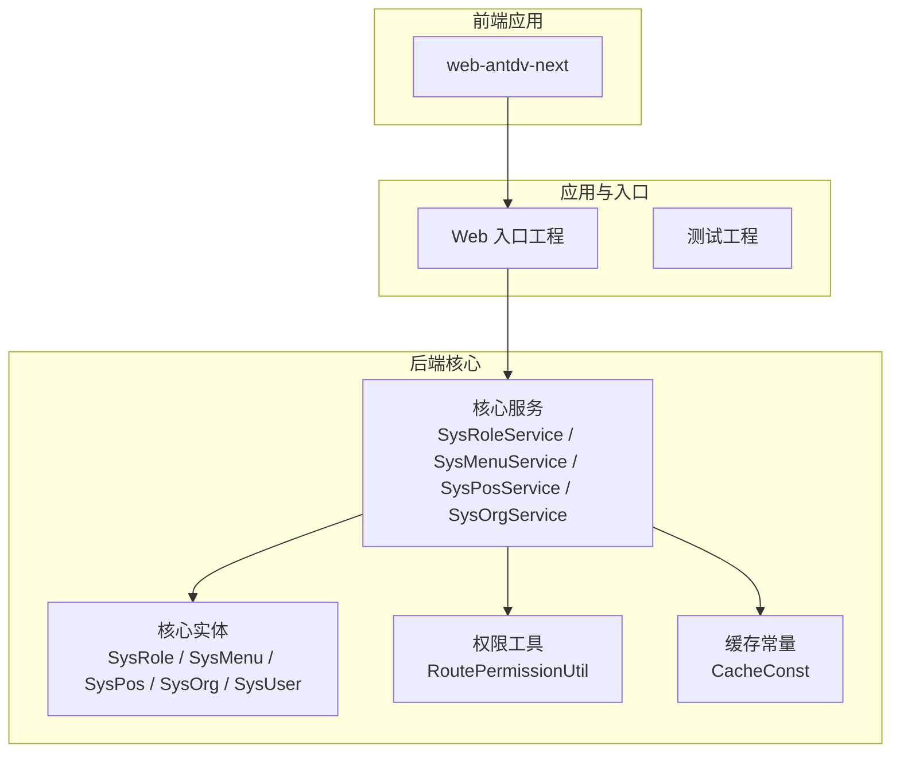
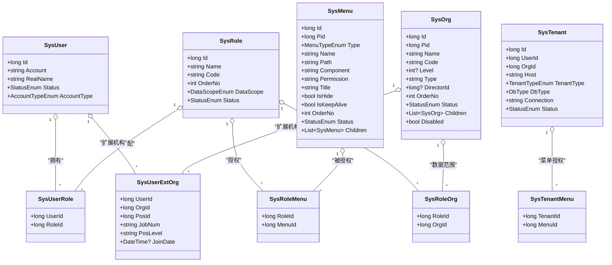
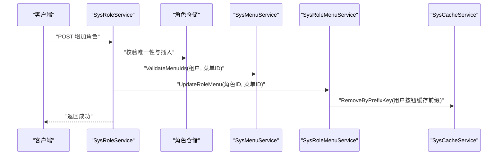
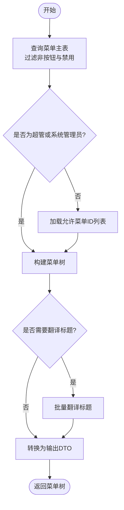
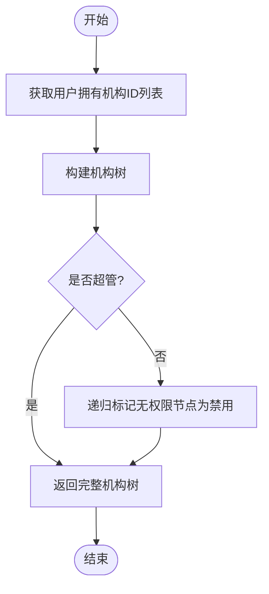
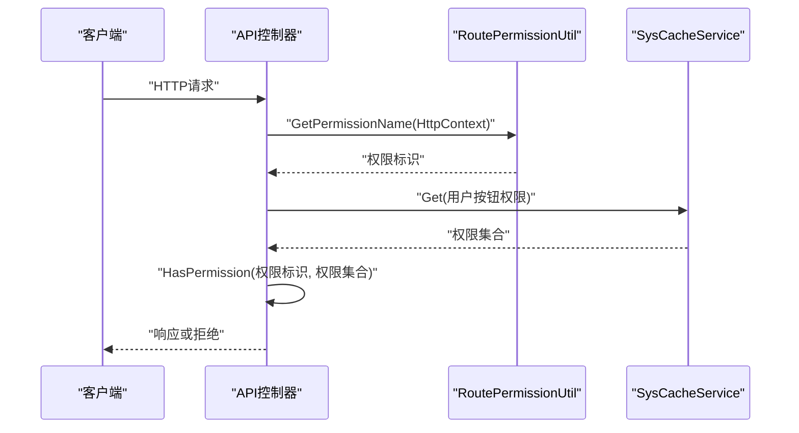
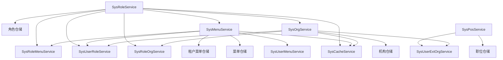
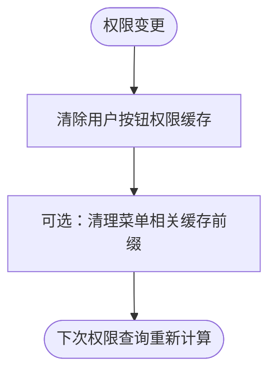

# 权限管理接口

<cite>
**本文引用的文件**   
- [SysRole.cs](file://Admin.NET/Admin.NET.Core/Entity/SysRole.cs)
- [SysMenu.cs](file://Admin.NET/Admin.NET.Core/Entity/SysMenu.cs)
- [SysPos.cs](file://Admin.NET/Admin.NET.Core/Entity/SysPos.cs)
- [SysOrg.cs](file://Admin.NET/Admin.NET.Core/Entity/SysOrg.cs)
- [SysTenant.cs](file://Admin.NET/Admin.NET.Core/Entity/SysTenant.cs)
- [SysUser.cs](file://Admin.NET/Admin.NET.Core/Entity/SysUser.cs)
- [SysRoleMenu.cs](file://Admin.NET/Admin.NET.Core/Entity/SysRoleMenu.cs)
- [SysUserRole.cs](file://Admin.NET/Admin.NET.Core/Entity/SysUserRole.cs)
- [SysUserMenu.cs](file://Admin.NET/Admin.NET.Core/Entity/SysUserMenu.cs)
- [SysTenantMenu.cs](file://Admin.NET/Admin.NET.Core/Entity/SysTenantMenu.cs)
- [SysRoleOrg.cs](file://Admin.NET/Admin.NET.Core/Entity/SysRoleOrg.cs)
- [SysUserExtOrg.cs](file://Admin.NET/Admin.NET.Core/Entity/SysUserExtOrg.cs)
- [SysRoleService.cs](file://Admin.NET/Admin.NET.Core/Service/Role/SysRoleService.cs)
- [SysRoleMenuService.cs](file://Admin.NET/Admin.NET.Core/Service/Role/SysRoleMenuService.cs)
- [SysRoleOrgService.cs](file://Admin.NET/Admin.NET.Core/Service/Role/SysRoleOrgService.cs)
- [SysMenuService.cs](file://Admin.NET/Admin.NET.Core/Service/Menu/SysMenuService.cs)
- [SysPosService.cs](file://Admin.NET/Admin.NET.Core/Service/Pos/SysPosService.cs)
- [SysOrgService.cs](file://Admin.NET/Admin.NET.Core/Service/Org/SysOrgService.cs)
- [SysUserMenuService.cs](file://Admin.NET/Admin.NET.Core/Service/User/SysUserMenuService.cs)
- [SysUserRoleService.cs](file://Admin.NET/Admin.NET.Core/Service/User/SysUserRoleService.cs)
- [SysUserService.cs](file://Admin.NET/Admin.NET.Core/Service/User/SysUserService.cs)
- [RoutePermissionUtil.cs](file://Admin.NET/Admin.NET.Core/Utils/RoutePermissionUtil.cs)
- [CacheConst.cs](file://Admin.NET/Admin.NET.Core/Const/CacheConst.cs)
- [README.md](file://README.md)
</cite>

## 目录
1. [简介](#简介)
2. [项目结构](#项目结构)
3. [核心组件](#核心组件)
4. [架构总览](#架构总览)
5. [详细组件分析](#详细组件分析)
6. [依赖关系分析](#依赖关系分析)
7. [性能与缓存特性](#性能与缓存特性)
8. [故障排查指南](#故障排查指南)
9. [结论](#结论)
10. [附录：前端集成要点](#附录前端集成要点)

## 简介
本文件面向 Admin.NET 的权限管理接口，围绕角色、菜单、职位、机构等基础资源，说明基于 RBAC 的权限模型、按钮级权限控制、数据权限范围、多租户隔离、权限缓存机制、菜单树构建算法以及权限校验流程。文档以当前源码为事实依据，重点覆盖以下能力：

- 角色管理：CRUD、菜单授权、机构授权、删除保护与级联清理。
- 菜单管理：目录/菜单/按钮三态、树形结构、权限标识、动态路由输出。
- 职位管理：组织与人员关联、在职人员查询、删除保护。
- 机构管理：多层级组织树、负责人关联、权限可见性控制。
- RBAC 权限模型：用户-角色-菜单-按钮、租户菜单绑定、数据范围。
- 权限缓存：用户按钮权限集合缓存、刷新策略。
- 权限校验：后端路由到权限标识映射、显式授权规则。
- 多租户隔离：租户维度菜单与数据范围。
- 权限审计日志：操作日志、访问日志、异常日志与差异日志实体。

## 项目结构
后端权限相关代码主要分布在 `Admin.NET.Core` 模块中，采用“实体 + 服务”分层组织；前端业务入口为 `Web/apps/web-antdv-next/`，API 入口为 `Admin.NET.Admin.NET.Web.Entry`。仓库 README 明确前后端分离与模块化设计，并指出已完成前端移植至 Vben / antdv-next。

图表来源
- [SysRole.cs:1-56](file://Admin.NET/Admin.NET.Core/Entity/SysRole.cs#L1-L56)
- [SysMenu.cs:1-134](file://Admin.NET/Admin.NET.Core/Entity/SysMenu.cs#L1-L134)
- [SysPosService.cs:1-113](file://Admin.NET/Admin.NET.Core/Service/Pos/SysPosService.cs#L1-L113)
- [SysOrgService.cs:1-200](file://Admin.NET/Admin.NET.Core/Service/Org/SysOrgService.cs#L1-L200)
- [README.md:1-144](file://README.md#L1-L144)

章节来源
- [README.md:1-144](file://README.md#L1-L144)

## 核心组件
权限系统由实体层定义数据模型，服务层实现 CRUD、授权、树构建与权限校验，工具类负责将 HTTP 路由转换为权限标识，缓存常量提供键前缀约定。

| 组件 | 职责 | 关键行为 |
|---|---|---|
| SysRole | 角色实体 | 名称、编码、排序、数据范围、状态；继承租户上下文。 |
| SysMenu | 菜单实体 | 父节点、类型（目录/菜单/按钮）、路由、权限标识、标题、图标、是否隐藏/缓存/固定、排序、状态；支持子节点列表。 |
| SysPos | 职位实体 | 名称、编码、排序、状态；包含在职人员扩展字段。 |
| SysOrg | 机构实体 | 父节点、名称、编码、级别、类型、负责人、排序、状态；支持子节点列表与禁用标记。 |
| SysUser | 用户实体 | 账号、密码、姓名、联系方式、状态、排序、账号类型；继承租户与机构上下文。 |
| SysTenant | 租户实体 | 租管用户、机构、域名、类型、数据库连接配置、注册开关、标志信息。 |
| SysRoleMenu | 角色-菜单关联 | 角色与菜单的多对多关系。 |
| SysUserRole | 用户-角色关联 | 用户与角色的多对多关系。 |
| SysTenantMenu | 租户-菜单关联 | 租户维度的菜单授权。 |
| SysRoleOrg | 角色-机构关联 | 角色与机构的授权关系，用于数据范围。 |
| SysUserExtOrg | 用户扩展机构 | 用户在一个或多个机构中的职位、工号、职级、入职日期。 |
| RoutePermissionUtil | 权限标识转换 | 将 API 路径转换为权限字符串，并提供显式授权判断。 |
| CacheConst | 缓存键常量 | 定义用户按钮权限等缓存键前缀。 |

章节来源
- [SysRole.cs:1-56](file://Admin.NET/Admin.NET.Core/Entity/SysRole.cs#L1-L56)
- [SysMenu.cs:1-134](file://Admin.NET/Admin.NET.Core/Entity/SysMenu.cs#L1-L134)
- [SysPos.cs:1-56](file://Admin.NET/Admin.NET.Core/Entity/SysPos.cs#L1-L56)
- [SysOrg.cs:1-96](file://Admin.NET/Admin.NET.Core/Entity/SysOrg.cs#L1-L96)
- [SysUser.cs:1-200](file://Admin.NET/Admin.NET.Core/Entity/SysUser.cs#L1-L200)
- [SysTenant.cs:1-145](file://Admin.NET/Admin.NET.Core/Entity/SysTenant.cs#L1-L145)
- [SysRoleMenu.cs:1-35](file://Admin.NET/Admin.NET.Core/Entity/SysRoleMenu.cs#L1-L35)
- [SysUserRole.cs:1-41](file://Admin.NET/Admin.NET.Core/Entity/SysUserRole.cs#L1-L41)
- [SysTenantMenu.cs:1-27](file://Admin.NET/Admin.NET.Core/Entity/SysTenantMenu.cs#L1-L27)
- [SysRoleOrg.cs:1-35](file://Admin.NET/Admin.NET.Core/Entity/SysRoleOrg.cs#L1-L35)
- [SysUserExtOrg.cs:1-77](file://Admin.NET/Admin.NET.Core/Entity/SysUserExtOrg.cs#L1-L77)
- [RoutePermissionUtil.cs:1-95](file://Admin.NET/Admin.NET.Core/Utils/RoutePermissionUtil.cs#L1-L95)
- [CacheConst.cs:17-17](file://Admin.NET/Admin.NET.Core/Const/CacheConst.cs#L17-L17)

## 架构总览
RBAC 权限模型在 Admin.NET 中通过用户、角色、菜单、机构与租户组合实现：

- 用户拥有多个角色。
- 角色绑定菜单和按钮，并可绑定机构以实现数据范围。
- 菜单分为目录、菜单、按钮三类，按钮携带权限标识。
- 租户可绑定菜单，实现菜单级多租户隔离。
- 用户登录后可获取其权限菜单树和按钮权限集合。
- 后端将 API 路由映射为权限标识进行校验。

图表来源
- [SysUser.cs:1-200](file://Admin.NET/Admin.NET.Core/Entity/SysUser.cs#L1-L200)
- [SysRole.cs:1-56](file://Admin.NET/Admin.NET.Core/Entity/SysRole.cs#L1-L56)
- [SysMenu.cs:1-134](file://Admin.NET/Admin.NET.Core/Entity/SysMenu.cs#L1-L134)
- [SysOrg.cs:1-96](file://Admin.NET/Admin.NET.Core/Entity/SysOrg.cs#L1-L96)
- [SysTenant.cs:1-145](file://Admin.NET/Admin.NET.Core/Entity/SysTenant.cs#L1-L145)
- [SysUserRole.cs:1-41](file://Admin.NET/Admin.NET.Core/Entity/SysUserRole.cs#L1-L41)
- [SysRoleMenu.cs:1-35](file://Admin.NET/Admin.NET.Core/Entity/SysRoleMenu.cs#L1-L35)
- [SysRoleOrg.cs:1-35](file://Admin.NET/Admin.NET.Core/Entity/SysRoleOrg.cs#L1-L35)
- [SysTenantMenu.cs:1-27](file://Admin.NET/Admin.NET.Core/Entity/SysTenantMenu.cs#L1-L27)
- [SysUserExtOrg.cs:1-77](file://Admin.NET/Admin.NET.Core/Entity/SysUserExtOrg.cs#L1-L77)

## 详细组件分析

### 角色管理接口
角色服务提供分页列表、列表、新增、更新、删除与菜单授权等能力。关键行为包括：

- 分页与列表查询按超管、系统管理员与普通用户的权限边界过滤租户与角色所有权。
- 新增角色时校验名称与编码唯一性，强制设置数据范围为仅本人，并校验菜单 ID。
- 更新角色忽略敏感字段，并重新授权菜单。
- 删除角色需检查是否有用户绑定、注册方案绑定，并级联删除角色机构、用户角色、角色菜单。
- 菜单授权会校验租户菜单合法性，支持批量角色授权，并清除用户按钮权限缓存。

图表来源
- [SysRoleService.cs:1-200](file://Admin.NET/Admin.NET.Core/Service/Role/SysRoleService.cs#L1-L200)
- [SysRoleMenuService.cs:1-100](file://Admin.NET/Admin.NET.Core/Service/Role/SysRoleMenuService.cs#L1-L100)
- [CacheConst.cs:17-17](file://Admin.NET/Admin.NET.Core/Const/CacheConst.cs#L17-L17)

#### 角色数据范围
角色实体包含数据范围枚举，常见值包括全部数据、本部门及以下、本部门、仅本人、自定义数据。数据范围通过角色-机构表进一步限定具体机构范围，并在数据查询时结合角色与机构进行过滤。

章节来源
- [SysRole.cs:1-56](file://Admin.NET/Admin.NET.Core/Entity/SysRole.cs#L1-L56)
- [SysRoleService.cs:1-200](file://Admin.NET/Admin.NET.Core/Service/Role/SysRoleService.cs#L1-L200)
- [SysRoleOrgService.cs:1-75](file://Admin.NET/Admin.NET.Core/Service/Role/SysRoleOrgService.cs#L1-L75)

### 菜单管理接口
菜单服务提供登录菜单树、Vben 菜单树、菜单列表、新增、更新等操作。关键行为包括：

- 登录菜单树根据用户权限过滤菜单，非按钮且启用状态的菜单参与构建。
- 非超管或系统管理员的用户需通过菜单 ID 列表过滤。
- 菜单标题支持语言翻译，仅在用户语言与系统默认语言不同时调用缓存翻译。
- 使用 `ToTree` 构建父子树结构，并按 `OrderNo` 与 `Id` 排序。
- 旧版支付相关菜单会被过滤以避免已下线功能进入登录入口。
- Vben 菜单树是对登录菜单树的 DTO 转换输出。

图表来源
- [SysMenuService.cs:1-200](file://Admin.NET/Admin.NET.Core/Service/Menu/SysMenuService.cs#L1-L200)

#### 菜单树构建算法
菜单树构建依赖菜单实体的 `Pid` 与 `Children` 字段，并通过 `ToTree` 将扁平列表转为树结构。对于菜单类型：

- 目录：作为容器，通常不直接暴露按钮权限。
- 菜单：页面级菜单，可能对应前端路由。
- 按钮：操作级权限，携带 `Permission` 标识，用于按钮级控制。

章节来源
- [SysMenu.cs:1-134](file://Admin.NET/Admin.NET.Core/Entity/SysMenu.cs#L1-L134)
- [SysMenuService.cs:1-200](file://Admin.NET/Admin.NET.Core/Service/Menu/SysMenuService.cs#L1-L200)

### 职位管理接口
职位服务提供列表、新增、更新、删除能力，并与用户扩展机构表联动：

- 列表查询包含在职人员，通过主职位或扩展机构职位聚合。
- 新增与更新校验名称与编码唯一性。
- 删除时需检查主职位与扩展职位是否有用户绑定，以及是否绑定注册方案。
- 非超管创建者不可修改或删除他人创建的职位。

章节来源
- [SysPosService.cs:1-113](file://Admin.NET/Admin.NET.Core/Service/Pos/SysPosService.cs#L1-L113)
- [SysPos.cs:1-56](file://Admin.NET/Admin.NET.Core/Entity/SysPos.cs#L1-L56)
- [SysUserExtOrg.cs:1-77](file://Admin.NET/Admin.NET.Core/Entity/SysUserExtOrg.cs#L1-L77)

### 机构管理接口
机构服务提供列表、树形结构、新增、更新、删除能力，并支持权限可见性控制：

- 列表查询支持按租户、名称、编码、类型筛选，并根据用户拥有的机构 ID 列表进行权限过滤。
- 树形结构会根据用户权限递归标记无权限节点为禁用，防止越权操作。
- 新增机构时校验父机构是否在用户权限范围内；根节点新增受权限限制。
- 变更父机构时会清理相关用户机构缓存，保证后续查询一致性。

图表来源
- [SysOrgService.cs:1-200](file://Admin.NET/Admin.NET.Core/Service/Org/SysOrgService.cs#L1-L200)
- [SysOrg.cs:1-96](file://Admin.NET/Admin.NET.Core/Entity/SysOrg.cs#L1-L96)

章节来源
- [SysOrgService.cs:1-200](file://Admin.NET/Admin.NET.Core/Service/Org/SysOrgService.cs#L1-L200)
- [SysOrg.cs:1-96](file://Admin.NET/Admin.NET.Core/Entity/SysOrg.cs#L1-L96)

### 用户与快捷菜单
用户快捷菜单服务支持收藏、取消收藏与获取当前用户收藏菜单集合：

- 收藏菜单会先验证所选菜单是否存在于可用菜单集合中。
- 可用菜单集合来源于登录菜单树，排除隐藏菜单与按钮。
- 收藏结果只保留菜单类型的项，便于前端展示快捷入口。

章节来源
- [SysUserMenuService.cs:1-123](file://Admin.NET/Admin.NET.Core/Service/User/SysUserMenuService.cs#L1-L123)
- [SysMenuService.cs:1-200](file://Admin.NET/Admin.NET.Core/Service/Menu/SysMenuService.cs#L1-L200)

### 权限校验与动态路由
权限校验的核心是将 HTTP 路由转换为权限标识，并结合用户已授权按钮集合进行匹配：

- 路由转换规则会将 `/api/sysXxx:yyy` 转换为 `sysXxx:yyy`。
- 部分路由存在映射关系，例如日志查看、文件预览、任务调度等统一映射到某个页面权限。
- 某些敏感操作需要显式授权，不能因旧菜单未登记按钮而放行。
- 开放接口的密钥生成与列表复用新增或更新权限。

图表来源
- [RoutePermissionUtil.cs:1-95](file://Admin.NET/Admin.NET.Core/Utils/RoutePermissionUtil.cs#L1-L95)
- [SysMenuService.cs:369-403](file://Admin.NET/Admin.NET.Core/Service/Menu/SysMenuService.cs#L369-L403)
- [CacheConst.cs:17-17](file://Admin.NET/Admin.NET.Core/Const/CacheConst.cs#L17-L17)

章节来源
- [RoutePermissionUtil.cs:1-95](file://Admin.NET/Admin.NET.Core/Utils/RoutePermissionUtil.cs#L1-L95)
- [SysMenuService.cs:369-403](file://Admin.NET/Admin.NET.Core/Service/Menu/SysMenuService.cs#L369-L403)

### 多租户权限隔离
租户菜单表用于将菜单与租户绑定，实现菜单级多租户隔离；角色与服务层查询普遍以租户上下文为边界：

- 角色列表与新增时根据超管与租户 ID 决定归属租户。
- 菜单列表与登录菜单树通过租户上下文过滤。
- 租户实体包含数据库连接、读写分离与注册开关等配置。

章节来源
- [SysTenantMenu.cs:1-27](file://Admin.NET/Admin.NET.Core/Entity/SysTenantMenu.cs#L1-L27)
- [SysRoleService.cs:1-200](file://Admin.NET/Admin.NET.Core/Service/Role/SysRoleService.cs#L1-L200)
- [SysMenuService.cs:1-200](file://Admin.NET/Admin.NET.Core/Service/Menu/SysMenuService.cs#L1-L200)
- [SysTenant.cs:1-145](file://Admin.NET/Admin.NET.Core/Entity/SysTenant.cs#L1-L145)

### 权限审计日志
权限相关的审计能力由日志实体与服务提供，包括：

- 访问日志：记录用户访问行为。
- 操作日志：记录正常业务操作。
- 异常日志：记录系统异常信息。
- 差异日志：记录数据变更差异。

这些实体位于 `Admin.NET.Core` 的日志模块，服务类分别提供增删查等能力，便于审计与排障。

章节来源
- [SysLogVis.cs](file://Admin.NET/Admin.NET.Core/Entity/SysLogVis.cs)
- [SysLogOp.cs](file://Admin.NET/Admin.NET.Core/Entity/SysLogOp.cs)
- [SysLogEx.cs](file://Admin.NET/Admin.NET.Core/Entity/SysLogEx.cs)
- [SysLogDiff.cs](file://Admin.NET/Admin.NET.Core/Entity/SysLogDiff.cs)
- [SysLogVisService.cs](file://Admin.NET/Admin.NET.Core/Service/Log/SysLogVisService.cs)
- [SysLogOpService.cs](file://Admin.NET/Admin.NET.Core/Service/Log/SysLogOpService.cs)
- [SysLogExService.cs](file://Admin.NET/Admin.NET.Core/Service/Log/SysLogExService.cs)
- [SysLogDiffService.cs](file://Admin.NET/Admin.NET.Core/Service/Log/SysLogDiffService.cs)

## 依赖关系分析
权限相关服务的依赖关系如下：

图表来源
- [SysRoleService.cs:1-200](file://Admin.NET/Admin.NET.Core/Service/Role/SysRoleService.cs#L1-L200)
- [SysMenuService.cs:1-200](file://Admin.NET/Admin.NET.Core/Service/Menu/SysMenuService.cs#L1-L200)
- [SysPosService.cs:1-113](file://Admin.NET/Admin.NET.Core/Service/Pos/SysPosService.cs#L1-L113)
- [SysOrgService.cs:1-200](file://Admin.NET/Admin.NET.Core/Service/Org/SysOrgService.cs#L1-L200)

章节来源
- [SysRoleService.cs:1-200](file://Admin.NET/Admin.NET.Core/Service/Role/SysRoleService.cs#L1-L200)
- [SysMenuService.cs:1-200](file://Admin.NET/Admin.NET.Core/Service/Menu/SysMenuService.cs#L1-L200)
- [SysPosService.cs:1-113](file://Admin.NET/Admin.NET.Core/Service/Pos/SysPosService.cs#L1-L113)
- [SysOrgService.cs:1-200](file://Admin.NET/Admin.NET.Core/Service/Org/SysOrgService.cs#L1-L200)

## 性能与缓存特性
权限系统使用缓存提升按钮权限查询性能，并避免频繁数据库访问：

- 用户按钮权限缓存键前缀为 `sys_user_button:`，键值为用户按钮权限集合。
- 角色菜单授权、用户角色授权、角色删除、租户切换等场景会清除用户按钮权限缓存。
- 菜单服务在计算用户权限时读取缓存，若不存在则计算并写入缓存。
- 菜单标题翻译通过语言文本缓存服务批量处理，减少不必要的翻译开销。

图表来源
- [SysRoleMenuService.cs:77-78](file://Admin.NET/Admin.NET.Core/Service/Role/SysRoleMenuService.cs#L77-L78)
- [SysUserRoleService.cs:36-74](file://Admin.NET/Admin.NET.Core/Service/User/SysUserRoleService.cs#L36-L74)
- [SysMenuService.cs:369-403](file://Admin.NET/Admin.NET.Core/Service/Menu/SysMenuService.cs#L369-L403)
- [CacheConst.cs:17-17](file://Admin.NET/Admin.NET.Core/Const/CacheConst.cs#L17-L17)

章节来源
- [SysRoleMenuService.cs:1-100](file://Admin.NET/Admin.NET.Core/Service/Role/SysRoleMenuService.cs#L1-L100)
- [SysUserRoleService.cs:1-111](file://Admin.NET/Admin.NET.Core/Service/User/SysUserRoleService.cs#L1-L111)
- [SysMenuService.cs:369-403](file://Admin.NET/Admin.NET.Core/Service/Menu/SysMenuService.cs#L369-L403)
- [CacheConst.cs:17-17](file://Admin.NET/Admin.NET.Core/Const/CacheConst.cs#L17-L17)

## 故障排查指南
常见问题与排查建议：

- 登录后菜单为空：
  - 检查菜单是否启用、是否为按钮类型。
  - 检查用户是否具备相应菜单权限。
  - 检查菜单标题翻译是否生效。
- 按钮权限无效：
  - 检查角色菜单授权是否正确。
  - 检查用户角色授权是否生效。
  - 检查用户按钮权限缓存是否被正确清除。
- 机构树显示异常：
  - 检查用户是否拥有该机构权限。
  - 检查父机构是否越权新增。
  - 检查机构缓存是否被清理。
- 多租户菜单不一致：
  - 检查租户菜单绑定。
  - 检查服务层租户上下文过滤。
- 权限校验失败：
  - 检查路由到权限标识映射。
  - 检查显式授权规则是否命中。

章节来源
- [SysMenuService.cs:1-200](file://Admin.NET/Admin.NET.Core/Service/Menu/SysMenuService.cs#L1-L200)
- [SysRoleMenuService.cs:1-100](file://Admin.NET/Admin.NET.Core/Service/Role/SysRoleMenuService.cs#L1-L100)
- [SysUserRoleService.cs:1-111](file://Admin.NET/Admin.NET.Core/Service/User/SysUserRoleService.cs#L1-L111)
- [SysOrgService.cs:1-200](file://Admin.NET/Admin.NET.Core/Service/Org/SysOrgService.cs#L1-L200)
- [RoutePermissionUtil.cs:1-95](file://Admin.NET/Admin.NET.Core/Utils/RoutePermissionUtil.cs#L1-L95)

## 结论
Admin.NET 的权限管理以 RBAC 为核心，结合租户、机构、菜单与按钮形成完整的权限体系。角色负责权限聚合，菜单负责界面与按钮标识，机构负责数据范围，租户负责资源隔离。权限缓存提升了按钮权限查询性能，路由到权限标识的工具简化了后端校验逻辑。职位与机构提供了组织架构支撑，日志实体提供了审计能力。前端可通过菜单树与按钮权限指令集成权限控制，并通过路由守卫与后端权限校验共同保障安全。

## 附录：前端集成要点
- 菜单树：
  - 调用登录菜单树接口获取菜单结构，前端据此构建导航与动态路由。
  - 菜单类型区分目录、菜单与按钮，按钮权限标识用于按钮级控制。
- 按钮权限指令：
  - 前端可使用按钮权限指令根据用户按钮权限集合控制按钮显示或禁用。
- 路由守卫：
  - 前端路由守卫可结合菜单树与权限标识进行跳转拦截。
- 多语言：
  - 菜单标题翻译由后端缓存服务完成，前端无需额外翻译逻辑。

[本节为概念性说明，不直接分析具体源文件]