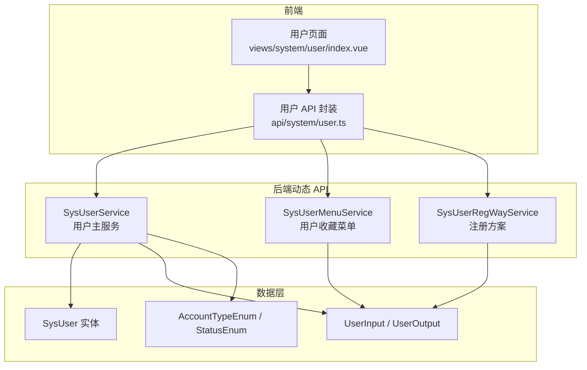
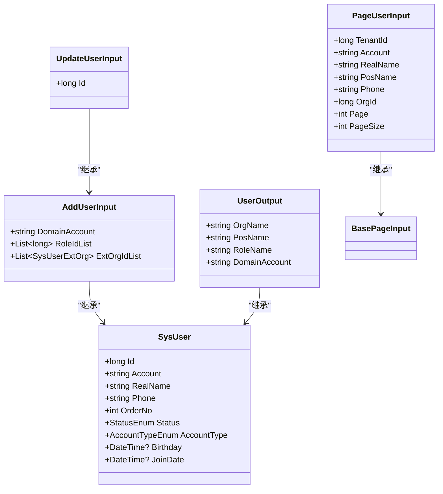
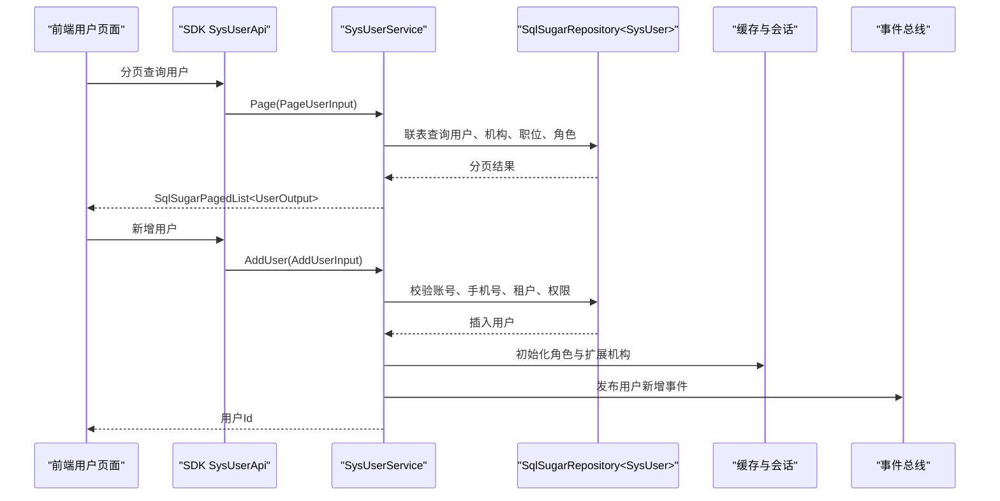
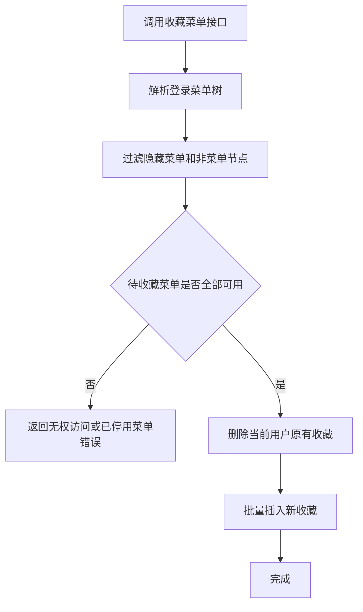
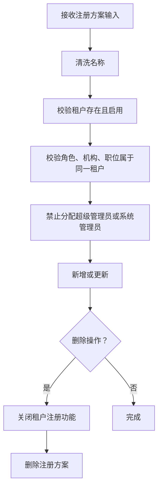
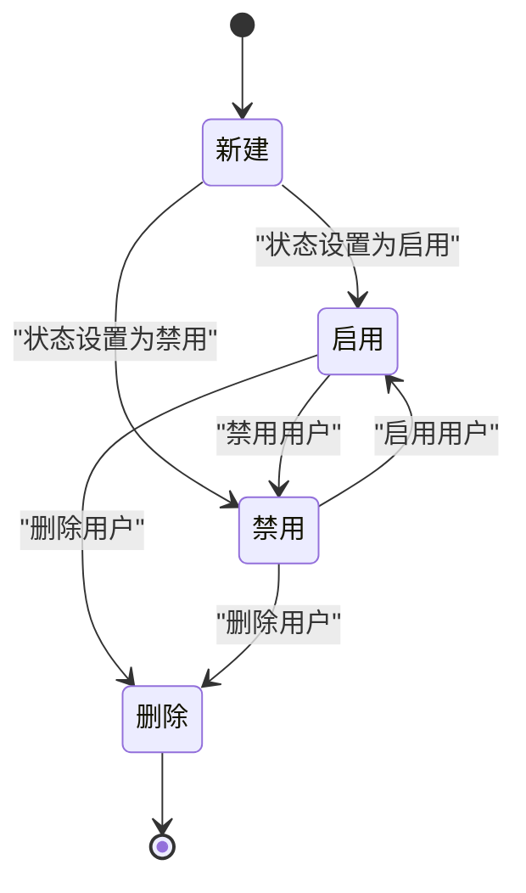
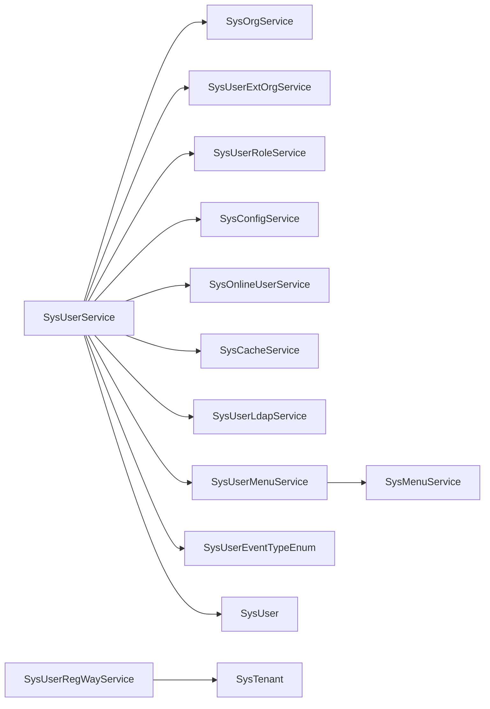

# 用户管理接口

<cite>
**本文引用的文件 **
- [SysUserService.cs](file://Admin.NET/Admin.NET.Core/Service/User/SysUserService.cs)
- [UserInput.cs](file://Admin.NET/Admin.NET.Core/Service/User/Dto/UserInput.cs)
- [UserOutput.cs](file://Admin.NET/Admin.NET.Core/Service/User/Dto/UserOutput.cs)
- [SysUserMenuService.cs](file://Admin.NET/Admin.NET.Core/Service/User/SysUserMenuService.cs)
- [SysUserRegWayService.cs](file://Admin.NET/Admin.NET.Core/Service/User/SysUserRegWayService.cs)
- [SysUser.cs](file://Admin.NET/Admin.NET.Core/Entity/SysUser.cs)
- [AccountTypeEnum.cs](file://Admin.NET/Admin.NET.Core/Enum/AccountTypeEnum.cs)
- [StatusEnum.cs](file://Admin.NET/Admin.NET.Core/Enum/StatusEnum.cs)
- [user.ts](file://Web/apps/web-antdv-next/src/api/system/user.ts)
- [index.vue](file://Web/apps/web-antdv-next/src/views/system/user/index.vue)
</cite>

## 目录
1. [简介](#简介)
2. [项目结构定位](#项目结构定位)
3. [核心组件与数据模型](#核心组件与数据模型)
4. [架构总览](#架构总览)
5. [用户管理接口规范](#用户管理接口规范)
6. [批量操作能力说明](#批量操作能力说明)
7. [用户角色与菜单权限接口](#用户角色与菜单权限接口)
8. [用户注册方式管理接口](#用户注册方式管理接口)
9. [前端表格集成示例](#前端表格集成示例)
10. [状态、密码与生命周期管理](#状态密码与生命周期管理)
11. [数据权限与租户隔离](#数据权限与租户隔离)
12. [依赖关系分析](#依赖关系分析)
13. [性能与可扩展性](#性能与可扩展性)
14. [故障排查指南](#故障排查指南)
15. [结论](#结论)

## 简介
本文面向 Admin.NET 后端与当前业务前端 `web-antdv-next`，系统化梳理用户管理相关接口。文档覆盖：
- 用户基础增删改查接口；
- 分页查询、过滤条件、排序规则；
- 用户状态更新、密码重置、解锁登录；
- 用户角色分配、扩展机构、收藏菜单；
- 用户注册方案管理；
- 数据权限、租户隔离、账号类型限制；
- 前端用户列表页面的搜索、筛选、排序、分页和交互实现。

需要特别说明：当前源码中未找到独立的“用户批量导入”“用户批量导出”控制器或 API 实现。因此本文不会虚构批量导入导出接口，仅对现有能力进行准确描述。

## 项目结构定位
用户管理的后端逻辑集中在 `.NET Core` 的 `SysUserService`、`SysUserMenuService` 和 `SysUserRegWayService` 三个动态 API 服务中；实体和数据传输对象位于 `Entity` 与 `Service/User/Dto` 下。业务前端以 `Web/apps/web-antdv-next/src/api/system/user.ts` 作为用户 API 调用封装，并以 `Web/apps/web-antdv-next/src/views/system/user/index.vue` 作为用户管理页面入口。

**图表来源**
- [SysUserService.cs:58-598](file://Admin.NET/Admin.NET.Core/Service/User/SysUserService.cs#L58-L598)
- [SysUserMenuService.cs:1-123](file://Admin.NET/Admin.NET.Core/Service/User/SysUserMenuService.cs#L1-L123)
- [SysUserRegWayService.cs:1-136](file://Admin.NET/Admin.NET.Core/Service/User/SysUserRegWayService.cs#L1-L136)
- [SysUser.cs:1-200](file://Admin.NET/Admin.NET.Core/Entity/SysUser.cs#L1-L200)
- [UserInput.cs:1-133](file://Admin.NET/Admin.NET.Core/Service/User/Dto/UserInput.cs#L1-L133)
- [UserOutput.cs:1-30](file://Admin.NET/Admin.NET.Core/Service/User/Dto/UserOutput.cs#L1-L30)
- [AccountTypeEnum.cs:1-38](file://Admin.NET/Admin.NET.Core/Enum/AccountTypeEnum.cs#L1-L38)
- [StatusEnum.cs:13-25](file://Admin.NET/Admin.NET.Core/Enum/StatusEnum.cs#L13-L25)
- [user.ts:1-57](file://Web/apps/web-antdv-next/src/api/system/user.ts#L1-L57)
- [index.vue:1-204](file://Web/apps/web-antdv-next/src/views/system/user/index.vue#L1-L204)

## 核心组件与数据模型

### 用户实体字段
`SysUser` 继承租户和组织基类，包含账号、密码、姓名、昵称、头像、性别、年龄、生日、民族、手机、证件类型、身份证号、邮箱、地址、文化程度、政治面貌、毕业院校、办公电话、紧急联系人信息、个人简介、排序、状态、备注、账号类型等字段。其中账号、手机号分别建有索引，密码字段在序列化时被忽略。

| 字段 | 含义 | 长度或约束 | 是否必填 |
|---|---|---|---|
| `Account` | 账号 | 最多 32 字符 | 新增时必填 |
| `Password` | 密码 | 最多 512 字符，不返回给前端 | 新增时可由系统默认或前端加密传入 |
| `RealName` | 真实姓名 | 最多 32 字符 | 新增时必填 |
| `NickName` | 昵称 | 最多 32 字符 | 可选 |
| `Avatar` | 头像地址 | 最多 512 字符 | 可选 |
| `Sex` | 性别 | 枚举 | 默认男 |
| `Age` | 年龄 | 整数 | 可选 |
| `Birthday` | 出生日期 | 可空日期 | 可选 |
| `Nation` | 民族 | 最多 32 字符 | 可选 |
| `Phone` | 手机号码 | 最多 16 字符 | 可选，需唯一 |
| `CardType` | 证件类型 | 枚举 | 可选 |
| `IdCardNum` | 身份证号 | 最多 32 字符 | 可选 |
| `Email` | 邮箱 | 最多 64 字符 | 可选 |
| `Address` | 地址 | 最多 256 字符 | 可选 |
| `CultureLevel` | 文化程度 | 枚举 | 可选 |
| `PoliticalOutlook` | 政治面貌 | 最多 16 字符 | 可选 |
| `College` | 毕业院校 | 最多 128 字符 | 可选 |
| `OfficePhone` | 办公电话 | 最多 16 字符 | 可选 |
| `EmergencyContact` | 紧急联系人 | 最多 32 字符 | 可选 |
| `EmergencyPhone` | 紧急联系人电话 | 最多 16 字符 | 可选 |
| `EmergencyAddress` | 紧急联系人地址 | 最多 256 字符 | 可选 |
| `Introduction` | 个人简介 | 最多 512 字符 | 可选 |
| `OrderNo` | 排序号 | 整数，默认 100 | 可选 |
| `Status` | 状态 | 启用为 1，禁用为 2 | 默认启用 |
| `Remark` | 备注 | 最多 256 字符 | 可选 |
| `AccountType` | 账号类型 | 超级管理员、系统管理员、普通账号、会员 | 新增时受权限控制 |

**章节来源**
- [SysUser.cs:16-200](file://Admin.NET/Admin.NET.Core/Entity/SysUser.cs#L16-L200)
- [StatusEnum.cs:13-25](file://Admin.NET/Admin.NET.Core/Enum/StatusEnum.cs#L13-L25)
- [AccountTypeEnum.cs:13-38](file://Admin.NET/Admin.NET.Core/Enum/AccountTypeEnum.cs#L13-L38)

### 用户输入输出模型
- `PageUserInput`：分页查询参数，继承通用分页基类，额外支持租户、账号、姓名、职位名、手机号、机构 ID 过滤。
- `AddUserInput`：新增用户参数，继承 `SysUser`，增加域账号、角色集合、扩展机构集合，并对账号和真实姓名增加必填校验。
- `UpdateUserInput`：更新用户参数，复用新增参数结构并增加主键 `Id`。
- `UserOutput`：分页和用户详情展示模型，继承 `SysUser`，补充机构名称、职位名称、角色名称、域账号。

**图表来源**
- [SysUser.cs:16-200](file://Admin.NET/Admin.NET.Core/Entity/SysUser.cs#L16-L200)
- [UserInput.cs:19-88](file://Admin.NET/Admin.NET.Core/Service/User/Dto/UserInput.cs#L19-L88)
- [UserOutput.cs:9-30](file://Admin.NET/Admin.NET.Core/Service/User/Dto/UserOutput.cs#L9-L30)

**章节来源**
- [UserInput.cs:19-88](file://Admin.NET/Admin.NET.Core/Service/User/Dto/UserInput.cs#L19-L88)
- [UserOutput.cs:9-30](file://Admin.NET/Admin.NET.Core/Service/User/Dto/UserOutput.cs#L9-L30)

## 架构总览
用户管理采用典型的分层动态 API 模式：
- 前端通过 SDK 生成的 `SysUserApi` 调用后端 `/api/sys-user/*` 风格接口；
- `SysUserService` 负责用户主流程，包括分页、新增、更新、删除、状态、密码、角色、扩展机构、域账号、事件发布；
- `SysUserMenuService` 负责当前登录用户的收藏菜单；
- `SysUserRegWayService` 负责公开注册方案的管理；
- 所有写操作均结合 `UserManager`、组织树、在线用户缓存、事件总线完成权限与安全控制。

**图表来源**
- [SysUserService.cs:58-136](file://Admin.NET/Admin.NET.Core/Service/User/SysUserService.cs#L58-L136)
- [user.ts:14-27](file://Web/apps/web-antdv-next/src/api/system/user.ts#L14-L27)

## 用户管理接口规范

以下接口均为动态 API 服务暴露的后端方法。实际 HTTP 路径由框架根据 `ApiDescriptionSettings` 与类名、方法名组合生成，通常对应 `/api/sys-user/*`。请求体一般为 JSON，响应体为统一包装结构，业务数据位于 `data.result`。

### 获取用户分页列表
- 用途：用户列表查询，支持按账号、姓名、职位、手机号、机构范围、租户过滤。
- 方法：POST
- URL：`/api/sys-user/Page`
- 请求体：`PageUserInput`
- 分页参数：
  - `Page`：页码，来自通用分页基类。
  - `PageSize`：每页条数，来自通用分页基类。
- 过滤参数：
  - `TenantId`：超管可指定租户；非超管默认使用当前租户。
  - `OrgId`：查询该机构及其子机构下的用户。
  - `Account`：账号模糊匹配。
  - `RealName`：真实姓名模糊匹配。
  - `PosName`：职位名称模糊匹配。
  - `Phone`：手机号模糊匹配。
- 返回体：`SqlSugarPagedList<UserOutput>`，前端通常取 `data.result.items` 和 `data.result.total`。
- 权限规则：
  - 排除超级管理员账号本身；
  - 非超管不能查看系统管理员；
  - 超管可限定租户；
  - 非超管按用户组织范围过滤。

**章节来源**
- [SysUserService.cs:58-91](file://Admin.NET/Admin.NET.Core/Service/User/SysUserService.cs#L58-L91)
- [UserInput.cs:28-53](file://Admin.NET/Admin.NET.Core/Service/User/Dto/UserInput.cs#L28-L53)
- [UserOutput.cs:9-30](file://Admin.NET/Admin.NET.Core/Service/User/Dto/UserOutput.cs#L9-L30)

### 新增用户
- 用途：后台新增系统用户，同时设置角色、扩展机构、域账号。
- 方法：POST
- URL：`/api/sys-user/Add`
- 请求体：`AddUserInput`
- 必填字段：
  - `Account`：账号；
  - `RealName`：真实姓名；
  - `TenantId`：超管可指定，否则使用当前租户。
- 可选字段：
  - `Password`：若为空则读取系统默认密码配置；若前端开启强密码传输，则应使用 SM2 加密后传入；
  - `RoleIdList`：角色集合；
  - `ExtOrgIdList`：扩展机构集合；
  - `DomainAccount`：域账号；
  - 其他 `SysUser` 基础信息如手机号、邮箱、生日等。
- 返回值：`long`，即新用户主键。
- 主要验证：
  - 账号全局唯一；
  - 手机号全局唯一；
  - 非超管不能新增超级管理员或系统管理员；
  - 关联角色与扩展机构写入；
  - 发布新增事件。

**章节来源**
- [SysUserService.cs:93-136](file://Admin.NET/Admin.NET.Core/Service/User/SysUserService.cs#L93-L136)
- [UserInput.cs:55-88](file://Admin.NET/Admin.NET.Core/Service/User/Dto/UserInput.cs#L55-L88)
- [SysUser.cs:16-200](file://Admin.NET/Admin.NET.Core/Entity/SysUser.cs#L16-L200)

### 注册用户
- 用途：供外部授权注册入口创建用户，例如开放注册方案。
- 方法：POST
- URL：通常为 `/api/sys-user/Register`（该方法是内部注册流程的一部分）。
- 请求体：`AddUserInput`。
- 行为差异：
  - 匿名注册使用已授权的注册方案，不读取匿名用户机构和角色管理范围；
  - 不允许注册超级管理员或系统管理员；
  - 密码可为空走系统默认，或由前端 SM2 加密后解密并校验强度；
  - 同样写入角色、扩展机构、域账号并发布注册事件。

注意：该接口更偏向内部注册流程，公共前端用户管理页面主要通过“新增用户”和“注册方案”协作。

**章节来源**
- [SysUserService.cs:137-190](file://Admin.NET/Admin.NET.Core/Service/User/SysUserService.cs#L137-L190)

### 更新用户
- 用途：修改用户基本信息、角色、扩展机构、域账号等。
- 方法：POST
- URL：`/api/sys-user/Update`
- 请求体：`UpdateUserInput`，必须包含 `Id`。
- 更新策略：
  - 忽略密码、状态、租户、审计字段等敏感字段；
  - 单独白名单更新 `Birthday` 和 `JoinDate`，允许清空；
  - 同步角色和扩展机构；
  - 若组织、角色或扩展机构变化，强制下线该用户；
  - 更新域账号；
  - 发布更新事件。
- 权限规则：
  - 非超管不能修改超级管理员或系统管理员；
  - 账号、手机号仍需唯一校验。

**章节来源**
- [SysUserService.cs:192-256](file://Admin.NET/Admin.NET.Core/Service/User/SysUserService.cs#L192-L256)
- [UserInput.cs:88-93](file://Admin.NET/Admin.NET.Core/Service/User/Dto/UserInput.cs#L88-L93)

### 删除用户
- 用途：删除用户及其关联角色、扩展机构、域账号、收藏菜单。
- 方法：POST
- URL：`/api/sys-user/Delete`
- 请求体：`DeleteUserInput`，包含 `Id`。
- 前置检查：
  - 目标用户存在且可被当前用户管理；
  - 不能是超级管理员账号；
  - 不能是当前用户自己；
  - 不能是租户默认用户；
  - 不能是被开放接口绑定的用户；
  - 删除前强制下线。
- 副作用：删除角色、扩展机构、域账号、收藏菜单并发布删除事件。

**章节来源**
- [SysUserService.cs:317-365](file://Admin.NET/Admin.NET.Core/Service/User/SysUserService.cs#L317-L365)
- [UserInput.cs:93-101](file://Admin.NET/Admin.NET.Core/Service/User/Dto/UserInput.cs#L93-L101)

### 查看用户基本信息
- 用途：当前登录用户查看自身基础信息。
- 方法：POST
- URL：`/api/sys-user/GetBaseInfo`
- 请求体：无业务参数。
- 返回体：`SysUser`。

**章节来源**
- [SysUserService.cs:367-376](file://Admin.NET/Admin.NET.Core/Service/User/SysUserService.cs#L367-L376)

### 更新用户基本信息
- 用途：个人资料编辑，只能修改本人资料。
- 方法：POST
- URL：`/api/sys-user/BaseInfo`
- 请求体：`SysUser`，但只允许更新姓名、昵称、手机、邮箱、生日、性别、语言、主页、地址、备注、头像、签名等字段。
- 校验：
  - 只能修改自己的记录；
  - 真实姓名不能为空；
  - 手机号变更时需唯一。

**章节来源**
- [SysUserService.cs:386-413](file://Admin.NET/Admin.NET.Core/Service/User/SysUserService.cs#L386-L413)

### 设置用户状态
- 用途：启用或禁用用户。
- 方法：POST
- URL：`/api/sys-user/SetStatus`
- 请求体：`UserInput`，包含 `Id` 和 `Status`。
- 状态值：
  - 1：启用；
  - 2：禁用。
- 行为：
  - 禁止禁用自己；
  - 不能禁用超级管理员；
  - 禁用时将加入黑名单缓存并强制下线；
  - 启用时移除黑名单；
  - 发布状态变更事件。

**章节来源**
- [SysUserService.cs:415-463](file://Admin.NET/Admin.NET.Core/Service/User/SysUserService.cs#L415-L463)
- [UserInput.cs:10-17](file://Admin.NET/Admin.NET.Core/Service/User/Dto/UserInput.cs#L10-L17)
- [StatusEnum.cs:13-25](file://Admin.NET/Admin.NET.Core/Enum/StatusEnum.cs#L13-L25)

### 授权用户角色
- 用途：为用户分配角色。
- 方法：POST
- URL：`/api/sys-user/GrantRole`
- 请求体：`UserRoleInput`，包含 `UserId` 和 `RoleIdList`。
- 行为：
  - 校验目标用户可管理；
  - 校验角色属于同一租户且具备授权范围；
  - 写入角色；
  - 清除用户组织缓存；
  - 强制下线用户以刷新权限；
  - 发布角色变更事件。

**章节来源**
- [SysUserService.cs:465-483](file://Admin.NET/Admin.NET.Core/Service/User/SysUserService.cs#L465-L483)

### 修改用户密码
- 用途：当前用户修改自己的密码。
- 方法：POST
- URL：`/api/sys-user/ChangePwd`
- 请求体：`ChangePwdInput`，包含旧密码和新密码。
- 行为：
  - 旧密码、新密码均通过 SM2 解密；
  - 校验旧密码是否正确；
  - 新旧密码不能相同；
  - 可按配置校验密码强度；
  - 成功后发布密码修改事件。

**章节来源**
- [SysUserService.cs:485-533](file://Admin.NET/Admin.NET.Core/Service/User/SysUserService.cs#L485-L533)
- [UserInput.cs:101-115](file://Admin.NET/Admin.NET.Core/Service/User/Dto/UserInput.cs#L101-L115)

### 重置用户密码
- 用途：管理员重置用户密码。
- 方法：POST
- URL：`/api/sys-user/ResetPwd`
- 请求体：`ResetPwdUserInput`，包含 `Id`。
- 行为：
  - 校验目标用户可管理；
  - 生成随机临时密码；
  - 加密后落库；
  - 清空密码错误次数缓存；
  - 返回临时密码给调用方。

**章节来源**
- [SysUserService.cs:535-555](file://Admin.NET/Admin.NET.Core/Service/User/SysUserService.cs#L535-L555)
- [UserInput.cs:101-110](file://Admin.NET/Admin.NET.Core/Service/User/Dto/UserInput.cs#L101-L110)

### 解除登录锁定
- 用途：清理用户密码错误次数，解除登录锁定。
- 方法：POST
- URL：`/api/sys-user/UnlockLogin`
- 请求体：`UnlockLoginInput`，包含 `Id`。
- 行为：
  - 校验目标用户可管理；
  - 清除密码错误次数缓存；
  - 发布解锁事件。

**章节来源**
- [SysUserService.cs:557-573](file://Admin.NET/Admin.NET.Core/Service/User/SysUserService.cs#L557-L573)
- [UserInput.cs:110-115](file://Admin.NET/Admin.NET.Core/Service/User/Dto/UserInput.cs#L110-L115)

### 获取用户拥有角色集合
- 用途：加载用户已有角色，用于角色分配界面回显。
- 方法：POST
- URL：`/api/sys-user/OwnRoleList/{userId}`
- 路径参数：`userId`
- 返回体：`List<long>` 角色 ID 集合。

**章节来源**
- [SysUserService.cs:575-583](file://Admin.NET/Admin.NET.Core/Service/User/SysUserService.cs#L575-L583)

### 获取用户扩展机构集合
- 用途：加载用户已有扩展机构，用于扩展机构分配界面回显。
- 方法：POST
- URL：`/api/sys-user/OwnExtOrgList/{userId}`
- 路径参数：`userId`
- 返回体：`List<SysUserExtOrg>`。

**章节来源**
- [SysUserService.cs:585-593](file://Admin.NET/Admin.NET.Core/Service/User/SysUserService.cs#L585-L593)

## 批量操作能力说明
当前仓库中未发现专门的用户批量导入或批量导出接口。现有批量相关能力体现在：
- 角色分配：通过 `RoleIdList` 一次性赋值多个角色；
- 扩展机构分配：通过 `ExtOrgIdList` 一次性赋值多个扩展机构；
- 状态更新：前端提供单行状态切换；
- 密码重置：前端提供单用户重置并返回临时密码；
- 解锁登录：前端提供单用户解锁。

如果需要真正的批量导入导出，应在后端新增对应的批量控制器或服务方法，并在前端增加上传、进度、错误行反馈组件。

**章节来源**
- [SysUserService.cs:93-136](file://Admin.NET/Admin.NET.Core/Service/User/SysUserService.cs#L93-L136)
- [SysUserService.cs:192-256](file://Admin.NET/Admin.NET.Core/Service/User/SysUserService.cs#L192-L256)
- [SysUserService.cs:415-483](file://Admin.NET/Admin.NET.Core/Service/User/SysUserService.cs#L415-L483)
- [SysUserService.cs:535-593](file://Admin.NET/Admin.NET.Core/Service/User/SysUserService.cs#L535-L593)
- [user.ts:14-57](file://Web/apps/web-antdv-next/src/api/system/user.ts#L14-L57)

## 用户角色与菜单权限接口

### 用户收藏菜单
用户收藏菜单与系统菜单权限解耦，当前登录用户只能管理自己的收藏，并且收藏的菜单必须是当前用户有权访问且未被隐藏的菜单。

| 接口 | 方法 | URL | 参数 | 返回 |
|---|---:|---|---|---|
| 收藏菜单 | POST | `/api/sys-user-menu/Add` | `UserMenuInput.MenuIdList` | 无 |
| 取消收藏菜单 | POST | `/api/sys-user-menu/DeleteUserMenu` | `UserMenuInput.MenuIdList` | 无 |
| 获取收藏菜单 | POST | `/api/sys-user-menu/GetUserMenuList` | 无 | `List<MenuOutput>` |
| 获取收藏菜单 ID | POST | `/api/sys-user-menu/GetUserMenuIdList` | 无 | `List<long>` |

收藏流程会先解析登录菜单树，过滤隐藏菜单和按钮类型菜单，再校验待收藏菜单是否在可用集合中。

**图表来源**
- [SysUserMenuService.cs:23-70](file://Admin.NET/Admin.NET.Core/Service/User/SysUserMenuService.cs#L23-L70)

**章节来源**
- [SysUserMenuService.cs:1-123](file://Admin.NET/Admin.NET.Core/Service/User/SysUserMenuService.cs#L1-L123)

## 用户注册方式管理接口

注册方式用于控制哪些租户允许匿名注册、使用哪个角色、机构和职位进行自动分配。

| 接口 | 方法 | URL | 参数 | 返回 |
|---|---:|---|---|---|
| 查询注册方案列表 | POST | `/api/sys-user-reg-way/List` | `PageUserRegWayInput` | `List<UserRegWayOutput>` |
| 增加注册方案 | POST | `/api/sys-user-reg-way/Add` | `AddUserRegWayInput` | `long` |
| 更新注册方案 | POST | `/api/sys-user-reg-way/Update` | `UpdateUserRegWayInput` | 无 |
| 删除注册方案 | POST | `/api/sys-user-reg-way/Delete` | `BaseIdInput` | 无 |

### 查询注册方案列表
- 支持关键字、名称模糊查询；
- 超管可按租户过滤；
- 非超管只能看当前租户；
- 返回角色名、机构名、职位名等展示字段。

### 增加和更新注册方案
- 名称长度不超过 32；
- 租户必须存在且启用；
- 角色、机构、职位必须属于方案所属租户；
- 不允许将超级管理员或系统管理员分配给注册方案；
- 更新时会限制可更新列，避免越权修改租户归属。

### 删除注册方案
- 删除前关闭使用该方案的租户注册功能；
- 再删除方案记录。

**图表来源**
- [SysUserRegWayService.cs:24-136](file://Admin.NET/Admin.NET.Core/Service/User/SysUserRegWayService.cs#L24-L136)

**章节来源**
- [SysUserRegWayService.cs:1-136](file://Admin.NET/Admin.NET.Core/Service/User/SysUserRegWayService.cs#L1-L136)

## 前端表格集成示例

### 用户列表页面
用户管理页面位于 `views/system/user/index.vue`，使用 Ant Design Vue Next 风格的表格组件和管理表格 Hook。

#### 搜索与筛选
- 账号、姓名、手机号、职位名作为文本过滤；
- 左侧机构导航选择后，将机构 ID 和租户 ID 注入查询；
- 超管账户类型可携带当前租户，非超管通常由后端默认处理。

#### 分页
- 使用 `useAdminTable` 管理分页、加载、刷新；
- 默认每页 50 条；
- 调用 `userPage(query)` 获取 `items` 和 `total`。

#### 排序
- 后端分页查询默认按 `OrderNo` 和 `Id` 排序；
- 前端列定义包含 `orderNo` 字段，可用于显示排序值。

#### 操作按钮
- 新增：带权限码 `sysUser:add`；
- 编辑：带权限码 `sysUser:update`；
- 删除：带权限码 `sysUser:delete`；
- 复制账号：带权限码 `sysUser:add`；
- 重置密码：带权限码 `sysUser:resetPwd`；
- 解除登录锁定：带权限码 `sysUser:unlockLogin`；
- 状态开关：带权限码 `sysUser:setStatus`。

#### 表格列
- 头像；
- 账号；
- 姓名；
- 手机号码；
- 账号类型；
- 角色集合；
- 所属机构；
- 职位；
- 状态；
- 排序；
- 修改记录；
- 操作。

```mermaid
flowchart TD
    Mount["页面挂载"] --> LoadRef["加载字典与参考数据"]
    LoadRef --> Reload["调用 userPage 加载用户列表"]
    Reload --> Render["渲染 AdminTable 表格"]
    Search["提交查询表单"] --> Reload
    SelectOrg["选择机构"] --> SetFilters["设置 orgId 与 tenantId"]
    SetFilters --> Reload
    Action["点击操作按钮"] --> AuthCheck{"权限码校验"}
    AuthCheck -->|通过| CallApi["调用后端用户接口"]
    AuthCheck -->|拒绝| HideBtn["隐藏或禁用按钮"]
```

**图表来源**
- [index.vue:1-204](file://Web/apps/web-antdv-next/src/views/system/user/index.vue#L1-L204)
- [user.ts:14-57](file://Web/apps/web-antdv-next/src/api/system/user.ts#L14-L57)

**章节来源**
- [index.vue:1-204](file://Web/apps/web-antdv-next/src/views/system/user/index.vue#L1-L204)
- [user.ts:1-57](file://Web/apps/web-antdv-next/src/api/system/user.ts#L1-L57)

## 状态、密码与生命周期管理

### 用户状态管理
- 状态为 1 表示启用，2 表示禁用；
- 禁用用户会被加入黑名单缓存，并强制下线；
- 启用用户从黑名单移除；
- 当前用户不能禁用自己；
- 非超管不能禁用超级管理员；
- 状态变更会发布事件，便于审计、通知或下游系统同步。

### 密码管理
- 新增用户时，若未传密码则使用系统默认密码；
- 公开注册时，若前端开启强密码，则密码应经 SM2 加密后传入；
- 修改密码要求旧密码正确，且新旧密码不同；
- 管理员重置密码会生成随机临时密码并返回；
- 密码错误次数与解锁状态通过缓存管理。

### 用户生命周期

**图表来源**
- [SysUserService.cs:93-136](file://Admin.NET/Admin.NET.Core/Service/User/SysUserService.cs#L93-L136)
- [SysUserService.cs:415-463](file://Admin.NET/Admin.NET.Core/Service/User/SysUserService.cs#L415-L463)
- [SysUserService.cs:317-365](file://Admin.NET/Admin.NET.Core/Service/User/SysUserService.cs#L317-L365)

**章节来源**
- [SysUserService.cs:93-136](file://Admin.NET/Admin.NET.Core/Service/User/SysUserService.cs#L93-L136)
- [SysUserService.cs:415-463](file://Admin.NET/Admin.NET.Core/Service/User/SysUserService.cs#L415-L463)
- [SysUserService.cs:485-555](file://Admin.NET/Admin.NET.Core/Service/User/SysUserService.cs#L485-L555)
- [SysUserService.cs:317-365](file://Admin.NET/Admin.NET.Core/Service/User/SysUserService.cs#L317-L365)

## 数据权限与租户隔离

### 租户隔离
- 非超管操作默认绑定当前租户；
- 超管可显式指定租户；
- 注册方案、角色、机构、职位必须属于方案租户；
- 用户列表可按租户过滤。

### 数据权限
- 非超管不能查看系统管理员；
- 非超管不能修改超级管理员或系统管理员；
- 删除用户需满足多种保护条件；
- 角色分配需校验角色属于同一租户，且具备授权范围；
- 用户扩展机构通过组织树控制查询范围。

### 账号类型
| 账号类型 | 值 | 说明 |
|---|---:|---|
| 超级管理员 | 999 | 最高权限，可跨租户管理 |
| 系统管理员 | 888 | 系统级管理员，受限较多 |
| 普通账号 | 777 | 一般业务用户 |
| 会员 | 666 | 面向会员体系 |

**章节来源**
- [SysUserService.cs:58-91](file://Admin.NET/Admin.NET.Core/Service/User/SysUserService.cs#L58-L91)
- [SysUserService.cs:93-136](file://Admin.NET/Admin.NET.Core/Service/User/SysUserService.cs#L93-L136)
- [SysUserService.cs:192-256](file://Admin.NET/Admin.NET.Core/Service/User/SysUserService.cs#L192-L256)
- [SysUserService.cs:465-593](file://Admin.NET/Admin.NET.Core/Service/User/SysUserService.cs#L465-L593)
- [SysUserRegWayService.cs:24-136](file://Admin.NET/Admin.NET.Core/Service/User/SysUserRegWayService.cs#L24-L136)
- [AccountTypeEnum.cs:13-38](file://Admin.NET/Admin.NET.Core/Enum/AccountTypeEnum.cs#L13-L38)

## 依赖关系分析

**图表来源**
- [SysUserService.cs:24-56](file://Admin.NET/Admin.NET.Core/Service/User/SysUserService.cs#L24-L56)
- [SysUserMenuService.cs:15-22](file://Admin.NET/Admin.NET.Core/Service/User/SysUserMenuService.cs#L15-L22)
- [SysUserRegWayService.cs:15-22](file://Admin.NET/Admin.NET.Core/Service/User/SysUserRegWayService.cs#L15-L22)

**章节来源**
- [SysUserService.cs:24-56](file://Admin.NET/Admin.NET.Core/Service/User/SysUserService.cs#L24-L56)
- [SysUserMenuService.cs:15-22](file://Admin.NET/Admin.NET.Core/Service/User/SysUserMenuService.cs#L15-L22)
- [SysUserRegWayService.cs:15-22](file://Admin.NET/Admin.NET.Core/Service/User/SysUserRegWayService.cs#L15-L22)

## 性能与可扩展性
- 分页查询通过 `SqlSugarPagedList` 返回，减少单次数据量；
- 用户列表使用左连接组织表和职位表，并通过子查询拼接角色名和域账号，适合中等规模用户表；
- 角色和扩展机构变更后强制下线，保证权限即时生效；
- 状态变更和黑名单通过缓存降低重复校验开销；
- 事件总线解耦用户操作与审计、通知等下游处理；
- 若未来增加批量导入导出，建议引入异步任务、进度回调和错误行报告，避免阻塞主线程。

[本节为通用优化建议，不直接分析具体代码片段]

## 故障排查指南

| 现象 | 可能原因 | 处理建议 |
|---|---|---|
| 新增用户提示账号已存在 | 账号全局唯一 | 更换账号或确认历史用户 |
| 新增用户提示手机号已存在 | 手机号全局唯一 | 修改手机号或联系管理员处理 |
| 新增或更新用户提示越权 | 尝试修改超级管理员或系统管理员 | 使用更高权限账号或调整账号类型 |
| 删除用户失败 | 目标是租户默认用户、开放接口绑定用户或超级管理员 | 先解绑或删除相关绑定 |
| 重置密码后仍无法登录 | 密码错误次数过多或被锁定 | 调用解锁登录接口 |
| 禁用用户后仍在线 | 缓存或会话延迟 | 等待会话过期或重新登录 |
| 前端表格无数据 | 查询参数、租户或机构过滤不正确 | 检查 `tenantId`、`orgId` 和过滤字段 |
| 收藏菜单报错 | 菜单无权访问或已停用 | 检查菜单权限和可见性 |

**章节来源**
- [SysUserService.cs:93-136](file://Admin.NET/Admin.NET.Core/Service/User/SysUserService.cs#L93-L136)
- [SysUserService.cs:317-365](file://Admin.NET/Admin.NET.Core/Service/User/SysUserService.cs#L317-L365)
- [SysUserService.cs:415-463](file://Admin.NET/Admin.NET.Core/Service/User/SysUserService.cs#L415-L463)
- [SysUserService.cs:535-573](file://Admin.NET/Admin.NET.Core/Service/User/SysUserService.cs#L535-L573)
- [SysUserMenuService.cs:23-70](file://Admin.NET/Admin.NET.Core/Service/User/SysUserMenuService.cs#L23-L70)

## 结论
Admin.NET 的用户管理接口围绕 `SysUserService` 构建，提供完整的用户基础 CRUD、分页查询、状态管理、密码管理、角色分配、扩展机构、域账号和事件发布能力。当前前端业务入口 `web-antdv-next` 的用户页面已经实现了搜索、筛选、分页、排序、权限控制和常用操作。对于批量导入导出等高级能力，需要在现有基础上扩展后端批量服务和前端上传流程。数据权限与租户隔离贯穿新增、更新、删除、角色分配和注册方案管理，确保多租户环境下的安全边界。