# 监控日志接口

<cite>
**本文引用的文件**   
- [SysLogVis.cs](file://Admin.NET/Admin.NET.Core/Entity/SysLogVis.cs)
- [SysLogOp.cs](file://Admin.NET/Admin.NET.Core/Entity/SysLogOp.cs)
- [SysLogEx.cs](file://Admin.NET/Admin.NET.Core/Entity/SysLogEx.cs)
- [SysOnlineUser.cs](file://Admin.NET/Admin.NET.Core/Entity/SysOnlineUser.cs)
- [SysLogVisService.cs](file://Admin.NET/Admin.NET.Core/Service/Log/SysLogVisService.cs)
- [SysLogOpService.cs](file://Admin.NET/Admin.NET.Core/Service/Log/SysLogOpService.cs)
- [SysLogExService.cs](file://Admin.NET/Admin.NET.Core/Service/Log/SysLogExService.cs)
- [LogInput.cs](file://Admin.NET/Admin.NET.Core/Service/Log/Dto/LogInput.cs)
- [LogVisOutput.cs](file://Admin.NET/Admin.NET.Core/Service/Log/Dto/LogVisOutput.cs)
- [ExportLogDto.cs](file://Admin.NET/Admin.NET.Core/Service/Log/Dto/ExportLogDto.cs)
- [SysServerService.cs](file://Admin.NET/Admin.NET.Core/Service/Server/SysServerService.cs)
- [SysOnlineUserService.cs](file://Admin.NET/Admin.NET.Core/Service/OnlineUser/SysOnlineUserService.cs)
- [OnlineUserHub.cs](file://Admin.NET/Admin.NET.Core/Hub/OnlineUserHub.cs)
- [ElasticSearchOptions.cs](file://Admin.NET/Admin.NET.Core/Option/ElasticSearchOptions.cs)
- [ElasticSearchClientFactory.cs](file://Admin.NET/Admin.NET.Core/ElasticSearch/ElasticSearchClientFactory.cs)
- [DatabaseLoggingWriter.cs](file://Admin.NET/Admin.NET.Core/Logging/DatabaseLoggingWriter.cs)
- [ElasticSearchLoggingWriter.cs](file://Admin.NET/Admin.NET.Core/Logging/ElasticSearchLoggingWriter.cs)
- [LogDataSanitizer.cs](file://Admin.NET/Admin.NET.Core/Logging/LogDataSanitizer.cs)
</cite>

## 目录

1. [简介](#简介)
2. [项目结构与职责边界](#项目结构与职责边界)
3. [核心数据模型](#核心数据模型)
4. [架构总览](#架构总览)
5. [操作日志接口](#操作日志接口)
6. [异常日志接口](#异常日志接口)
7. [访问日志接口](#访问日志接口)
8. [服务器监控接口](#服务器监控接口)
9. [在线用户接口](#在线用户接口)
10. [日志级别、存储策略与查询优化](#日志级别存储策略与查询优化)
11. [Elasticsearch 集成与日志聚合](#elasticsearch-集成与日志聚合)
12. [实时监控推送与仪表板集成](#实时监控推送与仪表板集成)
13. [告警规则配置建议](#告警规则配置建议)
14. [日志脱敏、隐私保护与合规性](#日志脱敏隐私保护与合规性)
15. [依赖关系分析](#依赖关系分析)
16. [故障排查指南](#故障排查指南)
17. [结论](#结论)

## 简介

本文件面向运维人员、后端开发人员与平台管理员，系统化说明 Admin.NET 的监控与日志能力。当前实现围绕数据库持久化的三类日志实体——访问日志、操作日志、异常日志，以及在线用户管理和服务器监控服务展开；同时提供 Elasticsearch 客户端工厂和可插拔日志写入器，为后续接入集中式日志系统奠定基础。

需要特别说明的是：仓库中已暴露的 API 主要基于 SqlSugar + SQL Server（或兼容数据库）持久化；Elasticsearch 在代码中以配置项和客户端工厂形式存在，但现有日志服务并未直接调用 Elasticsearch 写入器。因此，“Elasticsearch 集成”在本分支中属于基础设施能力，尚未作为默认日志落库路径启用。

## 项目结构与职责边界

| 模块 | 职责 | 关键文件 |
|---|---|---|
| 访问日志 | 记录 HTTP 请求的模块、方法、状态、耗时、来源、地理位置等 | [SysLogVis.cs](file://Admin.NET/Admin.NET.Core/Entity/SysLogVis.cs)、[SysLogVisService.cs](file://Admin.NET/Admin.NET.Core/Service/Log/SysLogVisService.cs) |
| 操作日志 | 在访问日志基础上增加请求方式、地址、参数、返回结果、异常与消息字段 | [SysLogOp.cs](file://Admin.NET/Admin.NET.Core/Entity/SysLogOp.cs)、[SysLogOpService.cs](file://Admin.NET/Admin.NET.Core/Service/Log/SysLogOpService.cs) |
| 异常日志 | 捕获并展示系统异常堆栈、请求上下文与错误分类信息 | [SysLogEx.cs](file://Admin.NET/Admin.NET.Core/Entity/SysLogEx.cs)、[SysLogExService.cs](file://Admin.NET/Admin.NET.Core/Service/Log/SysLogExService.cs) |
| 在线用户 | 管理 SignalR 连接、租户分组、强制下线与会话缓存清理 | [SysOnlineUser.cs](file://Admin.NET/Admin.NET.Core/Entity/SysOnlineUser.cs)、[SysOnlineUserService.cs](file://Admin.NET/Admin.NET.Core/Service/OnlineUser/SysOnlineUserService.cs)、[OnlineUserHub.cs](file://Admin.NET/Admin.NET.Core/Hub/OnlineUserHub.cs) |
| 服务器监控 | 获取硬件信息、运行时信息和框架程序集信息 | [SysServerService.cs](file://Admin.NET/Admin.NET.Core/Service/Server/SysServerService.cs) |
| Elasticsearch 基础 | 提供 ES 配置、认证、集群节点与客户端创建逻辑 | [ElasticSearchOptions.cs](file://Admin.NET/Admin.NET.Core/Option/ElasticSearchOptions.cs)、[ElasticSearchClientFactory.cs](file://Admin.NET/Admin.NET.Core/ElasticSearch/ElasticSearchClientFactory.cs) |
| 日志写入扩展点 | 数据库日志写入与 Elasticsearch 日志写入器 | [DatabaseLoggingWriter.cs](file://Admin.NET/Admin.NET.Core/Logging/DatabaseLoggingWriter.cs)、[ElasticSearchLoggingWriter.cs](file://Admin.NET/Admin.NET.Core/Logging/ElasticSearchLoggingWriter.cs) |

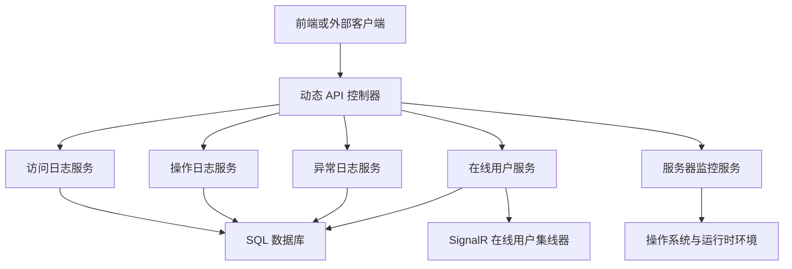

**图表来源**
- [SysLogVisService.cs:1-79](file://Admin.NET/Admin.NET.Core/Service/Log/SysLogVisService.cs#L1-L79)
- [SysLogOpService.cs:1-101](file://Admin.NET/Admin.NET.Core/Service/Log/SysLogOpService.cs#L1-L101)
- [SysLogExService.cs:1-101](file://Admin.NET/Admin.NET.Core/Service/Log/SysLogExService.cs#L1-L101)
- [SysOnlineUserService.cs:1-164](file://Admin.NET/Admin.NET.Core/Service/OnlineUser/SysOnlineUserService.cs#L1-L164)
- [SysServerService.cs:1-55](file://Admin.NET/Admin.NET.Core/Service/Server/SysServerService.cs#L1-L55)
- [OnlineUserHub.cs:1-193](file://Admin.NET/Admin.NET.Core/Hub/OnlineUserHub.cs#L1-L193)

**章节来源**
- [SysLogVis.cs:1-116](file://Admin.NET/Admin.NET.Core/Entity/SysLogVis.cs#L1-L116)
- [SysLogOp.cs:1-72](file://Admin.NET/Admin.NET.Core/Entity/SysLogOp.cs#L1-L72)
- [SysLogEx.cs:1-72](file://Admin.NET/Admin.NET.Core/Entity/SysLogEx.cs#L1-L72)
- [SysOnlineUser.cs:1-68](file://Admin.NET/Admin.NET.Core/Entity/SysOnlineUser.cs#L1-L68)
- [SysServerService.cs:1-55](file://Admin.NET/Admin.NET.Core/Service/Server/SysServerService.cs#L1-L55)

## 核心数据模型

### 数据模型关系图

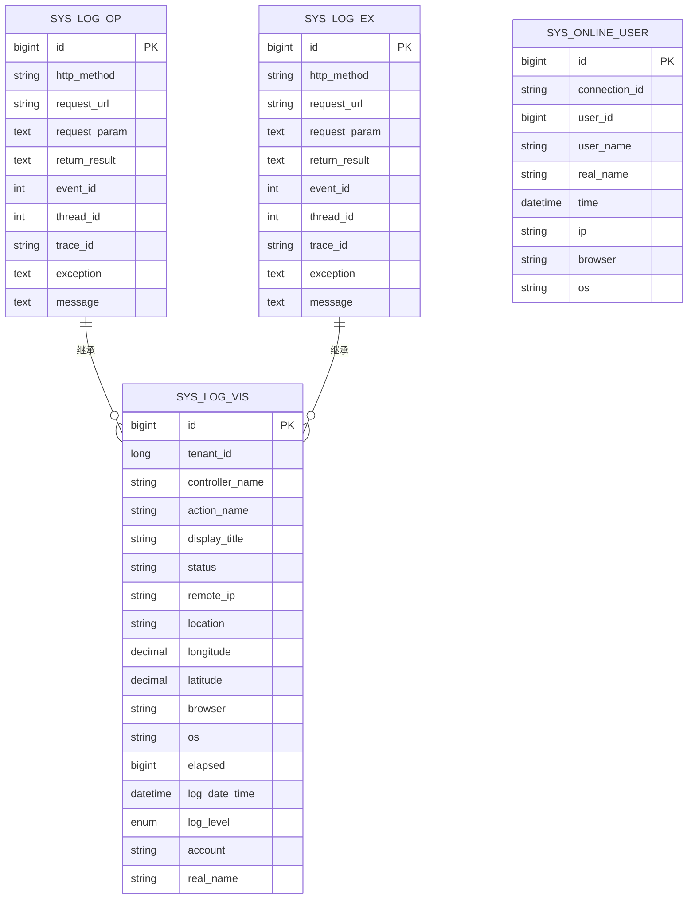

**图表来源**
- [SysLogVis.cs:1-116](file://Admin.NET/Admin.NET.Core/Entity/SysLogVis.cs#L1-L116)
- [SysLogOp.cs:1-72](file://Admin.NET/Admin.NET.Core/Entity/SysLogOp.cs#L1-L72)
- [SysLogEx.cs:1-72](file://Admin.NET/Admin.NET.Core/Entity/SysLogEx.cs#L1-L72)
- [SysOnlineUser.cs:1-68](file://Admin.NET/Admin.NET.Core/Entity/SysOnlineUser.cs#L1-L68)

### 字段说明

#### 访问日志 SysLogVis

| 字段 | 类型 | 用途 | 注意事项 |
|---|---|---|---|
| `ControllerName` | 字符串 | 模块名称 | 用于按业务模块筛选 |
| `ActionName` | 字符串 | 方法名称 | 常用于性能分析和热点接口统计 |
| `DisplayTitle` | 字符串 | 显示标题 | 适合在前端表格展示 |
| `Status` | 字符串 | 执行状态 | 服务层将 `200` 视为成功，其他值视为非成功 |
| `RemoteIp` | 字符串 | 客户端 IP | 可用于地域分布与安全审计 |
| `Location` | 字符串 | 登录地点 | 配合经纬度可在地图可视化 |
| `Longitude` | 数值 | 经度 | 仅大于 0 的记录会进入地图列表输出 |
| `Latitude` | 数值 | 纬度 | 同上 |
| `Browser` | 字符串 | 浏览器信息 | 用于兼容性分析与设备画像 |
| `Os` | 字符串 | 操作系统 | 同上 |
| `Elapsed` | 长整型 | 执行耗时 | 单位由采集侧定义，通常以毫秒衡量 |
| `LogDateTime` | 时间 | 日志时间 | 主要排序和范围查询字段 |
| `LogLevel` | 枚举 | 日志级别 | 底层使用 .NET `LogLevel` |
| `Account` | 字符串 | 账号 | 审计追踪 |
| `RealName` | 字符串 | 真实姓名 | 前端展示，不应直接导出敏感场景 |

#### 操作日志 SysLogOp

在访问日志基础上增加以下字段：

| 字段 | 类型 | 用途 |
|---|---|---|
| `HttpMethod` | 字符串 | 请求方式，如 GET、POST |
| `RequestUrl` | 字符串 | 请求地址 |
| `RequestParam` | 大文本 | 请求参数 |
| `ReturnResult` | 大文本 | 返回结果 |
| `EventId` | 整数 | 事件标识 |
| `ThreadId` | 整数 | 线程标识 |
| `TraceId` | 字符串 | 请求跟踪标识 |
| `Exception` | 大文本 | 异常信息 |
| `Message` | 大文本 | 结构化日志消息 |

#### 异常日志 SysLogEx

结构与操作日志基本一致，语义聚焦于“异常上下文”。分页查询时默认忽略 `RequestParam`、`ReturnResult`、`Message` 等大字段以提升性能；详情接口会返回完整内容。

#### 在线用户 SysOnlineUser

| 字段 | 类型 | 用途 |
|---|---|---|
| `ConnectionId` | 字符串 | SignalR 连接标识 |
| `UserId` | 长整型 | 用户主键 |
| `UserName` | 字符串 | 账号名 |
| `RealName` | 字符串 | 真实姓名 |
| `Time` | 时间 | 连接时间 |
| `Ip` | 字符串 | 连接 IP |
| `Browser` | 字符串 | 浏览器信息 |
| `Os` | 字符串 | 操作系统 |

**章节来源**
- [SysLogVis.cs:1-116](file://Admin.NET/Admin.NET.Core/Entity/SysLogVis.cs#L1-L116)
- [SysLogOp.cs:1-72](file://Admin.NET/Admin.NET.Core/Entity/SysLogOp.cs#L1-L72)
- [SysLogEx.cs:1-72](file://Admin.NET/Admin.NET.Core/Entity/SysLogEx.cs#L1-L72)
- [SysOnlineUser.cs:1-68](file://Admin.NET/Admin.NET.Core/Entity/SysOnlineUser.cs#L1-L68)

## 架构总览

监控日志接口采用分层结构：

1. **API 层**：通过动态 API 控制器暴露分页查询、详情、清空、导出等操作。
2. **服务层**：封装权限判断、租户隔离、查询构建、数据脱敏与导出逻辑。
3. **数据层**：SqlSugar 仓储访问数据库实体。
4. **实时层**：SignalR 集线器负责在线用户连接、分组广播与强制下线通知。
5. **基础设施层**：可选 Elasticsearch 客户端工厂、日志写入器、脱敏工具与系统信息收集工具。

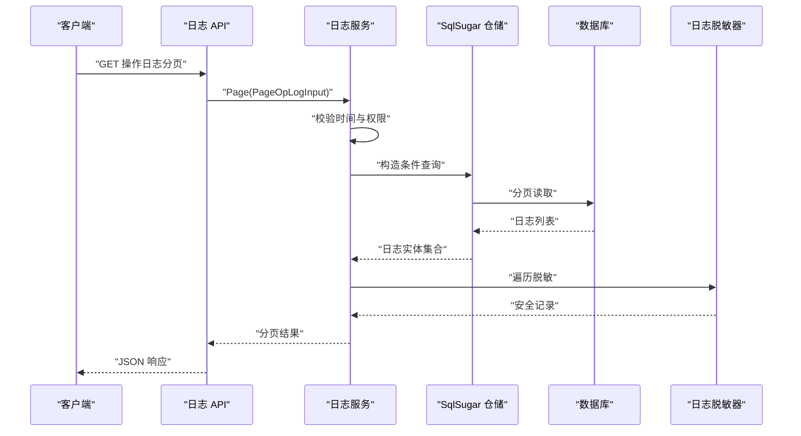

**图表来源**
- [SysLogOpService.cs:1-101](file://Admin.NET/Admin.NET.Core/Service/Log/SysLogOpService.cs#L1-L101)
- [LogDataSanitizer.cs](file://Admin.NET/Admin.NET.Core/Logging/LogDataSanitizer.cs)

## 操作日志接口

操作日志面向“用户操作记录、数据变更追踪、审计查询”。其核心是 `SysLogOpService`。

### 分页查询

- **请求对象**：`PageOpLogInput`，继承 `PageVisLogInput`，最终基于 `BasePageTimeInput`。
- **可用筛选条件**：
  - 租户 ID
  - 开始时间
  - 结束时间
  - 账号
  - 远程 IP
  - 模块名称
  - 方法名称
  - 最小耗时
  - 状态是否等于 `200` 或不等于 `200`
- **默认排序**：由 `OrderBuilder` 控制，源码中显式注释了默认按创建时间降序。
- **性能优化**：列表查询忽略 `RequestParam`、`ReturnResult`、`Message` 三个大字段。
- **权限控制**：非超级管理员自动绑定当前租户；超级管理员可跨租户查询。
- **返回值**：`SqlSugarPagedList<SysLogOp>`。

### 详情查询

- **请求对象**：ID。
- **权限控制**：仅允许查看当前租户记录或超级管理员查看所有租户记录。
- **返回值**：完整 `SysLogOp`，包含请求参数、返回结果、异常信息与日志消息。

### 清空操作日志

- **HTTP 方法**：POST。
- **动作名称**：`Clear`。
- **权限控制**：仅超级管理员可清空全部操作日志。
- **行为**：直接删除 `SysLogOp` 表数据。

### 导出操作日志

- **HTTP 方法**：POST。
- **动作名称**：`Export`。
- **请求对象**：`LogInput`，包含可选租户 ID、开始时间、结束时间。
- **导出格式**：Excel 二进制流，文件名带时间戳。
- **脱敏处理**：导出的 `Message` 与 `Exception` 会经过脱敏。
- **权限控制**：非超级管理员固定当前租户；超级管理员可按传入租户过滤。

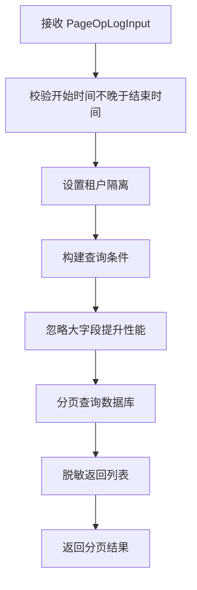

**图表来源**
- [SysLogOpService.cs:20-73](file://Admin.NET/Admin.NET.Core/Service/Log/SysLogOpService.cs#L20-L73)

**章节来源**
- [SysLogOpService.cs:1-101](file://Admin.NET/Admin.NET.Core/Service/Log/SysLogOpService.cs#L1-L101)
- [LogInput.cs:1-70](file://Admin.NET/Admin.NET.Core/Service/Log/Dto/LogInput.cs#L1-L70)
- [ExportLogDto.cs:1-68](file://Admin.NET/Admin.NET.Core/Service/Log/Dto/ExportLogDto.cs#L1-L68)

## 异常日志接口

异常日志面向“系统异常捕获、堆栈跟踪、错误分类”。其核心是 `SysLogExService`。

### 分页查询

- **请求对象**：`PageExLogInput`，继承 `PageOpLogInput`。
- **筛选条件**：与操作日志类似，支持租户、时间、账号、模块、方法、IP、耗时、状态。
- **性能优化**：列表忽略 `RequestParam`、`ReturnResult`、`Message`。
- **权限控制**：非超级管理员自动绑定当前租户。
- **返回值**：`SqlSugarPagedList<SysLogEx>`。

### 详情查询

- **请求对象**：ID。
- **权限控制**：仅当前租户或超级管理员。
- **返回值**：完整 `SysLogEx`，包含异常堆栈、请求上下文和日志消息。

### 清空异常日志

- **HTTP 方法**：POST。
- **动作名称**：`Clear`。
- **权限控制**：仅超级管理员。

### 导出异常日志

- **HTTP 方法**：POST。
- **动作名称**：`Export`。
- **请求对象**：`LogInput`。
- **脱敏处理**：`Message` 与 `Exception` 导出前脱敏。

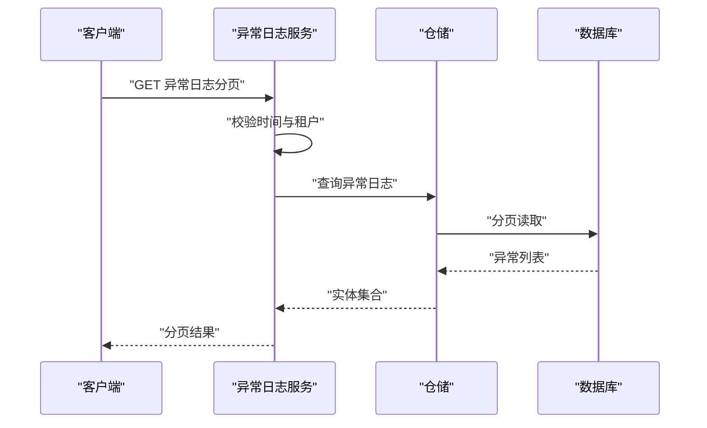

**图表来源**
- [SysLogExService.cs:1-101](file://Admin.NET/Admin.NET.Core/Service/Log/SysLogExService.cs#L1-L101)

**章节来源**
- [SysLogExService.cs:1-101](file://Admin.NET/Admin.NET.Core/Service/Log/SysLogExService.cs#L1-L101)
- [LogInput.cs:1-70](file://Admin.NET/Admin.NET.Core/Service/Log/Dto/LogInput.cs#L1-L70)

## 访问日志接口

访问日志面向“HTTP 请求记录、性能分析、流量统计”。其核心是 `SysLogVisService`。

### 分页查询

- **请求对象**：`PageVisLogInput`，包含账号、方法名、耗时、状态、IP、租户和时间范围。
- **筛选条件**：租户、时间、账号、方法名、远程 IP、最小耗时、状态。
- **默认排序**：按创建时间降序。
- **权限控制**：非超级管理员自动绑定当前租户。
- **返回值**：`SqlSugarPagedList<SysLogVis>`。

### 清空访问日志

- **HTTP 方法**：POST。
- **动作名称**：`Clear`。
- **权限控制**：仅超级管理员。

### 获取访问日志列表

- **用途**：返回带地理位置的访问日志，主要用于地图或轨迹展示。
- **过滤条件**：仅返回经度和纬度均大于 0 的记录。
- **返回对象**：`List<LogVisOutput>`，包含地点、经纬度、真实姓名与日志时间。

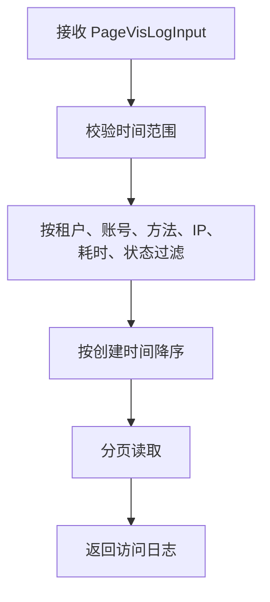

**图表来源**
- [SysLogVisService.cs:1-79](file://Admin.NET/Admin.NET.Core/Service/Log/SysLogVisService.cs#L1-L79)

**章节来源**
- [SysLogVisService.cs:1-79](file://Admin.NET/Admin.NET.Core/Service/Log/SysLogVisService.cs#L1-L79)
- [LogVisOutput.cs:1-35](file://Admin.NET/Admin.NET.Core/Service/Log/Dto/LogVisOutput.cs#L1-L35)
- [LogInput.cs:1-70](file://Admin.NET/Admin.NET.Core/Service/Log/Dto/LogInput.cs#L1-L70)

## 服务器监控接口

服务器监控接口面向“CPU、内存、磁盘、网络指标”的初步观测，当前实现更偏向“系统硬件信息、运行时信息与框架程序集信息”。

### 获取服务器硬件信息

- **方法**：`GetHardwareInfo`。
- **行为**：调用 `HardwareInfoManager.GetSystemHardwareInfo()`。
- **适用场景**：部署健康检查、运行环境审计。

### 获取服务器运行时信息

- **方法**：`GetRuntimeInfo`。
- **行为**：
  - 获取运行时信息，并清空命令行参数以避免泄露敏感启动参数。
  - 获取进程运行时长。
- **适用场景**：容器重启检测、进程存活监控。

### 获取框架主要程序集

- **方法**：`GetNuGetPackageInfo`。
- **行为**：反射获取以 `Admin.NET` 开头的 NuGet 包信息。
- **适用场景**：版本巡检、依赖一致性检查。

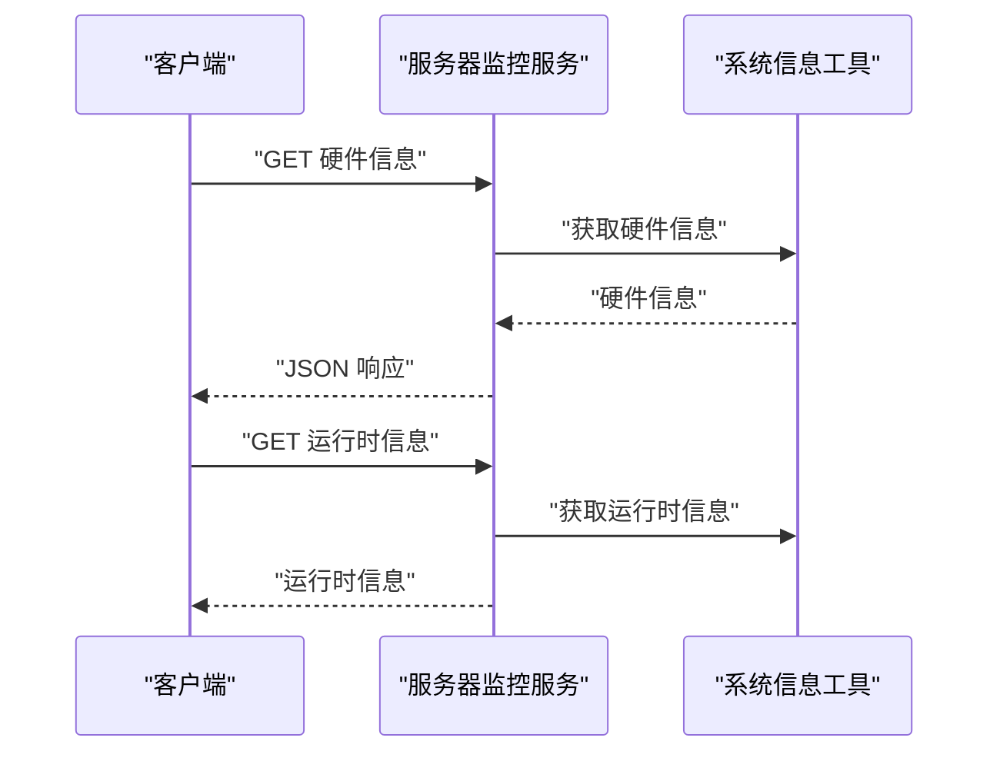

**图表来源**
- [SysServerService.cs:1-55](file://Admin.NET/Admin.NET.Core/Service/Server/SysServerService.cs#L1-L55)

**章节来源**
- [SysServerService.cs:1-55](file://Admin.NET/Admin.NET.Core/Service/Server/SysServerService.cs#L1-L55)

## 在线用户接口

在线用户接口面向“用户会话管理、强制下线、活跃检测”。它结合数据库、SignalR 集线器和缓存实现多端会话与实时通知。

### 分页查询在线用户

- **方法**：`Page`。
- **筛选条件**：租户、用户名模糊匹配、真实姓名模糊匹配。
- **权限控制**：非超级管理员限制当前租户；超级管理员可按租户过滤。
- **返回值**：`SqlSugarPagedList<SysOnlineUser>`。

### 强制下线

- **方法**：`ForceOffline(SysOnlineUser)`。
- **前置校验**：
  - 必须传入有效连接记录。
  - 需要拥有 `sysOnlineUser:forceOffline` 按钮权限，除非是超级管理员。
  - 目标连接必须存在且属于当前租户。
- **行为**：
  - 通过 SignalR 向目标连接推送 `ForceOffline` 消息。
  - 删除数据库中的在线用户记录。
  - 清理该连接的 Redis 哈希键。
  - 若开启“退出提醒”，则向同租户组广播更新后的在线用户列表。

### 内部强制下线方法

| 方法 | 参数 | 用途 |
|---|---|---|
| `ForceOfflineConnection` | 连接 ID | 按连接 ID 踢出用户 |
| `ForceOffline` | 用户 ID | 踢出某用户所有连接 |
| `SingleLogin` | 用户 ID | 单用户登录模式下踢掉旧连接 |
| `PublicNotice` | 公告和用户 ID 列表 | 向指定在线用户发送站内消息 |

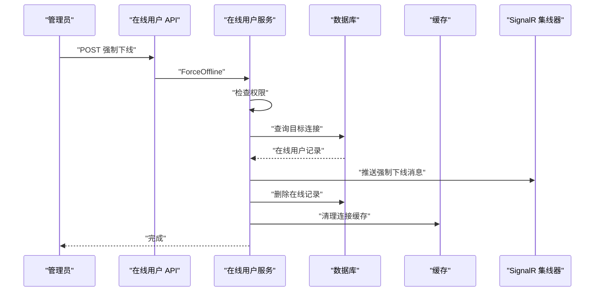

**图表来源**
- [SysOnlineUserService.cs:1-164](file://Admin.NET/Admin.NET.Core/Service/OnlineUser/SysOnlineUserService.cs#L1-L164)
- [OnlineUserHub.cs:1-193](file://Admin.NET/Admin.NET.Core/Hub/OnlineUserHub.cs#L1-L193)

**章节来源**
- [SysOnlineUserService.cs:1-164](file://Admin.NET/Admin.NET.Core/Service/OnlineUser/SysOnlineUserService.cs#L1-L164)
- [SysOnlineUser.cs:1-68](file://Admin.NET/Admin.NET.Core/Entity/SysOnlineUser.cs#L1-L68)
- [OnlineUserHub.cs:1-193](file://Admin.NET/Admin.NET.Core/Hub/OnlineUserHub.cs#L1-L193)

## 日志级别、存储策略与查询优化

### 日志级别

- 访问日志实体包含 `LogLevel` 字段，类型为 .NET `LogLevel`。
- 当前日志服务在查询与导出时未对日志级别做特殊过滤或转换，实际级别值取决于日志采集侧写入的数据。
- 建议在采集层统一日志级别语义，例如将业务成功、失败、警告、错误映射到标准级别。

### 存储策略

- **默认存储**：数据库持久化。三类日志分别对应 `SysLogVis`、`SysLogOp`、`SysLogEx`。
- **大字段处理**：
  - 操作日志与异常日志的分页列表忽略 `RequestParam`、`ReturnResult`、`Message`。
  - 详情接口才返回完整内容。
- **导出策略**：
  - 使用 Excel 导出。
  - 导出前对 `Message` 与 `Exception` 进行脱敏。
- **清理策略**：
  - 提供清空接口，但仅限超级管理员。
  - 生产环境建议增加定时归档与过期清理任务，避免数据库持续增长。

### 查询优化

| 优化点 | 说明 |
|---|---|
| 大字段忽略 | 列表查询忽略大字段，减少传输与解析开销 |
| 时间范围校验 | 开始时间不能晚于结束时间，避免无效扫描 |
| 租户隔离 | 非超级管理员自动绑定租户，降低跨租户误查风险 |
| 状态过滤 | 支持成功与非成功状态快速区分 |
| 最小耗时过滤 | 便于定位慢请求 |
| 地理位置过滤 | 地图列表仅返回有效经纬度记录 |

**章节来源**
- [SysLogVis.cs:1-116](file://Admin.NET/Admin.NET.Core/Entity/SysLogVis.cs#L1-L116)
- [SysLogOpService.cs:20-73](file://Admin.NET/Admin.NET.Core/Service/Log/SysLogOpService.cs#L20-L73)
- [SysLogExService.cs:20-73](file://Admin.NET/Admin.NET.Core/Service/Log/SysLogExService.cs#L20-L73)
- [SysLogVisService.cs:20-79](file://Admin.NET/Admin.NET.Core/Service/Log/SysLogVisService.cs#L20-L79)

## Elasticsearch 集成与日志聚合

### 配置选项

Elasticsearch 通过 `ElasticSearchOptions` 提供配置：

| 配置项 | 类型 | 含义 |
|---|---|---|
| `Enabled` | 布尔 | 是否启用 Elasticsearch |
| `AuthType` | 枚举 | 认证类型：Basic、ApiKey、Base64ApiKey、None |
| `User` | 字符串 | Basic 认证用户名 |
| `Password` | 字符串 | Basic 认证密码 |
| `ApiId` | 字符串 | ApiKey 认证 ID |
| `ApiKey` | 字符串 | ApiKey 认证密钥 |
| `Base64ApiKey` | 字符串 | Base64 编码的 API Key |
| `Fingerprint` | 字符串 | HTTPS 证书指纹 |
| `ServerUris` | 字符串列表 | ES 集群节点地址 |
| `DefaultIndex` | 字符串 | 默认索引名 |

### 客户端工厂

`ElasticSearchClientFactory` 提供通用客户端创建逻辑：

1. 从配置读取场景专用选项。
2. 若未启用则返回空。
3. 校验服务端地址列表。
4. 构建静态节点池，支持集群。
5. 设置默认索引与禁用直接流式响应，便于排查问题。
6. 根据认证类型配置 Basic、ApiKey 或 Base64ApiKey。
7. 可选配置 HTTPS 证书指纹。

### 当前集成状态

- 仓库中存在 `DatabaseLoggingWriter` 与 `ElasticSearchLoggingWriter`，表明日志写入具备可扩展设计。
- 现有日志服务类未直接调用 Elasticsearch 写入器。
- 因此，当前默认日志落库仍为数据库；Elasticsearch 可作为后续集中式日志聚合的扩展路径。

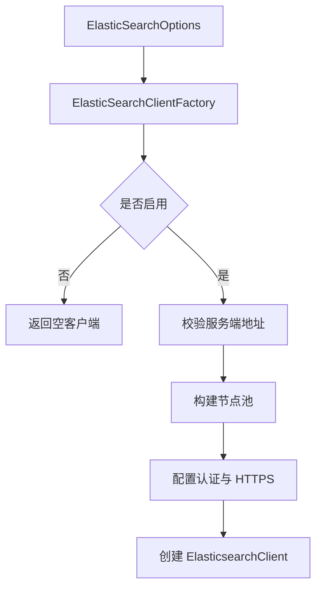

**图表来源**
- [ElasticSearchOptions.cs:1-64](file://Admin.NET/Admin.NET.Core/Option/ElasticSearchOptions.cs#L1-L64)
- [ElasticSearchClientFactory.cs:1-85](file://Admin.NET/Admin.NET.Core/ElasticSearch/ElasticSearchClientFactory.cs#L1-L85)

**章节来源**
- [ElasticSearchOptions.cs:1-64](file://Admin.NET/Admin.NET.Core/Option/ElasticSearchOptions.cs#L1-L64)
- [ElasticSearchClientFactory.cs:1-85](file://Admin.NET/Admin.NET.Core/ElasticSearch/ElasticSearchClientFactory.cs#L1-L85)
- [DatabaseLoggingWriter.cs](file://Admin.NET/Admin.NET.Core/Logging/DatabaseLoggingWriter.cs)
- [ElasticSearchLoggingWriter.cs](file://Admin.NET/Admin.NET.Core/Logging/ElasticSearchLoggingWriter.cs)

## 实时监控推送与仪表板集成

### SignalR 实时通道

在线用户集线器位于 `/hubs/onlineUser`，要求用户已授权。连接成功后：

1. 从 HTTP 上下文提取用户身份、账号、真实姓名、租户 ID。
2. 插入在线用户记录。
3. 根据是否开启单用户登录，决定缓存键。
4. 按租户加入 SignalR 分组。
5. 若开启退出提醒，向同租户组广播在线用户列表。

断开连接时：

1. 查找并删除在线用户记录。
2. 清理缓存键。
3. 向同租户组广播在线用户变化。

### 仪表板集成建议

| 页面 | 数据来源 | 推荐展示 |
|---|---|---|
| 访问日志看板 | `SysLogVisService.Page` | 请求量、成功率、平均耗时、Top 接口 |
| 操作审计看板 | `SysLogOpService.Page` | 操作明细、异常操作、慢操作 |
| 异常告警看板 | `SysLogExService.Page` | 异常趋势、错误分类、严重异常 |
| 在线用户看板 | `SysOnlineUserService.Page` + SignalR | 在线人数、地理分布、强制下线 |
| 服务器监控看板 | `SysServerService` | 硬件信息、运行时长、程序集版本 |

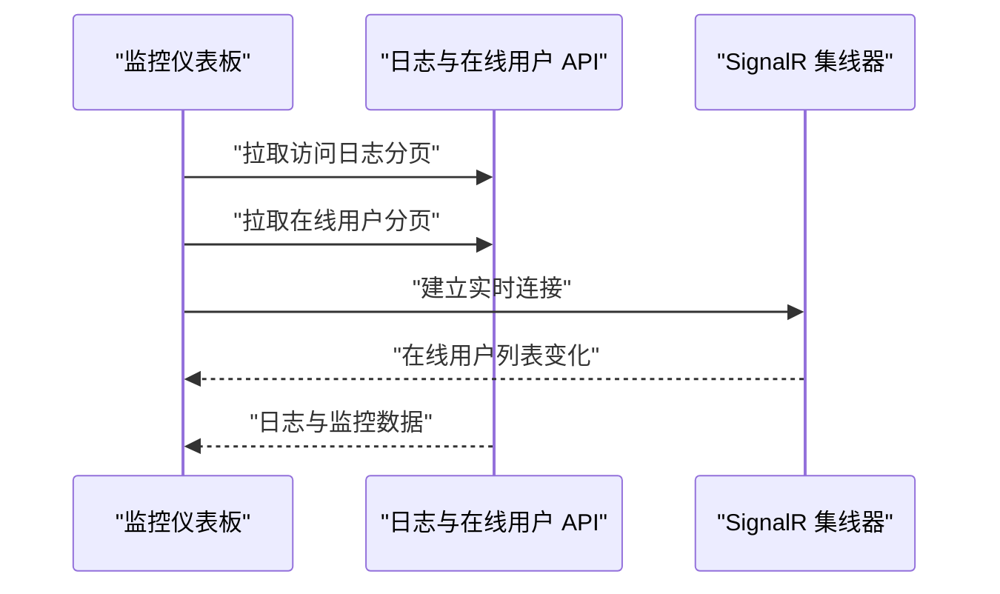

**图表来源**
- [SysLogVisService.cs:1-79](file://Admin.NET/Admin.NET.Core/Service/Log/SysLogVisService.cs#L1-L79)
- [SysLogOpService.cs:1-101](file://Admin.NET/Admin.NET.Core/Service/Log/SysLogOpService.cs#L1-L101)
- [SysLogExService.cs:1-101](file://Admin.NET/Admin.NET.Core/Service/Log/SysLogExService.cs#L1-L101)
- [SysOnlineUserService.cs:1-164](file://Admin.NET/Admin.NET.Core/Service/OnlineUser/SysOnlineUserService.cs#L1-L164)
- [OnlineUserHub.cs:1-193](file://Admin.NET/Admin.NET.Core/Hub/OnlineUserHub.cs#L1-L193)

**章节来源**
- [OnlineUserHub.cs:1-193](file://Admin.NET/Admin.NET.Core/Hub/OnlineUserHub.cs#L1-L193)
- [SysOnlineUserService.cs:1-164](file://Admin.NET/Admin.NET.Core/Service/OnlineUser/SysOnlineUserService.cs#L1-L164)

## 告警规则配置建议

虽然仓库未提供内置告警引擎，但可基于现有日志接口与监控系统构建告警规则：

| 告警主题 | 触发条件 | 建议动作 |
|---|---|---|
| 异常率升高 | 单位时间内 `SysLogEx` 中非 `200` 状态比例上升 | 通知运维群、创建工单 |
| 慢接口增多 | `SysLogVis` 或 `SysLogOp` 中 `Elapsed` 超过阈值 | 标记热点接口、触发性能分析 |
| 单用户重复登录 | 同一用户出现多个在线连接 | 根据配置踢掉旧连接 |
| 服务器长时间运行后重启 | `SysServerService` 运行时信息发生变化 | 记录发布或重启事件 |
| Elasticsearch 不可用 | ES 客户端创建或请求失败 | 降级为本地日志、通知平台团队 |

建议将上述规则接入外部监控系统，例如 Prometheus、Grafana、企业微信、钉钉或邮件系统。

## 日志脱敏、隐私保护与合规性

### 脱敏机制

- 操作日志与异常日志的分页返回列表会对每条记录调用 `LogDataSanitizer.SanitizeRecord`。
- 导出功能会对 `Message` 与 `Exception` 调用 `LogDataSanitizer.Sanitize`。
- 这意味着敏感字段不应直接出现在普通分页列表中；详情与导出也应谨慎开放。

### 隐私保护建议

| 数据类型 | 风险 | 建议 |
|---|---|---|
| 账号 | 可关联个人身份 | 列表展示可脱敏，详情需权限控制 |
| 真实姓名 | 个人信息 | 非必要不导出 |
| IP 地址 | 可能推断位置 | 对外报表脱敏 |
| 请求参数 | 可能包含密码、手机号、身份证 | 禁止默认记录或严格脱敏 |
| 返回结果 | 可能包含业务敏感数据 | 仅在审计场景开启 |
| 经纬度 | 位置隐私 | 地图展示需最小化 |
| TraceId | 请求追踪 | 可用于链路追踪，但不宜公开 |

### 合规性要求

- 日志访问应遵循最小权限原则。
- 审计日志不得随意清空，清空操作应记录审计事件。
- 导出文件应加密或限制下载权限。
- 涉及个人信息的日志应满足数据安全法、个人信息保护法等相关要求。
- 生产环境建议保留日志保留策略、归档策略与访问审计。

**章节来源**
- [SysLogOpService.cs:42-73](file://Admin.NET/Admin.NET.Core/Service/Log/SysLogOpService.cs#L42-L73)
- [SysLogExService.cs:42-73](file://Admin.NET/Admin.NET.Core/Service/Log/SysLogExService.cs#L42-L73)
- [LogDataSanitizer.cs](file://Admin.NET/Admin.NET.Core/Logging/LogDataSanitizer.cs)

## 依赖关系分析

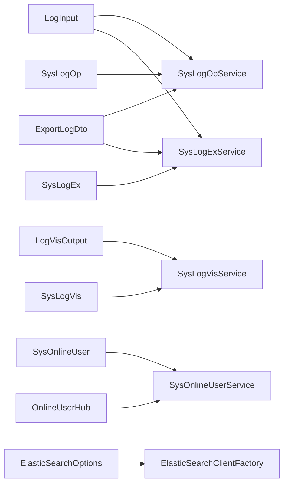

**图表来源**
- [LogInput.cs:1-70](file://Admin.NET/Admin.NET.Core/Service/Log/Dto/LogInput.cs#L1-L70)
- [LogVisOutput.cs:1-35](file://Admin.NET/Admin.NET.Core/Service/Log/Dto/LogVisOutput.cs#L1-L35)
- [ExportLogDto.cs:1-68](file://Admin.NET/Admin.NET.Core/Service/Log/Dto/ExportLogDto.cs#L1-L68)
- [SysLogVisService.cs:1-79](file://Admin.NET/Admin.NET.Core/Service/Log/SysLogVisService.cs#L1-L79)
- [SysLogOpService.cs:1-101](file://Admin.NET/Admin.NET.Core/Service/Log/SysLogOpService.cs#L1-L101)
- [SysLogExService.cs:1-101](file://Admin.NET/Admin.NET.Core/Service/Log/SysLogExService.cs#L1-L101)
- [SysOnlineUserService.cs:1-164](file://Admin.NET/Admin.NET.Core/Service/OnlineUser/SysOnlineUserService.cs#L1-L164)
- [OnlineUserHub.cs:1-193](file://Admin.NET/Admin.NET.Core/Hub/OnlineUserHub.cs#L1-L193)
- [ElasticSearchOptions.cs:1-64](file://Admin.NET/Admin.NET.Core/Option/ElasticSearchOptions.cs#L1-L64)
- [ElasticSearchClientFactory.cs:1-85](file://Admin.NET/Admin.NET.Core/ElasticSearch/ElasticSearchClientFactory.cs#L1-L85)

**章节来源**
- [SysLogVisService.cs:1-79](file://Admin.NET/Admin.NET.Core/Service/Log/SysLogVisService.cs#L1-L79)
- [SysLogOpService.cs:1-101](file://Admin.NET/Admin.NET.Core/Service/Log/SysLogOpService.cs#L1-L101)
- [SysLogExService.cs:1-101](file://Admin.NET/Admin.NET.Core/Service/Log/SysLogExService.cs#L1-L101)
- [SysOnlineUserService.cs:1-164](file://Admin.NET/Admin.NET.Core/Service/OnlineUser/SysOnlineUserService.cs#L1-L164)
- [OnlineUserHub.cs:1-193](file://Admin.NET/Admin.NET.Core/Hub/OnlineUserHub.cs#L1-L193)
- [ElasticSearchClientFactory.cs:1-85](file://Admin.NET/Admin.NET.Core/ElasticSearch/ElasticSearchClientFactory.cs#L1-L85)

## 故障排查指南

| 现象 | 可能原因 | 排查步骤 |
|---|---|---|
| 操作日志分页为空 | 时间范围错误、租户隔离、无匹配记录 | 检查开始结束时间、租户 ID、账号与状态 |
| 操作日志详情无权限 | 非超级管理员访问其他租户记录 | 确认当前租户或切换超级管理员 |
| 导出文件内容为空 | 查询条件过严或无数据 | 缩小时间范围、取消部分筛选 |
| 强制下线报错 | 连接失效、租户不匹配、无权限 | 检查连接 ID、租户与按钮权限 |
| 在线用户列表不更新 | SignalR 未连接或断连 | 检查浏览器控制台、SignalR 连接状态 |
| Elasticsearch 客户端为空 | 未启用或配置缺失 | 检查 `Enabled`、`ServerUris`、认证配置 |
| Elasticsearch 认证失败 | 用户名、密码或 API Key 错误 | 检查 `AuthType`、`User`、`Password`、`ApiKey` |
| HTTPS 连接失败 | 证书指纹不匹配 | 检查 `Fingerprint` 与服务端证书 |

**章节来源**
- [SysLogOpService.cs:20-101](file://Admin.NET/Admin.NET.Core/Service/Log/SysLogOpService.cs#L20-L101)
- [SysLogExService.cs:20-101](file://Admin.NET/Admin.NET.Core/Service/Log/SysLogExService.cs#L20-L101)
- [SysOnlineUserService.cs:40-164](file://Admin.NET/Admin.NET.Core/Service/OnlineUser/SysOnlineUserService.cs#L40-L164)
- [ElasticSearchClientFactory.cs:20-85](file://Admin.NET/Admin.NET.Core/ElasticSearch/ElasticSearchClientFactory.cs#L20-L85)

## 结论

Admin.NET 当前监控日志体系以数据库为中心，提供访问日志、操作日志、异常日志三类核心能力，并通过 SignalR 实现在线用户管理与实时通知。服务器监控接口提供基础硬件与运行时信息，适合轻量级运行环境观察。Elasticsearch 基础设施已就绪，但尚未作为默认日志写入路径；如需大规模日志聚合、全文检索与实时分析，应在采集层对接 Elasticsearch 写入器，并结合外部监控平台构建告警与仪表板。

在生产环境中，应重点关注日志脱敏、租户隔离、权限控制、数据归档与导出安全，确保监控日志既满足运维需求，又符合隐私与合规要求。