# 系统管理接口

<cite>
**本文引用的文件**   
- [SysConfigService.cs](file://Admin.NET/Admin.NET.Core/Service/Config/SysConfigService.cs)
- [SysTenantConfigService.cs](file://Admin.NET/Admin.NET.Core/Service/Config/SysTenantConfigService.cs)
- [SysUserConfigService.cs](file://Admin.NET/Admin.NET.Core/Service/Config/SysUserConfigService.cs)
- [SysConfig.cs](file://Admin.NET/Admin.NET.Core/Entity/SysConfig.cs)
- [SysTenantConfig.cs](file://Admin.NET/Admin.NET.Core/Entity/SysTenantConfig.cs)
- [SysTenantConfigData.cs](file://Admin.NET/Admin.NET.Core/Entity/SysTenantConfigData.cs)
- [SysTenantService.cs](file://Admin.NET/Admin.NET.Core/Service/Tenant/SysTenantService.cs)
- [SysTenant.cs](file://Admin.NET/Admin.NET.Core/Entity/SysTenant.cs)
- [SysTenantMenu.cs](file://Admin.NET/Admin.NET.Core/Entity/SysTenantMenu.cs)
- [SysDictTypeService.cs](file://Admin.NET/Admin.NET.Core/Service/Dict/SysDictTypeService.cs)
- [SysDictDataService.cs](file://Admin.NET/Admin.NET.Core/Service/Dict/SysDictDataService.cs)
- [SysDictType.cs](file://Admin.NET/Admin.NET.Core/Entity/SysDictType.cs)
- [SysDictData.cs](file://Admin.NET/Admin.NET.Core/Entity/SysDictData.cs)
- [SysDictDataTenant.cs](file://Admin.NET/Admin.NET.Core/Entity/SysDictDataTenant.cs)
- [SysEnumService.cs](file://Admin.NET/Admin.NET.Core/Service/Enum/SysEnumService.cs)
- [SysConstService.cs](file://Admin.NET/Admin.NET.Core/Service/Const/SysConstService.cs)
- [SysRegionService.cs](file://Admin.NET/Admin.NET.Core/Service/Region/SysRegionService.cs)
- [SysRegion.cs](file://Admin.NET/Admin.NET.Core/Entity/SysRegion.cs)
- [sys-config-api.ts](file://Web/apps/web-antdv-next/src/api-services/apis/sys-config-api.ts)
</cite>

## 目录

1. [简介](#简介)
2. [项目结构定位](#项目结构定位)
3. [核心接口总览](#核心接口总览)
4. [架构与数据流](#架构与数据流)
5. [配置中心接口](#配置中心接口)
6. [多租户管理接口](#多租户管理接口)
7. [字典管理接口](#字典管理接口)
8. [通用服务接口](#通用服务接口)
9. [依赖关系分析](#依赖关系分析)
10. [性能与缓存特性](#性能与缓存特性)
11. [故障排查指南](#故障排查指南)
12. [结论](#结论)

## 简介

本文档聚焦 Admin.NET 的“系统管理”能力，围绕以下业务域整理 API、实体模型、验证规则、生效机制和前端使用模式：

| 业务域 | 核心职责 | 典型接口 |
|---|---|---|
| 平台配置中心 | 键值对参数、分组、增删改查、按编码取值 | 系统配置分页列表、新增、更新、删除、批量删除、根据编码获取值 |
| 租户配置中心 | 租户级参数覆盖、平台共享元数据与租户值分离 | 租户配置分页、新增、更新、删除、批量删除、根据编码获取值 |
| 用户配置中心 | 当前登录用户偏好级配置 | 用户配置分页、新增、更新、删除、批量删除、根据编码获取值 |
| 多租户管理 | 租户生命周期、域名绑定、数据库隔离、菜单授权、状态切换 | 租户分页、新增、更新、删除、设置状态、创建数据库、重置密码、切换租户 |
| 字典管理 | 字典类型、字典数据、租户字典值、状态控制、缓存失效 | 字典类型分页、字典数据分页、根据编码取值、新增、更新、删除、同步状态 |
| 通用服务 | 枚举发现、常量反射、行政区域树 | 枚举类型列表、枚举值查询、常量列表、地区分页、地区树、地区同步 |

这些接口通过动态控制器暴露，通常以 `/api/sys*` 前缀路由；部分方法标记为非动作，仅作为内部服务调用或缓存清理逻辑。

**章节来源**
- [SysConfigService.cs:1-200](file://Admin.NET/Admin.NET.Core/Service/Config/SysConfigService.cs#L1-L200)
- [SysTenantService.cs:1-200](file://Admin.NET/Admin.NET.Core/Service/Tenant/SysTenantService.cs#L1-L200)
- [SysDictTypeService.cs:1-200](file://Admin.NET/Admin.NET.Core/Service/Dict/SysDictTypeService.cs#L1-L200)
- [SysDictDataService.cs:1-200](file://Admin.NET/Admin.NET.Core/Service/Dict/SysDictDataService.cs#L1-L200)

## 项目结构定位

从代码组织看，系统管理接口主要分布在 `Admin.NET.Admin.NET.Core` 的 Service 层，实体定义位于 Core 层的 Entity 子目录，前端 SDK 由 OpenAPI 生成并位于 Web 应用的前端工程。

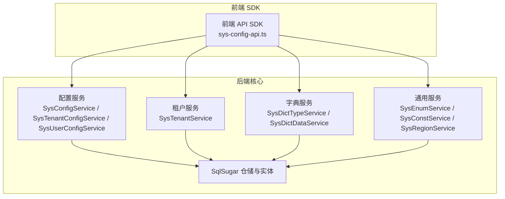

**图表来源**
- [SysConfigService.cs:1-120](file://Admin.NET/Admin.NET.Core/Service/Config/SysConfigService.cs#L1-L120)
- [SysTenantService.cs:1-120](file://Admin.NET/Admin.NET.Core/Service/Tenant/SysTenantService.cs#L1-L120)
- [SysDictTypeService.cs:1-120](file://Admin.NET/Admin.NET.Core/Service/Dict/SysDictTypeService.cs#L1-L120)
- [SysDictDataService.cs:1-120](file://Admin.NET/Admin.NET.Core/Service/Dict/SysDictDataService.cs#L1-L120)
- [SysEnumService.cs:1-102](file://Admin.NET/Admin.NET.Core/Service/Enum/SysEnumService.cs#L1-L102)
- [SysConstService.cs:1-83](file://Admin.NET/Admin.NET.Core/Service/Const/SysConstService.cs#L1-L83)
- [SysRegionService.cs:1-200](file://Admin.NET/Admin.NET.Core/Service/Region/SysRegionService.cs#L1-L200)
- [sys-config-api.ts:1-200](file://Web/apps/web-antdv-next/src/api-services/apis/sys-config-api.ts#L1-L200)

**章节来源**
- [SysConfigService.cs:1-120](file://Admin.NET/Admin.NET.Core/Service/Config/SysConfigService.cs#L1-L120)
- [sys-config-api.ts:1-200](file://Web/apps/web-antdv-next/src/api-services/apis/sys-config-api.ts#L1-L200)

## 核心接口总览

### 平台配置中心

| 接口用途 | HTTP 方式 | 路径特征 | 说明 |
|---|---|---|---|
| 分页查询配置 | GET | `/api/sysConfig/page` | 支持按名称、编码、分组编码过滤 |
| 列表查询配置 | GET | `/api/sysConfig/list` | 可按分组编码返回全部配置 |
| 新增配置 | POST | `/api/sysConfig/add` | 校验重复名称与编码 |
| 更新配置 | POST | `/api/sysConfig/update` | 变更日志写入，同时清理相关缓存 |
| 删除配置 | POST | `/api/sysConfig/delete` | 禁止删除系统内置配置 |
| 批量删除 | POST | `/api/sysConfig/batchDelete` | 跳过系统配置项 |
| 详情查询 | GET | `/api/sysConfig/detail` | 按主键查询 |
| 按编码取值 | GET | `/api/sysConfig/configValueByCode/{code}` | 先读缓存，再回源数据库 |
| 批量更新 | POST | `/api/sysConfig/batchUpdate` | 用于快速修改多个键值对 |

**章节来源**
- [SysConfigService.cs:1-200](file://Admin.NET/Admin.NET.Core/Service/Config/SysConfigService.cs#L1-L200)
- [sys-config-api.ts:1-200](file://Web/apps/web-antdv-next/src/api-services/apis/sys-config-api.ts#L1-L200)

### 租户配置中心

| 接口用途 | HTTP 方式 | 路径特征 | 说明 |
|---|---|---|---|
| 分页查询租户配置 | GET | `/api/sysTenantConfig/page` | 合并平台元数据与当前租户值 |
| 列表查询租户配置 | GET | `/api/sysTenantConfig/list` | 支持分组过滤 |
| 新增租户配置 | POST | `/api/sysTenantConfig/add` | 仅超级管理员可维护元数据 |
| 更新租户配置 | POST | `/api/sysTenantConfig/update` | 普通租户只能覆盖值字段 |
| 删除租户配置 | POST | `/api/sysTenantConfig/delete` | 禁止删除系统配置 |
| 批量删除 | POST | `/api/sysTenantConfig/batchDelete` | 跳过系统配置项 |
| 详情查询 | GET | `/api/sysTenantConfig/detail` | 按主键查询 |
| 按编码获取值 | GET | `/api/sysTenantConfig/configValueByCode/{code}` | 返回租户视角的配置值 |

**章节来源**
- [SysTenantConfigService.cs:1-200](file://Admin.NET/Admin.NET.Core/Service/Config/SysTenantConfigService.cs#L1-L200)

### 用户配置中心

| 接口用途 | HTTP 方式 | 路径特征 | 说明 |
|---|---|---|---|
| 分页查询用户配置 | GET | `/api/sysUserConfig/page` | 非超级管理员只看到自己覆盖的值 |
| 列表查询用户配置 | GET | `/api/sysUserConfig/list` | 支持分组过滤 |
| 新增用户配置 | POST | `/api/sysUserConfig/add` | 绑定当前用户 |
| 更新用户配置 | POST | `/api/sysUserConfig/update` | 覆盖当前用户对应配置值 |
| 删除用户配置 | POST | `/api/sysUserConfig/delete` | 删除当前用户的覆盖记录 |
| 批量删除 | POST | `/api/sysUserConfig/batchDelete` | 跳过系统配置项 |
| 详情查询 | GET | `/api/sysUserConfig/detail` | 按主键查询 |
| 按编码获取值 | GET | `/api/sysUserConfig/configValueByCode/{code}` | 优先返回用户覆盖值 |

**章节来源**
- [SysUserConfigService.cs:1-200](file://Admin.NET/Admin.NET.Core/Service/Config/SysUserConfigService.cs#L1-L200)

### 多租户管理

| 接口用途 | HTTP 方式 | 路径特征 | 说明 |
|---|---|---|---|
| 分页查询租户 | GET | `/api/sysTenant/page` | 关联机构、管理员账号信息 |
| 查询启用租户列表 | GET | `/api/sysTenant/getList` | 匿名可用，返回标签、主机和标识 |
| 新增租户 | POST | `/api/sysTenant/add` | 初始化机构、角色、职位、管理员 |
| 更新租户 | POST | `/api/sysTenant/update` | 同步机构和管理员信息 |
| 删除租户 | POST | `/api/sysTenant/delete` | 级联清理租户相关数据 |
| 设置租户状态 | POST | `/api/sysTenant/setStatus` | 禁止修改默认租户关键属性 |
| 创建租户数据库 | POST | `/api/sysTenant/createDb` | 为库隔离租户初始化数据库 |
| 重置租户管理员密码 | POST | `/api/sysTenant/resetPwd` | 使用系统默认密码加密后覆盖 |
| 切换租户 | POST | `/api/sysTenant/changeTenant` | 超级管理员切换身份上下文 |
| 进入租管端 | POST | `/api/sysTenant/goTenant` | 超级管理员直接进入租户管理员会话 |
| 授权租户菜单 | POST | `/api/sysTenant/grantMenu` | 校验菜单完整性与权限冲突 |
| 获取租户菜单集合 | GET | `/api/sysTenant/getTenantMenuList` | 返回可授权菜单 |
| 同步授权菜单 | POST | `/api/sysTenant/syncGrantMenu` | 基于种子数据或角色授权重建 |

**章节来源**
- [SysTenantService.cs:1-450](file://Admin.NET/Admin.NET.Core/Service/Tenant/SysTenantService.cs#L1-L450)
- [SysTenantService.cs:451-792](file://Admin.NET/Admin.NET.Core/Service/Tenant/SysTenantService.cs#L451-L792)

### 字典管理

| 接口用途 | HTTP 方式 | 路径特征 | 说明 |
|---|---|---|---|
| 分页查询字典类型 | GET | `/api/sysDictType/page` | 非超级管理员限制可见租户字典 |
| 列表查询字典类型 | GET | `/api/sysDictType/getList` | 按排序和编码排序 |
| 获取字典类型值列表 | GET | `/api/sysDictType/getDataList` | 返回字典数据并做语言翻译 |
| 新增字典类型 | POST | `/api/sysDictType/add` | 禁止以 enum 结尾 |
| 更新字典类型 | POST | `/api/sysDictType/update` | 校验租户标志与系统标志 |
| 删除字典类型 | POST | `/api/sysDictType/delete` | 级联删除字典值 |
| 修改字典类型状态 | POST | `/api/sysDictType/setStatus` | 影响字典数据可用性 |
| 分页查询字典数据 | GET | `/api/sysDictData/page` | 按字典类型、编码、标签过滤 |
| 列表查询字典数据 | GET | `/api/sysDictData/getList` | 按字典类型加载 |
| 新增字典数据 | POST | `/api/sysDictData/add` | 区分租户字典与平台字典 |
| 更新字典数据 | POST | `/api/sysDictData/update` | 校验唯一性与权限 |
| 删除字典数据 | POST | `/api/sysDictData/delete` | 级联清理缓存 |
| 修改字典数据状态 | POST | `/api/sysDictData/setStatus` | 控制是否参与取值 |
| 根据编码获取字典值 | GET | `/api/sysDictData/dataList` | 带状态过滤 |

**章节来源**
- [SysDictTypeService.cs:1-261](file://Admin.NET/Admin.NET.Core/Service/Dict/SysDictTypeService.cs#L1-L261)
- [SysDictDataService.cs:1-348](file://Admin.NET/Admin.NET.Core/Service/Dict/SysDictDataService.cs#L1-L348)

### 通用服务

| 接口用途 | HTTP 方式 | 路径特征 | 说明 |
|---|---|---|---|
| 获取所有枚举类型 | GET | `/api/sysEnum/getEnumTypeList` | 扫描程序集枚举，排除忽略类型 |
| 按枚举名获取值 | GET | `/api/sysEnum/getEnumDataList` | 返回枚举描述与值 |
| 按实体字段获取枚举 | GET | `/api/sysEnum/getEnumDataListByField` | 反射实体字段类型 |
| 获取常量列表 | GET | `/api/sysConst/getList` | 反射带常量特性的类或枚举 |
| 按类型名获取常量 | GET | `/api/sysConst/data` | 返回字段名与值 |
| 地区分页 | GET | `/api/sysRegion/page` | 支持父级、名称、编码过滤 |
| 地区列表 | GET | `/api/sysRegion/getList` | 返回指定父级下的地区 |
| 地区树 | GET | `/api/sysRegion/getTree` | 返回完整层级树 |
| 新增地区 | POST | `/api/sysRegion/add` | 规范化代码与父级 |
| 更新地区 | POST | `/api/sysRegion/update` | 校验父子关系与重复 |
| 删除地区 | POST | `/api/sysRegion/delete` | 级联删除子节点 |
| 同步地区 | POST | `/api/sysRegion/sync` | 根据配置层级拉取外部数据 |

**章节来源**
- [SysEnumService.cs:1-102](file://Admin.NET/Admin.NET.Core/Service/Enum/SysEnumService.cs#L1-L102)
- [SysConstService.cs:1-83](file://Admin.NET/Admin.NET.Core/Service/Const/SysConstService.cs#L1-L83)
- [SysRegionService.cs:1-200](file://Admin.NET/Admin.NET.Core/Service/Region/SysRegionService.cs#L1-L200)

## 架构与数据流

系统管理接口的通用处理流程如下：

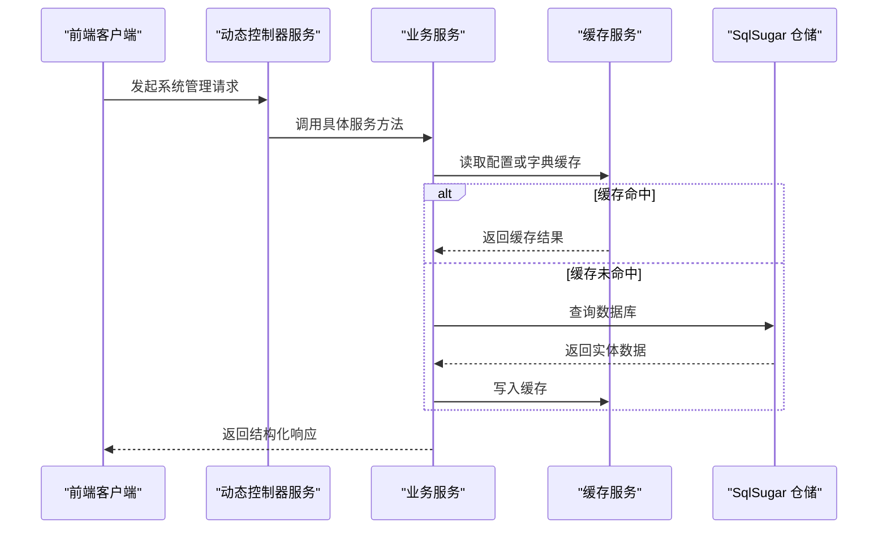

**图表来源**
- [SysConfigService.cs:120-200](file://Admin.NET/Admin.NET.Core/Service/Config/SysConfigService.cs#L120-L200)
- [SysTenantConfigService.cs:120-200](file://Admin.NET/Admin.NET.Core/Service/Config/SysTenantConfigService.cs#L120-L200)
- [SysDictDataService.cs:180-348](file://Admin.NET/Admin.NET.Core/Service/Dict/SysDictDataService.cs#L180-L348)

### 配置读取时序

以系统配置按编码取值为例：

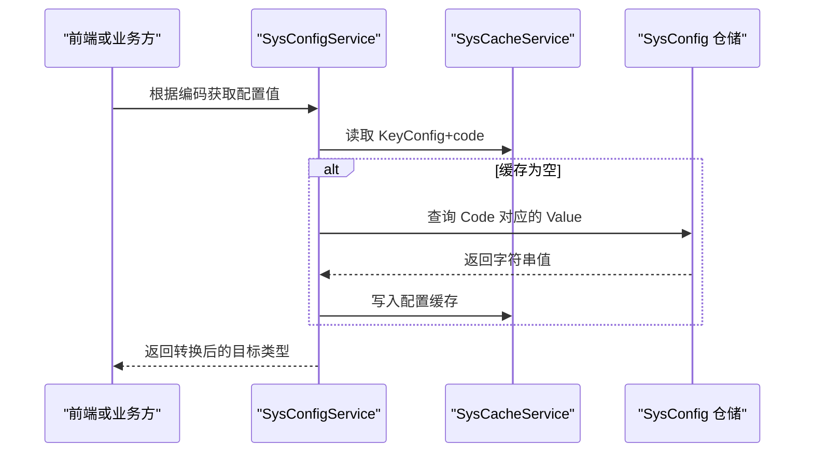

**图表来源**
- [SysConfigService.cs:120-200](file://Admin.NET/Admin.NET.Core/Service/Config/SysConfigService.cs#L120-L200)

### 租户菜单授权时序

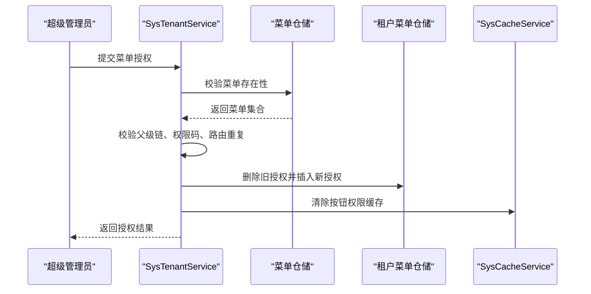

**图表来源**
- [SysTenantService.cs:520-650](file://Admin.NET/Admin.NET.Core/Service/Tenant/SysTenantService.cs#L520-L650)

## 架构与数据流

系统管理接口采用“动态控制器 + 领域服务 + SqlSugar 仓储 + 缓存”的分层结构。前端通过 Swagger/OpenAPI 生成的 TypeScript SDK 调用后端接口。

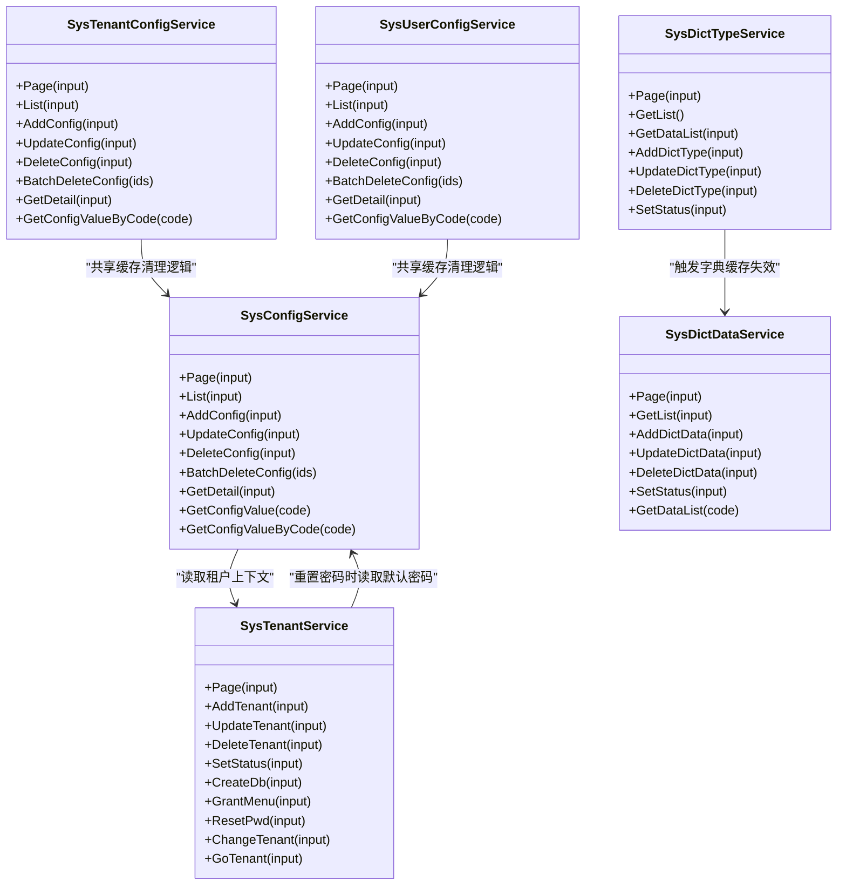

**图表来源**
- [SysConfigService.cs:1-200](file://Admin.NET/Admin.NET.Core/Service/Config/SysConfigService.cs#L1-L200)
- [SysTenantConfigService.cs:1-200](file://Admin.NET/Admin.NET.Core/Service/Config/SysTenantConfigService.cs#L1-L200)
- [SysUserConfigService.cs:1-200](file://Admin.NET/Admin.NET.Core/Service/Config/SysUserConfigService.cs#L1-L200)
- [SysTenantService.cs:1-792](file://Admin.NET/Admin.NET.Core/Service/Tenant/SysTenantService.cs#L1-L792)
- [SysDictTypeService.cs:1-261](file://Admin.NET/Admin.NET.Core/Service/Dict/SysDictTypeService.cs#L1-L261)
- [SysDictDataService.cs:1-348](file://Admin.NET/Admin.NET.Core/Service/Dict/SysDictDataService.cs#L1-L348)

**章节来源**
- [SysConfigService.cs:1-200](file://Admin.NET/Admin.NET.Core/Service/Config/SysConfigService.cs#L1-L200)
- [SysTenantService.cs:1-792](file://Admin.NET/Admin.NET.Core/Service/Tenant/SysTenantService.cs#L1-L792)
- [SysDictTypeService.cs:1-261](file://Admin.NET/Admin.NET.Core/Service/Dict/SysDictTypeService.cs#L1-L261)
- [SysDictDataService.cs:1-348](file://Admin.NET/Admin.NET.Core/Service/Dict/SysDictDataService.cs#L1-L348)

## 配置中心接口

### 配置项数据模型

系统配置实体包含名称、编码、值、系统标志、分组编码、排序和备注。其中：

- `Name`：必填，最大长度 64。
- `Code`：唯一索引，最大长度 64。
- `Value`：最大长度 512，实际业务中的“数据类型”统一以字符串存储，读取时按目标类型转换。
- `SysFlag`：内置系统配置标志，用于保护平台级配置。
- `GroupCode`：分组编码，用于界面分组展示。
- `OrderNo`：默认排序 100。
- `Remark`：备注，最大长度 256。

租户配置继承系统配置，但通过 `SysTenantConfigData` 表将值与租户隔离；用户配置则以用户维度保存覆盖值。

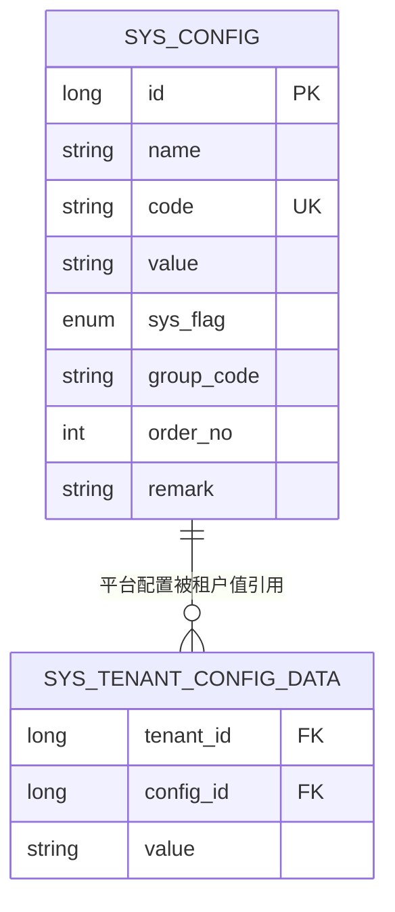

**图表来源**
- [SysConfig.cs:1-65](file://Admin.NET/Admin.NET.Core/Entity/SysConfig.cs#L1-L65)
- [SysTenantConfig.cs:1-21](file://Admin.NET/Admin.NET.Core/Entity/SysTenantConfig.cs#L1-L21)
- [SysTenantConfigData.cs:1-29](file://Admin.NET/Admin.NET.Core/Entity/SysTenantConfigData.cs#L1-L29)

### 配置验证规则

| 操作 | 验证规则 | 失败行为 |
|---|---|---|
| 新增平台配置 | 名称或编码重复时报错；系统配置只能由超级管理员添加 | 抛出业务错误码 |
| 更新平台配置 | 名称或编码重复排除自身时报错；涉及系统配置需超级管理员 | 抛出业务错误码 |
| 删除平台配置 | 系统配置禁止删除 | 抛出业务错误码 |
| 新增租户配置 | 名称或编码重复报错；非超级管理员不能修改平台元数据 | 抛出业务错误码 |
| 更新租户配置 | 普通租户只能覆盖 `Value`；修改元数据需要超级管理员 | 抛出业务错误码 |
| 删除租户配置 | 系统配置禁止删除；非超级管理员不能删除平台配置 | 抛出业务错误码 |
| 新增用户配置 | 名称或编码重复报错 | 抛出业务错误码 |
| 更新用户配置 | 名称或编码重复排除自身时报错 | 抛出业务错误码 |
| 删除用户配置 | 系统配置禁止删除 | 抛出业务错误码 |

### 配置生效机制

系统配置与租户配置共享同一套缓存策略：

1. 新增、更新、删除配置后，服务会尝试移除与配置编码相关的缓存键。
2. 按编码读取配置时，优先从缓存读取；缓存未命中则回源数据库，再写入缓存。
3. 租户配置在查询时使用左连接或内连接合并平台配置与租户值，因此平台配置变更后，租户视图会自动反映变化。
4. 用户配置与非超级管理员查询时，只返回当前用户覆盖的值；超级管理员可以看到所有用户的覆盖值。

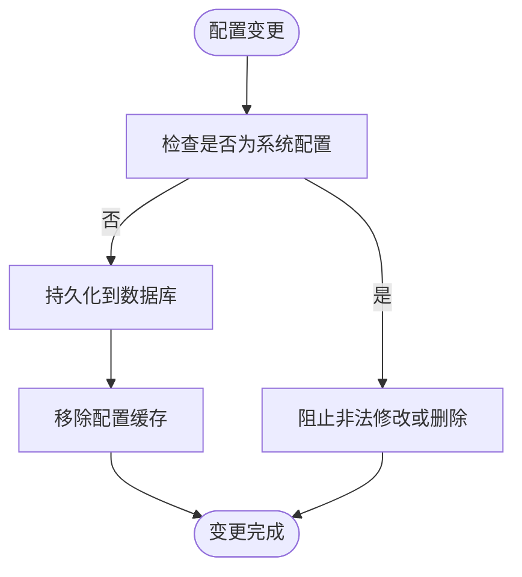

**图表来源**
- [SysConfigService.cs:60-200](file://Admin.NET/Admin.NET.Core/Service/Config/SysConfigService.cs#L60-L200)
- [SysTenantConfigService.cs:80-200](file://Admin.NET/Admin.NET.Core/Service/Config/SysTenantConfigService.cs#L80-L200)
- [SysUserConfigService.cs:80-200](file://Admin.NET/Admin.NET.Core/Service/Config/SysUserConfigService.cs#L80-L200)

### 配置中心集成示例

前端 SDK 中，系统配置接口已自动生成 Axios 封装，典型调用包括：

| 前端方法 | 后端路径 | 用途 |
|---|---|---|
| `apiSysConfigAddPost` | `/api/sysConfig/add` | 新增配置 |
| `apiSysConfigBatchDeletePost` | `/api/sysConfig/batchDelete` | 批量删除配置 |
| `apiSysConfigBatchUpdatePost` | `/api/sysConfig/batchUpdate` | 批量更新配置 |
| `apiSysConfigConfigValueByCodeCodeGet` | `/api/sysConfig/configValueByCode/{code}` | 按编码获取配置值 |

建议在前端业务模块中：

1. 使用 `configValueByCode` 接口加载运行时配置，而不是直接硬编码。
2. 在配置页面保存成功后，刷新本地配置缓存。
3. 对敏感配置（如密钥、连接串）避免在前端控制台打印。
4. 若需要版本化，可在配置项增加业务版本号字段，并在服务端比较版本号后再决定是否热更新。

**章节来源**
- [sys-config-api.ts:1-200](file://Web/apps/web-antdv-next/src/api-services/apis/sys-config-api.ts#L1-L200)
- [SysConfigService.cs:1-200](file://Admin.NET/Admin.NET.Core/Service/Config/SysConfigService.cs#L1-L200)

## 多租户管理接口

### 租户数据模型

租户实体包含租户管理员用户、机构、域名、租户类型、数据库类型、连接字符串、从库配置、注册开关、图标、标题、水印、版权、排序、备注和状态等。

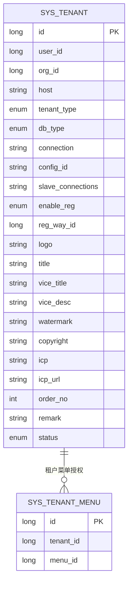

**图表来源**
- [SysTenant.cs:1-145](file://Admin.NET/Admin.NET.Core/Entity/SysTenant.cs#L1-L145)
- [SysTenantMenu.cs:1-27](file://Admin.NET/Admin.NET.Core/Entity/SysTenantMenu.cs#L1-L27)

### 租户隔离策略

系统支持两种主要隔离思路：

| 隔离方式 | 实现位置 | 特点 |
|---|---|---|
| 字段隔离 | 租户类型为主库连接，使用 `TenantId` 区分数据 | 部署简单，适合中小规模租户 |
| 库隔离 | 租户拥有独立数据库连接字符串，由 `Connection` 和 `DbType` 描述 | 物理隔离，适合高安全要求租户 |

库隔离租户通过 `SysTenantService.CacheTenant` 缓存连接信息，并将连接字符串进行 SM2 加密；动态访问租户数据库时，先从缓存解析连接，再创建 SqlSugar 作用域。

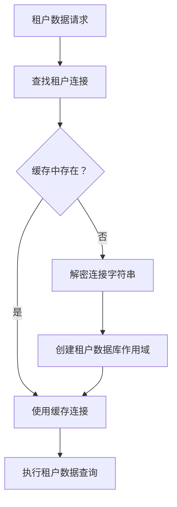

**图表来源**
- [SysTenantService.cs:700-792](file://Admin.NET/Admin.NET.Core/Service/Tenant/SysTenantService.cs#L700-L792)

### 租户菜单隔离

租户菜单通过 `SysTenantMenu` 表维护租户与菜单的关系。授权逻辑会：

1. 校验传入的菜单 ID 是否存在。
2. 向上追溯父级菜单，保证菜单树完整性。
3. 校验权限码和路由不重复。
4. 删除旧授权并写入新授权。
5. 清除按钮权限缓存。

**章节来源**
- [SysTenantService.cs:451-792](file://Admin.NET/Admin.NET.Core/Service/Tenant/SysTenantService.cs#L451-L792)
- [SysTenantMenu.cs:1-27](file://Admin.NET/Admin.NET.Core/Entity/SysTenantMenu.cs#L1-L27)

## 字典管理接口

### 字典数据模型

字典类型与字典数据是经典的一对多关系；租户字典值通过 `SysDictDataTenant` 扩展租户隔离。

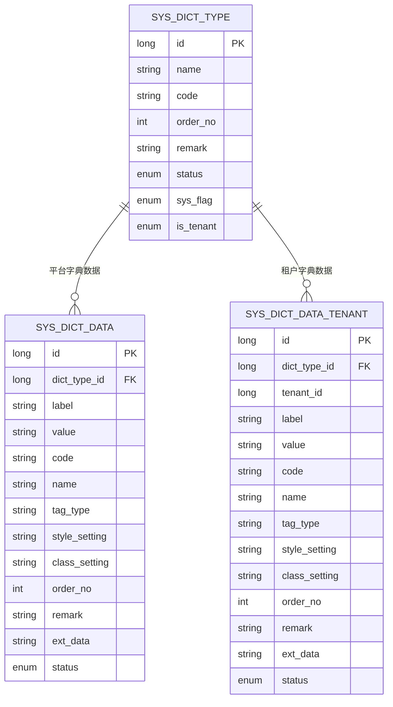

**图表来源**
- [SysDictType.cs:1-68](file://Admin.NET/Admin.NET.Core/Entity/SysDictType.cs#L1-L68)
- [SysDictData.cs:1-105](file://Admin.NET/Admin.NET.Core/Entity/SysDictData.cs#L1-L105)
- [SysDictDataTenant.cs:1-22](file://Admin.NET/Admin.NET.Core/Entity/SysDictDataTenant.cs#L1-L22)

### 字典缓存优化

字典读取路径会：

1. 根据字典类型判断是否为租户字典。
2. 平台字典使用全局键缓存。
3. 租户字典使用 `租户ID:字典编码` 的复合键缓存。
4. 新增、更新、删除字典数据后，移除对应类型的缓存键。
5. 字典类型变更时，主动遍历已存在的租户字典值，逐个租户失效缓存，避免前缀误删。

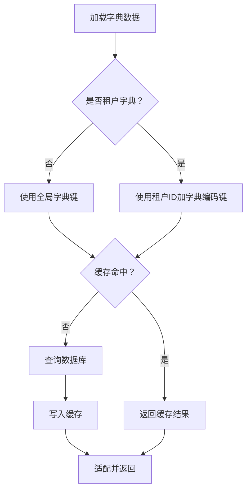

**图表来源**
- [SysDictDataService.cs:200-348](file://Admin.NET/Admin.NET.Core/Service/Dict/SysDictDataService.cs#L200-L348)

### 字典数据前端使用模式

推荐在前端采用“字典驱动表单”的模式：

1. 页面初始化时调用字典类型列表接口，拿到可编辑的枚举项。
2. 表单字段渲染时，根据字段绑定的字典编码调用字典值接口。
3. 下拉框显示 `label`，提交值为 `value`。
4. 字典值支持 `tagType`、`styleSetting`、`classSetting` 等样式字段，用于表格标签颜色或按钮样式。
5. 当后台更新字典后，前端应刷新本地字典缓存，或在字典编辑器保存后重新加载该字典值。

**章节来源**
- [SysDictTypeService.cs:1-261](file://Admin.NET/Admin.NET.Core/Service/Dict/SysDictTypeService.cs#L1-L261)
- [SysDictDataService.cs:1-348](file://Admin.NET/Admin.NET.Core/Service/Dict/SysDictDataService.cs#L1-L348)

## 通用服务接口

### 枚举服务

枚举服务通过反射扫描程序集中所有枚举类型，并按配置排除忽略枚举和错误码枚举。它提供：

- 枚举类型列表：包含类型描述、完整名称和枚举值集合。
- 按枚举名获取值：用于前端动态渲染下拉选项。
- 按实体字段名获取枚举：用于根据实体属性自动推断枚举选项。

**章节来源**
- [SysEnumService.cs:1-102](file://Admin.NET/Admin.NET.Core/Service/Enum/SysEnumService.cs#L1-L102)

### 常量服务

常量服务扫描带有常量特性的类或枚举，并缓存所有常量列表及单个类型的常量数据。适合把前端需要的静态常量（如状态码、业务常量）集中放在后端，通过反射暴露。

**章节来源**
- [SysConstService.cs:1-83](file://Admin.NET/Admin.NET.Core/Service/Const/SysConstService.cs#L1-L83)

### 地区服务

地区服务提供行政区划数据的分页、列表、树、增删改和同步。同步逻辑会根据系统配置决定同步层级，默认区县级，并通过外部统计局地图页面抓取数据，按省、市、区三级填充。

**章节来源**
- [SysRegionService.cs:1-200](file://Admin.NET/Admin.NET.Core/Service/Region/SysRegionService.cs#L1-L200)
- [SysRegion.cs:1-109](file://Admin.NET/Admin.NET.Core/Entity/SysRegion.cs#L1-L109)

## 依赖关系分析

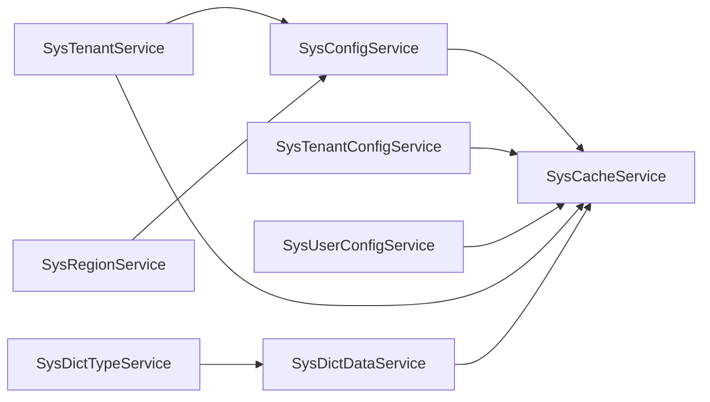

**图表来源**
- [SysConfigService.cs:1-120](file://Admin.NET/Admin.NET.Core/Service/Config/SysConfigService.cs#L1-L120)
- [SysTenantConfigService.cs:1-120](file://Admin.NET/Admin.NET.Core/Service/Config/SysTenantConfigService.cs#L1-L120)
- [SysUserConfigService.cs:1-120](file://Admin.NET/Admin.NET.Core/Service/Config/SysUserConfigService.cs#L1-L120)
- [SysTenantService.cs:1-120](file://Admin.NET/Admin.NET.Core/Service/Tenant/SysTenantService.cs#L1-L120)
- [SysDictTypeService.cs:1-120](file://Admin.NET/Admin.NET.Core/Service/Dict/SysDictTypeService.cs#L1-L120)
- [SysDictDataService.cs:1-120](file://Admin.NET/Admin.NET.Core/Service/Dict/SysDictDataService.cs#L1-L120)
- [SysRegionService.cs:1-120](file://Admin.NET/Admin.NET.Core/Service/Region/SysRegionService.cs#L1-L120)

**章节来源**
- [SysConfigService.cs:1-120](file://Admin.NET/Admin.NET.Core/Service/Config/SysConfigService.cs#L1-L120)
- [SysTenantService.cs:1-120](file://Admin.NET/Admin.NET.Core/Service/Tenant/SysTenantService.cs#L1-L120)
- [SysDictDataService.cs:1-120](file://Admin.NET/Admin.NET.Core/Service/Dict/SysDictDataService.cs#L1-L120)

## 性能与缓存特性

### 配置缓存

- 系统配置按编码缓存，键前缀为配置常量前缀加编码。
- 租户配置和用户配置在查询时合并平台与租户或用户值，避免每次重复拼接 SQL。
- 更新配置后，服务会移除相关缓存键，使下一次读取回源数据库。

### 字典缓存

- 平台字典按字典编码缓存。
- 租户字典按租户编号加字典编码缓存。
- 字典类型元数据变化时，会主动失效已有租户字典缓存，避免脏读。

### 租户连接缓存

- 所有租户连接信息缓存在内存中。
- 连接字符串在缓存前进行 SM2 加密。
- 访问租户数据库时复用已注册的连接作用域，减少频繁创建连接开销。

### 枚举与常量缓存

- 常量列表和按类型名的常量数据会写入缓存。
- 枚举值通过反射获取，适合低频启动期或首次加载场景。

**章节来源**
- [SysConfigService.cs:120-200](file://Admin.NET/Admin.NET.Core/Service/Config/SysConfigService.cs#L120-L200)
- [SysTenantConfigService.cs:120-200](file://Admin.NET/Admin.NET.Core/Service/Config/SysTenantConfigService.cs#L120-L200)
- [SysDictDataService.cs:200-348](file://Admin.NET/Admin.NET.Core/Service/Dict/SysDictDataService.cs#L200-L348)
- [SysConstService.cs:1-83](file://Admin.NET/Admin.NET.Core/Service/Const/SysConstService.cs#L1-L83)
- [SysTenantService.cs:700-792](file://Admin.NET/Admin.NET.Core/Service/Tenant/SysTenantService.cs#L700-L792)

## 故障排查指南

### 配置接口常见错误

| 现象 | 可能原因 | 处理建议 |
|---|---|---|
| 新增配置提示重复 | 名称或编码已存在 | 修改名称或编码，避免与系统配置冲突 |
| 更新配置提示无权限 | 修改了系统配置元数据 | 使用超级管理员账户 |
| 删除配置被拒绝 | 删除的是系统内置配置 | 不要删除系统配置项 |
| 按编码取值返回空 | 编码不存在或值为空 | 检查配置是否已创建，并确认缓存未命中 |
| 租户配置无法修改元数据 | 普通租户只能修改值 | 使用超级管理员或仅更新值字段 |

**章节来源**
- [SysConfigService.cs:60-200](file://Admin.NET/Admin.NET.Core/Service/Config/SysConfigService.cs#L60-L200)
- [SysTenantConfigService.cs:80-200](file://Admin.NET/Admin.NET.Core/Service/Config/SysTenantConfigService.cs#L80-L200)
- [SysUserConfigService.cs:80-200](file://Admin.NET/Admin.NET.Core/Service/Config/SysUserConfigService.cs#L80-L200)

### 租户接口常见错误

| 现象 | 可能原因 | 处理建议 |
|---|---|---|
| 新增租户机构重复 | 机构名称已存在 | 更换机构名称 |
| 新增租户域名重复 | 域名已绑定其他租户 | 更换域名或解除绑定 |
| 新增租户管理员账号重复 | 账号已存在 | 更换管理员账号 |
| 设置状态失败 | 尝试修改默认租户关键属性 | 禁止修改默认租户 |
| 创建租户数据库失败 | 租户不是库隔离租户或连接无效 | 检查租户类型和连接字符串 |
| 切换租户失败 | 租户或用户状态禁用 | 检查租户状态和用户状态 |
| 授权菜单失败 | 菜单不存在、父级链断裂或路由重复 | 检查菜单数据和授权规则 |

**章节来源**
- [SysTenantService.cs:200-792](file://Admin.NET/Admin.NET.Core/Service/Tenant/SysTenantService.cs#L200-L792)

### 字典接口常见错误

| 现象 | 可能原因 | 处理建议 |
|---|---|---|
| 新增字典类型以 enum 结尾 | 系统保留命名约定 | 修改字典编码 |
| 更新字典类型状态失败 | 非超级管理员修改系统标志 | 使用超级管理员 |
| 新增字典值重复 | 同类型下值重复 | 修改值或检查租户隔离 |
| 删除字典类型失败 | 删除系统字典或权限不足 | 检查系统标志和权限 |
| 字典取值返回空 | 字典类型禁用或字典值禁用 | 检查状态和缓存 |

**章节来源**
- [SysDictTypeService.cs:120-261](file://Admin.NET/Admin.NET.Core/Service/Dict/SysDictTypeService.cs#L120-L261)
- [SysDictDataService.cs:120-348](file://Admin.NET/Admin.NET.Core/Service/Dict/SysDictDataService.cs#L120-L348)

## 结论

Admin.NET 的系统管理接口围绕“配置、租户、字典、通用数据”四个方向构建：

- 配置中心提供平台级、租户级、用户级三层配置能力，适合运行期参数管理。
- 多租户管理支持字段隔离和库隔离，并提供菜单授权、状态控制、数据库初始化等完整生命周期能力。
- 字典管理支持平台字典与租户字典分离，具备完善的缓存失效机制。
- 通用服务通过反射简化枚举和常量获取，地区服务提供可扩展的行政区划数据。

在实际使用中，建议：

1. 将可变业务参数放入配置中心，而不是代码常量。
2. 对敏感连接串、密钥使用租户配置或外部配置中心，并配合加密与权限控制。
3. 使用字典驱动前端表单，降低前后端枚举不一致风险。
4. 在配置变更后主动刷新前端缓存，确保热更新体验一致。
5. 对高频字典和常量启用缓存，避免频繁反射或数据库查询。