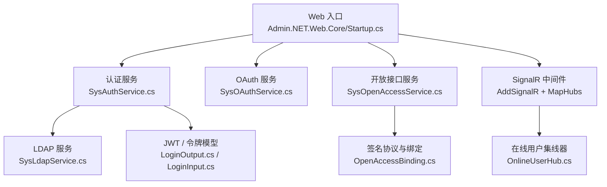
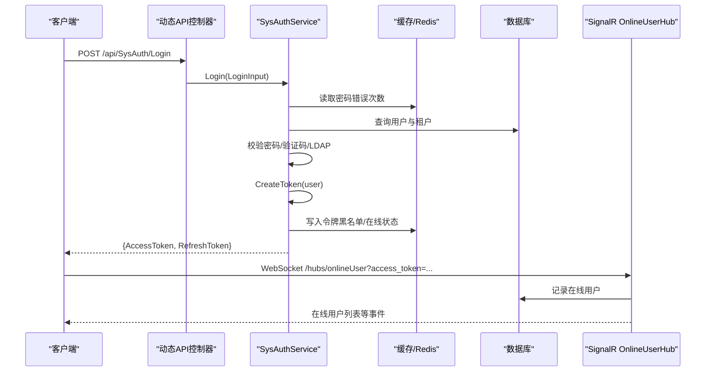
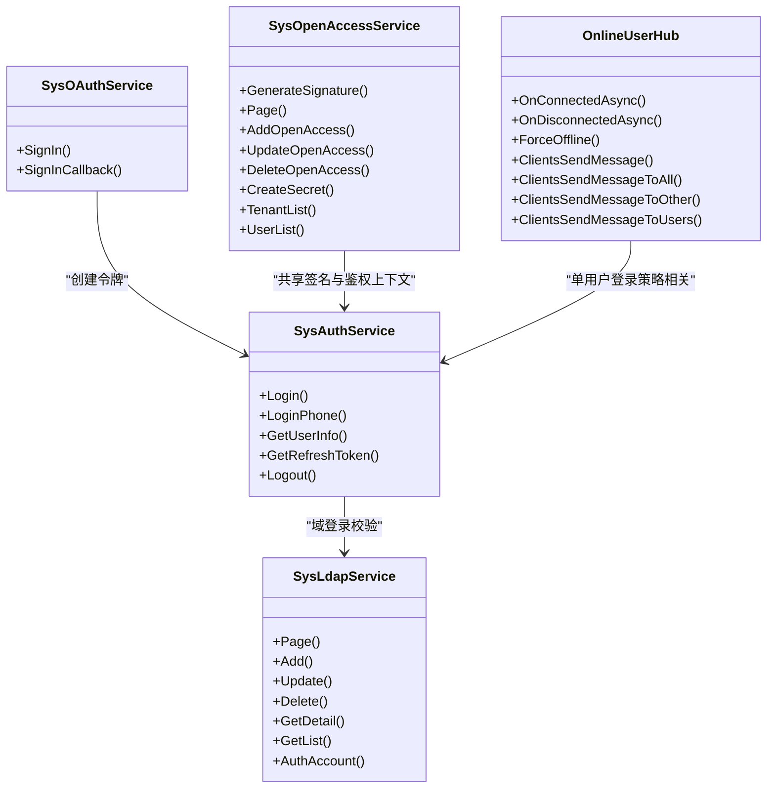

# 认证授权接口

<cite>
**本文引用的文件**   
- [Startup.cs](file://Admin.NET/Admin.NET.Web.Core/Startup.cs)
- [SysAuthService.cs](file://Admin.NET/Admin.NET.Core/Service/Auth/SysAuthService.cs)
- [LoginInput.cs](file://Admin.NET/Admin.NET.Core/Service/Auth/Dto/LoginInput.cs)
- [LoginOutput.cs](file://Admin.NET/Admin.NET.Core/Service/Auth/Dto/LoginOutput.cs)
- [LoginUserOutput.cs](file://Admin.NET/Admin.NET.Core/Service/Auth/Dto/LoginUserOutput.cs)
- [SysLdapService.cs](file://Admin.NET/Admin.NET.Core/Service/Auth/SysLdapService.cs)
- [SysOAuthService.cs](file://Admin.NET/Admin.NET.Core/Service/OAuth/SysOAuthService.cs)
- [SysOpenAccessService.cs](file://Admin.NET/Admin.NET.Core/Service/OpenAccess/SysOpenAccessService.cs)
- [OnlineUserHub.cs](file://Admin.NET/Admin.NET.Core/Hub/OnlineUserHub.cs)
- [IOnlineUserHub.cs](file://Admin.NET/Admin.NET.Core/Hub/IOnlineUserHub.cs)
- [SignalRSetup.cs](file://Admin.NET/Admin.NET.Core/SignalR/SignalRSetup.cs)
</cite>

## 目录
1. [简介](#简介)
2. [项目结构](#项目结构)
3. [核心组件](#核心组件)
4. [架构总览](#架构总览)
5. [详细接口文档](#详细接口文档)
6. [依赖关系分析](#依赖关系分析)
7. [性能与可扩展性](#性能与可扩展性)
8. [故障排查指南](#故障排查指南)
9. [结论](#结论)
10. [附录：前端集成与安全注意事项](#附录前端集成与安全注意事项)

## 简介
本文面向 Admin.NET 的认证、授权、开放接口与实时通信能力，基于当前源码对以下范围进行权威说明：
- 用户登录（账号密码登录、手机号登录）、获取用户信息、刷新令牌、退出登录。
- JWT 令牌验证机制、请求头与查询参数中的 Token 传递方式。
- OAuth 第三方登录流程（当前实现为第三方回调模式）。
- LDAP 目录服务集成（配置管理、域账号校验）。
- 开放接口签名认证（AccessKey/AccessSecret 签名协议）。
- SignalR 在线用户集线器、消息推送方法与事件类型。
- 安全策略：密码加密、验证码、错误次数限制、黑名单、跨域、限流、会话与单点登录行为。

## 项目结构
本仓库采用多工程分层组织：Web 启动与中间件注册位于 Web.Core；业务控制器与服务位于 Core；SignalR Hub 位于 Core.Hub；OAuth 与 OpenAccess 分别位于 Core.Service.OAuth 与 Core.Service.OpenAccess。

图表来源
- [Startup.cs:16-100](file://Admin.NET/Admin.NET.Web.Core/Startup.cs#L16-L100)
- [Startup.cs:222-236](file://Admin.NET/Admin.NET.Web.Core/Startup.cs#L222-L236)
- [Startup.cs:420-442](file://Admin.NET/Admin.NET.Web.Core/Startup.cs#L420-L442)
- [SysAuthService.cs:1-120](file://Admin.NET/Admin.NET.Core/Service/Auth/SysAuthService.cs#L1-L120)
- [SysOAuthService.cs:1-120](file://Admin.NET/Admin.NET.Core/Service/OAuth/SysOAuthService.cs#L1-L120)
- [SysOpenAccessService.cs:1-120](file://Admin.NET/Admin.NET.Core/Service/OpenAccess/SysOpenAccessService.cs#L1-L120)
- [OnlineUserHub.cs:1-60](file://Admin.NET/Admin.NET.Core/Hub/OnlineUserHub.cs#L1-L60)

章节来源
- [Startup.cs:16-100](file://Admin.NET/Admin.NET.Web.Core/Startup.cs#L16-L100)
- [Startup.cs:222-236](file://Admin.NET/Admin.NET.Web.Core/Startup.cs#L222-L236)
- [Startup.cs:420-442](file://Admin.NET/Admin.NET.Web.Core/Startup.cs#L420-L442)

## 核心组件
- SysAuthService：统一处理登录、手机号登录、获取用户信息、刷新令牌、退出登录、验证码、用户注册、Swagger 登录辅助。
- SysLdapService：提供 LDAP 配置的分页、新增、更新、删除、详情、列表以及域账号校验。
- SysOAuthService：第三方登录发起与回调，根据 provider 触发外部认证，成功后创建本地令牌并重定向。
- SysOpenAccessService：开放接口身份管理、签名生成、签名鉴权事件实现、租户与用户绑定校验。
- OnlineUserHub：SignalR 在线用户集线器，负责连接、分组、离线清理、强制下线、站内消息广播。
- Startup：注册 JWT、Signature 鉴权、CORS、SignalR、限流、路由与端点映射。

章节来源
- [SysAuthService.cs:1-200](file://Admin.NET/Admin.NET.Core/Service/Auth/SysAuthService.cs#L1-L200)
- [SysLdapService.cs:1-200](file://Admin.NET/Admin.NET.Core/Service/Auth/SysLdapService.cs#L1-L200)
- [SysOAuthService.cs:1-120](file://Admin.NET/Admin.NET.Core/Service/OAuth/SysOAuthService.cs#L1-L120)
- [SysOpenAccessService.cs:1-200](file://Admin.NET/Admin.NET.Core/Service/OpenAccess/SysOpenAccessService.cs#L1-L200)
- [OnlineUserHub.cs:1-193](file://Admin.NET/Admin.NET.Core/Hub/OnlineUserHub.cs#L1-L193)

## 架构总览
后端通过 Furion 动态 API 暴露控制器方法；认证流程由 JWT 中间件与自定义 JwtHandler 完成；SignalR 使用 JsonProtocol，支持 Redis 集群扩展；开放接口使用 Signature 鉴权方案。

图表来源
- [SysAuthService.cs:45-120](file://Admin.NET/Admin.NET.Core/Service/Auth/SysAuthService.cs#L45-L120)
- [SysAuthService.cs:201-320](file://Admin.NET/Admin.NET.Core/Service/Auth/SysAuthService.cs#L201-L320)
- [OnlineUserHub.cs:30-120](file://Admin.NET/Admin.NET.Core/Hub/OnlineUserHub.cs#L30-L120)
- [Startup.cs:222-236](file://Admin.NET/Admin.NET.Web.Core/Startup.cs#L222-L236)
- [Startup.cs:435-442](file://Admin.NET/Admin.NET.Web.Core/Startup.cs#L435-L442)

## 详细接口文档

### 用户登录（账号密码）
- 路径与方法：`POST /api/SysAuth/Login`
- 认证要求：无需登录（AllowAnonymous）
- 请求体字段
  - `Account`：账号，必填，长度至少 2。
  - `Password`：明文或前端 SM2 加密后的密码，必填，长度至少 3。
  - `TenantId`：可选，租户标识。
  - `CodeId`：可选，验证码 ID。
  - `Code`：可选，验证码。
- 业务规则
  - 若开启系统验证码，则必须通过验证码校验。
  - 若开启域登录，则根据是否关联 LDAP 决定本地密码或 LDAP 校验。
  - 密码错误次数超过阈值将被拒绝。
  - 成功登录后会更新最后登录信息并创建访问令牌与刷新令牌。
- 响应格式
  - 统一返回包装对象，数据部分包含：
    - `AccessToken`：JWT 访问令牌。
    - `RefreshToken`：刷新令牌。
    - `Homepage`：个性化首页地址。
- 错误码与含义（示例）
  - `D1027`：密码错误次数超限。
  - `D0008`：验证码无效。
  - `D1017`：账号被冻结。
  - `D1000`：账号或密码错误。
- 安全要点
  - 前端建议对密码做 SM2 加密后再传输。
  - 后端会记录 IP、设备、时间与地址。

章节来源
- [SysAuthService.cs:45-120](file://Admin.NET/Admin.NET.Core/Service/Auth/SysAuthService.cs#L45-L120)
- [LoginInput.cs:1-60](file://Admin.NET/Admin.NET.Core/Service/Auth/Dto/LoginInput.cs#L1-L60)
- [LoginOutput.cs:1-28](file://Admin.NET/Admin.NET.Core/Service/Auth/Dto/LoginOutput.cs#L1-L28)

### 手机号登录
- 路径与方法：`POST /api/SysAuth/LoginPhone`
- 认证要求：无需登录
- 请求体字段
  - `Phone`：手机号，必填且需符合手机号格式。
  - `Code`：短信验证码，必填。
  - `TenantId`：可选。
- 响应格式：同账号密码登录，返回 `AccessToken`、`RefreshToken`、`Homepage`。
- 错误码与含义（示例）
  - 短信验证码校验失败将抛出业务异常。
  - 账号被冻结时返回对应错误码。

章节来源
- [SysAuthService.cs:201-240](file://Admin.NET/Admin.NET.Core/Service/Auth/SysAuthService.cs#L201-L240)
- [LoginInput.cs:60-119](file://Admin.NET/Admin.NET.Core/Service/Auth/Dto/LoginInput.cs#L60-L119)
- [LoginOutput.cs:1-28](file://Admin.NET/Admin.NET.Core/Service/Auth/Dto/LoginOutput.cs#L1-L28)

### 获取用户信息
- 路径与方法：`GET /api/SysAuth/GetUserInfo`
- 认证要求：需要已登录用户
- 响应字段（节选）
  - `Id`、`Account`、`RealName`、`Phone`、`Email`、`Avatar`、`Buttons`、`RoleIds`、`OrgId`、`OrgName`、`OrgType`、`PosName`、`WatermarkText`、`LangCode`、`TenantId`、`CurrentTenantId`。
- 用途：用于前端初始化用户资料、按钮权限与水印信息。

章节来源
- [SysAuthService.cs:320-420](file://Admin.NET/Admin.NET.Core/Service/Auth/SysAuthService.cs#L320-L420)
- [LoginUserOutput.cs:1-118](file://Admin.NET/Admin.NET.Core/Service/Auth/Dto/LoginUserOutput.cs#L1-L118)

### 刷新令牌
- 路径与方法：`GET /api/SysAuth/GetRefreshToken?accessToken=...`
- 认证要求：需要携带旧 `AccessToken`，服务端会从该令牌解析当前用户上下文。
- 行为
  - 检查黑名单中是否存在旧令牌。
  - 校验令牌有效性。
  - 校验租户与用户状态。
  - 重新生成新的 `AccessToken` 与 `RefreshToken`。
- 响应格式：同登录响应。
- 错误码与含义（示例）
  - `D1011`：用户未登录或用户不存在。
  - `D1016`：上下文缺失或令牌无效。

章节来源
- [SysAuthService.cs:420-470](file://Admin.NET/Admin.NET.Core/Service/Auth/SysAuthService.cs#L420-L470)
- [LoginOutput.cs:1-28](file://Admin.NET/Admin.NET.Core/Service/Auth/Dto/LoginOutput.cs#L1-L28)

### 退出登录
- 路径与方法：`POST /api/SysAuth/Logout`
- 认证要求：需要已登录用户
- 行为
  - 从请求头 `Authorization` 中取出 Bearer token。
  - 将 token 加入黑名单，过期时间等于令牌有效期。
  - 发布登出事件，清除 Swagger 登录状态。
- 响应：统一成功响应。
- 错误码与含义（示例）
  - `D1011`：缺少认证信息。
  - `D1016`：HTTP 上下文缺失。

章节来源
- [SysAuthService.cs:470-514](file://Admin.NET/Admin.NET.Core/Service/Auth/SysAuthService.cs#L470-L514)

### JWT 令牌验证与传参方式
- 验证机制
  - 启用全局授权。
  - 通过 `JwtBearerEvents.OnMessageReceived` 优先从查询参数 `token` 提取令牌。
  - 对于 `/hubs` 路径，优先从 `access_token` 查询参数提取令牌，便于 SignalR 连接。
- 请求头
  - 常规 API 建议使用标准 `Authorization: Bearer <AccessToken>`。
- 响应头
  - 登录成功后会在响应头中设置 `access-token` 与 `refresh-token`，供前端读取。

章节来源
- [Startup.cs:16-100](file://Admin.NET/Admin.NET.Web.Core/Startup.cs#L16-L100)

### OAuth 第三方登录
- 发起登录
  - 路径与方法：`GET /api/SysOAuth/SignIn?provider=...&redirectUrl=...`
  - 功能：调用外部认证并提供回调地址。
  - 不支持的 provider 会抛出“不支持的OAuth类型”。
- 授权回调
  - 路径与方法：`GET /api/SysOAuth/SignInCallback?provider=...&redirectUrl=...`
  - 行为
    - 使用外部 provider 进行认证。
    - 从 Claims 中读取用户标识、姓名、邮箱、手机号等信息。
    - 若本地无绑定记录，则创建新用户并绑定第三方 OpenId。
    - 调用 `CreateToken` 生成令牌。
    - 重定向到前端 `redirectUrl/#/login?token=<AccessToken>`。
- 注意
  - 当前实现并非完整的 OAuth 2.0 授权码/客户端凭证/隐式模式通用服务器；它复用 ASP.NET Core 的外部认证体系，具体 provider 行为取决于外部平台。

章节来源
- [SysOAuthService.cs:1-120](file://Admin.NET/Admin.NET.Core/Service/OAuth/SysOAuthService.cs#L1-L120)
- [SysAuthService.cs:240-320](file://Admin.NET/Admin.NET.Core/Service/Auth/SysAuthService.cs#L240-L320)

### LDAP 目录服务集成
- 功能范围
  - 分页查询 LDAP 配置。
  - 新增、更新、删除、获取详情、获取列表。
  - 校验域账号：连接 LDAP、按配置搜索 DN、再尝试以用户名和密码绑定。
- 安全
  - 绑定密码以 SM2 加密存储。
  - 校验参数包括 Host、Port、BaseDn、BindDn、AuthFilter、版本、属性字段等。
- 典型错误
  - 找不到对象或属性。
  - 凭据无效。
  - 配置不完整。

章节来源
- [SysLdapService.cs:1-200](file://Admin.NET/Admin.NET.Core/Service/Auth/SysLdapService.cs#L1-L200)
- [SysAuthService.cs:60-120](file://Admin.NET/Admin.NET.Core/Service/Auth/SysAuthService.cs#L60-L120)

### 开放接口签名认证
- 适用场景
  - 面向外部系统或内部微服务的非浏览器访问。
- 关键能力
  - 生成签名：服务端提供 `GenerateSignature` 工具接口，按 METHOD、URL、ACCESSKEY、TIMESTAMP、NONCE 计算签名。
  - 管理 AccessKey/AccessSecret：分页、新增、更新、删除、创建密钥、绑定租户与用户。
  - 签名鉴权：通过 SignatureAuthentication 在中间件层校验请求签名。
- 鉴权流程
  - 中间件根据 AccessKey 加载绑定快照。
  - 校验租户与用户状态及权限。
  - 构建 HttpContext Principal 并继续后续业务逻辑。

章节来源
- [SysOpenAccessService.cs:1-200](file://Admin.NET/Admin.NET.Core/Service/OpenAccess/SysOpenAccessService.cs#L1-L200)
- [SysOpenAccessService.cs:201-312](file://Admin.NET/Admin.NET.Core/Service/OpenAccess/SysOpenAccessService.cs#L201-L312)
- [Startup.cs:40-60](file://Admin.NET/Admin.NET.Web.Core/Startup.cs#L40-L60)

### SignalR 实时通知与在线用户
- 连接地址
  - `/hubs/onlineUser`
  - 可通过查询参数 `access_token` 传递令牌。
- 认证要求
  - Hub 类标注 `[Authorize]`，连接前需通过 JWT 鉴权。
- 主要方法
  - `ClientsSendMessage(message)`：发送给指定用户。
  - `ClientsSendMessageToAll(message)`：广播给所有人。
  - `ClientsSendMessageToOther(message)`：发给其他人。
  - `ClientsSendMessageToUsers(message)`：发给一组用户。
  - `ForceOffline(input)`：强制下线某连接。
- 服务端事件
  - `OnlineUserList(context)`：推送在线用户列表变化。
  - `ForceOffline(context)`：通知强制下线。
  - `PublicNotice(context)`：发布站内公告。
  - `ReceiveMessage(context)`：接收消息回调。
- 连接生命周期
  - `OnConnectedAsync`：记录在线用户、按租户分组、推送初始列表。
  - `OnDisconnectedAsync`：清理在线记录、按单用户或多连接策略维护缓存、推送变动。

章节来源
- [OnlineUserHub.cs:1-193](file://Admin.NET/Admin.NET.Core/Hub/OnlineUserHub.cs#L1-L193)
- [IOnlineUserHub.cs:1-38](file://Admin.NET/Admin.NET.Core/Hub/IOnlineUserHub.cs#L1-L38)
- [Startup.cs:222-236](file://Admin.NET/Admin.NET.Web.Core/Startup.cs#L222-L236)
- [SignalRSetup.cs:1-103](file://Admin.NET/Admin.NET.Core/SignalR/SignalRSetup.cs#L1-L103)

## 依赖关系分析
- SysAuthService 依赖 UserManager、缓存、菜单服务、在线用户服务、租户服务、短信服务、LDAP 服务、事件总线与用户服务。
- SysLdapService 依赖 SqlSugarRepository<SysLdap> 与 UserManager，并在域校验中直接操作 LDAP 连接。
- SysOAuthService 依赖外部认证框架与微信用户表，最终委托 SysAuthService 生成令牌。
- SysOpenAccessService 依赖开放接口表、缓存、用户管理与签名协议。
- OnlineUserHub 依赖在线用户表、消息服务、HubContext、缓存与配置服务。

图表来源
- [SysAuthService.cs:1-200](file://Admin.NET/Admin.NET.Core/Service/Auth/SysAuthService.cs#L1-L200)
- [SysLdapService.cs:1-200](file://Admin.NET/Admin.NET.Core/Service/Auth/SysLdapService.cs#L1-L200)
- [SysOAuthService.cs:1-120](file://Admin.NET/Admin.NET.Core/Service/OAuth/SysOAuthService.cs#L1-L120)
- [SysOpenAccessService.cs:1-200](file://Admin.NET/Admin.NET.Core/Service/OpenAccess/SysOpenAccessService.cs#L1-L200)
- [OnlineUserHub.cs:1-193](file://Admin.NET/Admin.NET.Core/Hub/OnlineUserHub.cs#L1-L193)

## 性能与可扩展性
- JWT 与令牌
  - 令牌包含用户、租户、账号、角色、机构、语言等 Claim。
  - 刷新令牌独立生成，可单独控制过期时间。
- 在线用户
  - 支持单用户登录策略：同一用户仅保留一个在线连接。
  - 非单用户登录时按连接维度维护缓存。
  - 支持按租户分组广播，减少无关推送。
- SignalR 集群
  - 当缓存类型为 Redis 且 Cluster 启用时，SignalR 使用 StackExchange.Redis 作为持久化通道。
  - 支持哨兵模式与普通 Redis 配置。
- 限流与压缩
  - 内置内存限流、客户端限流与策略限流。
  - 启用 Brotli 与 Gzip 响应压缩。

章节来源
- [SysAuthService.cs:240-320](file://Admin.NET/Admin.NET.Core/Service/Auth/SysAuthService.cs#L240-L320)
- [OnlineUserHub.cs:60-160](file://Admin.NET/Admin.NET.Core/Hub/OnlineUserHub.cs#L60-L160)
- [SignalRSetup.cs:1-103](file://Admin.NET/Admin.NET.Core/SignalR/SignalRSetup.cs#L1-L103)
- [Startup.cs:100-200](file://Admin.NET/Admin.NET.Web.Core/Startup.cs#L100-L200)

## 故障排查指南
- 登录失败
  - 检查验证码是否开启以及 CodeId/Code 是否正确。
  - 检查密码错误次数是否超限。
  - 若启用域登录，确认 LDAP 配置有效且用户存在。
- 刷新令牌失败
  - 确认 AccessToken 未被加入黑名单。
  - 检查令牌是否有效，租户与用户是否启用。
- 退出失败
  - 检查 Authorization 请求头是否携带 Bearer token。
  - 确认 HTTP 上下文可用。
- SignalR 连接失败
  - 检查 `/hubs/onlineUser?access_token=...` 是否传入有效 token。
  - 检查 Redis 与集群配置是否正确。
  - 查看服务端日志中的 Redis 连接错误。
- 开放接口签名失败
  - 检查 AccessKey 与 AccessSecret 是否匹配。
  - 检查 METHOD、URL、Timestamp、Nonce 是否与签名一致。
  - 确认绑定租户与用户处于启用状态。

章节来源
- [SysAuthService.cs:45-120](file://Admin.NET/Admin.NET.Core/Service/Auth/SysAuthService.cs#L45-L120)
- [SysAuthService.cs:420-514](file://Admin.NET/Admin.NET.Core/Service/Auth/SysAuthService.cs#L420-L514)
- [OnlineUserHub.cs:100-193](file://Admin.NET/Admin.NET.Core/Hub/OnlineUserHub.cs#L100-L193)
- [SignalRSetup.cs:40-103](file://Admin.NET/Admin.NET.Core/SignalR/SignalRSetup.cs#L40-L103)
- [SysOpenAccessService.cs:201-312](file://Admin.NET/Admin.NET.Core/Service/OpenAccess/SysOpenAccessService.cs#L201-L312)

## 结论
Admin.NET 的认证授权体系以 JWT 为核心，结合验证码、密码错误次数、黑名单与单用户登录策略，形成较完整的安全闭环；OAuth 提供第三方登录接入；LDAP 支持企业域账号；开放接口提供签名鉴权；SignalR 提供在线用户与消息推送。实际集成时应遵循本文的接口规范、安全建议与错误处理策略。

## 附录：前端集成与安全注意事项

### 前端集成示例思路
- 登录
  - 调用账号密码或手机号登录接口，保存返回的 `AccessToken` 与 `RefreshToken`。
  - 也可从响应头 `access-token` 与 `refresh-token` 中读取。
- 自动刷新
  - 在业务请求前判断 AccessToken 是否即将过期。
  - 调用刷新接口，成功后替换本地令牌。
  - 刷新失败则跳转到登录页。
- 错误处理
  - 401 或业务错误码表示未登录或令牌失效，应清空本地状态并跳转登录。
  - 网络异常与超时重试应区分于认证错误。
- SignalR 连接
  - 在登录后建立 WebSocket 连接到 `/hubs/onlineUser`，并将 `access_token` 放入查询参数。
  - 订阅 `OnlineUserList` 等事件，处理在线用户变化与消息推送。
  - 断线后根据业务需求进行指数退避重连。

### 安全注意事项
- 密码加密
  - 前端可使用 SM2 对密码加密后再发送。
  - 后端根据配置解密并与存储值比较。
- 防暴力破解
  - 启用验证码。
  - 限制密码错误次数，超限时拒绝登录。
- 会话管理
  - 使用 JWT 作为无状态令牌，必要时配合黑名单防止撤销。
  - 根据单用户登录配置决定是否允许多设备同时在线。
- 跨域配置
  - 中间件启用 CORS，必须在路由之前、认证之后注册。
- 限流与防护
  - 启用 IP 限流、客户端限流与策略限流。
  - 生产环境启用异常处理页面与 HSTS。

章节来源
- [SysAuthService.cs:45-120](file://Admin.NET/Admin.NET.Core/Service/Auth/SysAuthService.cs#L45-L120)
- [SysAuthService.cs:420-514](file://Admin.NET/Admin.NET.Core/Service/Auth/SysAuthService.cs#L420-L514)
- [Startup.cs:320-420](file://Admin.NET/Admin.NET.Web.Core/Startup.cs#L320-L420)
- [OnlineUserHub.cs:1-193](file://Admin.NET/Admin.NET.Core/Hub/OnlineUserHub.cs#L1-L193)