# API 集成与请求管理

<cite>
**本文引用的文件**   
- [Web/package.json](file://Web/package.json)
- [Web/apps/web-antdv-next/package.json](file://Web/apps/web-antdv-next/package.json)
- [Web/playwright.config.ts](file://Web/playwright.config.ts)
- [Web/vitest.config.ts](file://Web/vitest.config.ts)
- [Web/apps/web-antdv-next/src/main.ts](file://Web/apps/web-antdv-next/src/main.ts)
- [Web/apps/web-antdv-next/src/bootstrap.ts](file://Web/apps/web-antdv-next/src/bootstrap.ts)
- [Web/apps/web-antdv-next/src/api/index.ts](file://Web/apps/web-antdv-next/src/api/index.ts)
- [Web/apps/web-antdv-next/src/api/request.ts](file://Web/apps/web-antdv-next/src/api/request.ts)
- [Web/apps/web-antdv-next/src/api/admin-interceptors.ts](file://Web/apps/web-antdv-next/src/api/admin-interceptors.ts)
- [Web/apps/web-antdv-next/src/api/core/auth.ts](file://Web/apps/web-antdv-next/src/api/core/auth.ts)
- [Web/apps/web-antdv-next/src/api/core/user.ts](file://Web/apps/web-antdv-next/src/api/core/user.ts)
- [Web/apps/web-antdv-next/src/api/core/menu.ts](file://Web/apps/web-antdv-next/src/api/core/menu.ts)
- [Web/apps/web-antdv-next/src/api/core/upload.ts](file://Web/apps/web-antdv-next/src/api/core/upload.ts)
- [Web/apps/web-antdv-next/src/api/core/index.ts](file://Web/apps/web-antdv-next/src/api/core/index.ts)
- [Web/apps/web-antdv-next/src/api/system/user.ts](file://Web/apps/web-antdv-next/src/api/system/user.ts)
- [Web/apps/web-antdv-next/src/api/system/file.ts](file://Web/apps/web-antdv-next/src/api/system/file.ts)
- [Web/apps/web-antdv-next/src/api/system/tenant.ts](file://Web/apps/web-antdv-next/src/api/system/tenant.ts)
- [Web/apps/web-antdv-next/src/api/system/cache.ts](file://Web/apps/web-antdv-next/src/api/system/cache.ts)
- [Web/apps/web-antdv-next/src/api/session.ts](file://Web/apps/web-antdv-next/src/api/session.ts)
- [Web/apps/web-antdv-next/src/api/online-session.ts](file://Web/apps/web-antdv-next/src/api/online-session.ts)
- [Web/apps/web-antdv-next/src/api/realtime.ts](file://Web/apps/web-antdv-next/src/api/realtime.ts)
- [Web/apps/web-antdv-next/src/api/file-response.ts](file://Web/apps/web-antdv-next/src/api/file-response.ts)
- [Web/apps/web-antdv-next/src/api/api-url.ts](file://Web/apps/web-antdv-next/src/api/api-url.ts)
- [Web/apps/web-antdv-next/src/api/sdk.ts](file://Web/apps/web-antdv-next/src/api/sdk.ts)
- [Web/apps/web-antdv-next/src/api-services/models/api-output.ts](file://Web/apps/web-antdv-next/src/api-services/models/api-output.ts)
- [Web/apps/web-antdv-next/src/api-services/models/admin-result-object.ts](file://Web/apps/web-antdv-next/src/api-services/models/admin-result-object.ts)
- [Web/apps/web-antdv-next/src/api/core/auth.test.ts](file://Web/apps/web-antdv-next/src/api/core/auth.test.ts)
- [Web/apps/web-antdv-next/src/api/admin-interceptors.test.ts](file://Web/apps/web-antdv-next/src/api/admin-interceptors.test.ts)
- [Web/apps/web-antdv-next/src/api/api-url.test.ts](file://Web/apps/web-antdv-next/src/api/api-url.test.ts)
- [Web/apps/web-antdv-next/src/api/file-response.test.ts](file://Web/apps/web-antdv-next/src/api/file-response.test.ts)
- [Web/apps/web-antdv-next/src/api/notice-inbox.test.ts](file://Web/apps/web-antdv-next/src/api/notice-inbox.test.ts)
- [Web/apps/web-antdv-next/src/api/online-session.test.ts](file://Web/apps/web-antdv-next/src/api/online-session.test.ts)
- [Web/apps/web-antdv-next/e2e/auth-contract.spec.ts](file://Web/apps/web-antdv-next/e2e/auth-contract.spec.ts)
- [Web/apps/web-antdv-next/e2e/timer-contract.spec.ts](file://Web/apps/web-antdv-next/e2e/timer-contract.spec.ts)
</cite>

## 目录
1. [引言](#引言)
2. [项目结构与运行入口](#项目结构与运行入口)
3. [核心组件总览](#核心组件总览)
4. [架构概览](#架构概览)
5. [详细组件分析](#详细组件分析)
6. [依赖关系分析](#依赖关系分析)
7. [性能与可靠性考虑](#性能与可靠性考虑)
8. [测试策略](#测试策略)
9. [常见问题排查](#常见问题排查)
10. [结论](#结论)

## 引言
本指南聚焦 Admin.NET 前端业务应用 `@vben/web-antdv-next` 的 API 集成与请求管理。该应用以 Vite + Vue 为运行时，通过工作区共享包提供通用请求能力；业务层在 `src/api` 下按功能域组织接口，并在 `src/api-services` 中维护由后端 OpenAPI 生成的类型模型。本文说明 axios 封装、拦截器、认证令牌、SignalR 实时通信、文件上传下载、响应适配和测试方法，帮助开发者在不直接操作底层 HTTP 库的前提下稳定调用后端服务。

## 项目结构与运行入口
当前分支已完成前端移植，业务前端入口是 `apps/web-antdv-next`。根工作区脚本将开发、构建、类型检查和 Lint 命令转发到该应用：
- 根脚本 `pnpm dev`、`pnpm build`、`pnpm lint`、`pnpm check:type` 面向业务应用，而不是全 workspace 检查。
- 应用自身提供 `dev`、`build`、`preview`、`typecheck` 等脚本。
- 运行时要求 Node 版本由根 `package.json` 的 `engines` 约束，包管理器由 `packageManager` 指定为 pnpm。

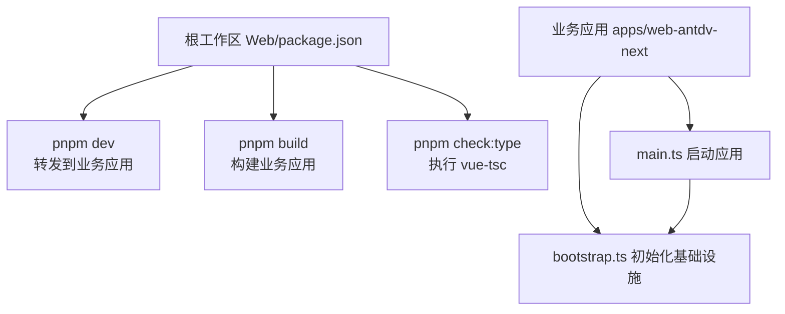

**图示来源**
- [Web/package.json:1-102](file://Web/package.json#L1-L102)
- [Web/apps/web-antdv-next/package.json:1-72](file://Web/apps/web-antdv-next/package.json#L1-L72)
- [Web/apps/web-antdv-next/src/main.ts](file://Web/apps/web-antdv-next/src/main.ts)
- [Web/apps/web-antdv-next/src/bootstrap.ts](file://Web/apps/web-antdv-next/src/bootstrap.ts)

**章节来源**
- [Web/package.json:1-102](file://Web/package.json#L1-L102)
- [Web/apps/web-antdv-next/package.json:1-72](file://Web/apps/web-antdv-next/package.json#L1-L72)

## 核心组件总览
Admin.NET 前端的 API 体系由以下几层组成：
- 基础请求层：基于 `axios` 的请求实例、超时、重试、取消和进度回调。
- 管理端拦截器：注入认证头、租户信息、签名参数、错误码统一处理、消息提示。
- 认证模块：登录、获取用户信息、菜单加载、刷新 token、退出登录。
- 功能域 API：系统、文件、会话、在线用户、通知、配置、缓存、租户等。
- 实时通信：基于 `@microsoft/signalr` 的连接、消息订阅与重连。
- 文件处理：上传、下载、预览、二进制流转换。
- 生成服务与类型：OpenAPI 生成的 `api-services` 类型模型，以及 SDK 适配器。
- 测试：Vitest 单元测试、Playwright 端到端契约测试。

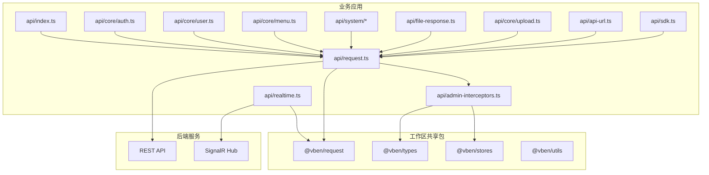

**图示来源**
- [Web/apps/web-antdv-next/src/api/index.ts](file://Web/apps/web-antdv-next/src/api/index.ts)
- [Web/apps/web-antdv-next/src/api/request.ts](file://Web/apps/web-antdv-next/src/api/request.ts)
- [Web/apps/web-antdv-next/src/api/admin-interceptors.ts](file://Web/apps/web-antdv-next/src/api/admin-interceptors.ts)
- [Web/apps/web-antdv-next/src/api/core/auth.ts](file://Web/apps/web-antdv-next/src/api/core/auth.ts)
- [Web/apps/web-antdv-next/src/api/core/user.ts](file://Web/apps/web-antdv-next/src/api/core/user.ts)
- [Web/apps/web-antdv-next/src/api/core/menu.ts](file://Web/apps/web-antdv-next/src/api/core/menu.ts)
- [Web/apps/web-antdv-next/src/api/system/file.ts](file://Web/apps/web-antdv-next/src/api/system/file.ts)
- [Web/apps/web-antdv-next/src/api/realtime.ts](file://Web/apps/web-antdv-next/src/api/realtime.ts)
- [Web/apps/web-antdv-next/src/api/file-response.ts](file://Web/apps/web-antdv-next/src/api/file-response.ts)
- [Web/apps/web-antdv-next/src/api/core/upload.ts](file://Web/apps/web-antdv-next/src/api/core/upload.ts)
- [Web/apps/web-antdv-next/src/api/api-url.ts](file://Web/apps/web-antdv-next/src/api/api-url.ts)
- [Web/apps/web-antdv-next/src/api/sdk.ts](file://Web/apps/web-antdv-next/src/api/sdk.ts)

## 架构概览
请求从业务页面进入 `src/api`，再进入统一请求实例。拦截器负责附加认证、租户、签名等上下文，并统一处理后端返回的错误码。数据层把后端结果转换为业务类型，必要时调用 `api-services` 中的模型类型。实时通信通过 SignalR 建立连接，订阅频道后推送通知或状态更新。文件操作区分普通 JSON 响应与二进制流，下载和预览使用统一的二进制响应处理工具。

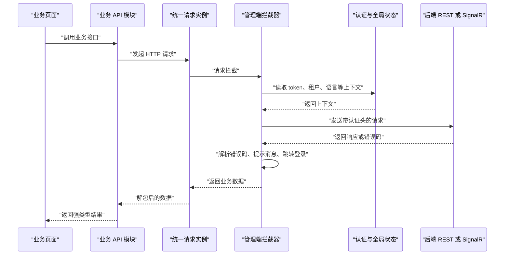

**图示来源**
- [Web/apps/web-antdv-next/src/api/request.ts](file://Web/apps/web-antdv-next/src/api/request.ts)
- [Web/apps/web-antdv-next/src/api/admin-interceptors.ts](file://Web/apps/web-antdv-next/src/api/admin-interceptors.ts)
- [Web/apps/web-antdv-next/src/api/core/auth.ts](file://Web/apps/web-antdv-next/src/api/core/auth.ts)

## 详细组件分析

### 基础请求封装
`src/api/request.ts` 负责创建和管理 axios 请求实例。它通常承担以下职责：
- 设置基础 URL、超时、请求头默认值。
- 合并业务自定义配置，例如分页参数、租户标识、语言代码。
- 支持取消重复请求、节流请求、进度回调。
- 把后端响应包装为业务可消费格式，例如提取 `data`、`code`、`message`。
- 与共享包 `@vben/request` 协作，复用通用请求能力。

实际使用时，业务 API 模块直接调用该请求实例的方法，避免在各页面重复写 fetch 或 axios 调用。

**章节来源**
- [Web/apps/web-antdv-next/src/api/request.ts](file://Web/apps/web-antdv-next/src/api/request.ts)
- [Web/apps/web-antdv-next/package.json:1-72](file://Web/apps/web-antdv-next/package.json#L1-L72)

### 管理端拦截器与错误处理
`src/api/admin-interceptors.ts` 是管理端接口的核心拦截器。它主要处理：
- 请求侧：注入 Authorization 头、X-TenantId、签名参数、防重放参数。
- 响应侧：判断后端统一响应结构，如 `AdminResult`、`ApiResponse`、`ApiOutput`。
- 错误码映射：将后端业务错误码映射为用户可读消息，并决定是否显示全局提示。
- 认证失效：当 token 过期或缺失时，触发重新登录流程，清除本地状态并跳转到登录页。
- 租户隔离：根据当前租户切换请求上下文，确保多租户数据隔离。

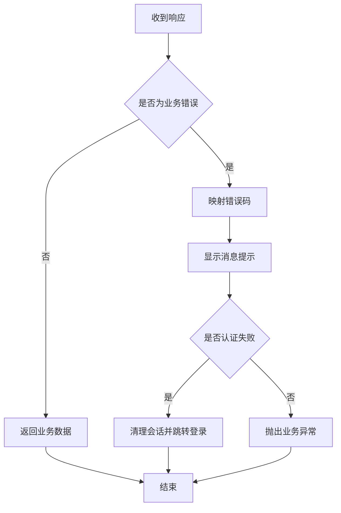

**图示来源**
- [Web/apps/web-antdv-next/src/api/admin-interceptors.ts](file://Web/apps/web-antdv-next/src/api/admin-interceptors.ts)
- [Web/apps/web-antdv-next/src/api-services/models/admin-result-object.ts](file://Web/apps/web-antdv-next/src/api-services/models/admin-result-object.ts)
- [Web/apps/web-antdv-next/src/api-services/models/api-output.ts](file://Web/apps/web-antdv-next/src/api-services/models/api-output.ts)

**章节来源**
- [Web/apps/web-antdv-next/src/api/admin-interceptors.ts](file://Web/apps/web-antdv-next/src/api/admin-interceptors.ts)
- [Web/apps/web-antdv-next/src/api-services/models/api-output.ts](file://Web/apps/web-antdv-next/src/api-services/models/api-output.ts)
- [Web/apps/web-antdv-next/src/api-services/models/admin-result-object.ts](file://Web/apps/web-antdv-next/src/api-services/models/admin-result-object.ts)

### 认证令牌管理
认证相关逻辑集中在 `src/api/core/auth.ts`，并与 `core/user.ts`、`core/menu.ts` 配合完成登录后数据加载。典型流程包括：
- 登录：提交用户名、密码、验证码或短信验证码，换取 JWT。
- 存储策略：token 通常存储在内存状态中，可选持久化到 sessionStorage；敏感场景应避免长期写入 localStorage。
- 刷新策略：token 接近过期时主动刷新，或在请求被标记为未授权时刷新。
- 登出：调用后端登出接口，清理 token、用户信息、权限、菜单，并跳转登录页。
- 上下文注入：拦截器从认证状态中读取 token，附加到后续请求。

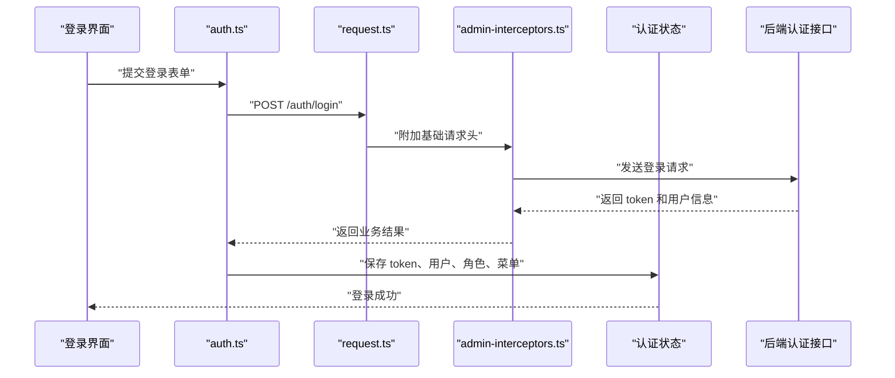

**图示来源**
- [Web/apps/web-antdv-next/src/api/core/auth.ts](file://Web/apps/web-antdv-next/src/api/core/auth.ts)
- [Web/apps/web-antdv-next/src/api/request.ts](file://Web/apps/web-antdv-next/src/api/request.ts)
- [Web/apps/web-antdv-next/src/api/admin-interceptors.ts](file://Web/apps/web-antdv-next/src/api/admin-interceptors.ts)

**章节来源**
- [Web/apps/web-antdv-next/src/api/core/auth.ts](file://Web/apps/web-antdv-next/src/api/core/auth.ts)
- [Web/apps/web-antdv-next/src/api/core/user.ts](file://Web/apps/web-antdv-next/src/api/core/user.ts)
- [Web/apps/web-antdv-next/src/api/core/menu.ts](file://Web/apps/web-antdv-next/src/api/core/menu.ts)
- [Web/apps/web-antdv-next/src/api/admin-interceptors.ts](file://Web/apps/web-antdv-next/src/api/admin-interceptors.ts)

### API 接口模块化组织
`src/api` 采用“功能域 + 核心能力”的分层组织方式：
- `core`：认证、用户、菜单、上传等跨领域能力。
- `system`：系统级功能，如用户、文件、租户、缓存、字典、配置、插件、定时任务、日志、数据库、站点信息等。
- 顶层文件：会话、在线会话、实时通知、文件响应、API URL、SDK 适配器等。

这种结构让新增功能域时只需在 `system` 下新建子模块，并在 `index.ts` 中导出，保持调用方无需关心内部实现细节。

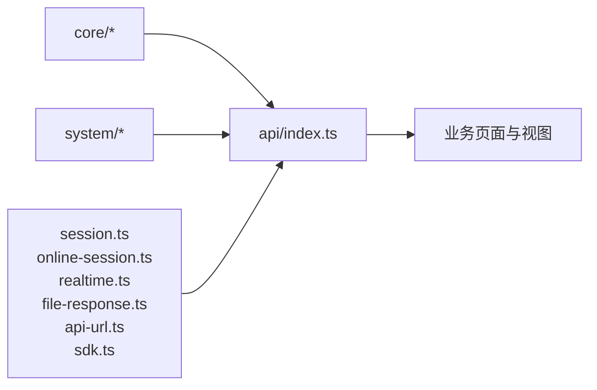

**图示来源**
- [Web/apps/web-antdv-next/src/api/index.ts](file://Web/apps/web-antdv-next/src/api/index.ts)
- [Web/apps/web-antdv-next/src/api/core/auth.ts](file://Web/apps/web-antdv-next/src/api/core/auth.ts)
- [Web/apps/web-antdv-next/src/api/system/user.ts](file://Web/apps/web-antdv-next/src/api/system/user.ts)
- [Web/apps/web-antdv-next/src/api/system/file.ts](file://Web/apps/web-antdv-next/src/api/system/file.ts)

**章节来源**
- [Web/apps/web-antdv-next/src/api/index.ts](file://Web/apps/web-antdv-next/src/api/index.ts)
- [Web/apps/web-antdv-next/src/api/core/upload.ts](file://Web/apps/web-antdv-next/src/api/core/upload.ts)
- [Web/apps/web-antdv-next/src/api/system/user.ts](file://Web/apps/web-antdv-next/src/api/system/user.ts)
- [Web/apps/web-antdv-next/src/api/system/file.ts](file://Web/apps/web-antdv-next/src/api/system/file.ts)

### 后端响应格式适配
后端返回统一结构，前端通过 `api-services/models` 中的类型描述这些结构，并由拦截器和 API 模块做适配：
- `ApiOutput`：通用 API 输出结构。
- `AdminResultObject`：管理端通用结果对象。
- 业务 API 模块在调用成功后提取 `data`，并转换为更贴近业务的 TypeScript 类型。

这样，页面组件只消费业务类型，不需要感知后端统一响应包装。

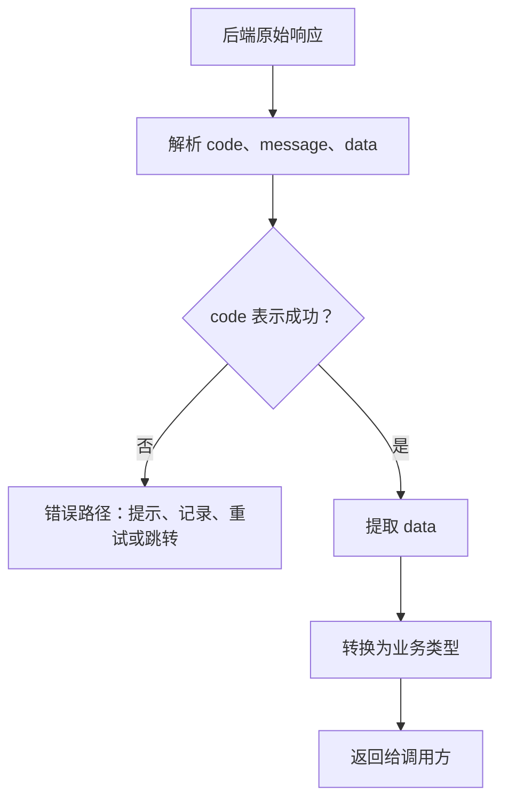

**图示来源**
- [Web/apps/web-antdv-next/src/api-services/models/api-output.ts](file://Web/apps/web-antdv-next/src/api-services/models/api-output.ts)
- [Web/apps/web-antdv-next/src/api-services/models/admin-result-object.ts](file://Web/apps/web-antdv-next/src/api-services/models/admin-result-object.ts)
- [Web/apps/web-antdv-next/src/api/admin-interceptors.ts](file://Web/apps/web-antdv-next/src/api/admin-interceptors.ts)

**章节来源**
- [Web/apps/web-antdv-next/src/api-services/models/api-output.ts](file://Web/apps/web-antdv-next/src/api-services/models/api-output.ts)
- [Web/apps/web-antdv-next/src/api-services/models/admin-result-object.ts](file://Web/apps/web-antdv-next/src/api-services/models/admin-result-object.ts)
- [Web/apps/web-antdv-next/src/api/admin-interceptors.ts](file://Web/apps/web-antdv-next/src/api/admin-interceptors.ts)

### SignalR 实时通信集成
`src/api/realtime.ts` 集成 `@microsoft/signalr`，用于接收后端推送的通知、在线用户变化、系统事件等。典型职责包括：
- 建立连接：根据环境配置连接后端 SignalR Hub。
- 订阅频道：注册消息处理器，如通知、公告、在线人数、作业执行状态。
- 重连机制：网络中断、Hub 断开时自动重连，并在恢复后重新订阅。
- 生命周期管理：应用销毁或用户退出时关闭连接，避免资源泄漏。

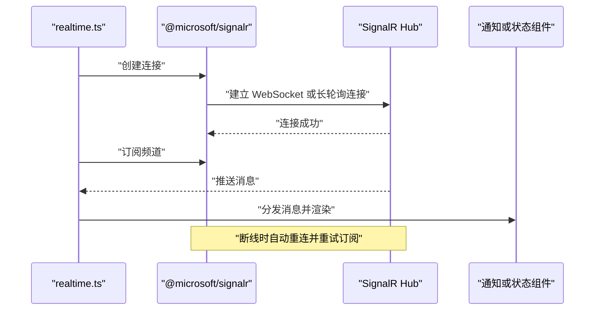

**图示来源**
- [Web/apps/web-antdv-next/src/api/realtime.ts](file://Web/apps/web-antdv-next/src/api/realtime.ts)
- [Web/apps/web-antdv-next/package.json:1-72](file://Web/apps/web-antdv-next/package.json#L1-L72)

**章节来源**
- [Web/apps/web-antdv-next/src/api/realtime.ts](file://Web/apps/web-antdv-next/src/api/realtime.ts)
- [Web/apps/web-antdv-next/package.json:1-72](file://Web/apps/web-antdv-next/package.json#L1-L72)

### 文件上传、下载与预览
文件处理分为三类：
- 上传：通过 `core/upload.ts` 或 `system/file.ts` 调用上传接口，支持进度回调、分片上传、并发控制。
- 下载：后端返回二进制流，前端通过 `file-response.ts` 将其转换为 Blob、URL 或文件名，触发浏览器下载。
- 预览：对 PDF、Word、Excel 等类型，结合 `@vue-office/*` 和 PDF.js 进行在线预览。

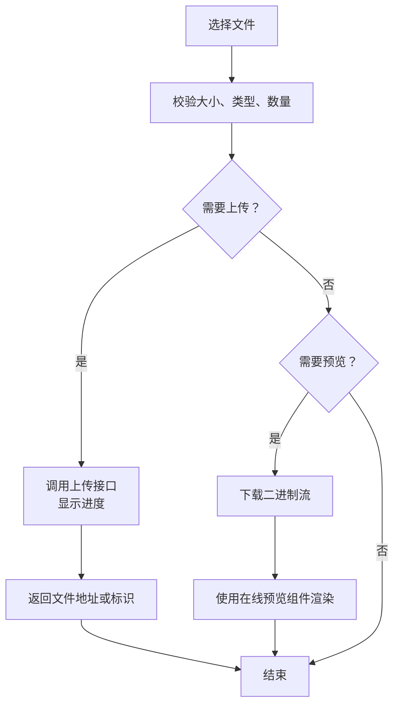

**图示来源**
- [Web/apps/web-antdv-next/src/api/core/upload.ts](file://Web/apps/web-antdv-next/src/api/core/upload.ts)
- [Web/apps/web-antdv-next/src/api/system/file.ts](file://Web/apps/web-antdv-next/src/api/system/file.ts)
- [Web/apps/web-antdv-next/src/api/file-response.ts](file://Web/apps/web-antdv-next/src/api/file-response.ts)
- [Web/apps/web-antdv-next/package.json:1-72](file://Web/apps/web-antdv-next/package.json#L1-L72)

**章节来源**
- [Web/apps/web-antdv-next/src/api/core/upload.ts](file://Web/apps/web-antdv-next/src/api/core/upload.ts)
- [Web/apps/web-antdv-next/src/api/system/file.ts](file://Web/apps/web-antdv-next/src/api/system/file.ts)
- [Web/apps/web-antdv-next/src/api/file-response.ts](file://Web/apps/web-antdv-next/src/api/file-response.ts)
- [Web/apps/web-antdv-next/package.json:1-72](file://Web/apps/web-antdv-next/package.json#L1-L72)

### SDK 与 OpenAPI 类型适配
`src/api/sdk.ts` 作为 SDK 适配层，把 OpenAPI 生成的客户端或服务方法与业务 API 模块衔接起来。`src/api-services/models` 中包含大量后端模型类型，如 `ApiOutput`、`AdminResultObject`、各类输入输出 DTO。这种方式保证：
- 类型安全：字段变更可由生成代码同步。
- 文档一致：前后端类型与接口定义保持一致。
- 业务简化：业务 API 只暴露必要方法，隐藏复杂 DTO。

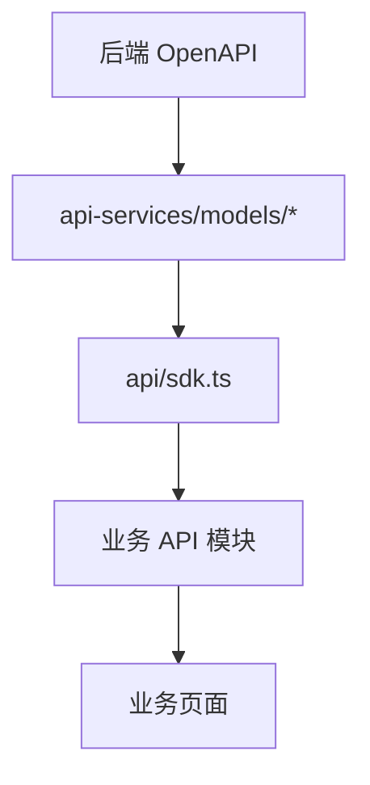

**图示来源**
- [Web/apps/web-antdv-next/src/api/sdk.ts](file://Web/apps/web-antdv-next/src/api/sdk.ts)
- [Web/apps/web-antdv-next/src/api-services/models/api-output.ts](file://Web/apps/web-antdv-next/src/api-services/models/api-output.ts)
- [Web/apps/web-antdv-next/src/api-services/models/admin-result-object.ts](file://Web/apps/web-antdv-next/src/api-services/models/admin-result-object.ts)

**章节来源**
- [Web/apps/web-antdv-next/src/api/sdk.ts](file://Web/apps/web-antdv-next/src/api/sdk.ts)
- [Web/apps/web-antdv-next/src/api-services/models/api-output.ts](file://Web/apps/web-antdv-next/src/api-services/models/api-output.ts)
- [Web/apps/web-antdv-next/src/api-services/models/admin-result-object.ts](file://Web/apps/web-antdv-next/src/api-services/models/admin-result-object.ts)

## 依赖关系分析
业务应用依赖 `axios` 和 `@microsoft/signalr`，并通过工作区引入 `@vben/request`、`@vben/stores`、`@vben/types`、`@vben/utils` 等共享能力。业务 API 模块依赖统一请求实例和拦截器，不直接耦合网络细节。

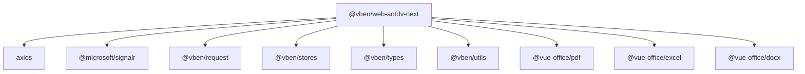

**图示来源**
- [Web/apps/web-antdv-next/package.json:1-72](file://Web/apps/web-antdv-next/package.json#L1-L72)

**章节来源**
- [Web/apps/web-antdv-next/package.json:1-72](file://Web/apps/web-antdv-next/package.json#L1-L72)

## 性能与可靠性考虑
- 请求优化：合理使用超时、取消重复请求、节流和去重，避免短时间内重复调用相同接口。
- 认证刷新：token 刷新应集中处理，避免多处并行刷新造成竞争条件。
- 实时连接：SignalR 连接应在应用启动时建立，并在退出时释放；重连失败时应给出降级提示。
- 大文件处理：上传建议使用分片和进度回调，下载使用流式处理，避免阻塞主线程。
- 错误边界：网络错误、HTTP 非 2xx、业务错误码都应分类处理，避免全局崩溃。
- 缓存策略：字典、配置、站点信息等低频变化数据可使用本地缓存，但需考虑脏数据和多标签页一致性。

[本节为通用指导，不直接分析具体文件]

## 测试策略
Admin.NET 前端采用三层测试：
- 单元测试：使用 Vitest，覆盖认证流程、拦截器行为、API URL 拼接、文件响应转换等。
- 集成测试：验证 API 模块与服务层组合行为的正确性，例如登录成功后用户信息和菜单加载。
- 端到端测试：使用 Playwright，模拟真实浏览器流程，验证登录、权限、文件、通知、在线用户等关键链路。

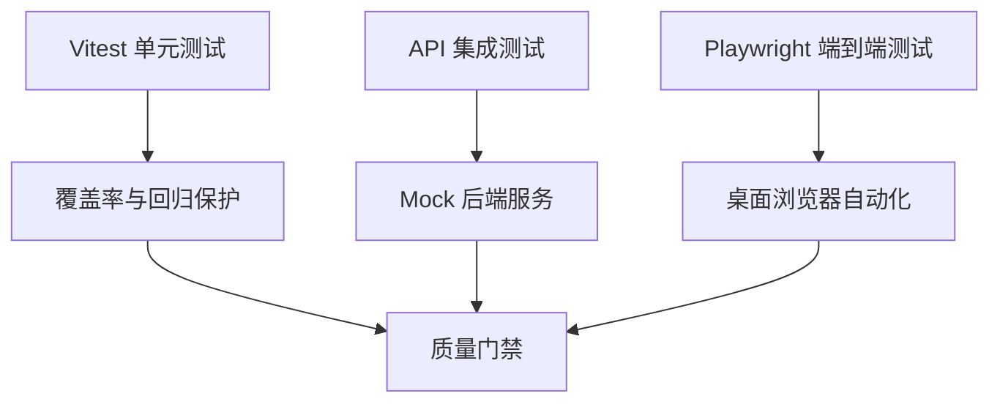

**图示来源**
- [Web/vitest.config.ts](file://Web/vitest.config.ts)
- [Web/playwright.config.ts](file://Web/playwright.config.ts)
- [Web/apps/web-antdv-next/src/api/core/auth.test.ts](file://Web/apps/web-antdv-next/src/api/core/auth.test.ts)
- [Web/apps/web-antdv-next/src/api/admin-interceptors.test.ts](file://Web/apps/web-antdv-next/src/api/admin-interceptors.test.ts)
- [Web/apps/web-antdv-next/src/api/api-url.test.ts](file://Web/apps/web-antdv-next/src/api/api-url.test.ts)
- [Web/apps/web-antdv-next/src/api/file-response.test.ts](file://Web/apps/web-antdv-next/src/api/file-response.test.ts)
- [Web/apps/web-antdv-next/src/api/notice-inbox.test.ts](file://Web/apps/web-antdv-next/src/api/notice-inbox.test.ts)
- [Web/apps/web-antdv-next/src/api/online-session.test.ts](file://Web/apps/web-antdv-next/src/api/online-session.test.ts)
- [Web/apps/web-antdv-next/e2e/auth-contract.spec.ts](file://Web/apps/web-antdv-next/e2e/auth-contract.spec.ts)
- [Web/apps/web-antdv-next/e2e/timer-contract.spec.ts](file://Web/apps/web-antdv-next/e2e/timer-contract.spec.ts)

**章节来源**
- [Web/vitest.config.ts](file://Web/vitest.config.ts)
- [Web/playwright.config.ts](file://Web/playwright.config.ts)
- [Web/apps/web-antdv-next/src/api/core/auth.test.ts](file://Web/apps/web-antdv-next/src/api/core/auth.test.ts)
- [Web/apps/web-antdv-next/src/api/admin-interceptors.test.ts](file://Web/apps/web-antdv-next/src/api/admin-interceptors.test.ts)
- [Web/apps/web-antdv-next/src/api/api-url.test.ts](file://Web/apps/web-antdv-next/src/api/api-url.test.ts)
- [Web/apps/web-antdv-next/src/api/file-response.test.ts](file://Web/apps/web-antdv-next/src/api/file-response.test.ts)
- [Web/apps/web-antdv-next/src/api/notice-inbox.test.ts](file://Web/apps/web-antdv-next/src/api/notice-inbox.test.ts)
- [Web/apps/web-antdv-next/src/api/online-session.test.ts](file://Web/apps/web-antdv-next/src/api/online-session.test.ts)
- [Web/apps/web-antdv-next/e2e/auth-contract.spec.ts](file://Web/apps/web-antdv-next/e2e/auth-contract.spec.ts)
- [Web/apps/web-antdv-next/e2e/timer-contract.spec.ts](file://Web/apps/web-antdv-next/e2e/timer-contract.spec.ts)

## 常见问题排查
- 跨域问题：确认 Vite 代理、后端 CORS 配置、域名与端口一致；生产环境注意 Nginx 反向代理和 Cookie SameSite 设置。
- 网络超时：调整 `timeout`、启用重试、区分网络错误与业务错误；对长耗时任务使用独立超时策略。
- 认证失效：检查 token 是否存在、是否过期、是否被跨域请求丢弃；确认登出后是否正确清理状态。
- 租户数据错乱：确认请求头中租户 ID 是否正确传递，多标签页情况下租户切换是否刷新上下文。
- 文件下载为空：确认后端返回的是二进制流而非 JSON，前端是否正确使用 Blob 和 URL 下载。
- SignalR 无法连接：检查 Hub 地址、WebSocket 支持、证书与代理；查看重连日志并确认订阅是否恢复。
- 类型不一致：检查 OpenAPI 生成代码是否最新，业务 API 模块是否使用正确的 DTO 类型。

**章节来源**
- [Web/apps/web-antdv-next/src/api/admin-interceptors.ts](file://Web/apps/web-antdv-next/src/api/admin-interceptors.ts)
- [Web/apps/web-antdv-next/src/api/file-response.ts](file://Web/apps/web-antdv-next/src/api/file-response.ts)
- [Web/apps/web-antdv-next/src/api/realtime.ts](file://Web/apps/web-antdv-next/src/api/realtime.ts)
- [Web/apps/web-antdv-next/src/api/core/auth.ts](file://Web/apps/web-antdv-next/src/api/core/auth.ts)

## 结论
Admin.NET 前端的 API 集成以统一请求实例为基础，通过管理端拦截器实现认证、租户、签名和错误处理的横切关注点；业务 API 按功能域组织，配合 OpenAPI 生成的类型模型保证类型安全；SignalR 提供实时通信能力；文件上传下载与预览形成完整的数据交互闭环。配合 Vitest 和 Playwright 的测试体系，可以在单元、集成和端到端层面保障 API 调用的稳定性。开发者在新增功能时，应优先复用现有请求封装、拦截器和类型模型，减少重复实现并降低接入后端服务的风险。