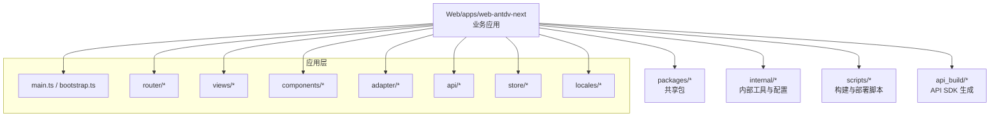
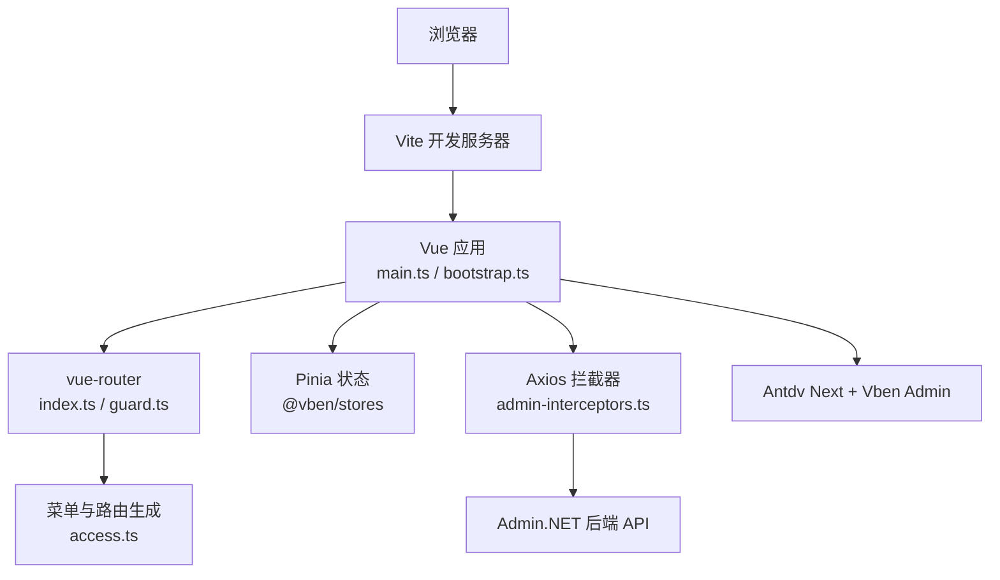
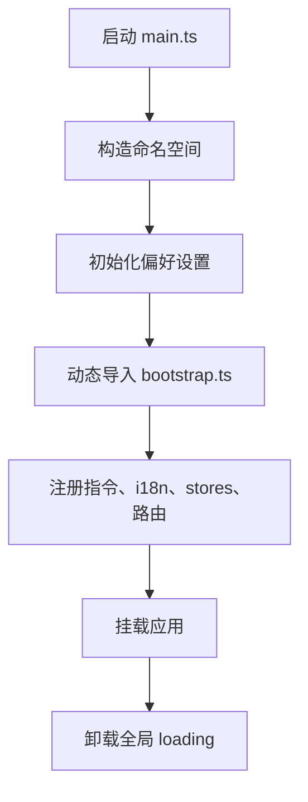
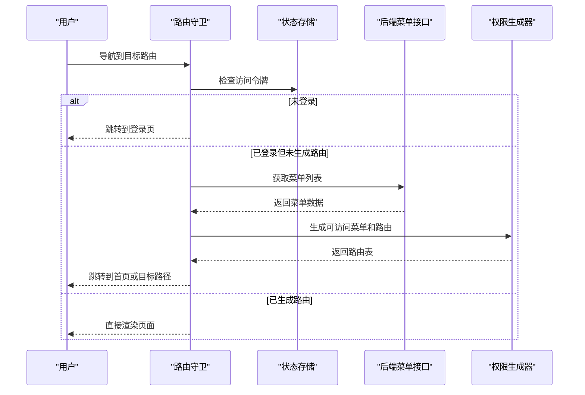
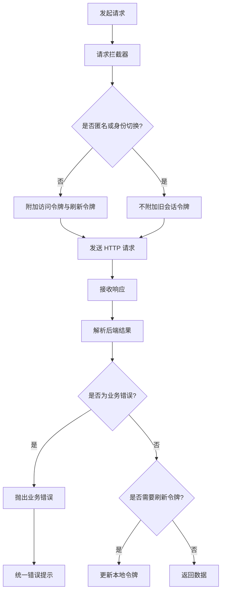
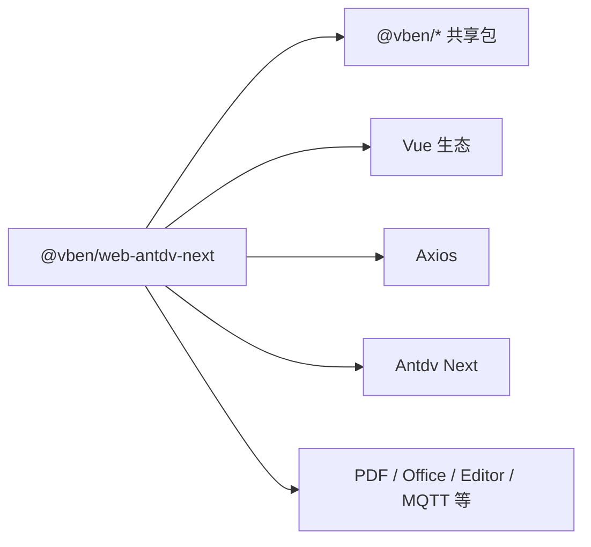
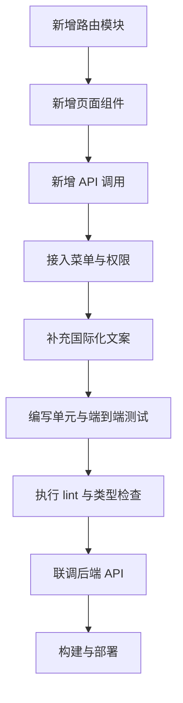

# 前端开发

<cite>
**本文引用的文件**   
- [Web/README.md](file://Web/README.md)
- [Web/package.json](file://Web/package.json)
- [Web/playwright.config.ts](file://Web/playwright.config.ts)
- [Web/apps/web-antdv-next/package.json](file://Web/apps/web-antdv-next/package.json)
- [Web/apps/web-antdv-next/vite.config.ts](file://Web/apps/web-antdv-next/vite.config.ts)
- [Web/apps/web-antdv-next/tsconfig.json](file://Web/apps/web-antdv-next/tsconfig.json)
- [Web/apps/web-antdv-next/src/main.ts](file://Web/apps/web-antdv-next/src/main.ts)
- [Web/apps/web-antdv-next/src/bootstrap.ts](file://Web/apps/web-antdv-next/src/bootstrap.ts)
- [Web/apps/web-antdv-next/src/preferences.ts](file://Web/apps/web-antdv-next/src/preferences.ts)
- [Web/apps/web-antdv-next/src/router/index.ts](file://Web/apps/web-antdv-next/src/router/index.ts)
- [Web/apps/web-antdv-next/src/router/guard.ts](file://Web/apps/web-antdv-next/src/router/guard.ts)
- [Web/apps/web-antdv-next/src/router/access.ts](file://Web/apps/web-antdv-next/src/router/access.ts)
- [Web/apps/web-antdv-next/src/router/routes/index.ts](file://Web/apps/web-antdv-next/src/router/routes/index.ts)
- [Web/apps/web-antdv-next/src/api/admin-interceptors.ts](file://Web/apps/web-antdv-next/src/api/admin-interceptors.ts)
- [Web/apps/web-antdv-next/src/api/session.ts](file://Web/apps/web-antdv-next/src/api/session.ts)
- [Web/internal/vite-config/src/config/application.ts](file://internal/vite-config/src/config/application.ts)
- [Web/internal/vite-config/src/plugins/inject-app-loading/index.ts](file://internal/vite-config/src/plugins/inject-app-loading/index.ts)
</cite>

## 目录
1. [简介](#简介)
2. [项目结构](#项目结构)
3. [核心组件](#核心组件)
4. [架构总览](#架构总览)
5. [详细组件分析](#详细组件分析)
6. [依赖关系分析](#依赖关系分析)
7. [性能与构建](#性能与构建)
8. [代码规范与调试](#代码规范与调试)
9. [后端集成指南](#后端集成指南)
10. [新页面开发流程](#新页面开发流程)
11. [故障排查](#故障排查)
12. [结论](#结论)

## 简介
本指南面向 Admin.NET 前端开发者，明确以 `Web/apps/web-antdv-next` 为当前业务前端入口。该应用基于 Vue 3、TypeScript、Vite、Vben Admin 和 Antdv Next，采用 pnpm workspace Monorepo 组织。根仓库的 README 说明：`Web/` 是工作区，保留共享包与上游许可证；业务联调需启动后端并准备隔离的真实 PostgreSQL，而不是 SQLite。常用命令如 `pnpm dev`、`pnpm build`、`pnpm lint`、`pnpm check:type` 均面向业务应用，不表示对整个 workspace 做全量检查。

## 项目结构
Monorepo 按职责划分：
- `apps/web-antdv-next`：业务前端应用，包含入口、路由、页面、组件、适配器、API 调用、国际化、偏好配置和 E2E 测试。
- `packages`：共享包，包括 UI 组件、布局、表单、图标、类型、工具、请求库、状态管理、样式和偏好等。
- `internal`：内部工程配置，例如 Vite 应用配置、Tailwind 配置、tsconfig、lint 规则和节点工具。
- `scripts`：部署、Turbo 运行器、自定义 CLI（vsh）、清理脚本等。
- `api_build`：从 Swagger 生成或更新 API SDK。
- `dist`：生产构建产物，不是源码目录。

**图表来源**
- [Web/README.md:31-54](file://Web/README.md#L31-L54)
- [Web/apps/web-antdv-next/package.json:1-72](file://Web/apps/web-antdv-next/package.json#L1-L72)

**章节来源**
- [Web/README.md:1-75](file://Web/README.md#L1-L75)
- [Web/package.json:1-102](file://Web/package.json#L1-L102)
- [Web/apps/web-antdv-next/package.json:1-72](file://Web/apps/web-antdv-next/package.json#L1-L72)

## 核心组件
- 应用入口：`src/main.ts` 负责初始化偏好设置、命名空间、动态导入 `bootstrap.ts`，并在挂载后移除全局 loading。
- 引导逻辑：`src/bootstrap.ts` 创建 Vue 应用，注册指令、国际化、Pinia stores、权限指令、Tippy、路由和 Motion 插件，最后挂载到 DOM。
- 偏好配置：`src/preferences.ts` 覆盖默认偏好，包括访问模式、登录页布局、首页路径、语言、标题、Logo 和版权信息。
- 路由系统：`src/router/index.ts` 创建 vue-router，支持 hash/history 模式；`src/router/routes/index.ts` 合并核心路由、外部路由、静态路由和 404 兜底路由；`src/router/guard.ts` 实现通用守卫与权限守卫；`src/router/access.ts` 根据后端菜单生成可访问菜单和路由。
- API 拦截器：`src/api/admin-interceptors.ts` 统一处理请求头、令牌、会话版本、响应结果、错误提示和刷新行为；`src/api/session.ts` 提供会话边界和 JWT 过期判断。

**章节来源**
- [Web/apps/web-antdv-next/src/main.ts:1-31](file://Web/apps/web-antdv-next/src/main.ts#L1-L31)
- [Web/apps/web-antdv-next/src/bootstrap.ts:1-76](file://Web/apps/web-antdv-next/src/bootstrap.ts#L1-L76)
- [Web/apps/web-antdv-next/src/preferences.ts:1-27](file://Web/apps/web-antdv-next/src/preferences.ts#L1-L27)
- [Web/apps/web-antdv-next/src/router/index.ts:1-37](file://Web/apps/web-antdv-next/src/router/index.ts#L1-L37)
- [Web/apps/web-antdv-next/src/router/routes/index.ts:1-37](file://Web/apps/web-antdv-next/src/router/routes/index.ts#L1-L37)
- [Web/apps/web-antdv-next/src/router/guard.ts:1-145](file://Web/apps/web-antdv-next/src/router/guard.ts#L1-L145)
- [Web/apps/web-antdv-next/src/router/access.ts:1-42](file://Web/apps/web-antdv-next/src/router/access.ts#L1-L42)
- [Web/apps/web-antdv-next/src/api/admin-interceptors.ts:1-133](file://Web/apps/web-antdv-next/src/api/admin-interceptors.ts#L1-L133)
- [Web/apps/web-antdv-next/src/api/session.ts:1-41](file://Web/apps/web-antdv-next/src/api/session.ts#L1-L41)

## 架构总览
业务应用由多层组成：浏览器通过 Vite 开发服务器访问，应用加载偏好设置后引导 Vue 实例；路由守卫校验登录态并拉取后端菜单；HTTP 请求通过 Axios 拦截器注入认证令牌、语言、会话版本和错误处理；UI 层使用 Antdv Next，并通过 Vben Admin 的表单、布局、插件和样式体系扩展。

**图表来源**
- [Web/apps/web-antdv-next/src/main.ts:1-31](file://Web/apps/web-antdv-next/src/main.ts#L1-L31)
- [Web/apps/web-antdv-next/src/bootstrap.ts:1-76](file://Web/apps/web-antdv-next/src/bootstrap.ts#L1-L76)
- [Web/apps/web-antdv-next/src/router/index.ts:1-37](file://Web/apps/web-antdv-next/src/router/index.ts#L1-L37)
- [Web/apps/web-antdv-next/src/router/guard.ts:1-145](file://Web/apps/web-antdv-next/src/router/guard.ts#L1-L145)
- [Web/apps/web-antdv-next/src/router/access.ts:1-42](file://Web/apps/web-antdv-next/src/router/access.ts#L1-L42)
- [Web/apps/web-antdv-next/src/api/admin-interceptors.ts:1-133](file://Web/apps/web-antdv-next/src/api/admin-interceptors.ts#L1-L133)

## 详细组件分析

### 应用启动与偏好系统
应用启动顺序如下：
1. `main.ts` 读取环境变量，构造唯一 namespace。
2. 调用 `initPreferences` 加载偏好，并合并 `overridesPreferences`。
3. 动态导入 `bootstrap.ts`。
4. `bootstrap.ts` 注册指令、国际化、stores、权限指令、Tippy、路由和动画插件。
5. 挂载应用并卸载全局 loading。

偏好配置中，应用启用后端访问模式，默认语言为中文，默认首页为 `/home`，并关闭自动刷新令牌开关。

**图表来源**
- [Web/apps/web-antdv-next/src/main.ts:1-31](file://Web/apps/web-antdv-next/src/main.ts#L1-L31)
- [Web/apps/web-antdv-next/src/bootstrap.ts:1-76](file://Web/apps/web-antdv-next/src/bootstrap.ts#L1-L76)
- [Web/apps/web-antdv-next/src/preferences.ts:1-27](file://Web/apps/web-antdv-next/src/preferences.ts#L1-L27)

**章节来源**
- [Web/apps/web-antdv-next/src/main.ts:1-31](file://Web/apps/web-antdv-next/src/main.ts#L1-L31)
- [Web/apps/web-antdv-next/src/bootstrap.ts:1-76](file://Web/apps/web-antdv-next/src/bootstrap.ts#L1-L76)
- [Web/apps/web-antdv-next/src/preferences.ts:1-27](file://Web/apps/web-antdv-next/src/preferences.ts#L1-L27)

### 路由与权限
路由由三部分组成：
- 核心路由：不需要权限验证的基础路由。
- 动态路由：从 `router/routes/modules/**/*.ts` 聚合的业务路由。
- 静态路由与外部路由：当前未启用静态路由和外部路由，但保留扩展点。

路由守卫先记录已加载页面并控制进度条，然后执行权限守卫：
- 携带 token 的旧登录链接会被重定向到新的 token 登录流程。
- 无访问令牌时跳转到登录页，并保存 redirect。
- 首次进入时根据用户角色调用后端接口获取菜单，再转换为可访问路由。
- 已检查过权限且路由已生成后直接放行。

**图表来源**
- [Web/apps/web-antdv-next/src/router/guard.ts:1-145](file://Web/apps/web-antdv-next/src/router/guard.ts#L1-L145)
- [Web/apps/web-antdv-next/src/router/access.ts:1-42](file://Web/apps/web-antdv-next/src/router/access.ts#L1-L42)
- [Web/apps/web-antdv-next/src/router/routes/index.ts:1-37](file://Web/apps/web-antdv-next/src/router/routes/index.ts#L1-L37)

**章节来源**
- [Web/apps/web-antdv-next/src/router/index.ts:1-37](file://Web/apps/web-antdv-next/src/router/index.ts#L1-L37)
- [Web/apps/web-antdv-next/src/router/guard.ts:1-145](file://Web/apps/web-antdv-next/src/router/guard.ts#L1-L145)
- [Web/apps/web-antdv-next/src/router/access.ts:1-42](file://Web/apps/web-antdv-next/src/router/access.ts#L1-L42)
- [Web/apps/web-antdv-next/src/router/routes/index.ts:1-37](file://Web/apps/web-antdv-next/src/router/routes/index.ts#L1-L37)

### API 请求与错误处理
业务 API 通过 Axios 拦截器统一管理：
- 请求拦截器注入 `Accept-Language`、`Authorization`、`X-Authorization` 等头部。
- 匿名请求不携带旧会话令牌。
- 如果检测到访问令牌过期，附带刷新令牌。
- 响应拦截器解析后端标准结果，抛出业务错误。
- 当后端返回 401 或无效 token 时，触发会话失效回调。
- 同一会话内并发响应不会用旧响应覆盖新令牌。
- 支持 `responseReturn` 为 `data` 或 `body`，简化常见调用。

会话边界 `SessionBoundary` 维护令牌版本和 AbortController 集合，用于在会话切换时取消旧请求。JWT 过期判断会解码 payload 中的 `exp` 字段。

**图表来源**
- [Web/apps/web-antdv-next/src/api/admin-interceptors.ts:1-133](file://Web/apps/web-antdv-next/src/api/admin-interceptors.ts#L1-L133)
- [Web/apps/web-antdv-next/src/api/session.ts:1-41](file://Web/apps/web-antdv-next/src/api/session.ts#L1-L41)

**章节来源**
- [Web/apps/web-antdv-next/src/api/admin-interceptors.ts:1-133](file://Web/apps/web-antdv-next/src/api/admin-interceptors.ts#L1-L133)
- [Web/apps/web-antdv-next/src/api/session.ts:1-41](file://Web/apps/web-antdv-next/src/api/session.ts#L1-L41)

### Vue 3 Composition API 与 Pinia
业务应用使用 Vue 3 组合式 API，并通过 `@vben/stores` 初始化 Pinia。引导阶段将 namespace 传入 store 初始化函数，使不同项目或环境的数据隔离。应用内还导出 `useAuthStore`，用于认证相关状态。

由于本项目复用 Vben Admin 框架，推荐遵循以下模式：
- 使用组合式函数封装页面逻辑，避免模板中堆积复杂条件。
- 使用 Pinia store 管理跨组件状态，如用户信息、菜单、权限、主题和语言。
- 使用 `@vben/hooks` 提供的 hooks 处理请求、防抖、监听等常见场景。
- 表单使用 `@vben/common-ui` 的表单能力，并通过 `adapter/form.ts` 适配 Ant Design Vue 的模型属性。

**章节来源**
- [Web/apps/web-antdv-next/src/bootstrap.ts:1-76](file://Web/apps/web-antdv-next/src/bootstrap.ts#L1-L76)
- [Web/apps/web-antdv-next/src/store/index.ts:1-1](file://Web/apps/web-antdv-next/src/store/index.ts#L1-L1)
- [Web/apps/web-antdv-next/src/adapter/form.ts:1-69](file://Web/apps/web-antdv-next/src/adapter/form.ts#L1-L69)

### 样式与 UI 组件
应用引入 `@vben/styles` 和 `@vben/styles/antdv-next`，并使用 Antdv Next 作为 UI 组件库。Vben Admin 提供布局、表单、弹窗、菜单、Tab、Shadcn 风格组件等。表单适配器将 Vben 表单 schema 映射到 Ant Design Vue 的 model prop，例如 checkbox、radio、switch、upload 和富文本编辑器。

全局样式注入由 internal Vite 配置完成：在 `apps` 下的模块自动注入 `@vben/styles/global`。应用层也可通过 Tailwind 和 CSS 变量进行主题扩展。

**章节来源**
- [Web/apps/web-antdv-next/src/bootstrap.ts:1-76](file://Web/apps/web-antdv-next/src/bootstrap.ts#L1-L76)
- [Web/apps/web-antdv-next/src/adapter/form.ts:1-69](file://Web/apps/web-antdv-next/src/adapter/form.ts#L1-L69)
- [internal/vite-config/src/config/application.ts:1-123](file://internal/vite-config/src/config/application.ts#L1-L123)

## 依赖关系分析
应用依赖分为三类：
- 框架依赖：Vue、vue-router、pinia、axios。
- Vben Admin 共享包：`@vben/access`、`@vben/common-ui`、`@vben/layouts`、`@vben/request`、`@vben/stores`、`@vben/types`、`@vben/utils`、`@vben/preferences`、`@vben/styles`、`@vben/icons`、`@vben/hooks`、`@vben/locales`、`@vben/plugins`、`@vben/constants`。
- 业务与专业领域依赖：SignalR、PDF.js、WangEditor、Monaco Editor、MQTT、Excel/Word/PDF 预览、打印、加密、视频播放等。

**图表来源**
- [Web/apps/web-antdv-next/package.json:1-72](file://Web/apps/web-antdv-next/package.json#L1-L72)

**章节来源**
- [Web/apps/web-antdv-next/package.json:1-72](file://Web/apps/web-antdv-next/package.json#L1-L72)

## 性能与构建
Vite 构建输出到 `Web/dist/`，应用级 vite 配置指定目标为 `es2022`，并复用 internal 的 `@vben/vite-config`。application 配置启用压缩、PWA、importmap、HTML 注入、元数据注入、license、Nitro mock、打印信息等插件，同时预热常用文件以减少冷启动时间。

建议的性能优化实践：
- 合理使用路由懒加载，避免一次性加载全部页面。
- 对大型第三方库使用按需引入或 external。
- 使用 `responseReturn: 'data'` 减少重复解包。
- 对长列表使用虚拟滚动或分页。
- 避免在模板中执行高成本计算，改用 computed 或缓存。
- 使用浏览器 DevTools Performance 面板分析渲染瓶颈。
- 使用 `pnpm build:analyze` 分析打包体积。

**章节来源**
- [Web/apps/web-antdv-next/vite.config.ts:1-36](file://Web/apps/web-antdv-next/vite.config.ts#L1-L36)
- [internal/vite-config/src/config/application.ts:1-123](file://internal/vite-config/src/config/application.ts#L1-L123)
- [internal/vite-config/src/plugins/inject-app-loading/index.ts:1-66](file://internal/vite-config/src/plugins/inject-app-loading/index.ts#L1-L66)

## 代码规范与调试
根仓库提供 ESLint、Stylelint、Prettier、oxlint、oxfmt、cspell、changesets 等工具。常用命令：
- `pnpm dev`：启动业务应用。
- `pnpm build`：构建业务应用。
- `pnpm lint`：检查业务应用源码。
- `pnpm lint-fix`：修复可写问题。
- `pnpm format`：格式化业务应用源码。
- `pnpm check:type`：执行 TypeScript 类型检查。
- `pnpm test:unit`：运行 Vitest 逻辑测试。
- `pnpm test:e2e`：运行 Playwright 桌面端测试。

调试建议：
- 使用浏览器 Network 面板检查 `/prod-api` 代理转发。
- 使用控制台查看 Axios 拦截器抛出的业务错误码。
- 使用 Vue DevTools 检查组件状态和路由。
- 使用 Playwright 截图和 trace 定位 UI 问题。
- 区分单元测试、浏览器端到端测试和真实后端联调。

**章节来源**
- [Web/README.md:16-75](file://Web/README.md#L16-L75)
- [Web/package.json:1-102](file://Web/package.json#L1-L102)
- [Web/playwright.config.ts:1-31](file://Web/playwright.config.ts#L1-L31)

## 后端集成指南
### 认证令牌管理
- 访问令牌通过 `Authorization: Bearer <token>` 发送。
- 当访问令牌可能过期时，附加 `X-Authorization: Bearer <refreshToken>`。
- 匿名请求不携带旧会话令牌，适合公开接口或仅验证新身份的接口。
- 成功响应中若后端返回 `access-token` 和 `x-access-token`，拦截器会自动更新本地令牌。
- 会话切换会递增版本号并取消旧请求，防止旧响应覆盖新令牌。

### 请求拦截器
- 统一设置 `Accept-Language`。
- 对 FormData 删除 `Content-Type`，让浏览器设置 boundary。
- 支持 `adminAnonymous`、`adminIdentity`、`adminManualTokens`、`silentError`、`responseReturn` 等扩展字段。
- 对 401 和无效 token 触发统一的会话失效处理。

### 错误处理
- 后端标准结果非 200 或存在 errors 时抛出业务错误。
- 网络超时、连接失败、服务端异常都会转为可读消息。
- 可通过 `silentError` 抑制部分错误提示，适用于轮询或静默重试场景。

**章节来源**
- [Web/apps/web-antdv-next/src/api/admin-interceptors.ts:1-133](file://Web/apps/web-antdv-next/src/api/admin-interceptors.ts#L1-L133)
- [Web/apps/web-antdv-next/src/api/session.ts:1-41](file://Web/apps/web-antdv-next/src/api/session.ts#L1-L41)

## 新页面开发流程
以下步骤以新增一个后台管理页面为例：

1. **创建路由模块**  
   在 `src/router/routes/modules` 下新增路由文件，定义 name、path、meta 和 component。若需要后端菜单驱动，确保 meta 与后端返回结构一致。

2. **创建页面组件**  
   在 `src/views` 下新建页面目录和 `index.vue`。页面应使用 Composition API，调用对应 API，并复用现有表格、表单和布局组件。

3. **添加 API 调用**  
   在 `src/api` 下按模块组织接口，例如 `system/user.ts`。如需认证和错误处理，使用已安装的 Axios 实例或 `@vben/request`。

4. **接入菜单与权限**  
   若启用后端菜单模式，后端需返回对应的菜单项和路由信息；否则需要在静态路由中声明。权限守卫会根据用户角色过滤可访问路由。

5. **国际化与文案**  
   在 `src/locales/langs/zh-CN` 中添加页面文案，使用 `$t` 获取翻译。

6. **编写测试**  
   - 单元测试：使用 Vitest 测试纯逻辑和组件。
   - E2E 测试：在 `e2e` 目录下编写 Playwright 场景，模拟登录后访问页面。

7. **联调与验收**  
   - 启动后端并准备隔离 PostgreSQL。
   - 运行 `pnpm dev` 访问业务应用。
   - 使用 `pnpm lint`、`pnpm check:type` 检查代码。
   - 必要时运行 `pnpm test:unit` 和 `pnpm test:e2e`。

[此图为概念流程，不直接映射具体源码文件]

## 故障排查
- 开发端口不确定：参考 `Web/README.md`，`pnpm dev` 启动的是业务应用，端口以 Vite 实际输出为准。
- 代理失败：检查 `vite.config.ts` 中 `/prod-api` 和 `/schedule` 代理目标是否为 `http://localhost:5005`。
- 登录后仍跳转登录页：检查 `accessStore.accessToken`、后端菜单接口是否返回正确菜单，以及路由是否已成功生成。
- 请求返回 401：确认会话是否失效、刷新令牌是否有效，以及是否触发了统一的 onExpired 回调。
- 构建产物不在预期位置：确认应用构建输出目录为 `Web/dist/`。
- 类型检查失败：使用 `pnpm check:type` 而非仅依赖根脚本，因为根脚本当前只针对业务应用。
- E2E 无法启动：Playwright 默认启动 `http://127.0.0.1:8890`，可通过 `ADMINNET_E2E_BASE_URL` 指定已有服务。

**章节来源**
- [Web/README.md:16-75](file://Web/README.md#L16-L75)
- [Web/apps/web-antdv-next/vite.config.ts:1-36](file://Web/apps/web-antdv-next/vite.config.ts#L1-L36)
- [Web/playwright.config.ts:1-31](file://Web/playwright.config.ts#L1-L31)

## 结论
Admin.NET 前端以 `Web/apps/web-antdv-next` 为业务入口，采用 Vue 3、TypeScript、Vite、Vben Admin 和 Antdv Next。Monorepo 结构清晰：业务应用位于 apps，共享能力位于 packages，工程化配置位于 internal，自动化脚本位于 scripts。开发者应遵循现有路由、API、表单适配器和权限守卫约定，优先复用共享包和 UI 组件，再通过偏好配置和 adapter 扩展业务需求。后端联调必须使用真实 PostgreSQL，并以 Vitest 和 Playwright 分别验证逻辑与浏览器流程。