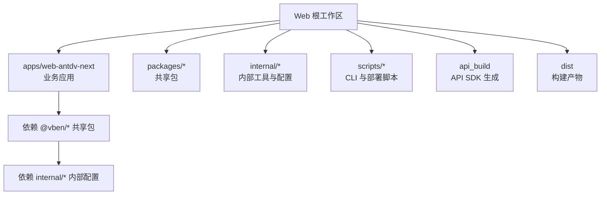
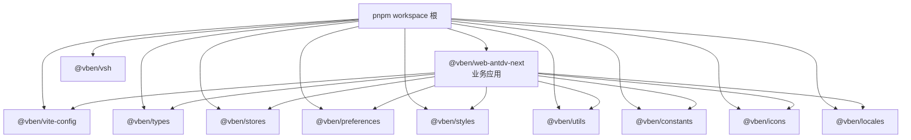
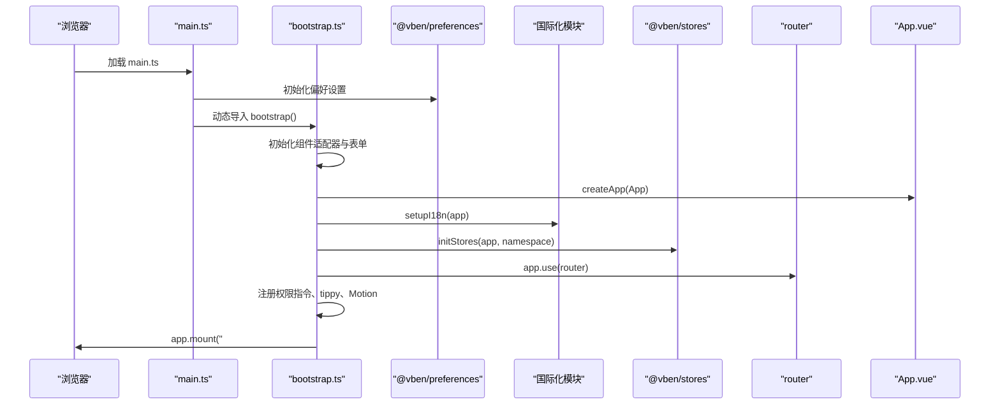
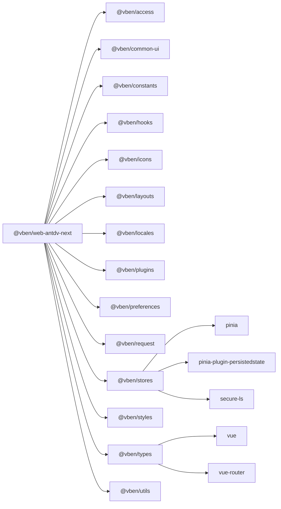
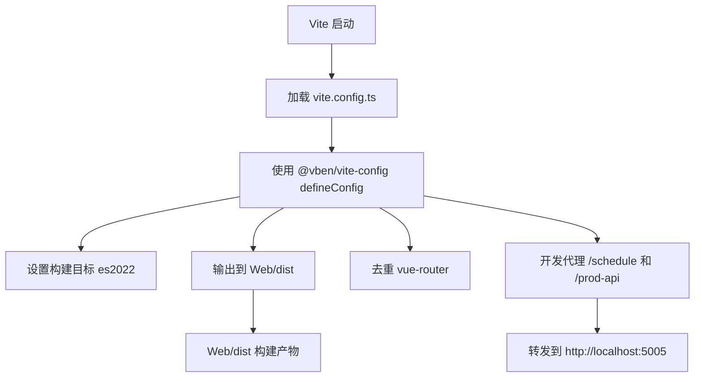

# 应用架构与工程结构

<cite>
**本文引用的文件**   
- [Web/package.json](file://Web/package.json)
- [Web/pnpm-workspace.yaml](file://Web/pnpm-workspace.yaml)
- [Web/turbo.json](file://Web/turbo.json)
- [Web/README.md](file://Web/README.md)
- [Web/apps/web-antdv-next/package.json](file://Web/apps/web-antdv-next/package.json)
- [Web/apps/web-antdv-next/vite.config.ts](file://Web/apps/web-antdv-next/vite.config.ts)
- [Web/apps/web-antdv-next/src/main.ts](file://Web/apps/web-antdv-next/src/main.ts)
- [Web/apps/web-antdv-next/src/bootstrap.ts](file://Web/apps/web-antdv-next/src/bootstrap.ts)
- [Web/packages/types/package.json](file://Web/packages/types/package.json)
- [Web/packages/stores/package.json](file://Web/packages/stores/package.json)
- [Web/internal/vite-config/package.json](file://Web/internal/vite-config/package.json)
- [Web/scripts/vsh/package.json](file://Web/scripts/vsh/package.json)
</cite>

## 目录
1. [简介](#简介)
2. [工程结构总览](#工程结构总览)
3. [运行环境与技术栈](#运行环境与技术栈)
4. [pnpm workspace Monorepo 组织方式](#pnpm-workspace-monorepo-组织方式)
5. [业务前端入口与启动流程](#业务前端入口与启动流程)
6. [共享包依赖关系](#共享包依赖关系)
7. [Vite 开发与构建配置](#vite-开发与构建配置)
8. [常用命令与执行边界](#常用命令与执行边界)
9. [测试与联调边界](#测试与联调边界)
10. [常见问题排查](#常见问题排查)
11. [性能优化建议](#性能优化建议)
12. [结论](#结论)

## 简介
本仓库的前端部分以 `Web` 为根工作区，采用 pnpm workspace 管理 Monorepo。当前业务前端应用位于 `apps/web-antdv-next`，使用 Vue 3、TypeScript、Vben Admin 和 Antdv Next；后端仍由 .NET 工程提供，但本说明聚焦前端架构、Monorepo 组织和业务应用启动链路。

根据项目自述，`Web/apps/web-antdv-next/` 是业务应用目录，`Web/` 是 pnpm workspace，保留 `@vben/*` 共享包和上游许可证。旧前端路径不应作为新文档依据。

**章节来源**
- [Web/README.md:1-75](file://Web/README.md#L1-L75)

## 工程结构总览
`Web` 根目录不是单一应用，而是包含以下层次：

| 目录 | 职责 |
| --- | --- |
| `apps/web-antdv-next` | 业务前端应用，Vue 3 + Vite + TypeScript，面向 Admin.NET 管理后台 |
| `packages` | 可被应用和其他包引用的共享包，如类型、存储、样式、工具、偏好设置等 |
| `internal` | 内部工具包和共享配置，例如 Vite 配置封装、Tailwind 配置、TS 配置、Node 工具 |
| `scripts` | 内部 CLI 和部署脚本，例如 `turbo-run`、`vsh`、发布工具 |
| `api_build` | Swagger SDK 生成与后处理脚本 |
| `src` | 上游模板遗留目录；当前业务代码应放在 `apps/web-antdv-next/src` |
| `public` | 上游模板静态资源目录；业务静态资源应放在 `apps/web-antdv-next/public` |
| `dist` | 生产构建产物输出目录 |

**图表来源**
- [Web/README.md:43-75](file://Web/README.md#L43-L75)
- [Web/package.json:1-102](file://Web/package.json#L1-L102)

**章节来源**
- [Web/README.md:43-75](file://Web/README.md#L43-L75)

## 运行环境与技术栈
- **前端框架**：Vue 3
- **构建工具**：Vite
- **语言**：TypeScript
- **UI 方案**：Antdv Next
- **状态管理**：Pinia
- **路由**：vue-router
- **国际化**：基于 i18n 的本地化模块
- **运行时环境**：Node.js `^22.18.0 || ^24.12.0`
- **包管理器**：pnpm `>=11.0.0`，锁定版本为 `pnpm@11.16.0`
- **浏览器目标**：Vite 构建 target 设置为 `es2022`

Node 与 pnpm 的版本约束来自根 `package.json` 的 `engines` 和 `packageManager`；应用构建目标来自 `apps/web-antdv-next/vite.config.ts`。

**章节来源**
- [Web/package.json:1-102](file://Web/package.json#L1-L102)
- [Web/apps/web-antdv-next/vite.config.ts:1-36](file://Web/apps/web-antdv-next/vite.config.ts#L1-L36)

## pnpm workspace Monorepo 组织方式
根工作区通过 `pnpm-workspace.yaml` 声明包范围：

- `internal/*`
- `internal/lint-configs/*`
- `packages/*`
- `packages/@core/base/*`
- `packages/@core/ui-kit/*`
- `packages/@core/forward/*`
- `packages/@core/*`
- `packages/effects/*`
- `packages/business/*`
- `apps/*`
- `scripts/*`

这意味着 Monorepo 不仅包含业务应用，还包含共享包、内部工具和脚本包。Workspace 关闭了严格 peer 依赖检查，启用自动安装 peer 依赖，并使用 catalog 统一管理依赖版本。

### 根工作区职责
根 `Web/package.json` 主要承担以下职责：
- 定义 workspace 根脚本，包括 `dev`、`build`、`lint`、`check:type`、`test:unit`、`test:e2e` 等
- 限定 Node 与 pnpm 运行环境
- 锁定 packageManager 为 `pnpm@11.16.0`
- 将多数开发依赖指向 catalog 中的统一版本
- 通过 `--filter @vben/web-antdv-next` 把主命令限制到业务应用

### apps 下的主应用
`apps/web-antdv-next` 是业务应用包，包名为 `@vben/web-antdv-next`。它引用多个 `workspace:*` 的 `@vben/*` 包，并维护自己的 Vue、Router、Store、组件和页面逻辑。

### packages 下的共享包
当前可见的共享包包括：
- `@vben/types`：类型定义
- `@vben/stores`：Pinia store 初始化与持久化
- `@vben/preferences`：应用偏好设置
- `@vben/styles`：样式与 Antdv Next 样式适配
- `@vben/utils`：通用工具
- `@vben/constants`：常量
- `@vben/icons`：图标
- `@vben/locales`：国际化资源

这些包在业务应用的 `dependencies` 中以 `workspace:*` 引用，保证同一仓库内版本一致。

### internal 下的内部工具
`internal/vite-config` 暴露 Vite 配置封装，业务应用通过 `@vben/vite-config` 使用统一的构建能力。其他 internal 包包括 Tailwind 配置、TS 配置、Node 工具等。

### scripts 下的构建脚本
`scripts/vsh` 暴露 `vsh` CLI，用于循环依赖检查、依赖检查、发布校验等工程任务；`scripts/turbo-run` 配合 Turbo 执行 workspace 任务。

**图表来源**
- [Web/pnpm-workspace.yaml:1-215](file://Web/pnpm-workspace.yaml#L1-L215)
- [Web/apps/web-antdv-next/package.json:1-72](file://Web/apps/web-antdv-next/package.json#L1-L72)
- [Web/packages/types/package.json:1-27](file://Web/packages/types/package.json#L1-L27)
- [Web/packages/stores/package.json:1-32](file://Web/packages/stores/package.json#L1-L32)
- [Web/internal/vite-config/package.json:1-59](file://Web/internal/vite-config/package.json#L1-L59)
- [Web/scripts/vsh/package.json:1-31](file://Web/scripts/vsh/package.json#L1-L31)

**章节来源**
- [Web/pnpm-workspace.yaml:1-215](file://Web/pnpm-workspace.yaml#L1-L215)
- [Web/package.json:1-102](file://Web/package.json#L1-L102)
- [Web/apps/web-antdv-next/package.json:1-72](file://Web/apps/web-antdv-next/package.json#L1-L72)

## 业务前端入口与启动流程
业务应用的入口是 `apps/web-antdv-next/src/main.ts`，它负责：
1. 读取环境变量，构造命名空间。
2. 初始化应用偏好设置。
3. 动态导入 `bootstrap.ts`。
4. 调用 `bootstrap(namespace)` 启动应用。
5. 移除全局 loading。

`bootstrap.ts` 负责创建 Vue 应用并完成初始化：
1. 初始化组件适配器。
2. 初始化表单组件。
3. 创建 Vue 应用实例。
4. 注册 loading 指令。
5. 初始化国际化。
6. 初始化 Pinia store。
7. 注册权限指令。
8. 初始化 tippy。
9. 安装路由。
10. 安装 Motion 插件。
11. 监听偏好设置更新标题。
12. 挂载到 `#app`。

**图表来源**
- [Web/apps/web-antdv-next/src/main.ts:1-31](file://Web/apps/web-antdv-next/src/main.ts#L1-L31)
- [Web/apps/web-antdv-next/src/bootstrap.ts:1-76](file://Web/apps/web-antdv-next/src/bootstrap.ts#L1-L76)

**章节来源**
- [Web/apps/web-antdv-next/src/main.ts:1-31](file://Web/apps/web-antdv-next/src/main.ts#L1-L31)
- [Web/apps/web-antdv-next/src/bootstrap.ts:1-76](file://Web/apps/web-antdv-next/src/bootstrap.ts#L1-L76)

## 共享包依赖关系
业务应用 `@vben/web-antdv-next` 显式依赖多个 `@vben/*` 共享包，包括：
- `@vben/access`
- `@vben/common-ui`
- `@vben/constants`
- `@vben/hooks`
- `@vben/icons`
- `@vben/layouts`
- `@vben/locales`
- `@vben/plugins`
- `@vben/preferences`
- `@vben/request`
- `@vben/stores`
- `@vben/styles`
- `@vben/types`
- `@vben/utils`

其中部分包在当前仓库快照中未直接出现在 `packages` 顶层目录，可能位于 `packages/@core/*`、`packages/effects/*`、`packages/business/*` 或上游模板结构中；但它们在业务应用中作为 `workspace:*` 依赖存在。

`@vben/types` 依赖 `@vben-core/typings`、`vue` 和 `vue-router`，主要对外暴露类型。`@vben/stores` 依赖 Pinia、持久化插件、安全本地存储、Vue 和 vue-router，负责 store 初始化与命名空间隔离。

**图表来源**
- [Web/apps/web-antdv-next/package.json:1-72](file://Web/apps/web-antdv-next/package.json#L1-L72)
- [Web/packages/types/package.json:1-27](file://Web/packages/types/package.json#L1-L27)
- [Web/packages/stores/package.json:1-32](file://Web/packages/stores/package.json#L1-L32)

**章节来源**
- [Web/apps/web-antdv-next/package.json:1-72](file://Web/apps/web-antdv-next/package.json#L1-L72)
- [Web/packages/types/package.json:1-27](file://Web/packages/types/package.json#L1-L27)
- [Web/packages/stores/package.json:1-32](file://Web/packages/stores/package.json#L1-L32)

## Vite 开发与构建配置
业务应用的 Vite 配置位于 `apps/web-antdv-next/vite.config.ts`，核心要点如下：

- 使用 `@vben/vite-config` 提供的 `defineConfig` 包装配置。
- 关闭 `vxeTableLazyImport`。
- 构建目标设为 `es2022`。
- 构建输出目录为 `../../dist`，即 `Web/dist`。
- 清理输出目录。
- 去重 `vue-router`，避免 workspace 不同 peer 依赖上下文产生重复注入键。
- 开发服务器代理 `/schedule` 和 `/prod-api` 到 `http://localhost:5005`。
- `/prod-api` 会去掉前缀并开启 WebSocket 支持。

**图表来源**
- [Web/apps/web-antdv-next/vite.config.ts:1-36](file://Web/apps/web-antdv-next/vite.config.ts#L1-L36)

**章节来源**
- [Web/apps/web-antdv-next/vite.config.ts:1-36](file://Web/apps/web-antdv-next/vite.config.ts#L1-L36)

## 常用命令与执行边界
所有命令从 `Web/` 目录执行。根脚本通过 `--filter @vben/web-antdv-next` 将主命令限制到业务应用，而不是全 workspace。

| 命令 | 行为与边界 |
| --- | --- |
| `pnpm dev` | 启动业务应用 `@vben/web-antdv-next`；别名 `pnpm dev:antdv-next` |
| `pnpm build` | 构建业务应用，产物输出到 `Web/dist/` |
| `pnpm build:analyze` | 使用业务应用的 analyze 模式构建 |
| `pnpm preview` | 本地预览已有构建产物，不提供生产 API 反向代理 |
| `pnpm check:type` | 执行业务应用的 `vue-tsc --noEmit --skipLibCheck` |
| `pnpm lint` | 检查 `apps/web-antdv-next/src/` |
| `pnpm lint-fix` | 对业务应用源码执行 ESLint 修复 |
| `pnpm format` | 对业务应用源码执行 Prettier 格式化 |
| `pnpm test:unit` | 运行根配置下的 Vitest 逻辑测试 |
| `pnpm test:e2e` | 运行桌面 Playwright 测试 |
| `pnpm build-api-ps` | 从 Swagger 生成并替换当前应用的 API SDK |

需要特别注意：
- `pnpm lint` 和 `pnpm check:type` 只覆盖业务应用源码，不覆盖整个共享包树。
- 修改共享包时应另外检查受影响范围。
- `pnpm check` 会串联循环依赖、依赖、类型和拼写检查，其范围和前提与常用命令不同。
- `pnpm lint-fix` 和 `pnpm format` 会写文件，运行后应检查差异。

**章节来源**
- [Web/package.json:1-102](file://Web/package.json#L1-L102)
- [Web/README.md:16-42](file://Web/README.md#L16-L42)

## 测试与联调边界
- **Vitest 逻辑测试**：使用 happy-dom，适合逻辑和组件测试，不能替代真实 API 与数据库验收。
- **Playwright 浏览器测试**：仅定义 `desktop` 项目，使用 Desktop Chrome，视口 `1440 × 1000`。未设置 `ADMINNET_E2E_BASE_URL` 时自动启动 `http://127.0.0.1:8890` 的 Vite 服务；设置后使用指定服务，不再自动启动前端。
- **真实联调要求**：先启动后端并准备隔离的真实 PostgreSQL；浏览器流程断言通过不代表登录、PostgreSQL、Nginx、上传或事件流已全部验收。
- **数据库验证**：必须使用隔离的真实 PostgreSQL，不能使用 SQLite 或 Mock 结果声称联调通过。

**章节来源**
- [Web/README.md:48-75](file://Web/README.md#L48-L75)

## 常见问题排查
| 问题 | 可能原因 | 处理方式 |
| --- | --- | --- |
| 找不到 pnpm 或版本不符 | 未使用根 `package.json` 指定的 packageManager，或 Node 版本不在允许范围 | 使用 `pnpm@11.16.0`，Node 满足 `^22.18.0 || ^24.12.0` |
| `pnpm dev` 启动失败 | 依赖未安装或 workspace 包未 stub | 在 `Web/` 执行 `pnpm install`，再执行 `pnpm dev` |
| 开发代理无法访问后端 | 后端未启动或未监听 `localhost:5005` | 启动后端服务，确认 `/prod-api` 和 `/schedule` 代理目标可达 |
| 构建产物位置不对 | 误以为产物在业务应用目录 | 业务应用构建产物在 `Web/dist/` |
| `pnpm lint` 没有检查共享包 | 根 lint 只检查业务应用源码 | 单独检查受影响共享包或使用完整检查命令 |
| `pnpm check:type` 报类型错误 | 业务应用或共享包类型不一致 | 优先检查业务应用 `vue-tsc` 输出，再检查共享包类型定义 |
| 浏览器测试端口异常 | 环境变量或 Playwright 配置与服务不一致 | 核对 `ADMINNET_E2E_BASE_URL` 与目标服务地址 |
| 数据库验收失败 | 使用了 SQLite、Mock 或非隔离数据库 | 使用隔离的真实 PostgreSQL，按开发和验证文档准备环境 |
| 共享包依赖冲突 | workspace peer 依赖上下文不一致 | 利用 Vite 配置中的 `dedupe: ['vue-router']`，并统一 catalog 版本 |

**章节来源**
- [Web/package.json:1-102](file://Web/package.json#L1-L102)
- [Web/apps/web-antdv-next/vite.config.ts:1-36](file://Web/apps/web-antdv-next/vite.config.ts#L1-L36)
- [Web/README.md:16-75](file://Web/README.md#L16-L75)

## 性能优化建议
- **保持构建目标稳定**：当前 `es2022` 是明确目标，升级 Node 或浏览器兼容目标前应评估影响。
- **复用共享包而非复制实现**：业务逻辑尽量下沉到 `packages/*`，减少业务应用体积和重复代码。
- **按需引入 UI 能力**：Vite 已支持懒加载；业务层继续遵循现有 adapter、form、plugins 的按需导入约定。
- **避免重复路由注入**：Vite 已对 `vue-router` 做 dedupe，新增 workspace peer 依赖时也应考虑是否会导致重复实例。
- **合理使用代理**：开发代理只针对 `/schedule` 和 `/prod-api`，新增后端接口路径时应同步更新代理规则。
- **控制构建分析范围**：使用 `pnpm build:analyze` 分析业务应用打包体积，定位大依赖和重复打包问题。
- **谨慎扩展 workspace 命令**：根脚本默认只面向业务应用；如需全 workspace 检查，应明确使用 `pnpm check` 或其他 workspace 命令，并理解其前提条件。

[本节为通用优化建议，不直接分析具体代码文件]

## 结论
Admin.NET 前端工程以 `Web` 为 pnpm workspace 根，业务应用位于 `apps/web-antdv-next`，通过 `@vben/*` 共享包解耦类型、store、样式、请求、布局、组件和工具。启动链路从 `main.ts` 初始化偏好设置，再到 `bootstrap.ts` 创建 Vue 应用、初始化国际化、store、路由和插件，最终挂载到 DOM。开发阶段通过 Vite 代理连接本地后端，构建阶段输出到 `Web/dist`。常用命令以业务应用为边界，测试分为 Vitest 逻辑测试和 Playwright 桌面浏览器测试，真实数据库验收必须使用隔离 PostgreSQL。

**章节来源**
- [Web/README.md:1-75](file://Web/README.md#L1-L75)
- [Web/package.json:1-102](file://Web/package.json#L1-L102)
- [Web/apps/web-antdv-next/src/main.ts:1-31](file://Web/apps/web-antdv-next/src/main.ts#L1-L31)
- [Web/apps/web-antdv-next/src/bootstrap.ts:1-76](file://Web/apps/web-antdv-next/src/bootstrap.ts#L1-L76)
- [Web/apps/web-antdv-next/vite.config.ts:1-36](file://Web/apps/web-antdv-next/vite.config.ts#L1-L36)