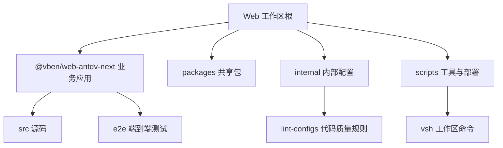
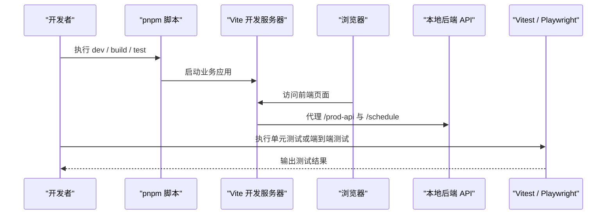
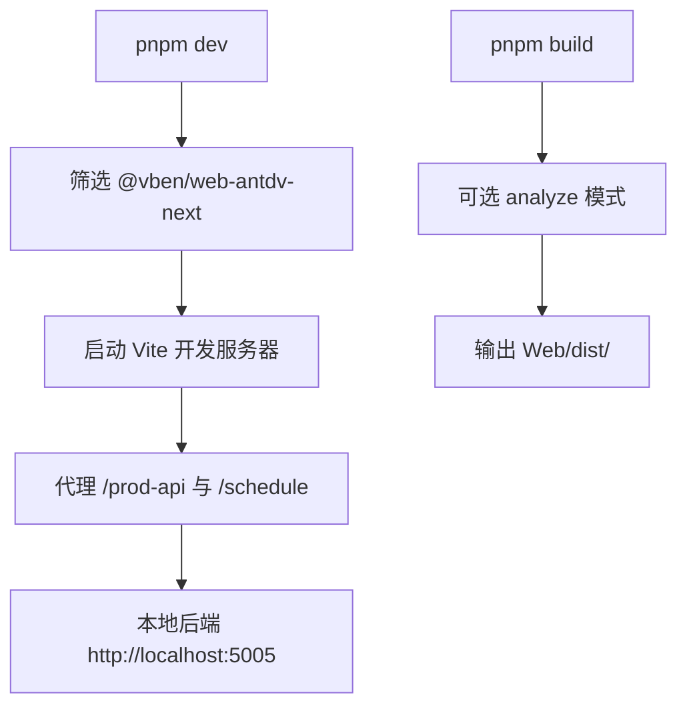
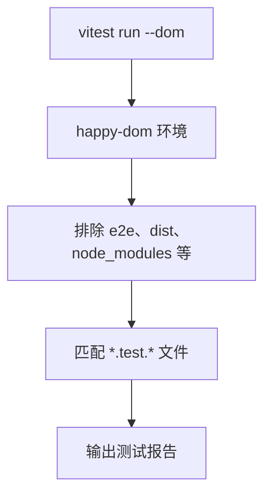
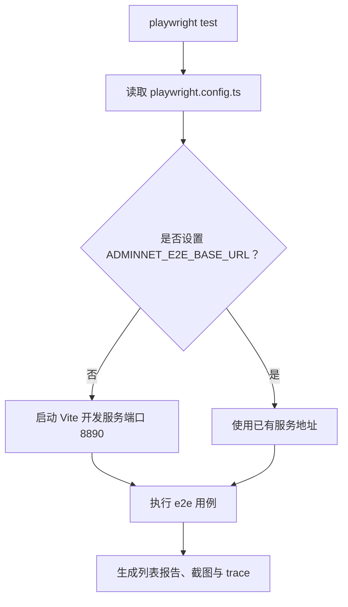
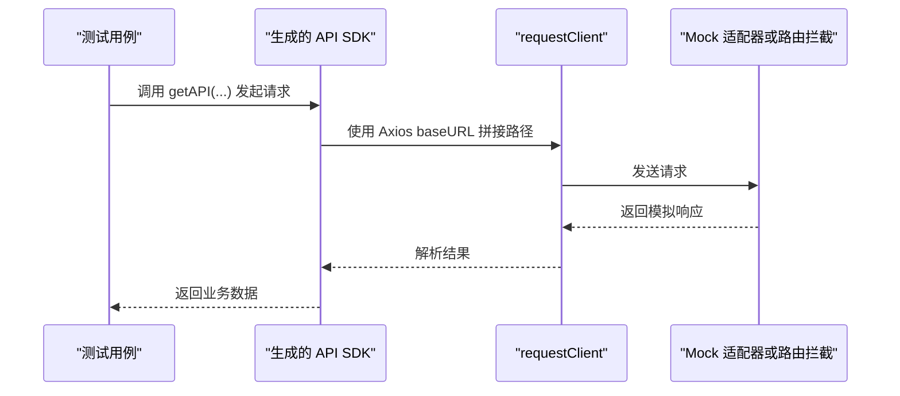
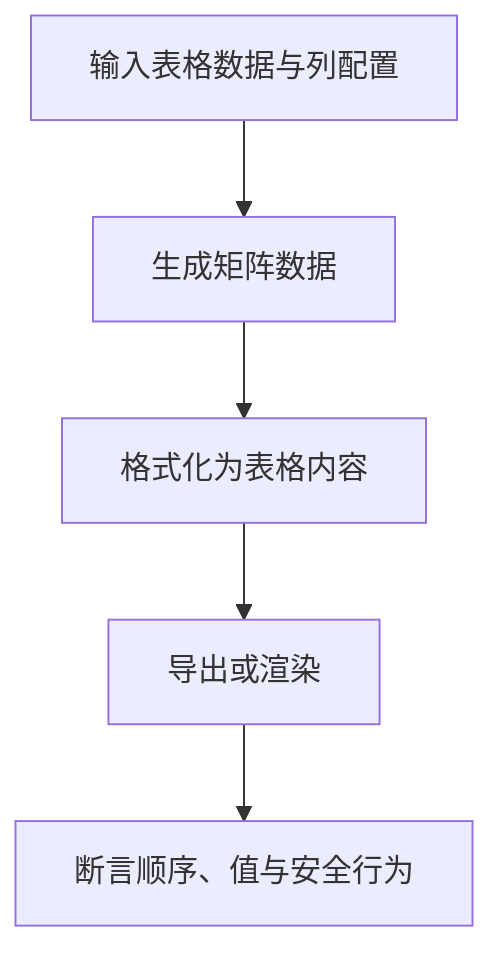
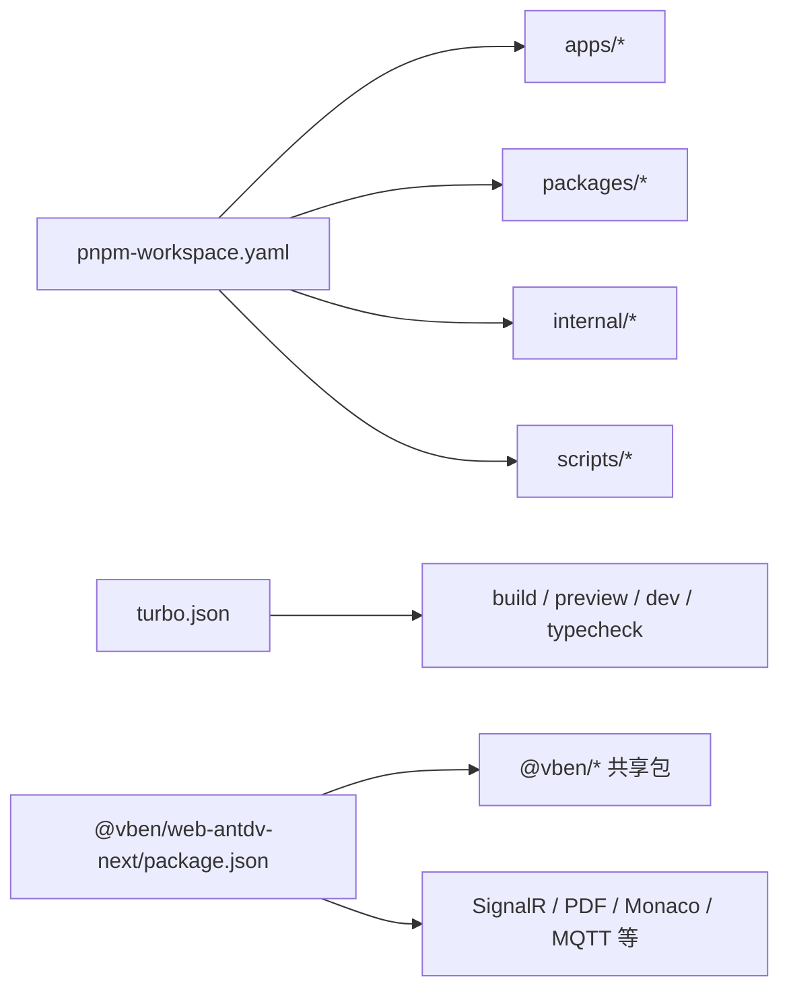
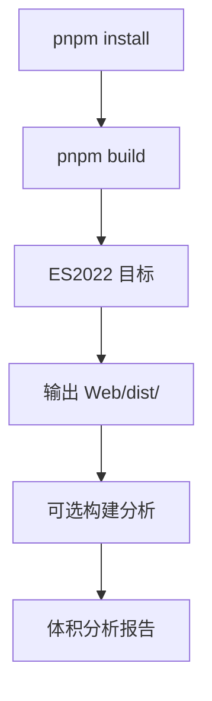
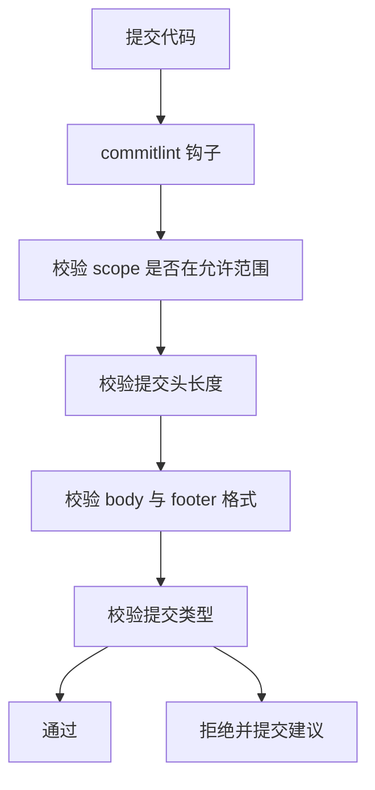

# 开发工作流与规范

<cite>
**本文引用的文件**
- [Web/package.json](file://Web/package.json)
- [Web/README.md](file://Web/README.md)
- [Web/apps/web-antdv-next/package.json](file://Web/apps/web-antdv-next/package.json)
- [Web/apps/web-antdv-next/vite.config.ts](file://Web/apps/web-antdv-next/vite.config.ts)
- [Web/turbo.json](file://Web/turbo.json)
- [Web/pnpm-workspace.yaml](file://Web/pnpm-workspace.yaml)
- [Web/eslint.config.mjs](file://Web/eslint.config.mjs)
- [Web/stylelint.config.mjs](file://Web/stylelint.config.mjs)
- [Web/.prettierrc.cjs](file://Web/.prettierrc.cjs)
- [Web/oxlint.config.ts](file://Web/oxlint.config.ts)
- [Web/oxfmt.config.ts](file://Web/oxfmt.config.ts)
- [Web/vitest.config.ts](file://Web/vitest.config.ts)
- [Web/playwright.config.ts](file://Web/playwright.config.ts)
- [Web/internal/lint-configs/stylelint-config/index.mjs](file://Web/internal/lint-configs/stylelint-config/index.mjs)
- [Web/internal/lint-configs/commitlint-config/index.mjs](file://Web/internal/lint-configs/commitlint-config/index.mjs)
- [Web/apps/web-antdv-next/e2e/auth-contract.spec.ts](file://Web/apps/web-antdv-next/e2e/auth-contract.spec.ts)
- [Web/apps/web-antdv-next/src/api/sdk.test.ts](file://Web/apps/web-antdv-next/src/api/sdk.test.ts)
- [Web/apps/web-antdv-next/src/components/admin-table/table-output.test.ts](file://Web/apps/web-antdv-next/src/components/admin-table/table-output.test.ts)
</cite>

## 目录
1. [简介](#简介)
2. [项目结构](#项目结构)
3. [核心组件](#核心组件)
4. [架构总览](#架构总览)
5. [详细组件分析](#详细组件分析)
6. [依赖关系分析](#依赖关系分析)
7. [性能与构建优化](#性能与构建优化)
8. [调试指南](#调试指南)
9. [测试体系](#测试体系)
10. [代码质量工具链](#代码质量工具链)
11. [Git 提交规范与分支策略](#git-提交规范与分支策略)
12. [团队协作最佳实践](#团队协作最佳实践)
13. [故障排查](#故障排查)
14. [结论](#结论)

## 简介
本文面向 Admin.NET 前端开发者，说明当前业务应用 `apps/web-antdv-next` 的开发工作流、代码规范、调试方法、测试体系和发布注意事项。该工作流以 pnpm workspace 为根，使用 Vue 3、TypeScript、Vite、Vitest、Playwright、ESLint、Stylelint、Prettier、Oxlint 和 Oxfmt；业务应用基于 Vben Admin 与 Antdv Next，生产构建产物统一输出到 `Web/dist/`。

## 项目结构
仓库采用 monorepo 组织方式：
- `Web/`：前端工作区根目录，包含共享包、内部配置、脚本和业务应用。
- `Web/apps/web-antdv-next/`：当前业务应用入口，包含页面、组件、路由、API SDK 与 E2E 测试。
- `Web/packages/`：共享功能包，如 UI、状态、请求、类型、工具等。
- `Web/internal/`：内部可复用配置，包括 ESLint、Stylelint、Oxlint、Oxfmt、Tailwind、Vite 和 tsconfig 等。
- `Web/scripts/`：工作区工具，如 `vsh`、部署脚本和 Turbo 运行器。

**图表来源**
- [Web/package.json:1-102](file://Web/package.json#L1-L102)
- [Web/apps/web-antdv-next/package.json:1-72](file://Web/apps/web-antdv-next/package.json#L1-L72)
- [Web/pnpm-workspace.yaml:1-10](file://Web/pnpm-workspace.yaml#L1-L10)

**章节来源**
- [Web/README.md:1-75](file://Web/README.md#L1-L75)
- [Web/package.json:1-102](file://Web/package.json#L1-L102)
- [Web/apps/web-antdv-next/package.json:1-72](file://Web/apps/web-antdv-next/package.json#L1-L72)

## 核心组件
- **业务应用**：`@vben/web-antdv-next`，提供开发、构建、预览和类型检查脚本。
- **工作区根**：统一 Node 与 pnpm 版本，管理常用脚本、依赖目录和共享包。
- **构建系统**：基于 Vite，并通过 `@vben/vite-config` 封装应用配置。
- **测试框架**：Vitest 负责逻辑与组件测试，Playwright 负责桌面浏览器端到端测试。
- **代码质量**：ESLint、Stylelint、Prettier、Oxlint、Oxfmt 共同保证代码风格与性能。
- **任务编排**：pnpm scripts 与 Turbo 协同，避免重复构建并提升缓存效率。

**章节来源**
- [Web/apps/web-antdv-next/package.json:1-72](file://Web/apps/web-antdv-next/package.json#L1-L72)
- [Web/package.json:1-102](file://Web/package.json#L1-L102)
- [Web/turbo.json:1-48](file://Web/turbo.json#L1-L48)

## 架构总览
前端开发链路如下：开发者修改源码后，通过 pnpm 脚本启动 Vite 开发服务器；浏览器请求经 Vite 代理转发到本地后端 API；单元测试由 Vitest 在 happy-dom 环境中执行；端到端测试由 Playwright 驱动桌面 Chrome；构建阶段使用 Turbo 协调依赖构建，并将产物输出到 `Web/dist/`。

**图表来源**
- [Web/apps/web-antdv-next/vite.config.ts:1-36](file://Web/apps/web-antdv-next/vite.config.ts#L1-L36)
- [Web/playwright.config.ts:1-31](file://Web/playwright.config.ts#L1-L31)
- [Web/vitest.config.ts:1-28](file://Web/vitest.config.ts#L1-L28)

**章节来源**
- [Web/apps/web-antdv-next/vite.config.ts:1-36](file://Web/apps/web-antdv-next/vite.config.ts#L1-L36)
- [Web/playwright.config.ts:1-31](file://Web/playwright.config.ts#L1-L31)
- [Web/vitest.config.ts:1-28](file://Web/vitest.config.ts#L1-L28)

## 详细组件分析

### 开发与构建入口
业务应用的开发、构建、预览和类型检查脚本集中在其 package.json 中；根工作区再通过 `pnpm --filter @vben/web-antdv-next` 调用这些脚本。Vite 配置将构建目标设为 ES2022，输出目录指向 `Web/dist/`，并对 `/prod-api` 和 `/schedule` 进行反向代理。

**图表来源**
- [Web/package.json:1-102](file://Web/package.json#L1-L102)
- [Web/apps/web-antdv-next/package.json:1-72](file://Web/apps/web-antdv-next/package.json#L1-L72)
- [Web/apps/web-antdv-next/vite.config.ts:1-36](file://Web/apps/web-antdv-next/vite.config.ts#L1-L36)

**章节来源**
- [Web/package.json:1-102](file://Web/package.json#L1-L102)
- [Web/apps/web-antdv-next/package.json:1-72](file://Web/apps/web-antdv-next/package.json#L1-L72)
- [Web/apps/web-antdv-next/vite.config.ts:1-36](file://Web/apps/web-antdv-next/vite.config.ts#L1-L36)
- [Web/README.md:1-75](file://Web/README.md#L1-L75)

### 单元测试框架 Vitest
Vitest 配置启用 Vue 与 JSX 插件，使用 happy-dom 作为 DOM 环境，并排除 e2e、dist、node_modules 和各类配置文件。适合测试工具函数、组件渲染逻辑、表单处理和数据转换；它不能替代真实 API 与数据库联调。

**图表来源**
- [Web/vitest.config.ts:1-28](file://Web/vitest.config.ts#L1-L28)
- [Web/package.json:1-102](file://Web/package.json#L1-L102)

**章节来源**
- [Web/vitest.config.ts:1-28](file://Web/vitest.config.ts#L1-L28)
- [Web/package.json:1-102](file://Web/package.json#L1-L102)
- [Web/README.md:1-75](file://Web/README.md#L1-L75)

### 端到端测试 Playwright
Playwright 仅定义 `desktop` 项目，使用桌面版 Chrome，视口为 `1440 × 1000`。未设置环境变量时自动启动业务应用开发服务；CI 环境会限制 `only` 用例、增加重试次数并保留失败时的 trace。

**图表来源**
- [Web/playwright.config.ts:1-31](file://Web/playwright.config.ts#L1-L31)
- [Web/apps/web-antdv-next/e2e/auth-contract.spec.ts:1-100](file://Web/apps/web-antdv-next/e2e/auth-contract.spec.ts#L1-L100)

**章节来源**
- [Web/playwright.config.ts:1-31](file://Web/playwright.config.ts#L1-L31)
- [Web/apps/web-antdv-next/e2e/auth-contract.spec.ts:1-100](file://Web/apps/web-antdv-next/e2e/auth-contract.spec.ts#L1-L100)
- [Web/README.md:1-75](file://Web/README.md#L1-L75)

### API SDK 与 Mock 数据
生成的 API SDK 位于业务应用源码的 `api-services` 目录，由 Swagger 生成流程维护；测试中通常通过 Vitest 的 `vi.mock` 替换请求客户端，或使用 Playwright 的 `page.route` 拦截网络响应，从而隔离后端依赖。

**图表来源**
- [Web/apps/web-antdv-next/src/api/sdk.test.ts:1-36](file://Web/apps/web-antdv-next/src/api/sdk.test.ts#L1-L36)
- [Web/apps/web-antdv-next/e2e/auth-contract.spec.ts:1-100](file://Web/apps/web-antdv-next/e2e/auth-contract.spec.ts#L1-L100)

**章节来源**
- [Web/apps/web-antdv-next/src/api/sdk.test.ts:1-36](file://Web/apps/web-antdv-next/src/api/sdk.test.ts#L1-L36)
- [Web/apps/web-antdv-next/e2e/auth-contract.spec.ts:1-100](file://Web/apps/web-antdv-next/e2e/auth-contract.spec.ts#L1-L100)

### 组件测试示例
组件测试验证表格导出、样式化单元格、HTML 内容安全等边界行为。例如表格导出测试确认列顺序、嵌套字段格式化、公式类文本不被当作电子表格公式，以及输出 HTML 不会执行用户脚本。

**图表来源**
- [Web/apps/web-antdv-next/src/components/admin-table/table-output.test.ts:1-47](file://Web/apps/web-antdv-next/src/components/admin-table/table-output.test.ts#L1-L47)

**章节来源**
- [Web/apps/web-antdv-next/src/components/admin-table/table-output.test.ts:1-47](file://Web/apps/web-antdv-next/src/components/admin-table/table-output.test.ts#L1-L47)

## 依赖关系分析
- **pnpm workspace**：统一管理 `internal/*`、`packages/*`、`apps/*`、`scripts/*` 等子包，并集中声明 catalog 依赖。
- **Turbo**：定义 `build`、`preview`、`build:analyze`、`dev`、`typecheck` 等任务及其依赖关系，提升缓存与并行执行效率。
- **业务应用依赖**：引用多个 `@vben/*` 共享包，同时引入 SignalR、PDF.js、Monaco、MQTT、Vue Office 等运行时依赖。

**图表来源**
- [Web/pnpm-workspace.yaml:1-10](file://Web/pnpm-workspace.yaml#L1-L10)
- [Web/turbo.json:1-48](file://Web/turbo.json#L1-L48)
- [Web/apps/web-antdv-next/package.json:1-72](file://Web/apps/web-antdv-next/package.json#L1-L72)

**章节来源**
- [Web/pnpm-workspace.yaml:1-200](file://Web/pnpm-workspace.yaml#L1-L200)
- [Web/turbo.json:1-48](file://Web/turbo.json#L1-L48)
- [Web/apps/web-antdv-next/package.json:1-72](file://Web/apps/web-antdv-next/package.json#L1-L72)

## 性能与构建优化
- **Node 与 pnpm 版本**：工作区要求 Node `^22.18.0 || ^24.12.0`，pnpm `>=11.0.0`，并使用 `pnpm@11.16.0` 固定安装。
- **构建目标**：Vite 构建目标为 ES2022，清空输出目录，避免旧产物干扰。
- **依赖去重**：通过 `dedupe: ['vue-router']` 保证 workspace 多 peer 依赖上下文中的路由注入键一致。
- **构建分析**：根脚本提供 `pnpm build:analyze`，业务应用支持 `build:analyze` 模式，用于分析打包体积。
- **Turbo 缓存**：`build`、`preview`、`build:analyze` 依赖上游包先构建，`dev` 禁用缓存并保持持久运行。

**图表来源**
- [Web/package.json:1-102](file://Web/package.json#L1-L102)
- [Web/apps/web-antdv-next/vite.config.ts:1-36](file://Web/apps/web-antdv-next/vite.config.ts#L1-L36)
- [Web/turbo.json:1-48](file://Web/turbo.json#L1-L48)

**章节来源**
- [Web/package.json:1-102](file://Web/package.json#L1-L102)
- [Web/apps/web-antdv-next/vite.config.ts:1-36](file://Web/apps/web-antdv-next/vite.config.ts#L1-L36)
- [Web/turbo.json:1-48](file://Web/turbo.json#L1-L48)
- [Web/README.md:1-75](file://Web/README.md#L1-L75)

## 调试指南

### 浏览器开发者工具
- 使用浏览器开发者工具查看网络请求、控制台错误、DOM 结构与性能面板。
- 登录与权限相关调试可参考 E2E 用例中对密码加密、租户 ID、验证码参数及错误提示的断言思路。

### Vue DevTools
- 项目依赖中包含 Vue DevTools 插件，可在开发模式下辅助观察组件树、状态与事件。
- 建议在业务应用开发服务器正常启动后再打开浏览器扩展。

### 网络请求调试
- 开发环境下，Vite 将 `/prod-api` 和 `/schedule` 代理到 `http://localhost:5005`。
- 若需要独立服务，可通过 Playwright 的 `ADMINNET_E2E_BASE_URL` 指定已运行的前端服务地址。
- 单元测试中可使用 `vi.mock` 替换请求客户端；E2E 中使用 `page.route` 拦截 API 响应。

**章节来源**
- [Web/apps/web-antdv-next/vite.config.ts:1-36](file://Web/apps/web-antdv-next/vite.config.ts#L1-L36)
- [Web/playwright.config.ts:1-31](file://Web/playwright.config.ts#L1-L31)
- [Web/apps/web-antdv-next/src/api/sdk.test.ts:1-36](file://Web/apps/web-antdv-next/src/api/sdk.test.ts#L1-L36)
- [Web/apps/web-antdv-next/e2e/auth-contract.spec.ts:1-100](file://Web/apps/web-antdv-next/e2e/auth-contract.spec.ts#L1-L100)

## 测试体系

### 单元测试（Vitest）
- 运行命令：`pnpm test:unit`。
- 环境：happy-dom，启用 Vue 与 JSX 插件。
- 适用场景：工具函数、表格导出、表单处理、路由跳转、API SDK 传输逻辑等。
- 推荐做法：对副作用较小的纯函数优先写单测；对外部请求使用 mock；对组件交互使用轻量断言。

**章节来源**
- [Web/vitest.config.ts:1-28](file://Web/vitest.config.ts#L1-L28)
- [Web/package.json:1-102](file://Web/package.json#L1-L102)
- [Web/apps/web-antdv-next/src/api/sdk.test.ts:1-36](file://Web/apps/web-antdv-next/src/api/sdk.test.ts#L1-L36)
- [Web/apps/web-antdv-next/src/components/admin-table/table-output.test.ts:1-47](file://Web/apps/web-antdv-next/src/components/admin-table/table-output.test.ts#L1-L47)

### 端到端测试（Playwright）
- 运行命令：`pnpm test:e2e`，或在 CI 中按项目执行 `pnpm test:e2e --project=desktop`。
- 适用场景：登录、权限、租户、菜单、文件、调度看板、插件等跨层业务流程。
- 推荐做法：优先用路由拦截隔离 API；需要真实后端或独立服务时明确标注前置条件；断言应覆盖成功、失败、加载态与无障碍标签。

**章节来源**
- [Web/playwright.config.ts:1-31](file://Web/playwright.config.ts#L1-L31)
- [Web/package.json:1-102](file://Web/package.json#L1-L102)
- [Web/apps/web-antdv-next/e2e/auth-contract.spec.ts:1-100](file://Web/apps/web-antdv-next/e2e/auth-contract.spec.ts#L1-L100)
- [Web/README.md:1-75](file://Web/README.md#L1-L75)

## 代码质量工具链

### ESLint 代码检查
- 根配置继承 `@vben/eslint-config`，并集成 `eslint-config-prettier`，让 Prettier 负责格式、ESLint 负责质量规则。
- 自动生成 SDK 目录 `api-services/**` 被忽略，不执行手写代码规则。
- 根脚本 `pnpm lint` 检查业务应用源码；`pnpm lint-fix` 自动修复可写问题。

**章节来源**
- [Web/eslint.config.mjs:1-9](file://Web/eslint.config.mjs#L1-L9)
- [Web/package.json:1-102](file://Web/package.json#L1-L102)

### Stylelint 样式检查
- 根配置继承 `@vben/stylelint-config`。
- 内部 Stylelint 配置扩展标准规则、CSS 排序规则和 Vue/SCSS 适配，并允许 Tailwind 等自定义 at-rule。
- 适用于 CSS、SCSS、HTML、Vue 模板与样式块。

**章节来源**
- [Web/stylelint.config.mjs:1-4](file://Web/stylelint.config.mjs#L1-L4)
- [Web/internal/lint-configs/stylelint-config/index.mjs:1-100](file://Web/internal/lint-configs/stylelint-config/index.mjs#L1-L100)

### Prettier 代码格式化
- 行宽 200，缩进 2 空格，使用制表符，分号结尾，字符串单引号，尾随逗号遵循 ES5。
- 根脚本 `pnpm format` 对业务应用源码执行格式化。
- ESLint 关闭冲突规则，保持 Prettier 单一事实源。

**章节来源**
- [Web/.prettierrc.cjs:1-39](file://Web/.prettierrc.cjs#L1-L39)
- [Web/eslint.config.mjs:1-9](file://Web/eslint.config.mjs#L1-L9)
- [Web/package.json:1-102](file://Web/package.json#L1-L102)

### Oxlint 静态检查
- 根配置委托给 `@vben/oxlint-config`，用于快速发现潜在问题。
- 与工作区 catalog 依赖配合，保持高性能静态检查体验。

**章节来源**
- [Web/oxlint.config.ts:1-5](file://Web/oxlint.config.ts#L1-L5)
- [Web/package.json:1-102](file://Web/package.json#L1-L102)

### Oxfmt 格式化
- 根配置来自 `@vben/oxfmt-config`，并显式忽略构建产物、锁文件、SVG、shell 脚本等。
- 与 Prettier 形成互补，团队应根据实际工程约定选择主格式化器。

**章节来源**
- [Web/oxfmt.config.ts:1-26](file://Web/oxfmt.config.ts#L1-L26)

## Git 提交规范与分支策略

### 提交信息规范
- 基于 conventional commit，类型包括 `feat`、`fix`、`perf`、`style`、`docs`、`test`、`refactor`、`build`、`ci`、`chore`、`revert`、`types`、`release`。
- scope 校验使用工作区包名集合，并额外允许 `project`、`style`、`lint`、`ci`、`dev`、`deploy`、`other`。
- 头部最大长度 108，body 必须空行开头，footer 必须空行开头。
- 提交前通过 commitlint 与交互式提交助手校验。

**图表来源**
- [Web/internal/lint-configs/commitlint-config/index.mjs:1-150](file://Web/internal/lint-configs/commitlint-config/index.mjs#L1-L150)

**章节来源**
- [Web/internal/lint-configs/commitlint-config/index.mjs:1-150](file://Web/internal/lint-configs/commitlint-config/index.mjs#L1-L150)

### 分支管理与协作建议
- 日常开发应在功能分支上完成小步提交，并通过 Pull Request 合并。
- 提交信息应清晰描述变更意图，便于自动生成变更日志与影响范围分析。
- 涉及构建、依赖、部署、工作流的变更应使用对应类型，如 `build`、`ci`、`deploy`、`workflow`。
- 发布流程可结合 Changesets，由根脚本触发版本管理与变更集生成。

**章节来源**
- [Web/package.json:1-102](file://Web/package.json#L1-L102)
- [Web/internal/lint-configs/commitlint-config/index.mjs:1-150](file://Web/internal/lint-configs/commitlint-config/index.mjs#L1-L150)

## 团队协作最佳实践

### 代码审查
- 每个功能变更应通过 Pull Request 审查，重点关注：
  - 接口契约与错误处理。
  - 用户体验与可访问性。
  - 性能敏感路径与打包体积变化。
  - 测试覆盖与回归风险。
- 审查者应关注提交信息与 scope 是否准确，避免模糊变更进入主干。

### 冲突解决
- 频繁同步主干分支，减少大段冲突。
- 遇到样式或格式冲突时，优先运行 `pnpm lint`、`pnpm format` 和 `pnpm check:type` 对齐规范。
- 对自动生成目录（如 `api-services`）不要手动长期维护，应通过生成脚本更新。

### 版本发布流程
- 使用 Changesets 管理变更集，执行版本命令后重新安装依赖。
- 生产构建产物统一输出到 `Web/dist/`。
- 部署配置、Nginx、SignalR、SSE、上传和缓存配置见部署文档，不在代码中硬编码线上地址。

**章节来源**
- [Web/package.json:1-102](file://Web/package.json#L1-L102)
- [Web/README.md:1-75](file://Web/README.md#L1-L75)

## 故障排查

### 常见问题
- **依赖安装失败**：确认使用工作区指定的 pnpm 版本，并满足 Node 版本要求。
- **类型检查失败**：使用 `pnpm check:type` 检查业务应用类型；共享包变更需单独检查受影响范围。
- **E2E 无法启动前端**：未设置 `ADMINNET_E2E_BASE_URL` 时会尝试启动开发服务；若端口占用或服务异常，请清理进程或设置环境变量指向已有服务。
- **单元测试无 DOM**：确保使用 `pnpm test:unit` 而非仅在 Node 环境中运行；Vitest 已启用 happy-dom。
- **真实联调误判**：浏览器流程通过不代表 PostgreSQL、Nginx、SignalR、上传或事件流全部验收；数据库联调必须使用隔离的真实 PostgreSQL。

**章节来源**
- [Web/package.json:1-102](file://Web/package.json#L1-L102)
- [Web/README.md:1-75](file://Web/README.md#L1-L75)
- [Web/vitest.config.ts:1-28](file://Web/vitest.config.ts#L1-L28)
- [Web/playwright.config.ts:1-31](file://Web/playwright.config.ts#L1-L31)

## 结论
Admin.NET 前端工作流以 pnpm workspace 为核心，围绕业务应用 `apps/web-antdv-next` 展开。开发者应优先使用根脚本启动开发、构建、检查和测试；代码质量由 ESLint、Stylelint、Prettier、Oxlint 和 Oxfmt 共同保障；单元测试覆盖逻辑与组件，端到端测试覆盖关键浏览器流程；发布与部署遵循统一的产物目录和部署文档。遵循本文规范可有效降低协作成本、提高代码稳定性，并帮助团队在持续交付中保持高质量前端工程。