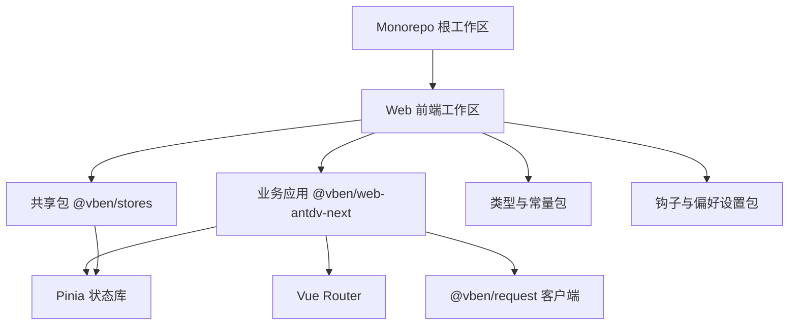
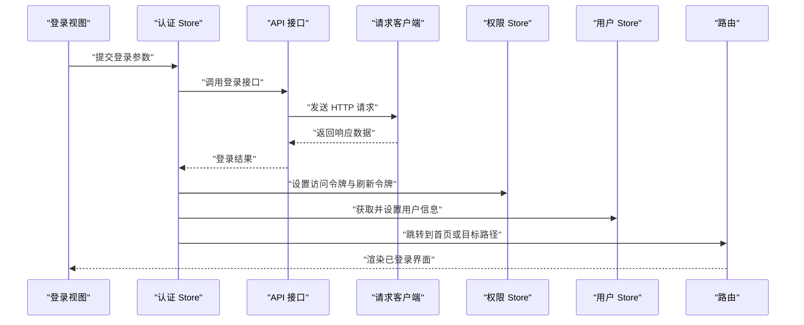
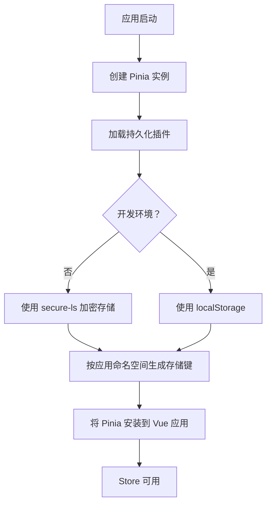
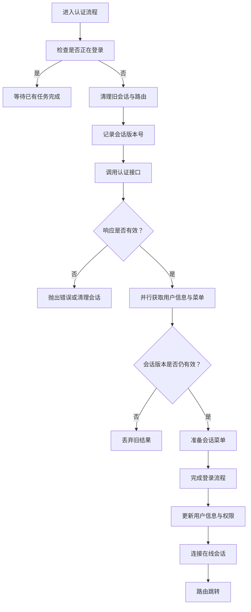
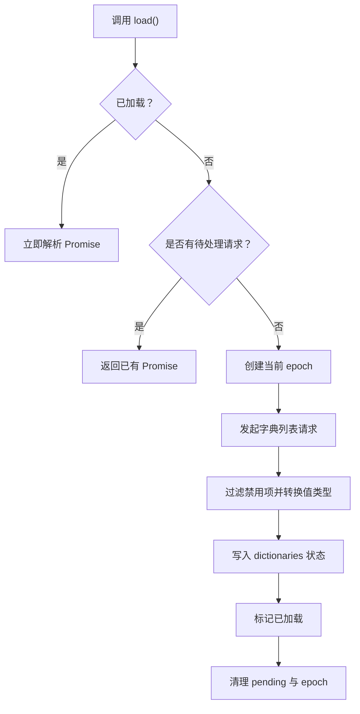
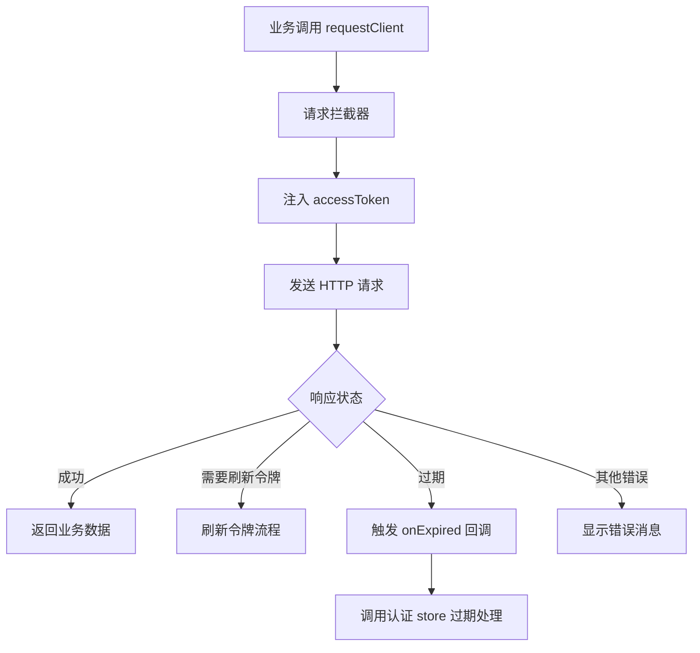
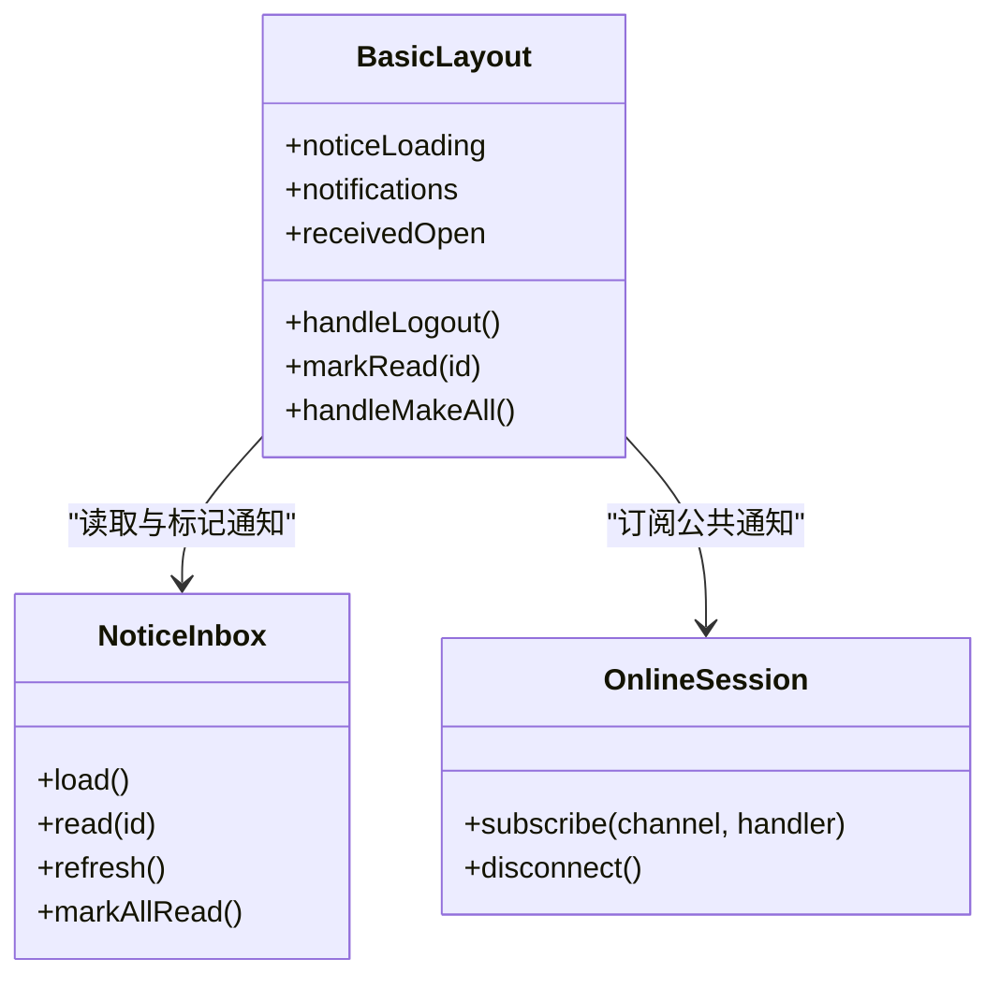
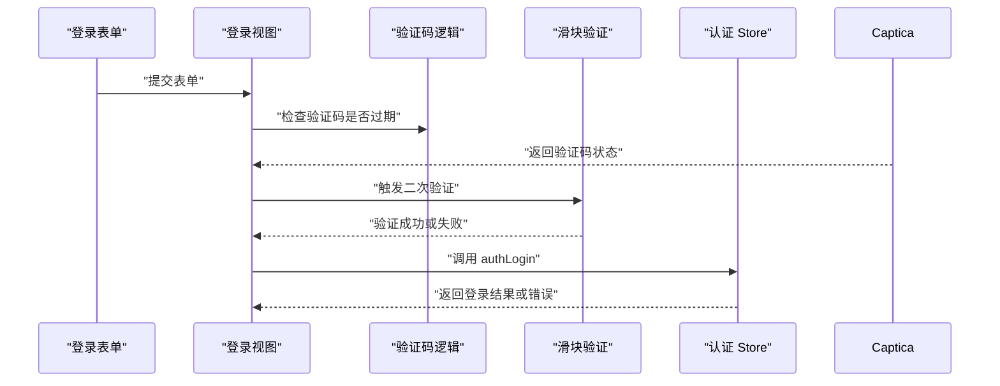
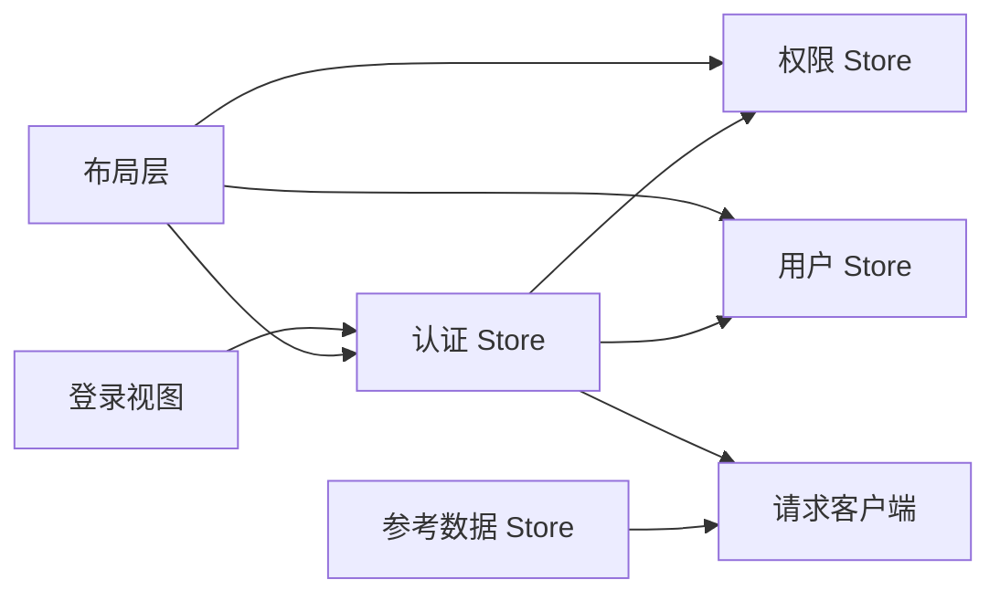

# 状态管理与数据流

<cite>
**本文引用的文件**
- [Web/package.json](file://Web/package.json)
- [Web/apps/web-antdv-next/package.json](file://Web/apps/web-antdv-next/package.json)
- [packages/stores/src/index.ts](file://Web/packages/stores/src/index.ts)
- [packages/stores/src/setup.ts](file://Web/packages/stores/src/setup.ts)
- [packages/stores/src/modules/access.ts](file://Web/packages/stores/src/modules/access.ts)
- [packages/stores/src/modules/user.ts](file://Web/packages/stores/src/modules/user.ts)
- [packages/stores/src/modules/tabbar.ts](file://Web/packages/stores/src/modules/tabbar.ts)
- [packages/stores/src/modules/timezone.ts](file://Web/packages/stores/src/modules/timezone.ts)
- [apps/web-antdv-next/src/store/auth.ts](file://Web/apps/web-antdv-next/src/store/auth.ts)
- [apps/web-antdv-next/src/store/reference.ts](file://Web/apps/web-antdv-next/src/store/reference.ts)
- [apps/web-antdv-next/src/api/request.ts](file://Web/apps/web-antdv-next/src/api/request.ts)
- [apps/web-antdv-next/src/layouts/basic.vue](file://Web/apps/web-antdv-next/src/layouts/basic.vue)
- [apps/web-antdv-next/src/views/_core/authentication/login.vue](file://Web/apps/web-antdv-next/src/views/_core/authentication/login.vue)
</cite>

## 目录
1. [简介](#简介)
2. [项目结构与前端运行环境](#项目结构与前端运行环境)
3. [核心组件与职责划分](#核心组件与职责划分)
4. [架构总览](#架构总览)
5. [详细组件分析](#详细组件分析)
6. [依赖关系分析](#依赖关系分析)
7. [性能与内存管理](#性能与内存管理)
8. [调试与排错指南](#调试与排错指南)
9. [结论](#结论)

## 简介
本文围绕 Admin.NET 当前业务前端入口 `@vben/web-antdv-next`，说明其基于 Pinia 的状态管理模式、全局状态与局部状态的划分原则、异步数据与副作用处理机制，以及从 API 调用到状态更新再到视图渲染的单向数据流。文档重点解释以下主题：
- Pinia store 的定义方式、状态组织与 action 设计。
- 全局状态（权限、用户、标签页、时区）与页面级/组件级状态的边界。
- 避免状态冗余、重复请求与并发登录导致的数据竞争。
- “effects 层”在当前仓库中的实际落地：store 内部封装请求、拦截器统一错误与过期处理、组件仅订阅状态。
- 跨组件状态共享的最佳实践：props 透传、事件回调、Pinia 全局状态和实时消息通道。
- 状态调试技巧、序列化持久化、内存清理与性能优化建议。

## 项目结构与前端运行环境
Admin.NET 是包含 .NET 后端与前端 monorepo 的项目。当前分支已完成前端移植，业务前端入口位于 `Web/apps/web-antdv-next`，根脚本面向该应用：
- `pnpm dev`、`pnpm build`、`pnpm lint`、`pnpm check:type` 针对业务应用 `@vben/web-antdv-next`。
- 工作区使用 pnpm workspace；Node 版本要求为 `^22.18.0 || ^24.12.0`，包管理器要求 pnpm `>=11.0.0`。
- 业务应用依赖 `pinia`、`vue-router`、`axios`、`@vben/stores`、`@vben/request` 等包。

**图示来源**
- [Web/package.json:1-102](file://Web/package.json#L1-L102)
- [Web/apps/web-antdv-next/package.json:1-72](file://Web/apps/web-antdv-next/package.json#L1-L72)

**章节来源**
- [Web/package.json:1-102](file://Web/package.json#L1-L102)
- [Web/apps/web-antdv-next/package.json:1-72](file://Web/apps/web-antdv-next/package.json#L1-L72)

## 核心组件与职责划分
当前项目的状态管理由三层协作完成：
- 共享 Pinia 初始化与持久化层：`@vben/stores` 提供 `initStores`、`resetAllStores` 及默认 store 模块。
- 业务认证与领域 store：`src/store/auth.ts`、`src/store/reference.ts` 负责登录、租户切换、菜单加载、字典缓存等。
- 视图层与布局层：`layouts/basic.vue`、`views/_core/authentication/login.vue` 等组件通过 store 暴露的响应式状态驱动 UI。

| 层级 | 主要文件 | 职责 |
|---|---|---|
| Pinia 基础设施 | `packages/stores/src/setup.ts` | 创建 Pinia、注册持久化插件、提供重置方法 |
| 全局基础 Store | `packages/stores/src/modules/access.ts` | 访问令牌、菜单、路由、锁屏、登录过期 |
| 用户信息 Store | `packages/stores/src/modules/user.ts` | 用户基本信息与角色列表 |
| 标签页 Store | `packages/stores/src/modules/tabbar.ts` | 标签页打开、关闭、缓存、历史栈 |
| 时区 Store | `packages/stores/src/modules/timezone.ts` | 时区选择、持久化、初始化 |
| 认证 Store | `apps/web-antdv-next/src/store/auth.ts` | 登录、手机登录、令牌登录、退出、租户切换、会话边界 |
| 参考数据 Store | `apps/web-antdv-next/src/store/reference.ts` | 字典枚举缓存、去重加载、label/value 查询 |
| HTTP 客户端 | `apps/web-antdv-next/src/api/request.ts` | 统一请求实例、拦截器、令牌注入、过期回调 |
| 布局层 | `apps/web-antdv-next/src/layouts/basic.vue` | 通知、在线会话、水印、登出、锁屏联动 |
| 登录视图 | `apps/web-antdv-next/src/views/_core/authentication/login.vue` | 表单校验、验证码、二次验证、触发认证流程 |

**章节来源**
- [packages/stores/src/index.ts:1-3](file://Web/packages/stores/src/index.ts#L1-L3)
- [packages/stores/src/setup.ts:1-81](file://Web/packages/stores/src/setup.ts#L1-L81)
- [packages/stores/src/modules/access.ts:1-129](file://Web/packages/stores/src/modules/access.ts#L1-L129)
- [packages/stores/src/modules/user.ts:1-42](file://Web/packages/stores/src/modules/user.ts#L1-L42)
- [packages/stores/src/modules/tabbar.ts:1-200](file://Web/packages/stores/src/modules/tabbar.ts#L1-L200)
- [packages/stores/src/modules/timezone.ts:1-132](file://Web/packages/stores/src/modules/timezone.ts#L1-L132)
- [apps/web-antdv-next/src/store/auth.ts:1-234](file://Web/apps/web-antdv-next/src/store/auth.ts#L1-L234)
- [apps/web-antdv-next/src/store/reference.ts:1-60](file://Web/apps/web-antdv-next/src/store/reference.ts#L1-L60)
- [apps/web-antdv-next/src/api/request.ts:1-44](file://Web/apps/web-antdv-next/src/api/request.ts#L1-L44)
- [apps/web-antdv-next/src/layouts/basic.vue:1-200](file://Web/apps/web-antdv-next/src/layouts/basic.vue#L1-L200)
- [apps/web-antdv-next/src/views/_core/authentication/login.vue:1-200](file://Web/apps/web-antdv-next/src/views/_core/authentication/login.vue#L1-L200)

## 架构总览
当前状态管理采用“单一数据源 + 单向数据流”的设计：
- 视图不直接发起业务网络请求，而是调用 store 暴露的方法。
- store 中封装请求、状态更新、副作用处理和竞态控制。
- 请求失败或令牌过期时，HTTP 拦截器统一回调认证逻辑。
- 成功后，认证 store 更新权限、用户信息和在线会话，路由跳转驱动视图渲染。

**图示来源**
- [apps/web-antdv-next/src/views/_core/authentication/login.vue:1-200](file://Web/apps/web-antdv-next/src/views/_core/authentication/login.vue#L1-L200)
- [apps/web-antdv-next/src/store/auth.ts:1-200](file://Web/apps/web-antdv-next/src/store/auth.ts#L1-L200)
- [apps/web-antdv-next/src/api/request.ts:1-44](file://Web/apps/web-antdv-next/src/api/request.ts#L1-L44)
- [packages/stores/src/modules/access.ts:1-129](file://Web/packages/stores/src/modules/access.ts#L1-L129)
- [packages/stores/src/modules/user.ts:1-42](file://Web/packages/stores/src/modules/user.ts#L1-L42)

## 详细组件分析

### Pinia 初始化与持久化
`@vben/stores` 在应用启动时创建 Pinia，并注册 `pinia-plugin-persistedstate`：
- 开发环境使用浏览器 `localStorage`。
- 生产环境使用 `secure-ls` 进行 AES 加密存储，并通过命名空间避免多应用冲突。
- 提供 `resetAllStores` 用于登出或重新授权时重置所有 store。

**图示来源**
- [packages/stores/src/setup.ts:1-81](file://Web/packages/stores/src/setup.ts#L1-L81)

**章节来源**
- [packages/stores/src/setup.ts:1-81](file://Web/packages/stores/src/setup.ts#L1-L81)
- [packages/stores/src/index.ts:1-3](file://Web/packages/stores/src/index.ts#L1-L3)

### 全局 Store：权限、用户、标签页与时区
| Store | 关键状态 | 关键 Action | 持久化策略 |
|---|---|---|---|
| `useAccessStore` | 访问令牌、刷新令牌、菜单、路由、访问码、锁屏、登录过期 | 设置令牌、设置菜单、设置路由、锁屏、解锁、查找菜单 | 只持久化令牌、锁屏相关字段 |
| `useUserStore` | 用户信息、角色列表 | 设置用户信息、设置角色 | 通常不持久化敏感用户详情 |
| `useTabbarStore` | 标签页列表、缓存 Map、历史栈、拖拽索引 | 添加标签、关闭标签、跳转标签、批量关闭 | 根据偏好配置控制是否持久化 |
| `useTimezoneStore` | 当前时区 | 初始化时区、设置时区、获取时区选项 | 只持久化时区字段 |

这些 store 定义在 `@vben/stores` 中，作为应用的基础能力被业务 store 复用。

**章节来源**
- [packages/stores/src/modules/access.ts:1-129](file://Web/packages/stores/src/modules/access.ts#L1-L129)
- [packages/stores/src/modules/user.ts:1-42](file://Web/packages/stores/src/modules/user.ts#L1-L42)
- [packages/stores/src/modules/tabbar.ts:1-200](file://Web/packages/stores/src/modules/tabbar.ts#L1-L200)
- [packages/stores/src/modules/timezone.ts:1-132](file://Web/packages/stores/src/modules/timezone.ts#L1-L132)

### 认证 Store：登录、令牌、菜单与会话
认证 store 是当前状态管理的核心协调者，承担以下职责：
- 登录、手机登录、令牌登录、锁屏解锁。
- 登录成功后写入访问令牌、刷新令牌、用户信息、按钮权限码。
- 加载菜单并准备会话菜单，防止旧会话污染新会话。
- 连接实时在线会话，处理强制下线、令牌过期和重连。
- 切换租户时保持原会话安全，仅在成功时替换身份。

**图示来源**
- [apps/web-antdv-next/src/store/auth.ts:1-234](file://Web/apps/web-antdv-next/src/store/auth.ts#L1-L234)

**章节来源**
- [apps/web-antdv-next/src/store/auth.ts:1-234](file://Web/apps/web-antdv-next/src/store/auth.ts#L1-L234)

### 参考数据 Store：字典缓存与懒加载
`useReferenceStore` 展示了一种轻量级的“effects 风格”模式：
- 使用 `shallowRef` 缓存字典对象，减少深层响应式开销。
- 使用 `pending`、`loaded`、`epoch` 控制单次加载、去重与失效。
- 使用 `sessionBoundary.version` 保证会话切换后旧结果不会覆盖新状态。
- 暴露 `load`、`options`、`label` 等方法，供视图和组件直接使用。

**图示来源**
- [apps/web-antdv-next/src/store/reference.ts:1-60](file://Web/apps/web-antdv-next/src/store/reference.ts#L1-L60)

**章节来源**
- [apps/web-antdv-next/src/store/reference.ts:1-60](file://Web/apps/web-antdv-next/src/store/reference.ts#L1-L60)

### HTTP 客户端与拦截器：统一错误、令牌注入与过期处理
`requestClient` 是基于 `@vben/request` 的请求实例：
- 统一 baseURL、超时时间、响应解包策略。
- 通过拦截器注入访问令牌、刷新令牌。
- 当服务端返回令牌过期时，调用 `useAuthStore().expireSession()`。
- 错误时显示全局消息提示。
- 提供 `baseRequestClient` 给 SDK 或其他模块复用。

**图示来源**
- [apps/web-antdv-next/src/api/request.ts:1-44](file://Web/apps/web-antdv-next/src/api/request.ts#L1-L44)

**章节来源**
- [apps/web-antdv-next/src/api/request.ts:1-44](file://Web/apps/web-antdv-next/src/api/request.ts#L1-L44)

### 布局层：通知、在线会话与状态联动
布局层是全局状态与 UI 效果的重要交汇点：
- 订阅在线会话消息，刷新未读通知列表。
- 将通知转换为 Ant Design 通知项，并触发原生浏览器通知。
- 监听锁屏状态，自动收起抽屉、弹窗与通知详情。
- 与水印、偏好设置、用户头像、菜单下拉联动。

**图示来源**
- [apps/web-antdv-next/src/layouts/basic.vue:1-200](file://Web/apps/web-antdv-next/src/layouts/basic.vue#L1-L200)

**章节来源**
- [apps/web-antdv-next/src/layouts/basic.vue:1-200](file://Web/apps/web-antdv-next/src/layouts/basic.vue#L1-L200)

### 登录视图：表单、验证码与认证触发
登录视图主要负责：
- 收集账号、密码、验证码、租户信息。
- 加载系统信息与验证码，处理验证码过期。
- 触发滑块二次验证。
- 调用认证 store 的登录方法，并根据结果展示错误、跳转或继续加载。

**图示来源**
- [apps/web-antdv-next/src/views/_core/authentication/login.vue:1-200](file://Web/apps/web-antdv-next/src/views/_core/authentication/login.vue#L1-L200)
- [apps/web-antdv-next/src/store/auth.ts:1-200](file://Web/apps/web-antdv-next/src/store/auth.ts#L1-L200)

**章节来源**
- [apps/web-antdv-next/src/views/_core/authentication/login.vue:1-200](file://Web/apps/web-antdv-next/src/views/_core/authentication/login.vue#L1-L200)
- [apps/web-antdv-next/src/store/auth.ts:1-200](file://Web/apps/web-antdv-next/src/store/auth.ts#L1-L200)

## 依赖关系分析
当前状态管理的依赖方向清晰：
- 视图依赖 store。
- 业务 store 依赖 `@vben/stores` 的全局 store 与 `@vben/request` 的 HTTP 客户端。
- 认证 store 同时影响路由、在线会话、用户 store、权限 store。
- 布局层订阅在线会话并驱动通知 UI。

**图示来源**
- [apps/web-antdv-next/src/views/_core/authentication/login.vue:1-200](file://Web/apps/web-antdv-next/src/views/_core/authentication/login.vue#L1-L200)
- [apps/web-antdv-next/src/store/auth.ts:1-234](file://Web/apps/web-antdv-next/src/store/auth.ts#L1-L234)
- [apps/web-antdv-next/src/store/reference.ts:1-60](file://Web/apps/web-antdv-next/src/store/reference.ts#L1-L60)
- [apps/web-antdv-next/src/api/request.ts:1-44](file://Web/apps/web-antdv-next/src/api/request.ts#L1-L44)
- [packages/stores/src/modules/access.ts:1-129](file://Web/packages/stores/src/modules/access.ts#L1-L129)
- [packages/stores/src/modules/user.ts:1-42](file://Web/packages/stores/src/modules/user.ts#L1-L42)

**章节来源**
- [apps/web-antdv-next/src/store/auth.ts:1-234](file://Web/apps/web-antdv-next/src/store/auth.ts#L1-L234)
- [apps/web-antdv-next/src/store/reference.ts:1-60](file://Web/apps/web-antdv-next/src/store/reference.ts#L1-L60)
- [apps/web-antdv-next/src/api/request.ts:1-44](file://Web/apps/web-antdv-next/src/api/request.ts#L1-L44)
- [packages/stores/src/modules/access.ts:1-129](file://Web/packages/stores/src/modules/access.ts#L1-L129)
- [packages/stores/src/modules/user.ts:1-42](file://Web/packages/stores/src/modules/user.ts#L1-L42)

## 性能与内存管理
### 状态序列化与持久化
- Pinia 持久化插件按 store id 生成 key，并通过命名空间避免多应用冲突。
- 生产环境使用 `secure-ls` 进行 AES 加密，适合存储令牌、锁屏状态、时区等敏感或常用配置。
- 建议只对必要字段启用持久化，避免把大对象长期保存在本地存储。

### 响应式优化
- 参考数据 store 使用 `shallowRef`，降低字典对象的深度响应式开销。
- 标签页 store 使用 `Map`、`Set`、`Stack` 等数据结构管理大量标签与缓存，避免不必要的深层响应式追踪。
- 对于不需要频繁比较的大对象，优先使用浅引用或手动计算属性。

### 内存管理
- 登出、重新授权、会话过期时调用 `resetAllStores` 重置所有 store。
- 认证 store 在清理会话时断开在线会话、清空会话边界、重置路由、清除水印内容。
- 布局层维护原生通知与定时器映射，在页面不可见或组件销毁时清理，避免泄漏。

### 并发与竞态控制
- 认证流程使用 `sessionBoundary.version` 判断结果是否属于当前会话。
- 参考数据 store 使用 `epoch` 与 `pending` 避免重复请求与旧结果覆盖。
- 登录视图与验证码逻辑使用 generation 计数器，确保异步结果与当前表单生命周期匹配。

**章节来源**
- [packages/stores/src/setup.ts:1-81](file://Web/packages/stores/src/setup.ts#L1-L81)
- [apps/web-antdv-next/src/store/reference.ts:1-60](file://Web/apps/web-antdv-next/src/store/reference.ts#L1-L60)
- [apps/web-antdv-next/src/store/auth.ts:1-234](file://Web/apps/web-antdv-next/src/store/auth.ts#L1-L234)
- [apps/web-antdv-next/src/views/_core/authentication/login.vue:1-200](file://Web/apps/web-antdv-next/src/views/_core/authentication/login.vue#L1-L200)

## 调试与排错指南

### 常见问题定位
| 问题现象 | 可能原因 | 排查建议 |
|---|---|---|
| 登录后仍然跳转到登录页 | 令牌未正确写入或会话版本不一致 | 检查权限 store 的令牌字段、认证 store 的 `completeLogin` 与 `fetchUserInfo` 流程 |
| 切换租户后状态混乱 | 旧会话结果覆盖了新会话 | 检查 `sessionBoundary.version` 与认证 store 的竞态保护 |
| 字典数据重复请求 | 未正确复用 pending 或 epoch | 检查参考数据 store 的 `load` 与 `$reset` |
| 通知丢失或重复 | 原生通知未清理或会话已过期 | 检查布局层通知集合与版本检查逻辑 |
| 页面登出后仍有数据残留 | store 未重置或持久化未清理 | 检查 `resetAllStores` 与持久化字段 |

### 调试技巧
- 在开发环境下查看 Pinia 持久化的 localStorage 键，确认命名空间是否正确。
- 使用浏览器控制台观察 `accessStore.accessToken`、`userStore.userInfo`、`authStore.loginLoading` 等状态变化。
- 通过 `resetAllStores` 模拟完整登出，验证状态是否可恢复。
- 对异步操作增加日志，确认 `sessionBoundary.version` 与请求生命周期是否一致。
- 使用单元测试验证 store 的 `$reset`、`load`、`options`、`label` 等行为。

**章节来源**
- [packages/stores/src/setup.ts:1-81](file://Web/packages/stores/src/setup.ts#L1-L81)
- [apps/web-antdv-next/src/store/auth.ts:1-234](file://Web/apps/web-antdv-next/src/store/auth.ts#L1-L234)
- [apps/web-antdv-next/src/store/reference.ts:1-60](file://Web/apps/web-antdv-next/src/store/reference.ts#L1-L60)
- [apps/web-antdv-next/src/layouts/basic.vue:1-200](file://Web/apps/web-antdv-next/src/layouts/basic.vue#L1-L200)

## 结论
Admin.NET 前端当前采用 Pinia 作为状态管理核心，结合 `@vben/stores` 的初始化与持久化能力，形成清晰的单向数据流：
- 视图层关注交互与展示。
- 业务 store 封装认证、租户切换、参考数据等业务逻辑。
- HTTP 拦截器统一处理令牌、错误与过期。
- 全局 store 提供权限、用户、标签页与时区等基础能力。
- 布局层协调通知、在线会话与 UI 状态。

这种设计避免了视图层直接耦合网络请求，降低了状态冗余与数据竞争风险，并通过会话版本、epoch、pending 等机制保证异步操作的可靠性。未来若引入更复杂的 effects 层，可继续沿用当前 store 内封装请求与副作用的模式，使状态更新与副作用处理保持解耦。