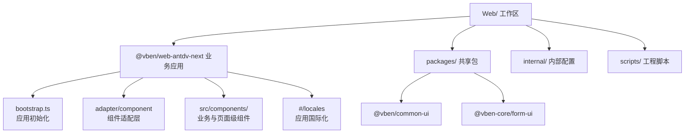
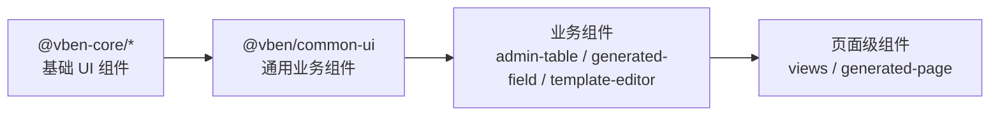
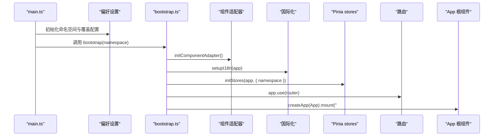
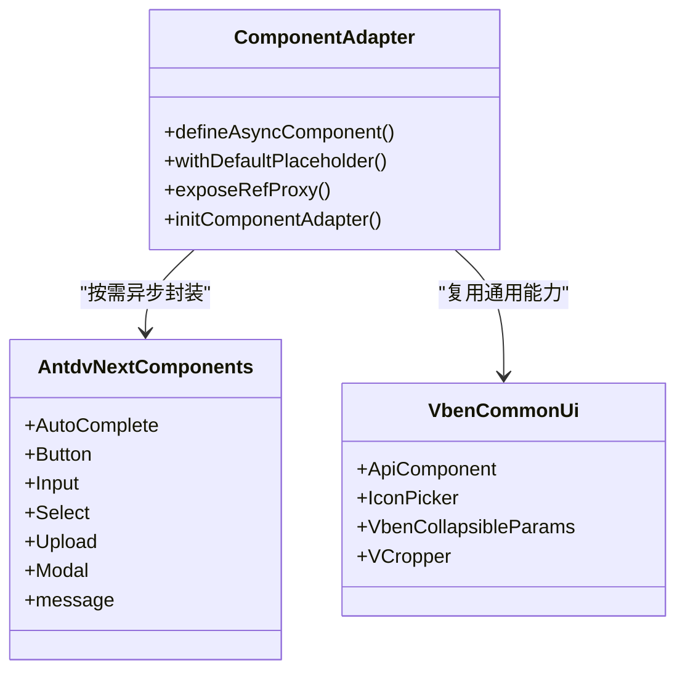
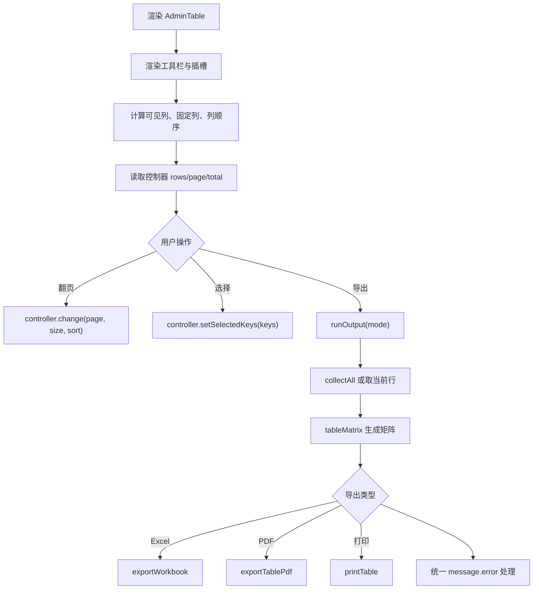
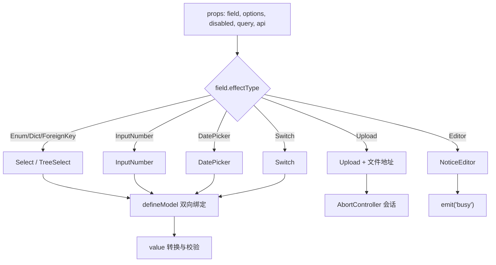
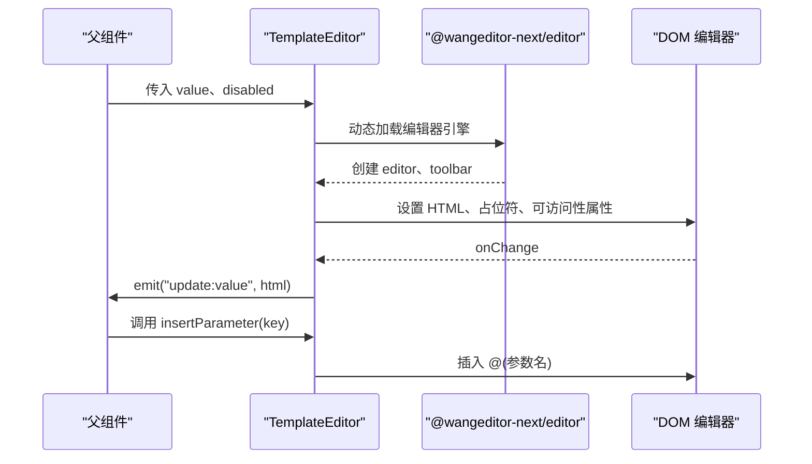
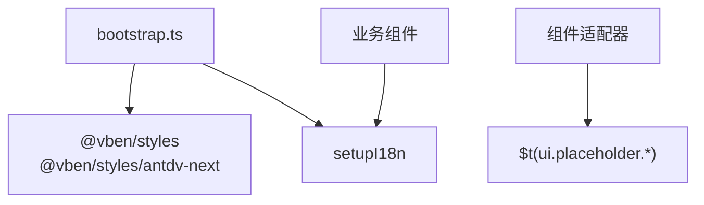
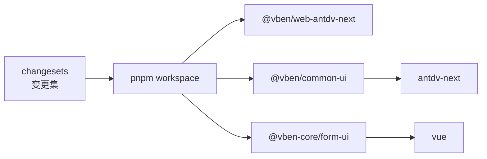

# 组件设计与开发

<cite>
**本文引用的文件**   
- [Web/README.md](file://Web/README.md)
- [Web/package.json](file://Web/package.json)
- [Web/pnpm-workspace.yaml](file://Web/pnpm-workspace.yaml)
- [apps/web-antdv-next/package.json](file://Web/apps/web-antdv-next/package.json)
- [apps/web-antdv-next/src/main.ts](file://Web/apps/web-antdv-next/src/main.ts)
- [apps/web-antdv-next/src/bootstrap.ts](file://Web/apps/web-antdv-next/src/bootstrap.ts)
- [apps/web-antdv-next/src/adapter/component/index.ts](file://Web/apps/web-antdv-next/src/adapter/component/index.ts)
- [packages/effects/common-ui/package.json](file://Web/packages/effects/common-ui/package.json)
- [packages/@core/ui-kit/form-ui/package.json](file://Web/packages/@core/ui-kit/form-ui/package.json)
- [apps/web-antdv-next/src/components/admin-table/index.vue](file://Web/apps/web-antdv-next/src/components/admin-table/index.vue)
- [apps/web-antdv-next/src/components/template-editor/index.vue](file://Web/apps/web-antdv-next/src/components/template-editor/index.vue)
- [apps/web-antdv-next/src/components/admin/generated-field.vue](file://Web/apps/web-antdv-next/src/components/admin/generated-field.vue)
- [apps/web-antdv-next/src/components/admin/generated.ts](file://Web/apps/web-antdv-next/src/components/admin/generated.ts)
</cite>

## 目录
1. [简介](#简介)
2. [项目结构](#项目结构)
3. [核心组件层次](#核心组件层次)
4. [架构总览](#架构总览)
5. [关键组件分析](#关键组件分析)
6. [依赖关系分析](#依赖关系分析)
7. [性能与可维护性](#性能与可维护性)
8. [测试与验收边界](#测试与验收边界)
9. [主题、样式与多语言](#主题样式与多语言)
10. [共享包与发布版本管理](#共享包与发布版本管理)
11. [自定义组件开发指南](#自定义组件开发指南)
12. [常见问题排查](#常见问题排查)
13. [结论](#结论)

## 简介
本指南面向 Admin.NET 前端在 `apps/web-antdv-next` 中的组件设计与开发。当前业务应用使用 Vue 3、TypeScript、Vben Admin 和 antdv-next；根目录 `Web/` 是 pnpm workspace，共享包位于 `packages/` 和 `internal/`。本文以“基础 UI 组件、业务组件、页面级组件”的层次为主线，说明 antdv-next 的使用方式、封装模式、属性与事件设计、插槽与组合模式、共享包创建、主题与多语言、测试以及发布版本管理。

## 项目结构
仓库前端部分的关键路径如下：

| 路径 | 职责 |
| --- | --- |
| `Web/` | pnpm workspace 根，集中脚本、依赖版本与工作区配置 |
| `Web/apps/web-antdv-next/` | 业务前端应用入口、视图、组件、适配器、国际化与静态资源 |
| `Web/packages/` | 共享包，如 common-ui、hooks、stores、types、styles、locales、@core/ui-kit 等 |
| `Web/internal/` | 内部工具与构建配置，不直接作为运行时业务代码 |
| `Web/scripts/` | 部署、发布切换、代码检查等工程脚本 |

**图表来源**
- [Web/README.md:12-47](file://Web/README.md#L12-L47)
- [apps/web-antdv-next/src/main.ts:1-31](file://Web/apps/web-antdv-next/src/main.ts#L1-L31)
- [apps/web-antdv-next/src/bootstrap.ts:1-76](file://Web/apps/web-antdv-next/src/bootstrap.ts#L1-L76)
- [packages/effects/common-ui/package.json:1-57](file://Web/packages/effects/common-ui/package.json#L1-L57)
- [packages/@core/ui-kit/form-ui/package.json:1-59](file://Web/packages/@core/ui-kit/form-ui/package.json#L1-L59)

**章节来源**
- [Web/README.md:12-47](file://Web/README.md#L12-L47)
- [Web/package.json:1-102](file://Web/package.json#L1-L102)
- [Web/pnpm-workspace.yaml:1-20](file://Web/pnpm-workspace.yaml#L1-L20)

## 核心组件层次
Admin.NET 前端在业务应用中形成三层组件结构：

| 层次 | 典型位置 | 职责 | 示例 |
| --- | --- | --- | --- |
| 基础 UI 组件 | `packages/@core/ui-kit/*`、`packages/effects/common-ui` | 提供表单、弹窗、布局、图标、加载器等通用能力，尽量保持无业务语义 | `@vben-core/form-ui`、`@vben/common-ui` |
| 业务组件 | `apps/web-antdv-next/src/components/admin-*`、`notice-*`、`pdfme`、`template-editor` | 封装具体业务场景，如生成式字段、通知编辑、模板编辑器、文件预览 | `GeneratedField`、`NoticeEditor`、`TemplateEditor` |
| 页面级组件 | `apps/web-antdv-next/src/views/**`、`admin-table`、`generated-page` | 组织路由页面、列表、表单、导出打印等业务流程 | `AdminTable`、`GeneratedPage` |

这种划分保证：

- 基础 UI 组件只关注交互细节和跨页面复用；
- 业务组件负责领域数据形态、状态与外部 API 的组合；
- 页面级组件聚焦路由视图、权限、菜单和业务流程编排。

**图表来源**
- [packages/@core/ui-kit/form-ui/package.json:1-59](file://Web/packages/@core/ui-kit/form-ui/package.json#L1-L59)
- [packages/effects/common-ui/package.json:1-57](file://Web/packages/effects/common-ui/package.json#L1-L57)
- [apps/web-antdv-next/src/components/admin-table/index.vue:1-20](file://Web/apps/web-antdv-next/src/components/admin-table/index.vue#L1-L20)
- [apps/web-antdv-next/src/components/admin/generated-field.vue:1-20](file://Web/apps/web-antdv-next/src/components/admin/generated-field.vue#L1-L20)
- [apps/web-antdv-next/src/components/template-editor/index.vue:1-15](file://Web/apps/web-antdv-next/src/components/template-editor/index.vue#L1-L15)

**章节来源**
- [packages/effects/common-ui/package.json:1-57](file://Web/packages/effects/common-ui/package.json#L1-L57)
- [packages/@core/ui-kit/form-ui/package.json:1-59](file://Web/packages/@core/ui-kit/form-ui/package.json#L1-L59)
- [apps/web-antdv-next/src/components/admin-table/index.vue:1-20](file://Web/apps/web-antdv-next/src/components/admin-table/index.vue#L1-L20)
- [apps/web-antdv-next/src/components/template-editor/index.vue:1-15](file://Web/apps/web-antdv-next/src/components/template-editor/index.vue#L1-L15)

## 架构总览
应用启动时先初始化偏好设置，再异步加载 bootstrap，完成组件适配器、表单适配、全局 loading 指令、国际化、Pinia stores、路由、动画插件和标题动态更新，最后挂载到 DOM。

**图表来源**
- [apps/web-antdv-next/src/main.ts:1-31](file://Web/apps/web-antdv-next/src/main.ts#L1-L31)
- [apps/web-antdv-next/src/bootstrap.ts:1-76](file://Web/apps/web-antdv-next/src/bootstrap.ts#L1-L76)
- [apps/web-antdv-next/src/adapter/component/index.ts:689-786](file://Web/apps/web-antdv-next/src/adapter/component/index.ts#L689-L786)

**章节来源**
- [apps/web-antdv-next/src/main.ts:1-31](file://Web/apps/web-antdv-next/src/main.ts#L1-L31)
- [apps/web-antdv-next/src/bootstrap.ts:1-76](file://Web/apps/web-antdv-next/src/bootstrap.ts#L1-L76)

## 关键组件分析

### 基础 UI 适配层
组件适配层将 antdv-next 的组件通过异步导入方式暴露给上层，同时为输入类组件统一默认占位符、透传 ref、合并 props 与 attrs。它承担以下职责：

- 对 antdv-next 的常用组件做按需异步加载；
- 为输入类组件注入国际化默认占位符；
- 向父组件透传底层组件方法；
- 在应用启动时执行 `initComponentAdapter()`，使上层表单、弹窗等组件获得一致行为。

**图表来源**
- [apps/web-antdv-next/src/adapter/component/index.ts:1-200](file://Web/apps/web-antdv-next/src/adapter/component/index.ts#L1-L200)
- [apps/web-antdv-next/src/bootstrap.ts:14-22](file://Web/apps/web-antdv-next/src/bootstrap.ts#L14-L22)

**章节来源**
- [apps/web-antdv-next/src/adapter/component/index.ts:1-200](file://Web/apps/web-antdv-next/src/adapter/component/index.ts#L1-L200)
- [apps/web-antdv-next/src/bootstrap.ts:14-22](file://Web/apps/web-antdv-next/src/bootstrap.ts#L14-L22)

### 业务表格组件 AdminTable
`AdminTable` 是对 antdv-next `Table` 的业务增强组件，核心职责包括：

- 接收控制器 `controller` 和列定义 `columns`，统一分页、选择、排序、滚动、刷新；
- 暴露工具栏插槽 `toolbar`、单元格插槽 `bodyCell`、编辑单元格插槽 `editCell`、展开行插槽 `expandedRowRender`；
- 集成列显示隐藏、固定列、列顺序调整；
- 支持导出 Excel、PDF 和打印；
- 通过 `output` 配置控制输出范围，区分当前页、选中项、全部匹配结果；
- 使用 `axios.isCancel` 和 AbortController 取消后的错误分类处理。

**图表来源**
- [apps/web-antdv-next/src/components/admin-table/index.vue:1-200](file://Web/apps/web-antdv-next/src/components/admin-table/index.vue#L1-L200)

**章节来源**
- [apps/web-antdv-next/src/components/admin-table/index.vue:1-200](file://Web/apps/web-antdv-next/src/components/admin-table/index.vue#L1-L200)

### 生成式字段组件 GeneratedField
`GeneratedField` 根据后端生成的字段 schema 自动选择 antdv-next 控件，例如 `Select`、`TreeSelect`、`DatePicker`、`InputNumber`、`Switch`、`Upload`、`TextArea` 和 `NoticeEditor`。其设计要点：

- 使用 `defineModel` 实现双向绑定；
- 通过 computed 将不同值类型转换为对应控件需要的 value；
- 使用 `createGeneratedSession` 管理请求生命周期，避免页面离页后继续写入；
- 对外暴露 `busy` 事件，让父组件知道字段是否处于上传或请求中；
- 使用 `Alert` 展示字段级错误；
- 查询模式下提供“非空”“时间范围”等特殊交互。

**图表来源**
- [apps/web-antdv-next/src/components/admin/generated-field.vue:1-58](file://Web/apps/web-antdv-next/src/components/admin/generated-field.vue#L1-L58)
- [apps/web-antdv-next/src/components/admin/generated.ts:1-119](file://Web/apps/web-antdv-next/src/components/admin/generated.ts#L1-L119)

**章节来源**
- [apps/web-antdv-next/src/components/admin/generated-field.vue:1-58](file://Web/apps/web-antdv-next/src/components/admin/generated-field.vue#L1-L58)
- [apps/web-antdv-next/src/components/admin/generated.ts:1-119](file://Web/apps/web-antdv-next/src/components/admin/generated.ts#L1-L119)

### 模板编辑器 TemplateEditor
`TemplateEditor` 是一个富文本模板编辑器，支持可视化编辑和源码编辑两种模式：

- 默认尝试加载 WangEditor 引擎进行可视化编辑；
- 如果 HTML 不能安全编辑，则回退到源码模式；
- 通过 `update:value` 与父组件双向绑定；
- 通过 `defineExpose({ insertParameter })` 暴露插入参数的方法；
- 处理模块加载失败、同源重试、可访问性属性同步、禁用态切换；
- 对用户编辑与框架回写做区分，避免覆盖用户正在输入的占位符。

**图表来源**
- [apps/web-antdv-next/src/components/template-editor/index.vue:1-200](file://Web/apps/web-antdv-next/src/components/template-editor/index.vue#L1-L200)

**章节来源**
- [apps/web-antdv-next/src/components/template-editor/index.vue:1-200](file://Web/apps/web-antdv-next/src/components/template-editor/index.vue#L1-L200)

## 依赖关系分析
业务应用 `@vben/web-antdv-next` 依赖多个 workspace 共享包，并直接使用 antdv-next。

```mermaid
graph TB
    App["@vben/web-antdv-next"] --> Access["@vben/access"]
    App --> CommonUi["@vben/common-ui"]
    App --> Constants["@vben/constants"]
    App --> Hooks["@vben/hooks"]
    App --> Icons["@vben/icons"]
    App --> Layouts["@vben/layouts"]
    App --> Locales["@vben/locales"]
    App --> Plugins["@vben/plugins"]
    App --> Preferences["@vben/preferences"]
    App --> Request["@vben/request"]
    App --> Stores["@vben/stores"]
    App --> Styles["@vben/styles"]
    App --> Types["@vben/types"]
    App --> Utils["@vben/utils"]
    App --> Antdv["antdv-next"]
```

**图表来源**
- [apps/web-antdv-next/package.json:27-72](file://Web/apps/web-antdv-next/package.json#L27-L72)

**章节来源**
- [apps/web-antdv-next/package.json:27-72](file://Web/apps/web-antdv-next/package.json#L27-L72)
- [Web/pnpm-workspace.yaml:1-20](file://Web/pnpm-workspace.yaml#L1-L20)

## 性能与可维护性

### 组件设计原则
- **单一职责**：`AdminTable` 专注表格交互与输出，`GeneratedField` 专注字段渲染，`TemplateEditor` 专注模板编辑。
- **可控性与组合**：通过控制器、schema、api、slot 组合能力，而不是把业务逻辑塞进单个大组件。
- **明确边界**：字段值转换、选项解析、请求取消放在 `generated.ts` 这类纯函数或轻量模块中。
- **可测试性**：单元测试覆盖值转换、规则、排序、输出、冷却策略等逻辑；浏览器流程由 Playwright 验证。
- **可访问性**：编辑器主动设置 `role`、`aria-label`、`aria-multiline`、`aria-readonly`；表格按钮提供 `aria-label`。
- **性能优化**：
  - 组件适配器使用 `defineAsyncComponent` 按需加载 antdv-next 子模块；
  - 编辑器懒加载，失败时保留源码模式；
  - 表格导出前判断 `active` 和 `generation`，避免卸载后仍写状态；
  - 使用 `shallowRef` 减少大型对象响应式开销。

### 复杂度与数据结构
- `GeneratedField` 的字段映射基于 `field.effectType` 分支选择控件，时间复杂度接近 O(1)，但选项树遍历 `generatedLabel` 在最坏情况下为 O(n)。
- `AdminTable` 的输出矩阵构建会遍历所有选中或全部记录，适合分页场景下先限制 scope，再调用 `collectAll`。
- 模板编辑器的 HTML 同步与销毁重建需要谨慎处理组件生命周期，避免内存泄漏。

[本节为通用指导，不直接分析具体代码行]

## 测试与验收边界
仓库测试体系包含三个层次：

| 层次 | 工具 | 适用范围 | 注意事项 |
| --- | --- | --- | --- |
| 逻辑测试 | Vitest + happy-dom | 纯函数、组件局部逻辑、状态转换 | 不替代真实 API 与数据库 |
| 浏览器验收 | Playwright desktop | 桌面 Chrome，视口 `1440 × 1000` | 未设置环境变量时自动启动本地服务 |
| 全仓联调 | 后端 + 隔离 PostgreSQL | 登录、权限、API、上传、调度看板等 | 不能用 SQLite 声称联调通过 |

根脚本说明：

- `pnpm dev`、`pnpm build`、`pnpm lint`、`pnpm check:type` 面向业务应用 `apps/web-antdv-next/src`；
- `pnpm test:unit` 运行根配置下的 Vitest 逻辑测试；
- `pnpm test:e2e` 运行桌面 Playwright 测试；
- 修改共享包时应单独检查受影响范围，根命令不会覆盖整个共享包树。

**章节来源**
- [Web/README.md:22-75](file://Web/README.md#L22-L75)
- [Web/package.json:16-43](file://Web/package.json#L16-L43)
- [Web/package.json:92-102](file://Web/package.json#L92-L102)

## 主题、样式与多语言

### 主题定制
- 应用启动时引入 `@vben/styles` 和 `@vben/styles/antdv-next`，确保 antdv-next 主题生效；
- 组件适配器统一注入默认占位符，避免每个输入组件重复处理；
- 若需扩展 antdv-next 主题变量，应优先通过 `@vben/styles` 和相关主题包配置，而不是在业务组件内硬编码颜色。

### 样式隔离
- 业务组件应尽量使用 scoped 样式或 Tailwind 原子类；
- 复杂第三方编辑器（如 WangEditor）需要显式同步可访问性属性和容器节点，避免样式和语义污染；
- 打包产物中 CSS 副作用通过包的 `sideEffects` 声明，避免被 tree-shaking 误删。

### 多语言支持
- 应用通过 `setupI18n` 初始化 i18n；
- 组件中使用 `$t` 获取翻译键，例如输入组件默认占位符使用 `ui.placeholder.input`、`ui.placeholder.select`；
- 业务文案应放入应用 `#/locales`，不要硬编码中文字符串。

**图表来源**
- [apps/web-antdv-next/src/bootstrap.ts:4-12](file://Web/apps/web-antdv-next/src/bootstrap.ts#L4-L12)
- [apps/web-antdv-next/src/adapter/component/index.ts:1-200](file://Web/apps/web-antdv-next/src/adapter/component/index.ts#L1-L200)

**章节来源**
- [apps/web-antdv-next/src/bootstrap.ts:4-12](file://Web/apps/web-antdv-next/src/bootstrap.ts#L4-L12)
- [apps/web-antdv-next/src/adapter/component/index.ts:1-200](file://Web/apps/web-antdv-next/src/adapter/component/index.ts#L1-L200)

## 共享包与发布版本管理

### 共享包结构
当前共享包主要分布在：

- `packages/@core/*`：核心 UI Kit，如 form-ui、popup-ui、layout-ui、menu-ui、tabs-ui、shadcn-ui；
- `packages/effects/*`：effects 层，如 access、common-ui、hooks、layouts、request、plugins；
- `packages/constants`、`packages/icons`、`packages/locales`、`packages/preferences`、`packages/stores`、`packages/styles`、`packages/types`、`packages/utils`。

`@vben/core/form-ui` 通过 tsdown 构建，导出 `dist/index.mjs` 和类型定义，并通过 `exports` 区分开发和生产入口。`@vben/common-ui` 暴露主入口及 `es/tippy`、`es/loading` 子路径。

### 版本管理与发布
- 根 `package.json` 提供 `changeset`、`version` 脚本，使用 changesets 管理变更集和版本号；
- `pnpm-workspace.yaml` 使用 catalog 集中管理依赖版本，workspace 包之间通过 `workspace:*` 引用；
- 业务应用版本由 `apps/web-antdv-next/package.json` 的 `version` 决定；
- 发布前建议运行 `pnpm check`、`pnpm lint`、`pnpm check:type`、`pnpm test:unit`，并根据需要运行 E2E。

**图表来源**
- [Web/package.json:16-43](file://Web/package.json#L16-L43)
- [Web/pnpm-workspace.yaml:1-20](file://Web/pnpm-workspace.yaml#L1-L20)
- [packages/@core/ui-kit/form-ui/package.json:1-59](file://Web/packages/@core/ui-kit/form-ui/package.json#L1-L59)
- [packages/effects/common-ui/package.json:1-57](file://Web/packages/effects/common-ui/package.json#L1-L57)
- [apps/web-antdv-next/package.json:1-26](file://Web/apps/web-antdv-next/package.json#L1-L26)

**章节来源**
- [Web/package.json:16-43](file://Web/package.json#L16-L43)
- [Web/pnpm-workspace.yaml:1-20](file://Web/pnpm-workspace.yaml#L1-L20)
- [packages/@core/ui-kit/form-ui/package.json:1-59](file://Web/packages/@core/ui-kit/form-ui/package.json#L1-L59)
- [packages/effects/common-ui/package.json:1-57](file://Web/packages/effects/common-ui/package.json#L1-L57)
- [apps/web-antdv-next/package.json:1-26](file://Web/apps/web-antdv-next/package.json#L1-L26)

## 自定义组件开发指南

### 何时创建新组件
- 如果某个交互会在多个页面重复出现，且不只是简单组合 antdv-next 组件，应提取为业务组件；
- 如果该交互可跨项目复用、不包含业务领域知识，应放入 `packages/effects/common-ui` 或 `packages/@core/ui-kit/*`；
- 如果只是单页布局，优先保持在 `views` 或页面级组件中，避免过早抽象。

### 属性定义与 TypeScript
推荐使用 Vue 3 Composition API 的 `defineProps` 与 `withDefaults`：

- 使用泛型或联合类型表达可选行为；
- 为必填属性提供合理默认值；
- 对外暴露的类型应稳定，便于上游消费方推断；
- 对于复杂表单字段，参考 `GeneratedField` 的值转换思路，将原始值和控件值分离。

### 事件处理
- 使用 `defineEmits` 明确事件签名；
- 双向绑定使用 `update:modelValue` 或 `update:value`；
- 异步状态使用 `busy` 等语义化事件，让父组件控制按钮禁用和加载；
- 对于复杂操作，优先返回 Promise 或抛出错误，由调用方决定提示策略。

### 插槽使用
- 用具名插槽扩展工具栏、单元格、操作区；
- 通过 `v-bind="context"` 透传给插槽内容，方便父组件拿到行数据和列信息；
- 插槽内容应保持最小依赖，避免把业务逻辑下沉到插槽函数中。

### 组合模式
- 将可复用的状态和逻辑抽成 composable，例如 `use-admin-table`；
- 将数据转换、规则校验、选项解析放入纯函数模块，例如 `generated.ts`；
- 将副作用集中在控制器或 session 管理器中，例如 `createGeneratedSession`。

### 可访问性
- 为交互元素提供 `id`、`aria-label`；
- 第三方编辑器需要手动同步 `role`、`aria-multiline`、`aria-readonly`；
- 避免仅靠颜色传达状态，必要时添加文字或图标。

### 可测试性
- 对纯函数编写单元测例，例如值转换、规则、排序、输出矩阵；
- 对组件行为使用 `@vue/test-utils` 触发事件、断言 DOM；
- 对真实登录、API、上传、数据库链路使用 Playwright E2E 验证。

### 开发示例骨架
下面给出一个通用自定义组件的开发骨架说明，实际代码请参考仓库中的 `GeneratedField`、`TemplateEditor` 和 `AdminTable`：

1. 新建 `src/components/my-component/index.vue`；
2. 使用 `<script setup lang="ts">`；
3. 定义 props、emits、model；
4. 使用 antdv-next 基础组件；
5. 使用 `@vben/locales` 的 `$t` 输出文案；
6. 使用 `@vben/icons` 或项目图标；
7. 对复杂逻辑抽取到同目录 `.ts`；
8. 编写 `*.test.ts`；
9. 在页面中通过 props、slots、events 组合使用。

[本节为通用指导，不直接分析具体代码行]

## 常见问题排查

| 问题 | 可能原因 | 处理方式 |
| --- | --- | --- |
| antdv-next 组件样式缺失 | 未引入 `@vben/styles/antdv-next` 或主题覆盖异常 | 检查 `bootstrap.ts` 中样式引入和主题配置 |
| 输入组件没有默认占位符 | 未走组件适配器或未注入 i18n | 确认 `initComponentAdapter()` 已执行，并使用 `$t` |
| 编辑器加载失败 | 模块请求失败或同源缓存 | 检查 `TemplateEditor` 的错误处理和重试逻辑 |
| 表格导出后状态错乱 | 组件已卸载但仍执行异步任务 | 检查 `active`、`generation`、`sessionBoundary.version` |
| 字段上传后页面关闭仍写入 | 未正确取消请求 | 使用 `createGeneratedSession` 和 AbortController |
| 单元测试通过但联调失败 | 缺少真实 API 或数据库 | 按 README 准备隔离 PostgreSQL 并运行 E2E |
| 共享包改动后类型报错 | 根脚本未覆盖共享包 | 单独运行受影响包的类型检查和 lint |

**章节来源**
- [apps/web-antdv-next/src/bootstrap.ts:4-22](file://Web/apps/web-antdv-next/src/bootstrap.ts#L4-L22)
- [apps/web-antdv-next/src/components/template-editor/index.vue:1-200](file://Web/apps/web-antdv-next/src/components/template-editor/index.vue#L1-L200)
- [apps/web-antdv-next/src/components/admin-table/index.vue:1-200](file://Web/apps/web-antdv-next/src/components/admin-table/index.vue#L1-L200)
- [apps/web-antdv-next/src/components/admin/generated.ts:74-119](file://Web/apps/web-antdv-next/src/components/admin/generated.ts#L74-L119)
- [Web/README.md:22-75](file://Web/README.md#L22-L75)

## 结论
Admin.NET 前端组件体系以 antdv-next 为基础 UI 能力，通过组件适配层、共享包和业务组件形成清晰分层。基础组件关注通用交互，业务组件封装领域数据与状态，页面组件编排流程。组件开发应遵循单一职责、明确 API、可测试、可访问和性能友好的原则；复杂逻辑应下沉到 composable 和纯函数模块；主题、样式和多语言通过共享样式包和应用 i18n 统一管理；共享包通过 pnpm workspace 和 changesets 管理版本与发布。

[本节为总结性内容，不直接分析具体代码行]