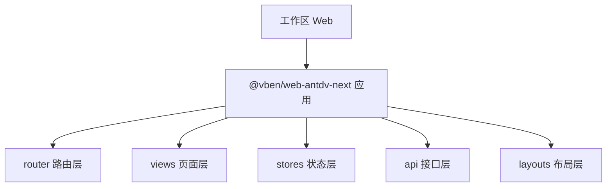
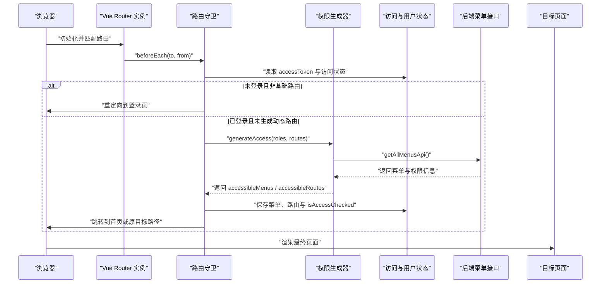
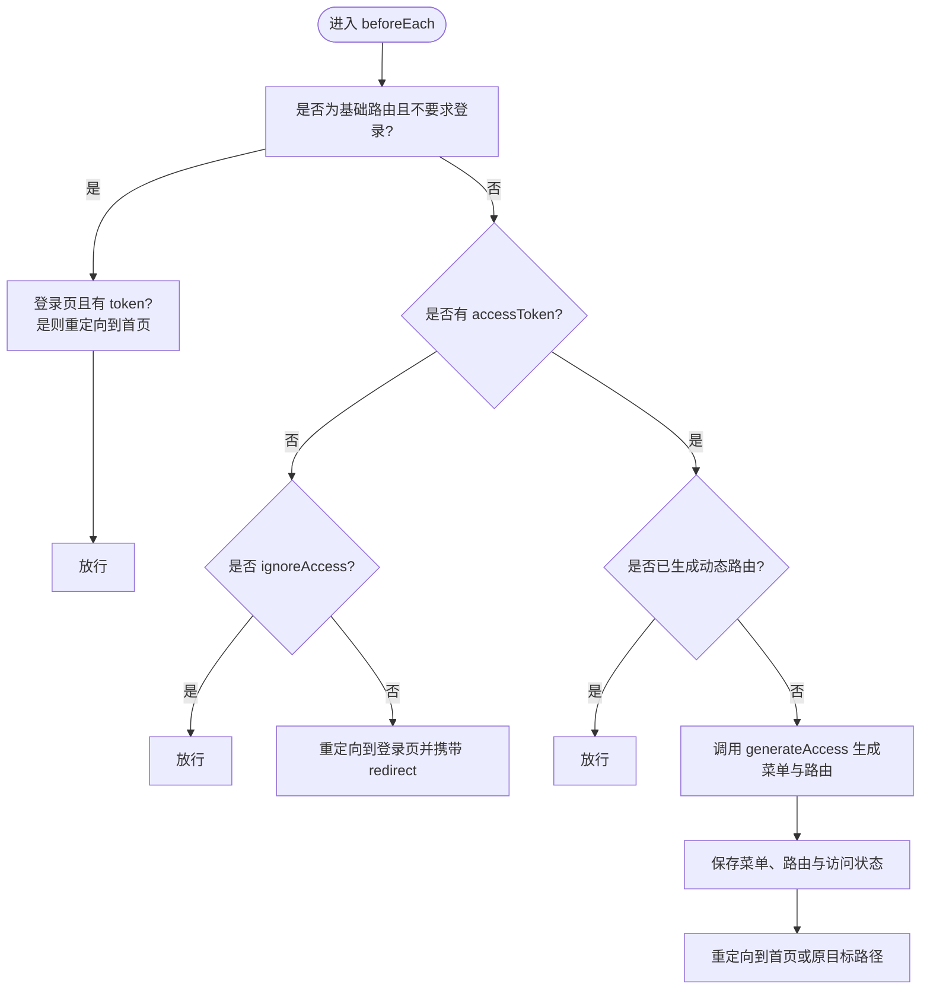
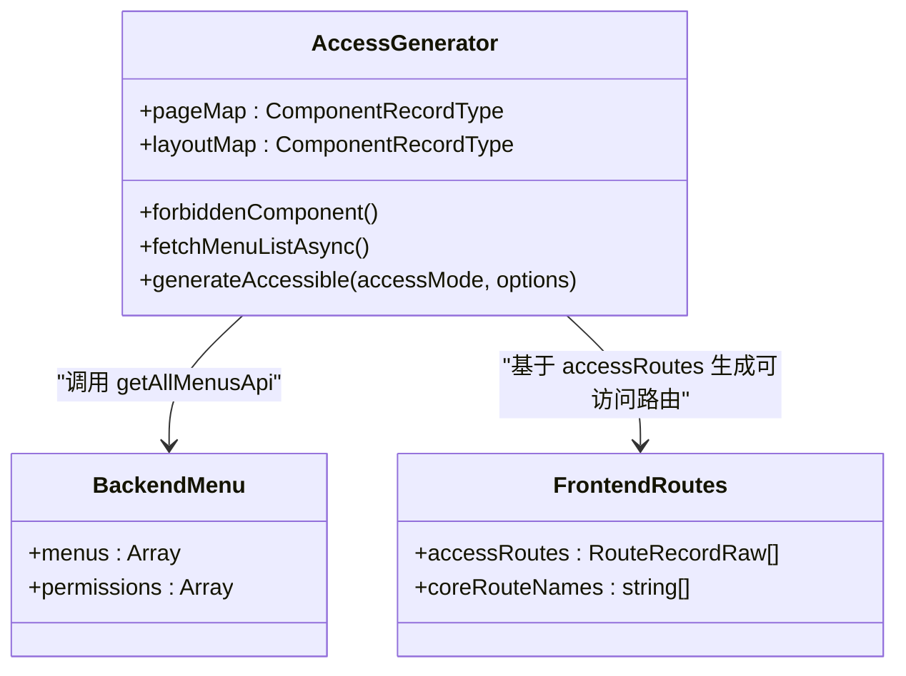
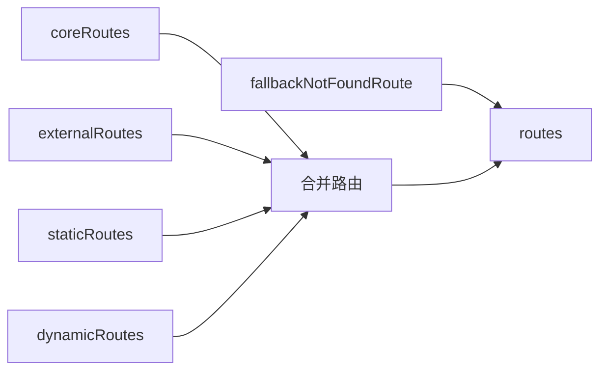
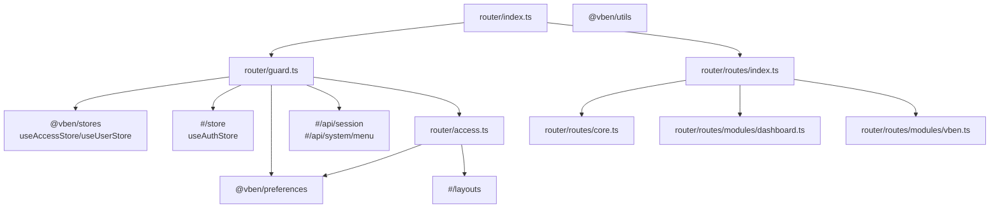

# 路由与页面模块

<cite>
**本文引用的文件列表**   
- [Web/apps/web-antdv-next/src/router/index.ts](file://Web/apps/web-antdv-next/src/router/index.ts)
- [Web/apps/web-antdv-next/src/router/guard.ts](file://Web/apps/web-antdv-next/src/router/guard.ts)
- [Web/apps/web-antdv-next/src/router/access.ts](file://Web/apps/web-antdv-next/src/router/access.ts)
- [Web/apps/web-antdv-next/src/router/redirect.ts](file://Web/apps/web-antdv-next/src/router/redirect.ts)
- [Web/apps/web-antdv-next/src/router/routes/index.ts](file://Web/apps/web-antdv-next/src/router/routes/index.ts)
- [Web/apps/web-antdv-next/src/router/routes/core.ts](file://Web/apps/web-antdv-next/src/router/routes/core.ts)
- [Web/apps/web-antdv-next/src/router/routes/modules/dashboard.ts](file://Web/apps/web-antdv-next/src/router/routes/modules/dashboard.ts)
- [Web/apps/web-antdv-next/src/router/routes/modules/vben.ts](file://Web/apps/web-antdv-next/src/router/routes/modules/vben.ts)
- [Web/apps/web-antdv-next/src/router/template-route.ts](file://Web/apps/web-antdv-next/src/router/template-route.ts)
- [Web/apps/web-antdv-next/src/router/plugin-route.ts](file://Web/apps/web-antdv-next/src/router/plugin-route.ts)
- [Web/package.json](file://Web/package.json)
- [Web/apps/web-antdv-next/package.json](file://Web/apps/web-antdv-next/package.json)
</cite>

## 目录
1. [引言](#引言)
2. [项目结构](#项目结构)
3. [核心组件](#核心组件)
4. [架构总览](#架构总览)
5. [详细组件分析](#详细组件分析)
6. [依赖关系分析](#依赖关系分析)
7. [性能优化建议](#性能优化建议)
8. [常见问题排查](#常见问题排查)
9. [结论](#结论)
10. [附录：新增页面完整流程](#附录新增页面完整流程)

## 引言
本文面向 Admin.NET 前端业务应用 `@vben/web-antdv-next`，围绕 Vue Router 的组织方式、权限校验、菜单同步以及页面模块划分，提供一份从源码出发的开发指南。重点覆盖：
- 静态路由、动态路由、嵌套路由和权限路由的配置方式
- views 目录下认证、系统管理、仪表板、主页等页面模块的职责边界
- 页面组件的模板、逻辑、样式与类型定义组织方式
- 从注册路由到实现页面的完整新增流程
- 页面间数据传递、参数获取与状态保持机制
- 路由守卫、权限校验与菜单同步的实现细节
- 懒加载、代码分割与缓存策略
- 常见问题的定位与修复思路

## 项目结构
本仓库采用 pnpm monorepo，业务前端位于 `Web/apps/web-antdv-next`，根工作区脚本通过 `--filter @vben/web-antdv-next` 指向该应用。运行、构建、类型检查与测试等命令均以该应用为入口，而不是对整个 workspace 执行统一任务。

**图示来源**
- [Web/apps/web-antdv-next/package.json:1-72](file://Web/apps/web-antdv-next/package.json#L1-L72)
- [Web/package.json:1-102](file://Web/package.json#L1-L102)

**章节来源**
- [Web/package.json:1-102](file://Web/package.json#L1-L102)
- [Web/apps/web-antdv-next/package.json:1-72](file://Web/apps/web-antdv-next/package.json#L1-L72)

## 核心组件
- **路由实例与历史记录**：根据环境变量选择 `createWebHistory` 或 `createWebHashHistory`，并挂载初始路由与滚动行为。
- **路由守卫**：分为通用守卫（进度条、已加载路径记录）与访问守卫（登录态、动态路由生成、菜单与权限控制）。
- **可访问路由生成器**：将后端菜单、前端路由与页面组件映射为可导航的菜单树和路由表。
- **安全重定向工具**：对 redirect 查询参数进行白名单校验，防止非法跳转。
- **路由集合装配器**：合并核心路由、外部路由、动态路由与 404 兜底路由，并区分“基础路由”和“需要权限的路由”。

**章节来源**
- [Web/apps/web-antdv-next/src/router/index.ts:1-37](file://Web/apps/web-antdv-next/src/router/index.ts#L1-L37)
- [Web/apps/web-antdv-next/src/router/guard.ts:1-145](file://Web/apps/web-antdv-next/src/router/guard.ts#L1-L145)
- [Web/apps/web-antdv-next/src/router/access.ts:1-42](file://Web/apps/web-antdv-next/src/router/access.ts#L1-L42)
- [Web/apps/web-antdv-next/src/router/redirect.ts:1-13](file://Web/apps/web-antdv-next/src/router/redirect.ts#L1-L13)
- [Web/apps/web-antdv-next/src/router/routes/index.ts:1-37](file://Web/apps/web-antdv-next/src/router/routes/index.ts#L1-L37)

## 架构总览
下图展示浏览器请求进入前端后，路由初始化、守卫拦截、权限校验、菜单与动态路由生成的整体链路。

**图示来源**
- [Web/apps/web-antdv-next/src/router/guard.ts:24-145](file://Web/apps/web-antdv-next/src/router/guard.ts#L24-L145)
- [Web/apps/web-antdv-next/src/router/access.ts:12-42](file://Web/apps/web-antdv-next/src/router/access.ts#L12-L42)

## 详细组件分析

### 路由实例与历史模式
- 路由实例通过环境变量 `VITE_ROUTER_HISTORY` 决定使用 hash 模式还是 history 模式。
- 滚动行为优先恢复上次滚动位置；否则根据 `to.hash` 平滑滚动到锚点，否则回到顶部。
- 导出 `resetRoutes` 用于重置静态路由，便于在权限刷新或会话切换时重建路由。

**章节来源**
- [Web/apps/web-antdv-next/src/router/index.ts:1-37](file://Web/apps/web-antdv-next/src/router/index.ts#L1-L37)

### 路由守卫与权限拦截
路由守卫负责以下职责：
1. **通用行为**
   - 记录每个路径是否已经加载过，避免重复动画与进度条。
   - 根据偏好设置开启或关闭页面过渡进度条。
2. **旧版 token 兼容**
   - 当登录页携带 `token` 查询参数时，将其暂存并重定向到 `/auth/token` 完成后续流程。
3. **基础路由放行**
   - `coreRouteNames` 中的路由不进入权限拦截；若当前是登录页且已有 token，则重定向到默认首页。
4. **登录态检查**
   - 未登录时，除非路由标记 `ignoreAccess`，否则重定向到登录页并保留 `redirect`。
5. **动态路由生成**
   - 首次登录后调用 `generateAccess`，传入用户角色、路由表和 router 实例。
   - 成功后保存可访问菜单、可访问路由，并标记已检查。
   - 最后跳转到 redirect 或默认首页。

**图示来源**
- [Web/apps/web-antdv-next/src/router/guard.ts:24-145](file://Web/apps/web-antdv-next/src/router/guard.ts#L24-L145)

**章节来源**
- [Web/apps/web-antdv-next/src/router/guard.ts:1-145](file://Web/apps/web-antdv-next/src/router/guard.ts#L1-L145)

### 权限与菜单生成
`generateAccess` 的核心职责是将后端菜单转换为前端可导航的菜单树与路由表：
- 通过 `import.meta.glob('../views/**/*.vue')` 建立页面组件映射。
- 提供 `BasicLayout` 与 `IFrameView` 作为布局映射。
- 通过 `preferences.app.accessMode` 控制权限模式。
- 通过 `fetchMenuListAsync` 调用后端接口获取菜单。
- 支持指定无权限时的 403 页面。

**图示来源**
- [Web/apps/web-antdv-next/src/router/access.ts:12-42](file://Web/apps/web-antdv-next/src/router/access.ts#L12-L42)
- [Web/apps/web-antdv-next/src/router/routes/index.ts:18-37](file://Web/apps/web-antdv-next/src/router/routes/index.ts#L18-L37)

**章节来源**
- [Web/apps/web-antdv-next/src/router/access.ts:1-42](file://Web/apps/web-antdv-next/src/router/access.ts#L1-L42)
- [Web/apps/web-antdv-next/src/router/routes/index.ts:1-37](file://Web/apps/web-antdv-next/src/router/routes/index.ts#L1-L37)

### 安全重定向
`safeRedirect` 用于保护登录回调中的 redirect 参数：
- 仅接受字符串。
- 解码后不允许以 `//` 开头或包含控制字符。
- 拒绝直接跳回 `/login`、`/auth` 及其子路径。
- 返回本地路径或原始值，异常时降级到默认首页。

**章节来源**
- [Web/apps/web-antdv-next/src/router/redirect.ts:1-13](file://Web/apps/web-antdv-next/src/router/redirect.ts#L1-L13)

### 路由集合装配
路由装配器将三类路由合并：
- **核心路由**：登录、认证、个人资料、首页、404 等基础能力。
- **外部路由**：预留目录，当前为空数组。
- **动态路由**：从 `./modules/**/*.ts` 自动导入，合并后参与权限过滤。

同时维护：
- `coreRouteNames`：不需要进入权限拦截的基础路由名称集合。
- `accessRoutes`：需要权限校验的动态路由与静态路由集合。

**图示来源**
- [Web/apps/web-antdv-next/src/router/routes/index.ts:1-37](file://Web/apps/web-antdv-next/src/router/routes/index.ts#L1-L37)
- [Web/apps/web-antdv-next/src/router/routes/core.ts:1-156](file://Web/apps/web-antdv-next/src/router/routes/core.ts#L1-L156)

**章节来源**
- [Web/apps/web-antdv-next/src/router/routes/index.ts:1-37](file://Web/apps/web-antdv-next/src/router/routes/index.ts#L1-L37)

### 核心路由与认证模块
核心路由承担系统最基础的能力：
- 登录与认证容器 `/auth`，包含多种登录方式。
- 个人资料 `/profile`。
- 首页与工作台相关路径。
- 404 兜底路由。

认证页面位于 `views/_core/authentication`，包括账号登录、扫码登录、验证码登录、密码找回、第三方 token 登录与注册。这些页面通常由认证布局包裹，并在路由元中声明标题与国际化文案。

**章节来源**
- [Web/apps/web-antdv-next/src/router/routes/core.ts:1-156](file://Web/apps/web-antdv-next/src/router/routes/core.ts#L1-L156)

### 仪表板模块
仪表板路由位于 `router/routes/modules/dashboard.ts`，包含：
- 仪表盘分组 `/dashboard`。
- 数据分析页 `/dashboard/analytics`。
- 工作台页 `/dashboard/workspace`。

该模块体现了典型的嵌套路由：父路由只承担分组与菜单标题，子路由对应具体页面组件。

**章节来源**
- [Web/apps/web-antdv-next/src/router/routes/modules/dashboard.ts:1-38](file://Web/apps/web-antdv-next/src/router/routes/modules/dashboard.ts#L1-L38)

### Vben 示例与外链路由
`router/routes/modules/vben.ts` 主要演示外链与内嵌 iframe 场景，例如文档、GitHub、Ant Design Vue 预览、Naive UI 预览等。这类路由常使用 `IFrameView` 布局，并通过 `meta.link` 描述外链地址。

**章节来源**
- [Web/apps/web-antdv-next/src/router/routes/modules/vben.ts:1-106](file://Web/apps/web-antdv-next/src/router/routes/modules/vben.ts#L1-L106)

### 模板与插件路由规范化
项目提供了两个辅助函数，用于统一不同命名空间下的模板与插件菜单：
- `normalizeTemplateMenu`：将 `platform/template` 与 `system/template` 统一归一化。
- `normalizePluginMenu`：将 `platform/plugin` 与 `system/plugin` 统一归一化。

这两个函数会保留别名，确保新旧路径都能正确访问同一页面。

**章节来源**
- [Web/apps/web-antdv-next/src/router/template-route.ts:1-18](file://Web/apps/web-antdv-next/src/router/template-route.ts#L1-L18)
- [Web/apps/web-antdv-next/src/router/plugin-route.ts:1-15](file://Web/apps/web-antdv-next/src/router/plugin-route.ts#L1-L15)

## 依赖关系分析
下图展示前端应用对 Vue Router、状态存储、偏好设置、接口层与布局层的依赖关系。

**图示来源**
- [Web/apps/web-antdv-next/src/router/index.ts:1-37](file://Web/apps/web-antdv-next/src/router/index.ts#L1-L37)
- [Web/apps/web-antdv-next/src/router/guard.ts:1-145](file://Web/apps/web-antdv-next/src/router/guard.ts#L1-L145)
- [Web/apps/web-antdv-next/src/router/access.ts:1-42](file://Web/apps/web-antdv-next/src/router/access.ts#L1-L42)
- [Web/apps/web-antdv-next/src/router/routes/index.ts:1-37](file://Web/apps/web-antdv-next/src/router/routes/index.ts#L1-L37)
- [Web/apps/web-antdv-next/src/router/routes/core.ts:1-156](file://Web/apps/web-antdv-next/src/router/routes/core.ts#L1-L156)
- [Web/apps/web-antdv-next/src/router/routes/modules/dashboard.ts:1-38](file://Web/apps/web-antdv-next/src/router/routes/modules/dashboard.ts#L1-L38)
- [Web/apps/web-antdv-next/src/router/routes/modules/vben.ts:1-106](file://Web/apps/web-antdv-next/src/router/routes/modules/vben.ts#L1-L106)

**章节来源**
- [Web/apps/web-antdv-next/src/router/index.ts:1-37](file://Web/apps/web-antdv-next/src/router/index.ts#L1-L37)
- [Web/apps/web-antdv-next/src/router/guard.ts:1-145](file://Web/apps/web-antdv-next/src/router/guard.ts#L1-L145)
- [Web/apps/web-antdv-next/src/router/access.ts:1-42](file://Web/apps/web-antdv-next/src/router/access.ts#L1-L42)
- [Web/apps/web-antdv-next/src/router/routes/index.ts:1-37](file://Web/apps/web-antdv-next/src/router/routes/index.ts#L1-L37)

## 性能优化建议
结合当前路由与页面组织方式，推荐以下优化实践：

1. **懒加载与代码分割**
   - 页面组件已普遍使用 `() => import('#/views/...')` 形式，有利于按路由拆分包体。
   - 对于大型表格、图表或编辑器页面，可在页面内部继续按需加载依赖库。

2. **减少首屏路由体积**
   - 将非必要模块放入动态路由或外链 iframe，避免全部塞入核心路由。
   - 使用 `IFrameView` 承载第三方预览或独立子系统。

3. **利用已加载路径缓存**
   - 守卫中已维护 `loadedPaths`，可用于控制页面切换动画、进度条与部分副作用的重复触发。

4. **菜单与路由生成缓存**
   - 权限路由仅在 `isAccessChecked` 为 false 时重新生成，避免频繁刷新导致菜单抖动。

5. **滚动与锚点优化**
   - 路由滚动行为支持锚点平滑滚动，适合长表单、文档类页面。

[本节为通用性能建议，不直接分析特定代码行]

## 常见问题排查

### 路由跳转失败或始终回到首页
可能原因：
- 用户未登录且目标路由未标记 `ignoreAccess`。
- 动态路由尚未生成，`isAccessChecked` 仍为 false。
- redirect 参数被 `safeRedirect` 判定为不安全路径。

排查步骤：
1. 确认目标路由是否在 `accessRoutes` 中。
2. 检查用户角色是否在后端菜单中存在。
3. 查看登录成功后的 redirect 参数是否被清洗。

**章节来源**
- [Web/apps/web-antdv-next/src/router/guard.ts:40-120](file://Web/apps/web-antdv-next/src/router/guard.ts#L40-L120)
- [Web/apps/web-antdv-next/src/router/redirect.ts:1-13](file://Web/apps/web-antdv-next/src/router/redirect.ts#L1-L13)

### 权限拦截异常或菜单不显示
可能原因：
- 后端菜单接口返回为空或结构不匹配。
- `accessMode` 配置与后端权限模型不一致。
- 页面组件未在 `import.meta.glob('../views/**/*.vue')` 匹配范围内。

排查步骤：
1. 确认 `getAllMenusApi` 正常返回菜单。
2. 检查 `preferences.app.accessMode` 配置。
3. 确认页面文件路径符合约定。

**章节来源**
- [Web/apps/web-antdv-next/src/router/access.ts:12-42](file://Web/apps/web-antdv-next/src/router/access.ts#L12-L42)

### 登录页携带 token 无法进入系统
可能原因：
- 旧版 token 未正确暂存。
- 重定向目标不是 `/auth/token`。
- 后续登录流程未完成。

排查步骤：
1. 检查登录页 URL 是否携带 `token`。
2. 确认是否重定向到 `/auth/token`。
3. 查看 `stageLegacyToken` 是否成功暂存 token。

**章节来源**
- [Web/apps/web-antdv-next/src/router/guard.ts:40-75](file://Web/apps/web-antdv-next/src/router/guard.ts#L40-L75)

### 动态路由刷新后丢失
可能原因：
- 刷新后状态未持久化。
- 权限校验提前返回或中断。
- 后端菜单接口失败。

排查步骤：
1. 检查 `accessStore.isAccessChecked` 是否应持久化。
2. 检查网络请求是否成功。
3. 确认 `sessionBoundary.version` 未发生异常变化。

**章节来源**
- [Web/apps/web-antdv-next/src/router/guard.ts:80-120](file://Web/apps/web-antdv-next/src/router/guard.ts#L80-L120)

## 结论
Admin.NET 前端的 Vue Router 体系以“核心路由 + 动态权限路由 + 页面懒加载”为核心设计：
- 核心路由承担登录、认证、个人资料、首页与 404 等基础能力。
- 动态路由由后端菜单驱动，结合前端路由表生成可访问菜单与页面。
- 路由守卫集中处理进度条、登录态、权限校验与安全重定向。
- 页面模块按功能划分为认证、系统管理、仪表板与示例站点等目录。
- 新增页面应遵循现有路由结构与页面组织规范，并确保菜单、权限与懒加载一致。

## 附录：新增页面完整流程

### 1. 确定页面所属模块
- 认证类页面放在 `views/_core/authentication`。
- 系统管理类页面放在 `views/system/<feature>`。
- 仪表板类页面放在 `views/dashboard/<feature>`。
- 主页与工作台类页面放在 `views/home`。

### 2. 创建页面组件
建议将页面拆分为：
- 主视图 `.vue`：模板与组合式逻辑。
- `component/`：复用表单、编辑器、表格等子组件。
- `*.ts`：表单定义、类型定义、状态或会话共享逻辑。
- 样式尽量使用 scoped 或 CSS Modules，避免全局污染。

### 3. 注册路由
- 如果是业务菜单路由，优先放到 `router/routes/modules` 下新建模块文件，导出路由数组。
- 如果是系统内置能力，可直接加入 `router/routes/core.ts`。
- 所有路由应包含 `name`、`path`、`component` 与 `meta.title`。
- 需要权限的页面应出现在 `accessRoutes` 中；基础页面可使用 `coreRoutes`。

### 4. 权限与菜单
- 如果页面由后端菜单驱动，无需手动硬编码路由，只需确保页面组件存在且路径可被 `pageMap` 解析。
- 如果页面需要固定显示在菜单中，可在后端菜单中配置对应路径。
- 如果需要忽略权限但仍显示菜单，可通过权限生成器的配置控制。

### 5. 页面间数据传递
- 路由参数：使用 `useRoute()` 获取 query、params。
- 页面状态：使用 Pinia store 或模块级响应式状态。
- 跨页面临时数据：可使用 URL query 或 sessionStorage。
- 复杂表单编辑：可将表单 schema 与提交逻辑抽离到 `*.ts`，供列表页与编辑弹窗复用。

### 6. 状态保持
- 路由守卫已记录 `loadedPaths`，可用于控制动画与副作用。
- 如需页面级状态保持，可结合 keep-alive 与路由 meta 控制缓存策略。
- 会话级数据建议放入 store 或 session storage，避免刷新丢失。

### 7. 验证清单
- 新页面能否通过菜单点击打开。
- 未登录时是否能被权限拦截。
- 刷新后动态路由是否恢复。
- 懒加载是否正常生效。
- 移动端与桌面端导航是否一致。
- 控制台是否存在路由冲突或 404。

[本节为流程说明，不直接分析特定代码行]