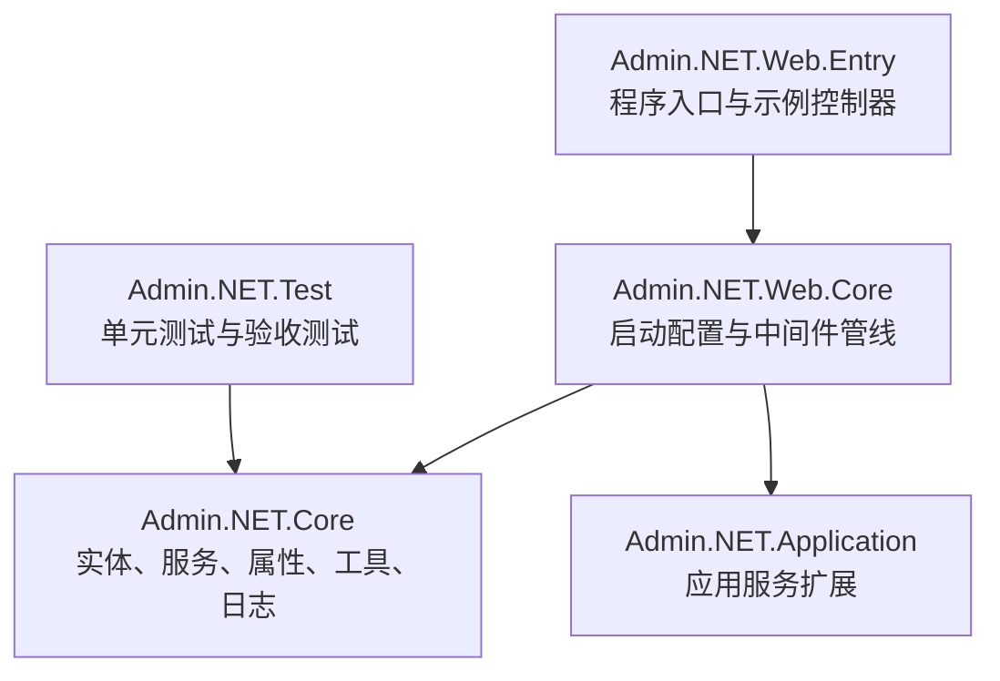
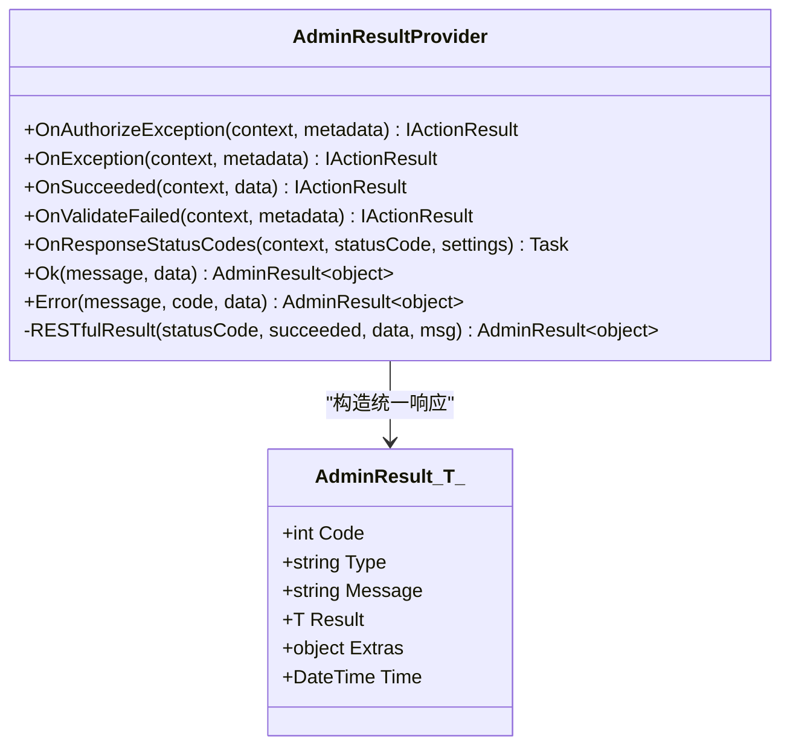
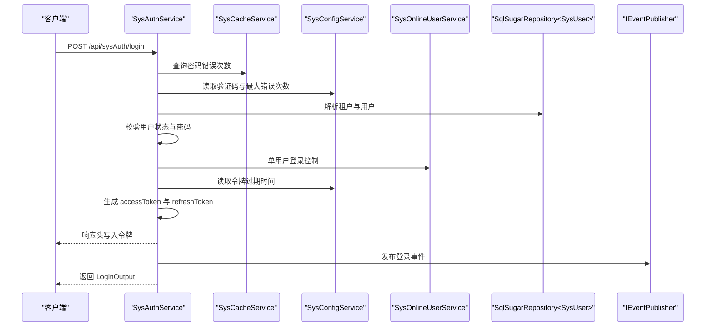
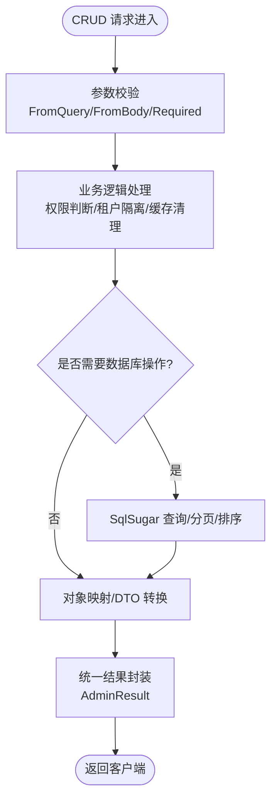
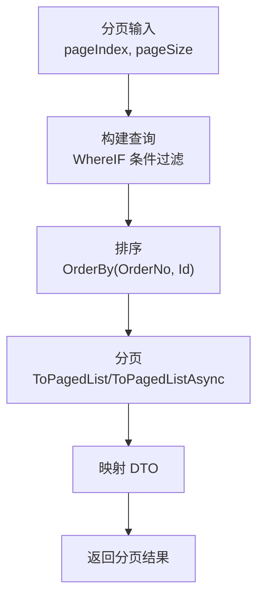
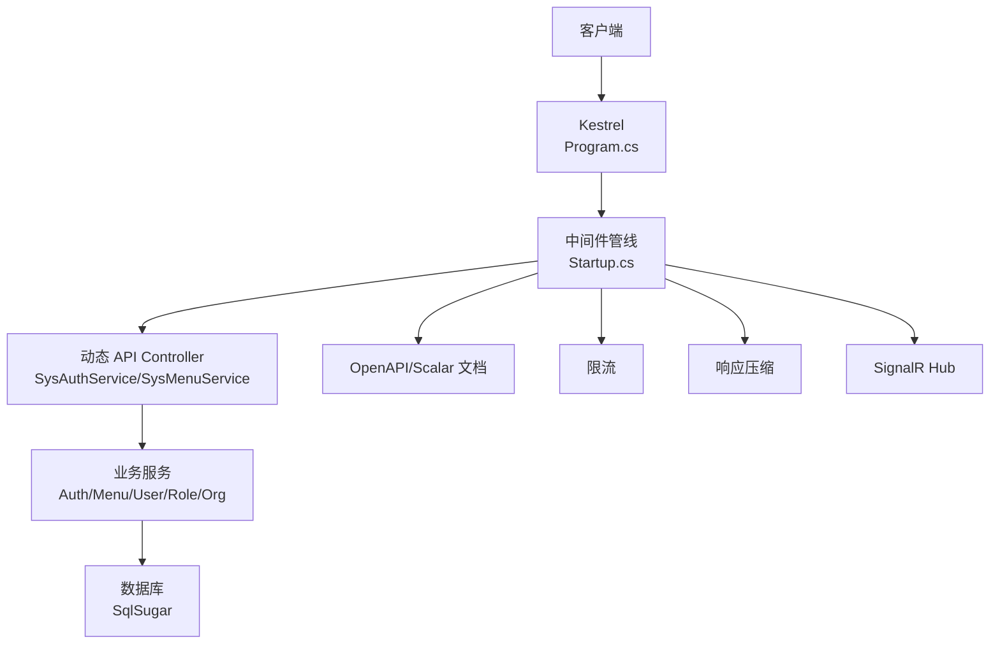
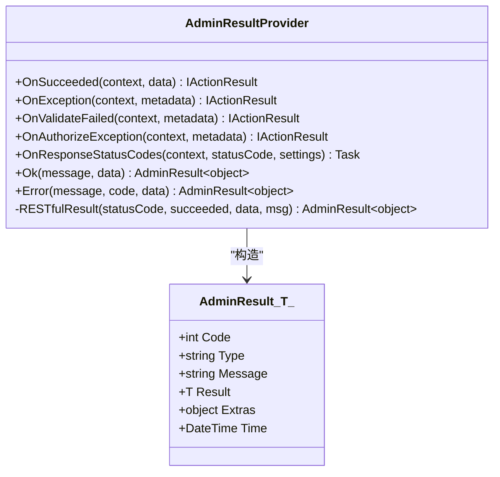
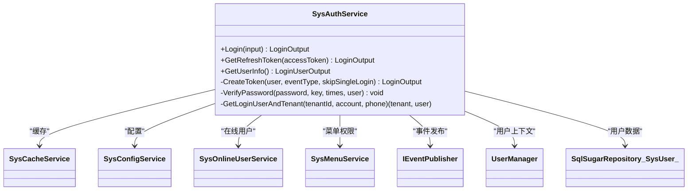
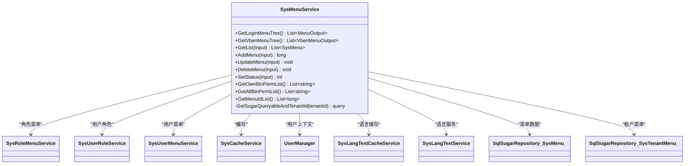
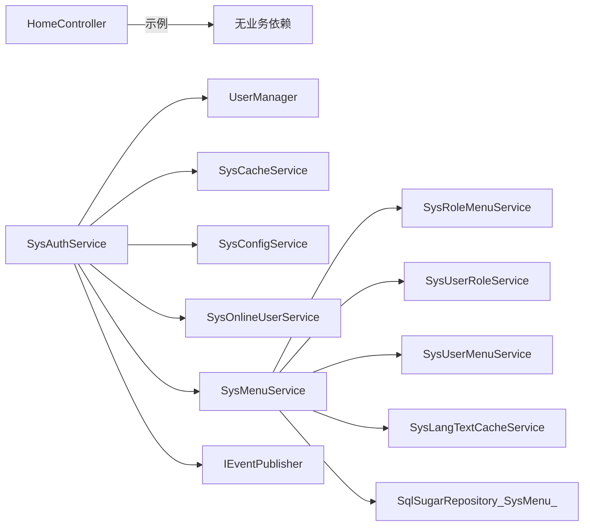

# API 设计与开发模式

<cite>
**本文引用的文件**
- [Program.cs](file://Admin.NET/Admin.NET.Web.Entry/Program.cs)
- [Startup.cs](file://Admin.NET/Admin.NET.Web.Core/Startup.cs)
- [HomeController.cs](file://Admin.NET/Admin.NET.Web.Entry/Controllers/HomeController.cs)
- [CustomUnifyResultAttribute.cs](file://Admin.NET/Admin.NET.Core/Attribute/CustomUnifyResultAttribute.cs)
- [AdminResultProvider.cs](file://Admin.NET/Admin.NET.Core/Utils/AdminResultProvider.cs)
- [SysAuthService.cs](file://Admin.NET/Admin.NET.Core/Service/Auth/SysAuthService.cs)
- [SysMenuService.cs](file://Admin.NET/Admin.NET.Core/Service/Menu/SysMenuService.cs)
- [SqlSugarPagedList.cs](file://Admin.NET/Admin.NET.Core/SqlSugar/SqlSugarPagedList.cs)
- [global.json](file://Admin.NET/global.json)
</cite>

## 目录
1. [引言](#引言)
2. [项目结构](#项目结构)
3. [核心组件](#核心组件)
4. [架构总览](#架构总览)
5. [详细组件分析](#详细组件分析)
6. [依赖关系分析](#依赖关系分析)
7. [性能考虑](#性能考虑)
8. [故障排查指南](#故障排查指南)
9. [结论](#结论)

## 引言
本指南面向 Admin.NET 的 API 设计与开发实践，围绕当前仓库中已实现的后端能力展开。后端基于 ASP.NET Core、Furion 与 SqlSugar，采用动态 API Controller、统一结果封装、JWT 认证、签名认证、限流、响应压缩、OpenAPI/Scalar 文档等机制；前端以 `Web/apps/web-antdv-next` 为业务入口，通过 pnpm workspace 管理。

本项目的前端运行环境以 `Web/package.json` 中的 `packageManager`、`engines` 及现有 workspace 配置和锁文件为准；根脚本 `pnpm dev`、`pnpm build`、`pnpm lint`、`pnpm check:type` 面向业务应用，不能表述为全 workspace 检查。数据库集成验证要求隔离的真实 PostgreSQL，不能以 SQLite 或 Mock 结果声称真实联调通过。浏览器流程只要求桌面端，区分 Vitest 逻辑测试、Playwright 浏览器验证与真实 API、数据库链路验收。

## 项目结构
Admin.NET 后端由多个工程组成：
- `Admin.NET.Admin.NET.Web.Entry`：Web 入口与示例控制器。
- `Admin.NET.Admin.NET.Web.Core`：Web 层启动配置、中间件、认证、序列化、日志、限流、压缩、OpenAPI/Scalar 等。
- `Admin.NET.Admin.NET.Core`：实体、枚举、服务、属性、工具类、日志、缓存、任务调度、SignalR、签名认证等共享能力。
- `Admin.NET.Admin.NET.Application`：可复用的应用服务模块。
- `Admin.NET.Admin.NET.Test`：按功能域组织的测试工程。

**图示来源**
- [Program.cs:10-38](file://Admin.NET/Admin.NET.Web.Entry/Program.cs#L10-L38)
- [Startup.cs:1-60](file://Admin.NET/Admin.NET.Web.Core/Startup.cs#L1-L60)
- [AdminResultProvider.cs:1-25](file://Admin.NET/Admin.NET.Core/Utils/AdminResultProvider.cs#L1-L25)

**章节来源**
- [README.md:1-40](file://README.md#L1-L40)
- [Program.cs:10-38](file://Admin.NET/Admin.NET.Web.Entry/Program.cs#L10-L38)
- [Startup.cs:1-120](file://Admin.NET/Admin.NET.Web.Core/Startup.cs#L1-L120)

## 核心组件
本节说明 RESTful API 的设计原则、命名规范、路由组织、HTTP 状态码、统一结果封装、认证授权、CRUD 模板、分页过滤排序、错误处理、文档版本控制以及性能优化策略。

### RESTful API 设计原则与命名规范
- 控制器组织
  - 系统内置服务以 `Admin.NET.Core/Service` 下的领域子目录划分，例如 `Auth`、`Menu`、`User`、`Role`、`Org`、`Dict`、`Log`、`File`、`Job`、`Tenant`、`Config`、`Message`、`Wechat`、`Alipay`、`ExtendService`、`Enum`、`Const`、`BaseService` 等。
  - 控制器类型使用 Furion 的 `IDynamicApiController`，使方法名直接映射为 API 名称，并通过 `[ApiDescriptionSettings]` 控制分组顺序和描述。
  - 示例控制器位于 `Admin.NET.Web.Entry/Controllers/HomeController.cs`，仅用于演示页面入口，不承载业务接口。

- 路由设计
  - 动态 API 默认按 Controller 和方法名生成路由；可通过 `[HttpGet]`、`[HttpPost]`、`[FromQuery]`、`[FromBody]` 等特性精确指定 HTTP 方法与参数来源。
  - 菜单管理等典型 CRUD 服务在 `SysMenuService` 中提供了列表、新增、修改、删除、批量操作、权限查询等方法，体现资源型 URL 与服务方法的对应关系。

- HTTP 状态码使用
  - 成功响应通常返回 `200 OK`，并由统一结果封装将业务成功标记为 `Type=success`。
  - 认证失败返回 `401 Unauthorized`，授权不足返回 `403 Forbidden`，请求校验失败返回 `400 BadRequest`。
  - 重定向使用 `302 Found`，并通过 `Location` 头指示跳转地址。
  - 这些状态码由 `AdminResultProvider.OnResponseStatusCodes` 集中处理，并输出统一的 JSON 结构。

**章节来源**
- [SysMenuService.cs:1-60](file://Admin.NET/Admin.NET.Core/Service/Menu/SysMenuService.cs#L1-L60)
- [SysMenuService.cs:128-200](file://Admin.NET/Admin.NET.Core/Service/Menu/SysMenuService.cs#L128-L200)
- [SysMenuService.cs:195-321](file://Admin.NET/Admin.NET.Core/Service/Menu/SysMenuService.cs#L195-L321)
- [AdminResultProvider.cs:60-130](file://Admin.NET/Admin.NET.Core/Utils/AdminResultProvider.cs#L60-L130)
- [HomeController.cs:1-29](file://Admin.NET/Admin.NET.Web.Entry/Controllers/HomeController.cs#L1-L29)

### 统一结果封装机制
Admin.NET 使用 Furion 的统一结果机制，通过 `AdminResultProvider` 实现全局响应格式化：
- 成功响应：`OnSucceeded` 调用内部 `RESTfulResult`，设置 `Code=200`、`Type=success`、`Result` 为业务数据。
- 异常响应：`OnException` 将异常信息转为错误结果。
- 验证失败：`OnValidateFailed` 将模型绑定与 `[Required]`、自定义验证器的错误信息放入 `ValidationResult`，并返回 `400 BadRequest`。
- 授权异常：`OnAuthorizeException` 将鉴权失败转换为统一错误响应。
- 特定状态码：`OnResponseStatusCodes` 对 `401`、`403`、`302` 进行特殊处理，其中 `401` 会优先使用签名认证失败消息，`302` 优先走 `Location` 重定向，否则返回错误 JSON。
- 通用构造器：`Ok` 与 `Error` 提供快捷构造方式；内部 `RESTfulResult` 还写入 `Extras` 上下文附加数据与当前时间戳。
- 统一数据结构：`AdminResult<T>` 包含 `Code`、`Type`、`Message`、`Result`、`Extras`、`Time`。

**图示来源**
- [AdminResultProvider.cs:1-193](file://Admin.NET/Admin.NET.Core/Utils/AdminResultProvider.cs#L1-L193)

**章节来源**
- [AdminResultProvider.cs:1-193](file://Admin.NET/Admin.NET.Core/Utils/AdminResultProvider.cs#L1-L193)

### 认证授权 API 的实现模式
认证授权主要围绕 `SysAuthService` 与 JWT 中间件：
- 账号密码登录
  - 方法 `Login` 接收 `LoginInput`，支持验证码校验、密码错误次数限制、租户解析、用户状态检查、域登录（LDAP）验证、按钮权限缓存清理、登录事件发布等。
  - 成功后调用内部 `CreateToken` 生成访问令牌与刷新令牌，并将令牌写入响应头。
- 令牌生成与会话
  - `CreateToken` 根据配置获取令牌过期时间，生成 `accessToken` 与 `refreshToken`，写入响应头，更新用户最后登录信息，并发布用户事件。
  - 单用户登录通过 `SysOnlineUserService.SingleLogin` 控制。
- 刷新令牌
  - `GetRefreshToken` 接收旧 `accessToken`，校验黑名单、JWT 有效性、用户身份，并生成新的访问令牌与刷新令牌。
- 用户信息
  - `GetUserInfo` 返回当前登录用户的详细信息、机构、职位、按钮权限、角色 ID、水印文字、语言代码、当前租户等。
- 认证中间件
  - Startup 中启用 `AddJwt`，并通过 `JwtBearerEvents.OnMessageReceived` 从 URL 查询参数 `token` 或 `/hubs` 路径的 `access_token` 读取令牌。
  - 同时启用签名认证 `AddSignatureAuthentication`，用于开放接口或第三方接入场景。
  - 管道中启用跨域、认证、授权、限流、OpenAPI/Scalar 文档、SignalR Hub 等。

**图示来源**
- [SysAuthService.cs:71-120](file://Admin.NET/Admin.NET.Core/Service/Auth/SysAuthService.cs#L71-L120)
- [SysAuthService.cs:241-310](file://Admin.NET/Admin.NET.Core/Service/Auth/SysAuthService.cs#L241-L310)
- [Startup.cs:30-80](file://Admin.NET/Admin.NET.Web.Core/Startup.cs#L30-L80)

**章节来源**
- [SysAuthService.cs:71-120](file://Admin.NET/Admin.NET.Core/Service/Auth/SysAuthService.cs#L71-L120)
- [SysAuthService.cs:241-310](file://Admin.NET/Admin.NET.Core/Service/Auth/SysAuthService.cs#L241-L310)
- [SysAuthService.cs:361-380](file://Admin.NET/Admin.NET.Core/Service/Auth/SysAuthService.cs#L361-L380)
- [Startup.cs:30-80](file://Admin.NET/Admin.NET.Web.Core/Startup.cs#L30-L80)

### CRUD API 的标准开发模板
以菜单管理为例，展示标准 CRUD 模板：
- 查询
  - `GetList` 支持按标题、类型过滤，非管理员用户按权限过滤，返回树形结构或筛选后的列表。
  - 支持多语言翻译字段，避免频繁 JOIN，提升性能。
- 新增
  - `AddMenu` 接收 `AddMenuInput`，创建新菜单记录并返回主键。
- 修改
  - `UpdateMenu` 接收 `UpdateMenuInput`，更新菜单信息。
- 删除
  - `DeleteMenu` 支持单个与批量删除。
- 状态变更
  - `SetStatus` 切换菜单启用状态。
- 权限查询
  - `GetOwnBtnPermList`、`GetAllBtnPermList`、`GetMenuIdList` 提供按钮权限与菜单 ID 集合，供前端控制按钮显示与菜单权限。

**图示来源**
- [SysMenuService.cs:128-200](file://Admin.NET/Admin.NET.Core/Service/Menu/SysMenuService.cs#L128-L200)
- [SysMenuService.cs:195-321](file://Admin.NET/Admin.NET.Core/Service/Menu/SysMenuService.cs#L195-L321)

**章节来源**
- [SysMenuService.cs:128-200](file://Admin.NET/Admin.NET.Core/Service/Menu/SysMenuService.cs#L128-L200)
- [SysMenuService.cs:195-321](file://Admin.NET/Admin.NET.Core/Service/Menu/SysMenuService.cs#L195-L321)
- [SysMenuService.cs:366-472](file://Admin.NET/Admin.NET.Core/Service/Menu/SysMenuService.cs#L366-L472)

### 分页查询、条件过滤与排序
- 分页
  - 通过 SqlSugar 提供的 `ToPagedList`、`ToPagedListAsync` 扩展方法完成分页查询，支持传入表达式以提升性能。
  - `SqlSugarPagedList` 包装了分页结果，便于 API 返回标准化分页数据。
- 条件过滤
  - 使用 `WhereIF` 实现可选条件过滤，避免拼接复杂 SQL。
  - 菜单查询中通过 `Title`、`Type`、权限 ID 列表组合过滤。
- 排序
  - 使用 `OrderBy` 指定排序字段，如 `OrderNo`、`Id`，保证树形结构稳定。

**图示来源**
- [SysMenuService.cs:128-195](file://Admin.NET/Admin.NET.Core/Service/Menu/SysMenuService.cs#L128-L195)
- [SqlSugarPagedList.cs:59-126](file://Admin.NET/Admin.NET.Core/SqlSugar/SqlSugarPagedList.cs#L59-L126)

**章节来源**
- [SysMenuService.cs:128-195](file://Admin.NET/Admin.NET.Core/Service/Menu/SysMenuService.cs#L128-L195)
- [SqlSugarPagedList.cs:59-126](file://Admin.NET/Admin.NET.Core/SqlSugar/SqlSugarPagedList.cs#L59-L126)

### 错误处理、异常捕获与日志记录
- 统一异常处理
  - `AdminResultProvider.OnException` 将异常转换为统一错误响应。
  - `OnValidateFailed` 将模型绑定错误转换为 `400 BadRequest`。
  - `OnAuthorizeException` 将授权异常转换为统一错误响应。
  - `OnResponseStatusCodes` 集中处理 `401`、`403`、`302` 等状态码。
- 日志记录
  - Startup 中注册 `AddLoggingSetup`，并根据环境启用开发异常页或生产异常处理器。
  - Program 中过滤日志类别，避免控制台运行时写入 Windows 事件日志导致权限问题。
  - 认证服务中在密码验证异常时记录错误日志。
- 安全与脱敏
  - 统一结果中存在敏感检测注释，可根据需要启用敏感信息替换。

**章节来源**
- [AdminResultProvider.cs:30-130](file://Admin.NET/Admin.NET.Core/Utils/AdminResultProvider.cs#L30-L130)
- [Startup.cs:330-442](file://Admin.NET/Admin.NET.Web.Core/Startup.cs#L330-L442)
- [Program.cs:10-38](file://Admin.NET/Admin.NET.Web.Entry/Program.cs#L10-L38)
- [SysAuthService.cs:150-200](file://Admin.NET/Admin.NET.Core/Service/Auth/SysAuthService.cs#L150-L200)

### API 文档生成、版本控制与向后兼容性
- 文档生成
  - 使用 Furion 的 SpecificationDocument 生成 OpenAPI 文档，并通过 Scalar UI 暴露 `/sapi`。
  - Startup 中注入文档配置，支持多组文档与描述增强。
- 版本控制
  - 当前未启用显式 API 版本化中间件；可通过 Swagger/OpenAPI 的 `SwaggerDoc` 配置版本号，但当前 Startup 中该部分被注释。
  - 建议在升级 API 时保留旧版本路由或使用兼容层，确保向后兼容。
- 向后兼容性
  - 返回结构统一为 `AdminResult<T>`，新增字段应兼容旧客户端。
  - 对敏感信息与扩展字段可使用 `Extras` 承载，避免破坏既有契约。

**章节来源**
- [Startup.cs:250-442](file://Admin.NET/Admin.NET.Web.Core/Startup.cs#L250-L442)
- [AdminResultProvider.cs:130-193](file://Admin.NET/Admin.NET.Core/Utils/AdminResultProvider.cs#L130-L193)

## 架构总览
Admin.NET 的 API 架构遵循“控制器薄、服务厚”的分层设计：
- Web 入口负责主机初始化、日志过滤、Kestrel 配置。
- Web Core 负责依赖注入、认证、授权、限流、压缩、静态文件、SignalR、OpenAPI/Scalar、异常处理等横切关注点。
- Core 提供服务、实体、工具、日志、缓存、任务调度、签名认证等核心能力。
- Application 与应用扩展复用 Core 能力。
- Test 按功能域组织单元测试与验收测试。

**图示来源**
- [Program.cs:10-38](file://Admin.NET/Admin.NET.Web.Entry/Program.cs#L10-L38)
- [Startup.cs:120-442](file://Admin.NET/Admin.NET.Web.Core/Startup.cs#L120-L442)
- [SysAuthService.cs:71-120](file://Admin.NET/Admin.NET.Core/Service/Auth/SysAuthService.cs#L71-L120)
- [SysMenuService.cs:128-200](file://Admin.NET/Admin.NET.Core/Service/Menu/SysMenuService.cs#L128-L200)

## 详细组件分析

### 统一结果提供者
`AdminResultProvider` 是整个 API 响应的中枢，负责：
- 成功响应格式化。
- 异常与验证错误格式化。
- 授权异常格式化。
- 特定状态码处理。
- 统一数据结构构造。

**图示来源**
- [AdminResultProvider.cs:1-193](file://Admin.NET/Admin.NET.Core/Utils/AdminResultProvider.cs#L1-L193)

**章节来源**
- [AdminResultProvider.cs:1-193](file://Admin.NET/Admin.NET.Core/Utils/AdminResultProvider.cs#L1-L193)

### 认证服务
`SysAuthService` 提供登录、刷新令牌、用户信息查询等功能，并与缓存、配置、在线用户、菜单权限、事件总线协作。

**图示来源**
- [SysAuthService.cs:71-120](file://Admin.NET/Admin.NET.Core/Service/Auth/SysAuthService.cs#L71-L120)
- [SysAuthService.cs:241-310](file://Admin.NET/Admin.NET.Core/Service/Auth/SysAuthService.cs#L241-L310)
- [SysAuthService.cs:361-380](file://Admin.NET/Admin.NET.Core/Service/Auth/SysAuthService.cs#L361-L380)

**章节来源**
- [SysAuthService.cs:71-120](file://Admin.NET/Admin.NET.Core/Service/Auth/SysAuthService.cs#L71-L120)
- [SysAuthService.cs:241-310](file://Admin.NET/Admin.NET.Core/Service/Auth/SysAuthService.cs#L241-L310)
- [SysAuthService.cs:361-380](file://Admin.NET/Admin.NET.Core/Service/Auth/SysAuthService.cs#L361-L380)

### 菜单服务
`SysMenuService` 提供菜单树、菜单列表、菜单 CRUD、按钮权限、菜单 ID 列表等能力，体现标准的资源型 API 设计。

**图示来源**
- [SysMenuService.cs:1-60](file://Admin.NET/Admin.NET.Core/Service/Menu/SysMenuService.cs#L1-L60)
- [SysMenuService.cs:52-128](file://Admin.NET/Admin.NET.Core/Service/Menu/SysMenuService.cs#L52-L128)
- [SysMenuService.cs:128-200](file://Admin.NET/Admin.NET.Core/Service/Menu/SysMenuService.cs#L128-L200)
- [SysMenuService.cs:195-321](file://Admin.NET/Admin.NET.Core/Service/Menu/SysMenuService.cs#L195-L321)
- [SysMenuService.cs:366-472](file://Admin.NET/Admin.NET.Core/Service/Menu/SysMenuService.cs#L366-L472)

**章节来源**
- [SysMenuService.cs:1-60](file://Admin.NET/Admin.NET.Core/Service/Menu/SysMenuService.cs#L1-L60)
- [SysMenuService.cs:52-128](file://Admin.NET/Admin.NET.Core/Service/Menu/SysMenuService.cs#L52-L128)
- [SysMenuService.cs:128-200](file://Admin.NET/Admin.NET.Core/Service/Menu/SysMenuService.cs#L128-L200)
- [SysMenuService.cs:195-321](file://Admin.NET/Admin.NET.Core/Service/Menu/SysMenuService.cs#L195-L321)
- [SysMenuService.cs:366-472](file://Admin.NET/Admin.NET.Core/Service/Menu/SysMenuService.cs#L366-L472)

## 依赖关系分析
- 控制器与服务解耦
  - `HomeController` 仅作为示例控制器，无业务依赖。
  - `SysAuthService`、`SysMenuService` 通过构造函数注入依赖，符合依赖注入最佳实践。
- 外部依赖
  - JwtBearer、Cors、RateLimit、SignalR、OSS、ElasticSearch、ImageSharp、Localization、TaskQueue、Schedule 等由 Startup 集中注册。
- 循环依赖风险
  - 服务间存在一定耦合，例如菜单服务依赖角色、用户、语言服务等，应避免在服务内部引入循环引用。

**图示来源**
- [HomeController.cs:1-29](file://Admin.NET/Admin.NET.Web.Entry/Controllers/HomeController.cs#L1-L29)
- [SysAuthService.cs:71-120](file://Admin.NET/Admin.NET.Core/Service/Auth/SysAuthService.cs#L71-L120)
- [SysMenuService.cs:1-60](file://Admin.NET/Admin.NET.Core/Service/Menu/SysMenuService.cs#L1-L60)

**章节来源**
- [HomeController.cs:1-29](file://Admin.NET/Admin.NET.Web.Entry/Controllers/HomeController.cs#L1-L29)
- [SysAuthService.cs:71-120](file://Admin.NET/Admin.NET.Core/Service/Auth/SysAuthService.cs#L71-L120)
- [SysMenuService.cs:1-60](file://Admin.NET/Admin.NET.Core/Service/Menu/SysMenuService.cs#L1-L60)

## 性能考虑
- 响应压缩
  - Startup 中启用 Brotli 与 Gzip 压缩，提升网络传输效率。
- 数据库查询优化
  - 使用 `WhereIF`、`OrderBy`、`ToPagedList` 减少无效数据加载。
  - 菜单查询避免不必要的 JOIN，改用分步查询与批量翻译。
- 缓存
  - 使用 `SysCacheService` 缓存密码错误次数、按钮权限等热点数据。
- 连接与超时
  - Program 中配置 Kestrel 的 KeepAliveTimeout、RequestHeadersTimeout、MaxRequestBodySize，适应大文件上传与长连接。
- 负载均衡
  - Startup 中启用 ForwardedHeaders，支持反向代理与负载均衡场景下获取真实客户端 IP。
  - 限流组件支持内存、IP、客户端、策略等多维度限流。

**章节来源**
- [Startup.cs:200-330](file://Admin.NET/Admin.NET.Web.Core/Startup.cs#L200-L330)
- [Program.cs:20-38](file://Admin.NET/Admin.NET.Web.Entry/Program.cs#L20-L38)
- [SysMenuService.cs:128-200](file://Admin.NET/Admin.NET.Core/Service/Menu/SysMenuService.cs#L128-L200)

## 故障排查指南
- 登录失败
  - 检查验证码开关、密码错误次数、租户状态、用户状态、LDAP 配置。
  - 查看缓存中密码错误次数与黑名单令牌。
- 权限不足
  - 检查角色、菜单、按钮权限是否正确配置。
  - 确认用户当前租户与权限缓存是否最新。
- 文档不可用
  - 检查 `AppSettings:InjectSpecificationDocument` 配置与 `/sapi` 路由。
- 日志缺失
  - 检查 Program 中的日志过滤器与 Startup 中的日志注册。
  - 确认生产环境异常处理器与开发者异常页配置。

**章节来源**
- [SysAuthService.cs:71-120](file://Admin.NET/Admin.NET.Core/Service/Auth/SysAuthService.cs#L71-L120)
- [SysAuthService.cs:361-380](file://Admin.NET/Admin.NET.Core/Service/Auth/SysAuthService.cs#L361-L380)
- [Startup.cs:330-442](file://Admin.NET/Admin.NET.Web.Core/Startup.cs#L330-L442)
- [Program.cs:10-38](file://Admin.NET/Admin.NET.Web.Entry/Program.cs#L10-L38)

## 结论
Admin.NET 的 API 设计以动态 API Controller、统一结果封装、JWT 认证、签名认证、限流、压缩、OpenAPI/Scalar 文档为核心，结合 SqlSugar 的灵活查询与分页能力，形成一套可扩展、可维护、可观测的后端开发范式。开发者应遵循资源型 URL、标准 HTTP 状态码、统一响应结构、参数校验、业务分层、缓存与日志最佳实践，并在部署前结合实际环境与真实 PostgreSQL 完成联调验收。