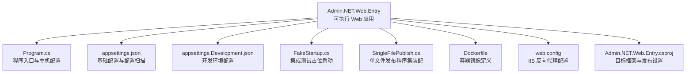
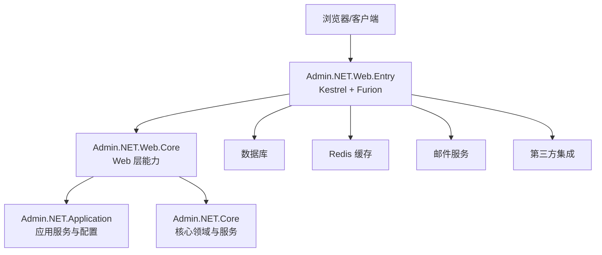
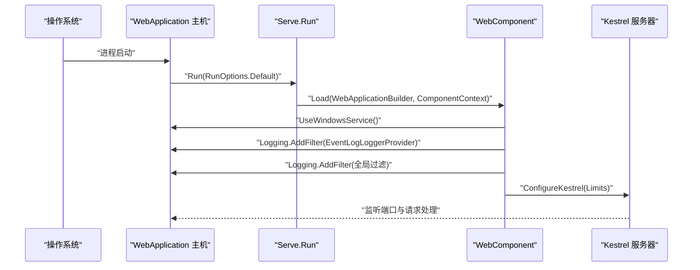
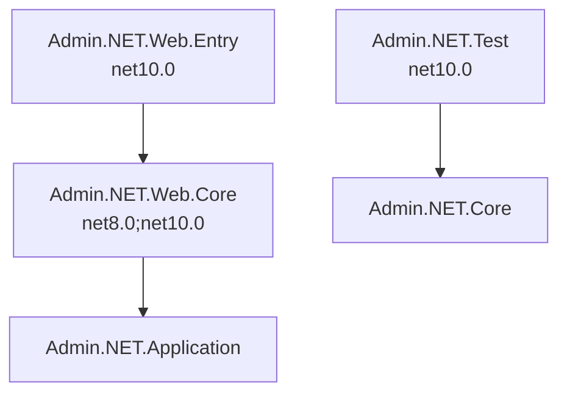

# Web 入口工程 Admin.NET.Web.Entry

<cite>
**本文引用的文件**   
- [Admin.NET.Web.Entry.csproj](file://Admin.NET/Admin.NET.Web.Entry/Admin.NET.Web.Entry.csproj)
- [Program.cs](file://Admin.NET/Admin.NET.Web.Entry/Program.cs)
- [appsettings.json](file://Admin.NET/Admin.NET.Web.Entry/appsettings.json)
- [appsettings.Development.json](file://Admin.NET/Admin.NET.Web.Entry/appsettings.Development.json)
- [FakeStartup.cs](file://Admin.NET/Admin.NET.Web.Entry/FakeStartup.cs)
- [SingleFilePublish.cs](file://Admin.NET/Admin.NET.Web.Entry/SingleFilePublish.cs)
- [Dockerfile](file://Admin.NET/Admin.NET.Web.Entry/Dockerfile)
- [web.config](file://Admin.NET/Admin.NET.Web.Entry/web.config)
- [global.json](file://Admin.NET/global.json)
- [Admin.NET.sln](file://Admin.NET/Admin.NET.sln)
- [Admin.NET.Web.Core.csproj](file://Admin.NET/Admin.NET.Web.Core/Admin.NET.Web.Core.csproj)
- [Admin.NET.Test.csproj](file://Admin.NET/Admin.NET.Test/Admin.NET.Test.csproj)
- [docker-compose.yml](file://docker/docker-compose.yml)
</cite>

## 目录
1. [引言](#引言)
2. [项目结构](#项目结构)
3. [核心组件](#核心组件)
4. [架构总览](#架构总览)
5. [详细组件分析](#详细组件分析)
6. [依赖关系分析](#依赖关系分析)
7. [性能与资源管理](#性能与资源管理)
8. [测试配置](#测试配置)
9. [部署与环境变量](#部署与环境变量)
10. [故障排查](#故障排查)
11. [结论](#结论)

## 引言
Admin.NET.Web.Entry 是 Admin.NET 平台的 .NET 可执行 Web 应用程序入口工程。该工程直接承载 Kestrel Web 服务器、Furion 框架启动流程以及平台业务扩展点，同时承担容器化构建、单文件发布装配和 Windows 服务集成等职责。它与其他共享库（如 Admin.NET.Core、Admin.NET.Application、Admin.NET.Web.Core）的区别在于：它是唯一被打包为可执行应用的工程，负责进程生命周期、Web 主机配置、外部系统集成和运行时环境适配。

本指南面向开发者与维护者，从程序启动、配置加载、日志与中间件、容器化、部署与测试角度给出完整说明，并补充性能调优、内存管理与资源清理建议。

## 项目结构
Admin.NET.Web.Entry 是一个基于 Microsoft.NET.Sdk.Web 的 Web 应用工程，目标框架为 net10.0，属于解决方案中的可执行入口项目。其关键文件如下：

- Program.cs：进程入口、主机构建器、Furion 组件注册、Kestrel 限制、Windows 服务支持。
- appsettings.json / appsettings.Development.json：Furion 配置扫描路径与环境差异化配置。
- FakeStartup.cs：供集成测试使用的占位启动类。
- SingleFilePublish.cs：解决单文件发布时程序集扫描问题。
- Dockerfile：容器镜像定义。
- web.config：IIS 反向代理相关配置。
- csproj：目标框架、发布选项、资源与依赖声明。

**图示来源**
- [Program.cs:1-38](file://Admin.NET/Admin.NET.Web.Entry/Program.cs#L1-L38)
- [appsettings.json:1-5](file://Admin.NET/Admin.NET.Web.Entry/appsettings.json#L1-L5)
- [appsettings.Development.json:1-5](file://Admin.NET/Admin.NET.Web.Entry/appsettings.Development.json#L1-L5)
- [FakeStartup.cs:1-14](file://Admin.NET/Admin.NET.Web.Entry/FakeStartup.cs#L1-L14)
- [SingleFilePublish.cs:1-43](file://Admin.NET/Admin.NET.Web.Entry/SingleFilePublish.cs#L1-L43)
- [Dockerfile:1-18](file://Admin.NET/Admin.NET.Web.Entry/Dockerfile#L1-L18)
- [web.config](file://Admin.NET/Admin.NET.Web.Entry/web.config)
- [Admin.NET.Web.Entry.csproj:1-71](file://Admin.NET/Admin.NET.Web.Entry/Admin.NET.Web.Entry.csproj#L1-L71)

**章节来源**
- [Admin.NET.Web.Entry.csproj:1-71](file://Admin.NET/Admin.NET.Web.Entry/Admin.NET.Web.Entry.csproj#L1-L71)

## 核心组件
- 程序入口 Program.cs：使用 Serve.Run 启动 Furion Web 应用，注册 WebComponent 进行日志过滤、Kestrel 超时与请求体大小限制、Windows 事件日志开关。
- 配置系统 appsettings.*：通过 ConfigurationScanDirectories 指定 Furion 的配置扫描目录，便于集中管理数据库、缓存、邮件、第三方集成等配置。
- FakeStartup.cs：用于集成测试环境的空启动类，配合测试宿主或测试夹具使用。
- SingleFilePublish.cs：实现 ISingleFilePublish，显式声明需要扫描的程序集，解决单文件发布时动态发现的问题。
- Dockerfile：基于 ASP.NET Runtime 镜像暴露端口，安装必要工具，以 dotnet 命令运行入口程序集。
- csproj：声明目标框架 net10.0、准备运行复合发布、排除日志与发布产物、包含静态资源与更新脚本。

**章节来源**
- [Program.cs:1-38](file://Admin.NET/Admin.NET.Web.Entry/Program.cs#L1-L38)
- [appsettings.json:1-5](file://Admin.NET/Admin.NET.Web.Entry/appsettings.json#L1-L5)
- [FakeStartup.cs:1-14](file://Admin.NET/Admin.NET.Web.Entry/FakeStartup.cs#L1-L14)
- [SingleFilePublish.cs:1-43](file://Admin.NET/Admin.NET.Web.Entry/SingleFilePublish.cs#L1-L43)
- [Dockerfile:1-18](file://Admin.NET/Admin.NET.Web.Entry/Dockerfile#L1-L18)
- [Admin.NET.Web.Entry.csproj:1-71](file://Admin.NET/Admin.NET.Web.Entry/Admin.NET.Web.Entry.csproj#L1-L71)

## 架构总览
Admin.NET.Web.Entry 作为可执行 Web 应用，向上承接前端与调用方，向下依赖 Admin.NET.Web.Core 提供的 Web 层能力，并通过 Furion 框架装配 Application 与 Core 层的服务、实体、选项、插件等。

**图示来源**
- [Admin.NET.Web.Entry.csproj:60-71](file://Admin.NET/Admin.NET.Web.Entry/Admin.NET.Web.Entry.csproj#L60-L71)
- [Admin.NET.Web.Core.csproj:1-21](file://Admin.NET/Admin.NET.Web.Core/Admin.NET.Web.Core.csproj#L1-L21)
- [Admin.NET.sln:1-78](file://Admin.NET/Admin.NET.sln#L1-L78)

## 详细组件分析

### Program.cs 程序启动流程
Program.cs 的核心职责是创建并启动 Web 主机，注册 Furion 组件，并针对 Windows 服务、日志和 Kestrel 进行优化。

要点说明：
- 主机构建器：通过 RunOptions.Default 创建默认 WebApplication 主机配置，并使用 UseWindowsService() 启用 Windows 服务支持。
- Furion 组件：AddWebComponent<WebComponent>() 将 WebComponent 注入到 Furion 的生命周期中，完成日志、Kestrel 等初始化。
- 日志过滤：在 Windows 非服务模式下禁用 EventLog 写入；全局过滤掉 Microsoft.Hosting 与 Microsoft.AspNetCore 的高频信息日志，仅保留 Information 及以上级别。
- Kestrel 限制：KeepAliveTimeout 与 RequestHeadersTimeout 设置为 30 分钟；MaxRequestBodySize 设为 null 表示不限制上传大小。
- 环境变量加载：由 Furion 与 .NET 主机配置系统共同负责，配置文件与环境变量会按优先级合并。

**图示来源**
- [Program.cs:1-38](file://Admin.NET/Admin.NET.Web.Entry/Program.cs#L1-L38)

**章节来源**
- [Program.cs:1-38](file://Admin.NET/Admin.NET.Web.Entry/Program.cs#L1-L38)

### appsettings.json 配置文件结构
appsettings.json 定义了 Furion 的配置基础与扫描策略。ConfigurationScanDirectories 指定了配置文件夹，使得该目录下所有 JSON 文件会被自动扫描并合并到配置树中。这意味着数据库连接、Redis、邮件服务、第三方集成等配置项可以分别放在不同文件中，统一由 Furion 加载。

典型配置分类（根据常见实践与扫描机制推断）：
- 数据库连接：通常位于 Configuration 目录下的数据库相关 JSON，如 SQL Server、MySQL、PostgreSQL 等。
- Redis 缓存：Redis 连接字符串、密码、集群模式等。
- 邮件服务：SMTP 主机、端口、用户名、密码、SSL/TLS 等。
- 第三方集成：微信、钉钉、支付、对象存储、搜索等外部服务密钥与端点。
- Furion 自身：日志、OpenAPI、认证、租户、权限等。

注意：当前仓库中 appsettings.json 仅声明 ConfigurationScanDirectories，实际键值应位于被扫描的目录内，不应硬编码在根级 JSON。

**章节来源**
- [appsettings.json:1-5](file://Admin.NET/Admin.NET.Web.Entry/appsettings.json#L1-L5)
- [appsettings.Development.json:1-5](file://Admin.NET/Admin.NET.Web.Entry/appsettings.Development.json#L1-L5)

### FakeStartup.cs 开发与测试作用
FakeStartup 是一个空的启动类，注释明确其为“供集成测试使用”。在集成测试场景中，测试宿主或测试夹具可通过该类型提供启动上下文，避免真实 Web 应用完全启动，从而缩短测试时间并隔离外部依赖。

建议在测试项目中：
- 使用 Furion.Xunit 与 xUnit v3 组织测试用例。
- 通过 FakeStartup 作为最小化启动上下文。
- 对数据库、Redis、邮件等外部依赖使用 Testcontainers 或本地开发服务。

**章节来源**
- [FakeStartup.cs:1-14](file://Admin.NET/Admin.NET.Web.Entry/FakeStartup.cs#L1-L14)

### SingleFilePublish.cs 单文件发布
SingleFilePublish 实现 ISingleFilePublish，用于在单文件发布模式下告诉 Furion 哪些程序集需要被扫描与装配。当前 IncludeAssemblies 返回空数组，IncludeAssemblyNames 显式列出 Admin.NET.Application、Admin.NET.Core、Admin.NET.Web.Core。这确保单文件发布后仍能正确发现服务、控制器、选项、插件等类型。

最佳实践：
- 新增模块或插件程序集时，同步添加到 IncludeAssemblyNames。
- 若使用反射或动态加载，优先使用 IncludeAssemblies 精确传入程序集实例。
- 发布前验证动态类型是否可用，避免运行时 MissingMethodException 或 TypeLoadException。

**章节来源**
- [SingleFilePublish.cs:1-43](file://Admin.NET/Admin.NET.Web.Entry/SingleFilePublish.cs#L1-L43)

### Dockerfile 容器化配置
Dockerfile 基于 mcr.microsoft.com/dotnet/aspnet:6.0 镜像，设置工作目录、暴露 5005 端口、复制应用、设置语言区域 zh-Hans，并通过 apt 安装 procps。最终 ENTRYPOINT 以 dotnet Admin.NET.Web.Entry.dll 启动。

注意事项：
- 基础镜像版本为 aspnet:6.0，而 csproj 目标框架为 net10.0，存在潜在兼容性问题。建议使用与目标框架匹配的 aspnet:10.0 或统一 SDK/Runtime 版本。
- 阿里云镜像源 sed 语句针对 Debian 旧源格式，适用于 .NET6 场景；在新版 Debian/Ubuntu 上可能需要调整 sources.list.d/debian.sources。
- 生产环境应使用多阶段构建：第一阶段编译与 Publish，第二阶段仅拷贝运行所需文件，减小镜像体积。
- 健康检查与优雅停机：建议增加 HEALTHCHECK 与信号处理（SIGTERM），结合容器编排的优雅退出。

**章节来源**
- [Dockerfile:1-18](file://Admin.NET/Admin.NET.Web.Entry/Dockerfile#L1-L18)

### web.config IIS 反向代理
web.config 用于 IIS 反向代理场景，通常与 AspNetCoreModuleV2 配合，将请求转发到 Kestrel。虽然当前仓库未展示具体 XML，但一般需关注：
- processPath 指向 dotnet。
- arguments 指定入口程序集或参数。
- startupTimeLimit 与 requestTimeout 控制超时。
- stdoutLogEnabled 与 logDirectory 便于调试。

**章节来源**
- [web.config](file://Admin.NET/Admin.NET.Web.Entry/web.config)

### Admin.NET.Web.Entry.csproj 工程属性
csproj 明确目标框架为 net10.0，启用 ImplicitUsings，设置卫星资源语言 zh-Hans，启用 PublishReadyToRunComposite，关闭 ReferenceAssembly 生成，配置 UserSecretsId 与 DockerDefaultTargetOS Linux。此外，排除 logs 与 publish 目录参与编译，wwwroot 下 avatar 与 upload 不复制到发布目录，template 模板保持最新，GeoLite2-City.mmdb、ip2region.db、UpdateScripts 等静态资源按需复制，敏感词表作为嵌入式资源但不复制到输出目录。

**章节来源**
- [Admin.NET.Web.Entry.csproj:1-71](file://Admin.NET/Admin.NET.Web.Entry/Admin.NET.Web.Entry.csproj#L1-L71)

## 依赖关系分析
Admin.NET.Web.Entry 仅直接引用 Admin.NET.Web.Core，后者再引用 Admin.NET.Application，形成入口 → Web 层 → 应用层的清晰分层。测试工程 Admin.NET.Test 独立于入口工程，引用 Admin.NET.Core，使用 xUnit v3 与 Furion.Xunit。

**图示来源**
- [Admin.NET.Web.Entry.csproj:60-71](file://Admin.NET/Admin.NET.Web.Entry/Admin.NET.Web.Entry.csproj#L60-L71)
- [Admin.NET.Web.Core.csproj:1-21](file://Admin.NET/Admin.NET.Web.Core/Admin.NET.Web.Core.csproj#L1-L21)
- [Admin.NET.Test.csproj:1-28](file://Admin.NET/Admin.NET.Test/Admin.NET.Test.csproj#L1-L28)

**章节来源**
- [Admin.NET.Web.Entry.csproj:60-71](file://Admin.NET/Admin.NET.Web.Entry/Admin.NET.Web.Entry.csproj#L60-L71)
- [Admin.NET.Web.Core.csproj:1-21](file://Admin.NET/Admin.NET.Web.Core/Admin.NET.Web.Core.csproj#L1-L21)
- [Admin.NET.Test.csproj:1-28](file://Admin.NET/Admin.NET.Test/Admin.NET.Test.csproj#L1-L28)
- [Admin.NET.sln:1-78](file://Admin.NET/Admin.NET.sln#L1-L78)

## 性能与资源管理
- Kestrel 限制：KeepAliveTimeout 与 RequestHeadersTimeout 已设置为 30 分钟，适合长连接场景；MaxRequestBodySize 设为 null 允许大文件上传，但需在上游网关或负载均衡处加防护，防止恶意超大请求。
- 日志过滤：屏蔽 Microsoft.Hosting 与 Microsoft.AspNetCore 的详细信息，降低 I/O 压力；生产环境建议结合结构化日志与远程收集。
- ReadyToRun：启用 PublishReadyToRunComposite 可提升冷启动速度，减少 JIT 开销；注意与调试模式的兼容性。
- 静态资源：avatar 与 upload 不复制到发布目录，避免无意义体积增长；模板与数据库升级脚本按需复制。
- 内存管理：避免在单文件发布中引入过多动态加载程序集；定期 GC 压测，观察托管堆与非托管句柄泄漏。
- 资源清理：在服务停止钩子中释放数据库连接池、Redis 连接、HTTP 客户端与文件句柄；使用 using 与异步 Dispose 模式。
- 并发与线程：合理设置 ThreadPool 最小线程数与最大请求并发，避免在高负载下出现饥饿；对 CPU 密集型任务使用 Task.Run 或专用线程池。

[本节为通用指导，无需特定文件来源]

## 测试配置
Admin.NET.Test 工程目标框架为 net10.0，使用 xUnit v3、Microsoft.NET.Test.Sdk、Furion.Xunit，并启用 Microsoft.Testing.Platform Runner。测试工程还引用 Selenium 相关包，可用于浏览器端到端验证。

建议测试分层：
- 单元测试：纯逻辑测试，使用 xUnit 与 Furion.Xunit 的轻量测试宿主。
- 集成测试：使用 FakeStartup 作为最小启动上下文，依赖本地或容器化的 PostgreSQL、Redis、MinIO 等。
- 浏览器验收：使用 Playwright 或 Selenium 在桌面浏览器执行 UI 流程，区分逻辑测试与真实 API、数据库链路验收。

测试最佳实践：
- 使用 Testcontainers 启动真实 PostgreSQL 与 Redis，避免 SQLite 或 Mock 结果声称联调通过。
- 测试数据种子与清理：每个测试用例前后自动建立与销毁临时数据库状态。
- 超时与重试：对外部依赖增加合理超时与重试策略，保证测试稳定性。
- 报告与覆盖率：开启覆盖率统计，结合 CI 流水线收集测试结果。

**章节来源**
- [Admin.NET.Test.csproj:1-28](file://Admin.NET/Admin.NET.Test/Admin.NET.Test.csproj#L1-L28)
- [global.json:1-5](file://Admin.NET/global.json#L1-L5)
- [FakeStartup.cs:1-14](file://Admin.NET/Admin.NET.Web.Entry/FakeStartup.cs#L1-L14)

## 部署与环境变量
部署方式包括：
- 容器部署：使用 docker-compose.yml 启动 nginx、mysql、redis、minio、tdengine 与 adminNet 服务。adminNet 服务映射宿主机 Release 输出到容器，并等待 MySQL 就绪后再启动应用。
- IIS 部署：借助 web.config 与 AspNetCoreModuleV2 反向代理到 Kestrel。
- Windows 服务：通过 UseWindowsService() 注册为 Windows 服务，避免控制台运行时的权限问题。

环境变量管理建议：
- 使用 .NET User Secrets 开发阶段管理敏感信息。
- 容器环境通过环境变量覆盖数据库连接、Redis 密码、邮件 SMTP 等。
- 生产环境使用配置中心或机密管理工具（如 Azure Key Vault、HashiCorp Vault）。
- 将 ConfigurationScanDirectories 指向外部挂载目录，以便在不重新构建镜像的情况下更新配置。

docker-compose.yml 关键点：
- nginx 反向代理静态资源与 HTTPS。
- mysql 暴露 3306，配置 root 密码与数据库名。
- redis 暴露 6379，持久化数据与日志。
- minio 暴露 9000/9001，用于对象存储。
- tdengine 暴露时序数据库端口。
- adminNet 依赖 mysql 与 redis，启动命令等待 MySQL 就绪后运行入口程序集。

**章节来源**
- [docker-compose.yml:1-110](file://docker/docker-compose.yml#L1-L110)
- [Admin.NET.Web.Entry.csproj:1-71](file://Admin.NET/Admin.NET.Web.Entry/Admin.NET.Web.Entry.csproj#L1-L71)
- [Program.cs:1-38](file://Admin.NET/Admin.NET.Web.Entry/Program.cs#L1-L38)

## 故障排查
常见问题与定位方法：
- 启动失败或端口冲突：检查 Kestrel 监听端口与防火墙；确认 docker-compose 端口映射未被占用。
- 配置未生效：确认 ConfigurationScanDirectories 指向的正确目录；检查 JSON 语法与键名一致性。
- 日志过多或无法写入：Windows 非服务模式下 EventLog 被禁用；检查日志级别与输出目标。
- 上传失败或超时：确认 MaxRequestBodySize 与上游网关限制；必要时调整 KeepAliveTimeout 与 RequestHeadersTimeout。
- 单文件发布找不到类型：检查 SingleFilePublish.IncludeAssemblyNames 是否包含新增程序集。
- 容器镜像兼容问题：Dockerfile 基础镜像与目标框架不一致时需统一版本；使用多阶段构建减小体积。
- 数据库连接失败：检查 connection string、网络连通性、账号权限与防火墙策略。
- Redis 连接失败：检查密码、端口、ACL 与网络策略；确认持久化与内存上限。

**章节来源**
- [Program.cs:1-38](file://Admin.NET/Admin.NET.Web.Entry/Program.cs#L1-L38)
- [SingleFilePublish.cs:1-43](file://Admin.NET/Admin.NET.Web.Entry/SingleFilePublish.cs#L1-L43)
- [Dockerfile:1-18](file://Admin.NET/Admin.NET.Web.Entry/Dockerfile#L1-L18)
- [appsettings.json:1-5](file://Admin.NET/Admin.NET.Web.Entry/appsettings.json#L1-L5)

## 结论
Admin.NET.Web.Entry 是 Admin.NET 的可执行 Web 入口工程，采用 .NET 10 单目标框架，承载 Kestrel 与 Furion 启动流程，负责日志、Kestrel 限制、Windows 服务支持与容器化运行。它与共享库的工程边界清晰：入口工程专注运行时装配与外部集成，共享库专注领域与业务能力。通过合理的配置扫描、程序集装配、测试分层与容器编排，可以在开发、测试与生产环境中获得稳定且高性能的运行体验。

[本节为总结性内容，无需特定文件来源]