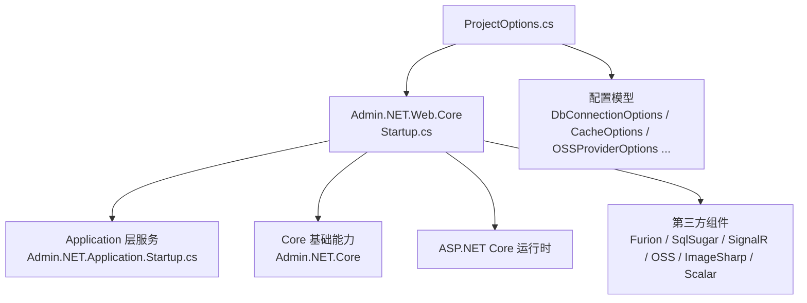
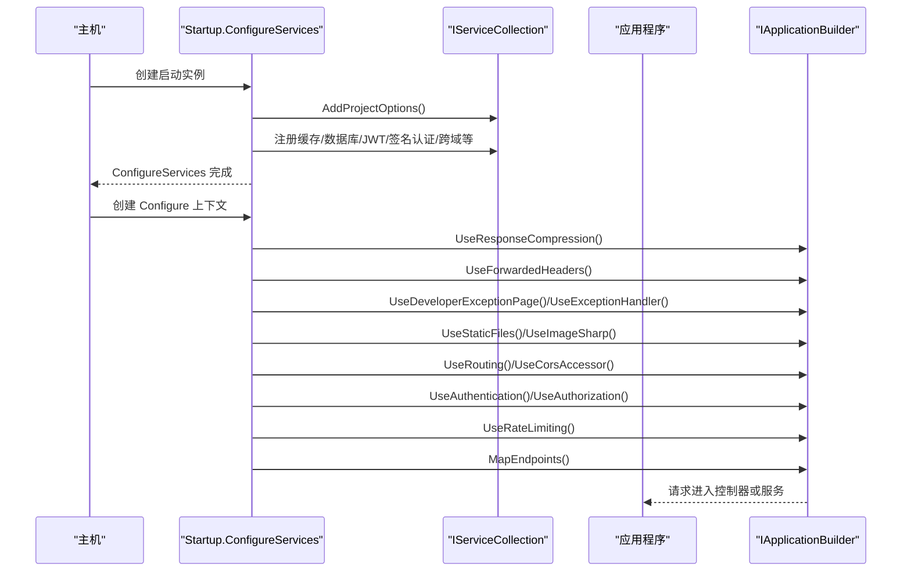
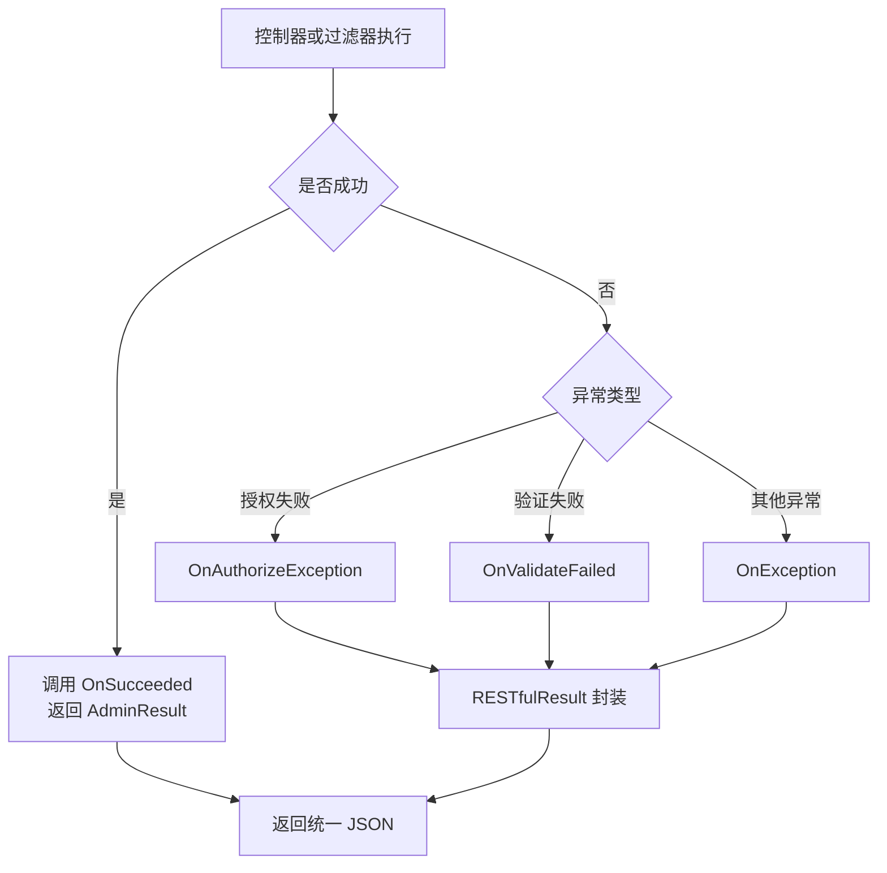
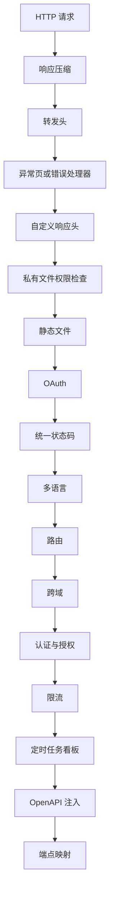
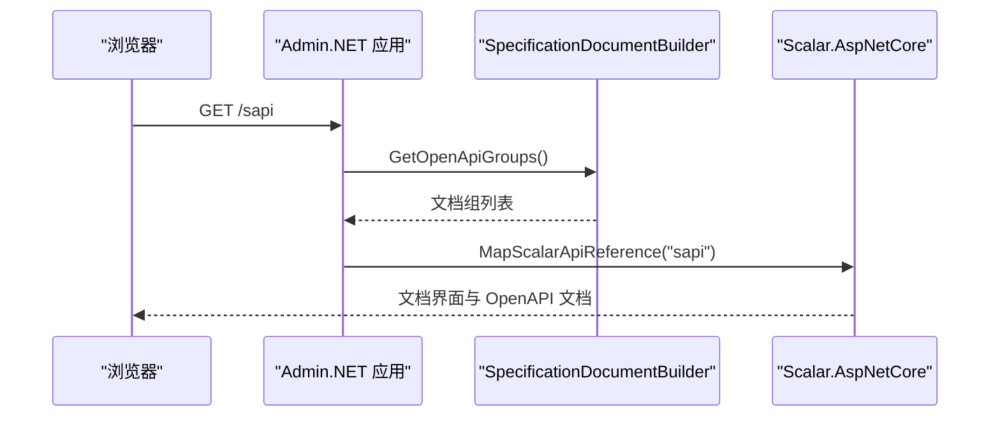

# Web 核心层 Admin.NET.Web.Core

<cite>
**本文引用的文件**   
- [Admin.NET.Web.Core/Startup.cs](file://Admin.NET/Admin.NET.Web.Core/Startup.cs)
- [Admin.NET.Web.Core/ProjectOptions.cs](file://Admin.NET/Admin.NET.Web.Core/ProjectOptions.cs)
- [Admin.NET.Core/Utils/AdminResultProvider.cs](file://Admin.NET/Admin.NET.Core/Utils/AdminResultProvider.cs)
- [Admin.NET.Core/SignatureAuth/SignatureAuthenticationHandler.cs](file://Admin.NET/Admin.NET.Core/SignatureAuth/SignatureAuthenticationHandler.cs)
- [Admin.NET.Core/Logging/LogExceptionHandler.cs](file://Admin.NET/Admin.NET.Core/Logging/LogExceptionHandler.cs)
- [Admin.NET.Admin.NET.Application/Startup.cs](file://Admin.NET/Admin.NET.Application/Startup.cs)
- [Admin.NET.Admin.NET.Application/Admin.NET.Application.csproj](file://Admin.NET/Admin.NET.Application/Admin.NET.Application.csproj)
- [Admin.NET.Admin.NET.Core/Admin.NET.Core.csproj](file://Admin.NET/Admin.NET.Core/Admin.NET.Core.csproj)
- [Admin.NET.Admin.NET.Web.Entry/Admin.NET.Web.Entry/Program.cs](file://Admin.NET/Admin.NET.Web.Entry/Admin.NET.Web.Entry/Program.cs)
</cite>

## 目录
1. [简介](#简介)
2. [项目定位与结构](#项目定位与结构)
3. [启动流程总览](#启动流程总览)
4. [配置机制：ProjectOptions](#配置机制projectoptions)
5. [请求处理与统一响应](#请求处理与统一响应)
6. [身份认证、授权与安全](#身份认证授权与安全)
7. [跨域、静态资源与中间件管道](#跨域静态资源与中间件管道)
8. [API 文档集成：Scalar.AspNetCore](#api-文档集成scalaraspnetcore)
9. [依赖关系分析](#依赖关系分析)
10. [性能与监控](#性能与监控)
11. [错误处理与调试技巧](#错误处理与调试技巧)
12. [前端集成与 CORS 最佳实践](#前端集成与-cors-最佳实践)
13. [自定义扩展示例](#自定义扩展示例)
14. [故障排查清单](#故障排查清单)
15. [结论](#结论)

## 简介
Admin.NET.Web.Core 是 Admin.NET 框架的 Web 基础设施层工程。它不承载具体业务逻辑，而是负责：
- 注册 Web 应用所需的基础服务，如缓存、数据库、认证、任务调度、日志、文件存储、SignalR 等；
- 配置 ASP.NET Core 中间件管道，包括异常页、转发头、压缩、静态文件、路由、鉴权、限流、国际化、文档与端点映射；
- 提供全局统一的 API 返回格式和状态码处理；
- 集成 Scalar.AspNetCore 作为 OpenAPI/Swagger 文档 UI；
- 通过 ProjectOptions 集中注入可配置选项，将应用配置与运行期服务解耦。

该层对 Application 层保持单向依赖：Web 核心层装配并启动 Application 层，而不是反过来。

## 项目定位与结构
Web 核心层主要包含两个关键文件：
- `Startup.cs`：定义 `AppStartup` 启动类，实现 `ConfigureServices` 和 `Configure`，完成服务注册与中间件管道配置；
- `ProjectOptions.cs`：集中注册各模块的配置选项，并通过 `IpRateLimiting`、`ClientRateLimiting` 等策略注入速率限制配置。

**图示来源**
- [Admin.NET.Web.Core/Startup.cs:1-442](file://Admin.NET/Admin.NET.Web.Core/Startup.cs#L1-L442)
- [Admin.NET.Web.Core/ProjectOptions.cs:1-51](file://Admin.NET/Admin.NET.Web.Core/ProjectOptions.cs#L1-L51)

**章节来源**
- [Admin.NET.Web.Core/Startup.cs:1-442](file://Admin.NET/Admin.NET.Web.Core/Startup.cs#L1-L442)
- [Admin.NET.Web.Core/ProjectOptions.cs:1-51](file://Admin.NET/Admin.NET.Web.Core/ProjectOptions.cs#L1-L51)

## 启动流程总览
`Startup` 使用 Furion 的 `[AppStartup]` 特性注册为高优先级启动类，并在 `ConfigureServices` 中按顺序完成以下工作：
1. 注册项目选项与缓存、数据库、JWT、签名认证、跨域、HTTP 远程调用、任务队列、定时任务、敏感词检测；
2. 注册控制器视图、统一结果提供者、JSON 序列化选项、OAuth、ElasticSearch、反向代理转发头、限流、事件总线、图像处理、对象存储、模板引擎、SignalR、日志、验证码、控制台 Logo、IP 地址库、响应压缩与虚拟文件系统；
3. 在 `Configure` 中启用响应压缩、转发头、开发异常页或生产异常页、自定义响应头、图片权限校验、ImageSharp、静态文件、OAuth、统一状态码、多语言、路由、跨域、认证、授权、限流、定时任务看板、OpenAPI 注入、Scalar 文档、SignalR Hub 与默认控制器路由。

**图示来源**
- [Admin.NET.Web.Core/Startup.cs:1-442](file://Admin.NET/Admin.NET.Web.Core/Startup.cs#L1-L442)

**章节来源**
- [Admin.NET.Web.Core/Startup.cs:1-442](file://Admin.NET/Admin.NET.Web.Core/Startup.cs#L1-L442)

## 配置机制：ProjectOptions
`ProjectOptions.AddProjectOptions` 是一个集中式配置注册扩展方法，职责如下：
- 使用 `AddConfigurableOptions<T>` 注册所有配置类型，使它们可通过 `App.GetConfig<T>()` 获取；
- 从配置文件读取 `IpRateLimiting`、`IpRateLimitPolicies`、`ClientRateLimiting`、`ClientRateLimitPolicies`，并分别注入到 `IpRateLimitOptions`、`IpRateLimitPolicies`、`ClientRateLimitOptions`、`ClientRateLimitPolicies`。

已注册的核心配置类型包括：
| 配置类型 | 用途 |
|---|---|
| `DbConnectionOptions` | 数据库连接信息 |
| `SnowIdOptions` | 雪花 ID 生成策略 |
| `CacheOptions` | 缓存后端及行为 |
| `ClusterOptions` | 集群标识与服务发现相关 |
| `OSSProviderOptions` | 对象存储提供商选择 |
| `UploadOptions` | 上传行为与路径规则 |
| `WechatOptions` | 微信相关配置 |
| `PayCallBackOptions` | 支付回调配置 |
| `CodeGenOptions` | 代码生成器配置 |
| `EnumOptions` | 枚举解析与序列化行为 |
| `APIJSONOptions` | APIJSON 支持配置 |
| `EmailOptions` | 邮件发送配置 |
| `OAuthOptions` | OAuth 登录配置 |
| `CryptogramOptions` | 加解密配置 |
| `SMSOptions` | 短信发送配置 |
| `EventBusOptions` | 事件总线行为 |
| `AlipayOptions` | 支付宝配置 |
| `CDConfigOptions` | CDN 相关配置 |
| `DeepSeekOptions` | DeepSeek 接入配置 |
| `LocalizationSettingsOptions` | 多语言设置 |
| `StressTestOptions` | 压测参数 |

这些配置通常位于应用配置文件中，例如 `appsettings.json` 及其环境变体。`Startup.cs` 中多处通过 `App.GetConfig<T>(section, true)` 读取配置，例如 OSS 提供商、缓存类型、Job 集群 ID 等。

**章节来源**
- [Admin.NET.Web.Core/ProjectOptions.cs:1-51](file://Admin.NET/Admin.NET.Web.Core/ProjectOptions.cs#L1-L51)
- [Admin.NET.Web.Core/Startup.cs:1-442](file://Admin.NET/Admin.NET.Web.Core/Startup.cs#L1-L442)

## 请求处理与统一响应
Web 核心层没有传统意义上的“Handlers”目录；请求处理由 ASP.NET Core 控制器、Action 以及 Furion 的统一结果机制共同完成。`Startup.cs` 中通过 `.AddInjectWithUnifyResult<AdminResultProvider>()` 将 `AdminResultProvider` 注册为全局统一结果提供者。

`AdminResultProvider` 的职责：
- 成功时返回 `AdminResult<object>`，包含状态码、类型、消息、数据、附加信息和时间；
- 授权失败时返回 401 对应的统一 JSON；
- 未处理异常时转换为统一 JSON；
- 验证失败时返回 400 或指定状态码的统一 JSON；
- 针对 401、403、302 等状态码进行特殊响应处理；
- 对 401 情况优先使用签名认证失败消息。

**图示来源**
- [Admin.NET.Web.Core/Startup.cs:1-442](file://Admin.NET/Admin.NET.Web.Core/Startup.cs#L1-L442)
- [Admin.NET.Core/Utils/AdminResultProvider.cs:1-193](file://Admin.NET/Admin.NET.Core/Utils/AdminResultProvider.cs#L1-L193)

**章节来源**
- [Admin.NET.Web.Core/Startup.cs:1-442](file://Admin.NET/Admin.NET.Web.Core/Startup.cs#L1-L442)
- [Admin.NET.Core/Utils/AdminResultProvider.cs:1-193](file://Admin.NET/Admin.NET.Core/Utils/AdminResultProvider.cs#L1-L193)

## 身份认证、授权与安全
### JWT 认证
`Startup` 通过 Furion 的 `AddJwt<JwtHandler>` 启用 JWT 认证，并开启全局授权控制。`OnMessageReceived` 事件中：
- 如果 URL 查询参数包含 `token`，则将其作为 JWT token；
- 如果请求路径以 `/hubs` 开头且查询参数包含 `access_token`，则将该值作为 token；这用于 SignalR 集线器的令牌传递。

### 签名认证
`AddSignatureAuthentication` 使用 `SysOpenAccessService.GetSignatureAuthenticationEventImpl()` 作为签名认证事件实现。签名认证常用于开放接口防篡改、防重放等场景。

### 安全建议
- 生产环境应关闭 URL 中的 `token` 明文传递方式；
- `/hubs` 的 `access_token` 应配合 HTTPS 和最小化暴露面；
- 结合 IP 限流、客户端限流、策略限流保护认证接口；
- 使用 `UseHsts`、`UseHttpsRedirection`（当前被注释）增强传输安全；
- 避免在生产环境启用详细错误页面。

**章节来源**
- [Admin.NET.Web.Core/Startup.cs:1-442](file://Admin.NET/Admin.NET.Web.Core/Startup.cs#L1-L442)
- [Admin.NET.Core/SignatureAuth/SignatureAuthenticationHandler.cs](file://Admin.NET/Admin.NET.Core/SignatureAuth/SignatureAuthenticationHandler.cs)

## 跨域、静态资源与中间件管道
### 中间件顺序
`Configure` 中中间件顺序非常关键：
1. `UseResponseCompression`：启用响应压缩；
2. `UseForwardedHeaders`：解析反向代理转发头；
3. 开发环境异常页，生产环境异常处理器与 HSTS；
4. 自定义响应头中间件；
5. 图片权限校验中间件；
6. `UseImageSharp`：图像处理；
7. `UseStaticFiles`：静态文件与虚拟路径；
8. `UseOAuth`：OAuth；
9. `UseUnifyResultStatusCodes`：统一状态码拦截；
10. `UseAppLocalization`：多语言；
11. `UseRouting`：路由；
12. `UseCorsAccessor`：跨域；
13. `UseAuthentication`、`UseAuthorization`：认证与授权；
14. 限流中间件；
15. 定时任务看板；
16. OpenAPI 注入；
17. 端点映射：Scalar、Hub、默认控制器路由。

### 跨域
`services.AddCorsAccessor()` 与 `app.UseCorsAccessor()` 分别完成跨域服务注册与启用。由于跨域必须在路由之前启用，且通常在认证之前，因此顺序必须保持。

### 静态文件与图片权限
- 静态文件通过 `FS.GetFileExtensionContentTypeProvider()` 获取 MIME 类型映射；
- 支持二级目录静态文件访问，路径由 `App.Settings.VirtualPath` 决定；
- 自定义图片权限中间件会检查以数字命名的文件，若对应文件记录存在且非公开，则返回 403。

**图示来源**
- [Admin.NET.Web.Core/Startup.cs:1-442](file://Admin.NET/Admin.NET.Web.Core/Startup.cs#L1-L442)

**章节来源**
- [Admin.NET.Web.Core/Startup.cs:1-442](file://Admin.NET/Admin.NET.Web.Core/Startup.cs#L1-L442)

## API 文档集成：Scalar.AspNetCore
Web 核心层同时支持 Furion 的 SpecificationDocument 与 Scalar.AspNetCore：
- `UseInject(string.Empty, options => ...)` 负责注入 OpenAPI 文档组，并为每个文档追加法律声明；
- `endpoints.MapScalarApiReference("sapi", options => ...)` 将 Scalar 文档界面挂载到 `/sapi`；
- 文档路由由 `SpecificationDocumentBuilder.GetOpenApiGroups()` 提供，支持多组文档；
- 是否启用由配置 `AppSettings:InjectSpecificationDocument` 控制。

**图示来源**
- [Admin.NET.Web.Core/Startup.cs:1-442](file://Admin.NET/Admin.NET.Web.Core/Startup.cs#L1-L442)

**章节来源**
- [Admin.NET.Web.Core/Startup.cs:1-442](file://Admin.NET/Admin.NET.Web.Core/Startup.cs#L1-L442)

## 依赖关系分析
### 工程依赖
- `Admin.NET.Web.Core` 依赖 `Admin.NET.Core` 与 `Admin.NET.Application`；
- `Admin.NET.Application` 依赖 `Admin.NET.Core`；
- `Admin.NET.Web.Entry` 是 Web 入口工程，通常引用 `Admin.NET.Web.Core` 和 `Admin.NET.Application`。

**图示来源**
- [Admin.NET.Admin.NET.Application/Admin.NET.Application.csproj](file://Admin.NET/Admin.NET.Application/Admin.NET.Application.csproj)
- [Admin.NET.Admin.NET.Core/Admin.NET.Core.csproj](file://Admin.NET/Admin.NET.Core/Admin.NET.Core.csproj)
- [Admin.NET.Admin.NET.Web.Entry/Admin.NET.Web.Entry/Program.cs](file://Admin.NET/Admin.NET.Web.Entry/Admin.NET.Web.Entry/Program.cs)

**章节来源**
- [Admin.NET.Admin.NET.Application/Admin.NET.Application.csproj](file://Admin.NET/Admin.NET.Application/Admin.NET.Application.csproj)
- [Admin.NET.Admin.NET.Core/Admin.NET.Core.csproj](file://Admin.NET/Admin.NET.Core/Admin.NET.Core.csproj)
- [Admin.NET.Admin.NET.Web.Entry/Admin.NET.Web.Entry/Program.cs](file://Admin.NET/Admin.NET.Web.Entry/Admin.NET.Web.Entry/Program.cs)

### 运行时依赖
`Startup.cs` 引入的关键运行时依赖包括：
- Furion：`AppStartup`、`AddInjectWithUnifyResult`、`AddAppLocalization`、`AddOAuth`、`AddSchedule`、`AddConsoleLogo`、`VirtualFileServer`、`SpecificationDocument`；
- Microsoft.AspNetCore：控制器、路由、认证、授权、转发头、响应压缩；
- SqlSugar：数据库访问；
- SignalR：实时通信；
- ImageSharp：图像处理；
- OnceMi.AspNetCore.OSS：对象存储；
- AspNetCoreRateLimit：IP 与客户端限流；
- SixLabors.ImageSharp.Web：图片缓存与处理；
- Scalar.AspNetCore：OpenAPI 文档 UI；
- IPTools：IP 地址库。

**章节来源**
- [Admin.NET.Web.Core/Startup.cs:1-442](file://Admin.NET/Admin.NET.Web.Core/Startup.cs#L1-L442)

## 性能与监控
### JSON 序列化优化
- 时间格式化统一为 `yyyy-MM-dd HH:mm:ss`；
- 忽略循环引用；
- 允许尾随逗号与跳过注释；
- 使用 `UnsafeRelaxedJsonEscaping` 处理中文乱码；
- 属性名大小写不敏感；
- 输出缩进便于调试；
- Long 类型超过 17 位转为字符串；
- 支持 `DateOnly`、`TimeOnly`、Clay、枚举、DataTable、DataSet。

### 响应压缩
启用 Brotli 与 Gzip，并将 HTML、XHTML、Atom、SVG 加入 MIME 类型。

### 图片处理
- ImageSharp 提供图片缩放、裁剪与缓存；
- 私有文件访问前进行权限校验，避免直接绕过认证。

### 事件总线监控
- 禁用事件日志以减少 I/O；
- 使用 `RetryEventHandlerExecutor` 重试失败事件；
- 使用 `EventHandlerMonitor` 监控每次事件处理；
- Redis 模式下替换事件源存储器；
- 保留 RabbitMQ 可扩展片段。

### 定时任务监控
- 作业持久化到数据库；
- 使用 `JobMonitor` 监控作业执行；
- 可选集群模式；
- 提供 `/schedule` 看板，支持登录验证与密钥配置。

**章节来源**
- [Admin.NET.Web.Core/Startup.cs:1-442](file://Admin.NET/Admin.NET.Web.Core/Startup.cs#L1-L442)

## 错误处理与调试技巧
### 错误处理
- 开发环境启用 `UseDeveloperExceptionPage`；
- 生产环境启用 `UseExceptionHandler("/Home/Error")`；
- `AdminResultProvider.OnException` 将异常转换为统一 JSON；
- `LogExceptionHandler` 在 Core 层提供日志异常处理扩展；
- 签名认证失败消息可通过 `SignatureAuthenticationDefaults.AuthenticateFailMsgKey` 写入上下文。

### 调试技巧
- 临时启用 JSON 缩进查看完整响应；
- 通过 `/sapi` 观察 OpenAPI 文档与路由；
- 使用 SignalR 调试集线器连接；
- 通过定时任务看板检查作业执行；
- 检查反向代理是否正确转发头；
- 确认静态文件路径与虚拟路径配置；
- 打开响应压缩后注意区分压缩前后响应大小。

**章节来源**
- [Admin.NET.Web.Core/Startup.cs:1-442](file://Admin.NET/Admin.NET.Web.Core/Startup.cs#L1-L442)
- [Admin.NET.Core/Utils/AdminResultProvider.cs:1-193](file://Admin.NET/Admin.NET.Core/Utils/AdminResultProvider.cs#L1-L193)
- [Admin.NET.Core/Logging/LogExceptionHandler.cs](file://Admin.NET/Admin.NET.Core/Logging/LogExceptionHandler.cs)

## 前端集成与 CORS 最佳实践
### CORS 配置
- 使用 `AddCorsAccessor()` 与 `UseCorsAccessor()` 管理跨域；
- 确保跨域中间件在路由之前启用；
- 生产环境只允许可信域名、方法和头部；
- 对于需要携带 Cookie 的前端，确保服务端允许凭据并正确配置 Cookie 属性。

### 静态资源与 API 前缀
- 静态文件通过 `wwwroot` 或虚拟路径提供；
- 二级目录由 `App.Settings.VirtualPath` 控制；
- API 文档路径 `/sapi` 应与前端文档工具保持一致；
- 控制器默认路由为 `{controller=Home}/{action=Index}/{id?}`。

### 认证与 Token
- 普通 API 建议使用标准 Authorization 头；
- 如需兼容旧接口，谨慎使用 URL 中的 `token`；
- SignalR 使用 `/hubs` 的 `access_token` 查询参数传递令牌；
- 前端应在认证失败时跳转到登录页或刷新凭证。

**章节来源**
- [Admin.NET.Web.Core/Startup.cs:1-442](file://Admin.NET/Admin.NET.Web.Core/Startup.cs#L1-L442)

## 自定义扩展示例
### 自定义中间件
可以在 `Startup.Configure` 中添加自定义中间件，例如：
- 请求耗时统计；
- 请求日志脱敏；
- 租户识别；
- 灰度发布判断；
- 自定义响应头。

注意事项：
- 中间件顺序影响功能生效；
- 异步处理使用 `await next()`；
- 异常需捕获并写入统一响应或日志；
- 不要阻塞长连接或大文件传输。

### 自定义统一结果
继承或扩展 `AdminResultProvider` 可实现：
- 新增状态码处理；
- 自定义成功响应字段；
- 对特定业务返回做额外包装；
- 集成审计上下文或追踪 ID。

### 自定义限流策略
通过 `ProjectOptions` 注入的 `IpRateLimitOptions`、`ClientRateLimitOptions` 等，可在配置文件中定义更细粒度的限流规则，并结合 `PolicyRateLimit` 进行业务维度限流。

### 自定义文档分组
利用 `SpecificationDocumentBuilder` 添加新的 OpenAPI 文档组，并在 Scalar 中注册对应文档路由。

**章节来源**
- [Admin.NET.Web.Core/Startup.cs:1-442](file://Admin.NET/Admin.NET.Web.Core/Startup.cs#L1-L442)
- [Admin.NET.Web.Core/ProjectOptions.cs:1-51](file://Admin.NET/Admin.NET.Web.Core/ProjectOptions.cs#L1-L51)
- [Admin.NET.Core/Utils/AdminResultProvider.cs:1-193](file://Admin.NET/Admin.NET.Core/Utils/AdminResultProvider.cs#L1-L193)

## 故障排查清单
| 现象 | 可能原因 | 排查建议 |
|---|---|---|
| 跨域失败 | 跨域中间件位置错误或未启用 | 确认 `UseCorsAccessor` 在 `UseRouting` 之前 |
| 401 未返回统一 JSON | 认证事件未设置消息或中间件顺序问题 | 检查签名认证事件与 `AdminResultProvider` |
| 图片访问被拒绝 | 文件为非公开 | 检查文件记录的公开标记 |
| 文档不可见 | 配置关闭或未映射 | 检查 `AppSettings:InjectSpecificationDocument` 与 `/sapi` |
| 响应过大 | 未启用压缩或 MIME 类型缺失 | 检查响应压缩配置 |
| SignalR 连接失败 | 未启用 Hub 或 Token 传递不正确 | 检查 `/hubs` 与 `access_token` |
| 定时任务未执行 | 集群 ID 未配置或持久化失败 | 检查 Job 配置与数据库持久化 |
| 中文乱码 | JSON 编码器未调整 | 检查 `UnsafeRelaxedJsonEscaping` |

**章节来源**
- [Admin.NET.Web.Core/Startup.cs:1-442](file://Admin.NET/Admin.NET.Web.Core/Startup.cs#L1-L442)
- [Admin.NET.Core/Utils/AdminResultProvider.cs:1-193](file://Admin.NET/Admin.NET.Core/Utils/AdminResultProvider.cs#L1-L193)

## 结论
Admin.NET.Web.Core 作为 Web 基础设施层，承担了 Admin.NET 应用启动、服务装配、中间件编排、统一响应、文档集成与安全配置等核心职责。它通过 `Startup.cs` 明确表达 Web 应用的生命周期，通过 `ProjectOptions.cs` 将配置与运行期服务解耦，并通过 `AdminResultProvider` 保证 API 返回一致性。

在实际项目中，应：
- 优先修改 `Startup.cs` 中的中间件顺序与服务注册；
- 通过配置文件管理 `ProjectOptions` 注册的所有选项；
- 谨慎启用 URL Token 与 `/hubs` 明文令牌；
- 使用 Scalar 文档验证 API 契约；
- 在生产环境关闭调试信息并启用安全与限流；
- 基于现有模式扩展中间件、结果提供者与限流策略。