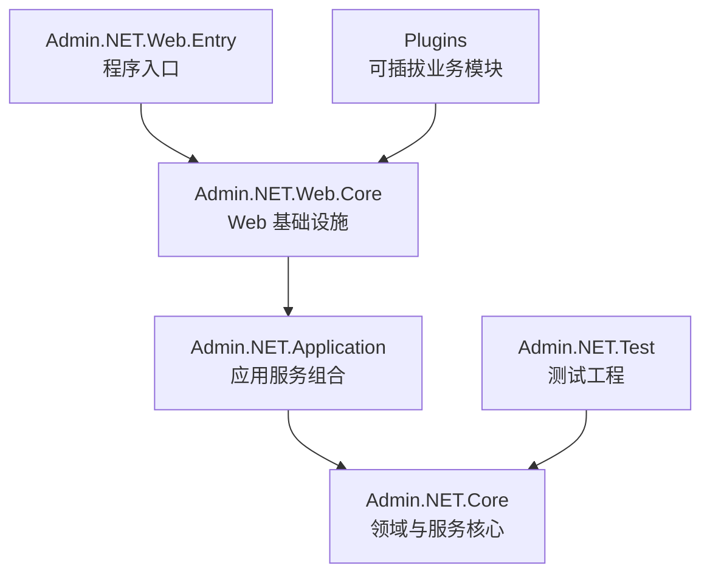
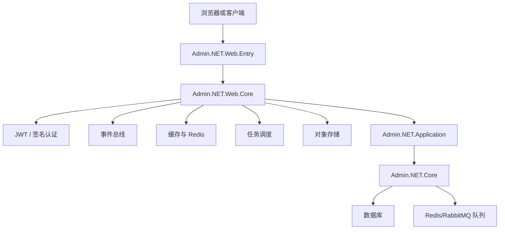
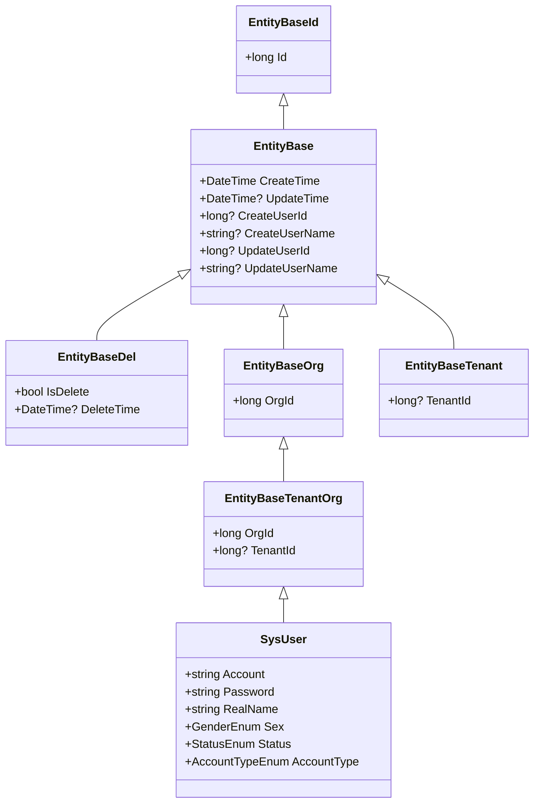
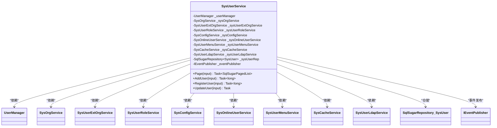
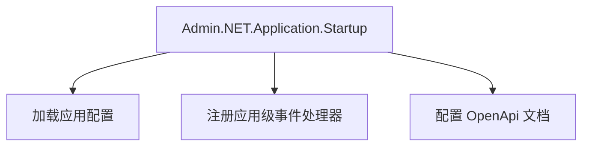
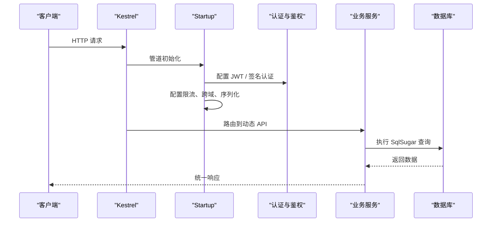
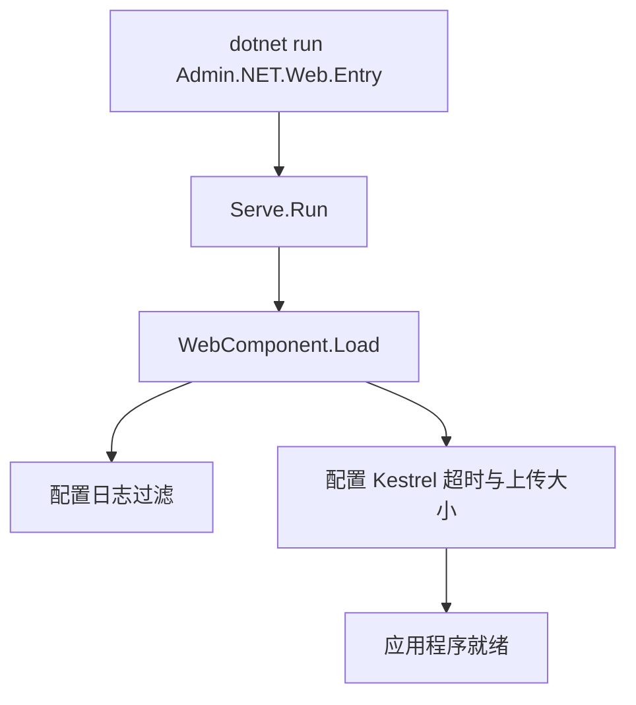
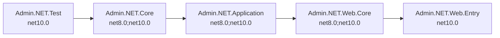
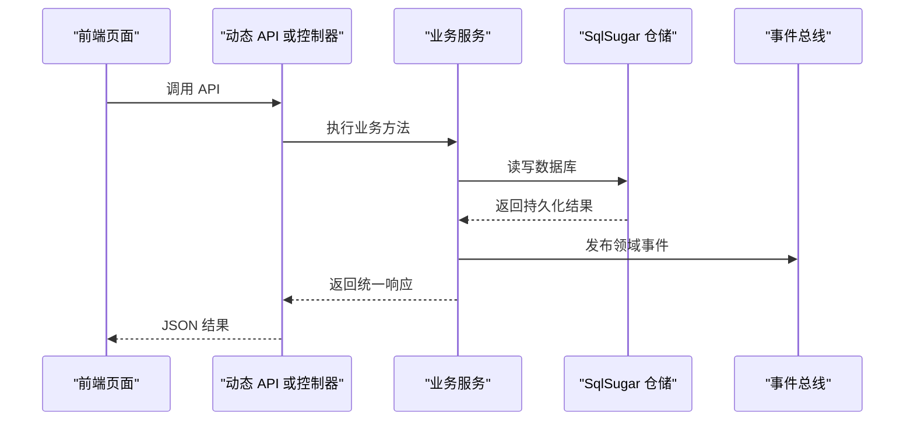

# 后端开发

<cite>
**本文引用的文件**   
- [README.md](file://README.md)
- [Admin.NET/global.json](file://Admin.NET/global.json)
- [Admin.NET/Admin.NET.sln](file://Admin.NET/Admin.NET.sln)
- [Admin.NET/Admin.NET.Core/Admin.NET.Core.csproj](file://Admin.NET/Admin.NET.Core/Admin.NET.Core.csproj)
- [Admin.NET/Admin.NET.Application/Admin.NET.Application.csproj](file://Admin.NET/Admin.NET.Application/Admin.NET.Application.csproj)
- [Admin.NET/Admin.NET.Web.Core/Admin.NET.Web.Core.csproj](file://Admin.NET/Admin.NET.Web.Core/Admin.NET.Web.Core.csproj)
- [Admin.NET/Admin.NET.Web.Entry/Admin.NET.Web.Entry.csproj](file://Admin.NET/Admin.NET.Web.Entry/Admin.NET.Web.Entry.csproj)
- [Admin.NET/Admin.NET.Test/Admin.NET.Test.csproj](file://Admin.NET/Admin.NET.Test/Admin.NET.Test.csproj)
- [Admin.NET/Admin.NET.Web.Entry/Program.cs](file://Admin.NET/Admin.NET.Web.Entry/Program.cs)
- [Admin.NET/Admin.NET.Web.Core/Startup.cs](file://Admin.NET/Admin.NET.Web.Core/Startup.cs)
- [Admin.NET/Admin.NET.Application/Startup.cs](file://Admin.NET/Admin.NET.Application/Startup.cs)
- [Admin.NET/Admin.NET.Core/Entity/EntityBase.cs](file://Admin.NET/Admin.NET.Core/Entity/EntityBase.cs)
- [Admin.NET/Admin.NET.Core/Entity/SysUser.cs](file://Admin.NET/Admin.NET.Core/Entity/SysUser.cs)
- [Admin.NET/Admin.NET.Core/Service/User/SysUserService.cs](file://Admin.NET/Admin.NET.Core/Service/User/SysUserService.cs)
- [Admin.NET/Admin.NET.Core/Enum/StatusEnum.cs](file://Admin.NET/Admin.NET.Core/Enum/StatusEnum.cs)
- [Admin.NET/Admin.NET.Core/Enum/MenuTypeEnum.cs](file://Admin.NET/Admin.NET.Core/Enum/MenuTypeEnum.cs)
- [Admin.NET/Admin.NET.Core/Utils/CommonHelper.cs](file://Admin.NET/Admin.NET.Core/Utils/CommonHelper.cs)
- [Admin.NET/Admin.NET.Web.Entry/Controllers/HomeController.cs](file://Admin.NET/Admin.NET.Web.Entry/Controllers/HomeController.cs)
</cite>

## 目录
1. [简介](#简介)
2. [项目结构](#项目结构)
3. [核心组件](#核心组件)
4. [架构总览](#架构总览)
5. [详细组件分析](#详细组件分析)
6. [依赖关系分析](#依赖关系分析)
7. [性能与运行特性](#性能与运行特性)
8. [新功能开发标准流程](#新功能开发标准流程)
9. [依赖注入、事务、异常与日志最佳实践](#依赖注入事务异常与日志最佳实践)
10. [插件扩展机制](#插件扩展机制)
11. [故障排查指南](#故障排查指南)
12. [结论](#结论)

## 简介
Admin.NET 是基于 ASP.NET Core、Furion 和 SqlSugar 的通用权限开发框架，支持多租户、权限管理、任务调度、消息通知、文件管理、代码生成等能力。当前仓库已完成前端移植，业务前端入口为 `Web/apps/web-antdv-next/`；后端共享工程按项目配置同时支持 .NET 8 与 .NET 10，API 入口工程和测试工程使用 .NET 10。数据库集成验收以真实 PostgreSQL 为准，不应用 SQLite 或 Mock 结果声称联调通过。

本指南面向后端开发者，覆盖从领域实体、服务层、控制器到 Web 基础设施、启动流程和插件扩展的完整开发流程，并说明如何正确划分 .csproj 目标框架、如何使用事件总线、依赖注入、事务、异常处理和日志。

**章节来源**
- [README.md:1-40](file://README.md#L1-L40)

## 项目结构
解决方案包含以下关键工程：
- `Admin.NET.Core`：领域实体、枚举、工具类、基础服务、SqlSugar 封装、缓存、日志、作业、签名认证、扩展方法等核心能力。
- `Admin.NET.Application`：应用服务组合、配置项、业务配置、事件总线扩展点及 OpenApi 相关设置。
- `Admin.NET.Web.Core`：Web 基础设施、中间件、过滤器、认证、限流、序列化、缓存、事件总线运行时配置。
- `Admin.NET.Web.Entry`：程序入口、Kestrel 配置、Windows 服务集成、日志过滤、静态资源与发布配置。
- `Admin.NET.Test`：基于 xUnit v3 和 Microsoft Testing Platform 的后端测试工程。
- `Plugins`：可插拔的业务模块，例如 ReZero、K3Cloud、WorkWeixin。

**图示来源**
- [Admin.NET/Admin.NET.sln:1-78](file://Admin.NET/Admin.NET.sln#L1-L78)

**章节来源**
- [Admin.NET/Admin.NET.sln:1-78](file://Admin.NET/Admin.NET.sln#L1-L78)
- [README.md:24-40](file://README.md#L24-L40)

## 核心组件
- 领域实体体系以 `EntityBaseId`、`EntityBase`、`EntityBaseDel`、`EntityBaseOrg`、`EntityBaseTenant` 等基类为基础，统一主键、审计字段、软删除、机构数据权限和租户隔离。
- 业务服务集中在 `Admin.NET.Core/Service`，采用 Furion 动态 API 控制器模式，并通过 `IDynamicApiController`、`UnitOfWork`、`ApiDescriptionSettings` 暴露接口。
- 工具类和枚举集中在 `Admin.NET.Core/Utils` 与 `Admin.NET.Core/Enum`，提供通用操作、加密、版本转换、Excel 导出、路径树构建、校验以及系统状态、菜单类型等业务枚举。
- Web 基础设施在 `Admin.NET.Web.Core/Startup.cs` 中完成认证、跨域、序列化、限流、事件总线、ElasticSearch、远程调用、任务调度、OSS 图片处理等注册。
- 程序入口在 `Admin.NET.Web.Entry/Program.cs`，负责 Windows 服务集成、控制台运行时的 Windows 事件日志禁用、日志过滤、Kestrel 超时与请求体大小限制。

**章节来源**
- [Admin.NET/Admin.NET.Core/Entity/EntityBase.cs:1-200](file://Admin.NET/Admin.NET.Core/Entity/EntityBase.cs#L1-L200)
- [Admin.NET/Admin.NET.Core/Service/User/SysUserService.cs:1-200](file://Admin.NET/Admin.NET.Core/Service/User/SysUserService.cs#L1-L200)
- [Admin.NET/Admin.NET.Core/Enum/StatusEnum.cs:1-26](file://Admin.NET/Admin.NET.Core/Enum/StatusEnum.cs#L1-L26)
- [Admin.NET/Admin.NET.Core/Enum/MenuTypeEnum.cs:1-33](file://Admin.NET/Admin.NET.Core/Enum/MenuTypeEnum.cs#L1-L33)
- [Admin.NET/Admin.NET.Core/Utils/CommonHelper.cs:1-200](file://Admin.NET/Admin.NET.Core/Utils/CommonHelper.cs#L1-L200)
- [Admin.NET/Admin.NET.Web.Core/Startup.cs:1-200](file://Admin.NET/Admin.NET.Web.Core/Startup.cs#L1-L200)
- [Admin.NET/Admin.NET.Web.Entry/Program.cs:1-38](file://Admin.NET/Admin.NET.Web.Entry/Program.cs#L1-L38)

## 架构总览
Admin.NET 采用前后端分离与模块化设计：
- 入口工程 `Admin.NET.Web.Entry` 仅负责宿主进程、运行环境、日志和 Kestrel 配置。
- `Admin.NET.Web.Core` 负责 Web 层的横切能力，包括认证、鉴权、限流、事件总线、序列化、缓存、OSS、SignalR、ES 日志等。
- `Admin.NET.Application` 是应用编排层，承载业务配置、OpenApi 配置和应用级启动逻辑。
- `Admin.NET.Core` 是领域与基础设施层，包含实体、服务、枚举、工具、缓存、作业、事件总线实现、签名认证、SqlSugar 封装等。
- 插件位于 `Plugins`，按需引用到 Web 层，避免污染核心工程。

**图示来源**
- [Admin.NET/Admin.NET.Web.Core/Startup.cs:1-200](file://Admin.NET/Admin.NET.Web.Core/Startup.cs#L1-L200)
- [Admin.NET/Admin.NET.Web.Entry/Program.cs:1-38](file://Admin.NET/Admin.NET.Web.Entry/Program.cs#L1-L38)

## 详细组件分析

### Admin.NET.Core：领域实体、服务、工具与枚举
#### 领域实体设计
实体继承自统一的基类族：
- `EntityBaseId`：雪花 Id 主键。
- `EntityBase`：创建时间、更新时间、创建者、修改者等审计字段。
- `EntityBaseDel`：软删除标志与删除时间。
- `EntityBaseOrg`：机构 Id，用于组织数据权限。
- `EntityBaseTenant`、`EntityBaseTenantOrg`：租户隔离与租户+机构组合。

示例实体 `SysUser` 继承 `EntityBaseTenantOrg`，并使用 SqlSugar 注解描述表结构、索引、列描述和验证规则。

**图示来源**
- [Admin.NET/Admin.NET.Core/Entity/EntityBase.cs:1-200](file://Admin.NET/Admin.NET.Core/Entity/EntityBase.cs#L1-L200)
- [Admin.NET/Admin.NET.Core/Entity/SysUser.cs:1-200](file://Admin.NET/Admin.NET.Core/Entity/SysUser.cs#L1-L200)

#### 业务服务架构
`SysUserService` 是典型的服务示例：
- 通过构造函数注入 `UserManager`、各类子服务、`SqlSugarRepository<SysUser>` 和 `IEventPublisher`。
- 使用 `[ApiDescriptionSettings]` 暴露动态 API。
- 使用 `[UnitOfWork]` 标记事务边界。
- 使用 `Oops.Oh(ErrorCodeEnum.*)` 抛出统一业务异常。
- 通过 `_eventPublisher.PublishAsync` 发布用户新增、注册等操作事件。

**图示来源**
- [Admin.NET/Admin.NET.Core/Service/User/SysUserService.cs:1-200](file://Admin.NET/Admin.NET.Core/Service/User/SysUserService.cs#L1-L200)

#### 工具类与枚举
- `CommonHelper` 提供哈希计算、版本号转长整型、百分比计算、本地地址获取、XML 序列化、Excel 模板导出等通用方法。
- `StatusEnum` 表示启用、停用等通用状态。
- `MenuTypeEnum` 表示目录、菜单、按钮三类菜单类型。

这些类型被服务层和 UI 层共同复用，确保行为一致。

**章节来源**
- [Admin.NET/Admin.NET.Core/Utils/CommonHelper.cs:1-200](file://Admin.NET/Admin.NET.Core/Utils/CommonHelper.cs#L1-L200)
- [Admin.NET/Admin.NET.Core/Enum/StatusEnum.cs:1-26](file://Admin.NET/Admin.NET.Core/Enum/StatusEnum.cs#L1-L26)
- [Admin.NET/Admin.NET.Core/Enum/MenuTypeEnum.cs:1-33](file://Admin.NET/Admin.NET.Core/Enum/MenuTypeEnum.cs#L1-L33)

### Admin.NET.Application：应用服务组合、配置与事件总线扩展点
- 该工程的目标框架为 `net8.0;net10.0`，引用 `Admin.NET.Core`。
- 其 `Startup` 类使用 `[AppStartup(100)]`，作为应用层启动器，目前为空实现，便于后续集中放置应用级配置、OpenApi 文档、业务配置加载和事件处理器注册。
- 工程内包含 `Configuration`、`EventBus`、`OpenApi` 等目录，适合存放应用级选项、事件订阅和接口文档增强。

**图示来源**
- [Admin.NET/Admin.NET.Application/Startup.cs:1-22](file://Admin.NET/Admin.NET.Application/Startup.cs#L1-L22)
- [Admin.NET/Admin.NET.Application/Admin.NET.Application.csproj:1-32](file://Admin.NET/Admin.NET.Application/Admin.NET.Application.csproj#L1-L32)

**章节来源**
- [Admin.NET/Admin.NET.Application/Startup.cs:1-22](file://Admin.NET/Admin.NET.Application/Startup.cs#L1-L22)
- [Admin.NET/Admin.NET.Application/Admin.NET.Application.csproj:1-32](file://Admin.NET/Admin.NET.Application/Admin.NET.Application.csproj#L1-L32)

### Admin.NET.Web.Core：Web 基础设施、中间件与过滤器
`Startup` 是 Web 层的核心装配点，主要职责包括：
- 注册项目选项、缓存、SqlSugar。
- 配置 JWT 认证、签名认证、跨域、远程请求、任务队列、任务调度、敏感词检测。
- 配置控制器、JSON 序列化、OAuth、ElasticSearch、转发头、限流、事件总线。
- 根据 `CacheOptions.CacheType` 将事件总线存储替换为 Redis 通道。
- 保留 RabbitMQ 事件源的可替换实现注释，便于后续接入。

**图示来源**
- [Admin.NET/Admin.NET.Web.Core/Startup.cs:1-200](file://Admin.NET/Admin.NET.Web.Core/Startup.cs#L1-L200)

**章节来源**
- [Admin.NET/Admin.NET.Web.Core/Startup.cs:1-200](file://Admin.NET/Admin.NET.Web.Core/Startup.cs#L1-L200)

### Admin.NET.Web.Entry：程序启动流程与运行时配置
`Program.cs` 使用 Furion 的 `Serve.Run` 启动应用，并通过自定义 `WebComponent` 完成：
- 控制台运行下禁用 Windows 事件日志提供者，避免权限问题。
- 全局日志过滤，忽略 `Microsoft.Hosting` 和 `Microsoft.AspNetCore` 前缀，只记录 Information 及以上级别。
- Kestrel 配置：KeepAlive 超时、请求头超时设置为 30 分钟，允许无限请求体大小。

**图示来源**
- [Admin.NET/Admin.NET.Web.Entry/Program.cs:1-38](file://Admin.NET/Admin.NET.Web.Entry/Program.cs#L1-L38)

**章节来源**
- [Admin.NET/Admin.NET.Web.Entry/Program.cs:1-38](file://Admin.NET/Admin.NET.Web.Entry/Program.cs#L1-L38)

## 依赖关系分析
各工程目标框架如下：
- `Admin.NET.Core`：`net8.0;net10.0`。
- `Admin.NET.Application`：`net8.0;net10.0`。
- `Admin.NET.Web.Core`：`net8.0;net10.0`。
- `Admin.NET.Web.Entry`：`net10.0`。
- `Admin.NET.Test`：`net10.0`。
- `global.json` 仅声明测试运行器为 `Microsoft.Testing.Platform`，不能据此声称固定 .NET SDK 版本。

**图示来源**
- [Admin.NET/Admin.NET.Core/Admin.NET.Core.csproj:1-70](file://Admin.NET/Admin.NET.Core/Admin.NET.Core.csproj#L1-L70)
- [Admin.NET/Admin.NET.Application/Admin.NET.Application.csproj:1-32](file://Admin.NET/Admin.NET.Application/Admin.NET.Application.csproj#L1-L32)
- [Admin.NET/Admin.NET.Web.Core/Admin.NET.Web.Core.csproj:1-21](file://Admin.NET/Admin.NET.Web.Core/Admin.NET.Web.Core.csproj#L1-L21)
- [Admin.NET/Admin.NET.Web.Entry/Admin.NET.Web.Entry.csproj:1-71](file://Admin.NET/Admin.NET.Web.Entry/Admin.NET.Web.Entry.csproj#L1-L71)
- [Admin.NET/Admin.NET.Test/Admin.NET.Test.csproj:1-28](file://Admin.NET/Admin.NET.Test/Admin.NET.Test.csproj#L1-L28)
- [Admin.NET/global.json:1-5](file://Admin.NET/global.json#L1-L5)

**章节来源**
- [Admin.NET/Admin.NET.Core/Admin.NET.Core.csproj:1-70](file://Admin.NET/Admin.NET.Core/Admin.NET.Core.csproj#L1-L70)
- [Admin.NET/Admin.NET.Application/Admin.NET.Application.csproj:1-32](file://Admin.NET/Admin.NET.Application/Admin.NET.Application.csproj#L1-L32)
- [Admin.NET/Admin.NET.Web.Core/Admin.NET.Web.Core.csproj:1-21](file://Admin.NET/Admin.NET.Web.Core/Admin.NET.Web.Core.csproj#L1-L21)
- [Admin.NET/Admin.NET.Web.Entry/Admin.NET.Web.Entry.csproj:1-71](file://Admin.NET/Admin.NET.Web.Entry/Admin.NET.Web.Entry.csproj#L1-L71)
- [Admin.NET/Admin.NET.Test/Admin.NET.Test.csproj:1-28](file://Admin.NET/Admin.NET.Test/Admin.NET.Test.csproj#L1-L28)
- [Admin.NET/global.json:1-5](file://Admin.NET/global.json#L1-L5)

## 性能与运行特性
- Kestrel 保持连接和请求头超时均为 30 分钟，请求体大小无上限，适合大文件上传场景，但生产环境应结合网关或反向代理做合理限制。
- JSON 序列化开启缩进、循环引用忽略、长整型安全转换、日期时间转换器、枚举转换器，有利于调试和前端兼容。
- 事件总线默认关闭事件日志，但注册了重试执行器和未观察异常处理器，可通过 Redis 或 RabbitMQ 替换存储实现。
- 限流使用内存模式，适合单机开发和小规模部署；集群部署需配合分布式限流方案。

**章节来源**
- [Admin.NET/Admin.NET.Web.Entry/Program.cs:1-38](file://Admin.NET/Admin.NET.Web.Entry/Program.cs#L1-L38)
- [Admin.NET/Admin.NET.Web.Core/Startup.cs:1-200](file://Admin.NET/Admin.NET.Web.Core/Startup.cs#L1-L200)

## 新功能开发标准流程
### 第一步：定义领域实体
- 在 `Admin.NET.Core/Entity` 中新建实体，继承合适的基类：
  - 需要租户隔离：继承 `EntityBaseTenant` 或 `EntityBaseTenantOrg`。
  - 需要软删除：继承 `EntityBaseDel` 或 `EntityBaseTenantOrgDel`。
  - 需要机构数据权限：继承 `EntityBaseOrg` 或其派生类。
- 使用 SqlSugar 注解描述表名、列名、长度、索引和列描述。
- 使用业务枚举表达状态、类型等离散值，避免魔法数字。

**章节来源**
- [Admin.NET/Admin.NET.Core/Entity/EntityBase.cs:1-200](file://Admin.NET/Admin.NET.Core/Entity/EntityBase.cs#L1-L200)
- [Admin.NET/Admin.NET.Core/Entity/SysUser.cs:1-200](file://Admin.NET/Admin.NET.Core/Entity/SysUser.cs#L1-L200)
- [Admin.NET/Admin.NET.Core/Enum/StatusEnum.cs:1-26](file://Admin.NET/Admin.NET.Core/Enum/StatusEnum.cs#L1-L26)

### 第二步：编写业务服务
- 在 `Admin.NET.Core/Service` 下新建服务类，实现 `IDynamicApiController`。
- 通过构造函数注入所需服务、仓储和事件发布器。
- 对写操作方法添加 `[UnitOfWork]`，保证多个仓储操作在同一事务中提交。
- 使用 `Oops.Oh(ErrorCodeEnum.*)` 抛出统一业务异常。
- 对成功变更操作使用 `IEventPublisher.PublishAsync` 发布领域事件，供其他模块异步处理。

**章节来源**
- [Admin.NET/Admin.NET.Core/Service/User/SysUserService.cs:1-200](file://Admin.NET/Admin.NET.Core/Service/User/SysUserService.cs#L1-L200)

### 第三步：暴露 Controller 与 API 文档
- 动态 API 控制器由 Furion 自动发现，无需传统 MVC Controller。
- 如需传统 Controller，可在 `Admin.NET.Web.Entry/Controllers` 下新增，并在其中调用服务层。
- API 文档通过 Swagger/OpenApi 生成，服务方法可使用 `[DisplayName]`、`[ApiDescriptionSettings]`、`[HttpPost]` 等控制文档表现。

**图示来源**
- [Admin.NET/Admin.NET.Web.Entry/Controllers/HomeController.cs:1-29](file://Admin.NET/Admin.NET.Web.Entry/Controllers/HomeController.cs#L1-L29)
- [Admin.NET/Admin.NET.Core/Service/User/SysUserService.cs:1-200](file://Admin.NET/Admin.NET.Core/Service/User/SysUserService.cs#L1-L200)

**章节来源**
- [Admin.NET/Admin.NET.Web.Entry/Controllers/HomeController.cs:1-29](file://Admin.NET/Admin.NET.Web.Entry/Controllers/HomeController.cs#L1-L29)

### 第四步：配置应用级行为
- 若新增配置项，放入 `Admin.NET.Application/Configuration`，并在 `Startup` 中加载。
- 若新增事件处理器，放入 `Admin.NET.Application/EventBus`，并在应用启动时订阅。
- 若调整 OpenApi 行为，放在 `Admin.NET.Application/OpenApi` 或通过 `Startup` 扩展。

**章节来源**
- [Admin.NET/Admin.NET.Application/Startup.cs:1-22](file://Admin.NET/Admin.NET.Application/Startup.cs#L1-L22)

## 依赖注入、事务、异常与日志最佳实践
### 依赖注入
- 服务类通过构造函数注入依赖，遵循单一职责原则。
- 仓储通过 `SqlSugarRepository<T>` 注入，避免重复构造数据库上下文。
- 事件发布通过 `IEventPublisher` 解耦业务流程与副作用。

### 事务处理
- 对涉及多个仓储写入的方法添加 `[UnitOfWork]`，由框架统一管理事务生命周期。
- 不要在事务方法内部再手动开启事务，避免嵌套事务导致异常。

### 异常处理
- 业务校验失败使用 `Oops.Oh(ErrorCodeEnum.*)` 抛出，配合 `AdminResultProvider` 输出统一错误结构。
- 对外部系统调用失败应在服务层捕获并转换为业务异常，避免泄露底层细节。

### 日志记录
- 入口层已过滤 Microsoft 框架日志，只记录 Information 及以上级别。
- 事件总线未启用事件日志，但保留了未观察异常处理器，便于定位异步事件中的异常。
- 不建议在服务中直接依赖具体日志实现，而是通过框架日志抽象或事件机制传递上下文。

**章节来源**
- [Admin.NET/Admin.NET.Web.Entry/Program.cs:1-38](file://Admin.NET/Admin.NET.Web.Entry/Program.cs#L1-L38)
- [Admin.NET/Admin.NET.Web.Core/Startup.cs:1-200](file://Admin.NET/Admin.NET.Web.Core/Startup.cs#L1-L200)
- [Admin.NET/Admin.NET.Core/Service/User/SysUserService.cs:1-200](file://Admin.NET/Admin.NET.Core/Service/User/SysUserService.cs#L1-L200)

## 插件扩展机制
插件位于 `Plugins` 目录，解决方案中包含：
- `Admin.NET.Plugin.ReZero`
- `Admin.NET.Plugin.K3Cloud`
- `Admin.NET.Plugin.WorkWeixin`

插件工程通常依赖 `Admin.NET.Core` 或 `Admin.NET.Web.Core`，并通过 Web 层启动流程启用。插件适用于：
- 对接第三方系统，如钉钉、企业微信、金蝶云星空、ReZero 等。
- 扩展文件存储、消息通道、报表引擎、授权提供方等能力。
- 在不侵入核心代码的前提下增加独立业务域。

开发插件时建议：
- 明确插件边界，避免引入与核心无关的重依赖。
- 通过配置开关控制插件是否启用。
- 将插件特有的实体和服务放在插件工程内，必要时通过事件总线与核心系统交互。
- 在 `Admin.NET.Web.Core` 或 `Admin.NET.Application` 中注册插件启动逻辑。

**章节来源**
- [Admin.NET/Admin.NET.sln:1-78](file://Admin.NET/Admin.NET.sln#L1-L78)

## 故障排查指南
- 控制台运行时报 Windows 事件日志写入异常：入口程序已在非 Windows 服务模式时禁用 `EventLogLoggerProvider`，可检查是否误启用了事件日志提供者。
- 接口超时报错：确认 Kestrel 的 KeepAlive 和 RequestHeadersTimeout 是否为期望值，并检查上游网关是否提前断开连接。
- 请求体过大导致失败：入口已取消最大请求体大小限制，需结合 Nginx 或反向代理配置实际上传大小。
- 事件处理失败：查看事件总线未观察异常处理器输出，确认 Redis 或 RabbitMQ 事件源配置是否正确。
- 前端联调不通：确认 PostgreSQL 为真实数据库，且 `appsettings.json` 中数据库连接正确；前端代理地址与后端 API 地址需匹配。

**章节来源**
- [Admin.NET/Admin.NET.Web.Entry/Program.cs:1-38](file://Admin.NET/Admin.NET.Web.Entry/Program.cs#L1-L38)
- [Admin.NET/Admin.NET.Web.Core/Startup.cs:1-200](file://Admin.NET/Admin.NET.Web.Core/Startup.cs#L1-L200)
- [README.md:24-40](file://README.md#L24-L40)

## 结论
Admin.NET 的后端工程按职责清晰分层：核心层提供领域模型、服务和通用能力，应用层编排配置与事件，Web 层装配基础设施，入口层专注宿主运行环境。开发者应遵循“实体在 Core、服务在 Core、控制器动态暴露、配置在 Application、Web 基础设施在 Web.Core、运行入口在 Web.Entry”的原则，并结合依赖注入、事务、统一异常和事件总线进行稳健开发。插件机制则用于扩展第三方集成与独立业务域，避免核心工程膨胀。