# 应用层 Admin.NET.Application

<cite>
**本文引用的文件**   
- [Admin.NET.Application.csproj](file://Admin.NET/Admin.NET.Application/Admin.NET.Application.csproj)
- [Startup.cs](file://Admin.NET/Admin.NET.Application/Startup.cs)
- [GlobalUsings.cs](file://Admin.NET/Admin.NET.Application/GlobalUsings.cs)
- [ApplicationConst.cs](file://Admin.NET/Admin.NET.Application/Const/ApplicationConst.cs)
- [DemoOpenApi.cs](file://Admin.NET/Admin.NET.Application/OpenApi/DemoOpenApi.cs)
- [SysUserEventSubscriber.cs](file://Admin.NET/Admin.NET.Application/EventBus/SysUserEventSubscriber.cs)
- [Cache.json](file://Admin.NET/Admin.NET.Application/Configuration/Cache.json)
- [CDConfig.json](file://Admin.NET/Admin.NET.Application/Configuration/CDConfig.json)
- [CDConfig.example](file://Admin.NET/Admin.NET.Application/Configuration/CDConfig.example)
- [global.json](file://Admin.NET/global.json)
- [AppEventSubscriber.cs](file://Admin.NET/Admin.NET.Core/EventBus/AppEventSubscriber.cs)
- [RetryEventHandlerExecutor.cs](file://Admin.NET/Admin.NET.Core/EventBus/RetryEventHandlerExecutor.cs)
- [EventBusOptions.cs](file://Admin.NET/Admin.NET.Core/Option/EventBusOptions.cs)
- [SysUserService.cs](file://Admin.NET/Admin.NET.Core/Service/User/SysUserService.cs)
</cite>

## 目录

1. [简介](#简介)
2. [项目结构](#项目结构)
3. [目标框架与依赖关系](#目标框架与依赖关系)
4. [服务启动与组合模式](#服务启动与组合模式)
5. [配置管理](#配置管理)
6. [事件总线设计](#事件总线设计)
7. [业务服务开发指南](#业务服务开发指南)
8. [架构总览](#架构总览)
9. [依赖分析](#依赖分析)
10. [性能与可观测性](#性能与可观测性)
11. [故障排查](#故障排查)
12. [扩展与新模块开发](#扩展与新模块开发)
13. [结论](#结论)

## 简介

Admin.NET.Application 是 Admin.NET 通用权限开发平台的应用层工程。它不负责定义基础领域实体和基础设施，而是基于 Core 层提供的能力，完成应用级服务装配、开放接口暴露、事件订阅、业务常量以及应用级配置文件的发布。当前仓库中该工程处于“轻量应用壳”状态：它引用 Core 层，提供启动类占位、示例开放接口、用户相关事件订阅模板、业务常量以及缓存与持续部署相关的配置文件。

核心职责可以概括为：

- 声明应用目标框架 net8.0/net10.0，并引用 Admin.NET.Core。
- 通过 Startup 类注册应用级服务、中间件和业务编排逻辑。
- 提供 ApplicationConst 等应用常量入口。
- 提供 DemoOpenApi 作为动态开放接口的参考实现。
- 提供 SysUserEventSubscriber 作为用户域事件的订阅模板。
- 将 Configuration 下的 JSON 配置随输出目录发布，供运行时加载。

## 项目结构

Admin.NET.Application 的源码组织采用按职责分目录的方式，而不是按功能聚合的大型单体结构。当前已确认的目录包括：

| 路径 | 职责说明 |
|---|---|
| `Admin.NET.Application/` | 应用层根命名空间入口 |
| `Configuration/` | 应用级 JSON 配置，例如缓存、集群、持续部署配置 |
| `Const/` | 应用常量，如 API 分组名称 |
| `Entity/` | 应用层可能使用的视图模型或本地实体（当前包含测试视图） |
| `EventBus/` | 应用层事件订阅者，用于响应 Core 层或其他模块发出的事件 |
| `OpenApi/` | 动态开放接口，对外暴露无鉴权或签名鉴权的接口 |
| `Service/` | 应用级业务服务；当前仓库快照中未包含具体实现文件 |
| `Startup.cs` | 应用启动器，标记为 `AppStartup(100)` |
| `GlobalUsings.cs` | 全局 using，统一引入 Furion、Core、ASP.NET Core 与依赖注入相关类型 |

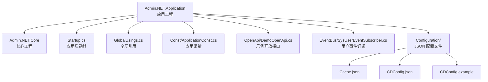

**图表来源**   
- [Admin.NET.Application.csproj:1-32](file://Admin.NET/Admin.NET.Application/Admin.NET.Application.csproj#L1-L32)
- [Startup.cs:1-22](file://Admin.NET/Admin.NET.Application/Startup.cs#L1-L22)
- [GlobalUsings.cs:1-15](file://Admin.NET/Admin.NET.Application/GlobalUsings.cs#L1-L15)
- [ApplicationConst.cs:1-18](file://Admin.NET/Admin.NET.Application/Const/ApplicationConst.cs#L1-L18)
- [DemoOpenApi.cs:1-45](file://Admin.NET/Admin.NET.Application/OpenApi/DemoOpenApi.cs#L1-L45)
- [SysUserEventSubscriber.cs:1-103](file://Admin.NET/Admin.NET.Application/EventBus/SysUserEventSubscriber.cs#L1-L103)
- [Cache.json:1-38](file://Admin.NET/Admin.NET.Application/Configuration/Cache.json#L1-L38)
- [CDConfig.json:1-20](file://Admin.NET/Admin.NET.Application/Configuration/CDConfig.json#L1-L20)
- [CDConfig.example:1-25](file://Admin.NET/Admin.NET.Application/Configuration/CDConfig.example#L1-L25)

**章节来源**   
- [Admin.NET.Application.csproj:1-32](file://Admin.NET/Admin.NET.Application/Admin.NET.Application.csproj#L1-L32)
- [Startup.cs:1-22](file://Admin.NET/Admin.NET.Application/Startup.cs#L1-L22)
- [GlobalUsings.cs:1-15](file://Admin.NET/Admin.NET.Application/GlobalUsings.cs#L1-L15)

## 目标框架与依赖关系

### 目标框架

Admin.NET.Application 使用多目标框架构建：

- 目标框架：`net8.0;net10.0`
- 启用隐式 using
- 生成文档文件
- 禁用 Nullable
- 复制 `Configuration` 与 `wwwroot` 内容到输出目录
- 引用 `Admin.NET.Core`

这意味着同一个应用工程可以在 .NET 8 和 .NET 10 上编译运行，适合需要兼容旧运行时或提前验证新运行时行为的团队。

### 顶层 SDK 与测试框架

仓库根目录的 `global.json` 没有固定 .NET SDK 版本，只声明测试运行器为 `Microsoft.Testing.Platform`。因此不能据此声称本分支已经固定某个 .NET SDK 版本；实际 SDK 选择由开发者机器或 CI 环境决定。

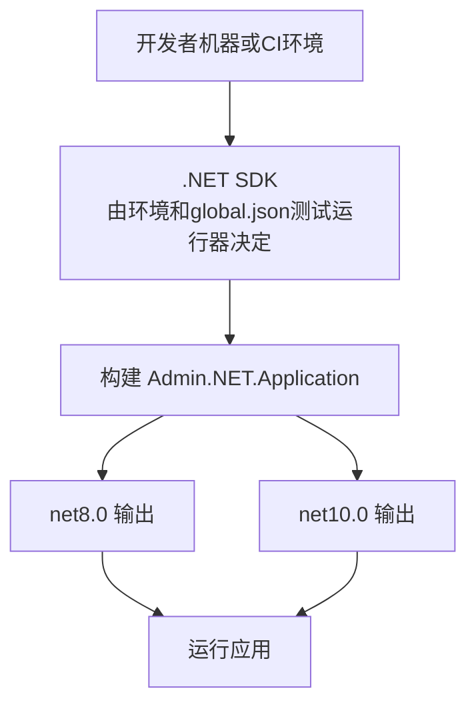

**图表来源**   
- [Admin.NET.Application.csproj:1-12](file://Admin.NET/Admin.NET.Application/Admin.NET.Application.csproj#L1-L12)
- [global.json:1-5](file://Admin.NET/global.json#L1-L5)

**章节来源**   
- [Admin.NET.Application.csproj:1-12](file://Admin.NET/Admin.NET.Application/Admin.NET.Application.csproj#L1-L12)
- [global.json:1-5](file://Admin.NET/global.json#L1-L5)

### 对 Core 层的依赖

Application 层仅显式引用 `Admin.NET.Core`，并通过 `GlobalUsings.cs` 全局引入以下能力：

- `Admin.NET.Core`
- `Furion`
- `Furion.DependencyInjection`
- `Furion.DynamicApiController`
- ASP.NET Core 授权与 MVC 相关类型
- Microsoft.Extensions.DependencyInjection
- System 与异步任务类型

这表示应用层本身不直接依赖 Web Entry、Web.Core 或前端工程，而是依赖 Core 层提供的动态控制器、事件总线、数据库访问、日志、配置选项、异常处理等基础设施。

**章节来源**   
- [Admin.NET.Application.csproj:23-32](file://Admin.NET/Admin.NET.Application/Admin.NET.Application.csproj#L23-L32)
- [GlobalUsings.cs:12-15](file://Admin.NET/Admin.NET.Application/GlobalUsings.cs#L12-L15)

## 服务启动与组合模式

### Startup 的作用

`Startup.cs` 是一个典型的 Furion 启动类：

- 使用 `[AppStartup(100)]` 标记启动优先级为 100。
- 继承 `AppStartup`。
- 提供 `ConfigureServices` 用于注册服务。
- 提供 `Configure` 用于配置请求管道。

在当前代码中，这两个方法为空实现，表示该工程已经具备启动点，但尚未在应用层内注册额外服务。真正的业务服务注册通常由 Core 层或 Web 层完成，Application 层在此处扩展自己的服务装配逻辑。

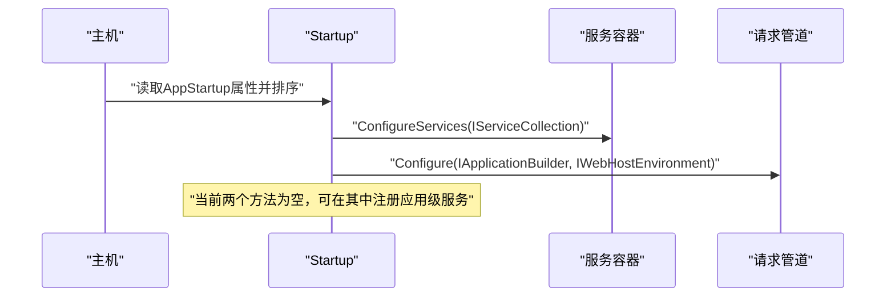

**图表来源**   
- [Startup.cs:12-22](file://Admin.NET/Admin.NET.Application/Startup.cs#L12-L22)

### 组合模式要点

结合 Furion 的约定，建议遵循以下组合规则：

1. 所有需要被容器管理的业务服务应实现 Furion 生命周期接口，例如 `ITransient`、`ISingleton`、`IInstance` 等。
2. 动态控制器和服务可通过 Furion 自动发现机制注册，无需手动逐个添加。
3. 复杂装配逻辑放入 `Startup.ConfigureServices`，简单配置放在对应服务的构造参数或特性中。
4. 如果应用需要跨模块协调多个服务，应编写协调服务，而不是让控制器直接耦合底层服务。
5. 事件订阅者应实现 `IEventSubscriber`，并使用 `[EventSubscribe]` 指定事件类型。

**章节来源**   
- [Startup.cs:12-22](file://Admin.NET/Admin.NET.Application/Startup.cs#L12-L22)

## 配置管理

### 配置目录职责

`Configuration` 目录中的 JSON 文件不是普通代码，而是随应用输出发布的运行时配置。`Admin.NET.Application.csproj` 中明确将 `Configuration/**/*` 标记为 Content，并复制到输出目录和发布目录。

当前已存在的配置包括：

| 配置文件 | 用途 |
|---|---|
| `Cache.json` | 缓存前缀、缓存类型、Redis 连接、集群、SignalR 通道、DataProtection Key 存储等 |
| `CDConfig.json` | 持续部署配置，包括仓库、分支、令牌、发布目标、排除文件等 |
| `CDConfig.example` | 持续部署配置的示例模板 |

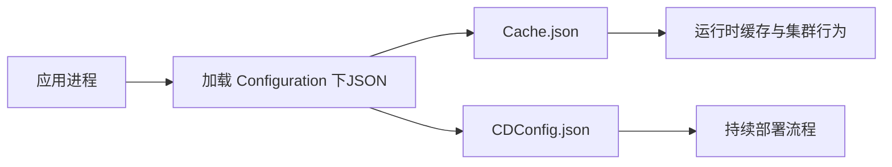

**图表来源**   
- [Admin.NET.Application.csproj:13-22](file://Admin.NET/Admin.NET.Application/Admin.NET.Application.csproj#L13-L22)
- [Cache.json:1-38](file://Admin.NET/Admin.NET.Application/Configuration/Cache.json#L1-L38)
- [CDConfig.json:1-20](file://Admin.NET/Admin.NET.Application/Configuration/CDConfig.json#L1-L20)
- [CDConfig.example:1-25](file://Admin.NET/Admin.NET.Application/Configuration/CDConfig.example#L1-L25)

### 配置文件加载机制

从当前源码看，Application 层没有自定义配置加载器。配置文件加载由 Furion 的配置系统承担：

1. 项目将 `Configuration` 目录作为 Content 资源复制。
2. Furion 在应用启动时扫描并加载这些配置。
3. 配置项映射到强类型选项对象，例如 `EventBusOptions`、缓存选项、集群选项等。
4. 业务服务通过依赖注入获取配置对象。

### 配置验证

当前仓库中没有看到 Application 层自实现的配置验证器。建议在新增配置时遵循以下实践：

- 为每个配置块定义强类型选项类。
- 使用数据注解或 Fluent Validation 进行必填字段校验。
- 对敏感字段如令牌、密码设置环境变量或密钥管理服务覆盖。
- 对 Redis、数据库、消息队列等外部依赖的连接字符串进行连通性检查。

### 热更新机制

当前源码未展示 Application 层自定义的文件监听或热更新逻辑。对于 Furion 生态，常见做法是使用其配置选项的热更新能力，或在启动阶段注册文件监视器。若要在 Application 层支持配置热更新，推荐：

- 使用 `IOptionsMonitor<T>` 获取可监控变更的配置。
- 在变更回调中刷新缓存、重新初始化客户端或触发业务重连。
- 避免在热更新回调中执行长时间阻塞操作。
- 对热更新失败做降级和日志记录。

**章节来源**   
- [Admin.NET.Application.csproj:13-22](file://Admin.NET/Admin.NET.Application/Admin.NET.Application.csproj#L13-L22)
- [Cache.json:1-38](file://Admin.NET/Admin.NET.Application/Configuration/Cache.json#L1-L38)
- [CDConfig.json:1-20](file://Admin.NET/Admin.NET.Application/Configuration/CDConfig.json#L1-L20)
- [CDConfig.example:1-25](file://Admin.NET/Admin.NET.Application/Configuration/CDConfig.example#L1-L25)

## 事件总线设计

### 设计模式

Application 层的事件总线实现基于 Furion 的事件总线模式，核心参与者包括：

| 角色 | 位置 | 职责 |
|---|---|---|
| 事件发布者 | Core 层服务 | 发出领域事件，例如用户增删改、异常日志、邮件发送等 |
| 事件订阅者 | Application 层或 Core 层 | 实现 `IEventSubscriber`，用 `[EventSubscribe]` 绑定事件 |
| 事件执行器 | Core 层 | 控制重试、超时、熔断和错误日志 |
| 事件配置 | Core 层 | 定义 RabbitMQ 等传输配置 |

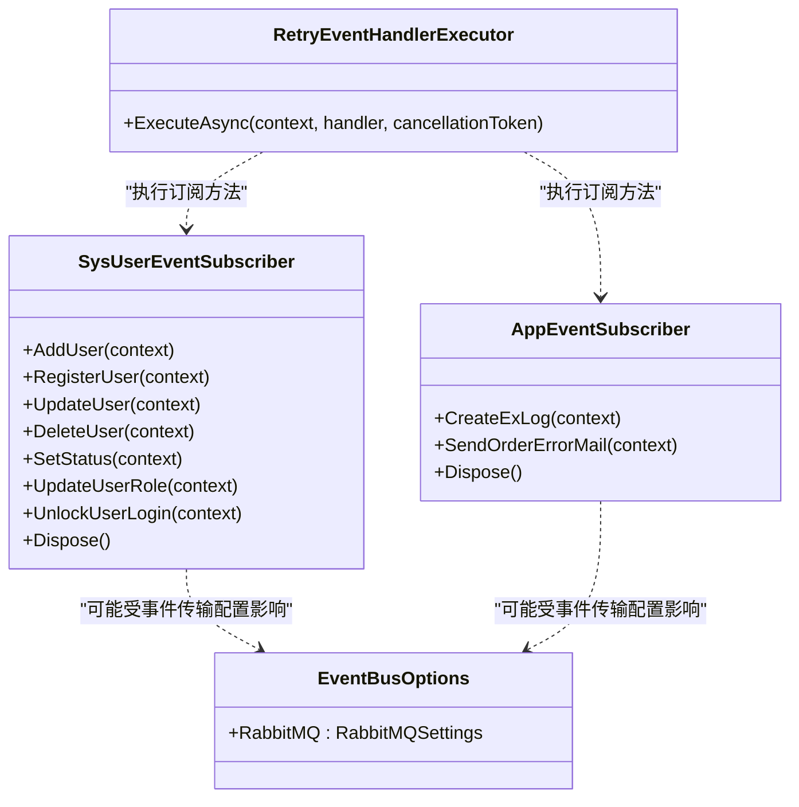

**图表来源**   
- [SysUserEventSubscriber.cs:14-103](file://Admin.NET/Admin.NET.Application/EventBus/SysUserEventSubscriber.cs#L14-L103)
- [AppEventSubscriber.cs:14-58](file://Admin.NET/Admin.NET.Core/EventBus/AppEventSubscriber.cs#L14-L58)
- [RetryEventHandlerExecutor.cs:14-44](file://Admin.NET/Admin.NET.Core/EventBus/RetryEventHandlerExecutor.cs#L14-L44)
- [EventBusOptions.cs:14-44](file://Admin.NET/Admin.NET.Core/Option/EventBusOptions.cs#L14-L44)

### 消息处理流程

以用户相关事件为例，典型流程如下：

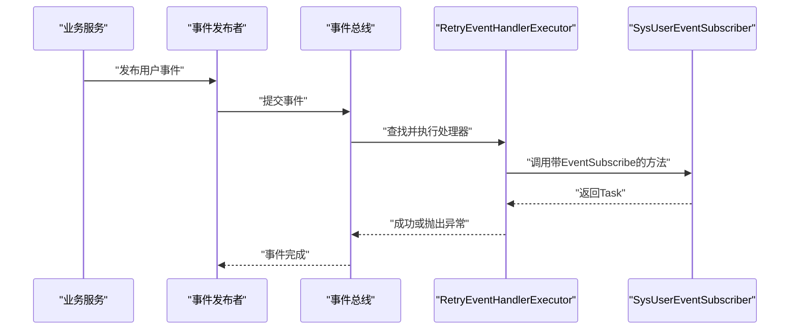

**图表来源**   
- [SysUserEventSubscriber.cs:14-103](file://Admin.NET/Admin.NET.Application/EventBus/SysUserEventSubscriber.cs#L14-L103)
- [RetryEventHandlerExecutor.cs:14-44](file://Admin.NET/Admin.NET.Core/EventBus/RetryEventHandlerExecutor.cs#L14-L44)

### 异步消息与错误处理

`SysUserEventSubscriber` 定义了多个用户相关事件处理方法，包括增加用户、注册用户、更新用户、删除用户、设置状态、更新角色、解除登录锁定等。当前实现返回 `Task.CompletedTask`，属于占位订阅者，便于后续扩展真实逻辑。

`RetryEventHandlerExecutor` 提供了事件执行的统一包装：

- 使用重试工具调用事件处理器。
- 捕获异常后记录错误日志。
- 根据事件订阅特性中的重试次数、重试超时和异常类型进行重试。
- 每次重试输出警告日志。

`AppEventSubscriber` 展示了更复杂的业务场景：

- 根据配置切换独立日志数据库写入异常日志。
- 从当前 HTTP 上下文提取租户信息。
- 通过服务作用域解析邮箱服务发送邮件。
- 实现 `IDisposable` 释放作用域。

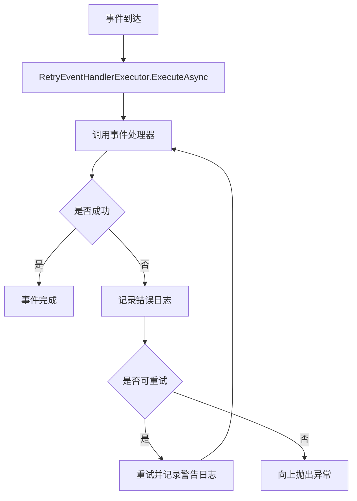

**图表来源**   
- [RetryEventHandlerExecutor.cs:14-44](file://Admin.NET/Admin.NET.Core/EventBus/RetryEventHandlerExecutor.cs#L14-L44)
- [AppEventSubscriber.cs:14-58](file://Admin.NET/Admin.NET.Core/EventBus/AppEventSubscriber.cs#L14-L58)
- [SysUserEventSubscriber.cs:14-103](file://Admin.NET/Admin.NET.Application/EventBus/SysUserEventSubscriber.cs#L14-L103)

**章节来源**   
- [SysUserEventSubscriber.cs:14-103](file://Admin.NET/Admin.NET.Application/EventBus/SysUserEventSubscriber.cs#L14-L103)
- [AppEventSubscriber.cs:14-58](file://Admin.NET/Admin.NET.Core/EventBus/AppEventSubscriber.cs#L14-L58)
- [RetryEventHandlerExecutor.cs:14-44](file://Admin.NET/Admin.NET.Core/EventBus/RetryEventHandlerExecutor.cs#L14-L44)
- [EventBusOptions.cs:14-44](file://Admin.NET/Admin.NET.Core/Option/EventBusOptions.cs#L14-L44)

## 业务服务开发指南

### 应用服务定位

Application 层适合放置面向用例的服务协调逻辑、开放接口和事件订阅。领域数据和基础设施能力主要由 Core 层提供。典型开发流程是：

1. 在 Core 层定义领域实体、仓储和服务。
2. 在 Application 层编写动态开放接口或服务，组合 Core 层服务。
3. 通过构造函数注入所需服务。
4. 使用 Furion 的统一结果、异常、日志、事务、参数验证等能力。

### 示例开放接口

`DemoOpenApi` 展示了应用层开放接口的写法：

- 使用 `[ApiDescriptionSettings]` 设置分组和排序。
- 使用 `[Authorize]` 指定签名认证方案。
- 实现 `IDynamicApiController`。
- 通过 `UserManager` 获取当前身份。
- 使用 `[SuppressMonitor]` 抑制某些监控统计。

该接口适合作为新开放接口的参考模板。

### 可测试应用服务示例

虽然当前 Application 层没有完整业务服务实现，但可以基于 Core 层现有模式编写可测试服务。推荐结构：

| 组件 | 说明 |
|---|---|
| 输入模型 | 使用数据注解或 Fluent Validation 验证参数 |
| 输出模型 | 与服务返回值一致，避免暴露内部实体 |
| 应用服务 | 组合 Core 层服务，负责事务、权限、事件和异常 |
| 单元测试 | 使用内存仓储或 Mock 外部依赖 |
| 集成测试 | 使用隔离的真实 PostgreSQL，不依赖 SQLite 或 Mock 结果 |

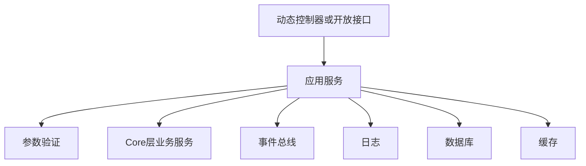

[此图为概念流程图，不直接映射具体源码文件]

### 最佳实践清单

| 主题 | 建议 |
|---|---|
| 事务管理 | 使用 `[UnitOfWork]` 包裹写操作，确保多个仓储操作原子性 |
| 异常处理 | 使用 `Oops.Oh` 抛出统一业务异常，不要吞掉异常 |
| 参数验证 | 使用数据注解或 Fluent Validation，优先在输入模型上声明 |
| 日志记录 | 使用 `Log` 记录关键业务步骤和异常 |
| 权限控制 | 使用 `UserManager` 判断租户、组织、角色和超级管理员 |
| 事件解耦 | 将副作用逻辑放入事件订阅者，保持主流程简洁 |
| 可测试性 | 将外部依赖抽象为接口或可替换服务 |

**章节来源**   
- [DemoOpenApi.cs:14-45](file://Admin.NET/Admin.NET.Application/OpenApi/DemoOpenApi.cs#L14-L45)
- [SysUserService.cs:14-120](file://Admin.NET/Admin.NET.Core/Service/User/SysUserService.cs#L14-L120)

## 架构总览

Application 层位于 Core 层之上，向下依赖 Core 层能力，向上可能被 Web 层或插件引用。当前仓库中，Application 层主要承担以下职责：

- 启动入口扩展点
- 业务常量
- 示例开放接口
- 用户事件订阅模板
- 应用级 JSON 配置

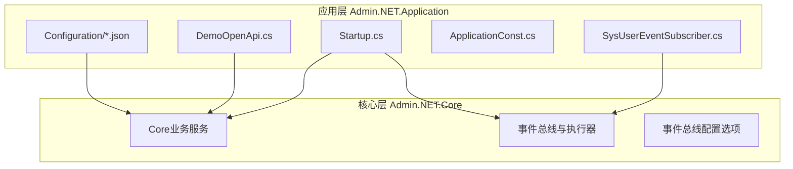

**图表来源**   
- [Startup.cs:12-22](file://Admin.NET/Admin.NET.Application/Startup.cs#L12-L22)
- [DemoOpenApi.cs:14-45](file://Admin.NET/Admin.NET.Application/OpenApi/DemoOpenApi.cs#L14-L45)
- [SysUserEventSubscriber.cs:14-103](file://Admin.NET/Admin.NET.Application/EventBus/SysUserEventSubscriber.cs#L14-L103)
- [ApplicationConst.cs:14-18](file://Admin.NET/Admin.NET.Application/Const/ApplicationConst.cs#L14-L18)
- [Cache.json:1-38](file://Admin.NET/Admin.NET.Application/Configuration/Cache.json#L1-L38)
- [CDConfig.json:1-20](file://Admin.NET/Admin.NET.Application/Configuration/CDConfig.json#L1-L20)
- [AppEventSubscriber.cs:14-58](file://Admin.NET/Admin.NET.Core/EventBus/AppEventSubscriber.cs#L14-L58)
- [RetryEventHandlerExecutor.cs:14-44](file://Admin.NET/Admin.NET.Core/EventBus/RetryEventHandlerExecutor.cs#L14-L44)
- [EventBusOptions.cs:14-44](file://Admin.NET/Admin.NET.Core/Option/EventBusOptions.cs#L14-L44)

## 依赖分析

### 程序集依赖

Application 层直接依赖：

- `Admin.NET.Core`
- Furion 系列包
- ASP.NET Core 运行时类型
- Microsoft.Extensions.DependencyInjection

Core 层进一步提供：

- 动态控制器
- 事件总线
- 数据库访问
- 日志
- 配置选项
- 业务服务

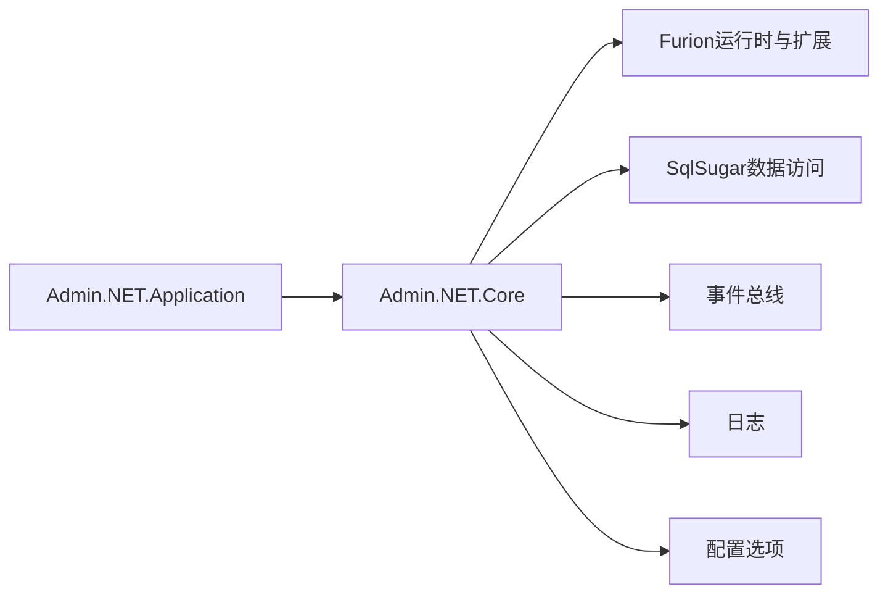

**图表来源**   
- [Admin.NET.Application.csproj:23-32](file://Admin.NET/Admin.NET.Application/Admin.NET.Application.csproj#L23-L32)
- [GlobalUsings.cs:12-15](file://Admin.NET/Admin.NET.Application/GlobalUsings.cs#L12-L15)
- [AppEventSubscriber.cs:14-58](file://Admin.NET/Admin.NET.Core/EventBus/AppEventSubscriber.cs#L14-L58)
- [RetryEventHandlerExecutor.cs:14-44](file://Admin.NET/Admin.NET.Core/EventBus/RetryEventHandlerExecutor.cs#L14-L44)
- [EventBusOptions.cs:14-44](file://Admin.NET/Admin.NET.Core/Option/EventBusOptions.cs#L14-L44)

### 循环依赖风险

当前 Application 层只单向依赖 Core 层，没有反向引用，也没有在 Application 层引用 Web.Entry 或 Web.Core，因此不存在明显的程序集循环依赖风险。

**章节来源**   
- [Admin.NET.Application.csproj:23-32](file://Admin.NET/Admin.NET.Application/Admin.NET.Application.csproj#L23-L32)
- [GlobalUsings.cs:12-15](file://Admin.NET/Admin.NET.Application/GlobalUsings.cs#L12-L15)

## 性能与可观测性

### 性能考虑

- 事件处理器应避免长耗时同步操作；必要时使用异步任务。
- 重试机制会增加调用次数，需合理设置重试次数和超时时间。
- 缓存前缀和 Redis 配置会影响分布式缓存性能和键冲突风险。
- 日志写入独立数据库可降低业务表压力，但要注意日志库连接和磁盘 IO。
- 多目标框架不会改变运行时性能特征，但不同 .NET 版本可能存在行为差异。

### 可观测性

- 事件执行失败会记录错误日志。
- 重试过程会输出警告日志。
- 开放接口可通过 Furion 监控和日志体系观察。
- 建议在应用层新增关键业务流程埋点，记录租户、用户、业务 ID 和耗时。

**章节来源**   
- [RetryEventHandlerExecutor.cs:14-44](file://Admin.NET/Admin.NET.Core/EventBus/RetryEventHandlerExecutor.cs#L14-L44)
- [Cache.json:1-38](file://Admin.NET/Admin.NET.Application/Configuration/Cache.json#L1-L38)
- [AppEventSubscriber.cs:14-58](file://Admin.NET/Admin.NET.Core/EventBus/AppEventSubscriber.cs#L14-L58)

## 故障排查

### 事件处理器无响应

排查顺序：

1. 确认事件订阅者实现了 `IEventSubscriber`。
2. 确认方法上有 `[EventSubscribe]` 且事件枚举值正确。
3. 确认订阅者被容器管理，例如实现 `ISingleton`。
4. 查看事件执行器日志，确认是否进入重试或报错。

**章节来源**   
- [SysUserEventSubscriber.cs:14-103](file://Admin.NET/Admin.NET.Application/EventBus/SysUserEventSubscriber.cs#L14-L103)
- [RetryEventHandlerExecutor.cs:14-44](file://Admin.NET/Admin.NET.Core/EventBus/RetryEventHandlerExecutor.cs#L14-L44)

### 配置未生效

排查顺序：

1. 确认 `Configuration` 目录中的 JSON 文件已复制到输出目录。
2. 确认文件名和大小写符合预期。
3. 确认配置项路径与强类型选项匹配。
4. 检查 Redis、集群、令牌等敏感配置是否正确。
5. 若使用持续部署，检查 `CDConfig.json` 是否启用及令牌是否有效。

**章节来源**   
- [Admin.NET.Application.csproj:13-22](file://Admin.NET/Admin.NET.Application/Admin.NET.Application.csproj#L13-L22)
- [Cache.json:1-38](file://Admin.NET/Admin.NET.Application/Configuration/Cache.json#L1-L38)
- [CDConfig.json:1-20](file://Admin.NET/Admin.NET.Application/Configuration/CDConfig.json#L1-L20)

### 开放接口无法访问

排查顺序：

1. 确认控制器实现 `IDynamicApiController`。
2. 确认启用了签名认证或对应授权策略。
3. 检查 `ApiDescriptionSettings` 分组和路由。
4. 确认 `UserManager` 能获取当前身份。

**章节来源**   
- [DemoOpenApi.cs:14-45](file://Admin.NET/Admin.NET.Application/OpenApi/DemoOpenApi.cs#L14-L45)

## 扩展与新模块开发

### 添加新业务模块的步骤

1. 在 Core 层定义领域实体、仓储和服务。
2. 在 Application 层创建业务服务或开放接口。
3. 在 `Startup.ConfigureServices` 中注册应用级服务（如果需要）。
4. 如需对外暴露，创建 `OpenApi` 目录下的动态开放接口。
5. 如需解耦副作用，创建 `EventBus` 目录下的事件订阅者。
6. 如需新增配置，在 `Configuration` 目录下添加 JSON，并在选项中映射。
7. 编写单元测试和集成测试。

### 扩展现有功能

- 扩展用户流程：在 `SysUserEventSubscriber` 中补充真实逻辑。
- 扩展开放接口：在 `OpenApi` 中添加新的 `IDynamicApiController`。
- 扩展配置：在 `Configuration` 中添加新的 JSON，并在 Core 层或 Application 层建立选项映射。
- 扩展事件：新增事件枚举和方法，使用 `[EventSubscribe]` 绑定。

### 新模块目录建议

| 目录 | 建议内容 |
|---|---|
| `Service/` | 应用级业务服务 |
| `OpenApi/` | 开放接口 |
| `EventBus/` | 事件订阅者 |
| `Configuration/` | 应用级 JSON 配置 |
| `Const/` | 模块常量 |
| `Entity/` | 应用层视图模型或本地实体 |

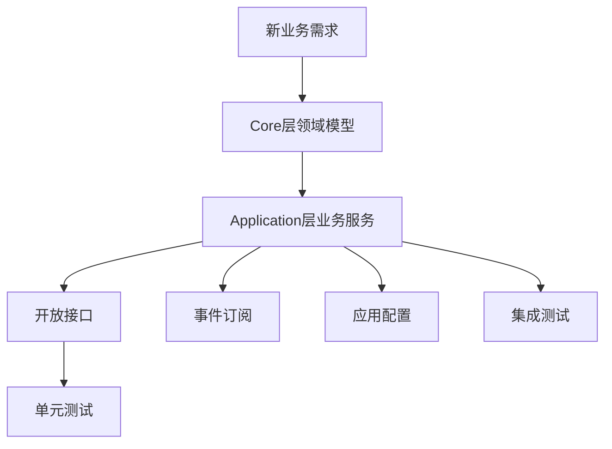

[此图为概念流程图，不直接映射具体源码文件]

**章节来源**   
- [Startup.cs:12-22](file://Admin.NET/Admin.NET.Application/Startup.cs#L12-L22)
- [DemoOpenApi.cs:14-45](file://Admin.NET/Admin.NET.Application/OpenApi/DemoOpenApi.cs#L14-L45)
- [SysUserEventSubscriber.cs:14-103](file://Admin.NET/Admin.NET.Application/EventBus/SysUserEventSubscriber.cs#L14-L103)
- [ApplicationConst.cs:14-18](file://Admin.NET/Admin.NET.Application/Const/ApplicationConst.cs#L14-L18)

## 结论

Admin.NET.Application 当前是一个面向业务扩展的应用层入口。它通过多目标框架支持 .NET 8 和 .NET 10，单向依赖 Core 层，并提供启动点、开放接口、事件订阅模板和应用级配置。对于二次开发，建议重点在以下方向完善：

- 在 `Startup.ConfigureServices` 中注册应用级服务。
- 在 `OpenApi` 中实现真正对外接口。
- 在 `EventBus` 中实现真实事件处理逻辑。
- 在 `Configuration` 中管理业务配置，并做好验证和热更新。
- 在 `Service` 中编写可测试的业务协调服务。
- 使用事务、异常、参数验证和日志保证业务一致性。
- 通过事件总线解耦副作用，提升系统可扩展性。