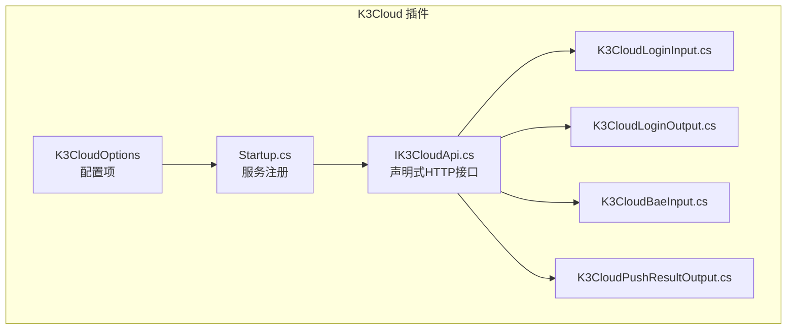
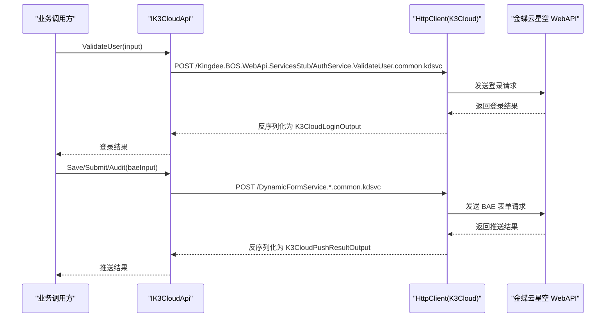
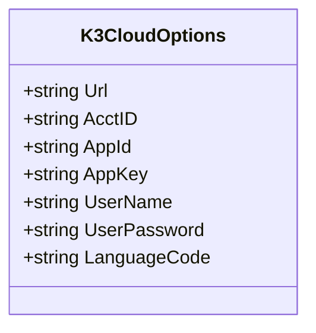
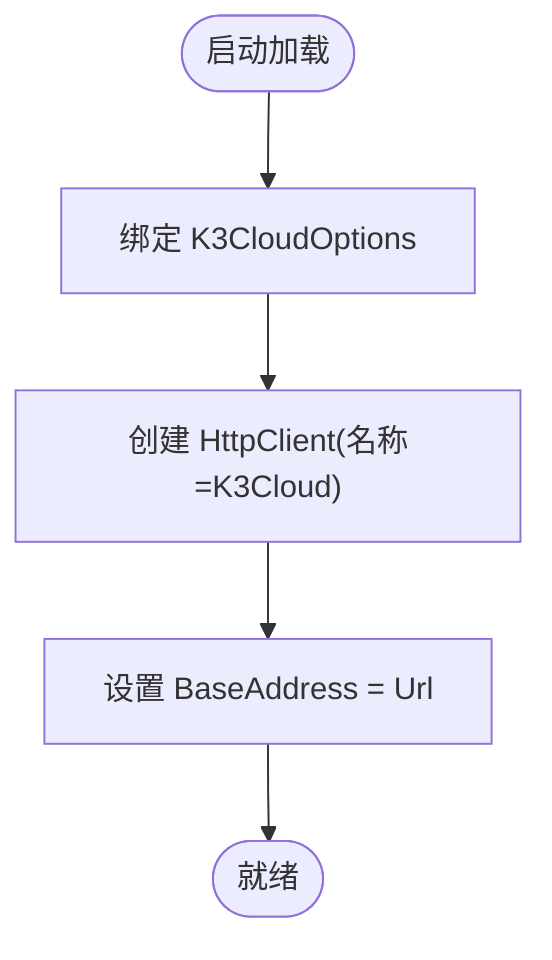
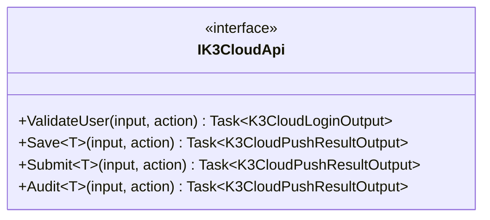
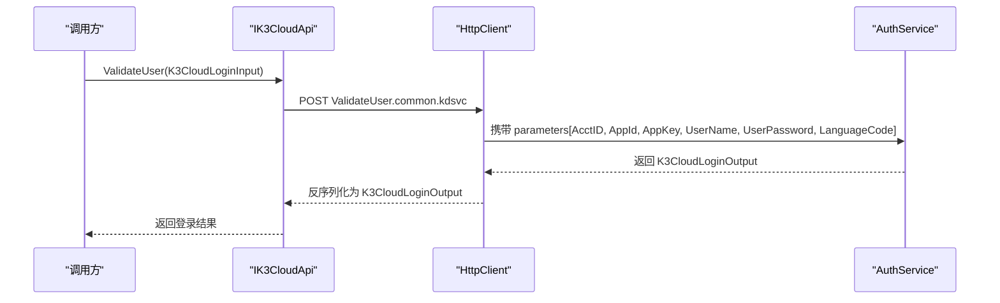
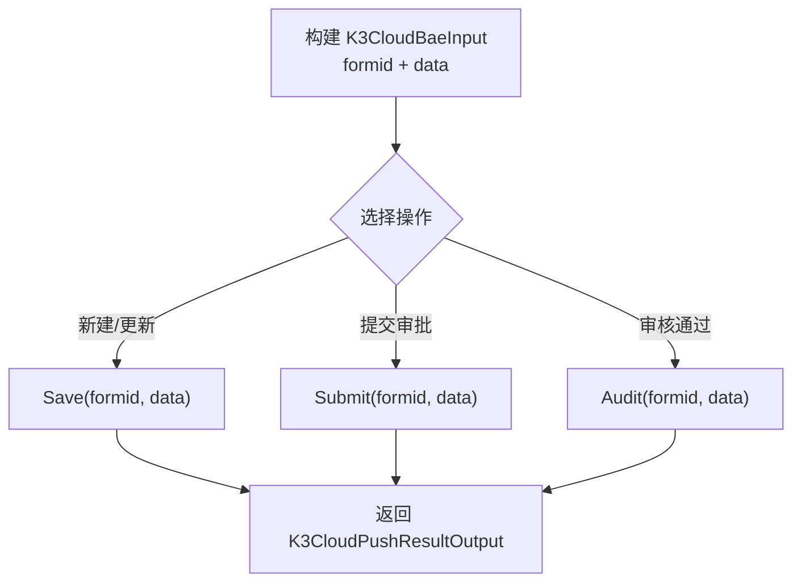
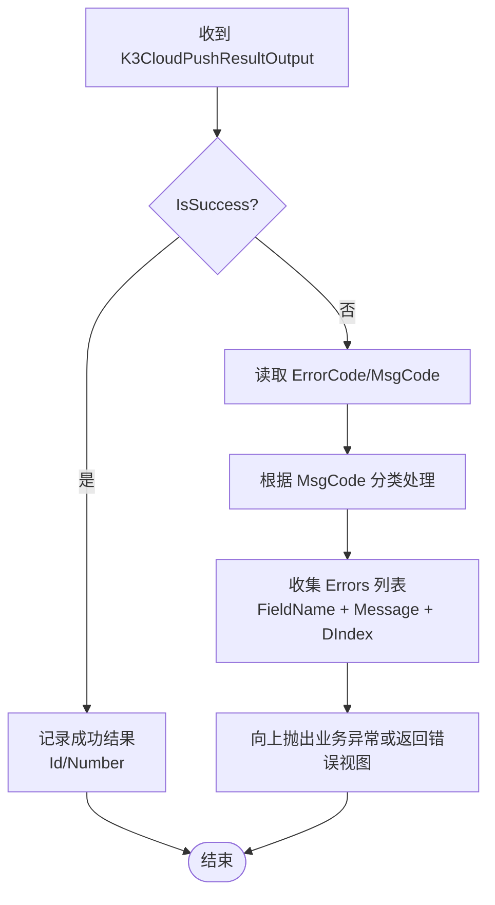
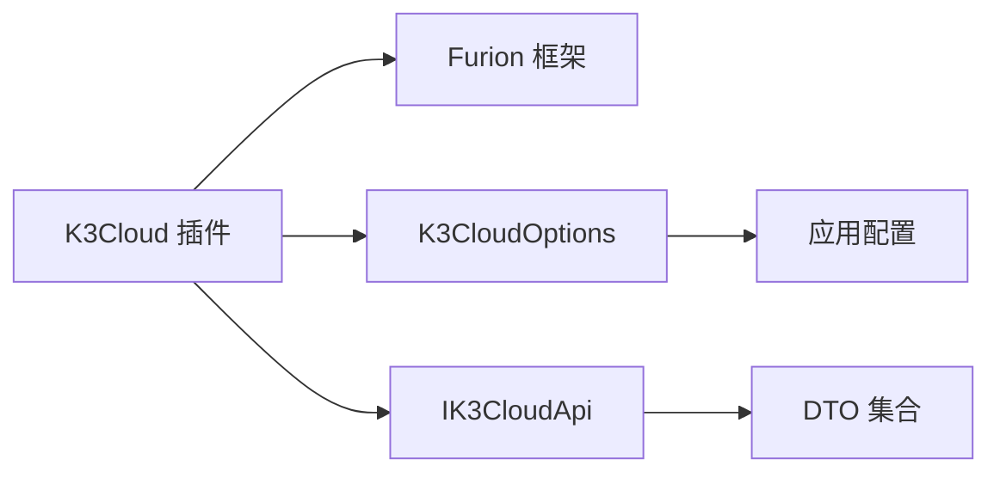

# K3Cloud ERP 插件

<cite>
**本文引用的文件**   
- [Startup.cs](file://Admin.NET/Plugins/Admin.NET.Plugin.K3Cloud/Startup.cs)
- [K3CloudOptions.cs](file://Admin.NET/Plugins/Admin.NET.Plugin.K3Cloud/Option/K3CloudOptions.cs)
- [IK3CloudApi.cs](file://Admin.NET/Plugins/Admin.NET.Plugin.K3Cloud/Service/IK3CloudApi.cs)
- [K3CloudLoginInput.cs](file://Admin.NET/Plugins/Admin.NET.Plugin.K3Cloud/Service/Dto/K3CloudLoginInput.cs)
- [K3CloudLoginOutput.cs](file://Admin.NET/Plugins/Admin.NET.Plugin.K3Cloud/Service/Dto/K3CloudLoginOutput.cs)
- [K3CloudBaeInput.cs](file://Admin.NET/Plugins/Admin.NET.Plugin.K3Cloud/Service/Dto/K3CloudBaeInput.cs)
- [K3CloudPushResultOutput.cs](file://Admin.NET/Plugins/Admin.NET.Plugin.K3Cloud/Service/Dto/K3CloudPushResultOutput.cs)
- [GlobalUsings.cs](file://Admin.NET/Plugins/Admin.NET.Plugin.K3Cloud/GlobalUsings.cs)
</cite>

## 目录
1. [简介](#简介)
2. [项目结构](#项目结构)
3. [核心组件](#核心组件)
4. [架构总览](#架构总览)
5. [详细组件分析](#详细组件分析)
6. [依赖关系分析](#依赖关系分析)
7. [性能与配置建议](#性能与配置建议)
8. [故障排查指南](#故障排查指南)
9. [结论](#结论)
10. [附录：API 调用示例与数据转换规则](#附录api-调用示例与数据转换规则)

## 简介
本技术文档面向 Admin.NET 多租户系统中的 K3Cloud ERP 插件，聚焦以下目标：
- 解释 K3CloudOptions 配置项及其在 HttpClient 注册中的作用。
- 说明 IK3CloudApi 接口的 RESTful API 封装模式，包括登录认证和 BAE（Business Application Extension）表单操作。
- 梳理数据传输对象设计，包括登录请求、登录响应、BAE 通用入参与推送结果输出。
- 给出 ERP 业务数据同步策略的参考实现思路，覆盖库存、订单、客户等核心对象的增删改查流程。
- 提供 API 调用示例、数据转换规则、错误处理机制、网络超时设置及性能优化建议。
- 说明与 Admin.NET 多租户架构集成时，如何结合配置隔离与权限控制策略进行安全调用。

## 项目结构
K3Cloud 插件位于 Admin.NET 插件目录下，采用“配置 + 启动注册 + 声明式 HTTP 接口 + DTO”的结构组织：
- Option/K3CloudOptions.cs：ERP 站点、帐套、应用密钥、用户凭据等可配置选项。
- Startup.cs：通过 Furion 扩展将 K3CloudOptions 注入 DI，并注册名为 K3Cloud 的 HttpClient，设置 BaseAddress。
- Service/IK3CloudApi.cs：基于 Furion.HttpRemote 的声明式 HTTP 接口，封装登录验证与 BAE 表单操作。
- Service/Dto/*：登录输入输出、BAE 通用入参、推送结果输出等数据传输对象。
- GlobalUsings.cs：全局引入 Furion 相关命名空间。

**图表来源**
- [Startup.cs:12-28](file://Admin.NET/Plugins/Admin.NET.Plugin.K3Cloud/Startup.cs#L12-L28)
- [K3CloudOptions.cs:11-44](file://Admin.NET/Plugins/Admin.NET.Plugin.K3Cloud/Option/K3CloudOptions.cs#L11-L44)
- [IK3CloudApi.cs:12-49](file://Admin.NET/Plugins/Admin.NET.Plugin.K3Cloud/Service/IK3CloudApi.cs#L12-L49)
- [K3CloudLoginInput.cs:9-11](file://Admin.NET/Plugins/Admin.NET.Plugin.K3Cloud/Service/Dto/K3CloudLoginInput.cs#L9-L11)
- [K3CloudLoginOutput.cs:11-61](file://Admin.NET/Plugins/Admin.NET.Plugin.K3Cloud/Service/Dto/K3CloudLoginOutput.cs#L11-L61)
- [K3CloudBaeInput.cs:11-22](file://Admin.NET/Plugins/Admin.NET.Plugin.K3Cloud/Service/Dto/K3CloudBaeInput.cs#L11-L22)
- [K3CloudPushResultOutput.cs:11-65](file://Admin.NET/Plugins/Admin.NET.Plugin.K3Cloud/Service/Dto/K3CloudPushResultOutput.cs#L11-L65)

**章节来源**
- [Startup.cs:12-28](file://Admin.NET/Plugins/Admin.NET.Plugin.K3Cloud/Startup.cs#L12-L28)
- [K3CloudOptions.cs:11-44](file://Admin.NET/Plugins/Admin.NET.Plugin.K3Cloud/Option/K3CloudOptions.cs#L11-L44)
- [IK3CloudApi.cs:12-49](file://Admin.NET/Plugins/Admin.NET.Plugin.K3Cloud/Service/IK3CloudApi.cs#L12-L49)
- [GlobalUsings.cs:9-9](file://Admin.NET/Plugins/Admin.NET.Plugin.K3Cloud/GlobalUsings.cs#L9-L9)

## 核心组件
- K3CloudOptions：承载 ERP 站点地址、帐套Id、应用Id、应用密钥、用户名、密码与语言代码等配置项，支持通过 App.GetConfig 读取。
- Startup：注册 K3CloudOptions 配置绑定，并通过 AddHttpClient 注册名为 K3Cloud 的 HttpClient，BaseAddress 来自配置中的 Url。
- IK3CloudApi：声明式 HTTP 接口，封装 Kingdee.BOS.WebApi.ServicesStub 下的 AuthService.ValidateUser 与 DynamicFormService 的 Save/Submit/Audit 方法。
- 数据传输对象：
  - K3CloudLoginInput：登录参数数组。
  - K3CloudLoginOutput：登录结果，包含消息、消息码与登录结果枚举。
  - K3CloudBaeInput<T>：BAE 通用入参，包含 formid 与 data。
  - K3CloudPushResultOutput：推送结果包装，内部为 ErpPushResultInfo。

**章节来源**
- [K3CloudOptions.cs:11-44](file://Admin.NET/Plugins/Admin.NET.Plugin.K3Cloud/Option/K3CloudOptions.cs#L11-L44)
- [Startup.cs:12-28](file://Admin.NET/Plugins/Admin.NET.Plugin.K3Cloud/Startup.cs#L12-L28)
- [IK3CloudApi.cs:12-49](file://Admin.NET/Plugins/Admin.NET.Plugin.K3Cloud/Service/IK3CloudApi.cs#L12-L49)
- [K3CloudLoginInput.cs:9-11](file://Admin.NET/Plugins/Admin.NET.Plugin.K3Cloud/Service/Dto/K3CloudLoginInput.cs#L9-L11)
- [K3CloudLoginOutput.cs:11-61](file://Admin.NET/Plugins/Admin.NET.Plugin.K3Cloud/Service/Dto/K3CloudLoginOutput.cs#L11-L61)
- [K3CloudBaeInput.cs:11-22](file://Admin.NET/Plugins/Admin.NET.Plugin.K3Cloud/Service/Dto/K3CloudBaeInput.cs#L11-L22)
- [K3CloudPushResultOutput.cs:11-65](file://Admin.NET/Plugins/Admin.NET.Plugin.K3Cloud/Service/Dto/K3CloudPushResultOutput.cs#L11-L65)

## 架构总览
K3Cloud 插件通过 Furion 的配置绑定与 HttpRemote 能力，将 ERP 后端接口抽象为强类型 .NET 接口。调用方无需手动拼接 URL、序列化 JSON 或处理 Cookie；框架负责将声明式注解映射到 HTTP 请求。

**图表来源**
- [IK3CloudApi.cs:18-49](file://Admin.NET/Plugins/Admin.NET.Plugin.K3Cloud/Service/IK3CloudApi.cs#L18-L49)
- [Startup.cs:20-27](file://Admin.NET/Plugins/Admin.NET.Plugin.K3Cloud/Startup.cs#L20-L27)

## 详细组件分析

### K3CloudOptions 配置模型
K3CloudOptions 是插件的可配置中心，字段含义如下：
- Url：ERP 业务站点地址，用于设置 HttpClient.BaseAddress。
- AcctID：帐套Id（数据中心Id）。
- AppId：应用Id。
- AppKey：应用密钥。
- UserName：用户名。
- UserPassword：用户密码。
- LanguageCode：语言代码。

这些字段通常以键值对形式保存在应用配置中，插件通过 App.GetConfig<K3CloudOptions>("K3Cloud", true) 获取实例。Url 被用于初始化 HttpClient 的基础地址。

**图表来源**
- [K3CloudOptions.cs:11-44](file://Admin.NET/Plugins/Admin.NET.Plugin.K3Cloud/Option/K3CloudOptions.cs#L11-L44)

**章节来源**
- [K3CloudOptions.cs:11-44](file://Admin.NET/Plugins/Admin.NET.Plugin.K3Cloud/Option/K3CloudOptions.cs#L11-L44)
- [Startup.cs:20-24](file://Admin.NET/Plugins/Admin.NET.Plugin.K3Cloud/Startup.cs#L20-L24)

### HttpClient 客户端配置机制
Startup 使用 Furion 的 AddConfigurableOptions 注册 K3CloudOptions，并通过 AddHttpClient("K3Cloud", ...) 创建一个名为 K3Cloud 的 HttpClient。该客户端的 BaseAddress 直接来源于配置的 Url。

要点：
- 客户端名称为 K3Cloud，供 IK3CloudApi 上的 HttpClientName 注解使用。
- BaseAddress 由配置动态决定，便于多环境切换。
- 当前实现未显式设置超时、重试策略或连接池参数，可在后续扩展中补充。

**图表来源**
- [Startup.cs:16-27](file://Admin.NET/Plugins/Admin.NET.Plugin.K3Cloud/Startup.cs#L16-L27)

**章节来源**
- [Startup.cs:16-27](file://Admin.NET/Plugins/Admin.NET.Plugin.K3Cloud/Startup.cs#L16-L27)

### IK3CloudApi 接口与 RESTful 封装模式
IK3CloudApi 使用 Furion.HttpRemote 的声明式注解，将 C# 方法映射到金蝶云星空 WebAPI：
- ValidateUser：POST 到 AuthService.ValidateUser.common.kdsvc，用于登录认证。
- Save<T>：POST 到 DynamicFormService.Save.common.kdsvc，用于保存表单。
- Submit<T>：POST 到 DynamicFormService.Submit.common.kdsvc，用于提交表单。
- Audit<T>：POST 到 DynamicFormService.Audit.common.kdsvc，用于审核表单。

每个方法都接收 Body 参数，并可选地接受一个回调委托，以便在底层 HttpClient 发送前进行自定义修改。例如 ValidateUser 的 action 参数类型为 Action<HttpClient, HttpResponseMessage>，Save/Submit/Audit 的 action 参数类型为 Action<HttpClient, HttpRequestMessage>。

**图表来源**
- [IK3CloudApi.cs:12-49](file://Admin.NET/Plugins/Admin.NET.Plugin.K3Cloud/Service/IK3CloudApi.cs#L12-L49)

**章节来源**
- [IK3CloudApi.cs:12-49](file://Admin.NET/Plugins/Admin.NET.Plugin.K3Cloud/Service/IK3CloudApi.cs#L12-L49)

### 登录认证流程与会话管理
登录流程通过 ValidateUser 完成。K3CloudLoginInput.parameters 是一个字符串列表，通常需要传入帐套Id、应用Id、应用密钥、用户名、密码与语言代码等参数。返回值 K3CloudLoginOutput 包含 Message、MessageCode 与 LoginResultType 枚举。

登录结果枚举 ErpLoginResultTypeEnum 定义了多种状态，如成功、失败、密码错误、激活、警告等。调用方应根据 LoginResultType 判断是否继续后续 BAE 操作。

**图表来源**
- [IK3CloudApi.cs:20-26](file://Admin.NET/Plugins/Admin.NET.Plugin.K3Cloud/Service/IK3CloudApi.cs#L20-L26)
- [K3CloudLoginInput.cs:9-11](file://Admin.NET/Plugins/Admin.NET.Plugin.K3Cloud/Service/Dto/K3CloudLoginInput.cs#L9-L11)
- [K3CloudLoginOutput.cs:11-61](file://Admin.NET/Plugins/Admin.NET.Plugin.K3Cloud/Service/Dto/K3CloudLoginOutput.cs#L11-L61)

**章节来源**
- [IK3CloudApi.cs:20-26](file://Admin.NET/Plugins/Admin.NET.Plugin.K3Cloud/Service/IK3CloudApi.cs#L20-L26)
- [K3CloudLoginInput.cs:9-11](file://Admin.NET/Plugins/Admin.NET.Plugin.K3Cloud/Service/Dto/K3CloudLoginInput.cs#L9-L11)
- [K3CloudLoginOutput.cs:11-61](file://Admin.NET/Plugins/Admin.NET.Plugin.K3Cloud/Service/Dto/K3CloudLoginOutput.cs#L11-L61)

### BAE 接口调用方式与参数映射
BAE 接口通过 DynamicFormService 暴露 Save、Submit、Audit 等方法。K3CloudBaeInput<T> 作为统一入参，包含：
- formid：表单Id，标识要操作的 ERP 实体（如库存、销售订单、客户等）。
- data：泛型数据主体，具体结构取决于 formid 对应的表单定义。

调用过程：
1. 构造 K3CloudBaeInput<T>，设置 formid 与 data。
2. 根据业务阶段选择 Save、Submit 或 Audit。
3. 可选地在 action 回调中追加 Header、Cookie 或调试日志。

**图表来源**
- [IK3CloudApi.cs:28-49](file://Admin.NET/Plugins/Admin.NET.Plugin.K3Cloud/Service/IK3CloudApi.cs#L28-L49)
- [K3CloudBaeInput.cs:11-22](file://Admin.NET/Plugins/Admin.NET.Plugin.K3Cloud/Service/Dto/K3CloudBaeInput.cs#L11-L22)

**章节来源**
- [IK3CloudApi.cs:28-49](file://Admin.NET/Plugins/Admin.NET.Plugin.K3Cloud/Service/IK3CloudApi.cs#L28-L49)
- [K3CloudBaeInput.cs:11-22](file://Admin.NET/Plugins/Admin.NET.Plugin.K3Cloud/Service/Dto/K3CloudBaeInput.cs#L11-L22)

### 推送结果输出与错误处理
K3CloudPushResultOutput 包装了 ErpPushResultInfo，后者包含 Id、Number、ResponseStatus 与 Errors。ResponseStatus.IsSuccess 表示整体成功与否；ErrorCode 与 MsgCode 提供错误分类；Errors 列表包含字段级错误信息。

常见 MsgCode 语义（依据注释）：
- 0：默认
- 1：上下文丢失，会话过期
- 2：没有权限
- 3：操作标识为空
- 4：异常
- 5：单据标识为空
- 6：数据库操作失败
- 7：许可错误
- 8：参数错误
- 9：指定字段/值不存在
- 10：未找到对应数据
- 11：验证失败
- 12：不可操作
- 13：网控冲突
- 14：调用限制
- 15：禁止管理员登录

错误处理建议：
- 优先检查 ResponseStatus.IsSuccess。
- 若失败，读取 ErrorCode 与 MsgCode 进行业务分支处理。
- 遍历 Errors 收集字段级错误提示，用于前端展示或重试策略。
- 针对 MsgCode=1（会话过期），应触发重新登录流程。

**图表来源**
- [K3CloudPushResultOutput.cs:11-65](file://Admin.NET/Plugins/Admin.NET.Plugin.K3Cloud/Service/Dto/K3CloudPushResultOutput.cs#L11-L65)

**章节来源**
- [K3CloudPushResultOutput.cs:11-65](file://Admin.NET/Plugins/Admin.NET.Plugin.K3Cloud/Service/Dto/K3CloudPushResultOutput.cs#L11-L65)

### ERP 业务数据同步策略
虽然插件本身只提供了通用的 BAE 接口与 DTO，但业务层可以据此实现库存、订单、客户等核心对象的 CRUD：
- 库存：
  - 新增/更新：使用 Save，formid 指向库存物料主数据或库存台账表单。
  - 提交：使用 Submit 触发工作流。
  - 审核：使用 Audit 完成最终生效。
- 订单：
  - 销售订单/采购订单：Save 创建草稿，Submit 进入审批，Audit 审核后生成下游单据。
- 客户：
  - 客户主数据：Save 新增或更新客户档案，必要时配合校验与幂等键。

CRUD 参考策略：
- 查询：可通过 BAE 查询接口（未在插件中直接声明，可由调用方扩展 IK3CloudApi 添加相应方法）或 ERP 其他 WebAPI 获取。
- 创建：Save(data)。
- 更新：Save(data)，注意保留 Id 或 Number 以定位记录。
- 删除：可通过 BAE Delete 接口（需扩展 IK3CloudApi）或 ERP 提供的删除服务。
- 审批流：Save -> Submit -> Audit，按业务阶段推进。

**章节来源**
- [IK3CloudApi.cs:28-49](file://Admin.NET/Plugins/Admin.NET.Plugin.K3Cloud/Service/IK3CloudApi.cs#L28-L49)
- [K3CloudBaeInput.cs:11-22](file://Admin.NET/Plugins/Admin.NET.Plugin.K3Cloud/Service/Dto/K3CloudBaeInput.cs#L11-L22)

## 依赖关系分析
插件依赖 Furion 生态：
- GlobalUsings 引入 Furion、Furion.ConfigurableOptions、Furion.HttpRemote。
- Startup 使用 App.GetConfig 读取配置，AddHttpClient 注册 HttpClient。
- IK3CloudApi 使用 Furion 的 HttpClientName、Post、Body 注解。

**图表来源**
- [GlobalUsings.cs:9-9](file://Admin.NET/Plugins/Admin.NET.Plugin.K3Cloud/GlobalUsings.cs#L9-L9)
- [Startup.cs:16-27](file://Admin.NET/Plugins/Admin.NET.Plugin.K3Cloud/Startup.cs#L16-L27)
- [IK3CloudApi.cs:12-49](file://Admin.NET/Plugins/Admin.NET.Plugin.K3Cloud/Service/IK3CloudApi.cs#L12-L49)

**章节来源**
- [GlobalUsings.cs:9-9](file://Admin.NET/Plugins/Admin.NET.Plugin.K3Cloud/GlobalUsings.cs#L9-L9)
- [Startup.cs:16-27](file://Admin.NET/Plugins/Admin.NET.Plugin.K3Cloud/Startup.cs#L16-L27)
- [IK3CloudApi.cs:12-49](file://Admin.NET/Plugins/Admin.NET.Plugin.K3Cloud/Service/IK3CloudApi.cs#L12-L49)

## 性能与配置建议
- HttpClient 生命周期：
  - 当前 Startup 使用 AddHttpClient 注册命名客户端，建议在生产环境中启用连接池与重试策略。
  - 可在 Startup 中为 K3Cloud 客户端增加 Timeout、MaxConnectionsPerServer 与指数退避重试。
- 登录缓存：
  - 登录成功后可将 Token/Cookie 缓存到 Redis 或内存，避免频繁调用 ValidateUser。
  - 缓存 Key 应包含租户标识与帐套Id，避免跨租户污染。
- 批处理：
  - 批量写入时尽量合并请求，减少往返次数；对大数据集使用分页或分批提交。
- 超时与重试：
  - 建议设置合理的请求超时时间，并对网络抖动进行有限次重试。
- 多租户隔离：
  - 每个租户拥有独立的 K3CloudOptions，通过租户上下文区分 Url、AppId、AppKey 与用户凭据。
  - 在 action 回调中根据当前租户注入必要 Header 或 Cookie。

**章节来源**
- [Startup.cs:20-27](file://Admin.NET/Plugins/Admin.NET.Plugin.K3Cloud/Startup.cs#L20-L27)
- [K3CloudOptions.cs:11-44](file://Admin.NET/Plugins/Admin.NET.Plugin.K3Cloud/Option/K3CloudOptions.cs#L11-L44)

## 故障排查指南
常见问题与处理方法：
- 登录失败：
  - 检查 K3CloudLoginInput.parameters 是否包含正确顺序的参数。
  - 检查 K3CloudOptions 中的 AppId、AppKey、UserName、UserPassword、LanguageCode。
  - 查看 K3CloudLoginOutput.LoginResultType，根据枚举值定位问题。
- 推送失败：
  - 检查 K3CloudPushResultOutput.Result.ResponseStatus.IsSuccess。
  - 读取 ErrorCode 与 MsgCode，按错误分类处理。
  - 遍历 Errors 列表，定位 FieldName 与 Message，修正数据后重试。
- 会话过期：
  - 当 MsgCode=1 时，重新执行 ValidateUser 刷新会话。
- 权限不足：
  - 当 MsgCode=2 时，检查 ERP 用户权限与角色配置。
- 参数错误：
  - 当 MsgCode=8 时，检查 formid 与 data 结构是否符合 ERP 表单定义。

**章节来源**
- [K3CloudLoginOutput.cs:11-61](file://Admin.NET/Plugins/Admin.NET.Plugin.K3Cloud/Service/Dto/K3CloudLoginOutput.cs#L11-L61)
- [K3CloudPushResultOutput.cs:11-65](file://Admin.NET/Plugins/Admin.NET.Plugin.K3Cloud/Service/Dto/K3CloudPushResultOutput.cs#L11-L65)

## 结论
K3Cloud ERP 插件以最小化的代码实现了与金蝶云星空 WebAPI 的对接，核心在于：
- 使用 K3CloudOptions 集中管理 ERP 站点与应用凭据。
- 通过 Startup 注册命名 HttpClient，简化网络通信。
- 使用 IK3CloudApi 的声明式注解封装登录与 BAE 表单操作。
- 借助 DTO 规范数据交换格式，并提供清晰的错误响应结构。

在实际业务中，插件可作为基础能力层，由上层服务实现具体业务对象（库存、订单、客户等）的 CRUD 与审批流，并结合 Admin.NET 的多租户架构实现配置隔离与权限控制。

## 附录：API 调用示例与数据转换规则

### 登录认证示例
- 输入：
  - K3CloudLoginInput.parameters：包含帐套Id、应用Id、应用密钥、用户名、密码、语言代码的顺序数组。
- 输出：
  - K3CloudLoginOutput：根据 LoginResultType 判断登录状态。

调用路径：
- IK3CloudApi.ValidateUser(K3CloudLoginInput)

**章节来源**
- [IK3CloudApi.cs:20-26](file://Admin.NET/Plugins/Admin.NET.Plugin.K3Cloud/Service/IK3CloudApi.cs#L20-L26)
- [K3CloudLoginInput.cs:9-11](file://Admin.NET/Plugins/Admin.NET.Plugin.K3Cloud/Service/Dto/K3CloudLoginInput.cs#L9-L11)
- [K3CloudLoginOutput.cs:11-61](file://Admin.NET/Plugins/Admin.NET.Plugin.K3Cloud/Service/Dto/K3CloudLoginOutput.cs#L11-L61)

### BAE 表单操作示例
- 输入：
  - K3CloudBaeInput<T>：formid 指向 ERP 表单，data 为业务数据。
- 输出：
  - K3CloudPushResultOutput：Result.ResponseStatus.IsSuccess 指示成功与否。

调用路径：
- IK3CloudApi.Save<T>(K3CloudBaeInput<T>)
- IK3CloudApi.Submit<T>(K3CloudBaeInput<T>)
- IK3CloudApi.Audit<T>(K3CloudBaeInput<T>)

**章节来源**
- [IK3CloudApi.cs:28-49](file://Admin.NET/Plugins/Admin.NET.Plugin.K3Cloud/Service/IK3CloudApi.cs#L28-L49)
- [K3CloudBaeInput.cs:11-22](file://Admin.NET/Plugins/Admin.NET.Plugin.K3Cloud/Service/Dto/K3CloudBaeInput.cs#L11-L22)
- [K3CloudPushResultOutput.cs:11-65](file://Admin.NET/Plugins/Admin.NET.Plugin.K3Cloud/Service/Dto/K3CloudPushResultOutput.cs#L11-L65)

### 数据转换规则
- 登录参数：
  - 将 K3CloudOptions 中的 AcctID、AppId、AppKey、UserName、UserPassword、LanguageCode 组装为 parameters 数组。
- BAE 数据：
  - 将业务对象映射为 T，确保字段名与 ERP 表单字段一致。
  - 对必填字段进行非空校验，对日期、金额、编码等进行格式化。
- 错误映射：
  - 将 MsgCode 与 Errors 映射为系统内统一错误码与用户可读消息。

**章节来源**
- [K3CloudOptions.cs:11-44](file://Admin.NET/Plugins/Admin.NET.Plugin.K3Cloud/Option/K3CloudOptions.cs#L11-L44)
- [K3CloudBaeInput.cs:11-22](file://Admin.NET/Plugins/Admin.NET.Plugin.K3Cloud/Service/Dto/K3CloudBaeInput.cs#L11-L22)
- [K3CloudPushResultOutput.cs:11-65](file://Admin.NET/Plugins/Admin.NET.Plugin.K3Cloud/Service/Dto/K3CloudPushResultOutput.cs#L11-L65)