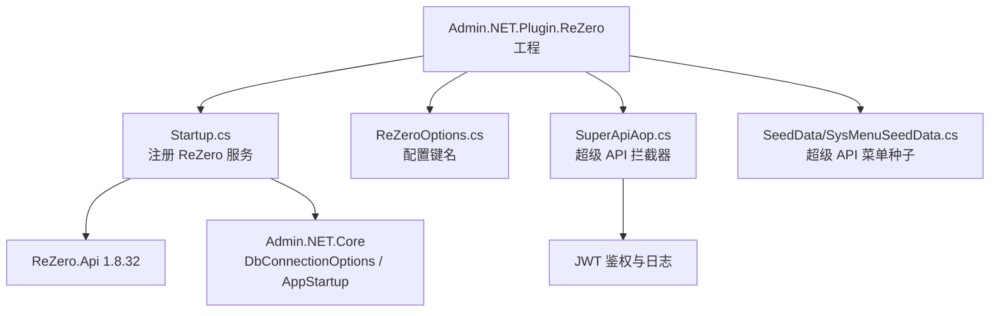
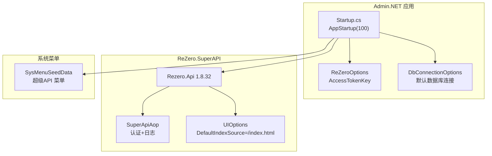
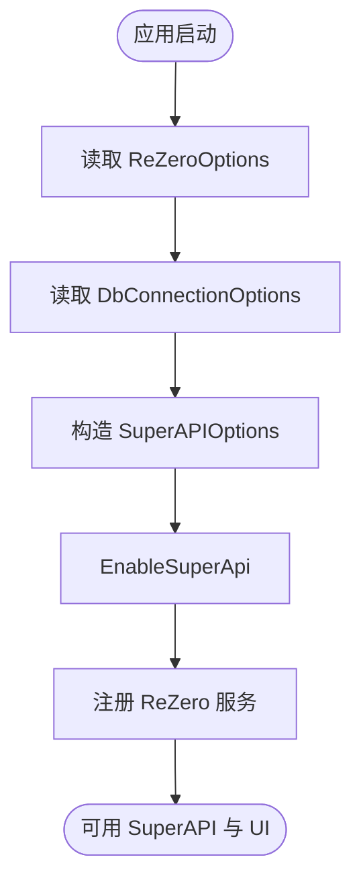
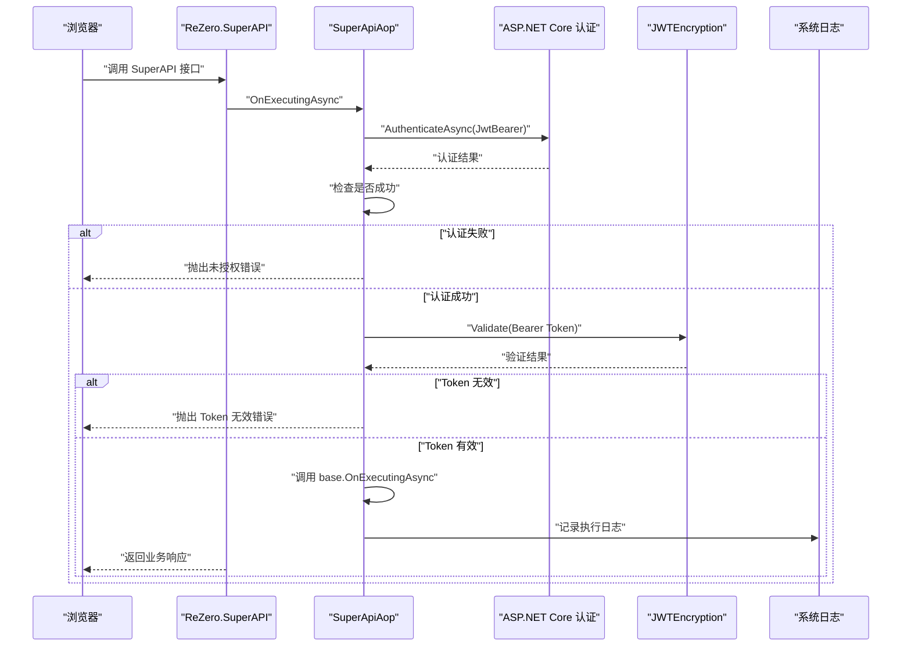
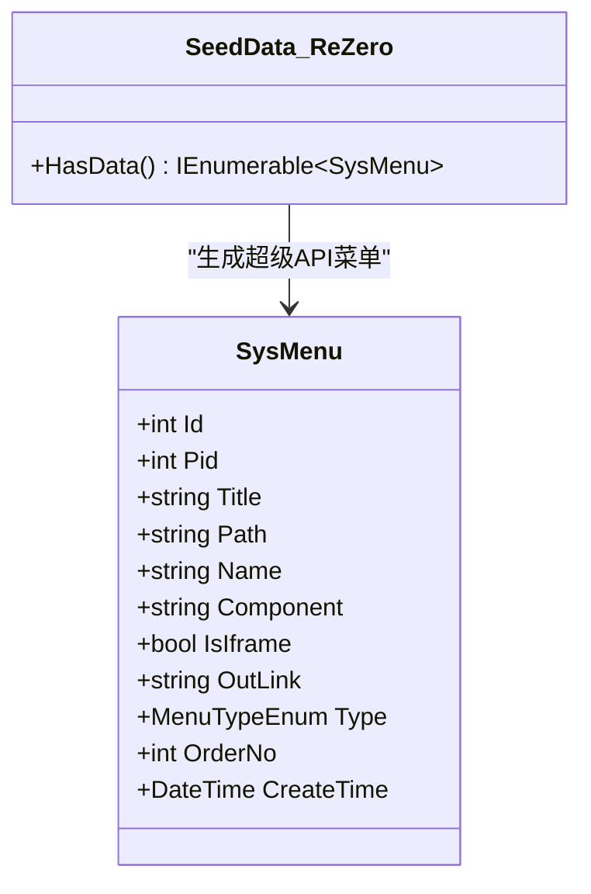
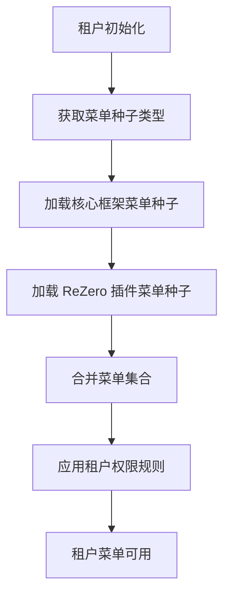
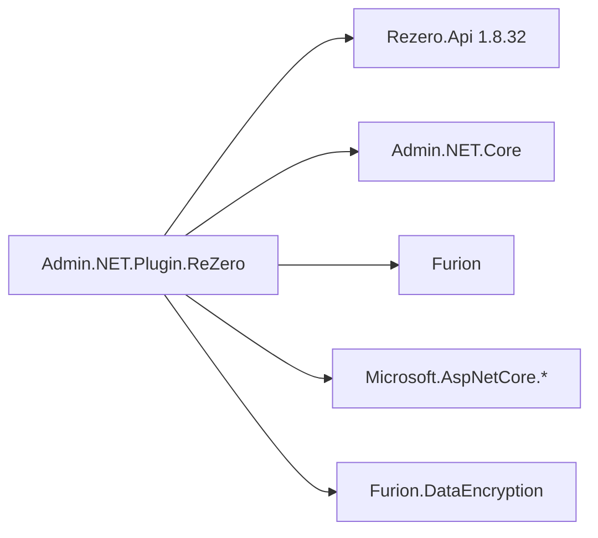

# ReZero 数据库同步插件

<cite>
**本文引用的文件**   
- [Admin.NET.Plugin.ReZero.csproj](file://Admin.NET/Plugins/Admin.NET.Plugin.ReZero/Admin.NET.Plugin.ReZero.csproj)
- [GlobalUsings.cs](file://Admin.NET/Plugins/Admin.NET.Plugin.ReZero/GlobalUsings.cs)
- [Startup.cs](file://Admin.NET/Plugins/Admin.NET.Plugin.ReZero/Startup.cs)
- [ReZeroOptions.cs](file://Admin.NET/Plugins/Admin.NET.Plugin.ReZero/Option/ReZeroOptions.cs)
- [SuperApiAop.cs](file://Admin.NET/Plugins/Admin.NET.Plugin.ReZero/Service/SuperApiAop.cs)
- [SysMenuSeedData.cs（ReZero 插件）](file://Admin.NET/Plugins/Admin.NET.Plugin.ReZero/SeedData/SysMenuSeedData.cs)
- [SysMenuSeedData.cs（核心框架）](file://Admin.NET/Admin.NET.Core/SeedData/SysMenuSeedData.cs)
- [SysTenantService.cs](file://Admin.NET/Admin.NET.Core/Service/Tenant/SysTenantService.cs)
</cite>

## 目录
1. [简介](#简介)
2. [项目结构](#项目结构)
3. [核心组件](#核心组件)
4. [架构总览](#架构总览)
5. [详细组件分析](#详细组件分析)
6. [依赖关系分析](#依赖关系分析)
7. [性能与扩展性](#性能与扩展性)
8. [配置与部署](#配置与部署)
9. [故障排查指南](#故障排查指南)
10. [结论](#结论)

## 简介
本技术文档围绕 Admin.NET 中的 ReZero 数据库同步插件展开，聚焦以下目标：
- 说明如何集成 ReZero.Api 1.8.32。
- 解释 SuperAPI 的配置、数据库连接映射与 UI 入口。
- 解析 ReZeroOptions 配置项及与前端本地存储的约定。
- 深入分析 SuperApiAop 超级 API 拦截器的请求过滤、鉴权与日志记录机制。
- 说明 SysMenuSeedData 菜单种子数据的初始化过程及其在租户体系中的作用。
- 给出与 Admin.NET 多租户架构的集成建议、数据模型自动映射策略与增量同步实践思路。
- 提供插件配置示例、部署步骤和常见问题排查方法。

## 项目结构
ReZero 插件位于 `Admin.NET/Plugins/Admin.NET.Plugin.ReZero`，当前源码包含以下关键部分：
- 工程定义：目标框架为 `net8.0` 与 `net10.0`，引用 `Rezero.Api 1.8.32`，并引用 Admin.NET Core 工程。
- 启动装配：通过 AppStartup 注册 ReZero 服务，绑定默认数据库连接，启用 SuperAPI 与 UI。
- 配置选项：ReZeroOptions 提供 AccessTokenKey 与 RefreshAccessTokenKey 等键名。
- 拦截器：SuperApiAop 实现 SuperAPI 的生命周期钩子，完成认证校验与日志采集。
- 菜单种子：SysMenuSeedData 注入“超级API”相关菜单，便于从 Admin.NET 前端访问 ReZero UI。

**图示来源**
- [Admin.NET.Plugin.ReZero.csproj:1-36](file://Admin.NET/Plugins/Admin.NET.Plugin.ReZero/Admin.NET.Plugin.ReZero.csproj#L1-L36)
- [Startup.cs:1-54](file://Admin.NET/Plugins/Admin.NET.Plugin.ReZero/Startup.cs#L1-L54)

**章节来源**
- [Admin.NET.Plugin.ReZero.csproj:1-36](file://Admin.NET/Plugins/Admin.NET.Plugin.ReZero/Admin.NET.Plugin.ReZero.csproj#L1-L36)
- [GlobalUsings.cs:1-8](file://Admin.NET/Plugins/Admin.NET.Plugin.ReZero/GlobalUsings.cs#L1-L8)

## 核心组件
- ReZero 插件工程：声明对 Rezero.Api 1.8.32 的 NuGet 引用，并将 Configuration 与 wwwroot 内容复制到输出目录，便于运行期加载外部资源。
- Startup：读取 ReZeroOptions 与 DbConnection 配置，构造 SuperAPIOptions，启用 SuperAPI 与 UI，并挂载自定义拦截器。
- ReZeroOptions：提供 AccessTokenKey 与 RefreshAccessTokenKey，作为浏览器 LocalStorage 中 Token 键名的配置点。
- SuperApiAop：继承 DefaultSuperApiAop，实现 OnExecutingAsync、OnExecutedAsync、OnErrorAsync，负责 JWT 校验、异常日志与统一审计信息写入。
- SysMenuSeedData（插件）：向系统菜单表插入“超级API”分组与若干 iframe 页面入口，指向 ReZero 动态接口管理、数据库管理、实体表管理等界面。

**章节来源**
- [Startup.cs:1-54](file://Admin.NET/Plugins/Admin.NET.Plugin.ReZero/Startup.cs#L1-L54)
- [ReZeroOptions.cs:1-20](file://Admin.NET/Plugins/Admin.NET.Plugin.ReZero/Option/ReZeroOptions.cs#L1-L20)
- [SuperApiAop.cs:1-110](file://Admin.NET/Plugins/Admin.NET.Plugin.ReZero/Service/SuperApiAop.cs#L1-L110)
- [SysMenuSeedData.cs（ReZero 插件）:1-32](file://Admin.NET/Plugins/Admin.NET.Plugin.ReZero/SeedData/SysMenuSeedData.cs#L1-L32)

## 架构总览
下图展示 ReZero 插件在 Admin.NET 中的整体位置与交互路径：应用启动时由 Startup 注册 ReZero；SuperAPI 使用默认数据库连接；浏览器通过 Admin.NET 前端访问 ReZero UI；业务 SuperAPI 调用经过 SuperApiAop 进行鉴权和日志记录。

**图示来源**
- [Startup.cs:1-54](file://Admin.NET/Plugins/Admin.NET.Plugin.ReZero/Startup.cs#L1-L54)
- [ReZeroOptions.cs:1-20](file://Admin.NET/Plugins/Admin.NET.Plugin.ReZero/Option/ReZeroOptions.cs#L1-L20)
- [SysMenuSeedData.cs（ReZero 插件）:1-32](file://Admin.NET/Plugins/Admin.NET.Plugin.ReZero/SeedData/SysMenuSeedData.cs#L1-L32)

## 详细组件分析

### ReZero 插件工程与依赖
- 目标框架：同时支持 `net8.0` 与 `net10.0`。
- 包依赖：引入 `Rezero.Api 1.8.32`，并通过 ProjectReference 引用 Admin.NET.Core。
- 内容文件：将 Configuration 与 wwwroot 复制到输出目录，确保插件运行时可加载配置与静态资源。

该工程是 ReZero 能力接入 Admin.NET 的唯一代码入口，所有 SuperAPI、UI 与菜单种子均在此插件内组织。

**章节来源**
- [Admin.NET.Plugin.ReZero.csproj:1-36](file://Admin.NET/Plugins/Admin.NET.Plugin.ReZero/Admin.NET.Plugin.ReZero.csproj#L1-L36)
- [GlobalUsings.cs:1-8](file://Admin.NET/Plugins/Admin.NET.Plugin.ReZero/GlobalUsings.cs#L1-L8)

### Startup：ReZero 服务注册与 SuperAPI 配置
Startup 的作用是将 ReZero 的能力装配到 Admin.NET 的依赖注入容器中，主要流程如下：
1. 读取 ReZeroOptions，获取 AccessTokenKey 等键名。
2. 读取 DbConnectionOptions，取第一个数据库连接作为 SuperAPI 的默认数据库。
3. 构建 SuperAPIOptions：
   - DatabaseOptions.ConnectionConfig：DbType 与 ConnectionString 来自默认数据库配置。
   - UiOptions.DefaultIndexSource：设置为 `/index.html`，用于 ReZero UI 的默认入口。
   - InterfaceOptions.AuthorizationLocalStorageName：设置为 ReZeroOptions.AccessTokenKey，使 ReZero UI 在浏览器 LocalStorage 中使用指定键名存取 Token。
   - InterfaceOptions.SuperApiAop：注入自定义 SuperApiAop，实现认证与日志。
4. 调用 services.AddReZeroServices 并启用 SuperAPI。

**图示来源**
- [Startup.cs:1-54](file://Admin.NET/Plugins/Admin.NET.Plugin.ReZero/Startup.cs#L1-L54)

**章节来源**
- [Startup.cs:1-54](file://Admin.NET/Plugins/Admin.NET.Plugin.ReZero/Startup.cs#L1-L54)

### ReZeroOptions：配置项说明
ReZeroOptions 暴露两个字符串属性：
- AccessTokenKey：表示浏览器 LocalStorage 中存储访问令牌的键名。
- RefreshAccessTokenKey：表示刷新令牌在 LocalStorage 中的键名。

这些键名会直接传递给 ReZero UI，决定前端从哪里读取 Token。若与前端不一致，会导致 ReZero 界面无法携带授权信息访问后端接口。

**章节来源**
- [ReZeroOptions.cs:1-20](file://Admin.NET/Plugins/Admin.NET.Plugin.ReZero/Option/ReZeroOptions.cs#L1-L20)

### SuperApiAop：超级 API 拦截器
SuperApiAop 继承 ReZero 的 DefaultSuperApiAop，覆盖三个生命周期方法：
- OnExecutingAsync：执行前拦截，先尝试以 JwtBearerDefaults.AuthenticationScheme 进行 ASP.NET Core 认证；若失败则抛出未授权错误。随后从 Authorization 头提取 Bearer Token，使用 JWTEncryption 验证有效性；验证通过后继续调用基类逻辑。
- OnExecutedAsync：执行后拦截，初始化日志上下文并以 Information 级别记录。
- OnErrorAsync：异常拦截，初始化日志上下文并以 Error 级别记录。

InitLogContext 内部会：
- 从请求头 Authorization 中提取 Token。
- 使用 JWTEncryption.ReadJwtToken 解析 Claims。
- 根据 ClaimConst.Account 与 ClaimConst.RealName 提取用户名与真实姓名。
- 从接口 URL 中提取 actionName，并根据接口类型设置 controllerName。
- 收集远端 IPv4、User-Agent、HTTP 状态码、异常信息等。
- 使用 App.GetRequiredService<ILoggerFactory>() 创建日志器，并写入 CommonConst.SysLogCategoryName 分类，把结构化监控信息放入 ScopeContext。

**图示来源**
- [SuperApiAop.cs:1-110](file://Admin.NET/Plugins/Admin.NET.Plugin.ReZero/Service/SuperApiAop.cs#L1-L110)

**章节来源**
- [SuperApiAop.cs:1-110](file://Admin.NET/Plugins/Admin.NET.Plugin.ReZero/Service/SuperApiAop.cs#L1-L110)

### SysMenuSeedData：菜单种子数据初始化
插件中的 SysMenuSeedData 实现了 ISqlSugarEntitySeedData<SysMenu>，其 HasData 返回一组 SysMenu 对象，构成“超级API”菜单树：
- 一级目录：超级API。
- 二级菜单：动态接口、数据库管理、实体表管理、接口分类、接口定义。
- 二级菜单多数使用 iframe 方式嵌入 ReZero 提供的静态页面，例如 dynamic_interface.html、database_manager.html、entity_manager.html 等。

该种子数据与核心框架中的 SysMenuSeedData 不同：前者属于 ReZero 插件，后者属于 Admin.NET 核心系统菜单。两者都通过 SqlSugar 的种子数据机制在数据库初始化或租户初始化阶段被消费。

**图示来源**
- [SysMenuSeedData.cs（ReZero 插件）:1-32](file://Admin.NET/Plugins/Admin.NET.Plugin.ReZero/SeedData/SysMenuSeedData.cs#L1-L32)

**章节来源**
- [SysMenuSeedData.cs（ReZero 插件）:1-32](file://Admin.NET/Plugins/Admin.NET.Plugin.ReZero/SeedData/SysMenuSeedData.cs#L1-L32)
- [SysMenuSeedData.cs（核心框架）:1-116](file://Admin.NET/Admin.NET.Core/SeedData/SysMenuSeedData.cs#L1-L116)

### 与 Admin.NET 多租户架构的集成
Admin.NET 的核心租户服务在租户相关流程中会使用 SysMenuSeedData 的种子数据：
- 获取菜单种子数据类型列表。
- 构建完整菜单集合。
- 在特定场景下基于种子菜单 ID 做权限或范围控制。

这意味着 ReZero 插件的 SysMenuSeedData 会在租户初始化时被纳入菜单数据源。对于多租户场景，需要注意：
- 如果每个租户需要独立菜单，应区分种子数据归属或使用租户隔离策略。
- 如果所有租户共享 ReZero 管理入口，可将插件菜单视为平台级菜单，仅在具备相应角色或权限的用户可见。
- 若需要在租户库中隔离 ReZero 数据，需结合 SqlSugar 的多租户分库策略与 ReZero 的数据库配置，确保 SuperAPI 使用的数据库连接符合租户期望。

**图示来源**
- [SysTenantService.cs:319-379](file://Admin.NET/Admin.NET.Core/Service/Tenant/SysTenantService.cs#L319-L379)
- [SysTenantService.cs:662](file://Admin.NET/Admin.NET.Core/Service/Tenant/SysTenantService.cs#L662)

**章节来源**
- [SysTenantService.cs:319-379](file://Admin.NET/Admin.NET.Core/Service/Tenant/SysTenantService.cs#L319-L379)
- [SysTenantService.cs:662](file://Admin.NET/Admin.NET.Core/Service/Tenant/SysTenantService.cs#L662)

## 依赖关系分析
ReZero 插件的关键依赖如下：
- Rezero.Api 1.8.32：提供 SuperAPI、InterfaceContext、DefaultSuperApiAop、SuperAPIOptions、DatabaseOptions、UiOptions、InterfaceOptions 等类型。
- Admin.NET.Core：提供 AppStartup、DbConnectionOptions、SysMenu、SqlSugar 种子数据接口、ClaimConst、CommonConst 等基础能力。
- Furion：提供 IConfigurableOptions、App.GetConfig、JSON 序列化等通用能力。
- Microsoft.AspNetCore.*：提供 HttpContext、Authentication、JwtBearer 等 Web 中间件类型。
- Furion.DataEncryption：提供 JWTEncryption，用于解析与校验 JWT。

**图示来源**
- [Admin.NET.Plugin.ReZero.csproj:1-36](file://Admin.NET/Plugins/Admin.NET.Plugin.ReZero/Admin.NET.Plugin.ReZero.csproj#L1-L36)
- [Startup.cs:1-54](file://Admin.NET/Plugins/Admin.NET.Plugin.ReZero/Startup.cs#L1-L54)
- [SuperApiAop.cs:1-110](file://Admin.NET/Plugins/Admin.NET.Plugin.ReZero/Service/SuperApiAop.cs#L1-L110)

**章节来源**
- [Admin.NET.Plugin.ReZero.csproj:1-36](file://Admin.NET/Plugins/Admin.NET.Plugin.ReZero/Admin.NET.Plugin.ReZero.csproj#L1-L36)
- [Startup.cs:1-54](file://Admin.NET/Plugins/Admin.NET.Plugin.ReZero/Startup.cs#L1-L54)
- [SuperApiAop.cs:1-110](file://Admin.NET/Plugins/Admin.NET.Plugin.ReZero/Service/SuperApiAop.cs#L1-L110)

## 性能与扩展性
- 拦截器开销：SuperApiAop 在每个 SuperAPI 调用中执行 ASP.NET Core 认证、JWT 解析与结构化日志写入。高频调用场景下，应避免在 InitLogContext 中进行昂贵操作。
- 日志写入：日志通过 ILoggerFactory 创建 logger 并使用 ScopeContext 传递监控信息，建议在分布式环境中配合集中式日志系统提升可观测性。
- 数据库连接：SuperAPI 使用默认数据库连接，若存在高并发写操作，应考虑连接池参数优化与读写分离策略。
- 可扩展点：
  - 可在 SuperApiAop 中增加更细粒度的权限判断，例如基于角色、数据范围或租户标识。
  - 可在 Startup 中根据环境或租户切换不同的数据库连接。
  - 可在 SysMenuSeedData 中按业务模块拆分更多菜单条目。

[本节为通用性能讨论，不直接分析具体文件]

## 配置与部署

### 插件配置示例
在应用配置中，需要至少提供以下配置段：
- ReZero：
  - AccessTokenKey：浏览器 LocalStorage 中存储访问令牌的键名。
  - RefreshAccessTokenKey：浏览器 LocalStorage 中存储刷新令牌的键名。
- DbConnection：
  - 第一个连接的 DbType 与 ConnectionString 会被 ReZero SuperAPI 使用。

注意：
- AccessTokenKey 必须与前端 ReZero UI 读取 Token 的键名一致。
- 若前端已使用其他键名，请调整前端配置或修改 ReZeroOptions 的 AccessTokenKey。

**章节来源**
- [ReZeroOptions.cs:1-20](file://Admin.NET/Plugins/Admin.NET.Plugin.ReZero/Option/ReZeroOptions.cs#L1-L20)
- [Startup.cs:1-54](file://Admin.NET/Plugins/Admin.NET.Plugin.ReZero/Startup.cs#L1-L54)

### 部署步骤
1. 确保 Admin.NET 应用已引用 Admin.NET.Plugin.ReZero 工程或对应 NuGet 包。
2. 确认应用已启用 ReZero 插件的 AppStartup，通常由 Admin.NET 插件加载机制自动发现。
3. 在配置文件中添加 ReZero 与 DbConnection 配置。
4. 发布并运行应用，确认：
   - ReZero 服务已注册。
   - SuperAPI 可通过默认数据库连接访问。
   - ReZero UI 可通过 Admin.NET 前端菜单进入。
5. 在浏览器中登录 Admin.NET，打开“超级API”菜单，验证动态接口、数据库管理、实体表管理等页面能正常加载。

**章节来源**
- [Admin.NET.Plugin.ReZero.csproj:1-36](file://Admin.NET/Plugins/Admin.NET.Plugin.ReZero/Admin.NET.Plugin.ReZero.csproj#L1-L36)
- [Startup.cs:1-54](file://Admin.NET/Plugins/Admin.NET.Plugin.ReZero/Startup.cs#L1-L54)
- [SysMenuSeedData.cs（ReZero 插件）:1-32](file://Admin.NET/Plugins/Admin.NET.Plugin.ReZero/SeedData/SysMenuSeedData.cs#L1-L32)

### 数据模型自动映射策略与增量同步机制
当前源码中，ReZero 插件仅完成了：
- SuperAPI 服务注册。
- 默认数据库连接映射。
- UI 菜单种子注入。
- 超级 API 拦截器。

并未在本插件中实现 Admin.NET 业务实体与 ReZero 数据模型的自动映射或增量同步逻辑。因此：
- 自动映射：需要开发者在 ReZero 的接口层或业务层显式定义数据转换逻辑。
- 增量同步：需要结合 ReZero 的数据模型设计与 Admin.NET 的业务实体设计，自行实现变更检测、差异比较与数据推送。
- 多租户数据隔离：如需按租户隔离，应在 SuperAPI 数据访问层结合租户上下文，或在 Startup 中按租户选择数据库连接。

[本节为概念性说明，不直接分析具体文件]

## 故障排查指南

### 问题一：ReZero UI 无法加载或显示空白
可能原因：
- ReZeroOptions.AccessTokenKey 与前端不一致。
- DbConnection 配置错误或默认连接不可用。
- ReZero 静态资源未正确复制。

排查步骤：
1. 检查配置文件中的 ReZero.AccessTokenKey。
2. 检查浏览器 LocalStorage 是否存在对应键名。
3. 检查 DbConnection 的第一个连接是否能连通。
4. 确认插件的 wwwroot 与 Configuration 已复制到输出目录。

**章节来源**
- [Startup.cs:1-54](file://Admin.NET/Plugins/Admin.NET.Plugin.ReZero/Startup.cs#L1-L54)
- [Admin.NET.Plugin.ReZero.csproj:1-36](file://Admin.NET/Plugins/Admin.NET.Plugin.ReZero/Admin.NET.Plugin.ReZero.csproj#L1-L36)

### 问题二：调用 SuperAPI 报“没权限 Unauthorized”
可能原因：
- ASP.NET Core 认证失败。
- Authorization 头缺失或格式不正确。
- JWT 无效或过期。

排查步骤：
1. 检查请求是否携带 Authorization: Bearer <token>。
2. 检查 token 是否由 Admin.NET 登录流程签发。
3. 查看 SuperApiAop 抛出的未授权或 Token 无效错误。
4. 检查 JWTEncryption 是否能解析并验证 token。

**章节来源**
- [SuperApiAop.cs:1-110](file://Admin.NET/Plugins/Admin.NET.Plugin.ReZero/Service/SuperApiAop.cs#L1-L110)

### 问题三：ReZero 超级 API 日志缺失
可能原因：
- 日志分类不是 CommonConst.SysLogCategoryName。
- ScopeContext 或日志配置未启用。
- 应用未正确注入 ILoggerFactory。

排查步骤：
1. 检查日志分类是否为 CommonConst.SysLogCategoryName。
2. 检查日志输出是否启用结构化监控字段 loggingMonitor。
3. 确认 App.GetRequiredService<ILoggerFactory>() 能获取到日志工厂。

**章节来源**
- [SuperApiAop.cs:1-110](file://Admin.NET/Plugins/Admin.NET.Plugin.ReZero/Service/SuperApiAop.cs#L1-L110)

### 问题四：菜单中看不到“超级API”
可能原因：
- 插件种子数据未生效。
- 租户初始化未加载插件菜单种子。
- 用户无权限访问该菜单。

排查步骤：
1. 检查数据库 sys_menu 是否存在插件生成的“超级API”菜单。
2. 检查租户初始化流程是否加载了 SysMenuSeedData。
3. 检查用户角色与菜单权限。

**章节来源**
- [SysMenuSeedData.cs（ReZero 插件）:1-32](file://Admin.NET/Plugins/Admin.NET.Plugin.ReZero/SeedData/SysMenuSeedData.cs#L1-L32)
- [SysTenantService.cs:319-379](file://Admin.NET/Admin.NET.Core/Service/Tenant/SysTenantService.cs#L319-L379)

## 结论
ReZero 数据库同步插件在当前仓库中提供了稳定的集成基础：
- 通过 Startup 将 ReZero.Api 1.8.32 与 Admin.NET 依赖注入、默认数据库连接与 UI 入口打通。
- 通过 ReZeroOptions 明确 Token 键名，保证前端与后端对 LocalStorage 的约定一致。
- 通过 SuperApiAop 实现对 SuperAPI 的统一认证校验与结构化日志记录。
- 通过 SysMenuSeedData 为 Admin.NET 前端提供 ReZero 管理界面的入口。

若需要完整的自动映射与增量同步能力，应在插件基础上进一步开发数据转换层与同步调度逻辑，并结合 Admin.NET 的多租户、权限与日志体系进行扩展。

[本节为总结性内容，不直接分析具体文件]