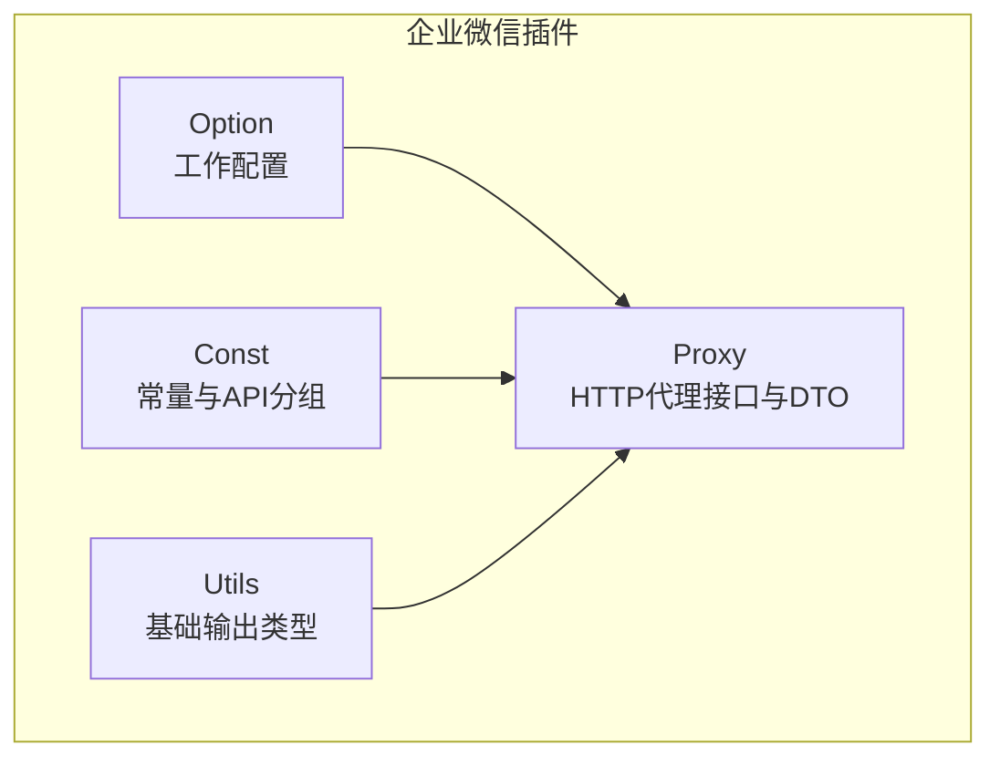
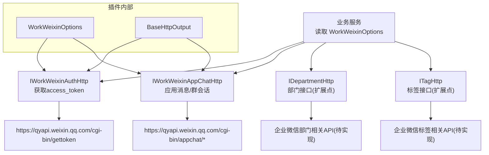
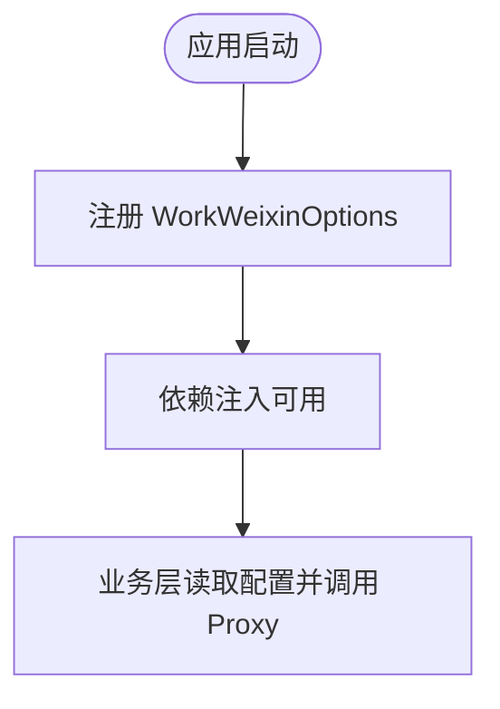
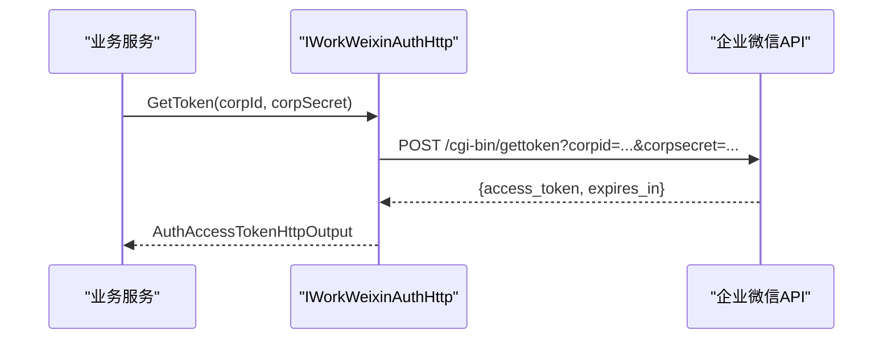
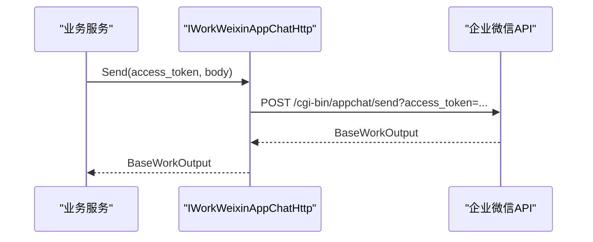
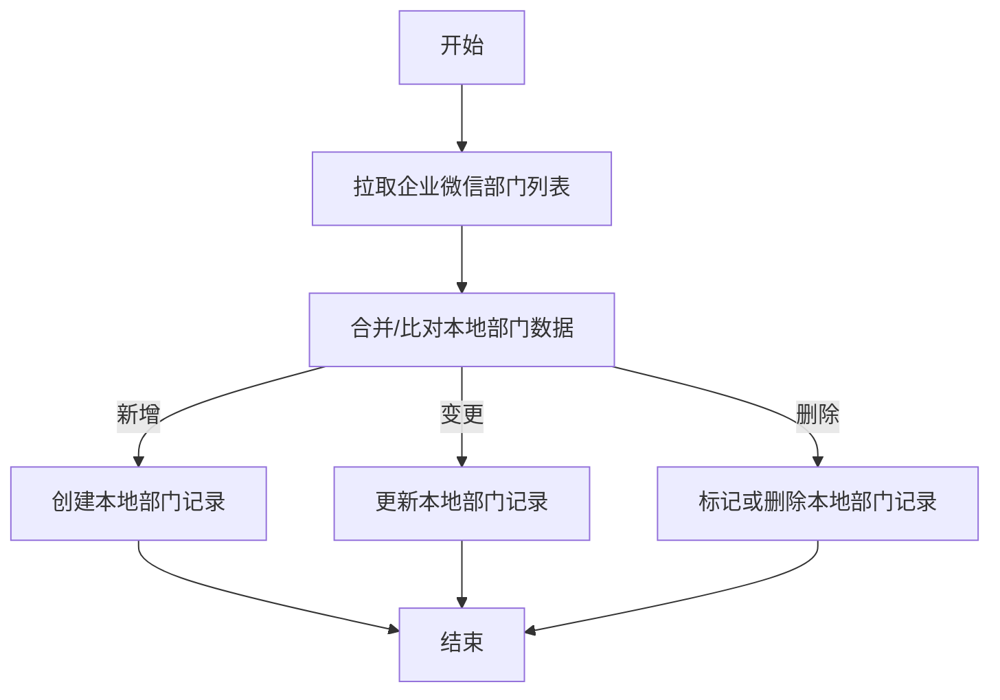
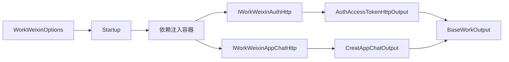

# 企业微信插件

<cite>
**本文引用的文件**   
- [Admin.NET/Plugins/Admin.NET.Plugin.WorkWeixin/Option/WorkWeixinOptions.cs](file://Admin.NET/Plugins/Admin.NET.Plugin.WorkWeixin/Option/WorkWeixinOptions.cs)
- [Admin.NET/Plugins/Admin.NET.Plugin.WorkWeixin/Startup.cs](file://Admin.NET/Plugins/Admin.NET.Plugin.WorkWeixin/Startup.cs)
- [Admin.NET/Plugins/Admin.NET.Plugin.WorkWeixin/Const/WorkWeixinConst.cs](file://Admin.NET/Plugins/Admin.NET.Plugin.WorkWeixin/Const/WorkWeixinConst.cs)
- [Admin.NET/Plugins/Admin.NET.Plugin.WorkWeixin/Proxy/Auth/IWorkWeixinAuthHttp.cs](file://Admin.NET/Plugins/Admin.NET.Plugin.WorkWeixin/Proxy/Auth/IWorkWeixinAuthHttp.cs)
- [Admin.NET/Plugins/Admin.NET.Plugin.WorkWeixin/Proxy/Auth/Dto/WorkWeixinAuthHttpOutput.cs](file://Admin.NET/Plugins/Admin.NET.Plugin.WorkWeixin/Proxy/Auth/Dto/WorkWeixinAuthHttpOutput.cs)
- [Admin.NET/Plugins/Admin.NET.Plugin.WorkWeixin/Proxy/AppChat/IWorkWeixinAppChatHttp.cs](file://Admin.NET/Plugins/Admin.NET.Plugin.WorkWeixin/Proxy/AppChat/IWorkWeixinAppChatHttp.cs)
- [Admin.NET/Plugins/Admin.NET.Plugin.WorkWeixin/Proxy/AppChat/Dto/AppChatHttpInput.cs](file://Admin.NET/Plugins/Admin.NET.Plugin.WorkWeixin/Proxy/AppChat/Dto/AppChatHttpInput.cs)
- [Admin.NET/Plugins/Admin.NET.Plugin.WorkWeixin/Proxy/AppChat/Dto/AppChatHttpOutput.cs](file://Admin.NET/Plugins/Admin.NET.Plugin.WorkWeixin/Proxy/AppChat/Dto/AppChatHttpOutput.cs)
- [Admin.NET/Plugins/Admin.NET.Plugin.WorkWeixin/Proxy/Department/IDepartmentHttp.cs](file://Admin.NET/Plugins/Admin.NET.Plugin.WorkWeixin/Proxy/Department/IDepartmentHttp.cs)
- [Admin.NET/Plugins/Admin.NET.Plugin.WorkWeixin/Proxy/Department/Dto/DepartmentHttpInput.cs](file://Admin.NET/Plugins/Admin.NET.Plugin.WorkWeixin/Proxy/Department/Dto/DepartmentHttpInput.cs)
- [Admin.NET/Plugins/Admin.NET.Plugin.WorkWeixin/Proxy/Department/Dto/DepartmentHttpOutput.cs](file://Admin.NET/Plugins/Admin.NET.Plugin.WorkWeixin/Proxy/Department/Dto/DepartmentHttpOutput.cs)
- [Admin.NET/Plugins/Admin.NET.Plugin.WorkWeixin/Proxy/Tag/ITagHttp.cs](file://Admin.NET/Plugins/Admin.NET.Plugin.WorkWeixin/Proxy/Tag/ITagHttp.cs)
- [Admin.NET/Plugins/Admin.NET.Plugin.WorkWeixin/Proxy/Tag/Dto/TagHttpInput.cs](file://Admin.NET/Plugins/Admin.NET.Plugin.WorkWeixin/Proxy/Tag/Dto/TagHttpInput.cs)
- [Admin.NET/Plugins/Admin.NET.Plugin.WorkWeixin/Proxy/Tag/Dto/TagHttpOutput.cs](file://Admin.NET/Plugins/Admin.NET.Plugin.WorkWeixin/Proxy/Tag/Dto/TagHttpOutput.cs)
- [Admin.NET/Plugins/Admin.NET.Plugin.WorkWeixin/Utils/BaseHttpOutput.cs](file://Admin.NET/Plugins/Admin.NET.Plugin.WorkWeixin/Utils/BaseHttpOutput.cs)
</cite>

## 目录
1. [引言](#引言)
2. [项目结构](#项目结构)
3. [核心组件](#核心组件)
4. [架构总览](#架构总览)
5. [详细组件分析](#详细组件分析)
6. [依赖关系分析](#依赖关系分析)
7. [性能与可靠性](#性能与可靠性)
8. [故障排查指南](#故障排查指南)
9. [配置、安全与生产部署](#配置安全与生产部署)
10. [结论](#结论)

## 引言
本技术文档聚焦 Admin.NET 的企业微信插件，围绕以下目标展开：
- 解析 WorkWeixinOptions 配置项及其在依赖注入中的注册方式。
- 说明企业微信 OAuth 凭证获取流程与 IWorkWeixinAuthHttp 接口契约。
- 梳理部门管理 API 抽象 IDepartmentHttp 及可扩展的组织同步逻辑。
- 讲解应用消息推送能力，包括群会话创建、更新、查询与应用消息发送。
- 介绍标签管理 API 抽象 ITagHttp 及常见分组操作。
- 阐释 Proxy 层的 HTTP 客户端封装模式、BaseHttpOutput 基类与错误处理策略。
- 提供 API 调用示例、消息格式定义和异常处理建议，并给出配置与安全部署指引。

## 项目结构
企业微信插件位于 `Admin.NET/Plugins/Admin.NET.Plugin.WorkWeixin`，采用按功能域划分的结构：
- Option：插件可配置选项。
- Const：常量与 API 分组名称。
- Proxy：面向企业微信 REST API 的声明式 HTTP 代理接口与 DTO。
- Utils：通用输出基类与工具。



图示来源
- [Admin.NET/Plugins/Admin.NET.Plugin.WorkWeixin/Option/WorkWeixinOptions.cs:1-25](file://Admin.NET/Plugins/Admin.NET.Plugin.WorkWeixin/Option/WorkWeixinOptions.cs#L1-L25)
- [Admin.NET/Plugins/Admin.NET.Plugin.WorkWeixin/Const/WorkWeixinConst.cs:1-15](file://Admin.NET/Plugins/Admin.NET.Plugin.WorkWeixin/Const/WorkWeixinConst.cs#L1-L15)
- [Admin.NET/Plugins/Admin.NET.Plugin.WorkWeixin/Proxy/Auth/IWorkWeixinAuthHttp.cs:1-23](file://Admin.NET/Plugins/Admin.NET.Plugin.WorkWeixin/Proxy/Auth/IWorkWeixinAuthHttp.cs#L1-L23)
- [Admin.NET/Plugins/Admin.NET.Plugin.WorkWeixin/Utils/BaseHttpOutput.cs](file://Admin.NET/Plugins/Admin.NET.Plugin.WorkWeixin/Utils/BaseHttpOutput.cs)

章节来源
- [Admin.NET/Plugins/Admin.NET.Plugin.WorkWeixin/Startup.cs:1-25](file://Admin.NET/Plugins/Admin.NET.Plugin.WorkWeixin/Startup.cs#L1-L25)
- [Admin.NET/Plugins/Admin.NET.Plugin.WorkWeixin/Const/WorkWeixinConst.cs:1-15](file://Admin.NET/Plugins/Admin.NET.Plugin.WorkWeixin/Const/WorkWeixinConst.cs#L1-L15)

## 核心组件
本节概述插件的核心模块与职责边界。

- 配置中心
  - WorkWeixinOptions：承载企业ID与密钥等敏感信息，通过 Furion 的可配置选项机制注入。
  - Startup：注册可配置选项，使业务层可通过依赖注入消费配置。

- 常量
  - WorkWeixinConst：集中定义 API 分组名，便于 OpenAPI/Swagger 或日志分类。

- Proxy 层
  - Auth：IWorkWeixinAuthHttp 负责获取 access_token；对应响应模型为 AuthAccessTokenHttpOutput。
  - AppChat：IWorkWeixinAppChatHttp 封装群会话创建、更新、查询与应用消息发送。
  - Department：IDepartmentHttp 抽象部门相关接口（当前源码仅暴露接口与 DTO）。
  - Tag：ITagHttp 抽象标签相关接口（当前源码仅暴露接口与 DTO）。

- 公共输出
  - BaseHttpOutput：统一返回结构，用于承载企业微信 API 的 code、errmsg 等标准字段。

章节来源
- [Admin.NET/Plugins/Admin.NET.Plugin.WorkWeixin/Option/WorkWeixinOptions.cs:1-25](file://Admin.NET/Plugins/Admin.NET.Plugin.WorkWeixin/Option/WorkWeixinOptions.cs#L1-L25)
- [Admin.NET/Plugins/Admin.NET.Plugin.WorkWeixin/Startup.cs:1-25](file://Admin.NET/Plugins/Admin.NET.Plugin.WorkWeixin/Startup.cs#L1-L25)
- [Admin.NET/Plugins/Admin.NET.Plugin.WorkWeixin/Const/WorkWeixinConst.cs:1-15](file://Admin.NET/Plugins/Admin.NET.Plugin.WorkWeixin/Const/WorkWeixinConst.cs#L1-L15)
- [Admin.NET/Plugins/Admin.NET.Plugin.WorkWeixin/Proxy/Auth/IWorkWeixinAuthHttp.cs:1-23](file://Admin.NET/Plugins/Admin.NET.Plugin.WorkWeixin/Proxy/Auth/IWorkWeixinAuthHttp.cs#L1-L23)
- [Admin.NET/Plugins/Admin.NET.Plugin.WorkWeixin/Proxy/Auth/Dto/WorkWeixinAuthHttpOutput.cs:1-24](file://Admin.NET/Plugins/Admin.NET.Plugin.WorkWeixin/Proxy/Auth/Dto/WorkWeixinAuthHttpOutput.cs#L1-L24)
- [Admin.NET/Plugins/Admin.NET.Plugin.WorkWeixin/Proxy/AppChat/IWorkWeixinAppChatHttp.cs:1-53](file://Admin.NET/Plugins/Admin.NET.Plugin.WorkWeixin/Proxy/AppChat/IWorkWeixinAppChatHttp.cs#L1-L53)
- [Admin.NET/Plugins/Admin.NET.Plugin.WorkWeixin/Proxy/Department/IDepartmentHttp.cs](file://Admin.NET/Plugins/Admin.NET.Plugin.WorkWeixin/Proxy/Department/IDepartmentHttp.cs)
- [Admin.NET/Plugins/Admin.NET.Plugin.WorkWeixin/Proxy/Tag/ITagHttp.cs](file://Admin.NET/Plugins/Admin.NET.Plugin.WorkWeixin/Proxy/Tag/ITagHttp.cs)
- [Admin.NET/Plugins/Admin.NET.Plugin.WorkWeixin/Utils/BaseHttpOutput.cs](file://Admin.NET/Plugins/Admin.NET.Plugin.WorkWeixin/Utils/BaseHttpOutput.cs)

## 架构总览
企业微信插件以“声明式 HTTP 代理 + 强类型 DTO”的方式对接企业微信 REST API，并通过 Options 注入配置。



图示来源
- [Admin.NET/Plugins/Admin.NET.Plugin.WorkWeixin/Option/WorkWeixinOptions.cs:1-25](file://Admin.NET/Plugins/Admin.NET.Plugin.WorkWeixin/Option/WorkWeixinOptions.cs#L1-L25)
- [Admin.NET/Plugins/Admin.NET.Plugin.WorkWeixin/Proxy/Auth/IWorkWeixinAuthHttp.cs:1-23](file://Admin.NET/Plugins/Admin.NET.Plugin.WorkWeixin/Proxy/Auth/IWorkWeixinAuthHttp.cs#L1-L23)
- [Admin.NET/Plugins/Admin.NET.Plugin.WorkWeixin/Proxy/AppChat/IWorkWeixinAppChatHttp.cs:1-53](file://Admin.NET/Plugins/Admin.NET.Plugin.WorkWeixin/Proxy/AppChat/IWorkWeixinAppChatHttp.cs#L1-L53)
- [Admin.NET/Plugins/Admin.NET.Plugin.WorkWeixin/Utils/BaseHttpOutput.cs](file://Admin.NET/Plugins/Admin.NET.Plugin.WorkWeixin/Utils/BaseHttpOutput.cs)

## 详细组件分析

### 配置与启动
- WorkWeixinOptions
  - CorpId：企业ID。
  - CorpSecret：企业微信凭证密钥。
  - 通过 Furion 的 IConfigurableOptions 机制注册，支持外部配置文件注入。
- Startup
  - 使用 AddConfigurableOptions<WorkWeixinOptions>() 完成服务注册。
  - Configure 为空，表明插件不直接挂载中间件，而是被宿主应用装配。



图示来源
- [Admin.NET/Plugins/Admin.NET.Plugin.WorkWeixin/Option/WorkWeixinOptions.cs:1-25](file://Admin.NET/Plugins/Admin.NET.Plugin.WorkWeixin/Option/WorkWeixinOptions.cs#L1-L25)
- [Admin.NET/Plugins/Admin.NET.Plugin.WorkWeixin/Startup.cs:1-25](file://Admin.NET/Plugins/Admin.NET.Plugin.WorkWeixin/Startup.cs#L1-L25)

章节来源
- [Admin.NET/Plugins/Admin.NET.Plugin.WorkWeixin/Option/WorkWeixinOptions.cs:1-25](file://Admin.NET/Plugins/Admin.NET.Plugin.WorkWeixin/Option/WorkWeixinOptions.cs#L1-L25)
- [Admin.NET/Plugins/Admin.NET.Plugin.WorkWeixin/Startup.cs:1-25](file://Admin.NET/Plugins/Admin.NET.Plugin.WorkWeixin/Startup.cs#L1-L25)

### OAuth 认证与令牌获取
- 接口契约
  - IWorkWeixinAuthHttp.GetToken：POST 到 https://qyapi.weixin.qq.com/cgi-bin/gettoken，参数 corpid、corpsecret，返回 AccessToken 与过期时间。
- 数据模型
  - AuthAccessTokenHttpOutput：继承 BaseWorkOutput，包含 AccessToken、ExpiresIn。
- 典型调用链
  - 业务服务从配置中获取 CorpId、CorpSecret。
  - 调用 IWorkWeixinAuthHttp.GetToken 取得 access_token。
  - 后续调用其他需要鉴权的 API 时携带该 token。



图示来源
- [Admin.NET/Plugins/Admin.NET.Plugin.WorkWeixin/Proxy/Auth/IWorkWeixinAuthHttp.cs:1-23](file://Admin.NET/Plugins/Admin.NET.Plugin.WorkWeixin/Proxy/Auth/IWorkWeixinAuthHttp.cs#L1-L23)
- [Admin.NET/Plugins/Admin.NET.Plugin.WorkWeixin/Proxy/Auth/Dto/WorkWeixinAuthHttpOutput.cs:1-24](file://Admin.NET/Plugins/Admin.NET.Plugin.WorkWeixin/Proxy/Auth/Dto/WorkWeixinAuthHttpOutput.cs#L1-L24)

章节来源
- [Admin.NET/Plugins/Admin.NET.Plugin.WorkWeixin/Proxy/Auth/IWorkWeixinAuthHttp.cs:1-23](file://Admin.NET/Plugins/Admin.NET.Plugin.WorkWeixin/Proxy/Auth/IWorkWeixinAuthHttp.cs#L1-L23)
- [Admin.NET/Plugins/Admin.NET.Plugin.WorkWeixin/Proxy/Auth/Dto/WorkWeixinAuthHttpOutput.cs:1-24](file://Admin.NET/Plugins/Admin.NET.Plugin.WorkWeixin/Proxy/Auth/Dto/WorkWeixinAuthHttpOutput.cs#L1-L24)

### 应用消息与群会话
- 接口契约
  - IWorkWeixinAppChatHttp 提供：
    - Create：创建群聊会话。
    - Update：修改群聊会话。
    - Get：查询群聊会话。
    - Send：向群会话发送应用消息。
- 请求与响应
  - 输入 DTO：CreatAppChatInput、UpdateAppChatInput、SendBaseAppChatInput（位于 AppChat/Dto）。
  - 输出 DTO：CreatAppChatOutput、BaseWorkOutput（位于 AppChat/Dto 与 Utils）。
- 消息发送流程



图示来源
- [Admin.NET/Plugins/Admin.NET.Plugin.WorkWeixin/Proxy/AppChat/IWorkWeixinAppChatHttp.cs:1-53](file://Admin.NET/Plugins/Admin.NET.Plugin.WorkWeixin/Proxy/AppChat/IWorkWeixinAppChatHttp.cs#L1-L53)
- [Admin.NET/Plugins/Admin.NET.Plugin.WorkWeixin/Proxy/AppChat/Dto/AppChatHttpInput.cs](file://Admin.NET/Plugins/Admin.NET.Plugin.WorkWeixin/Proxy/AppChat/Dto/AppChatHttpInput.cs)
- [Admin.NET/Plugins/Admin.NET.Plugin.WorkWeixin/Proxy/AppChat/Dto/AppChatHttpOutput.cs](file://Admin.NET/Plugins/Admin.NET.Plugin.WorkWeixin/Proxy/AppChat/Dto/AppChatHttpOutput.cs)
- [Admin.NET/Plugins/Admin.NET.Plugin.WorkWeixin/Utils/BaseHttpOutput.cs](file://Admin.NET/Plugins/Admin.NET.Plugin.WorkWeixin/Utils/BaseHttpOutput.cs)

章节来源
- [Admin.NET/Plugins/Admin.NET.Plugin.WorkWeixin/Proxy/AppChat/IWorkWeixinAppChatHttp.cs:1-53](file://Admin.NET/Plugins/Admin.NET.Plugin.WorkWeixin/Proxy/AppChat/IWorkWeixinAppChatHttp.cs#L1-L53)
- [Admin.NET/Plugins/Admin.NET.Plugin.WorkWeixin/Proxy/AppChat/Dto/AppChatHttpInput.cs](file://Admin.NET/Plugins/Admin.NET.Plugin.WorkWeixin/Proxy/AppChat/Dto/AppChatHttpInput.cs)
- [Admin.NET/Plugins/Admin.NET.Plugin.WorkWeixin/Proxy/AppChat/Dto/AppChatHttpOutput.cs](file://Admin.NET/Plugins/Admin.NET.Plugin.WorkWeixin/Proxy/AppChat/Dto/AppChatHttpOutput.cs)

### 部门管理与组织同步
- 接口与 DTO
  - IDepartmentHttp：部门相关 HTTP 代理接口（当前源码未展示具体方法）。
  - DepartmentHttpInput、DepartmentHttpOutput：部门输入输出 DTO（当前源码未展示字段）。
- 同步逻辑建议
  - 由于当前仓库未包含 IDepartmentHttp 的具体方法与实体映射，组织同步逻辑应在业务层实现：
    - 拉取企业微信部门树。
    - 与本地组织表进行增量/全量比对。
    - 维护主键、上级部门、状态等字段一致性。
  - 建议将幂等性与重试纳入同步任务设计，避免重复与抖动。



章节来源
- [Admin.NET/Plugins/Admin.NET.Plugin.WorkWeixin/Proxy/Department/IDepartmentHttp.cs](file://Admin.NET/Plugins/Admin.NET.Plugin.WorkWeixin/Proxy/Department/IDepartmentHttp.cs)
- [Admin.NET/Plugins/Admin.NET.Plugin.WorkWeixin/Proxy/Department/Dto/DepartmentHttpInput.cs](file://Admin.NET/Plugins/Admin.NET.Plugin.WorkWeixin/Proxy/Department/Dto/DepartmentHttpInput.cs)
- [Admin.NET/Plugins/Admin.NET.Plugin.WorkWeixin/Proxy/Department/Dto/DepartmentHttpOutput.cs](file://Admin.NET/Plugins/Admin.NET.Plugin.WorkWeixin/Proxy/Department/Dto/DepartmentHttpOutput.cs)

### 标签管理与分组操作
- 接口与 DTO
  - ITagHttp：标签相关 HTTP 代理接口（当前源码未展示具体方法）。
  - TagHttpInput、TagHttpOutput：标签输入输出 DTO（当前源码未展示字段）。
- 分组操作建议
  - 基于 ITagHttp 扩展标签增删改查、成员添加/移除、标签分组聚合等能力。
  - 与用户/部门维度结合，形成多维度标签体系。

章节来源
- [Admin.NET/Plugins/Admin.NET.Plugin.WorkWeixin/Proxy/Tag/ITagHttp.cs](file://Admin.NET/Plugins/Admin.NET.Plugin.WorkWeixin/Proxy/Tag/ITagHttp.cs)
- [Admin.NET/Plugins/Admin.NET.Plugin.WorkWeixin/Proxy/Tag/Dto/TagHttpInput.cs](file://Admin.NET/Plugins/Admin.NET.Plugin.WorkWeixin/Proxy/Tag/Dto/TagHttpInput.cs)
- [Admin.NET/Plugins/Admin.NET.Plugin.WorkWeixin/Proxy/Tag/Dto/TagHttpOutput.cs](file://Admin.NET/Plugins/Admin.NET.Plugin.WorkWeixin/Proxy/Tag/Dto/TagHttpOutput.cs)

### Proxy 层与错误处理
- 封装模式
  - 所有 HTTP 代理接口均继承 IHttpDeclarative，使用 Post/Get、QueryParam、Body 等特性描述远端 API。
  - 返回类型为 Task<TOutput>，TOutput 通常继承 BaseWorkOutput。
- BaseHttpOutput 与 BaseWorkOutput
  - BaseHttpOutput：通用 HTTP 输出基类。
  - BaseWorkOutput：企业微信 API 的统一返回体，用于承载 code、errmsg 等业务语义字段。
- 错误处理策略
  - 优先检查返回值中的 code 是否为成功码；若非成功码，抛出或包装异常，附带 errmsg。
  - 对网络异常、超时、HTTP 非 2xx 进行捕获与重试（指数退避）策略。
  - 针对 access_token 失效场景，应自动刷新并重试一次。

```mermaid
classDiagram
    class BaseHttpOutput
    class BaseWorkOutput
    class AuthAccessTokenHttpOutput
    class CreatAppChatOutput
    class BaseWorkOutput <|-- AuthAccessTokenHttpOutput
    class BaseWorkOutput <|-- CreatAppChatOutput
```

图示来源
- [Admin.NET/Plugins/Admin.NET.Plugin.WorkWeixin/Utils/BaseHttpOutput.cs](file://Admin.NET/Plugins/Admin.NET.Plugin.WorkWeixin/Utils/BaseHttpOutput.cs)
- [Admin.NET/Plugins/Admin.NET.Plugin.WorkWeixin/Proxy/Auth/Dto/WorkWeixinAuthHttpOutput.cs:1-24](file://Admin.NET/Plugins/Admin.NET.Plugin.WorkWeixin/Proxy/Auth/Dto/WorkWeixinAuthHttpOutput.cs#L1-L24)
- [Admin.NET/Plugins/Admin.NET.Plugin.WorkWeixin/Proxy/AppChat/Dto/AppChatHttpOutput.cs](file://Admin.NET/Plugins/Admin.NET.Plugin.WorkWeixin/Proxy/AppChat/Dto/AppChatHttpOutput.cs)

章节来源
- [Admin.NET/Plugins/Admin.NET.Plugin.WorkWeixin/Proxy/Auth/IWorkWeixinAuthHttp.cs:1-23](file://Admin.NET/Plugins/Admin.NET.Plugin.WorkWeixin/Proxy/Auth/IWorkWeixinAuthHttp.cs#L1-L23)
- [Admin.NET/Plugins/Admin.NET.Plugin.WorkWeixin/Proxy/AppChat/IWorkWeixinAppChatHttp.cs:1-53](file://Admin.NET/Plugins/Admin.NET.Plugin.WorkWeixin/Proxy/AppChat/IWorkWeixinAppChatHttp.cs#L1-L53)
- [Admin.NET/Plugins/Admin.NET.Plugin.WorkWeixin/Utils/BaseHttpOutput.cs](file://Admin.NET/Plugins/Admin.NET.Plugin.WorkWeixin/Utils/BaseHttpOutput.cs)

## 依赖关系分析
- 内部依赖
  - Startup 依赖 WorkWeixinOptions，完成可配置选项注册。
  - Proxy 接口依赖 Furion 的声明式 HTTP 特性（IHttpDeclarative、Post、Get、QueryParam、Body）。
  - 各类 Output 继承 BaseWorkOutput，保证返回结构一致。
- 外部依赖
  - 企业微信 REST API：gettoken、appchat/*。
  - Furion 框架提供的配置与 Web 基础设施。



图示来源
- [Admin.NET/Plugins/Admin.NET.Plugin.WorkWeixin/Startup.cs:1-25](file://Admin.NET/Plugins/Admin.NET.Plugin.WorkWeixin/Startup.cs#L1-L25)
- [Admin.NET/Plugins/Admin.NET.Plugin.WorkWeixin/Option/WorkWeixinOptions.cs:1-25](file://Admin.NET/Plugins/Admin.NET.Plugin.WorkWeixin/Option/WorkWeixinOptions.cs#L1-L25)
- [Admin.NET/Plugins/Admin.NET.Plugin.WorkWeixin/Proxy/Auth/IWorkWeixinAuthHttp.cs:1-23](file://Admin.NET/Plugins/Admin.NET.Plugin.WorkWeixin/Proxy/Auth/IWorkWeixinAuthHttp.cs#L1-L23)
- [Admin.NET/Plugins/Admin.NET.Plugin.WorkWeixin/Proxy/AppChat/IWorkWeixinAppChatHttp.cs:1-53](file://Admin.NET/Plugins/Admin.NET.Plugin.WorkWeixin/Proxy/AppChat/IWorkWeixinAppChatHttp.cs#L1-L53)
- [Admin.NET/Plugins/Admin.NET.Plugin.WorkWeixin/Proxy/Auth/Dto/WorkWeixinAuthHttpOutput.cs:1-24](file://Admin.NET/Plugins/Admin.NET.Plugin.WorkWeixin/Proxy/Auth/Dto/WorkWeixinAuthHttpOutput.cs#L1-L24)
- [Admin.NET/Plugins/Admin.NET.Plugin.WorkWeixin/Proxy/AppChat/Dto/AppChatHttpOutput.cs](file://Admin.NET/Plugins/Admin.NET.Plugin.WorkWeixin/Proxy/AppChat/Dto/AppChatHttpOutput.cs)
- [Admin.NET/Plugins/Admin.NET.Plugin.WorkWeixin/Utils/BaseHttpOutput.cs](file://Admin.NET/Plugins/Admin.NET.Plugin.WorkWeixin/Utils/BaseHttpOutput.cs)

章节来源
- [Admin.NET/Plugins/Admin.NET.Plugin.WorkWeixin/Startup.cs:1-25](file://Admin.NET/Plugins/Admin.NET.Plugin.WorkWeixin/Startup.cs#L1-L25)
- [Admin.NET/Plugins/Admin.NET.Plugin.WorkWeixin/Option/WorkWeixinOptions.cs:1-25](file://Admin.NET/Plugins/Admin.NET.Plugin.WorkWeixin/Option/WorkWeixinOptions.cs#L1-L25)

## 性能与可靠性
- Token 缓存
  - 建议对 access_token 进行短期缓存，避免频繁请求 gettoken。
  - 在 ExpiresIn 前一段时间主动刷新，降低失效概率。
- 限流与重试
  - 遵循企业微信 API 频率限制，必要时增加队列与背压控制。
  - 对瞬时失败进行有限次重试，指数退避，避免雪崩。
- 并发与线程安全
  - 共享的 HttpClient/代理实例需线程安全；建议使用 DI 生命周期管理。
- 可观测性
  - 记录关键链路：获取 token、发送消息、群会话操作的耗时与错误码。

[本节为通用指导，不涉及特定代码文件]

## 故障排查指南
- 无法获取 access_token
  - 检查 CorpId、CorpSecret 是否正确。
  - 确认网络可达且未被防火墙拦截 qyapi.weixin.qq.com。
  - 查看返回的 code、errmsg 定位具体错误原因。
- 消息发送失败
  - 检查 accessToken 是否有效，是否在有效期内。
  - 校验 Send 请求体的必填字段与格式是否符合企业微信规范。
  - 若返回权限不足，检查应用权限与企业微信后台配置。
- 组织/标签同步问题
  - 确认 IDepartmentHttp/ITagHttp 的实现已补齐。
  - 核对上游返回数据与本地映射规则的一致性。

章节来源
- [Admin.NET/Plugins/Admin.NET.Plugin.WorkWeixin/Proxy/Auth/IWorkWeixinAuthHttp.cs:1-23](file://Admin.NET/Plugins/Admin.NET.Plugin.WorkWeixin/Proxy/Auth/IWorkWeixinAuthHttp.cs#L1-L23)
- [Admin.NET/Plugins/Admin.NET.Plugin.WorkWeixin/Proxy/AppChat/IWorkWeixinAppChatHttp.cs:1-53](file://Admin.NET/Plugins/Admin.NET.Plugin.WorkWeixin/Proxy/AppChat/IWorkWeixinAppChatHttp.cs#L1-L53)
- [Admin.NET/Plugins/Admin.NET.Plugin.WorkWeixin/Proxy/Department/IDepartmentHttp.cs](file://Admin.NET/Plugins/Admin.NET.Plugin.WorkWeixin/Proxy/Department/IDepartmentHttp.cs)
- [Admin.NET/Plugins/Admin.NET.Plugin.WorkWeixin/Proxy/Tag/ITagHttp.cs](file://Admin.NET/Plugins/Admin.NET.Plugin.WorkWeixin/Proxy/Tag/ITagHttp.cs)

## 配置、安全与生产部署
- 配置方式
  - 通过 Furion 的可配置选项机制加载 WorkWeixinOptions。
  - 在企业级配置源中设置 CorpId、CorpSecret。
- 安全建议
  - 严禁将 CorpSecret 硬编码进代码库；使用密钥管理服务或环境变量注入。
  - 限制访问企业微信 API 的网络出口白名单。
  - 对日志中的敏感字段做脱敏处理。
- 部署要点
  - 确保宿主机能访问企业微信公网 API。
  - 合理设置应用超时、重试与熔断策略。
  - 对批量同步与消息推送使用异步任务与队列，避免阻塞主线程。

[本节为通用指导，不涉及特定代码文件]

## 结论
企业微信插件在当前版本提供了稳定的 OAuth 令牌获取与应用消息/群会话管理能力，并以清晰的 Proxy 接口形式暴露企业微信 REST API。部门与标签接口目前作为扩展点预留，业务方可在上层实现具体的同步与分组逻辑。通过 BaseWorkOutput 统一返回结构、Furion 的配置注入与声明式 HTTP 代理，插件具备良好的可测试性与可维护性。在生产环境中，应重点加强敏感信息管理、令牌缓存与限流重试策略，以确保稳定可靠地与企业微信平台集成。

[本节为总结性内容，不涉及特定代码文件]