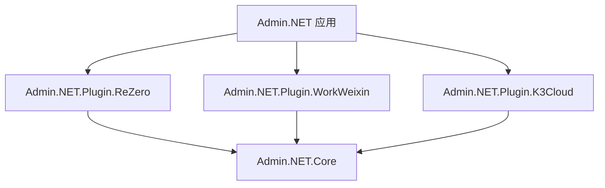
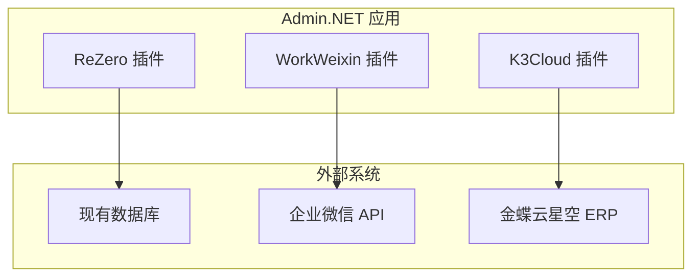
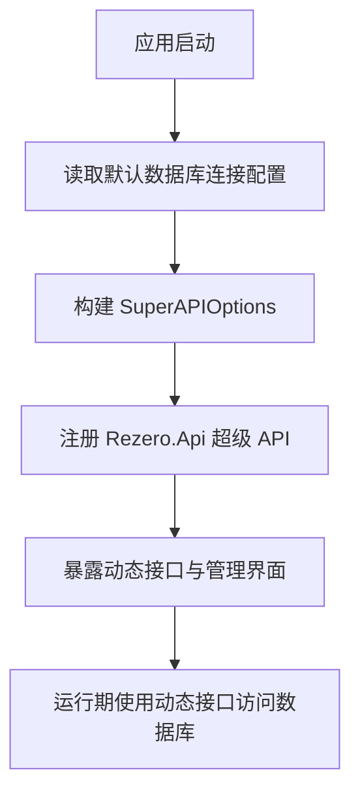
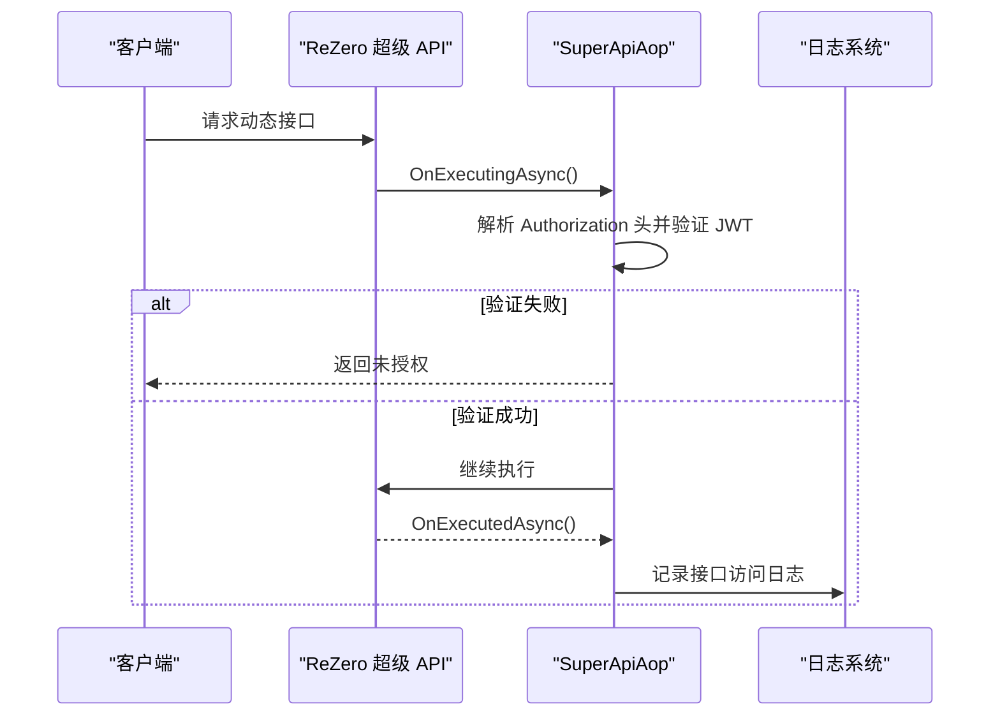
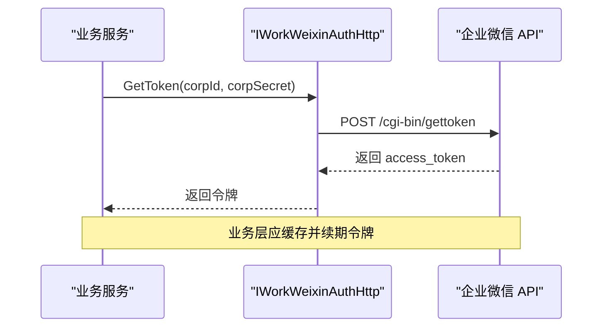
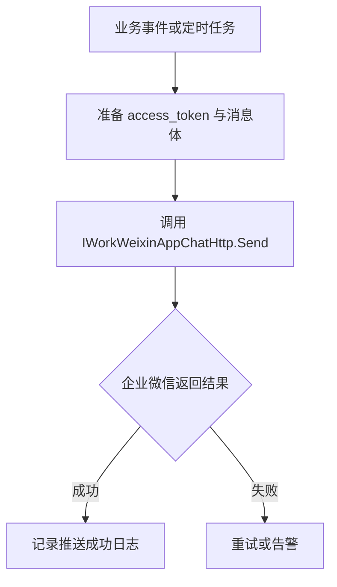
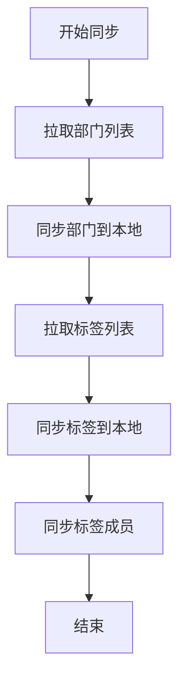
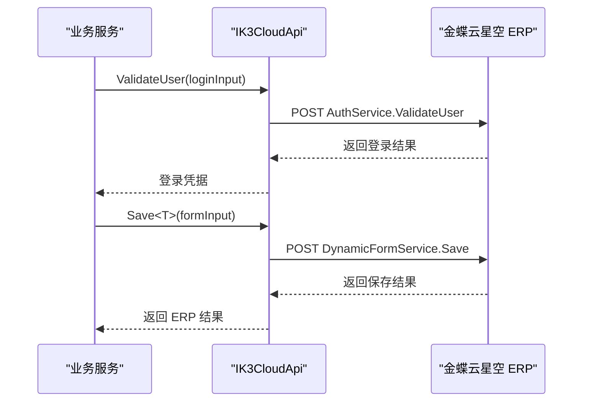
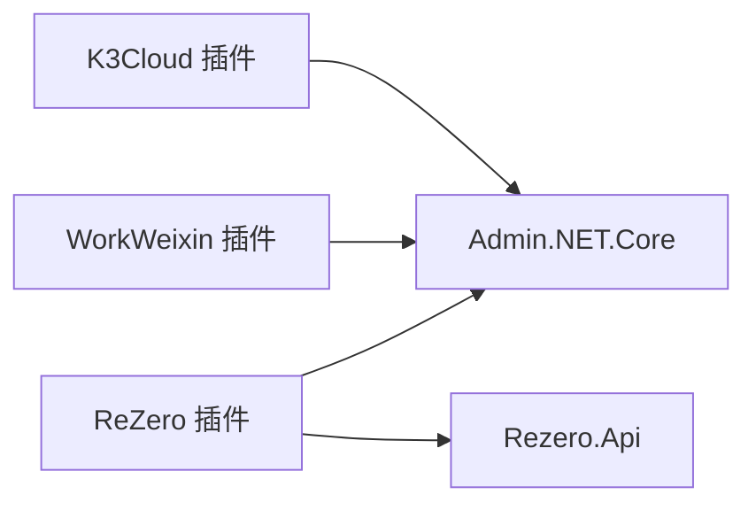

# 内置插件详解

<cite>
**本文引用的文件**   
- [README.md](file://README.md)
- [Admin.NET.Plugin.ReZero.csproj](file://Admin.NET/Plugins/Admin.NET.Plugin.ReZero/Admin.NET.Plugin.ReZero.csproj)
- [ReZero 启动配置 Startup.cs](file://Admin.NET/Plugins/Admin.NET.Plugin.ReZero/Startup.cs)
- [ReZeroOptions 配置类](file://Admin.NET/Plugins/Admin.NET.Plugin.ReZero/Option/ReZeroOptions.cs)
- [SuperApiAop 超级 API 拦截器](file://Admin.NET/Plugins/Admin.NET.Plugin.ReZero/Service/SuperApiAop.cs)
- [SysMenuSeedData 菜单种子数据](file://Admin.NET/Plugins/Admin.NET.Plugin.ReZero/SeedData/SysMenuSeedData.cs)
- [Admin.NET.Plugin.WorkWeixin.csproj](file://Admin.NET/Plugins/Admin.NET.Plugin.WorkWeixin/Admin.NET.Plugin.WorkWeixin.csproj)
- [WorkWeixin 启动配置 Startup.cs](file://Admin.NET/Plugins/Admin.NET.Plugin.WorkWeixin/Startup.cs)
- [WorkWeixinOptions 配置类](file://Admin.NET/Plugins/Admin.NET.Plugin.WorkWeixin/Option/WorkWeixinOptions.cs)
- [WorkWeixinConst 常量](file://Admin.NET/Plugins/Admin.NET.Plugin.WorkWeixin/Const/WorkWeixinConst.cs)
- [IWorkWeixinAppChatHttp 应用消息接口](file://Admin.NET/Plugins/Admin.NET.Plugin.WorkWeixin/Proxy/AppChat/IWorkWeixinAppChatHttp.cs)
- [IWorkWeixinAuthHttp 授权接口](file://Admin.NET/Plugins/Admin.NET.Plugin.WorkWeixin/Proxy/Auth/IWorkWeixinAuthHttp.cs)
- [IDepartmentHttp 部门接口](file://Admin.NET/Plugins/Admin.NET.Plugin.WorkWeixin/Proxy/Department/IDepartmentHttp.cs)
- [ITagHttp 标签接口](file://Admin.NET/Plugins/Admin.NET.Plugin.WorkWeixin/Proxy/Tag/ITagHttp.cs)
- [Admin.NET.Plugin.K3Cloud.csproj](file://Admin.NET/Plugins/Admin.NET.Plugin.K3Cloud/Admin.NET.Plugin.K3Cloud.csproj)
- [K3Cloud 启动配置 Startup.cs](file://Admin.NET/Plugins/Admin.NET.Plugin.K3Cloud/Startup.cs)
- [K3CloudOptions 配置类](file://Admin.NET/Plugins/Admin.NET.Plugin.K3Cloud/Option/K3CloudOptions.cs)
- [IK3CloudApi ERP 接口](file://Admin.NET/Plugins/Admin.NET.Plugin.K3Cloud/Service/IK3CloudApi.cs)
</cite>

## 目录
1. [简介](#简介)
2. [项目结构总览](#项目结构总览)
3. [核心组件](#核心组件)
4. [架构总览](#架构总览)
5. [ReZero 插件详解](#rezero-插件详解)
6. [WorkWeixin 企业微信插件详解](#workweixin-企业微信插件详解)
7. [K3Cloud ERP 插件详解](#k3cloud-erp-插件详解)
8. [依赖关系分析](#依赖关系分析)
9. [性能与扩展建议](#性能与扩展建议)
10. [监控、异常处理与故障排查](#监控异常处理与故障排查)
11. [结论](#结论)

## 简介
本文件面向 Admin.NET 内置插件的技术文档，重点覆盖以下三个插件：
- ReZero 插件：基于 Rezero.Api 的超级 API 能力，将现有数据库作为动态接口和数据管理后端。
- WorkWeixin 企业微信插件：提供企业微信 OAuth 认证、消息推送和组织架构同步所需的基础 HTTP 代理和配置入口。
- K3Cloud ERP 插件：对接金蝶云星空 ERP，封装登录、表单保存、提交、审核等远程调用能力。

这些插件均通过 `AppStartup` 注入到 Admin.NET 应用生命周期中，使用统一的配置体系、HTTP 客户端和日志记录机制。当前仓库的前端业务入口为 `Web/apps/web-antdv-next/`，后端入口为 `Admin.NET/Admin.NET.Web.Entry/`；插件运行环境以各 `.csproj` 和目标框架为准。

**章节来源**
- [README.md:1-40](file://README.md#L1-L40)

## 项目结构总览
插件位于 `Admin.NET/Plugins/` 下，每个插件是一个独立的可发布工程，目标框架均为 `net8.0;net10.0`，并引用共享核心工程 `Admin.NET.Core`。

**图示来源**
- [Admin.NET.Plugin.ReZero.csproj:1-36](file://Admin.NET/Plugins/Admin.NET.Plugin.ReZero/Admin.NET.Plugin.ReZero.csproj#L1-L36)
- [Admin.NET.Plugin.WorkWeixin.csproj:1-23](file://Admin.NET/Plugins/Admin.NET.Plugin.WorkWeixin/Admin.NET.Plugin.WorkWeixin.csproj#L1-L23)
- [Admin.NET.Plugin.K3Cloud.csproj:1-23](file://Admin.NET/Plugins/Admin.NET.Plugin.K3Cloud/Admin.NET.Plugin.K3Cloud.csproj#L1-L23)

**章节来源**
- [Admin.NET.Plugin.ReZero.csproj:1-36](file://Admin.NET/Plugins/Admin.NET.Plugin.ReZero/Admin.NET.Plugin.ReZero.csproj#L1-L36)
- [Admin.NET.Plugin.WorkWeixin.csproj:1-23](file://Admin.NET/Plugins/Admin.NET.Plugin.WorkWeixin/Admin.NET.Plugin.WorkWeixin.csproj#L1-L23)
- [Admin.NET.Plugin.K3Cloud.csproj:1-23](file://Admin.NET/Plugins/Admin.NET.Plugin.K3Cloud/Admin.NET.Plugin.K3Cloud.csproj#L1-L23)

## 核心组件
- ReZero 插件：
  - 启动配置负责读取默认数据库连接并注册 Rezero.Api 的超级 API。
  - 超级 API 拦截器实现 JWT 校验、访问日志与上下文追踪。
  - 菜单种子数据用于在系统菜单中展示 ReZero 相关功能入口。
- WorkWeixin 插件：
  - 启动配置注册可配置选项。
  - 提供企业微信授权、部门、标签、群聊会话等 HTTP 声明式接口。
- K3Cloud 插件：
  - 启动配置注册 ERP 站点基础地址的命名 HTTP 客户端。
  - 封装登录验证、表单保存、提交、审核等 ERP 接口。

**章节来源**
- [ReZero 启动配置 Startup.cs:1-54](file://Admin.NET/Plugins/Admin.NET.Plugin.ReZero/Startup.cs#L1-L54)
- [SuperApiAop 超级 API 拦截器:1-110](file://Admin.NET/Plugins/Admin.NET.Plugin.ReZero/Service/SuperApiAop.cs#L1-L110)
- [SysMenuSeedData 菜单种子数据:1-32](file://Admin.NET/Plugins/Admin.NET.Plugin.ReZero/SeedData/SysMenuSeedData.cs#L1-L32)
- [WorkWeixin 启动配置 Startup.cs:1-25](file://Admin.NET/Plugins/Admin.NET.Plugin.WorkWeixin/Startup.cs#L1-L25)
- [IWorkWeixinAuthHttp 授权接口:1-23](file://Admin.NET/Plugins/Admin.NET.Plugin.WorkWeixin/Proxy/Auth/IWorkWeixinAuthHttp.cs#L1-L23)
- [IDepartmentHttp 部门接口:1-63](file://Admin.NET/Plugins/Admin.NET.Plugin.WorkWeixin/Proxy/Department/IDepartmentHttp.cs#L1-L63)
- [ITagHttp 标签接口:1-82](file://Admin.NET/Plugins/Admin.NET.Plugin.WorkWeixin/Proxy/Tag/ITagHttp.cs#L1-L82)
- [IWorkWeixinAppChatHttp 应用消息接口:1-53](file://Admin.NET/Plugins/Admin.NET.Plugin.WorkWeixin/Proxy/AppChat/IWorkWeixinAppChatHttp.cs#L1-L53)
- [K3Cloud 启动配置 Startup.cs:1-29](file://Admin.NET/Plugins/Admin.NET.Plugin.K3Cloud/Startup.cs#L1-L29)
- [IK3CloudApi ERP 接口:1-50](file://Admin.NET/Plugins/Admin.NET.Plugin.K3Cloud/Service/IK3CloudApi.cs#L1-L50)

## 架构总览
三个插件在运行时通过统一的应用启动管线装配，对外暴露的能力如下：
- ReZero：把现有数据库表映射为动态接口，并提供管理界面入口。
- WorkWeixin：封装企业微信 REST API 的声明式调用，便于上层服务完成认证、消息与组织同步。
- K3Cloud：封装金蝶云星空 WebAPI，提供 ERP 数据读写与流程控制能力。

**图示来源**
- [ReZero 启动配置 Startup.cs:1-54](file://Admin.NET/Plugins/Admin.NET.Plugin.ReZero/Startup.cs#L1-L54)
- [WorkWeixin 启动配置 Startup.cs:1-25](file://Admin.NET/Plugins/Admin.NET.Plugin.WorkWeixin/Startup.cs#L1-L25)
- [K3Cloud 启动配置 Startup.cs:1-29](file://Admin.NET/Plugins/Admin.NET.Plugin.K3Cloud/Startup.cs#L1-L29)

## ReZero 插件详解

### 项目结构与职责
- `Admin.NET.Plugin.ReZero.csproj`：引入 `Rezero.Api`、ClosedXML、CSharp.Scripting，并复制 `Configuration` 与 `wwwroot` 资源。
- `Startup.cs`：从应用配置读取 `ReZero` 与默认 `DbConnection`，注册 Rezero.Api 超级 API。
- `Option/ReZeroOptions.cs`：定义令牌键名等可配置项。
- `Service/SuperApiAop.cs`：实现超级 API 执行前后拦截，进行 JWT 校验、日志记录与异常上下文收集。
- `SeedData/SysMenuSeedData.cs`：为系统菜单注入 ReZero 动态接口、数据库管理、实体管理等入口。

**章节来源**
- [Admin.NET.Plugin.ReZero.csproj:1-36](file://Admin.NET/Plugins/Admin.NET.Plugin.ReZero/Admin.NET.Plugin.ReZero.csproj#L1-L36)
- [ReZero 启动配置 Startup.cs:1-54](file://Admin.NET/Plugins/Admin.NET.Plugin.ReZero/Startup.cs#L1-L54)
- [ReZeroOptions 配置类:1-20](file://Admin.NET/Plugins/Admin.NET.Plugin.ReZero/Option/ReZeroOptions.cs#L1-L20)
- [SuperApiAop 超级 API 拦截器:1-110](file://Admin.NET/Plugins/Admin.NET.Plugin.ReZero/Service/SuperApiAop.cs#L1-L110)
- [SysMenuSeedData 菜单种子数据:1-32](file://Admin.NET/Plugins/Admin.NET.Plugin.ReZero/SeedData/SysMenuSeedData.cs#L1-L32)

### Rezero.Api 集成与数据库同步机制
ReZero 插件不自行维护数据库迁移或增量同步算法，而是将 Admin.NET 已配置的默认数据库连接直接交给 Rezero.Api 的超级 API：
1. 启动时读取 `DbConnection` 的第一个连接配置。
2. 将该连接的数据库类型和连接字符串写入 `SuperAPIOptions.DatabaseOptions.ConnectionConfig`。
3. 启用 `services.AddReZeroServices(api => api.EnableSuperApi(...))`，由 Rezero.Api 根据现有数据库生成动态接口与管理界面。

这意味着“数据库同步”在本插件中的含义是：**让 Rezero.Api 感知现有数据库结构**，而不是插件内部实现自定义增量同步策略。若需要增量同步，应在 Rezero.Api 的动态接口层或上层业务服务中实现。

**图示来源**
- [ReZero 启动配置 Startup.cs:1-54](file://Admin.NET/Plugins/Admin.NET.Plugin.ReZero/Startup.cs#L1-L54)

### 数据模型映射
当前源码未包含自定义 ReZero 实体映射类。数据模型映射主要由 Rezero.Api 基于现有数据库表结构推断。业务侧如需扩展，应遵循 Rezero.Api 的约定并在其动态接口或服务层中进行转换。

**章节来源**
- [ReZero 启动配置 Startup.cs:1-54](file://Admin.NET/Plugins/Admin.NET.Plugin.ReZero/Startup.cs#L1-L54)

### 增量同步策略
- 插件本身未实现增量同步逻辑。
- 如果业务需要增量同步，推荐在上层服务中基于时间戳、版本号或事件触发同步，并通过 Rezero.Api 生成的接口或 Admin.NET 的服务层操作数据库。
- 对审计与可观测性，可复用 `SuperApiAop` 的日志上下文模式，将同步任务的状态、影响行数和异常信息写入统一日志。

**章节来源**
- [SuperApiAop 超级 API 拦截器:1-110](file://Admin.NET/Plugins/Admin.NET.Plugin.ReZero/Service/SuperApiAop.cs#L1-L110)

### 配置项与环境变量
- 配置路径：`ReZero`
- 主要字段：
  - `AccessTokenKey`：浏览器本地存储令牌键名。
  - `RefreshAccessTokenKey`：刷新令牌键名。
- 数据库来源：默认 `DbConnection` 的第一个连接配置。

部署注意事项：
- 确保生产环境的 `ReZero.AccessTokenKey` 与实际前端 Token 存储键一致。
- 确保 Rezero.Api 的管理界面 URL 与前端 iframe 或跳转地址匹配。
- 不要硬编码连接字符串；通过应用配置注入。

**章节来源**
- [ReZeroOptions 配置类:1-20](file://Admin.NET/Plugins/Admin.NET.Plugin.ReZero/Option/ReZeroOptions.cs#L1-L20)
- [ReZero 启动配置 Startup.cs:1-54](file://Admin.NET/Plugins/Admin.NET.Plugin.ReZero/Startup.cs#L1-L54)

### 认证与拦截流程

**图示来源**
- [SuperApiAop 超级 API 拦截器:1-110](file://Admin.NET/Plugins/Admin.NET.Plugin.ReZero/Service/SuperApiAop.cs#L1-L110)

### 扩展点
- 继承或替换 `DefaultSuperApiAop` 实现自定义鉴权、限流、审计。
- 通过 `SysMenuSeedData` 扩展 ReZero 功能菜单。
- 在 Rezero.Api 动态接口中编写业务逻辑，复用 Admin.NET 的依赖注入与服务能力。

**章节来源**
- [SysMenuSeedData 菜单种子数据:1-32](file://Admin.NET/Plugins/Admin.NET.Plugin.ReZero/SeedData/SysMenuSeedData.cs#L1-L32)
- [SuperApiAop 超级 API 拦截器:1-110](file://Admin.NET/Plugins/Admin.NET.Plugin.ReZero/Service/SuperApiAop.cs#L1-L110)

## WorkWeixin 企业微信插件详解

### 项目结构与职责
- `Admin.NET.Plugin.WorkWeixin.csproj`：仅引用 `Admin.NET.Core`，不引入第三方 SDK。
- `Startup.cs`：注册 `WorkWeixinOptions` 可配置选项。
- `Option/WorkWeixinOptions.cs`：定义企业 ID 与应用凭证密钥。
- `Const/WorkWeixinConst.cs`：定义 API 分组常量。
- `Proxy/*`：按企业微信模块划分 HTTP 声明式接口，包括授权、部门、标签、群聊会话与消息。

该插件目前提供的是**基础设施层**：配置、常量与 HTTP 代理接口。OAuth、消息推送、组织架构同步等业务逻辑应由上层服务组合这些代理接口实现。

**章节来源**
- [Admin.NET.Plugin.WorkWeixin.csproj:1-23](file://Admin.NET/Plugins/Admin.NET.Plugin.WorkWeixin/Admin.NET.Plugin.WorkWeixin.csproj#L1-L23)
- [WorkWeixin 启动配置 Startup.cs:1-25](file://Admin.NET/Plugins/Admin.NET.Plugin.WorkWeixin/Startup.cs#L1-L25)
- [WorkWeixinOptions 配置类:1-25](file://Admin.NET/Plugins/Admin.NET.Plugin.WorkWeixin/Option/WorkWeixinOptions.cs#L1-L25)
- [WorkWeixinConst 常量:1-15](file://Admin.NET/Plugins/Admin.NET.Plugin.WorkWeixin/Const/WorkWeixinConst.cs#L1-L15)

### OAuth 认证模式
授权代理接口定义了获取接口凭证的端点，典型流程为：
1. 使用 `CorpId` 和 `CorpSecret` 调用企业微信获取 token。
2. 缓存 token 并设置过期时间。
3. 后续业务调用携带 `access_token`。

**图示来源**
- [IWorkWeixinAuthHttp 授权接口:1-23](file://Admin.NET/Plugins/Admin.NET.Plugin.WorkWeixin/Proxy/Auth/IWorkWeixinAuthHttp.cs#L1-L23)

**章节来源**
- [IWorkWeixinAuthHttp 授权接口:1-23](file://Admin.NET/Plugins/Admin.NET.Plugin.WorkWeixin/Proxy/Auth/IWorkWeixinAuthHttp.cs#L1-L23)

### 消息推送与企业群聊
应用消息与群聊会话通过 `IWorkWeixinAppChatHttp` 暴露：
- 创建、更新、查询群聊会话。
- 向群聊推送消息。

消息推送建议结合业务事件总线或后台任务，避免在主请求链路中阻塞。

**图示来源**
- [IWorkWeixinAppChatHttp 应用消息接口:1-53](file://Admin.NET/Plugins/Admin.NET.Plugin.WorkWeixin/Proxy/AppChat/IWorkWeixinAppChatHttp.cs#L1-L53)

**章节来源**
- [IWorkWeixinAppChatHttp 应用消息接口:1-53](file://Admin.NET/Plugins/Admin.NET.Plugin.WorkWeixin/Proxy/AppChat/IWorkWeixinAppChatHttp.cs#L1-L53)

### 组织架构同步
部门与标签接口为组织同步提供基础能力：
- 部门：创建、更新、删除、简单列表、详情。
- 标签：创建、更新、删除、成员增减、列表。

同步策略建议：
- 全量同步：定期拉取完整部门树与标签列表，合并到本地库。
- 增量同步：基于更新时间或变更事件，只同步差异部分。
- 幂等设计：使用企业微信返回的 Id 作为唯一键，避免重复插入。

**图示来源**
- [IDepartmentHttp 部门接口:1-63](file://Admin.NET/Plugins/Admin.NET.Plugin.WorkWeixin/Proxy/Department/IDepartmentHttp.cs#L1-L63)
- [ITagHttp 标签接口:1-82](file://Admin.NET/Plugins/Admin.NET.Plugin.WorkWeixin/Proxy/Tag/ITagHttp.cs#L1-L82)

**章节来源**
- [IDepartmentHttp 部门接口:1-63](file://Admin.NET/Plugins/Admin.NET.Plugin.WorkWeixin/Proxy/Department/IDepartmentHttp.cs#L1-L63)
- [ITagHttp 标签接口:1-82](file://Admin.NET/Plugins/Admin.NET.Plugin.WorkWeixin/Proxy/Tag/ITagHttp.cs#L1-L82)

### 配置项与部署注意事项
- 配置路径：`WorkWeixin`
- 主要字段：
  - `CorpId`：企业 ID。
  - `CorpSecret`：应用凭证密钥。
- 部署注意：
  - 不要在代码中硬编码企业微信密钥。
  - 在企业微信后台配置可信域名与回调地址。
  - 对 token 缓存增加过期时间与错误重试机制。

**章节来源**
- [WorkWeixinOptions 配置类:1-25](file://Admin.NET/Plugins/Admin.NET.Plugin.WorkWeixin/Option/WorkWeixinOptions.cs#L1-L25)

## K3Cloud ERP 插件详解

### 项目结构与职责
- `Admin.NET.Plugin.K3Cloud.csproj`：引用 `Admin.NET.Core`，不包含 ERP SDK。
- `Startup.cs`：注册 `K3CloudOptions`，并创建名为 `K3Cloud` 的命名 HTTP 客户端，基础地址来自配置。
- `Option/K3CloudOptions.cs`：定义 ERP 站点地址、账套 ID、应用 ID、应用密钥、用户名、密码、语言代码。
- `Service/IK3CloudApi.cs`：定义登录验证、表单保存、提交、审核等 ERP 接口。

该插件的核心价值是将金蝶云星空 WebAPI 的请求参数、URL 与响应类型抽象为强类型接口，便于上层业务服务复用。

**章节来源**
- [Admin.NET.Plugin.K3Cloud.csproj:1-23](file://Admin.NET/Plugins/Admin.NET.Plugin.K3Cloud/Admin.NET.Plugin.K3Cloud.csproj#L1-L23)
- [K3Cloud 启动配置 Startup.cs:1-29](file://Admin.NET/Plugins/Admin.NET.Plugin.K3Cloud/Startup.cs#L1-L29)
- [K3CloudOptions 配置类:1-45](file://Admin.NET/Plugins/Admin.NET.Plugin.K3Cloud/Option/K3CloudOptions.cs#L1-L45)
- [IK3CloudApi ERP 接口:1-50](file://Admin.NET/Plugins/Admin.NET.Plugin.K3Cloud/Service/IK3CloudApi.cs#L1-L50)

### API 调用与数据转换
K3Cloud 插件封装了以下 ERP 能力：
- 用户验证：`ValidateUser`。
- 表单保存：`Save<T>`。
- 表单提交：`Submit<T>`。
- 表单审核：`Audit<T>`。

典型调用流程：
1. 构造登录输入参数。
2. 调用 `ValidateUser` 获取会话凭据。
3. 将业务对象转换为金蝶动态表单 DTO。
4. 调用 `Save`、`Submit` 或 `Audit` 完成业务流程。

**图示来源**
- [IK3CloudApi ERP 接口:1-50](file://Admin.NET/Plugins/Admin.NET.Plugin.K3Cloud/Service/IK3CloudApi.cs#L1-L50)

**章节来源**
- [IK3CloudApi ERP 接口:1-50](file://Admin.NET/Plugins/Admin.NET.Plugin.K3Cloud/Service/IK3CloudApi.cs#L1-L50)

### 业务逻辑适配
- 登录态管理：建议在业务层缓存会话信息，避免每次请求都重新登录。
- 表单映射：业务实体到金蝶动态表单 DTO 的映射应放在专用转换器中，避免污染业务服务。
- 事务与回滚：ERP 提交与审核通常不可逆，需在业务层明确状态机与补偿逻辑。
- 错误处理：区分网络错误、认证失败、业务校验失败和 ERP 系统异常。

**章节来源**
- [K3CloudOptions 配置类:1-45](file://Admin.NET/Plugins/Admin.NET.Plugin.K3Cloud/Option/K3CloudOptions.cs#L1-L45)
- [IK3CloudApi ERP 接口:1-50](file://Admin.NET/Plugins/Admin.NET.Plugin.K3Cloud/Service/IK3CloudApi.cs#L1-L50)

### 配置项与部署注意事项
- 配置路径：`K3Cloud`
- 主要字段：
  - `Url`：ERP 业务站点地址。
  - `AcctID`：账套 ID。
  - `AppId`：应用 ID。
  - `AppKey`：应用密钥。
  - `UserName`：用户名。
  - `UserPassword`：用户密码。
  - `LanguageCode`：语言代码。
- 部署注意：
  - ERP 地址应为内网或受控公网地址。
  - 敏感配置必须使用安全配置源，不得写入源代码。
  - 对 ERP 调用增加超时、重试与熔断策略。

**章节来源**
- [K3CloudOptions 配置类:1-45](file://Admin.NET/Plugins/Admin.NET.Plugin.K3Cloud/Option/K3CloudOptions.cs#L1-L45)

## 依赖关系分析
三个插件共同依赖 Admin.NET.Core，并通过各自的 `Startup` 注入到应用容器。

**图示来源**
- [Admin.NET.Plugin.ReZero.csproj:1-36](file://Admin.NET/Plugins/Admin.NET.Plugin.ReZero/Admin.NET.Plugin.ReZero.csproj#L1-L36)
- [Admin.NET.Plugin.WorkWeixin.csproj:1-23](file://Admin.NET/Plugins/Admin.NET.Plugin.WorkWeixin/Admin.NET.Plugin.WorkWeixin.csproj#L1-L23)
- [Admin.NET.Plugin.K3Cloud.csproj:1-23](file://Admin.NET/Plugins/Admin.NET.Plugin.K3Cloud/Admin.NET.Plugin.K3Cloud.csproj#L1-L23)

**章节来源**
- [Admin.NET.Plugin.ReZero.csproj:1-36](file://Admin.NET/Plugins/Admin.NET.Plugin.ReZero/Admin.NET.Plugin.ReZero.csproj#L1-L36)
- [Admin.NET.Plugin.WorkWeixin.csproj:1-23](file://Admin.NET/Plugins/Admin.NET.Plugin.WorkWeixin/Admin.NET.Plugin.WorkWeixin.csproj#L1-L23)
- [Admin.NET.Plugin.K3Cloud.csproj:1-23](file://Admin.NET/Plugins/Admin.NET.Plugin.K3Cloud/Admin.NET.Plugin.K3Cloud.csproj#L1-L23)

## 性能与扩展建议
- ReZero：
  - 动态接口适合开发期与运维期快速调试，生产环境建议将高频接口固化到强类型服务中。
  - 超级 API 拦截器适合集中做审计与权限校验，但不应承载重型业务逻辑。
- WorkWeixin：
  - 对 token 和企业微信 API 调用增加缓存、限流与重试。
  - 组织同步建议使用异步任务，避免阻塞主线程。
- K3Cloud：
  - ERP 调用延迟较高，应使用命名 HttpClient 复用连接。
  - 批量保存与提交需考虑 ERP 端分页与吞吐限制。
- 插件间通信：
  - 推荐使用 Admin.NET 的事件总线或消息队列解耦。
  - 共享数据优先通过数据库或缓存，而非进程内单例。

[本节为通用指导，不直接分析具体文件]

## 监控、异常处理与故障排查

### ReZero 监控
- 超级 API 拦截器在成功和失败路径都会初始化日志上下文，提取用户账号、真实姓名、请求 URL、HTTP 方法、远程 IP、User-Agent、响应状态码和异常信息。
- 建议在生产环境开启结构化日志，并按 `loggingMonitor` 上下文字段聚合查询。

**章节来源**
- [SuperApiAop 超级 API 拦截器:1-110](file://Admin.NET/Plugins/Admin.NET.Plugin.ReZero/Service/SuperApiAop.cs#L1-L110)

### WorkWeixin 监控
- 对授权、部门、标签、群聊消息等外部 API 调用应记录：
  - 调用耗时。
  - 企业微信返回码。
  - 重试次数。
  - 失败原因。
- 建议对 token 失效、频率限制、网络超时分别设置告警规则。

**章节来源**
- [IWorkWeixinAuthHttp 授权接口:1-23](file://Admin.NET/Plugins/Admin.NET.Plugin.WorkWeixin/Proxy/Auth/IWorkWeixinAuthHttp.cs#L1-L23)
- [IDepartmentHttp 部门接口:1-63](file://Admin.NET/Plugins/Admin.NET.Plugin.WorkWeixin/Proxy/Department/IDepartmentHttp.cs#L1-L63)
- [ITagHttp 标签接口:1-82](file://Admin.NET/Plugins/Admin.NET.Plugin.WorkWeixin/Proxy/Tag/ITagHttp.cs#L1-L82)
- [IWorkWeixinAppChatHttp 应用消息接口:1-53](file://Admin.NET/Plugins/Admin.NET.Plugin.WorkWeixin/Proxy/AppChat/IWorkWeixinAppChatHttp.cs#L1-L53)

### K3Cloud 监控
- 对登录、保存、提交、审核等 ERP 接口记录：
  - 账套 ID、应用 ID、操作人。
  - ERP 返回码与错误描述。
  - 表单编号与业务流水号。
- 对 ERP 系统不可用场景增加降级策略，例如改为离线队列。

**章节来源**
- [IK3CloudApi ERP 接口:1-50](file://Admin.NET/Plugins/Admin.NET.Plugin.K3Cloud/Service/IK3CloudApi.cs#L1-L50)

### 常见故障排查清单
- ReZero：
  - 菜单无法打开：检查 `SysMenuSeedData` 中的外链地址是否可达。
  - 接口未授权：检查 `AccessTokenKey` 是否与前端一致，JWT 是否有效。
- WorkWeixin：
  - 获取 token 失败：检查 `CorpId` 与 `CorpSecret`。
  - 消息推送失败：检查群聊 Id、access_token 有效期与权限范围。
- K3Cloud：
  - 登录失败：检查 `Url`、`AcctID`、`AppId`、`AppKey`、用户名和密码。
  - 表单保存失败：检查动态表单字段映射与必填项。

**章节来源**
- [SysMenuSeedData 菜单种子数据:1-32](file://Admin.NET/Plugins/Admin.NET.Plugin.ReZero/SeedData/SysMenuSeedData.cs#L1-L32)
- [ReZeroOptions 配置类:1-20](file://Admin.NET/Plugins/Admin.NET.Plugin.ReZero/Option/ReZeroOptions.cs#L1-L20)
- [WorkWeixinOptions 配置类:1-25](file://Admin.NET/Plugins/Admin.NET.Plugin.WorkWeixin/Option/WorkWeixinOptions.cs#L1-L25)
- [K3CloudOptions 配置类:1-45](file://Admin.NET/Plugins/Admin.NET.Plugin.K3Cloud/Option/K3CloudOptions.cs#L1-L45)

## 结论
- ReZero 插件通过 Rezero.Api 将现有数据库暴露为动态接口，适合快速开发、运维调试和轻量级数据管理；生产环境建议将关键接口收敛到强类型服务。
- WorkWeixin 插件提供企业微信认证、消息推送和组织架构同步的基础 HTTP 代理，业务层应在此基础上实现令牌缓存、异步同步和错误恢复。
- K3Cloud 插件封装金蝶云星空 ERP 的核心接口，适合与 Admin.NET 业务系统集成；应重点关注登录态管理、表单映射、错误分类与可观测性。
- 三个插件共享 Admin.NET 的配置、依赖注入与日志体系，建议通过事件总线或消息队列实现插件间解耦通信，并通过结构化日志与外部监控系统保障运行质量。