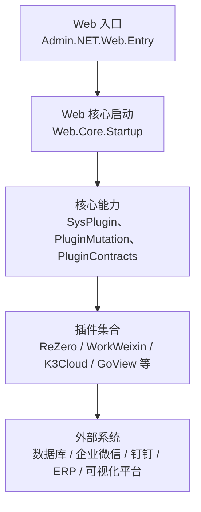
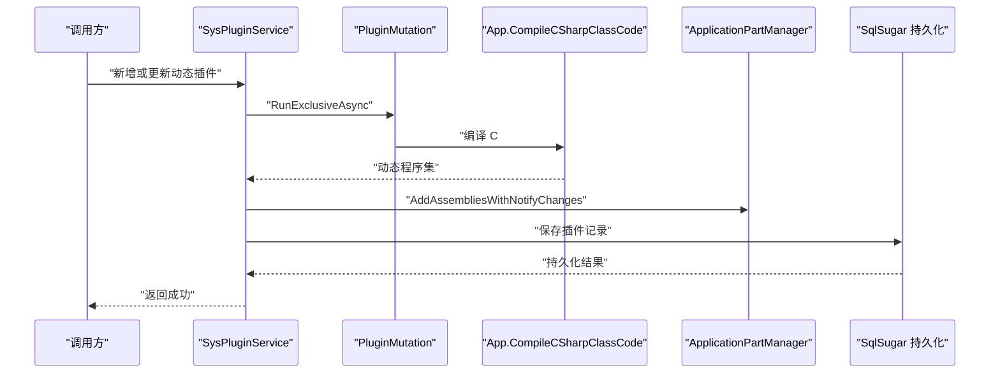
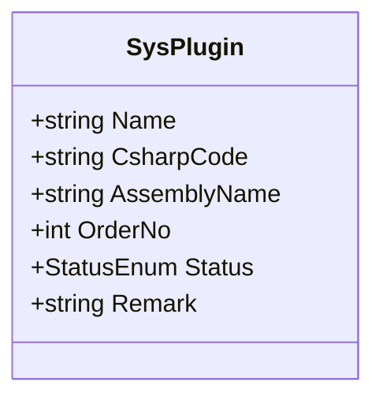
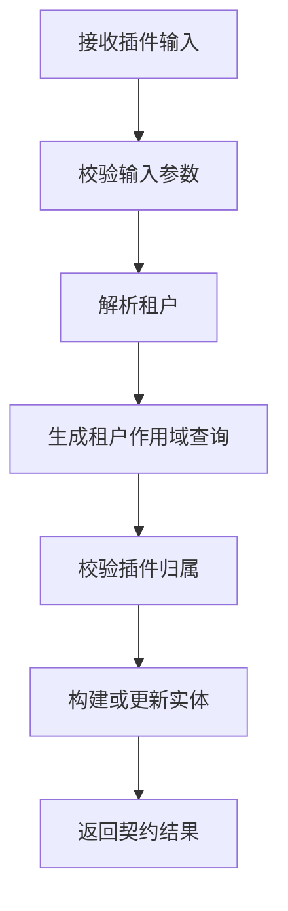
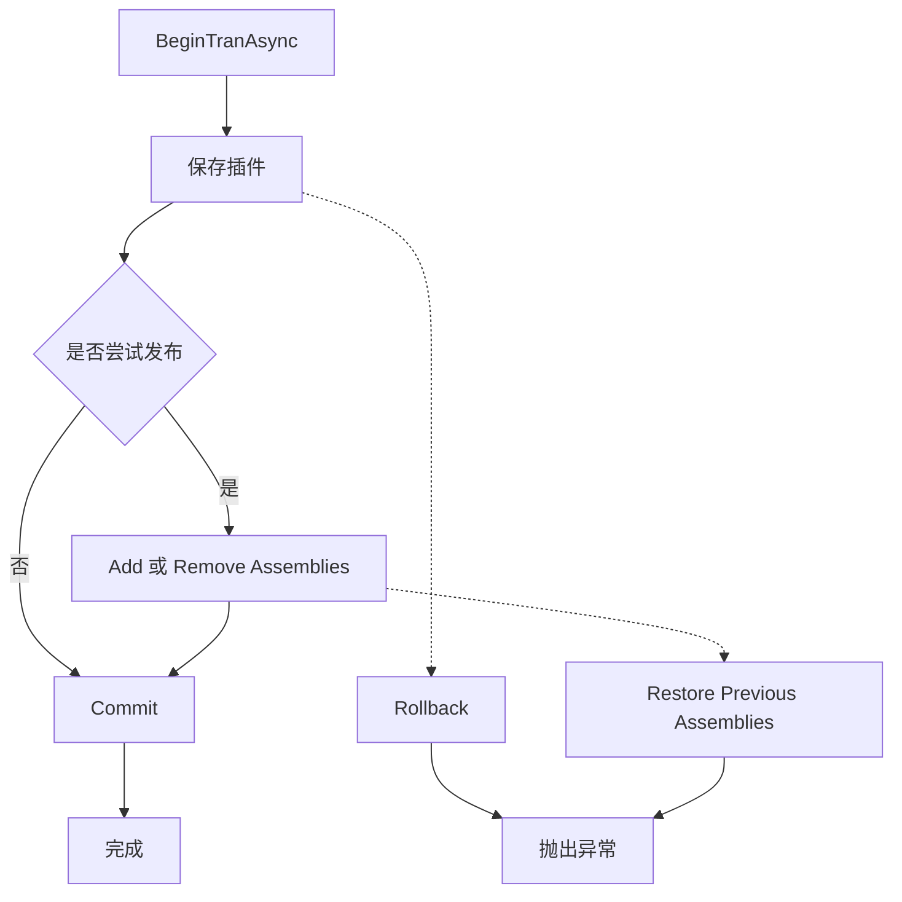
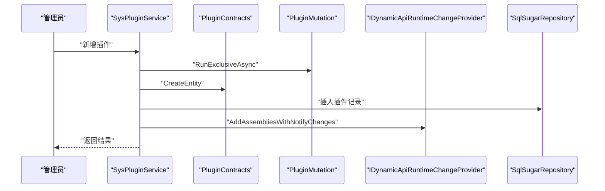
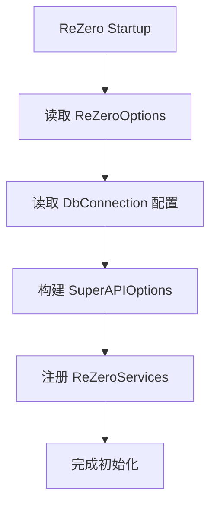
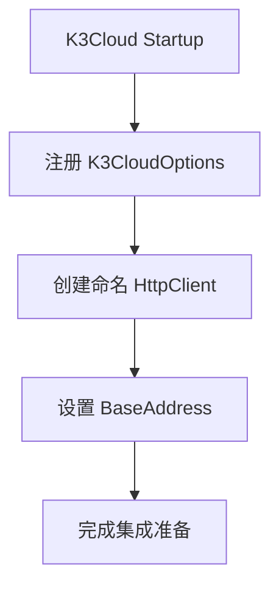
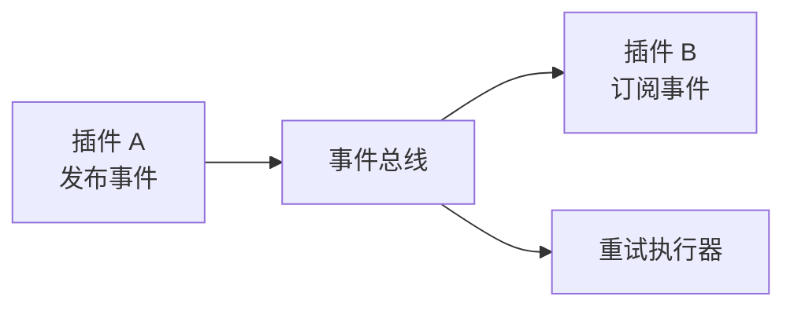
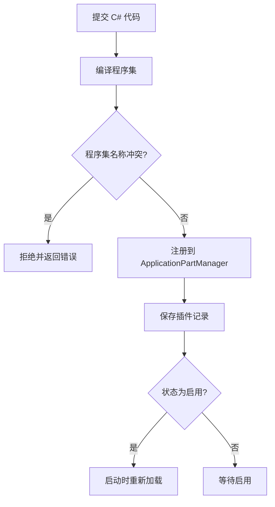

# 插件开发机制

<cite>
**本文引用的文件**   
- [README.md](file://README.md)
- [SysPlugin.cs](file://Admin.NET/Admin.NET.Core/Entity/SysPlugin.cs)
- [PluginInput.cs](file://Admin.NET/Admin.NET.Core/Service/Plugin/Dto/PluginInput.cs)
- [PluginContracts.cs](file://Admin.NET/Admin.NET.Core/Service/Plugin/PluginContracts.cs)
- [PluginMutation.cs](file://Admin.NET/Admin.NET.Core/Service/Plugin/PluginMutation.cs)
- [SysPluginService.cs](file://Admin.NET/Admin.NET.Core/Service/Plugin/SysPluginService.cs)
- [Startup.cs（Web.Core）](file://Admin.NET/Admin.NET.Web.Core/Startup.cs)
- [Startup.cs（Application）](file://Admin.NET/Admin.NET.Application/Startup.cs)
- [FakeStartup.cs](file://Admin.NET/Admin.NET.Web.Entry/FakeStartup.cs)
- [Startup.cs（ReZero 插件）](file://Admin.NET/Plugins/Admin.NET.Plugin.ReZero/Startup.cs)
- [Startup.cs（WorkWeixin 插件）](file://Admin.NET/Plugins/Admin.NET.Plugin.WorkWeixin/Startup.cs)
- [Startup.cs（K3Cloud 插件）](file://Admin.NET/Plugins/Admin.NET.Plugin.K3Cloud/Startup.cs)
</cite>

## 目录
1. [简介](#简介)
2. [项目结构与插件边界](#项目结构与插件边界)
3. [插件架构总览](#插件架构总览)
4. [核心组件与契约](#核心组件与契约)
5. [动态程序集与运行时加载](#动态程序集与运行时加载)
6. [内置插件实现模式](#内置插件实现模式)
7. [新插件开发流程](#新插件开发流程)
8. [插件间通信、数据共享与事务处理](#插件间通信数据共享与事务处理)
9. [打包、发布与版本管理](#打包发布与版本管理)
10. [测试策略与性能优化](#测试策略与性能优化)
11. [故障排查指南](#故障排查指南)
12. [结论](#结论)

## 简介
Admin.NET 是一个基于 ASP.NET Core、Furion 和 SqlSugar 的通用权限开发框架，采用前后端分离与模块化设计。当前前端业务入口为 `Web/apps/web-antdv-next`，后端入口为 `Admin.NET/Admin.NET.Web.Entry`。仓库支持按业务需要扩展应用服务、数据库适配和插件；插件既包括静态编译的独立工程，也包括通过动态代码编译注入的动态接口。

本指南聚焦 Admin.NET 的插件开发机制，说明：
- 插件契约、生命周期和依赖隔离方式。
- 内置 ReZero、WorkWeixin、K3Cloud 等插件的实现模式。
- 如何创建新插件、注册服务、配置选项并安全发布。
- 插件间的通信、数据共享、事务一致性方案。
- 打包、发布、版本管理与测试优化实践。

**章节来源**
- [README.md:1-44](file://README.md#L1-L44)

## 项目结构与插件边界
从当前源码结构看，插件相关能力分布在三层：

| 层次 | 职责 | 关键位置 |
|---|---|---|
| 核心层 | 定义插件实体、输入输出、校验契约、变更协调器以及动态插件 API | `Admin.NET/Core/Entity/SysPlugin.cs`、`Admin.NET/Core/Service/Plugin/*` |
| Web 核心层 | 注册全局基础设施，如认证、缓存、事件总线、HTTP 客户端、任务调度等 | `Admin.NET/Web.Core/Startup.cs` |
| 插件层 | 各功能插件通过 `AppStartup` 注册配置、服务和中间件 | `Admin.NET/Plugins/Admin.NET.Plugin.*` |

**图示来源**
- [Startup.cs（Web.Core）:1-60](file://Admin.NET/Admin.NET.Web.Core/Startup.cs#L1-L60)
- [SysPluginService.cs:1-40](file://Admin.NET/Admin.NET.Core/Service/Plugin/SysPluginService.cs#L1-L40)
- [Startup.cs（ReZero 插件）:1-20](file://Admin.NET/Plugins/Admin.NET.Plugin.ReZero/Startup.cs#L1-L20)
- [Startup.cs（WorkWeixin 插件）:1-20](file://Admin.NET/Plugins/Admin.NET.Plugin.WorkWeixin/Startup.cs#L1-L20)
- [Startup.cs（K3Cloud 插件）:1-20](file://Admin.NET/Plugins/Admin.NET.Plugin.K3Cloud/Startup.cs#L1-L20)

**章节来源**
- [README.md:24-44](file://README.md#L24-L44)
- [Startup.cs（Web.Core）:1-60](file://Admin.NET/Admin.NET.Web.Core/Startup.cs#L1-L60)
- [Startup.cs（Application）:1-22](file://Admin.NET/Admin.NET.Application/Startup.cs#L1-L22)

## 插件架构总览
Admin.NET 的插件体系包含两种形态：

1. **静态编译插件**  
   每个插件是独立的 .NET 工程，通过 `[AppStartup]` 在应用启动时由 Furion 发现并执行。典型职责包括：
   - 读取配置选项。
   - 注册可配置服务或 HTTP 客户端。
   - 初始化第三方 SDK。
   - 提供业务控制器或服务。

2. **动态程序集插件**  
   系统允许通过 API 提交 C# 源代码，编译成程序集并注册到运行时的 `ApplicationPartManager`，从而动态暴露动态 API。该能力由 `SysPluginService` 提供，并由 `PluginMutation` 保证并发安全与事务一致性。

**图示来源**
- [SysPluginService.cs:60-120](file://Admin.NET/Admin.NET.Core/Service/Plugin/SysPluginService.cs#L60-L120)
- [PluginMutation.cs:14-55](file://Admin.NET/Admin.NET.Core/Service/Plugin/PluginMutation.cs#L14-L55)

**章节来源**
- [SysPluginService.cs:1-40](file://Admin.NET/Admin.NET.Core/Service/Plugin/SysPluginService.cs#L1-L40)
- [SysPluginService.cs:60-120](file://Admin.NET/Admin.NET.Core/Service/Plugin/SysPluginService.cs#L60-L120)
- [SysPluginService.cs:201-264](file://Admin.NET/Admin.NET.Core/Service/Plugin/SysPluginService.cs#L201-L264)

## 核心组件与契约
### SysPlugin：插件元数据
`SysPlugin` 是动态插件的持久化实体，继承租户基类，表示一个已登记的功能模块。关键字段包括：

| 字段 | 含义 | 约束 |
|---|---|---|
| `Name` | 插件名称 | 必填，最大长度 64 |
| `CsharpCode` | 动态 C# 源代码 | 必填，大文本存储 |
| `AssemblyName` | 运行时程序集名称 | 可选，最大长度 512 |
| `OrderNo` | 排序号 | 默认 100 |
| `Status` | 启用状态 | 枚举值 |
| `Remark` | 备注 | 最大长度 128 |

**图示来源**
- [SysPlugin.cs:1-56](file://Admin.NET/Admin.NET.Core/Entity/SysPlugin.cs#L1-L56)

**章节来源**
- [SysPlugin.cs:1-56](file://Admin.NET/Admin.NET.Core/Entity/SysPlugin.cs#L1-L56)

### 输入模型与分页
插件操作使用统一的输入模型：

| 类型 | 用途 |
|---|---|
| `PagePluginInput` | 查询分页，支持按名称、编码、租户过滤 |
| `AddPluginInput` | 新增插件，继承 `SysPlugin` 并强化名称校验 |
| `UpdatePluginInput` | 更新插件，复用新增输入模型 |
| `DeletePluginInput` | 删除插件，使用基础 ID 输入 |

这些模型配合 `PluginContracts` 完成参数校验、租户解析和权限检查。

**章节来源**
- [PluginInput.cs:1-42](file://Admin.NET/Admin.NET.Core/Service/Plugin/Dto/PluginInput.cs#L1-L42)

### PluginContracts：插件契约
`PluginContracts` 集中处理插件领域规则：

- 校验新增和分页输入。
- 解析租户范围。
- 校验插件归属与访问权限。
- 构建可更新查询，防止 ORM 自定义 `Where` 覆盖主键条件。
- 构造和更新插件实体。

**图示来源**
- [PluginContracts.cs:14-97](file://Admin.NET/Admin.NET.Core/Service/Plugin/PluginContracts.cs#L14-L97)

**章节来源**
- [PluginContracts.cs:14-97](file://Admin.NET/Admin.NET.Core/Service/Plugin/PluginContracts.cs#L14-L97)

### PluginMutation：变更协调器
`PluginMutation` 提供进程内单锁协调器和事务编排方法，确保以下顺序：

1. 开始数据库事务。
2. 保存插件数据。
3. 发布或恢复动态程序集。
4. 提交或回滚事务。
5. 如果发布失败，尝试恢复原程序集。

**图示来源**
- [PluginMutation.cs:14-55](file://Admin.NET/Admin.NET.Core/Service/Plugin/PluginMutation.cs#L14-L55)

**章节来源**
- [PluginMutation.cs:14-55](file://Admin.NET/Admin.NET.Core/Service/Plugin/PluginMutation.cs#L14-L55)

## 动态程序集与运行时加载
`SysPluginService` 是动态插件的主要入口，承担以下职责：

- 分页查询启用的插件。
- 新增插件：编译代码、检查程序集冲突、写入数据库、按需注册动态程序集。
- 更新插件：快照旧程序集、编译新代码、原子切换并通知路由变化。
- 删除插件：删除记录并移除运行时程序集。
- 动态编译接口：临时添加程序集并记录所有者租户。
- 移除动态程序集：校验所有权后卸载程序集。
- 加载所有动态程序集：启动时按启用状态重新注册。

**图示来源**
- [SysPluginService.cs:60-120](file://Admin.NET/Admin.NET.Core/Service/Plugin/SysPluginService.cs#L60-L120)

**章节来源**
- [SysPluginService.cs:60-120](file://Admin.NET/Admin.NET.Core/Service/Plugin/SysPluginService.cs#L60-L120)
- [SysPluginService.cs:120-200](file://Admin.NET/Admin.NET.Core/Service/Plugin/SysPluginService.cs#L120-L200)
- [SysPluginService.cs:201-264](file://Admin.NET/Admin.NET.Core/Service/Plugin/SysPluginService.cs#L201-L264)

## 内置插件实现模式
### ReZero 插件：数据库同步与超级 API
ReZero 插件负责将 Admin.NET 的基础数据库能力与 ReZero 的 SuperAPI 集成。其启动逻辑主要完成：

- 读取 `ReZeroOptions`。
- 读取默认数据库连接配置。
- 配置 SuperAPI 的数据库连接、UI 入口和鉴权本地存储键。
- 注册 ReZero 服务并启用 SuperAPI。

**图示来源**
- [Startup.cs（ReZero 插件）:1-54](file://Admin.NET/Plugins/Admin.NET.Plugin.ReZero/Startup.cs#L1-L54)

**章节来源**
- [Startup.cs（ReZero 插件）:1-54](file://Admin.NET/Plugins/Admin.NET.Plugin.ReZero/Startup.cs#L1-L54)

### WorkWeixin 插件：企业微信集成
WorkWeixin 插件以配置驱动为主，启动时注册 `WorkWeixinOptions`。其他文件表明该插件还包含：

- 配置项：`WorkWeixinOptions`。
- HTTP 输出模型：`BaseHttpOutput`。
- 部门、标签、应用聊天等代理 DTO。
- 常量：`WorkWeixinConst`。

这种模式适合将第三方 SDK 封装为可配置服务，并通过内部服务或 API 对外暴露。

**章节来源**
- [Startup.cs（WorkWeixin 插件）:1-25](file://Admin.NET/Plugins/Admin.NET.Plugin.WorkWeixin/Startup.cs#L1-L25)

### K3Cloud 插件：ERP 集成
K3Cloud 插件启动时注册 `K3CloudOptions`，并创建一个名为 `K3Cloud` 的命名 HttpClient，其基础地址来自配置。这表明该插件通过 HTTP 客户端与金蝶 K3 Cloud 交互。

**图示来源**
- [Startup.cs（K3Cloud 插件）:1-29](file://Admin.NET/Plugins/Admin.NET.Plugin.K3Cloud/Startup.cs#L1-L29)

**章节来源**
- [Startup.cs（K3Cloud 插件）:1-29](file://Admin.NET/Plugins/Admin.NET.Plugin.K3Cloud/Startup.cs#L1-L29)

### GoView 与 DingTalk 插件
当前仓库中存在 `Admin.NET.Plugin.GoView` 与 `Admin.NET.Plugin.DingTalk` 目录路径标记，但本次未直接分析其具体实现文件。按照既有插件模式，它们应遵循相同约定：

- 独立插件工程。
- 通过 `[AppStartup]` 注册配置与服务。
- 使用配置对象对接外部系统。
- 根据需要暴露 API 或服务。

由于缺少对应源码文件内容，本节不给出具体实现细节。

[本节不直接分析具体源码文件，故无“章节来源”]

## 新插件开发流程
### 第一步：创建插件工程
建议为每个外部能力创建独立插件工程，例如 `Admin.NET.Plugin.YourFeature`。工程应：

- 引用必要的 Admin.NET 核心包。
- 定义配置选项类。
- 定义服务、DTO、常量或种子数据。
- 提供 `Startup` 类并使用 `[AppStartup]` 标记。

### 第二步：实现配置选项
参考 WorkWeixin 和 K3Cloud 插件，将敏感或环境相关配置放在专用选项类中，并通过 `services.AddConfigurableOptions<T>()` 注册。

### 第三步：注册服务与中间件
在 `Startup.ConfigureServices` 中：

- 注册可配置选项。
- 注册 HTTP 客户端、缓存、任务、事件处理器等服务。
- 如需暴露动态 API，实现 `IDynamicApiController` 并在插件工程中编译或作为静态程序集注册。

### 第四步：配置管理
配置文件应区分环境，避免硬编码密钥。可通过 App 配置读取选项，例如：

- `ReZero` 配置用于 ReZero 插件。
- `K3Cloud` 配置用于 K3Cloud 插件。
- `DbConnection` 用于数据库连接。

### 第五步：启用插件
静态插件由 Furion 的启动发现机制自动加载。若希望插件参与动态程序集机制，可使用系统提供的动态编译 API 或通过宿主工程引用插件程序集。

**章节来源**
- [Startup.cs（WorkWeixin 插件）:1-25](file://Admin.NET/Plugins/Admin.NET.Plugin.WorkWeixin/Startup.cs#L1-L25)
- [Startup.cs（K3Cloud 插件）:1-29](file://Admin.NET/Plugins/Admin.NET.Plugin.K3Cloud/Startup.cs#L1-L29)
- [Startup.cs（ReZero 插件）:1-54](file://Admin.NET/Plugins/Admin.NET.Plugin.ReZero/Startup.cs#L1-L54)

## 插件间通信、数据共享与事务处理
### 插件间通信
Admin.NET 提供事件总线能力，适用于松耦合的插件通信：

- 事件总线可替换为 Redis 消息源。
- 支持重试执行器。
- 支持未处理异常监控。
- 插件可以订阅事件并发布领域事件。

**图示来源**
- [Startup.cs（Web.Core）:120-180](file://Admin.NET/Admin.NET.Web.Core/Startup.cs#L120-L180)

**章节来源**
- [Startup.cs（Web.Core）:120-180](file://Admin.NET/Admin.NET.Web.Core/Startup.cs#L120-L180)

### 数据共享
推荐的数据共享方式：

1. **共享实体与 DTO**：将跨插件共享的领域模型放在核心层或共享库。
2. **数据库共享**：多个插件读写同一数据库，但应通过租户字段隔离数据。
3. **缓存共享**：通过框架缓存能力共享短期数据。
4. **事件共享**：通过事件总线传递变更信号。

不建议：

- 插件直接持有另一个插件的服务实例。
- 插件之间通过静态全局状态共享可变数据。
- 绕过租户过滤直接访问其他租户数据。

### 事务处理
动态插件的增删改通过 `PluginMutation.ExecuteAsync` 编排事务：

- 先保存数据。
- 再发布或恢复程序集。
- 成功后提交事务。
- 失败时回滚并恢复运行时状态。

对于业务事务，应在插件服务中使用 SqlSugar 的事务能力，确保数据库写入一致。

**章节来源**
- [PluginMutation.cs:14-55](file://Admin.NET/Admin.NET.Core/Service/Plugin/PluginMutation.cs#L14-L55)
- [SysPluginService.cs:120-200](file://Admin.NET/Admin.NET.Core/Service/Plugin/SysPluginService.cs#L120-L200)

## 打包、发布与版本管理
### 静态插件
静态插件通常随宿主应用一起编译发布。部署时应确保：

- 插件程序集被宿主工程引用或复制到运行目录。
- 插件的 `AppStartup` 能被 Furion 发现。
- 配置文件中包含插件所需的环境变量或配置项。

### 动态程序集插件
动态插件通过 `SysPluginService` 的 API 提交 C# 代码并编译。需要注意：

- 程序集名称不能与现有程序集冲突。
- 启用状态的插件会在加载阶段被重新注册。
- 临时编译的程序集会记录所有者租户，便于后续移除。
- 移除动态程序集前需校验所有权。

**图示来源**
- [SysPluginService.cs:60-120](file://Admin.NET/Admin.NET.Core/Service/Plugin/SysPluginService.cs#L60-L120)
- [SysPluginService.cs:201-264](file://Admin.NET/Admin.NET.Core/Service/Plugin/SysPluginService.cs#L201-L264)

### 版本管理建议
虽然当前 `SysPlugin` 未包含显式版本号字段，仍建议采用以下策略：

- 在插件名称或备注中标记版本。
- 在 C# 代码注释或元数据中记录版本。
- 在配置中维护插件启用状态和排序号。
- 通过数据库变更记录插件升级历史。
- 对动态程序集进行编译前校验，避免破坏性更新。

**章节来源**
- [SysPlugin.cs:1-56](file://Admin.NET/Admin.NET.Core/Entity/SysPlugin.cs#L1-L56)
- [SysPluginService.cs:60-120](file://Admin.NET/Admin.NET.Core/Service/Plugin/SysPluginService.cs#L60-L120)
- [SysPluginService.cs:201-264](file://Admin.NET/Admin.NET.Core/Service/Plugin/SysPluginService.cs#L201-L264)

## 测试策略与性能优化
### 测试策略
根据仓库要求，插件测试应区分：

- **单元测试**：验证插件配置、DTO、校验规则和纯函数逻辑。
- **浏览器验证**：仅面向桌面端，使用 Playwright 验证前端业务流程。
- **真实联调**：使用隔离的真实 PostgreSQL，不能用 SQLite 或 Mock 结果代替真实数据库联调。
- **动态插件测试**：通过 `SysPluginService` 的 API 模拟新增、更新、删除和加载流程。

`FakeStartup` 明确标注为供集成测试使用，可作为测试宿主启动类的占位实现。

### 性能优化建议
- 避免在插件启动时执行重型 I/O。
- 使用命名 HttpClient 复用连接池。
- 对远程调用增加超时、重试和熔断策略。
- 合理配置事件总线存储器和执行器。
- 对动态程序集数量进行限制，避免过多程序集影响路由发现性能。
- 对数据库查询加索引，特别是插件名称、租户 ID 等高频过滤字段。

**章节来源**
- [FakeStartup.cs:1-14](file://Admin.NET/Admin.NET.Web.Entry/FakeStartup.cs#L1-L14)
- [Startup.cs（Web.Core）:120-180](file://Admin.NET/Admin.NET.Web.Core/Startup.cs#L120-L180)

## 故障排查指南
常见插件问题及定位思路：

| 现象 | 可能原因 | 排查方向 |
|---|---|---|
| 新增动态插件失败 | 程序集名称冲突 | 检查 `EnsureAssemblyAvailable` 与冲突校验 |
| 更新插件后接口不可用 | 动态程序集未正确发布 | 查看发布与恢复逻辑 |
| 删除插件后仍有接口 | 程序集未卸载 | 检查 `RemoveAssembliesWithNotifyChanges` |
| 权限不足 | 租户归属校验失败 | 检查 `PluginContracts.EnsureRemovalOwner` 与 `RequireAccessible` |
| 启动时插件未加载 | 插件状态非启用或程序集已存在 | 检查 `LoadAllAssembly` 与重复跳过逻辑 |
| 事件未触发 | 事件总线未配置或存储器不可用 | 检查 Redis 或内存事件源配置 |

**章节来源**
- [SysPluginService.cs:60-120](file://Admin.NET/Admin.NET.Core/Service/Plugin/SysPluginService.cs#L60-L120)
- [SysPluginService.cs:120-200](file://Admin.NET/Admin.NET.Core/Service/Plugin/SysPluginService.cs#L120-L200)
- [SysPluginService.cs:201-264](file://Admin.NET/Admin.NET.Core/Service/Plugin/SysPluginService.cs#L201-L264)
- [PluginContracts.cs:14-97](file://Admin.NET/Admin.NET.Core/Service/Plugin/PluginContracts.cs#L14-L97)

## 结论
Admin.NET 的插件机制兼顾灵活性与安全性：

- 静态插件通过 `AppStartup` 注册服务，适合稳定、可编译的外部集成。
- 动态插件通过编译 C# 代码注入运行时，适合快速迭代和热插拔场景。
- `SysPlugin`、`PluginContracts`、`PluginMutation` 和 `SysPluginService` 共同构成插件契约、校验、事务和运行时管理核心。
- ReZero、WorkWeixin、K3Cloud 等内置插件展示了配置驱动、SDK 集成和 HTTP 客户端封装的典型模式。
- 新插件应优先使用配置选项、事件总线和租户隔离，避免紧耦合和全局状态。
- 测试应以真实 PostgreSQL 和桌面端浏览器流程为准，避免用 Mock 替代联调。

**章节来源**
- [SysPlugin.cs:1-56](file://Admin.NET/Admin.NET.Core/Entity/SysPlugin.cs#L1-L56)
- [PluginContracts.cs:14-97](file://Admin.NET/Admin.NET.Core/Service/Plugin/PluginContracts.cs#L14-L97)
- [PluginMutation.cs:14-55](file://Admin.NET/Admin.NET.Core/Service/Plugin/PluginMutation.cs#L14-L55)
- [SysPluginService.cs:60-264](file://Admin.NET/Admin.NET.Core/Service/Plugin/SysPluginService.cs#L60-L264)
- [Startup.cs（ReZero 插件）:1-54](file://Admin.NET/Plugins/Admin.NET.Plugin.ReZero/Startup.cs#L1-L54)
- [Startup.cs（WorkWeixin 插件）:1-25](file://Admin.NET/Plugins/Admin.NET.Plugin.WorkWeixin/Startup.cs#L1-L25)
- [Startup.cs（K3Cloud 插件）:1-29](file://Admin.NET/Plugins/Admin.NET.Plugin.K3Cloud/Startup.cs#L1-L29)