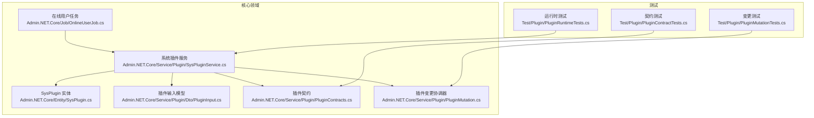
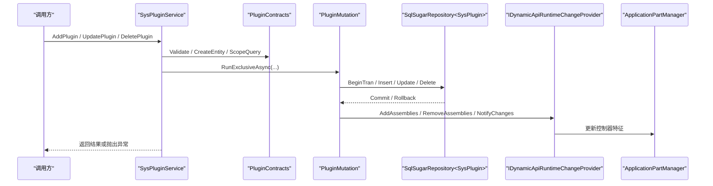
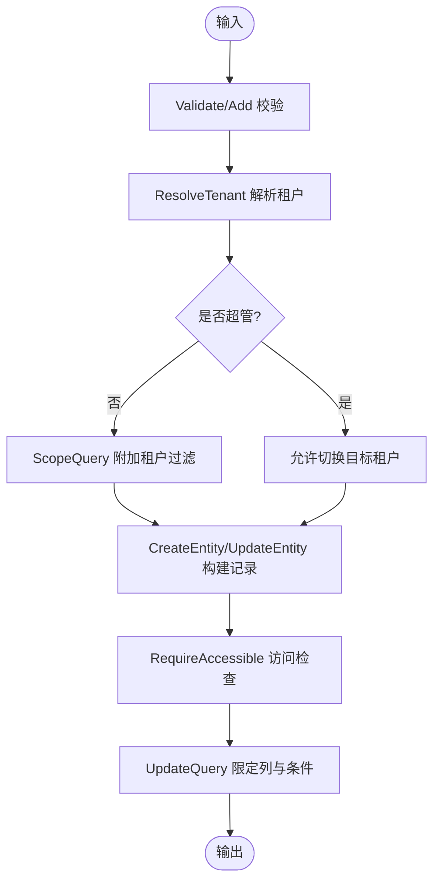
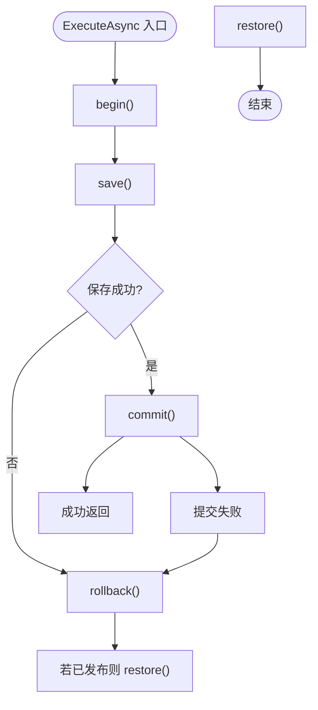
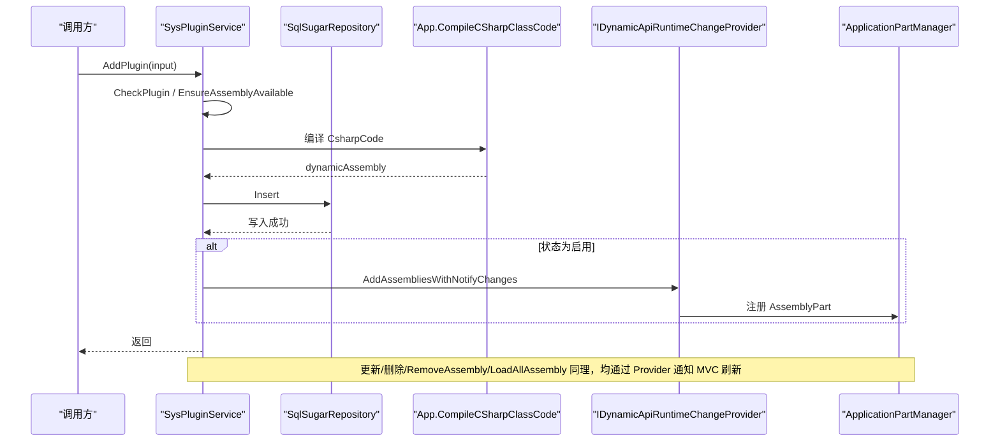
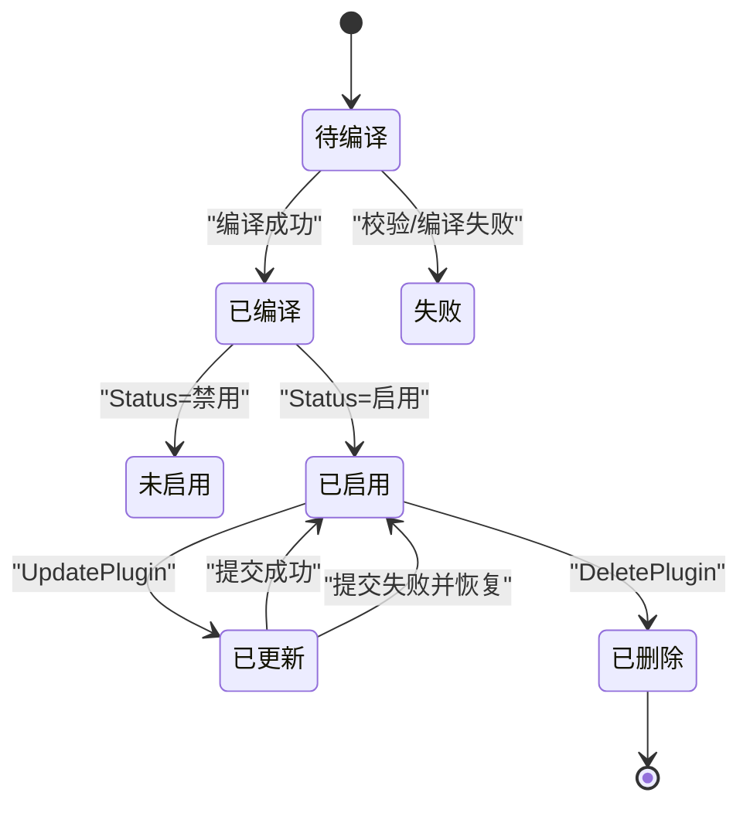
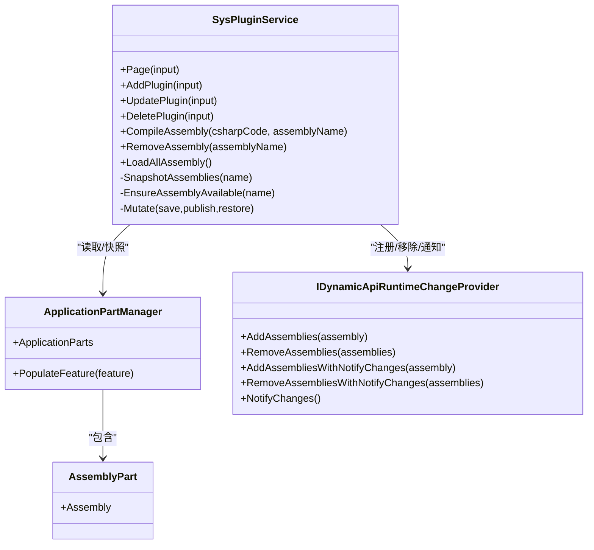
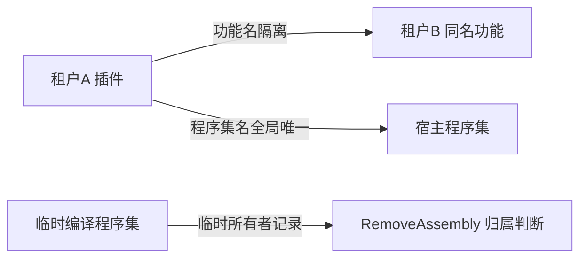

# 插件架构设计

<cite>
**本文引用的文件 **
- [SysPluginService.cs](file://Admin.NET/Admin.NET.Core/Service/Plugin/SysPluginService.cs)
- [PluginContracts.cs](file://Admin.NET/Admin.NET.Core/Service/Plugin/PluginContracts.cs)
- [PluginMutation.cs](file://Admin.NET/Admin.NET.Core/Service/Plugin/PluginMutation.cs)
- [SysPlugin.cs](file://Admin.NET/Admin.NET.Core/Entity/SysPlugin.cs)
- [PluginInput.cs](file://Admin.NET/Admin.NET.Core/Service/Plugin/Dto/PluginInput.cs)
- [OnlineUserJob.cs](file://Admin.NET/Admin.NET.Core/Job/OnlineUserJob.cs)
- [PluginRuntimeTests.cs](file://Admin.NET/Admin.NET.Test/Plugin/PluginRuntimeTests.cs)
- [PluginContractTests.cs](file://Admin.NET/Admin.NET.Test/Plugin/PluginContractTests.cs)
- [PluginMutationTests.cs](file://Admin.NET/Admin.NET.Test/Plugin/PluginMutationTests.cs)
</cite>

## 目录
1. [引言](#引言)
2. [项目结构](#项目结构)
3. [核心组件](#核心组件)
4. [架构总览](#架构总览)
5. [详细组件分析](#详细组件分析)
6. [依赖与隔离分析](#依赖与隔离分析)
7. [性能考量](#性能考量)
8. [故障排查指南](#故障排查指南)
9. [结论](#结论)

## 引言
本文件面向 Admin.NET 的插件系统，围绕“动态程序集加载、运行时接口注册、租户隔离”三个维度展开。系统通过编译 C# 源码生成动态程序集，将其注册到 ASP.NET Core MVC 的动态 API 运行时，暴露控制器方法；同时以 SysPlugin 实体持久化插件元数据，并通过 PluginContracts 提供输入校验、租户范围解析和权限控制。PluginMutation 保证插件变更在并发、事务与运行时代码替换上的原子性。SysPluginService 是用户可见的动态插件服务入口，负责从请求到数据库、再到运行时接口的完整编排。

## 项目结构
插件相关代码集中在 Admin.NET.Core 的 Service 与 Entity 层，测试位于 Test 工程：

**图表来源**
- [SysPluginService.cs:1-264](file://Admin.NET/Admin.NET.Core/Service/Plugin/SysPluginService.cs#L1-L264)
- [PluginContracts.cs:1-97](file://Admin.NET/Admin.NET.Core/Service/Plugin/PluginContracts.cs#L1-L97)
- [PluginMutation.cs:1-55](file://Admin.NET/Admin.NET.Core/Service/Plugin/PluginMutation.cs#L1-L55)
- [SysPlugin.cs:1-56](file://Admin.NET/Admin.NET.Core/Entity/SysPlugin.cs#L1-L56)
- [PluginInput.cs:1-42](file://Admin.NET/Admin.NET.Core/Service/Plugin/Dto/PluginInput.cs#L1-L42)
- [OnlineUserJob.cs:1-49](file://Admin.NET/Admin.NET.Core/Job/OnlineUserJob.cs#L1-L49)
- [PluginContractTests.cs:1-132](file://Admin.NET/Admin.NET.Test/Plugin/PluginContractTests.cs#L1-L132)
- [PluginMutationTests.cs:1-68](file://Admin.NET/Admin.NET.Test/Plugin/PluginMutationTests.cs#L1-L68)
- [PluginRuntimeTests.cs:1-103](file://Admin.NET/Admin.NET.Test/Plugin/PluginRuntimeTests.cs#L1-L103)

**章节来源**
- [SysPluginService.cs:1-264](file://Admin.NET/Admin.NET.Core/Service/Plugin/SysPluginService.cs#L1-L264)
- [PluginContracts.cs:1-97](file://Admin.NET/Admin.NET.Core/Service/Plugin/PluginContracts.cs#L1-L97)
- [PluginMutation.cs:1-55](file://Admin.NET/Admin.NET.Core/Service/Plugin/PluginMutation.cs#L1-L55)
- [SysPlugin.cs:1-56](file://Admin.NET/Admin.NET.Core/Entity/SysPlugin.cs#L1-L56)
- [PluginInput.cs:1-42](file://Admin.NET/Admin.NET.Core/Service/Plugin/Dto/PluginInput.cs#L1-L42)
- [OnlineUserJob.cs:1-49](file://Admin.NET/Admin.NET.Core/Job/OnlineUserJob.cs#L1-L49)
- [PluginContractTests.cs:1-132](file://Admin.NET/Admin.NET.Test/Plugin/PluginContractTests.cs#L1-L132)
- [PluginMutationTests.cs:1-68](file://Admin.NET/Admin.NET.Test/Plugin/PluginMutationTests.cs#L1-L68)
- [PluginRuntimeTests.cs:1-103](file://Admin.NET/Admin.NET.Test/Plugin/PluginRuntimeTests.cs#L1-L103)

## 核心组件
- SysPluginService：对外暴露增删改查、编译动态程序集、移除动态程序集、批量加载已启用插件等能力；集成 ApplicationPartManager 与 IDynamicApiRuntimeChangeProvider，完成运行时控制器发现与更新。
- PluginContracts：纯函数式契约，承担参数校验、租户范围解析、删除归属校验、可访问性检查、实体构建与更新查询构造。
- PluginMutation：进程级单实例变更协调器，提供互斥执行和带事务的回滚恢复流程。
- SysPlugin：插件持久化模型，包含名称、C# 源码、程序集名称、排序、状态与备注，并继承租户基类。
- PluginInput：Add/Update/Delete/Page 等请求输入模型。
- OnlineUserJob：应用启动后定时任务，触发 LoadAllAssembly，确保重启后仍加载已启用插件。

**章节来源**
- [SysPluginService.cs:1-264](file://Admin.NET/Admin.NET.Core/Service/Plugin/SysPluginService.cs#L1-L264)
- [PluginContracts.cs:1-97](file://Admin.NET/Admin.NET.Core/Service/Plugin/PluginContracts.cs#L1-L97)
- [PluginMutation.cs:1-55](file://Admin.NET/Admin.NET.Core/Service/Plugin/PluginMutation.cs#L1-L55)
- [SysPlugin.cs:1-56](file://Admin.NET/Admin.NET.Core/Entity/SysPlugin.cs#L1-L56)
- [PluginInput.cs:1-42](file://Admin.NET/Admin.NET.Core/Service/Plugin/Dto/PluginInput.cs#L1-L42)
- [OnlineUserJob.cs:1-49](file://Admin.NET/Admin.NET.Core/Job/OnlineUserJob.cs#L1-L49)

## 架构总览
插件系统整体由“业务服务 → 契约校验 → 变更协调 → 数据库 → 运行时 API 注册”构成。MVC 通过 ApplicationPartManager 和 ControllerFeature 发现控制器；IDynamicApiRuntimeChangeProvider 负责通知运行时刷新 ActionDescriptor。

**图表来源**
- [SysPluginService.cs:40-200](file://Admin.NET/Admin.NET.Core/Service/Plugin/SysPluginService.cs#L40-L200)
- [PluginContracts.cs:12-97](file://Admin.NET/Admin.NET.Core/Service/Plugin/PluginContracts.cs#L12-L97)
- [PluginMutation.cs:12-55](file://Admin.NET/Admin.NET.Core/Service/Plugin/PluginMutation.cs#L12-L55)

## 详细组件分析

### PluginContracts：输入验证、租户解析与权限控制
PluginContracts 将跨多个服务的规则收敛为静态方法，避免在控制器或服务中散落校验逻辑。

- 输入验证
  - AddPluginInput.Validate：非空、长度上限、枚举有效性、租户有效性。
  - PagePluginInput.ValidatePage：分页参数为正数、查询字段长度与租户合法性。
- 租户范围解析
  - ResolveTenant：超管可切换目标租户；普通用户只能使用当前租户；最终租户必须大于零。
  - ScopeQuery：根据是否超管决定是否附加 TenantId 过滤条件。
- 权限控制
  - EnsureRemovalOwner：禁止移除宿主程序集或不属于当前租户的程序集；超管也不允许破坏宿主。
  - RequireAccessible：对象不存在或非当前租户时拒绝访问。
- 实体构建与更新
  - CreateEntity：对 Name、AssemblyName、Remark 做 Trim；TenantId 走 ResolveTenant。
  - UpdateEntity：拒绝移动租户；只映射允许字段。
  - UpdateQuery：显式写主键与原租户条件，防止自定义 Where 覆盖 ORM 条件。

**图表来源**
- [PluginContracts.cs:12-97](file://Admin.NET/Admin.NET.Core/Service/Plugin/PluginContracts.cs#L12-L97)

**章节来源**
- [PluginContracts.cs:12-97](file://Admin.NET/Admin.NET.Core/Service/Plugin/PluginContracts.cs#L12-L97)
- [PluginContractTests.cs:17-132](file://Admin.NET/Admin.NET.Test/Plugin/PluginContractTests.cs#L17-L132)

### PluginMutation：并发安全、事务回滚与资源恢复
PluginMutation 是插件系统的“一致性边界”，保证同一时刻只有一个插件变更进入关键路径，并在失败时尽可能恢复数据库与运行时状态。

- 并发安全
  - 使用 SemaphoreSlim(1,1) 实现进程内互斥。
  - RunExclusiveAsync 与 RunExclusive 分别支持异步与同步场景。
- 事务与回滚
  - ExecuteAsync 接收 begin/save/publish/commit/rollback/restore 六个阶段回调。
  - save 失败：仅 rollback。
  - publish 失败：先 rollback，再 restore 运行时。
  - commit 失败：先 rollback，再 restore 运行时。
- 多错误聚合
  - 若 rollback 或 restore 也失败，会收集多个异常并以 AggregateException 抛出，便于诊断。

**图表来源**
- [PluginMutation.cs:12-55](file://Admin.NET/Admin.NET.Core/Service/Plugin/PluginMutation.cs#L12-L55)

**章节来源**
- [PluginMutation.cs:12-55](file://Admin.NET/Admin.NET.Core/Service/Plugin/PluginMutation.cs#L12-L55)
- [PluginMutationTests.cs:11-68](file://Admin.NET/Admin.NET.Test/Plugin/PluginMutationTests.cs#L11-L68)

### SysPluginService：动态 API 注册流程
SysPluginService 是插件系统的编排中心，职责包括：

- 列表查询
  - Page：基于 ScopeQuery 与当前用户身份进行分页、模糊查询与排序。
- 新增插件
  - 校验并创建实体；编译 C# 源码；检查程序集名称冲突；插入数据库；若启用则通过 _provider.AddAssembliesWithNotifyChanges 注册到 MVC。
- 更新插件
  - 查找并校验归属；编译新代码；快照旧程序集；更新数据库；运行时先移除旧程序集、再添加新程序集；若提交失败则恢复旧程序集。
- 删除插件
  - 查找并校验归属；快照旧程序集；删除数据库；运行时移除程序集；若失败则恢复。
- 直接编译与移除动态程序集
  - CompileAssembly：用于临时接口；记录 TemporaryAssemblyOwners，供 RemoveAssembly 判断归属。
  - RemoveAssembly：按程序集名称移除运行时接口，并清理临时所有者。
- 启动加载
  - LoadAllAssembly：遍历 StatusEnum.Enable 的插件，编译并注册。

**图表来源**
- [SysPluginService.cs:40-200](file://Admin.NET/Admin.NET.Core/Service/Plugin/SysPluginService.cs#L40-L200)
- [SysPluginService.cs:201-264](file://Admin.NET/Admin.NET.Core/Service/Plugin/SysPluginService.cs#L201-L264)

**章节来源**
- [SysPluginService.cs:1-264](file://Admin.NET/Admin.NET.Core/Service/Plugin/SysPluginService.cs#L1-L264)

### 插件生命周期：从编译到接口暴露
插件生命周期分为以下阶段：

1. 源码输入：AddPluginInput.CsharpCode 与可选 AssemblyName。
2. 输入校验：PluginContracts.Validate 与长度、枚举、租户检查。
3. 编译：App.CompileCSharpClassCode 生成动态程序集。
4. 冲突检测：EnsureAssemblyAvailable 与 CheckPlugin 阻止同名程序集和功能名冲突。
5. 持久化：Insert/Update/Delete 在事务内执行。
6. 运行时注册：_provider.AddAssemblies/RemoveAssemblies 与 NotifyChanges 通知 MVC。
7. 启动恢复：OnlineUserJob 调用 LoadAllAssembly 重新加载已启用插件。

**图表来源**
- [SysPluginService.cs:40-264](file://Admin.NET/Admin.NET.Core/Service/Plugin/SysPluginService.cs#L40-L264)
- [OnlineUserJob.cs:38-49](file://Admin.NET/Admin.NET.Core/Job/OnlineUserJob.cs#L38-L49)

**章节来源**
- [SysPluginService.cs:40-264](file://Admin.NET/Admin.NET.Core/Service/Plugin/SysPluginService.cs#L40-L264)
- [OnlineUserJob.cs:1-49](file://Admin.NET/Admin.NET.Core/Job/OnlineUserJob.cs#L1-L49)

### 运行时接口注册机制
SysPluginService 注入 Microsoft.AspNetCore.Mvc.ApplicationParts.ApplicationPartManager 与 Furion 提供的 IDynamicApiRuntimeChangeProvider。动态控制器通过 AssemblyPart 注册，并由 DynamicApiRuntimeChangeProvider 内部维护 MvcActionDescriptorChangeProvider，从而触发 MVC 刷新控制器元数据。

关键点：
- AddAssembliesWithNotifyChanges：注册程序集并通知运行时刷新。
- RemoveAssembliesWithNotifyChanges：移除程序集并通知刷新。
- SnapshotAssemblies：从 ApplicationPartManager 中按程序集名称筛选 AssemblyPart，用于备份与恢复。
- 测试验证：PluginRuntimeTests 通过反射创建 IDynamicApiRuntimeChangeProvider 实例，证明控制器在程序集释放后仍可被 MVC 调用，并在刷新后被正确移除。

**图表来源**
- [SysPluginService.cs:12-264](file://Admin.NET/Admin.NET.Core/Service/Plugin/SysPluginService.cs#L12-L264)
- [PluginRuntimeTests.cs:14-103](file://Admin.NET/Admin.NET.Test/Plugin/PluginRuntimeTests.cs#L14-L103)

**章节来源**
- [SysPluginService.cs:12-264](file://Admin.NET/Admin.NET.Core/Service/Plugin/SysPluginService.cs#L12-L264)
- [PluginRuntimeTests.cs:14-103](file://Admin.NET/Admin.NET.Test/Plugin/PluginRuntimeTests.cs#L14-L103)

## 依赖与隔离分析

### 插件间依赖隔离
- 进程内共享：所有动态程序集加载到当前 AppDomain/AppContext 的进程中；不同插件之间不形成独立进程或沙箱。
- 命名空间与类型隔离：通过程序集名称区分；相同程序集名称会被视为同一运行实体，重复注册会被拒绝。
- 功能名称隔离：同一租户下功能名称不可重复；跨租户可重名，但程序集名称全局唯一。

### 命名空间冲突处理
- 程序集名称冲突：EnsureAssemblyAvailable 与 CheckPlugin 双重检查，防止与现有插件或已编译临时程序集冲突。
- 功能名称冲突：CheckPlugin 在同一租户内禁止重复；跨租户允许同名功能。

### 租户隔离
- 查询隔离：ScopeQuery 为非超管用户自动附加 TenantId 过滤。
- 写入隔离：UpdateQuery 显式限制 Id 与 TenantId 条件，防止误改其他租户数据。
- 删除保护：EnsureRemovalOwner 禁止删除宿主程序集或他人租户的程序集。
- 租户校验：CheckPlugin 要求目标租户存在且启用。

**图表来源**
- [PluginContracts.cs:24-97](file://Admin.NET/Admin.NET.Core/Service/Plugin/PluginContracts.cs#L24-L97)
- [SysPluginService.cs:120-200](file://Admin.NET/Admin.NET.Core/Service/Plugin/SysPluginService.cs#L120-L200)

**章节来源**
- [PluginContracts.cs:24-97](file://Admin.NET/Admin.NET.Core/Service/Plugin/PluginContracts.cs#L24-L97)
- [SysPluginService.cs:120-200](file://Admin.NET/Admin.NET.Core/Service/Plugin/SysPluginService.cs#L120-L200)

## 性能考量
- 并发控制：SemaphoreSlim 保证同一时间只有一个插件变更进入关键路径，避免多线程下的程序集注册与数据库写入竞争。
- 编译开销：每次新增/更新都会编译 C# 源码，属于 CPU 密集操作；应避免频繁热更，必要时结合缓存策略减少重复编译。
- MVC 刷新成本：每次 Add/Remove/NotifyChanges 都会刷新控制器描述符；批量更新时可合并通知，降低刷新次数。
- 启动加载：LoadAllAssembly 仅在启动时或特定任务触发，避免每次请求都重复编译与注册。
- 内存占用：动态程序集通过 using 释放编译句柄，但 MVC 持有的类型引用会使程序集驻留；测试表明控制器在程序集释放后仍可调用，体现 MVC 的类型缓存特性。

[本节为通用指导，不涉及具体文件分析]

## 故障排查指南

### 常见问题与定位
- 新增插件失败
  - 检查输入校验：名称为空、超长、状态非法、租户无效。
  - 检查程序集名称冲突：EnsureAssemblyAvailable 与 CheckPlugin。
  - 检查租户是否存在且启用：CheckPlugin。
- 更新插件失败
  - 确认目标记录未被并发修改：UpdateQuery 的 Id 与 TenantId 条件。
  - 关注运行时恢复：若提交失败，应检查旧程序集是否恢复。
- 删除插件失败
  - 确认删除归属：EnsureRemovalOwner 不允许删除宿主或他人租户程序集。
- 运行时接口未生效
  - 检查 IDynamicApiRuntimeChangeProvider 是否成功调用 AddAssembliesWithNotifyChanges 与 NotifyChanges。
  - 查看 ApplicationPartManager 中的 AssemblyPart 是否包含目标程序集。
- 启动后未加载插件
  - 确认 OnlineUserJob 是否执行 LoadAllAssembly。
  - 检查插件 Status 是否为启用。

**章节来源**
- [PluginContracts.cs:12-97](file://Admin.NET/Admin.NET.Core/Service/Plugin/PluginContracts.cs#L12-L97)
- [SysPluginService.cs:40-264](file://Admin.NET/Admin.NET.Core/Service/Plugin/SysPluginService.cs#L40-L264)
- [PluginRuntimeTests.cs:14-103](file://Admin.NET/Admin.NET.Test/Plugin/PluginRuntimeTests.cs#L14-L103)
- [PluginMutationTests.cs:11-68](file://Admin.NET/Admin.NET.Test/Plugin/PluginMutationTests.cs#L11-L68)

## 结论
Admin.NET 的插件系统以 SysPluginService 为核心编排点，结合 PluginContracts 的严格契约、PluginMutation 的强一致变更流程，以及 MVC 运行时程序集注册机制，实现了“动态编译、运行时暴露、事务回滚、资源恢复、租户隔离”的完整闭环。其设计强调：
- 安全性：输入校验、租户隔离、删除保护。
- 一致性：进程内互斥、事务回滚、运行时恢复。
- 可观测性：测试覆盖契约、变更与运行时行为，便于回归验证。
在实际使用中，建议尽量减少高频热更，合理划分插件边界，并通过单元测试与浏览器验收保障插件质量与用户体验。