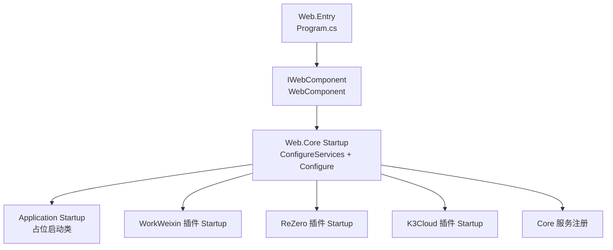
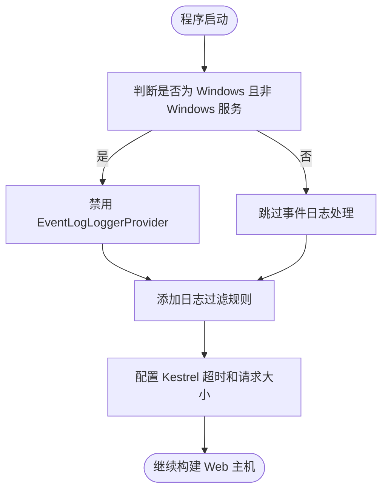
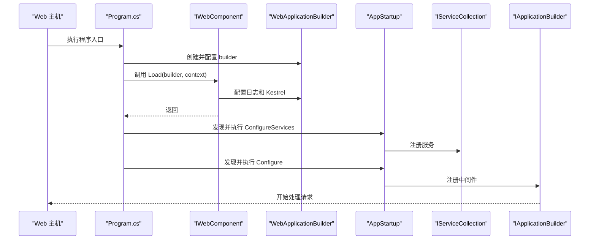
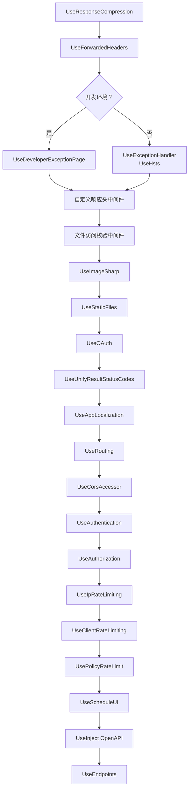
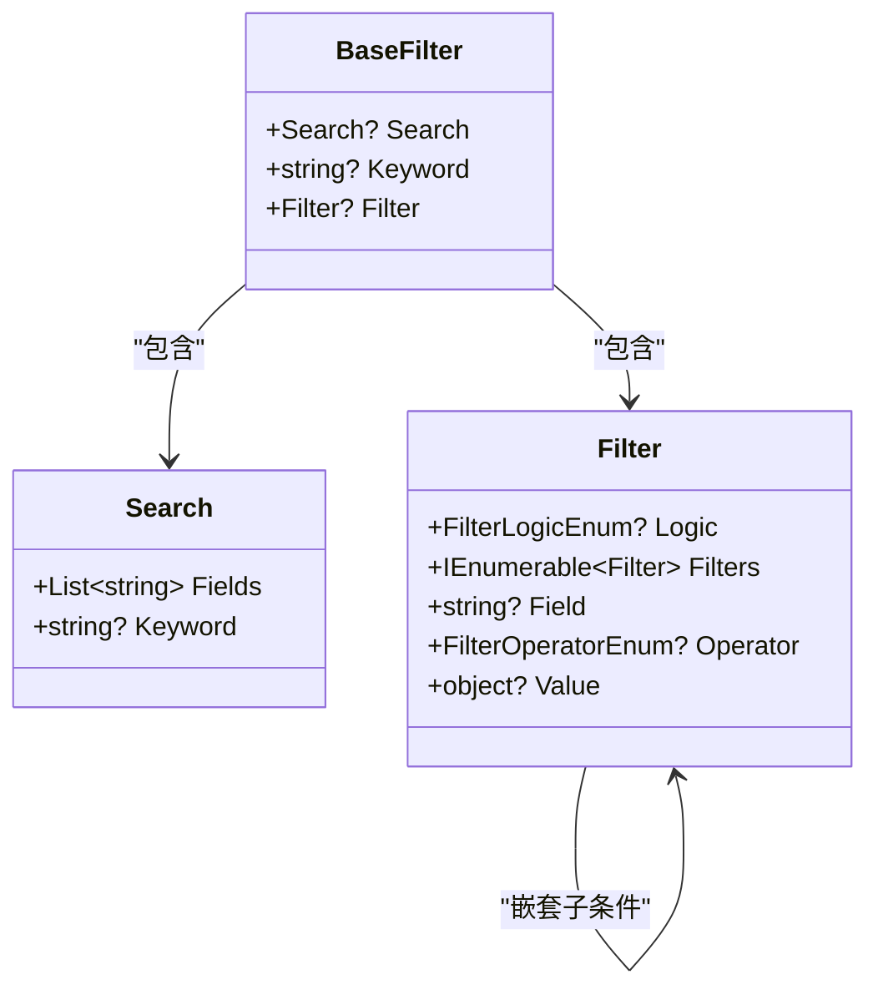
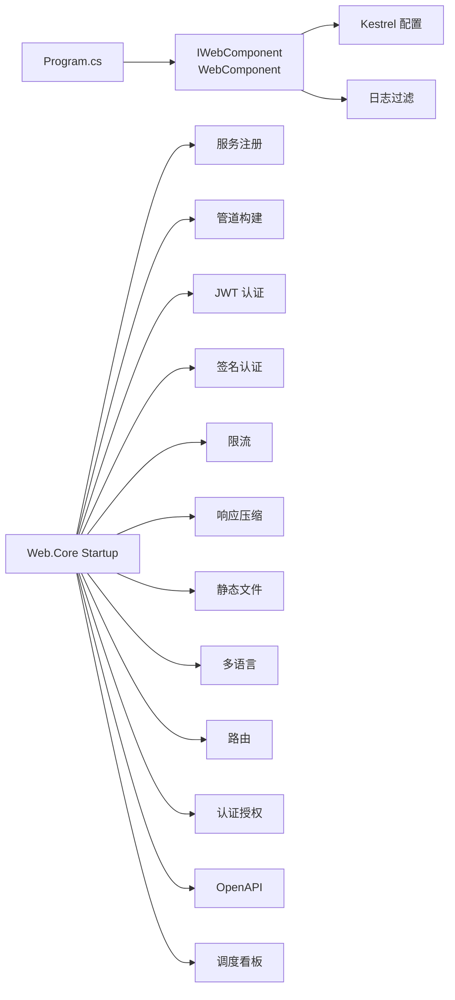

# IWebComponent 接口实现

<cite>
**本文引用的文件**   
- [Program.cs](file://Admin.NET/Admin.NET.Web.Entry/Program.cs)
- [Startup.cs（Web.Core）](file://Admin.NET/Admin.NET.Web.Core/Startup.cs)
- [ProjectOptions.cs](file://Admin.NET/Admin.NET.Web.Core/ProjectOptions.cs)
- [Startup.cs（Application）](file://Admin.NET/Admin.NET.Application/Startup.cs)
- [Startup.cs（WorkWeixin 插件）](file://Admin.NET/Plugins/Admin.NET.Plugin.WorkWeixin/Startup.cs)
- [Startup.cs（ReZero 插件）](file://Admin.NET/Plugins/Admin.NET.Plugin.ReZero/Startup.cs)
- [Startup.cs（K3Cloud 插件）](file://Admin.NET/Plugins/Admin.NET.Plugin.K3Cloud/Startup.cs)
- [BaseFilter.cs](file://Admin.NET/Admin.NET.Core/Utils/BaseFilter.cs)
- [IdempotentAttribute.cs](file://Admin.NET/Admin.NET.Core/Attribute/IdempotentAttribute.cs)
- [SqlSugarSetup.cs](file://Admin.NET/Admin.NET.Core/SqlSugar/SqlSugarSetup.cs)
- [CacheSetup.cs](file://Admin.NET/Admin.NET.Core/Cache/CacheSetup.cs)
- [ElasticSearchSetup.cs](file://Admin.NET/Admin.NET.Core/ElasticSearch/ElasticSearchSetup.cs)
</cite>

## 目录

1. [引言](#引言)
2. [项目结构与入口](#项目结构与入口)
3. [IWebComponent 接口与 WebComponent 职责](#iwebcomponent-接口与-webcomponent-职责)
4. [应用启动生命周期](#应用启动生命周期)
5. [中间件注册、顺序与条件执行](#中间件注册顺序与条件执行)
6. [过滤器机制：全局过滤器与控制器级过滤器](#过滤器机制全局过滤器与控制器级过滤器)
7. [服务注入策略：单例、瞬态与作用域](#服务注入策略单例瞬态与作用域)
8. [常见 Web 扩展示例](#常见-web-扩展示例)
9. [依赖关系分析](#依赖关系分析)
10. [性能优化建议](#性能优化建议)
11. [故障排查指南](#故障排查指南)
12. [结论](#结论)

## 引言

本文件围绕 Admin.NET 的 Web 启动扩展点，重点讲解 `IWebComponent` 接口的实际使用方式、应用启动流程、中间件注册顺序、过滤器机制和服务生命周期。该项目在 .NET Web 主机中通过 Furion 的组件模型组织 Web 层能力，并以 `Admin.NET.Web.Entry` 作为程序入口，以 `Admin.NET.Web.Core.Startup` 作为核心 Web 启动配置类。

需要特别说明的是：当前仓库中的业务前端入口位于 `Web/apps/web-antdv-next/`，后端 Web 扩展能力集中在 `Admin.NET` 目录下的 C# 工程中；本文不讨论旧前端目录或模板应用，只分析当前已实现的 Web 启动和组件扩展机制。

## 项目结构与入口

从仓库结构看，Web 相关代码主要分布在以下位置：

| 路径 | 职责 |
|---|---|
| `Admin.NET/Admin.NET.Web.Entry/Program.cs` | 创建 Web 主机、注册 `IWebComponent`、配置 Kestrel、日志过滤和 Windows 事件日志行为 |
| `Admin.NET/Admin.NET.Web.Core/Startup.cs` | 核心 `AppStartup`，注册服务、配置 JSON、限流、压缩、响应头、路由、鉴权、授权、OpenAPI 等 |
| `Admin.NET/Admin.NET.Application/Startup.cs` | 应用层占位启动类，用于演示按优先级加载多个 `AppStartup` |
| `Admin.NET/Plugins/*/Startup.cs` | 各插件通过 `AppStartup` 注册自身选项、服务和管道中间件 |
| `Admin.NET/Admin.NET.Core/...` | 核心能力：缓存、数据库、日志、搜索、信号、任务调度、OAuth、签名认证等 |

**图示来源**   
- [Program.cs:1-38](file://Admin.NET/Admin.NET.Web.Entry/Program.cs#L1-L38)
- [Startup.cs（Web.Core）:1-442](file://Admin.NET/Admin.NET.Web.Core/Startup.cs#L1-L442)
- [Startup.cs（Application）:1-22](file://Admin.NET/Admin.NET.Application/Startup.cs#L1-L22)
- [Startup.cs（WorkWeixin 插件）:1-25](file://Admin.NET/Plugins/Admin.NET.Plugin.WorkWeixin/Startup.cs#L1-L25)
- [Startup.cs（ReZero 插件）:1-54](file://Admin.NET/Plugins/Admin.NET.Plugin.ReZero/Startup.cs#L1-L54)
- [Startup.cs（K3Cloud 插件）:1-29](file://Admin.NET/Plugins/Admin.NET.Plugin.K3Cloud/Startup.cs#L1-L29)

**章节来源**   
- [Program.cs:1-38](file://Admin.NET/Admin.NET.Web.Entry/Program.cs#L1-L38)
- [Startup.cs（Web.Core）:1-442](file://Admin.NET/Admin.NET.Web.Core/Startup.cs#L1-L442)

## IWebComponent 接口与 WebComponent 职责

### 接口方法职责说明

在当前仓库中，`IWebComponent` 的实际使用方式是定义一个实现该接口的类，并通过宿主 builder 注册到 Furion 组件系统中。根据 `Program.cs` 的实现，这个入口类至少暴露了 `Load` 方法，接收 `WebApplicationBuilder` 和 `ComponentContext`，用于在应用启动早期完成 Web 层基础设施配置。

| 方法名 | 参数 | 职责 | 调用时机 |
|---|---|---|---|
| `Load` | `WebApplicationBuilder builder`、`ComponentContext componentContext` | 配置日志、Windows 事件日志、Kestrel 请求限制等底层运行时行为 | 应用构建阶段，通常在服务注册和管道构建之前 |

当前仓库没有展示 `Configure`、`ConfigureServices`、`ConfigurePipeline` 等方法的直接实现；这些方法属于 Furion 的 `AppStartup` 体系，而不是 `IWebComponent` 的直接方法。`IWebComponent` 在此项目中承担的是“Web 主机初始化阶段的轻量扩展点”，而真正的服务注册和管道构建由 `AppStartup` 负责。

### WebComponent 的具体实现

`WebComponent` 在 `Program.cs` 中实现了三项关键职责：

1. **控制台运行时的 Windows 事件日志处理**  
   如果运行环境是 Windows 且不是 Windows Service，则禁用 `EventLogLoggerProvider`，避免普通用户权限导致事件日志写入异常。

2. **日志级别过滤**  
   添加通用日志过滤器，忽略 `Microsoft.Hosting` 和 `Microsoft.AspNetCore` 前缀的类别，并只记录 `Information` 及以上级别。

3. **Kestrel 服务器限制**  
   设置 KeepAlive 超时、请求头超时为 30 分钟，并允许无限大的请求体大小，适合管理后台上传大文件或长时间连接的场景。

**图示来源**   
- [Program.cs:1-38](file://Admin.NET/Admin.NET.Web.Entry/Program.cs#L1-L38)

**章节来源**   
- [Program.cs:1-38](file://Admin.NET/Admin.NET.Web.Entry/Program.cs#L1-L38)

## 应用启动生命周期

Admin.NET 的 Web 启动由两个层次组成：

1. **Web 主机初始化层**：由 `Program.cs` 中的 `Serve.Run` 和 `IWebComponent.Load` 负责。
2. **Furion AppStartup 层**：由 `AppStartup` 派生类负责服务注册和管道构建。

**图示来源**   
- [Program.cs:1-38](file://Admin.NET/Admin.NET.Web.Entry/Program.cs#L1-L38)
- [Startup.cs（Web.Core）:1-442](file://Admin.NET/Admin.NET.Web.Core/Startup.cs#L1-L442)

### AppStartup 的优先级

`Startup` 类通过 `[AppStartup(int.MaxValue)]` 声明启动优先级。值越大，越先执行。`Admin.NET.Application.Startup` 使用 `[AppStartup(100)]`，表示它是一个低优先级的占位启动类；`Web.Core` 的启动类使用最大整数优先级，确保核心 Web 能力优先加载。

这种设计允许插件和应用模块通过不同优先级组合启动逻辑，但同时也要求开发者注意：

- 高优先级启动类应先于低优先级启动类注册基础服务。
- 插件之间如果有依赖关系，应通过明确的配置项或服务契约控制顺序，而不是完全依赖优先级数字。
- 不要滥用极大或极小优先级，以免破坏可读性和可维护性。

**章节来源**   
- [Startup.cs（Web.Core）:1-20](file://Admin.NET/Admin.NET.Web.Core/Startup.cs#L1-L20)
- [Startup.cs（Application）:1-22](file://Admin.NET/Admin.NET.Application/Startup.cs#L1-L22)

## 中间件注册、顺序与条件执行

`Startup.Configure` 是 ASP.NET Core 管道构建的核心位置。当前实现展示了典型的中间件顺序：

**图示来源**   
- [Startup.cs（Web.Core）:267-442](file://Admin.NET/Admin.NET.Web.Core/Startup.cs#L267-L442)

### 关键中间件职责

| 中间件 | 作用 | 注意事项 |
|---|---|---|
| `UseResponseCompression` | 启用 Brotli 和 Gzip 响应压缩 | 已在服务端注册，管道中启用 |
| `UseForwardedHeaders` | 读取反向代理转发头 | 生产环境需配合负载均衡器正确配置 |
| `UseDeveloperExceptionPage` / `UseExceptionHandler` | 开发错误页或生产错误页 | 生产环境关闭详细错误页 |
| 自定义响应头中间件 | 向响应追加 `Admin.NET` 头 | 放在管道早期，所有响应都会携带 |
| 文件访问校验中间件 | 根据文件名解析 fileId，校验是否公开 | 私有文件返回 403，防止直接下载 |
| `UseImageSharp` | 图像处理 | 必须在图片缓存和静态文件之前 |
| `UseStaticFiles` | 静态文件服务 | 支持虚拟路径和 MIME 类型映射 |
| `UseOAuth` | OAuth 第三方登录 | 由 Furion 扩展提供 |
| `UseUnifyResultStatusCodes` | 统一状态码处理 | 保证 API 返回格式一致 |
| `UseAppLocalization` | 多语言 | 必须在 `UseRouting` 之前 |
| `UseRouting` | 路由注册 | 后续鉴权和授权依赖路由信息 |
| `UseCorsAccessor` | 跨域 | 必须在路由之后、鉴权之前 |
| `UseAuthentication` / `UseAuthorization` | 身份验证和授权 | JWT 和签名认证在服务端注册 |
| 限流中间件 | IP、客户端、策略限流 | 放在鉴权之后，避免对未认证请求过度限流 |
| `UseScheduleUI` | 定时任务看板 | 包含登录回调和安全密钥配置 |
| `UseInject` / `MapScalarApiReference` | OpenAPI 文档 | 支持分组文档和 Scalar UI |
| `UseEndpoints` | 控制器、SignalR Hub、默认路由 | 最终请求分发点 |

### 条件执行逻辑

1. **环境区分**  
   开发环境启用开发者异常页；生产环境启用异常处理器和 HSTS。

2. **OpenAPI 开关**  
   通过配置项 `AppSettings:InjectSpecificationDocument` 控制是否启用 Scalar API 文档。

3. **虚拟路径静态文件**  
   如果配置中存在 `VirtualPath`，则额外挂载二级目录静态文件。

4. **集群作业调度**  
   如果在配置中找到 `JobSchedule:ClusterId`，则启用集群模式和集群服务器。

5. **Redis 事件总线存储**  
   当缓存类型为 Redis 时，替换事件总线存储器为 Redis 通道。

**章节来源**   
- [Startup.cs（Web.Core）:267-442](file://Admin.NET/Admin.NET.Web.Core/Startup.cs#L267-L442)

## 过滤器机制：全局过滤器与控制器级过滤器

需要区分两类“过滤器”概念：

1. **ASP.NET Core 请求管道中的中间件**：由 `Startup.Configure` 中的 `app.UseXxx` 控制。
2. **控制器或 Action 级别的过滤器**：例如异步动作过滤器、授权过滤器、结果过滤器等。
3. **数据查询层的筛选模型**：例如 `BaseFilter`、`Filter`、`Search` 等，用于分页和条件查询。

### 控制器级过滤器示例

项目中存在一个幂等性属性 `IdempotentAttribute`，它实现了 `IAsyncActionFilter`，用于标识幂等操作。这类过滤器通常用于防止重复提交、重试攻击或分布式场景下的重复请求。

| 特性 | 说明 |
|---|---|
| 类型 | 异步动作过滤器 |
| 适用范围 | 控制器方法或控制器类 |
| 典型用途 | 幂等校验、请求去重、操作审计 |
| 注册方式 | 通常通过特性直接标注在 Action 上 |

### 全局过滤器与控制器级过滤器的区别

| 维度 | 全局过滤器 | 控制器级过滤器 |
|---|---|---|
| 作用范围 | 所有匹配的请求或所有控制器 | 单个控制器或单个 Action |
| 注册位置 | 通常在 `ConfigureServices` 中注册 | 通过特性标注 |
| 执行顺序 | 由框架或全局配置决定 | 晚于全局过滤器 |
| 适用场景 | 日志、审计、全局异常、通用校验 | 业务特定校验、权限、幂等 |
| 风险 | 容易影响性能或误伤正常请求 | 更容易控制和测试 |

### 数据查询过滤器

`BaseFilter.cs` 定义了 `Search`、`Filter` 和 `BaseFilter`，主要用于列表查询的条件构造：

| 类型 | 字段 | 含义 |
|---|---|---|
| `Search` | `Fields`、`Keyword` | 模糊查询字段集合和关键字 |
| `Filter` | `Logic`、`Filters`、`Field`、`Operator`、`Value` | 复合查询条件、子条件、字段、运算符、值 |
| `BaseFilter` | `Search`、`Keyword`、`Filter` | 查询输入基类，供分页或列表输入继承 |

**图示来源**   
- [BaseFilter.cs:1-75](file://Admin.NET/Admin.NET.Core/Utils/BaseFilter.cs#L1-L75)

**章节来源**   
- [BaseFilter.cs:1-75](file://Admin.NET/Admin.NET.Core/Utils/BaseFilter.cs#L1-L75)
- [IdempotentAttribute.cs](file://Admin.NET/Admin.NET.Core/Attribute/IdempotentAttribute.cs)

## 服务注入策略：单例、瞬态与作用域

Admin.NET 的服务注册遵循 .NET DI 常规约定，并结合 Furion 的 `AddConfigurableOptions` 等扩展方法。以下是仓库中明确使用的三种生命周期：

| 生命周期 | 含义 | 仓库中的典型用法 |
|---|---|---|
| 单例 | 整个应用生命周期内只有一个实例 | SQL Client、ElasticSearch 客户端、速率限制配置、OSS 管理器 |
| 瞬态 | 每次请求或每次解析时创建新实例 | 文件提供者、工作单元类、短期工具对象 |
| 作用域 | 每个请求范围内共享一个实例 | SqlSugar 仓储、请求上下文相关服务 |

### 单例服务

| 服务 | 文件 | 原因 |
|---|---|---|
| `IRateLimitConfiguration` → `RateLimitConfiguration` | [Startup.cs（Web.Core）:150](file://Admin.NET/Admin.NET.Web.Core/Startup.cs#L150) | 限流配置需要全局一致 |
| `IOSSServiceManager` → `OSSServiceManager` | [Startup.cs（Web.Core）:215](file://Admin.NET/Admin.NET.Web.Core/Startup.cs#L215) | 保持 OSS 缓存一致性 |
| `ISqlSugarClient` | [SqlSugarSetup.cs:63](file://Admin.NET/Admin.NET.Core/SqlSugar/SqlSugarSetup.cs#L63) | 数据库客户端通常为单例 |
| ElasticSearch 客户端 | [ElasticSearchSetup.cs:51](file://Admin.NET/Admin.NET.Core/ElasticSearch/ElasticSearchSetup.cs#L51) | 客户端实例昂贵，适合单例 |
| Redis 缓存提供者 | [CacheSetup.cs:37](file://Admin.NET/Admin.NET.Core/Cache/CacheSetup.cs#L37) | 连接复用和连接池管理 |

### 瞬态服务

| 服务 | 文件 | 原因 |
|---|---|---|
| `SysFileProviderService` | [Startup.cs（Web.Core）:214](file://Admin.NET/Admin.NET.Web.Core/Startup.cs#L214) | 文件操作通常不需要跨请求共享状态 |
| `MultiOSSFileProvider` | [Startup.cs（Web.Core）:216](file://Admin.NET/Admin.NET.Web.Core/Startup.cs#L216) | 临时文件访问对象 |

### 作用域服务

| 服务 | 文件 | 原因 |
|---|---|---|
| `SqlSugarRepository<>` | [SqlSugarSetup.cs:64](file://Admin.NET/Admin.NET.Core/SqlSugar/SqlSugarSetup.cs#L64) | 仓储通常绑定请求范围，避免并发写冲突 |

### 配置选项注入

`ProjectOptions.AddProjectOptions` 集中注册大量可配置选项，包括数据库连接、雪花 ID、缓存、集群、OSS、上传、微信、支付、代码生成、枚举、APIJSON、邮件、加密、短信、事件总线、支付宝、CDN、深度模型、本地化、压测等。

```mermaid
flowchart TD
    Options["AddProjectOptions"] --> Db["DbConnectionOptions"]
    Options --> SnowId["SnowIdOptions"]
    Options --> Cache["CacheOptions"]
    Options --> Cluster["ClusterOptions"]
    Options --> Oss["OSSProviderOptions"]
    Options --> Upload["UploadOptions"]
    Options --> Wechat["WechatOptions"]
    Options --> Pay["PayCallBackOptions"]
    Options --> CodeGen["CodeGenOptions"]
    Options --> EnumOpt["EnumOptions"]
    Options --> ApiJson["APIJSONOptions"]
    Options --> Email["EmailOptions"]
    Options --> Crypto["CryptogramOptions"]
    Options --> Sms["SMSOptions"]
    Options --> EventBus["EventBusOptions"]
    Options --> Alipay["AlipayOptions"]
    Options --> Cdn["CDConfigOptions"]
    Options --> DeepSeek["DeepSeekOptions"]
    Options --> Local["LocalizationSettingsOptions"]
    Options --> Stress["StressTestOptions"]
```

**图示来源**   
- [ProjectOptions.cs:1-51](file://Admin.NET/Admin.NET.Web.Core/ProjectOptions.cs#L1-L51)

**章节来源**   
- [Startup.cs（Web.Core）:150-216](file://Admin.NET/Admin.NET.Web.Core/Startup.cs#L150-L216)
- [SqlSugarSetup.cs:63-64](file://Admin.NET/Admin.NET.Core/SqlSugar/SqlSugarSetup.cs#L63-L64)
- [CacheSetup.cs:37-41](file://Admin.NET/Admin.NET.Core/Cache/CacheSetup.cs#L37-L41)
- [ElasticSearchSetup.cs:51](file://Admin.NET/Admin.NET.Core/ElasticSearch/ElasticSearchSetup.cs#L51)
- [ProjectOptions.cs:1-51](file://Admin.NET/Admin.NET.Web.Core/ProjectOptions.cs#L1-L51)

## 常见 Web 扩展示例

以下示例基于当前仓库中已有的模式进行说明，不包含具体代码内容，只给出实现思路和对应参考文件。

### 示例一：API 版本控制

虽然当前仓库中没有直接的 API 版本控制中间件，但可以沿用现有模式：

1. 在 `IWebComponent.Load` 中配置通用请求约束，例如版本前缀、请求头或 URL 前缀。
2. 在 `Startup.ConfigureServices` 中注册版本控制服务。
3. 在 `Startup.Configure` 中注册版本选择中间件。
4. 将不同版本的控制器路由到不同命名空间或区域。

参考文件：
- [Program.cs:1-38](file://Admin.NET/Admin.NET.Web.Entry/Program.cs#L1-L38)
- [Startup.cs（Web.Core）:1-442](file://Admin.NET/Admin.NET.Web.Core/Startup.cs#L1-L442)

### 示例二：请求日志记录

推荐做法：

1. 使用项目已有的日志系统，不要在中间件中做同步阻塞 IO。
2. 在 `Startup.Configure` 中注册异步日志中间件。
3. 仅记录必要字段：请求方法、路径、状态码、耗时、租户标识、用户标识。
4. 避免记录完整请求体或敏感参数。
5. 使用采样策略降低高频接口的日志压力。

参考文件：
- [Program.cs:1-38](file://Admin.NET/Admin.NET.Web.Entry/Program.cs#L1-L38)
- [Startup.cs（Web.Core）:267-442](file://Admin.NET/Admin.NET.Web.Core/Startup.cs#L267-L442)

### 示例三：权限验证

当前系统已经集成 JWT 和签名认证：

1. `AddJwt` 启用全局授权，并通过事件钩子支持 URL 中的 token 和 SignalR 的 access_token。
2. `AddSignatureAuthentication` 提供签名验证扩展点。
3. 新增权限验证时，建议使用特性或授权策略，而不是在所有中间件中硬编码。
4. 对于开放接口，使用白名单或排除规则，避免绕过鉴权。

参考文件：
- [Startup.cs（Web.Core）:35-85](file://Admin.NET/Admin.NET.Web.Core/Startup.cs#L35-L85)
- [Startup.cs（Web.Core）:330-345](file://Admin.NET/Admin.NET.Web.Core/Startup.cs#L330-L345)

### 示例四：插件中间件注册

插件通过 `AppStartup` 注册自己的服务和管道中间件：

- WorkWeixin 插件注册配置选项。
- ReZero 插件注册 SuperAPI 服务和 UI 配置。
- K3Cloud 插件注册 HttpClient 和基础地址。

插件启动类的优先级均为 100，核心 Web 启动类优先级更高，因此插件不应假设核心中间件已经执行完毕后再注册管道行为。

参考文件：
- [Startup.cs（WorkWeixin 插件）:1-25](file://Admin.NET/Plugins/Admin.NET.Plugin.WorkWeixin/Startup.cs#L1-L25)
- [Startup.cs（ReZero 插件）:1-54](file://Admin.NET/Plugins/Admin.NET.Plugin.ReZero/Startup.cs#L1-L54)
- [Startup.cs（K3Cloud 插件）:1-29](file://Admin.NET/Plugins/Admin.NET.Plugin.K3Cloud/Startup.cs#L1-L29)

**章节来源**   
- [Program.cs:1-38](file://Admin.NET/Admin.NET.Web.Entry/Program.cs#L1-L38)
- [Startup.cs（Web.Core）:35-85](file://Admin.NET/Admin.NET.Web.Core/Startup.cs#L35-L85)
- [Startup.cs（Web.Core）:267-442](file://Admin.NET/Admin.NET.Web.Core/Startup.cs#L267-L442)
- [Startup.cs（WorkWeixin 插件）:1-25](file://Admin.NET/Plugins/Admin.NET.Plugin.WorkWeixin/Startup.cs#L1-L25)
- [Startup.cs（ReZero 插件）:1-54](file://Admin.NET/Plugins/Admin.NET.Plugin.ReZero/Startup.cs#L1-L54)
- [Startup.cs（K3Cloud 插件）:1-29](file://Admin.NET/Plugins/Admin.NET.Plugin.K3Cloud/Startup.cs#L1-L29)

## 依赖关系分析

**图示来源**   
- [Program.cs:1-38](file://Admin.NET/Admin.NET.Web.Entry/Program.cs#L1-L38)
- [Startup.cs（Web.Core）:1-442](file://Admin.NET/Admin.NET.Web.Core/Startup.cs#L1-L442)

**章节来源**   
- [Program.cs:1-38](file://Admin.NET/Admin.NET.Web.Entry/Program.cs#L1-L38)
- [Startup.cs（Web.Core）:1-442](file://Admin.NET/Admin.NET.Web.Core/Startup.cs#L1-L442)

## 性能优化建议

1. **避免在中间件中执行耗时操作**  
   中间件会拦截所有请求，任何同步阻塞、数据库查询、远程调用或文件 IO 都会放大延迟。

2. **谨慎使用响应压缩**  
   虽然 Brotli 和 Gzip 能减少带宽，但 CPU 开销较高。对高频小响应和低频大响应应分别评估。

3. **合理使用服务生命周期**  
   - 连接型对象用单例。
   - 请求相关对象用作用域。
   - 临时对象用瞬态。
   - 不要把作用域服务注入单例服务，否则会导致隐式捕获请求上下文。

4. **避免在静态文件中间件前做昂贵校验**  
   当前仓库在静态文件前做了 fileId 校验，这是合理的，因为要保护私有文件；但如果校验逻辑很重，应考虑缓存或预检。

5. **日志采样和过滤**  
   当前已禁用部分 Microsoft 类别日志，并设置最低级别；生产环境应避免全量请求日志。

6. **数据库和缓存连接复用**  
   SQL Client、ElasticSearch、Redis 等连接都应复用，不要每次请求新建。

7. **OpenAPI 和生产环境隔离**  
   OpenAPI 文档应在非生产环境或受控环境中启用，避免暴露内部接口结构。

[本节为通用性能指导，不直接分析具体源码]

## 故障排查指南

### 问题一：Windows 控制台运行时报事件日志权限错误

**现象**  
在 Windows 下以普通用户运行控制台程序时，写入 Windows 事件日志失败。

**原因**  
`EventLogLoggerProvider` 需要系统权限。

**解决**  
当前 `WebComponent` 已自动在非 Windows Service 环境下禁用事件日志提供者。如果二次开发修改了日志配置，应保持这一判断逻辑。

**参考**  
- [Program.cs:1-38](file://Admin.NET/Admin.NET.Web.Entry/Program.cs#L1-L38)

### 问题二：请求体过大被拒绝

**现象**  
上传文件时出现请求体大小限制错误。

**原因**  
Kestrel 默认有请求体大小限制。

**解决**  
当前 `WebComponent` 已将 `MaxRequestBodySize` 设置为 null，解除限制。若部署在反向代理后，还需检查 Nginx、IIS 或其他网关的限制。

**参考**  
- [Program.cs:1-38](file://Admin.NET/Admin.NET.Web.Entry/Program.cs#L1-L38)

### 问题三：静态文件可直接下载私有文件

**现象**  
未认证用户仍能访问私有上传文件。

**原因**  
可能绕过了自定义文件校验中间件，或文件 ID 不在预期命名规则中。

**解决**  
确认自定义文件校验中间件已注册，并且私有文件的访问必须经过受控 API，而不是直接暴露路径。

**参考**  
- [Startup.cs（Web.Core）:285-315](file://Admin.NET/Admin.NET.Web.Core/Startup.cs#L285-L315)

### 问题四：插件服务未生效

**现象**  
插件注册的选项或服务不可用。

**原因**  
可能是插件启动优先级低于核心服务，或者配置项名称不一致。

**解决**  
检查插件 `Startup` 的 `[AppStartup]` 优先级、配置键名和服务注册位置。

**参考**  
- [Startup.cs（WorkWeixin 插件）:1-25](file://Admin.NET/Plugins/Admin.NET.Plugin.WorkWeixin/Startup.cs#L1-L25)
- [Startup.cs（ReZero 插件）:1-54](file://Admin.NET/Plugins/Admin.NET.Plugin.ReZero/Startup.cs#L1-L54)
- [Startup.cs（K3Cloud 插件）:1-29](file://Admin.NET/Plugins/Admin.NET.Plugin.K3Cloud/Startup.cs#L1-L29)

**章节来源**   
- [Program.cs:1-38](file://Admin.NET/Admin.NET.Web.Entry/Program.cs#L1-L38)
- [Startup.cs（Web.Core）:285-315](file://Admin.NET/Admin.NET.Web.Core/Startup.cs#L285-L315)
- [Startup.cs（WorkWeixin 插件）:1-25](file://Admin.NET/Plugins/Admin.NET.Plugin.WorkWeixin/Startup.cs#L1-L25)
- [Startup.cs（ReZero 插件）:1-54](file://Admin.NET/Plugins/Admin.NET.Plugin.ReZero/Startup.cs#L1-L54)
- [Startup.cs（K3Cloud 插件）:1-29](file://Admin.NET/Plugins/Admin.NET.Plugin.K3Cloud/Startup.cs#L1-L29)

## 结论

在本仓库中，`IWebComponent` 的主要职责是 Web 主机初始化阶段的轻量扩展点，由 `Program.cs` 中的 `WebComponent` 实现，负责日志过滤、Windows 事件日志兼容和 Kestrel 运行时限制。真正的应用服务注册和管道构建由 `AppStartup` 体系承担，核心逻辑集中在 `Admin.NET.Web.Core.Startup`。

对于扩展 Web 功能，推荐遵循以下原则：

- 使用 `IWebComponent.Load` 配置底层主机行为。
- 使用 `AppStartup` 注册服务、选项和管道中间件。
- 明确中间件顺序，把通用逻辑放在前面，业务逻辑放在后面。
- 使用特性注册控制器级过滤器，避免在中间件中写死业务规则。
- 合理选择服务生命周期，避免作用域服务被单例捕获。
- 在中间件中只做轻量预处理，不做耗时 IO。
- 插件通过 `AppStartup` 独立扩展，但不要依赖隐式启动顺序。