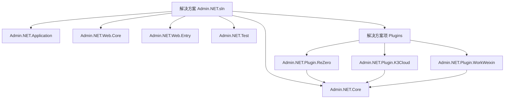
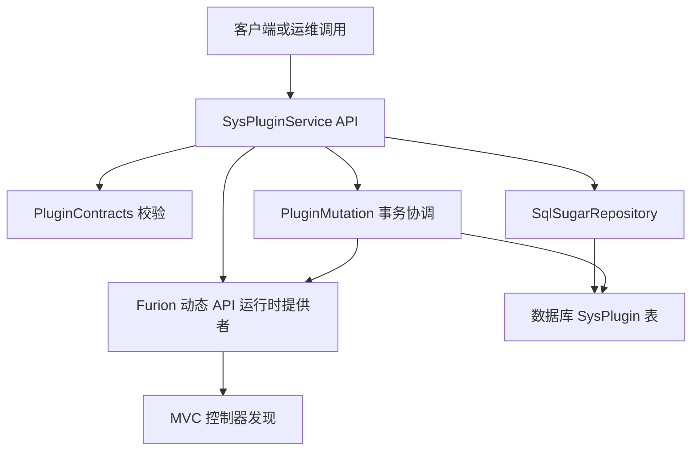
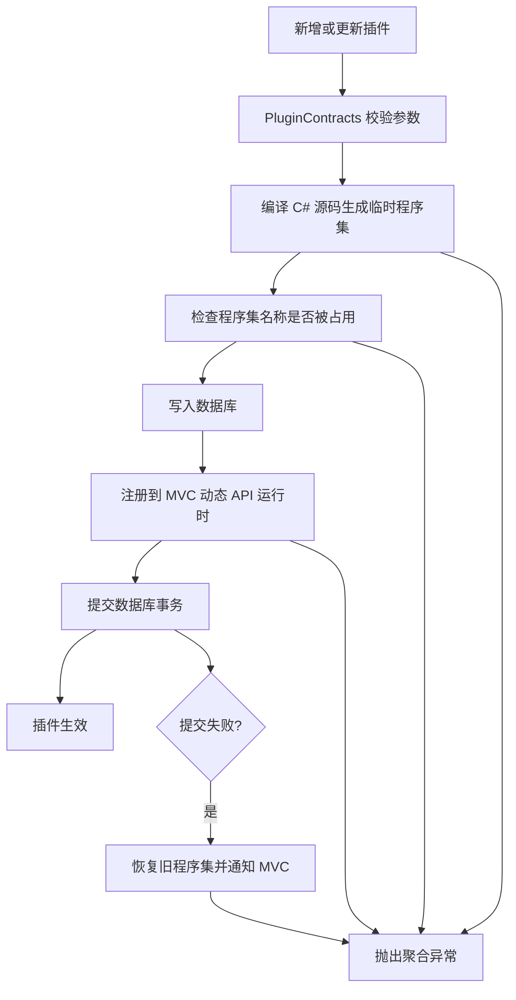
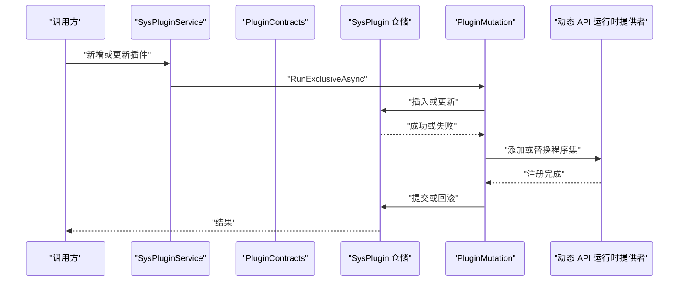
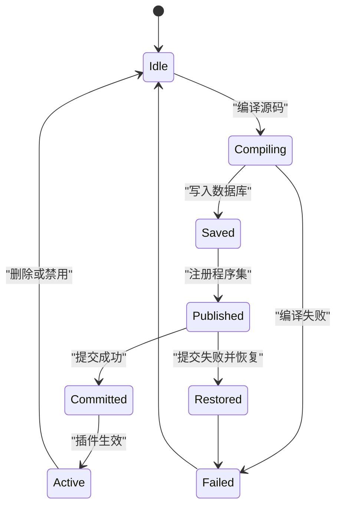
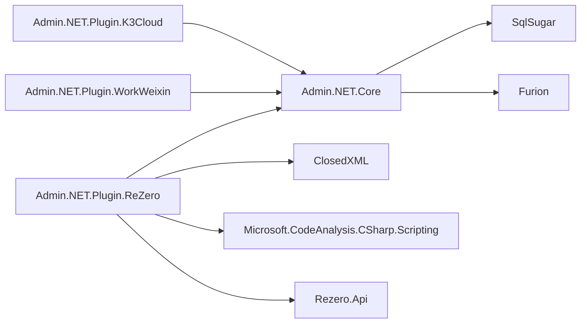

# 插件打包与分发

<cite>
**本文引用的文件**   
- [Admin.NET.sln](file://Admin.NET/Admin.NET.sln)
- [global.json](file://Admin.NET/global.json)
- [Admin.NET.Plugin.ReZero.csproj](file://Admin.NET/Plugins/Admin.NET.Plugin.ReZero/Admin.NET.Plugin.ReZero.csproj)
- [Admin.NET.Plugin.WorkWeixin.csproj](file://Admin.NET/Plugins/Admin.NET.Plugin.WorkWeixin/Admin.NET.Plugin.WorkWeixin.csproj)
- [Admin.NET.Plugin.K3Cloud.csproj](file://Admin.NET/Plugins/Admin.NET.Plugin.K3Cloud/Admin.NET.Plugin.K3Cloud.csproj)
- [SysPluginService.cs](file://Admin.NET/Admin.NET.Core/Service/Plugin/SysPluginService.cs)
- [PluginContracts.cs](file://Admin.NET/Admin.NET.Core/Service/Plugin/PluginContracts.cs)
- [PluginMutation.cs](file://Admin.NET/Admin.NET.Core/Service/Plugin/PluginMutation.cs)
- [SysPlugin.cs](file://Admin.NET/Admin.NET.Core/Entity/SysPlugin.cs)
- [ReflectionHelper.cs](file://Admin.NET/Admin.NET.Core/Utils/ReflectionHelper.cs)
- [OnlineUserJob.cs](file://Admin.NET/Admin.NET.Core/Job/OnlineUserJob.cs)
- [PluginRuntimeTests.cs](file://Admin.NET/Admin.NET.Test/Plugin/PluginRuntimeTests.cs)
</cite>

## 目录
1. [简介](#简介)
2. [项目结构与插件定位](#项目结构与插件定位)
3. [核心组件](#核心组件)
4. [架构总览](#架构总览)
5. [详细组件分析](#详细组件分析)
6. [依赖关系分析](#依赖关系分析)
7. [性能与运行时特性](#性能与运行时特性)
8. [故障排查指南](#故障排查指南)
9. [结论](#结论)
10. [附录：插件打包与分发操作清单](#附录插件打包与分发操作清单)

## 简介
本指南面向 Admin.NET 的插件构建、发布和分发。仓库当前包含三类已实现的 .NET 插件工程，以及宿主侧的动态程序集加载、动态接口注册、事务化更新与回滚机制。需要特别注意：

- 当前代码库没有 nuspec 文件，也没有显式 `dotnet pack` 或私有 NuGet 服务器配置；因此“NuGet 包创建”“私有 NuGet 服务器”“CI/CD 流水线”部分应视为扩展建议，不能声称仓库已经实现。
- 插件程序集目前通过编译现有 C# 项目生成，也可由系统运行时根据数据库中的 C# 源码动态编译为程序集并注册为动态 API。
- 版本兼容性、签名认证、灰度发布和回滚在运行时有基础支持（例如事务化发布、旧程序集快照恢复），但没有现成的语义化版本策略、代码签名证书或灰度流量开关实现。

## 项目结构与插件定位
解决方案 `Admin.NET.sln` 将三个插件工程放在名为 `Plugins` 的解决方案项中，并以普通项目引用方式加入解决方案：

- `Admin.NET.Plugin.ReZero`
- `Admin.NET.Plugin.K3Cloud`
- `Admin.NET.Plugin.WorkWeixin`

每个插件工程都引用共享内核 `Admin.NET.Core`，并声明多目标框架 `net8.0;net10.0`。这意味着插件程序集可同时为目标框架构建两个版本的输出。

**图表来源**
- [Admin.NET.sln:1-78](file://Admin.NET/Admin.NET.sln#L1-L78)

**章节来源**
- [Admin.NET.sln:1-78](file://Admin.NET/Admin.NET.sln#L1-L78)

## 核心组件
插件打包与分发的关键实体集中在以下位置：

| 组件 | 职责 | 关键行为 |
|---|---|---|
| 插件工程 csproj | 定义插件目标框架、内容文件和第三方依赖 | 多目标 `net8.0;net10.0`，复制配置和静态资源，引用 `Admin.NET.Core` |
| `SysPlugin` 实体 | 持久化动态插件元数据 | 名称、C# 源码、程序集名称、排序、状态、备注 |
| `SysPluginService` | 暴露动态插件增删改查与动态程序集管理 API | 编译源码、注册 MVC 控制器、事务化发布、失败回滚 |
| `PluginContracts` | 校验插件输入、租户范围与更新条件 | 长度校验、租户隔离、不可直接覆盖宿主程序集名称 |
| `PluginMutation` | 单进程并发保护与事务协调 | 信号量串行化、数据库保存、发布、提交、回滚、恢复 |
| `ReflectionHelper` | 反射与程序集扫描工具 | 扫描目录程序集、获取入口程序集、递归解析引用 |
| `OnlineUserJob` | 启动任务 | 服务重启后加载所有启用的动态程序集 |
| `PluginRuntimeTests` | 运行时行为验证 | 验证动态程序集添加、替换、移除及 MVC 发现行为 |

**章节来源**
- [SysPlugin.cs:1-56](file://Admin.NET/Admin.NET.Core/Entity/SysPlugin.cs#L1-L56)
- [SysPluginService.cs:1-264](file://Admin.NET/Admin.NET.Core/Service/Plugin/SysPluginService.cs#L1-L264)
- [PluginContracts.cs:1-97](file://Admin.NET/Admin.NET.Core/Service/Plugin/PluginContracts.cs#L1-L97)
- [PluginMutation.cs:1-55](file://Admin.NET/Admin.NET.Core/Service/Plugin/PluginMutation.cs#L1-L55)
- [ReflectionHelper.cs:1-200](file://Admin.NET/Admin.NET.Core/Utils/ReflectionHelper.cs#L1-L200)
- [OnlineUserJob.cs:30-49](file://Admin.NET/Admin.NET.Core/Job/OnlineUserJob.cs#L30-L49)
- [PluginRuntimeTests.cs:1-103](file://Admin.NET/Admin.NET.Test/Plugin/PluginRuntimeTests.cs#L1-L103)

## 架构总览
当前系统的插件体系分为两类：

1. **编译期插件**：以独立 .NET 项目存在，随解决方案一起编译，生成程序集供宿主使用。
2. **运行时动态插件**：从数据库读取 C# 源码，使用编译器生成临时程序集，并通过 MVC 应用部分机制注册控制器。

**图表来源**
- [SysPluginService.cs:1-264](file://Admin.NET/Admin.NET.Core/Service/Plugin/SysPluginService.cs#L1-L264)
- [PluginContracts.cs:1-97](file://Admin.NET/Admin.NET.Core/Service/Plugin/PluginContracts.cs#L1-L97)
- [PluginMutation.cs:1-55](file://Admin.NET/Admin.NET.Core/Service/Plugin/PluginMutation.cs#L1-L55)

## 详细组件分析

### 插件工程与发布产物
三个插件工程均采用 SDK 风格 `.csproj`，目标框架为 `net8.0;net10.0`。它们的主要差异在于静态资源和配置文件的发布方式：

- `Admin.NET.Plugin.ReZero` 将 `Configuration` 和 `wwwroot` 标记为内容文件，并复制到输出和发布目录，同时排除单文件发布；它还引入 ClosedXML、Roslyn 脚本和 Rezero.Api 等依赖。
- `Admin.NET.Plugin.WorkWeixin` 和 `Admin.NET.Plugin.K3Cloud` 主要把 `Configuration` 目录更新为可复制到输出目录的配置资源。
- 三者都引用 `Admin.NET.Core`，从而复用宿主平台能力。

这意味着插件程序集的发布产物包括：

- 目标框架对应的程序集文件。
- 插件声明的配置项。
- 插件可能需要的静态资源。
- 插件自身声明的 NuGet 依赖。

**章节来源**
- [Admin.NET.Plugin.ReZero.csproj:1-36](file://Admin.NET/Plugins/Admin.NET.Plugin.ReZero/Admin.NET.Plugin.ReZero.csproj#L1-L36)
- [Admin.NET.Plugin.WorkWeixin.csproj:1-23](file://Admin.NET/Plugins/Admin.NET.Plugin.WorkWeixin/Admin.NET.Plugin.WorkWeixin.csproj#L1-L23)
- [Admin.NET.Plugin.K3Cloud.csproj:1-23](file://Admin.NET/Plugins/Admin.NET.Plugin.K3Cloud/Admin.NET.Plugin.K3Cloud.csproj#L1-L23)

### 动态插件生命周期
动态插件的生命周期围绕以下阶段：

**图表来源**
- [SysPluginService.cs:1-264](file://Admin.NET/Admin.NET.Core/Service/Plugin/SysPluginService.cs#L1-L264)
- [PluginMutation.cs:1-55](file://Admin.NET/Admin.NET.Core/Service/Plugin/PluginMutation.cs#L1-L55)

#### 新增与更新流程
`AddPlugin` 和 `UpdatePlugin` 都遵循相同的安全模式：

1. 进入独占执行区域。
2. 校验输入并构造插件实体。
3. 先编译源码，但不立即影响运行接口。
4. 检查程序集名称冲突。
5. 保存数据库。
6. 如果状态为启用，则注册新程序集。
7. 提交事务；若失败，则恢复原程序集。

**图表来源**
- [SysPluginService.cs:1-200](file://Admin.NET/Admin.NET.Core/Service/Plugin/SysPluginService.cs#L1-L200)
- [PluginMutation.cs:1-55](file://Admin.NET/Admin.NET.Core/Service/Plugin/PluginMutation.cs#L1-L55)

#### 删除与卸载流程
删除插件时，系统会：

- 校验租户权限。
- 快照当前已注册的同名程序集。
- 从数据库删除记录。
- 从 MVC 动态 API 运行时移除程序集。
- 如果移除失败，尝试恢复之前快照的程序集。

#### 启动时加载
服务重启后，`OnlineUserJob` 会调用 `LoadAllAssembly`，加载所有状态为启用的动态插件，避免每次启动都需要人工重新注册。

**章节来源**
- [SysPluginService.cs:1-264](file://Admin.NET/Admin.NET.Core/Service/Plugin/SysPluginService.cs#L1-L264)
- [OnlineUserJob.cs:30-49](file://Admin.NET/Admin.NET.Core/Job/OnlineUserJob.cs#L30-L49)

### 插件输入与租户边界
`PluginContracts` 定义了插件操作的契约：

- 插件名称最多 64 个字符。
- C# 源码不能为空。
- 程序集名称最长 512 个字符。
- 备注最长 128 个字符。
- 非超管用户只能访问自己的租户。
- 更新操作要求主键和租户一致。
- 移除操作要求明确归属租户，且不允许移除宿主程序集。

这些约束确保插件命名空间不会污染宿主，也防止跨租户越权修改。

**章节来源**
- [PluginContracts.cs:1-97](file://Admin.NET/Admin.NET.Core/Service/Plugin/PluginContracts.cs#L1-L97)

### 运行时安全与回滚
`PluginMutation` 使用信号量保证单进程内插件变更串行执行。它封装了开始、保存、发布、提交、回滚和恢复六个阶段，并在多个阶段失败时组合异常。测试用例验证了：

- 有效编译成功后，即使后续编译失败，已发布的控制器仍可被 MVC 发现。
- 提交失败时，MVC 控制器会被恢复到旧程序集。
- 程序集添加、替换、移除都会触发 MVC 功能发现刷新。

**图表来源**
- [PluginMutation.cs:1-55](file://Admin.NET/Admin.NET.Core/Service/Plugin/PluginMutation.cs#L1-L55)
- [PluginRuntimeTests.cs:1-103](file://Admin.NET/Admin.NET.Test/Plugin/PluginRuntimeTests.cs#L1-L103)

**章节来源**
- [PluginMutation.cs:1-55](file://Admin.NET/Admin.NET.Core/Service/Plugin/PluginMutation.cs#L1-L55)
- [PluginRuntimeTests.cs:1-103](file://Admin.NET/Admin.NET.Test/Plugin/PluginRuntimeTests.cs#L1-L103)

## 依赖关系分析
插件工程与宿主的关系如下：

**图表来源**
- [Admin.NET.Plugin.ReZero.csproj:1-36](file://Admin.NET/Plugins/Admin.NET.Plugin.ReZero/Admin.NET.Plugin.ReZero.csproj#L1-L36)
- [Admin.NET.Plugin.WorkWeixin.csproj:1-23](file://Admin.NET/Plugins/Admin.NET.Plugin.WorkWeixin/Admin.NET.Plugin.WorkWeixin.csproj#L1-L23)
- [Admin.NET.Plugin.K3Cloud.csproj:1-23](file://Admin.NET/Plugins/Admin.NET.Plugin.K3Cloud/Admin.NET.Plugin.K3Cloud.csproj#L1-L23)

插件对宿主的核心依赖是 `Admin.NET.Core`，而运行时动态 API 能力来自 Furion 的 `IDynamicApiController` 和动态 API 运行时提供者。反射工具类 `ReflectionHelper` 提供程序集枚举、引用解析和默认上下文加载能力，可用于扩展插件发现逻辑。

**章节来源**
- [ReflectionHelper.cs:1-200](file://Admin.NET/Admin.NET.Core/Utils/ReflectionHelper.cs#L1-L200)
- [SysPluginService.cs:1-264](file://Admin.NET/Admin.NET.Core/Service/Plugin/SysPluginService.cs#L1-L264)

## 性能与运行时特性
- 多目标框架：插件工程同时构建 `net8.0` 和 `net10.0`，便于在不同宿主环境中选择匹配版本。
- 运行时动态编译：插件源码通过编译器生成临时程序集，适合快速迭代，但不应替代稳定的预编译插件包。
- MVC 集成：插件控制器通过动态 API 运行时提供者注册，更新时会触发控制器特征刷新。
- 并发控制：插件变更通过信号量串行化，避免同一时刻多个线程修改 MVC 程序集集合。
- 内存释放：测试覆盖了编译句柄释放后 MVC 仍持有程序集的行为，说明程序集一旦注册，生命周期由 MVC 管理。

需要注意：

- `ReflectionHelper.LoadAssemblies` 使用默认 `AssemblyLoadContext` 加载程序集，不适合强隔离的插件沙箱场景。
- 当前没有独立的插件卸载路径清理磁盘文件或程序集缓存，卸载主要指从运行时框架中移除程序集。
- 多目标构建会增加 CI 时间和产物体积，应根据部署环境决定是否只构建所需目标框架。

**章节来源**
- [PluginRuntimeTests.cs:1-103](file://Admin.NET/Admin.NET.Test/Plugin/PluginRuntimeTests.cs#L1-L103)
- [ReflectionHelper.cs:1-200](file://Admin.NET/Admin.NET.Core/Utils/ReflectionHelper.cs#L1-L200)

## 故障排查指南
常见问题和对应处理建议：

| 现象 | 可能原因 | 处理建议 |
|---|---|---|
| 新增插件时报程序集名称冲突 | 已有同名程序集正在运行或被其他租户占用 | 检查 `SysPlugin` 表中 `AssemblyName`，避免重复；确认未运行同名字符串的程序集 |
| 更新插件后接口不生效 | 插件状态未启用，或发布失败后回滚 | 检查插件状态、数据库事务提交结果、MVC 控制器列表 |
| 删除插件后仍能看到控制器 | 程序集仍在 MVC 应用中 | 调用移除动态程序集接口或重启服务 |
| 动态编译失败 | C# 源码语法错误或缺少依赖类型 | 检查源码、插件依赖、宿主可用类型 |
| 提交失败后运行时状态不一致 | 发布或恢复步骤抛出多个异常 | 查看聚合异常日志，核对数据库与 MVC 程序集集合 |
| 服务重启后动态插件丢失 | 数据库中无启用状态的插件记录 | 重新新增或启用插件，等待启动任务加载 |

**章节来源**
- [SysPluginService.cs:1-264](file://Admin.NET/Admin.NET.Core/Service/Plugin/SysPluginService.cs#L1-L264)
- [PluginRuntimeTests.cs:1-103](file://Admin.NET/Admin.NET.Test/Plugin/PluginRuntimeTests.cs#L1-L103)

## 结论
当前仓库实现了 Admin.NET 的插件生态基础：

- 支持编译期插件项目。
- 支持运行时动态编译 C# 源码并注册为动态 API。
- 提供租户隔离、名称冲突检测、事务化发布和失败恢复。
- 在服务启动时自动加载已启用的动态插件。

但仓库尚未实现以下完整分发能力：

- 没有 nuspec 文件，也没有 `dotnet pack` 或私有 NuGet 服务器配置。
- 没有显式的版本兼容策略、破坏性变更规则或语义化版本管理。
- 没有插件签名、可信链或代码签名证书配置。
- 没有灰度发布、流量切换或回滚编排的专用机制。
- 没有 CI/CD 流水线配置文件。

因此，上述缺失项应作为未来扩展方向，而不是当前实现事实。

## 附录：插件打包与分发操作清单

### 构建插件程序集
- 使用解决方案构建三个插件工程。
- 指定目标框架：`net8.0` 或 `net10.0`，或保留多目标构建。
- 确认插件的 `Configuration` 和 `wwwroot` 等资源已复制到输出目录。
- 如需发布生产产物，可使用发布命令生成可部署目录。

### 符号文件与调试信息
- 插件工程启用了文档生成，但未显式启用调试符号或 PDB 生成选项。
- 建议在生产发布时开启调试符号，以便定位运行时动态编译和插件问题。
- 符号文件应与插件程序集一起归档，不要混入公开 NuGet 包。

### 依赖项处理
- 插件依赖 `Admin.NET.Core`，以及各自第三方库。
- 运行时动态插件依赖宿主提供的类型；预编译插件应确保宿主已加载必要程序集。
- 若插件包含外部二进制文件，应在 csproj 中声明为内容文件并按需复制到发布目录。

### NuGet 包创建建议
仓库中没有 nuspec 文件，也没有 NuGet 打包命令。若要对外发布插件，建议：

- 为每个插件工程添加 nuspec 或使用包内联元数据。
- 定义包标识、标题、描述、作者、许可证、图标和标签。
- 将插件程序集、配置文件、文档和符号文件纳入包。
- 通过环境变量或密钥存储注入 NuGet 源凭据，不要把令牌写进源码。

### 私有 NuGet 服务器建议
仓库中没有私有 NuGet 服务器配置。建议：

- 在企业内部部署私有 NuGet 源。
- 使用受控账号推送插件包。
- 限制仅管理员可发布稳定版本。
- 使用组织级身份认证和访问控制。
- 在开发机、CI 和部署机配置统一的 NuGet 源。

### 版本兼容性建议
仓库中没有显式版本策略。建议：

- 使用语义化版本控制主版本、次版本和修订号。
- 向后兼容：新增字段、新增接口方法、新增配置项应保持兼容。
- 破坏性变更：升级主版本，迁移数据库和插件代码。
- 在插件元数据中标明支持的宿主版本范围。
- 禁止在不升级主版本的情况下删除公共类型或改变序列化结构。

### 插件签名与认证建议
仓库中没有代码签名配置。建议：

- 使用受信任的代码签名证书签署插件程序集。
- 在 CI 中使用安全的密钥管理服务获取私钥。
- 在部署端验证程序集签名和发布者信息。
- 将签名验证纳入插件安装前的安全检查。
- 对敏感配置使用加密或密钥管理系统。

### 插件更新与升级策略
当前系统支持运行时程序集替换和回滚，但没有灰度发布开关。建议：

- 使用双轨部署：新版本先在灰度租户启用。
- 通过数据库状态控制插件启用、禁用和顺序。
- 变更前备份 `SysPlugin` 表和 MVC 已注册程序集状态。
- 失败时恢复旧程序集并回滚数据库。
- 灰度通过后逐步扩大租户范围。
- 保留历史版本程序集和迁移脚本，支持回滚。

### CI/CD 流水线建议
仓库中没有 GitHub Actions、GitLab CI、Azure Pipelines 或 Gitee Actions 的构建流水线。建议流水线包含：

1. 固定 .NET SDK 版本。
2. 还原依赖。
3. 编译所有插件。
4. 运行单元测试。
5. 可选：运行浏览器端到端测试。
6. 生成 NuGet 包。
7. 上传制品。
8. 推送到私有 NuGet 源。
9. 部署插件到目标环境。
10. 验证签名、版本和依赖完整性。