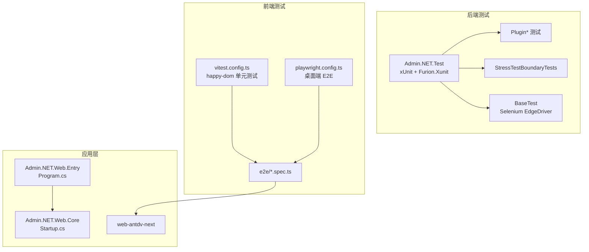
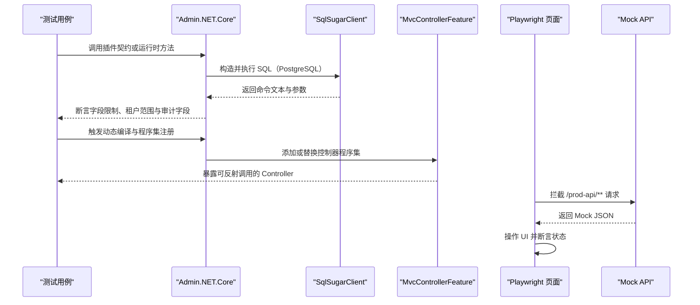
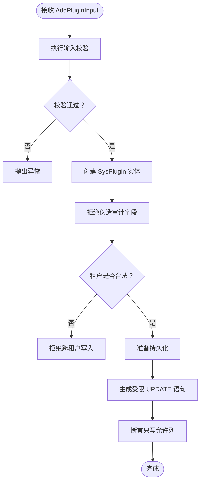
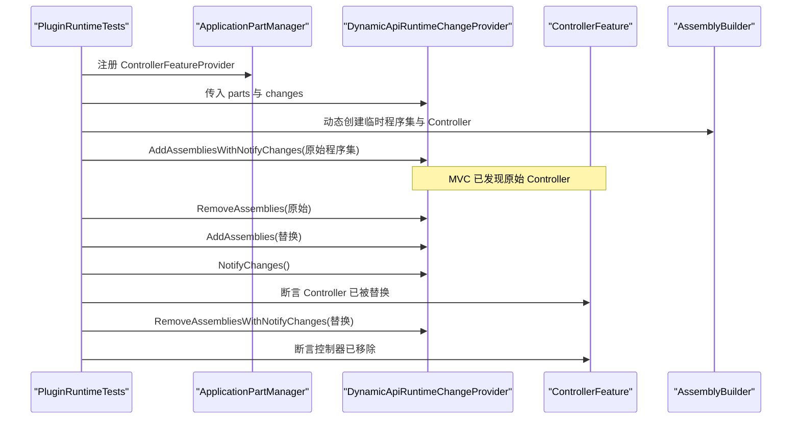
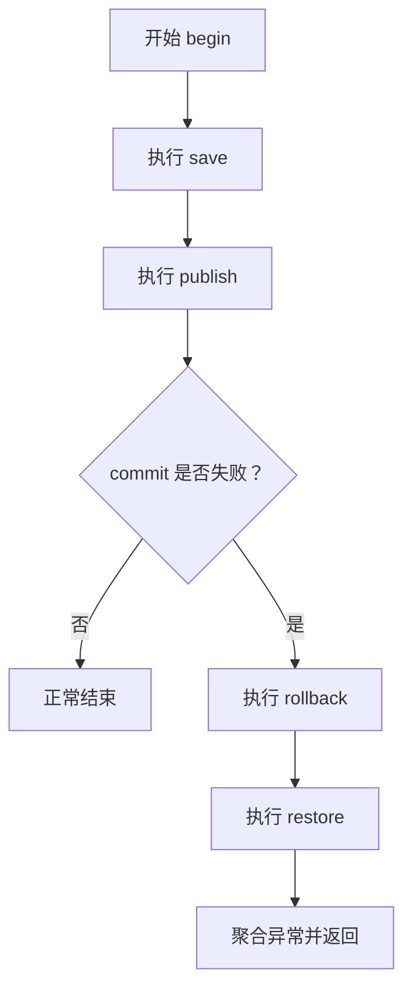
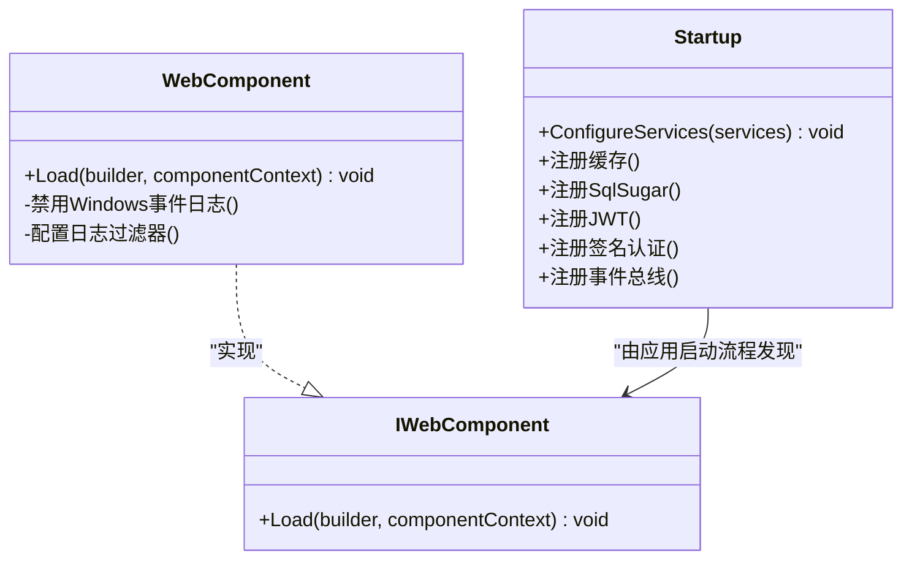
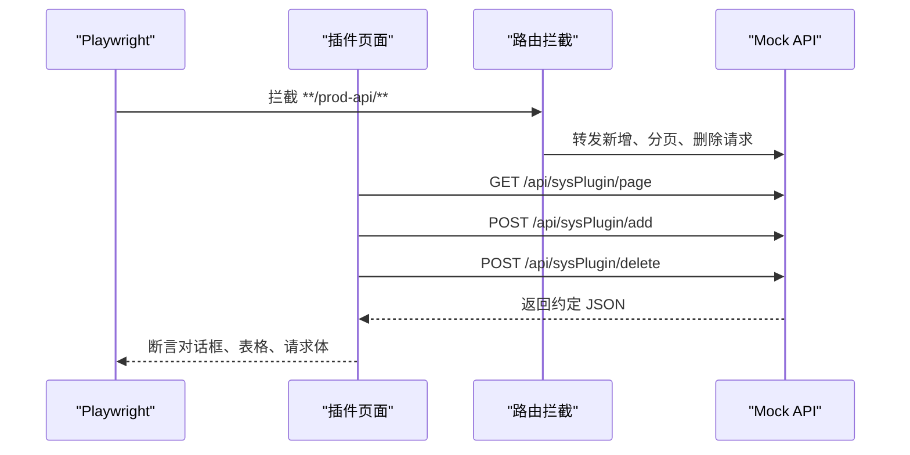
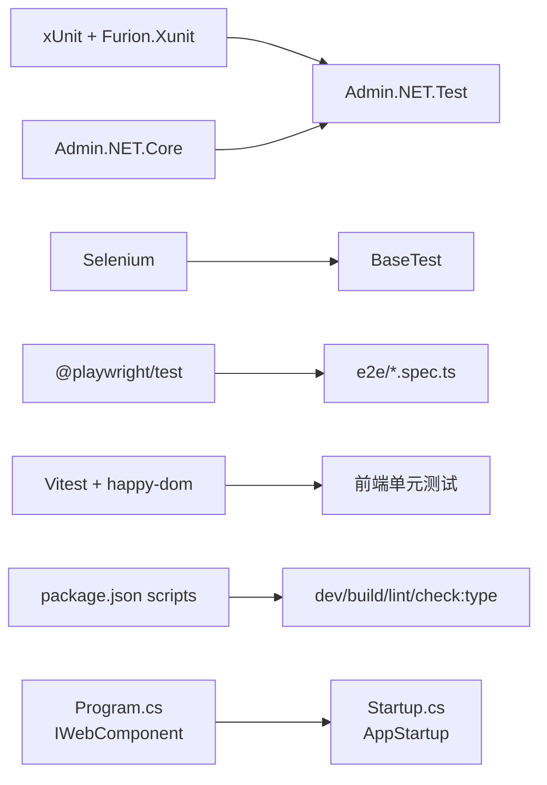
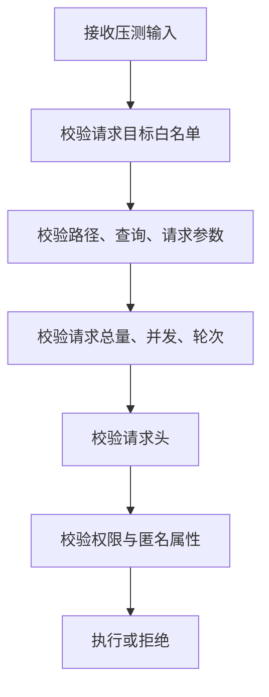

# 插件测试策略

<cite>
**本文引用的文件**   
- [Admin.NET.Test.csproj](file://Admin.NET/Admin.NET.Test/Admin.NET.Test.csproj)
- [global.json](file://Admin.NET/global.json)
- [BaseTest.cs](file://Admin.NET/Admin.NET.Test/BaseTest.cs)
- [PluginContractTests.cs](file://Admin.NET/Admin.NET.Test/Plugin/PluginContractTests.cs)
- [PluginRuntimeTests.cs](file://Admin.NET/Admin.NET.Test/Plugin/PluginRuntimeTests.cs)
- [PluginMutationTests.cs](file://Admin.NET/Admin.NET.Test/Plugin/PluginMutationTests.cs)
- [StressTestBoundaryTests.cs](file://Admin.NET/Admin.NET.Test/Stress/StressTestBoundaryTests.cs)
- [Program.cs](file://Admin.NET/Admin.NET.Web.Entry/Program.cs)
- [Startup.cs](file://Admin.NET/Admin.NET.Web.Core/Startup.cs)
- [package.json](file://Web/package.json)
- [playwright.config.ts](file://Web/playwright.config.ts)
- [vitest.config.ts](file://Web/vitest.config.ts)
- [plugin-contract.spec.ts](file://Web/apps/web-antdv-next/e2e/plugin-contract.spec.ts)
- [stress-test-contract.spec.ts](file://Web/apps/web-antdv-next/e2e/stress-test-contract.spec.ts)
</cite>

## 目录
1. [引言](#引言)
2. [项目结构](#项目结构)
3. [核心测试组件](#核心测试组件)
4. [架构总览](#架构总览)
5. [详细组件分析](#详细组件分析)
6. [依赖关系分析](#依赖关系分析)
7. [性能与压力测试](#性能与压力测试)
8. [持续集成与覆盖率建议](#持续集成与覆盖率建议)
9. [故障排查指南](#故障排查指南)
10. [结论](#结论)

## 引言
本文件面向 Admin.NET 插件体系的测试策略与实施方案，覆盖单元测试、集成测试、端到端浏览器测试、性能与压力测试，以及 IWebComponent 实现和插件动态加载的验证方法。文档以当前仓库中的 C# xUnit 测试、Playwright 前端验收测试和 Web 工程配置为依据，强调隔离性、可重复性和生产一致性。

## 项目结构
当前仓库包含三层测试相关结构：
- .NET 后端测试：位于 `Admin.NET/Admin.NET.Test`，使用 xUnit v3、Furion.Xunit 和 Microsoft.Testing.Platform；针对插件契约、运行时、边界校验与压测入口进行断言。
- 前端工作区：位于 `Web`，业务前端入口为 `apps/web-antdv-next`，使用 Vitest 运行单元与基准测试，使用 Playwright 运行端到端测试。
- 基础设施配置：`global.json` 指定测试运行器；`playwright.config.ts` 管理 E2E 执行环境；`vitest.config.ts` 管理 happy-dom 单元环境。

**图示来源**
- [Admin.NET.Test.csproj:1-28](file://Admin.NET/Admin.NET.Test/Admin.NET.Test.csproj#L1-L28)
- [global.json:1-5](file://Admin.NET/global.json#L1-L5)
- [playwright.config.ts:1-31](file://Web/playwright.config.ts#L1-L31)
- [vitest.config.ts:1-28](file://Web/vitest.config.ts#L1-L28)

**章节来源**
- [Admin.NET.Test.csproj:1-28](file://Admin.NET/Admin.NET.Test/Admin.NET.Test.csproj#L1-L28)
- [global.json:1-5](file://Admin.NET/global.json#L1-L5)
- [package.json:1-102](file://Web/package.json#L1-L102)

## 核心测试组件
### .NET 测试工程
- 目标框架：`net10.0`。
- 测试框架：xUnit v3，通过 Furion.Xunit 扩展。
- 测试运行器：由 `global.json` 指定为 `Microsoft.Testing.Platform`。
- 外部浏览器驱动：Selenium WebDriver 与 Edge 驱动用于现有基类自动化场景。
- 项目引用：仅显式引用 `Admin.NET.Core`，便于对核心服务、实体与工具类做无宿主依赖测试。

### 前端测试工程
- 包管理器：pnpm，Node 版本要求 `^22.18.0 || ^24.12.0`，pnpm 版本要求 `>=11.0.0`。
- 脚本定位：根脚本 `pnpm dev`、`pnpm build`、`pnpm lint`、`pnpm check:type`、`pnpm test:unit`、`pnpm test:e2e` 均面向业务应用 `@vben/web-antdv-next`，不是全 workspace 检查。
- 单元测试：Vitest，环境为 happy-dom，排除 e2e、dist、node_modules 等路径。
- 端到端测试：Playwright，默认启动本地开发服务器，固定桌面 Chrome 设备。

**章节来源**
- [Admin.NET.Test.csproj:1-28](file://Admin.NET/Admin.NET.Test/Admin.NET.Test.csproj#L1-L28)
- [global.json:1-5](file://Admin.NET/global.json#L1-L5)
- [package.json:1-102](file://Web/package.json#L1-L102)
- [vitest.config.ts:1-28](file://Web/vitest.config.ts#L1-L28)
- [playwright.config.ts:1-31](file://Web/playwright.config.ts#L1-L31)

## 架构总览
插件测试体系分为四个层次：
1. **契约与输入校验测试**：验证插件创建、更新、查询、权限和 SQL 生成是否符合安全约束。
2. **运行时与程序集变更测试**：验证动态编译、MVC Controller 发现、替换与回滚逻辑。
3. **压测边界测试**：验证压测请求参数、目标白名单、并发预算和权限控制。
4. **前端端到端测试**：通过 Playwright 验证插件管理页面、压测页面与 Mock API 的交互契约。

**图示来源**
- [PluginContractTests.cs:1-132](file://Admin.NET/Admin.NET.Test/Plugin/PluginContractTests.cs#L1-L132)
- [PluginRuntimeTests.cs:1-103](file://Admin.NET/Admin.NET.Test/Plugin/PluginRuntimeTests.cs#L1-L103)
- [PluginMutationTests.cs:1-68](file://Admin.NET/Admin.NET.Test/Plugin/PluginMutationTests.cs#L1-L68)
- [plugin-contract.spec.ts:1-106](file://Web/apps/web-antdv-next/e2e/plugin-contract.spec.ts#L1-L106)

## 详细组件分析

### 插件契约与安全边界测试
插件契约测试聚焦以下关键点：
- **所有者校验**：`EnsureRemovalOwner` 根据 owner、superAdmin、tenant 决定是否允许移除目标程序集或插件。
- **实体创建隔离**：`CreateEntity` 只允许受信任字段，拒绝伪造 Id、CreateUserId、UpdateUserName 等审计字段。
- **输入校验**：`Validate` 拒绝空名称、空白代码、超长名称、超长 AssemblyName、超长备注、非法 Status。
- **租户隔离**：普通用户不能将插件迁移到外租户；超级管理员允许设置目标租户。
- **更新隔离**：`UpdateEntity` 禁止直接修改租户，且未提供的字段应保留原值。
- **访问控制**：`RequireAccessible` 拒绝空记录或外租户记录。
- **SQL 生成约束**：在 PostgreSQL 下，UpdateQuery 必须只更新允许列，并强制 where 条件包含 id 与 tenantid；ScopeQuery 必须包含租户过滤。

这些测试通过直接构造输入对象、调用静态契约方法、使用真实 SqlSugarClient 连接 PostgreSQL 配置来断言行为。由于连接字符串指向 `sql_only` 数据库且仅生成并检查 SQL 文本，该层主要验证“不会写出危险字段”的契约性质。

**图示来源**
- [PluginContractTests.cs:1-132](file://Admin.NET/Admin.NET.Test/Plugin/PluginContractTests.cs#L1-L132)

**章节来源**
- [PluginContractTests.cs:1-132](file://Admin.NET/Admin.NET.Test/Plugin/PluginContractTests.cs#L1-L132)

### 插件运行时与动态程序集测试
运行时测试验证两个关键能力：
1. **C# 源码编译与 MVC 发现**：通过 Furion 的动态编译接口编译合法类，注入到 `ApplicationPartManager`，并在后续无效编译失败时确认已发布的控制器仍可被发现和调用。
2. **程序集替换与回滚**：使用 `IDynamicApiRuntimeChangeProvider` 公开接口模拟控制器程序集替换，断言成功提交后控制器被替换，提交失败后执行 rollback 并恢复原始程序集；同时验证 `token.HasChanged` 表示 MVC 元数据刷新。

测试通过反射获取内部实现类型、使用 `AssemblyBuilder` 动态构建临时 Controller，从而在不依赖真实后端进程的情况下验证 MVC 元数据生命周期。

**图示来源**
- [PluginRuntimeTests.cs:1-103](file://Admin.NET/Admin.NET.Test/Plugin/PluginMutationTests.cs#L1-L68)
- [PluginRuntimeTests.cs:1-103](file://Admin.NET/Admin.NET.Test/Plugin/PluginRuntimeTests.cs#L1-L103)

**章节来源**
- [PluginRuntimeTests.cs:1-103](file://Admin.NET/Admin.NET.Test/Plugin/PluginRuntimeTests.cs#L1-L103)
- [PluginMutationTests.cs:1-68](file://Admin.NET/Admin.NET.Test/Plugin/PluginMutationTests.cs#L1-L68)

### 插件变更事务与互斥测试
`PluginMutation` 提供统一的发布阶段编排与互斥执行机制：
- **阶段编排**：begin、save、publish、commit、rollback、restore 六个阶段按顺序执行；任一阶段抛异常时继续执行剩余回滚与恢复阶段，最终可能聚合多个异常。
- **并发互斥**：`RunExclusiveAsync` 保证同一时刻只有一个插件变更任务执行，其他任务等待；即使第一个任务失败，后续任务仍应获得执行机会。

这些测试通过事件记录数组、TaskCompletionSource 和异常消息断言来验证执行顺序、回滚语义与并发释放语义。

**图示来源**
- [PluginMutationTests.cs:1-68](file://Admin.NET/Admin.NET.Test/Plugin/PluginMutationTests.cs#L1-L68)

**章节来源**
- [PluginMutationTests.cs:1-68](file://Admin.NET/Admin.NET.Test/Plugin/PluginMutationTests.cs#L1-L68)

### IWebComponent 实现与中间件测试要点
`IWebComponent` 是 Furion 组件模型的核心抽象。仓库中 `Program.cs` 定义了一个 `WebComponent : IWebComponent`，其 `Load` 方法负责：
- 控制台运行环境下禁用 Windows 事件日志，避免普通用户权限导致日志写入异常。
- 配置全局日志过滤。
- 通过 `AddWebComponent<WebComponent>()` 注册组件。

`Admin.NET.Web.Core.Startup.cs` 则集中注册缓存、SqlSugar、JWT、签名认证、CORS、远程请求、任务队列、调度、限流、事件总线、序列化选项等基础设施。

#### 如何测试 IWebComponent 实现
虽然当前测试工程未直接测试 `WebComponent.Load`，但可按以下方式设计：
- **日志行为测试**：构造 `WebApplicationBuilder`，注入自定义日志收集器，调用 `Load`，断言在 Windows 非服务模式下 EventLog 过滤器生效。
- **组件装配测试**：使用最小化 `Host` 或 `WebApplicationFactory` 启动应用，解析 `IWebComponent` 或相关服务，确认组件已注册。
- **中间件顺序测试**：通过 HTTP 客户端发送请求，断言鉴权、签名、CORS、限流、日志等中间件按预期处理响应头与状态码。
- **插件影响隔离**：在插件加载前后分别检查 MVC Feature、服务容器、缓存、事件总线配置是否被正确扩展或还原。

**图示来源**
- [Program.cs:9-26](file://Admin.NET/Admin.NET.Web.Entry/Program.cs#L9-L26)
- [Startup.cs:1-200](file://Admin.NET/Admin.NET.Web.Core/Startup.cs#L1-L200)

**章节来源**
- [Program.cs:9-26](file://Admin.NET/Admin.NET.Web.Entry/Program.cs#L9-L26)
- [Startup.cs:1-200](file://Admin.NET/Admin.NET.Web.Core/Startup.cs#L1-L200)

### 前端插件管理端到端测试
`plugin-contract.spec.ts` 验证插件管理页面的核心交互：
- 新增插件：打开对话框、编辑 Monaco 编辑器、保存后返回列表行，并断言提交的 JSON 不包含服务端生成的 id。
- 删除确认：取消删除不发起请求，确认删除后列表清空。
- 只读权限：不提供新增、编辑、删除按钮。
- 编辑与撤销：保存失败提示错误；取消后重新打开应恢复原文。

所有 `/prod-api/**` 请求均通过 `page.route` 拦截，未声明的请求会被记录并断言为空，确保前端只调用预期 API。

**图示来源**
- [plugin-contract.spec.ts:1-106](file://Web/apps/web-antdv-next/e2e/plugin-contract.spec.ts#L1-L106)
- [playwright.config.ts:1-31](file://Web/playwright.config.ts#L1-L31)

**章节来源**
- [plugin-contract.spec.ts:1-106](file://Web/apps/web-antdv-next/e2e/plugin-contract.spec.ts#L1-L106)
- [playwright.config.ts:1-31](file://Web/playwright.config.ts#L1-L31)

## 依赖关系分析
- `.NET 测试` 依赖 xUnit、Furion.Xunit、Selenium、SqlSugar 与 `Admin.NET.Core`。
- `Playwright E2E` 依赖 `@playwright/test`，并通过环境变量 `ADMINNET_E2E_BASE_URL` 决定是否复用已有后端服务；未设置时自动启动 `web-antdv-next` 开发服务器。
- `Vitest 单元` 依赖 Vue、Vue JSX 插件与 happy-dom，明确排除 e2e 与构建产物。
- `Program.cs` 与 `Startup.cs` 共同构成 Web 应用启动链，IWebComponent 作为 Furion 组件入口，Startup 作为 AppStartup 配置中心。

**图示来源**
- [Admin.NET.Test.csproj:1-28](file://Admin.NET/Admin.NET.Test/Admin.NET.Test.csproj#L1-L28)
- [package.json:1-102](file://Web/package.json#L1-L102)
- [Program.cs:9-26](file://Admin.NET/Admin.NET.Web.Entry/Program.cs#L9-L26)
- [Startup.cs:1-200](file://Admin.NET/Admin.NET.Web.Core/Startup.cs#L1-L200)

**章节来源**
- [Admin.NET.Test.csproj:1-28](file://Admin.NET/Admin.NET.Test/Admin.NET.Test.csproj#L1-L28)
- [package.json:1-102](file://Web/package.json#L1-L102)

## 性能与压力测试
### 后端压测边界测试
`StressTestBoundaryTests` 重点验证压测入口的安全边界：
- **目标白名单校验**：仅允许配置的目标主机与路径前缀，拒绝不同主机、HTTPS、越界路径、编码绕过、FTP 协议、用户信息、片段等。
- **参数预算校验**：拒绝超出总量、轮次、并发度等非法预算。
- **头部校验**：拒绝覆盖传输层头部、非法键名与换行。
- **权限控制**：压测端点需要显式授权，不标记 `AllowAnonymous`。
- **取消语义**：已取消令牌应立即抛出取消异常，且不泄漏结果。

这些测试不发起真实网络请求，而是通过输入参数、Options、HttpContext 反射断言行为，适合作为回归保护。

**图示来源**
- [StressTestBoundaryTests.cs:1-159](file://Admin.NET/Admin.NET.Test/Stress/StressTestBoundaryTests.cs#L1-L159)

**章节来源**
- [StressTestBoundaryTests.cs:1-159](file://Admin.NET/Admin.NET.Test/Stress/StressTestBoundaryTests.cs#L1-L159)

### 前端压测契约测试
`stress-test-contract.spec.ts` 从用户视角验证压测页面：
- 目标列表与执行请求的 Mock 契约。
- 浅色与深色主题可读性。
- 表单填写、Header/Body/Path/Query 参数组装。
- 超过总量上限时前端拒绝调用 API。
- 运行期间锁定编辑与重复执行，取消后显示明确状态。
- 全部失败时显示完成但不给出成功结论。

该测试通过 `ADMINNET_E2E_BASE_URL` 指向实际后端时验证真实链路，也可仅依赖 Mock API 验证前端逻辑完整性。

**章节来源**
- [stress-test-contract.spec.ts:1-187](file://Web/apps/web-antdv-next/e2e/stress-test-contract.spec.ts#L1-L187)
- [playwright.config.ts:1-31](file://Web/playwright.config.ts#L1-L31)

## 持续集成与覆盖率建议
### 当前仓库提供的测试入口
- 后端测试：基于 xUnit v3 与 Microsoft.Testing.Platform。可通过测试运行器执行 `Admin.NET.Test` 项目中的契约、运行时、变更、压测边界等测试。
- 前端单元测试：`pnpm test:unit` 使用 Vitest 与 happy-dom。
- 前端端到端测试：`pnpm test:e2e` 使用 Playwright；若未设置 `ADMINNET_E2E_BASE_URL`，会自动启动 `web-antdv-next` 开发服务器。
- 前端基准测试：`pnpm test:benchmark` 提供 Vitest bench 入口。

### 覆盖率收集建议
当前测试项目未启用内置覆盖率配置。建议在 CI 中按语言平台补充：
- **.NET 覆盖率**：在运行 xUnit 测试时启用 Code Coverage，例如通过 Microsoft.Testing.Platform 或 dotnet test 的 coverage 功能，输出 Cobertura 或 OpenCover 格式供报告工具消费。
- **前端覆盖率**：在 Vitest 中启用 `coverage.enabled`、`coverage.reporter`，生成 `lcov` 或 `json-summary`，并与 Playwright 测试结果分开归档。

### CI 流程建议
1. 安装 Node 与 pnpm，安装依赖。
2. 运行 `pnpm test:unit` 与 `pnpm test:benchmark`。
3. 启动 PostgreSQL 实例，配置连接串，运行后端契约测试。
4. 启动后端服务或使用 `ADMINNET_E2E_BASE_URL` 指向已有服务。
5. 运行 `pnpm test:e2e`，保留 Playwright 截图与 trace。
6. 汇总覆盖率报告，设置质量门禁。

[本节为通用实践建议，不直接分析具体文件]

## 故障排查指南
### 后端测试常见问题
- **PostgreSQL 连接失败**：插件契约测试使用真实 SqlSugarClient 连接 PostgreSQL；需确保数据库存在并可连接，或调整测试连接串与权限。
- **MVC 程序集清理**：动态程序集测试会注册与移除 Controller；应在测试完成后调用 `RemoveAssembliesWithNotifyChanges`，否则后续测试可能发现残留控制器。
- **并发互斥超时**：`RunExclusiveAsync` 依赖任务完成信号；若测试未释放信号，可能导致等待超时。

**章节来源**
- [PluginContractTests.cs:89-132](file://Admin.NET/Admin.NET.Test/Plugin/PluginContractTests.cs#L89-L132)
- [PluginRuntimeTests.cs:1-103](file://Admin.NET/Admin.NET.Test/Plugin/PluginRuntimeTests.cs#L1-L103)
- [PluginMutationTests.cs:43-68](file://Admin.NET/Admin.NET.Test/Plugin/PluginMutationTests.cs#L43-L68)

### 前端 E2E 测试常见问题
- **端口冲突**：Playwright 默认启动 `127.0.0.1:8890`；CI 中建议设置 `ADMINNET_E2E_BASE_URL` 复用已有服务。
- **Mock 未声明**：测试通过 `page.route('**/prod-api/**')` 捕获未声明请求；若出现意外路径，说明前端调用了未覆盖的 API。
- **会话与权限**：插件与压测页面依赖 `mockAdminSession`；权限不足时不应出现敏感按钮或请求。

**章节来源**
- [playwright.config.ts:1-31](file://Web/playwright.config.ts#L1-L31)
- [plugin-contract.spec.ts:1-106](file://Web/apps/web-antdv-next/e2e/plugin-contract.spec.ts#L1-L106)
- [stress-test-contract.spec.ts:1-187](file://Web/apps/web-antdv-next/e2e/stress-test-contract.spec.ts#L1-L187)

## 结论
本项目的插件测试策略以 xUnit 契约测试为核心，辅以运行时程序集变更测试、压测边界测试，并由 Playwright 前端 E2E 测试验证用户交互契约。IWebComponent 与 Startup 构成了 Web 应用启动链的关键扩展点，应通过最小化 Host 或工厂方式验证中间件、服务注册与插件加载行为。为确保生产稳定性，建议补充覆盖率收集、真实 PostgreSQL 联调、Playwright 可视化报告，并在 CI 中分层执行单元、契约、E2E 与性能相关测试。