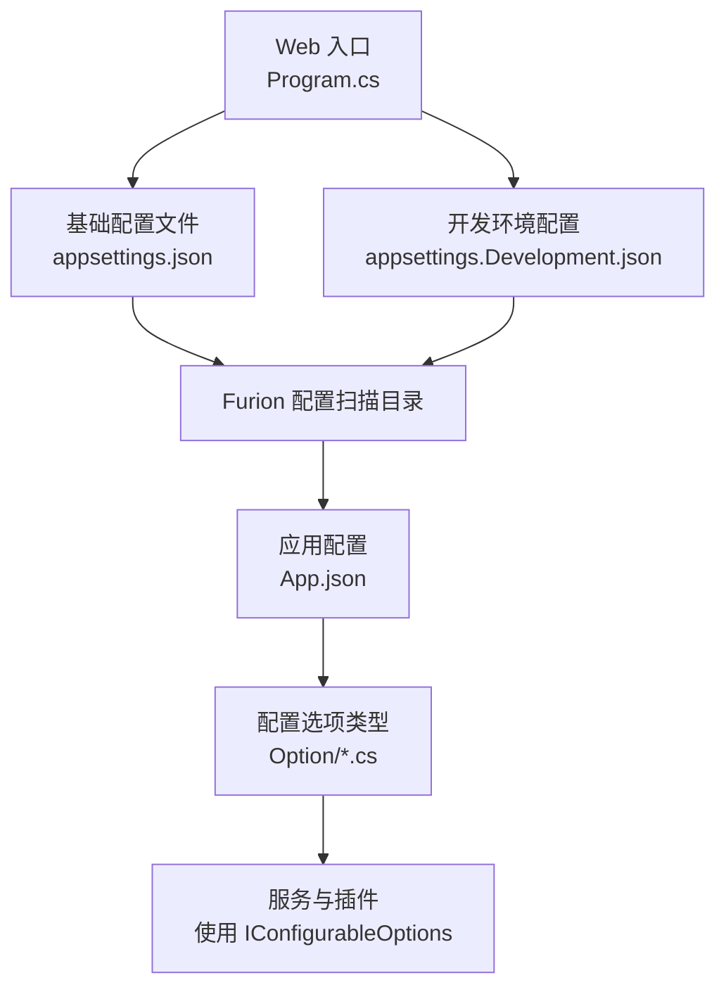
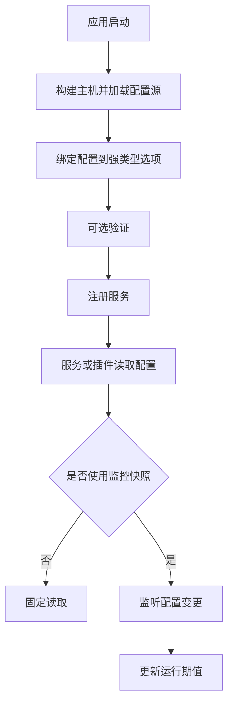
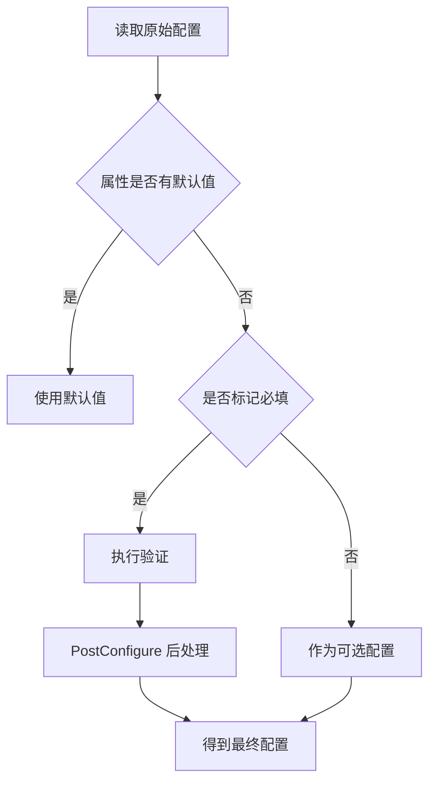
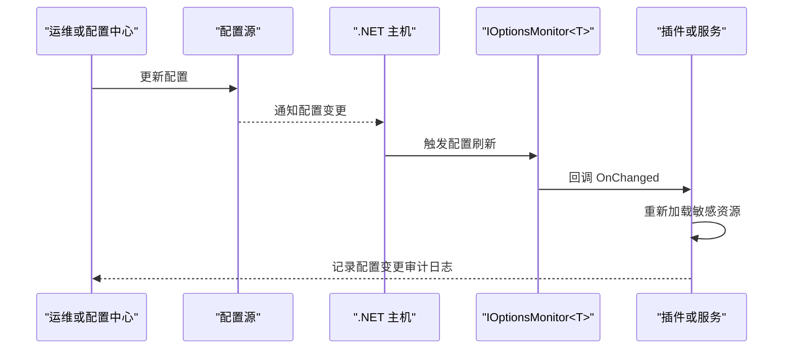
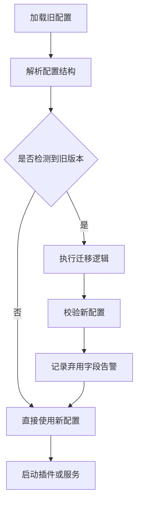

# 插件配置管理机制

<cite>
**本文引用的文件**   
- [README.md](file://README.md)
- [Program.cs](file://Admin.NET/Admin.NET.Web.Entry/Program.cs)
- [Startup.cs](file://Admin.NET/Admin.NET.Application/Startup.cs)
- [appsettings.json](file://Admin.NET/Admin.NET.Web.Entry/appsettings.json)
- [appsettings.Development.json](file://Admin.NET/Admin.NET.Web.Entry/appsettings.Development.json)
- [App.json](file://Admin.NET/Admin.NET.Application/Configuration/App.json)
- [DbConnectionOptions.cs](file://Admin.NET/Admin.NET.Core/Option/DbConnectionOptions.cs)
- [CryptogramOptions.cs](file://Admin.NET/Admin.NET.Core/Option/CryptogramOptions.cs)
- [SMSOptions.cs](file://Admin.NET/Admin.NET.Core/Option/SMSOptions.cs)
- [WechatOptions.cs](file://Admin.NET/Admin.NET.Core/Option/WechatOptions.cs)
- [EmailOptions.cs](file://Admin.NET/Admin.NET.Core/Option/EmailOptions.cs)
- [UploadOptions.cs](file://Admin.NET/Admin.NET.Core/Option/UploadOptions.cs)
- [CacheOptions.cs](file://Admin.NET/Admin.NET.Core/Option/CacheOptions.cs)
- [OAuthOptions.cs](file://Admin.NET/Admin.NET.Core/Option/OAuthOptions.cs)
</cite>

## 目录
1. [引言](#引言)
2. [项目结构中的配置位置](#项目结构中的配置位置)
3. [插件配置的多种来源](#插件配置的多种来源)
4. [配置绑定机制与 IConfiguration 使用方式](#配置绑定机制与-iconfiguration-使用方式)
5. [配置验证与默认值处理](#配置验证与默认值处理)
6. [运行时配置更新与热重载](#运行时配置更新与热重载)
7. [配置加密与安全存储最佳实践](#配置加密与安全存储最佳实践)
8. [配置迁移与版本管理](#配置迁移与版本管理)
9. [常见配置场景与示例路径](#常见配置场景与示例路径)
10. [依赖关系分析](#依赖关系分析)
11. [故障排除指南](#故障排除指南)
12. [结论](#结论)

## 引言
本文围绕 Admin.NET 中“插件配置管理”展开，重点说明：
- 插件和系统扩展的配置来源，包括配置文件、环境变量、命令行参数和运行时配置。
- 如何使用 .NET 的 `IConfiguration` 接口读取配置。
- 如何定义配置选项类，实现默认值、必填校验、后处理和敏感信息保护。
- 如何实现配置热重载和动态刷新。
- 如何在插件升级时做配置兼容和迁移。
- 常见问题定位方法和安全建议。

本仓库后端入口位于 `Admin.NET/Admin.NET.Web.Entry/`，前端业务入口为 `Web/apps/web-antdv-next/`；数据库集成验收要求真实 PostgreSQL，不能以 SQLite 或模拟结果替代联调。

**章节来源**
- [README.md:1-50](file://README.md#L1-L50)

## 项目结构中的配置位置
当前仓库中，配置主要分布在以下位置：

| 位置 | 作用 | 是否包含敏感信息 |
|---|---|---|
| `Admin.NET/Admin.NET.Web.Entry/appsettings.json` | Web 入口的基础配置，声明 Furion 配置扫描目录 | 否 |
| `Admin.NET/Admin.NET.Web.Entry/appsettings.Development.json` | 开发环境覆盖配置 | 否 |
| `Admin.NET/Admin.NET.Application/Configuration/App.json` | 应用级配置，包含插件目录、端口、跨域、任务调度、雪花 Id、密码策略等 | 是，包含密钥字段 |
| `Admin.NET/Admin.NET.Core/Option/*.cs` | 配置选项类型定义，用于将配置映射到强类型对象 | 否，仅定义结构 |



**图示来源**
- [Program.cs:1-38](file://Admin.NET/Admin.NET.Web.Entry/Program.cs#L1-L38)
- [appsettings.json:1-5](file://Admin.NET/Admin.NET.Web.Entry/appsettings.json#L1-L5)
- [appsettings.Development.json:1-5](file://Admin.NET/Admin.NET.Web.Entry/appsettings.Development.json#L1-L5)
- [App.json:1-65](file://Admin.NET/Admin.NET.Application/Configuration/App.json#L1-L65)
- [DbConnectionOptions.cs:1-136](file://Admin.NET/Admin.NET.Core/Option/DbConnectionOptions.cs#L1-L136)

**章节来源**
- [appsettings.json:1-5](file://Admin.NET/Admin.NET.Web.Entry/appsettings.json#L1-L5)
- [appsettings.Development.json:1-5](file://Admin.NET/Admin.NET.Web.Entry/appsettings.Development.json#L1-L5)
- [App.json:1-65](file://Admin.NET/Admin.NET.Application/Configuration/App.json#L1-L65)

## 插件配置的多种来源
### 配置文件来源
- `appsettings.json` 通过 Furion schema 声明配置扫描目录，允许框架自动合并指定目录下的 JSON 配置。
- `App.json` 是典型的应用级配置，其中 `AppSettings.ExternalAssemblies` 明确列出 `plugins`，表示插件程序集目录由配置驱动。
- 其他插件配置通常放在被扫描到的配置目录中，例如短信、微信、邮件、缓存、上传、开放授权等模块的配置。

### 环境变量来源
- 在 .NET 配置系统中，环境变量可以覆盖 `appsettings.*.json` 中的同名键。
- 对插件而言，推荐使用环境变量注入敏感值，如数据库连接字符串、API Key、Secret、Token、私钥等。
- 环境变量命名建议使用分层前缀，避免不同插件之间冲突，例如 `Plugin__Name__ApiKey` 或 `Service__Wechat__AppSecret`。

### 命令行参数来源
- .NET 主机支持通过命令行参数提供配置，例如 `--Service:Wechat:AppId=xxx`。
- 命令行参数优先级高于配置文件和环境变量，适合临时调试、容器启动参数或部署脚本注入。

### 配置文件（非 JSON）与运行时配置
- 除了 JSON，还可使用 XML、INI、内存配置、Azure Key Vault、Consul、Nacos 等配置源。
- 对于需要动态更新的配置，推荐结合 `IOptionsMonitor<T>` 或 `IOptionsSnapshot<T>`，而不是只使用 `IOptions<T>`。

**章节来源**
- [appsettings.json:1-5](file://Admin.NET/Admin.NET.Web.Entry/appsettings.json#L1-L5)
- [App.json:1-65](file://Admin.NET/Admin.NET.Application/Configuration/App.json#L1-L65)

## 配置绑定机制与 IConfiguration 使用方式
### 配置选项类型模式
Admin.NET 的核心配置选项普遍采用强类型选项模式，例如：
- `DbConnectionOptions`
- `CryptogramOptions`
- `SMSOptions`
- `WechatOptions`
- `EmailOptions`
- `UploadOptions`
- `CacheOptions`
- `OAuthOptions`

这些类型实现了 Furion 的 `IConfigurableOptions` 或带泛型的 `IConfigurableOptions<T>`，使框架能够自动将配置节点绑定到对象属性。

### 使用 IConfiguration 读取配置
推荐两种使用方式：

| 使用方式 | 适用场景 | 行为特点 |
|---|---|---|
| 直接注入 `IConfiguration` | 一次性读取某个配置段 | 不自动触发验证，也不支持热重载 |
| 注入 `IOptions<T>` | 单例服务中读取固定配置 | 绑定后值不变，不支持热重载 |
| 注入 `IOptionsSnapshot<T>` | 请求级读取配置 | 每次获取可反映已刷新的配置 |
| 注入 `IOptionsMonitor<T>` | 后台线程、定时任务、事件处理器 | 支持配置热重载，需订阅变更事件 |

### 配置读取流程示意


**图示来源**
- [Program.cs:1-38](file://Admin.NET/Admin.NET.Web.Entry/Program.cs#L1-L38)
- [DbConnectionOptions.cs:1-136](file://Admin.NET/Admin.NET.Core/Option/DbConnectionOptions.cs#L1-L136)
- [CryptogramOptions.cs:1-43](file://Admin.NET/Admin.NET.Core/Option/CryptogramOptions.cs#L1-L43)

**章节来源**
- [DbConnectionOptions.cs:1-136](file://Admin.NET/Admin.NET.Core/Option/DbConnectionOptions.cs#L1-L136)
- [CryptogramOptions.cs:1-43](file://Admin.NET/Admin.NET.Core/Option/CryptogramOptions.cs#L1-L43)
- [SMSOptions.cs:1-143](file://Admin.NET/Admin.NET.Core/Option/SMSOptions.cs#L1-L143)
- [WechatOptions.cs:1-43](file://Admin.NET/Admin.NET.Core/Option/WechatOptions.cs#L1-L43)
- [EmailOptions.cs:1-58](file://Admin.NET/Admin.NET.Core/Option/EmailOptions.cs#L1-L58)
- [UploadOptions.cs:1-59](file://Admin.NET/Admin.NET.Core/Option/UploadOptions.cs#L1-L59)
- [CacheOptions.cs:1-141](file://Admin.NET/Admin.NET.Core/Option/CacheOptions.cs#L1-L141)
- [OAuthOptions.cs:1-100](file://Admin.NET/Admin.NET.Core/Option/OAuthOptions.cs#L1-L100)

## 配置验证与默认值处理
### 默认值处理
配置默认值应优先在选项类型的属性初始化中设置，这样无论配置来自哪个源，都能保证有确定值：
- 短信发送间隔、验证码过期时间等数值型配置已有默认值语义。
- 自定义短信接口的请求方法、内容类型、成功标识等都有合理默认值。
- 数据库连接配置中，`PostConfigure` 可对缺失的主配置标识进行填充。

### 必填字段验证
对于必填字段，推荐以下做法：
1. 在选项类型中使用数据注解标记必填字段，例如 `[Required]`、`[MinLength]`、`[Range]`。
2. 调用框架提供的验证能力，或在 `PostConfigure` 中手动校验。
3. 在启动阶段记录明确的错误日志，指出缺失的配置项和所属插件。

### 配置后处理
`DbConnectionOptions.PostConfigure` 展示了配置后处理的典型模式：当连接配置未显式设置主配置标识时，自动补全默认值。这种方式适合处理兼容性、历史配置和默认行为。



**图示来源**
- [DbConnectionOptions.cs:1-136](file://Admin.NET/Admin.NET.Core/Option/DbConnectionOptions.cs#L1-L136)
- [SMSOptions.cs:1-143](file://Admin.NET/Admin.NET.Core/Option/SMSOptions.cs#L1-L143)

**章节来源**
- [DbConnectionOptions.cs:1-136](file://Admin.NET/Admin.NET.Core/Option/DbConnectionOptions.cs#L1-L136)
- [SMSOptions.cs:1-143](file://Admin.NET/Admin.NET.Core/Option/SMSOptions.cs#L1-L143)

## 运行时配置更新与热重载
### 何时需要热重载
以下场景建议使用 `IOptionsMonitor<T>`：
- 后台任务读取外部配置。
- 插件动态启用或切换第三方服务。
- 运维侧修改了缓存、短信、微信、邮件、上传等运行时配置。
- 配置中心推送了新配置。

### 热重载注意事项
- 不要假设所有配置都天然支持热重载；必须确认使用的是 `IOptionsMonitor<T>` 或 `IOptionsSnapshot<T>`。
- 配置变更后，旧实例可能仍持有旧值，需要重新构造依赖或触发刷新逻辑。
- 敏感配置变更应记录审计日志，但不宜输出明文 Secret。
- 对幂等性要求高的操作，应在收到配置变更事件后重试或重建客户端。

### 配置刷新序列


**图示来源**
- [Program.cs:1-38](file://Admin.NET/Admin.NET.Web.Entry/Program.cs#L1-L38)
- [DbConnectionOptions.cs:1-136](file://Admin.NET/Admin.NET.Core/Option/DbConnectionOptions.cs#L1-L136)

**章节来源**
- [Program.cs:1-38](file://Admin.NET/Admin.NET.Web.Entry/Program.cs#L1-L38)
- [DbConnectionOptions.cs:1-136](file://Admin.NET/Admin.NET.Core/Option/DbConnectionOptions.cs#L1-L136)

## 配置加密与安全存储最佳实践
### 识别敏感配置
项目中存在多处敏感字段：
- 数据库连接字符串及连接串加密开关。
- 短信服务的 AccessKeyId、AccessKeySecret。
- 微信公众号和小程序的 AppSecret、EncodingAESKey。
- 邮件服务的 Password。
- 缓存服务的 Password、SentinelPassword。
- 上传服务 OSS 的 Bucket、自定义 Host 以及底层 SDK 的密钥。
- 密码策略中的 PublicKey 和 PrivateKey。

### 推荐实践
| 场景 | 推荐方案 | 说明 |
|---|---|---|
| 本地开发 | 使用用户密钥存储或环境变量 | 不要把真实密钥提交到代码库 |
| 生产环境 | 使用操作系统密钥存储、云密钥管理服务 | 如 Windows DPAPI、Linux secrets store、Azure Key Vault、阿里云 KMS、HashiCorp Vault |
| 连接字符串 | 使用连接串加密开关 | 结合数据库配置中的加密开关和密钥管理系统 |
| API 密钥 | 环境变量 + 最小权限原则 | 只在需要的插件进程中注入 |
| 日志输出 | 屏蔽 Secret、Token、Password | 使用日志过滤器或脱敏工具 |
| 配置传输 | 使用 HTTPS 和受信任配置中心 | 避免明文传输 |
| 备份与审计 | 加密备份、访问审计 | 不记录明文敏感值 |

### 本项目相关线索
- `DbConnectionOptions` 提供 `EnableConnStringEncrypt`，表明系统支持连接串加密策略。
- `CryptogramOptions` 暴露密码算法类型、公钥和私钥，属于高敏感配置。
- `WechatOptions`、`EmailOptions`、`SMSOptions`、`CacheOptions`、`UploadOptions`、`OAuthOptions` 均包含密钥、令牌或凭据字段。

**章节来源**
- [DbConnectionOptions.cs:1-136](file://Admin.NET/Admin.NET.Core/Option/DbConnectionOptions.cs#L1-L136)
- [CryptogramOptions.cs:1-43](file://Admin.NET/Admin.NET.Core/Option/CryptogramOptions.cs#L1-L43)
- [WechatOptions.cs:1-43](file://Admin.NET/Admin.NET.Core/Option/WechatOptions.cs#L1-L43)
- [EmailOptions.cs:1-58](file://Admin.NET/Admin.NET.Core/Option/EmailOptions.cs#L1-L58)
- [SMSOptions.cs:1-143](file://Admin.NET/Admin.NET.Core/Option/SMSOptions.cs#L1-L143)
- [CacheOptions.cs:1-141](file://Admin.NET/Admin.NET.Core/Option/CacheOptions.cs#L1-L141)
- [UploadOptions.cs:1-59](file://Admin.NET/Admin.NET.Core/Option/UploadOptions.cs#L1-L59)
- [OAuthOptions.cs:1-100](file://Admin.NET/Admin.NET.Core/Option/OAuthOptions.cs#L1-L100)

## 配置迁移与版本管理
### 迁移目标
- 支持插件升级后旧配置仍可运行。
- 新字段可缺省，但应有清晰默认值。
- 破坏性变更应提供迁移脚本或启动期转换逻辑。
- 配置结构变化应有版本标识或兼容层。

### 推荐策略
1. **保留旧字段兼容层**：在新选项类型中同时支持旧字段名和新字段名。
2. **PostConfigure 迁移**：在 `PostConfigure` 中将旧值映射到新结构。
3. **启动期校验与告警**：检测弃用字段并记录警告，提示管理员更新配置。
4. **配置版本号**：在配置根节点加入版本字段，由启动逻辑判断是否需要迁移。
5. **灰度发布**：先只读检查配置有效性，再逐步启用新功能。

### 迁移流程图


**图示来源**
- [DbConnectionOptions.cs:1-136](file://Admin.NET/Admin.NET.Core/Option/DbConnectionOptions.cs#L1-L136)

**章节来源**
- [DbConnectionOptions.cs:1-136](file://Admin.NET/Admin.NET.Core/Option/DbConnectionOptions.cs#L1-L136)

## 常见配置场景与示例路径
### 1. 配置插件目录
- 在应用配置中设置插件程序集目录，例如 `AppSettings.ExternalAssemblies`。
- 确保该目录存在且包含可加载的程序集。
- 若部署到容器，需挂载插件目录并确认权限。

参考路径：
- [App.json:1-65](file://Admin.NET/Admin.NET.Application/Configuration/App.json#L1-L65)

### 2. 配置数据库连接
- 使用 `DbConnectionOptions` 对应的配置节点。
- 如需启用连接串加密，设置 `EnableConnStringEncrypt`。
- 多租户或多库场景下，注意 `TenantType`、`DbNickName` 等字段。
- 验证真实 PostgreSQL 连通性，不能仅依赖 SQLite 或 Mock。

参考路径：
- [DbConnectionOptions.cs:1-136](file://Admin.NET/Admin.NET.Core/Option/DbConnectionOptions.cs#L1-L136)

### 3. 配置短信服务
- 支持阿里云、腾讯云和自定义短信接口。
- 每个供应商配置包含 SdkAppId、AccessKeyId、AccessKeySecret 等。
- 模板可通过 `Templates` 列表维护，并通过 `GetTemplate` 按 Id 查找。
- 自定义接口支持 GET/POST、JSON/Form 数据模板和成功响应标识。

参考路径：
- [SMSOptions.cs:1-143](file://Admin.NET/Admin.NET.Core/Option/SMSOptions.cs#L1-L143)

### 4. 配置微信服务
- 公众号配置包含 AppId、AppSecret、Token、EncodingAESKey。
- 小程序配置包含 OpenAppId、OpenAppSecret、Token、EncodingAESKey。
- 这些字段都应通过环境变量或密钥管理服务注入。

参考路径：
- [WechatOptions.cs:1-43](file://Admin.NET/Admin.NET.Core/Option/WechatOptions.cs#L1-L43)

### 5. 配置邮件服务
- 包含 Host、Port、EnableSsl、UserName、Password、默认发件人和收件人。
- 生产环境不应在配置文件中明文保存 Password。
- 建议配合 SMTP 专用密码或 OAuth 凭据。

参考路径：
- [EmailOptions.cs:1-58](file://Admin.NET/Admin.NET.Core/Option/EmailOptions.cs#L1-L58)

### 6. 配置文件上传与对象存储
- 上传路径、OSS Provider、Bucket、CustomHost 等。
- 对象存储密钥应通过环境变量注入，避免写入代码仓库。
- 多 Provider 场景下应明确主 Provider 和备用 Provider。

参考路径：
- [UploadOptions.cs:1-59](file://Admin.NET/Admin.NET.Core/Option/UploadOptions.cs#L1-L59)

### 7. 配置缓存与 Redis
- 包含缓存前缀、缓存类型、Redis 配置、集群配置、SignalR Channel 前缀。
- 密码和 Sentinel 密码属于敏感配置。
- 集群模式下应校验 ServerIp、ServerId、DataProtecteKey 等字段。

参考路径：
- [CacheOptions.cs:1-141](file://Admin.NET/Admin.NET.Core/Option/CacheOptions.cs#L1-L141)

### 8. 配置开放授权 OAuth
- 包含多个 OAuth 提供方配置，常见字段包括 ClientId、ClientSecret、RedirectUri。
- Secret 必须通过环境变量或密钥管理服务注入。
- 应限制授权回调域名，防止重定向攻击。

参考路径：
- [OAuthOptions.cs:1-100](file://Admin.NET/Admin.NET.Core/Option/OAuthOptions.cs#L1-L100)

## 依赖关系分析
### 配置类型与服务关系
```mermaid
classDiagram
    class DbConnectionOptions {
        +bool EnableConsoleSql
        +bool SuperAdminIgnoreIDeletedFilter
        +List ConnectionConfigs
        +PostConfigure(options, configuration)
    }

    class CryptogramOptions {
        +bool StrongPassword
        +string PasswordStrengthValidation
        +string PasswordStrengthValidationMsg
        +string CryptoType
        +string PublicKey
        +string PrivateKey
    }

    class SMSOptions {
        +int VerifyCodeExpireSeconds
        +int SendIntervalSeconds
        +SMSSettings Aliyun
        +SMSSettings Tencentyun
        +CustomSMSSettings Custom
    }

    class WechatOptions {
        +string WechatAppId
        +string WechatAppSecret
        +string WechatToken
        +string WechatEncodingAESKey
        +string WxOpenAppId
        +string WxOpenAppSecret
        +string WxToken
        +string WxEncodingAESKey
    }

    class EmailOptions {
        +string Host
        +int Port
        +string DefaultFromEmail
        +string DefaultToEmail
        +bool EnableSsl
        +string UserName
        +string Password
        +string DefaultFromName
    }

    class UploadOptions {
        +string Path
    }

    class CacheOptions {
        +string Prefix
        +string CacheType
    }

    class OAuthOptions {
    }

    DbConnectionOptions --> "uses" : "数据库连接配置"
    CryptogramOptions --> "uses" : "密码加密策略"
    SMSOptions --> "uses" : "短信服务"
    WechatOptions --> "uses" : "微信服务"
    EmailOptions --> "uses" : "邮件服务"
    UploadOptions --> "uses" : "文件存储"
    CacheOptions --> "uses" : "缓存服务"
    OAuthOptions --> "uses" : "第三方授权"
```

**图示来源**
- [DbConnectionOptions.cs:1-136](file://Admin.NET/Admin.NET.Core/Option/DbConnectionOptions.cs#L1-L136)
- [CryptogramOptions.cs:1-43](file://Admin.NET/Admin.NET.Core/Option/CryptogramOptions.cs#L1-L43)
- [SMSOptions.cs:1-143](file://Admin.NET/Admin.NET.Core/Option/SMSOptions.cs#L1-L143)
- [WechatOptions.cs:1-43](file://Admin.NET/Admin.NET.Core/Option/WechatOptions.cs#L1-L43)
- [EmailOptions.cs:1-58](file://Admin.NET/Admin.NET.Core/Option/EmailOptions.cs#L1-L58)
- [UploadOptions.cs:1-59](file://Admin.NET/Admin.NET.Core/Option/UploadOptions.cs#L1-L59)
- [CacheOptions.cs:1-141](file://Admin.NET/Admin.NET.Core/Option/CacheOptions.cs#L1-L141)
- [OAuthOptions.cs:1-100](file://Admin.NET/Admin.NET.Core/Option/OAuthOptions.cs#L1-L100)

**章节来源**
- [DbConnectionOptions.cs:1-136](file://Admin.NET/Admin.NET.Core/Option/DbConnectionOptions.cs#L1-L136)
- [CryptogramOptions.cs:1-43](file://Admin.NET/Admin.NET.Core/Option/CryptogramOptions.cs#L1-L43)
- [SMSOptions.cs:1-143](file://Admin.NET/Admin.NET.Core/Option/SMSOptions.cs#L1-L143)
- [WechatOptions.cs:1-43](file://Admin.NET/Admin.NET.Core/Option/WechatOptions.cs#L1-L43)
- [EmailOptions.cs:1-58](file://Admin.NET/Admin.NET.Core/Option/EmailOptions.cs#L1-L58)
- [UploadOptions.cs:1-59](file://Admin.NET/Admin.NET.Core/Option/UploadOptions.cs#L1-L59)
- [CacheOptions.cs:1-141](file://Admin.NET/Admin.NET.Core/Option/CacheOptions.cs#L1-L141)
- [OAuthOptions.cs:1-100](file://Admin.NET/Admin.NET.Core/Option/OAuthOptions.cs#L1-L100)

## 故障排除指南
### 插件目录未生效
- 检查 `AppSettings.ExternalAssemblies` 是否包含插件目录。
- 检查 Furion 配置扫描目录是否包含插件配置所在目录。
- 确认插件程序集存在于预期路径，且具有正确加载权限。

参考路径：
- [App.json:1-65](file://Admin.NET/Admin.NET.Application/Configuration/App.json#L1-L65)

### 配置未绑定或值为空
- 确认配置节点名称与选项类型属性一致。
- 确认配置源顺序：命令行 > 环境变量 > appsettings.*.json > 默认值。
- 如果是首次启动失败，优先检查必填字段是否缺失。

参考路径：
- [DbConnectionOptions.cs:1-136](file://Admin.NET/Admin.NET.Core/Option/DbConnectionOptions.cs#L1-L136)

### 热重载无效
- 检查是否使用了 `IOptionsMonitor<T>` 或 `IOptionsSnapshot<T>`。
- 检查配置源是否支持文件监视或配置中心推送。
- 检查服务生命周期是否正确释放旧资源并重建新客户端。

参考路径：
- [Program.cs:1-38](file://Admin.NET/Admin.NET.Web.Entry/Program.cs#L1-L38)

### 数据库连接失败
- 先使用真实 PostgreSQL 进行联调，不使用 SQLite 或 Mock 代替。
- 检查连接字符串、数据库名、用户名、密码、SSL、隔离模式等。
- 如果启用了连接串加密，确认解密服务和密钥可用。

参考路径：
- [DbConnectionOptions.cs:1-136](file://Admin.NET/Admin.NET.Core/Option/DbConnectionOptions.cs#L1-L136)

### 第三方服务调用失败
- 检查短信、微信、邮件、缓存、上传、OAuth 等配置的密钥是否正确注入。
- 检查网络、代理、域名、回调地址、白名单等外部依赖。
- 查看日志时注意屏蔽 Secret，但仍保留足够上下文以便排查。

参考路径：
- [SMSOptions.cs:1-143](file://Admin.NET/Admin.NET.Core/Option/SMSOptions.cs#L1-L143)
- [WechatOptions.cs:1-43](file://Admin.NET/Admin.NET.Core/Option/WechatOptions.cs#L1-L43)
- [EmailOptions.cs:1-58](file://Admin.NET/Admin.NET.Core/Option/EmailOptions.cs#L1-L58)
- [CacheOptions.cs:1-141](file://Admin.NET/Admin.NET.Core/Option/CacheOptions.cs#L1-L141)
- [UploadOptions.cs:1-59](file://Admin.NET/Admin.NET.Core/Option/UploadOptions.cs#L1-L59)
- [OAuthOptions.cs:1-100](file://Admin.NET/Admin.NET.Core/Option/OAuthOptions.cs#L1-L100)

## 结论
Admin.NET 的插件配置管理以强类型选项为核心，结合 Furion 的配置扫描机制，将配置文件、环境变量、命令行参数和运行时配置统一到 `IConfiguration` 体系中。插件开发者应：
- 使用 `IConfigurableOptions` 定义配置模型。
- 在属性初始化中设置默认值。
- 对必填字段和数据范围进行验证。
- 在 `PostConfigure` 中处理兼容性和默认值。
- 对敏感配置使用环境变量或密钥管理服务。
- 在需要热重载的场景使用 `IOptionsMonitor<T>`。
- 在插件升级时提供配置迁移和弃用字段告警。

这样可以保证插件配置具备可移植性、可验证性、可演进性和安全性。