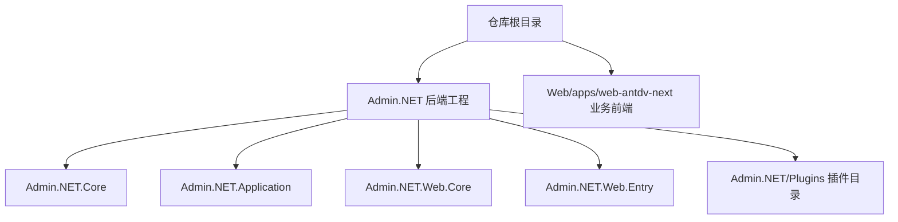
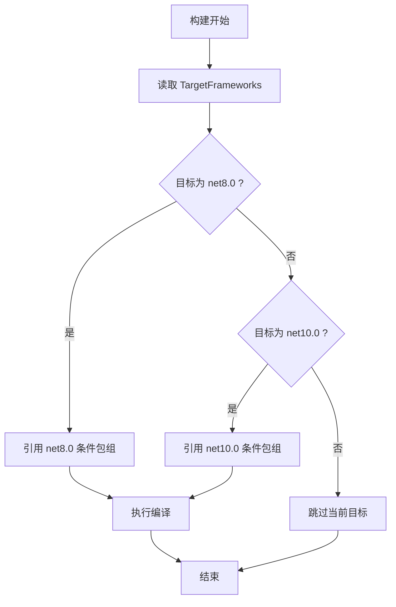
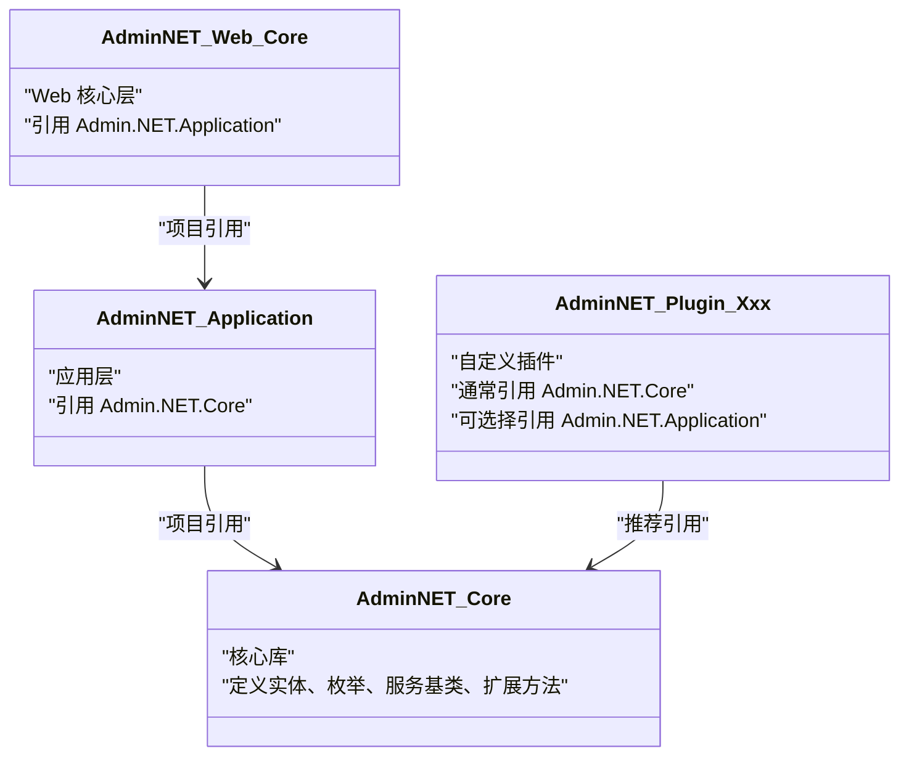
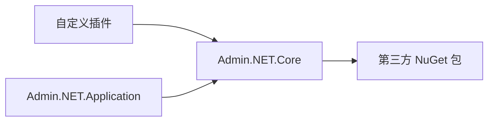
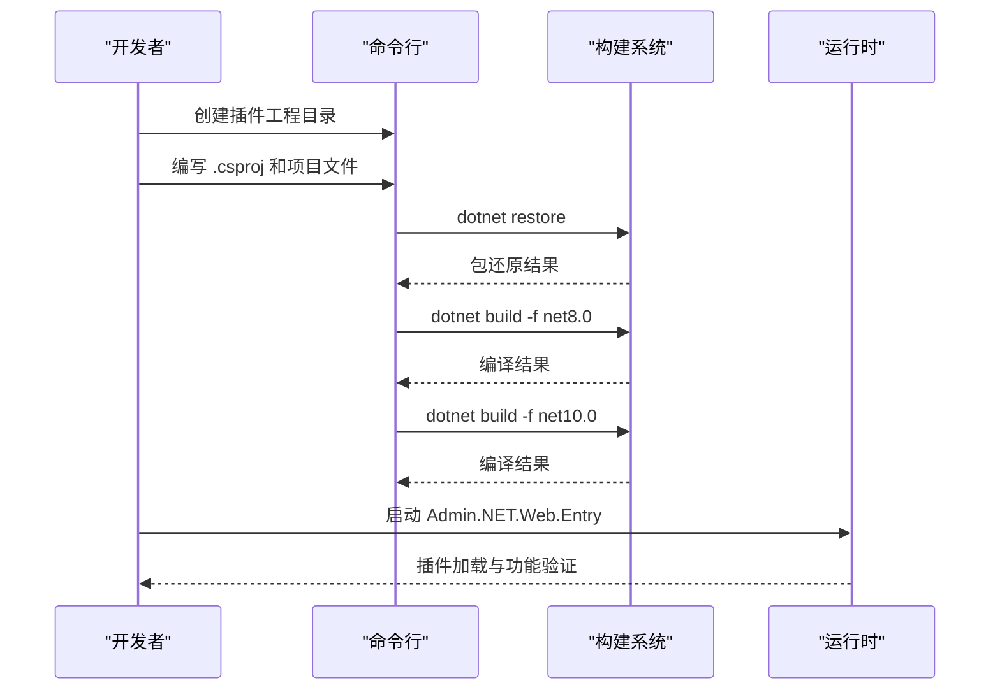

# 插件项目创建与环境搭建

<cite>
**本文引用的文件**   
- [global.json](file://Admin.NET/global.json)
- [Admin.NET.Core.csproj](file://Admin.NET/Admin.NET.Core/Admin.NET.Core.csproj)
- [Admin.NET.Application.csproj](file://Admin.NET/Admin.NET.Application/Admin.NET.Application.csproj)
- [Admin.NET.Web.Core.csproj](file://Admin.NET/Admin.NET.Web.Core/Admin.NET.Web.Core.csproj)
- [Admin.NET.Web.Entry.csproj](file://Admin.NET/Admin.NET.Web.Entry/Admin.NET.Web.Entry.csproj)
- [Program.cs](file://Admin.NET/Admin.NET.Web.Entry/Program.cs)
- [Startup.cs](file://Admin.NET/Admin.NET.Web.Core/Startup.cs)
</cite>

## 目录
1. [引言](#引言)
2. [仓库结构定位](#仓库结构定位)
3. [目标框架与双目标编译](#目标框架与双目标编译)
4. [插件项目模板与命名约定](#插件项目模板与命名约定)
5. [.csproj 配置要点](#csproj-配置要点)
6. [依赖包管理与版本兼容性](#依赖包管理与版本兼容性)
7. [开发环境配置](#开发环境配置)
8. [从模板创建新插件项目的步骤](#从模板创建新插件项目的步骤)
9. [常见问题排查](#常见问题排查)
10. [总结](#总结)

## 引言
本文面向需要基于 Admin.NET 创建自定义插件项目的开发者，说明如何从现有仓库结构出发初始化插件工程、配置 .csproj、引用核心包、选择目标框架，并在 Visual Studio 或 VS Code 中完成开发调试。文档以当前源码为事实依据，重点解释 `.NET 8` 与 `.NET 10` 双目标编译方式，以及 `Admin.NET.Core`、`Admin.NET.Application` 等核心工程的依赖关系。

## 仓库结构定位
当前仓库采用“后端 C# 工程 + Web 前端工程”的混合结构：
- 后端主仓库位于 `Admin.NET/`，包含核心库、应用层、Web 核心层、Web 入口程序、测试工程和插件示例目录。
- Web 前端业务入口位于 `Web/apps/web-antdv-next/`，由根级 `Web/package.json` 及 workspace 管理。

对于插件项目，应重点关注 `Admin.NET/Plugins/` 下的已有插件目录，例如钉钉、GoView、K3Cloud、WorkWeixin 等，这些是插件工程组织形式的参考来源。

**图表来源**   
- [Admin.NET.Core.csproj:1-15](file://Admin.NET/Admin.NET.Core/Admin.NET.Core.csproj#L1-L15)
- [Admin.NET.Application.csproj:1-15](file://Admin.NET/Admin.NET.Application/Admin.NET.Application.csproj#L1-L15)
- [Admin.NET.Web.Core.csproj:1-15](file://Admin.NET/Admin.NET.Web.Core/Admin.NET.Web.Core.csproj#L1-L15)
- [Admin.NET.Web.Entry.csproj:1-15](file://Admin.NET/Admin.NET.Web.Entry/Admin.NET.Web.Entry.csproj#L1-L15)

**章节来源**   
- [Admin.NET.Core.csproj:1-15](file://Admin.NET/Admin.NET.Core/Admin.NET.Core.csproj#L1-L15)
- [Admin.NET.Application.csproj:1-15](file://Admin.NET/Admin.NET.Application/Admin.NET.Application.csproj#L1-L15)
- [Admin.NET.Web.Core.csproj:1-15](file://Admin.NET/Admin.NET.Web.Core/Admin.NET.Web.Core.csproj#L1-L15)
- [Admin.NET.Web.Entry.csproj:1-15](file://Admin.NET/Admin.NET.Web.Entry/Admin.NET.Web.Entry.csproj#L1-L15)

## 目标框架与双目标编译
仓库中的核心库和应用层使用多目标框架，同时支持 `.NET 8` 和 `.NET 10`；Web 入口程序当前只指定 `.NET 10`。

| 工程 | 目标框架 | 说明 |
|---|---|---|
| `Admin.NET.Core` | `net8.0;net10.0` | 核心库双目标，内部通过条件分组引用不同版本的 ASP.NET Core 相关包 |
| `Admin.NET.Application` | `net8.0;net10.0` | 应用层双目标，引用 `Admin.NET.Core` |
| `Admin.NET.Web.Core` | `net8.0;net10.0` | Web 核心层双目标，引用 `Admin.NET.Application` |
| `Admin.NET.Web.Entry` | `net10.0` | Web 启动入口，当前仅针对 `.NET 10` |

### 双目标配置模式
核心库通过 `<TargetFrameworks>` 声明多个目标框架，并使用 `<ItemGroup Condition="...">` 按目标框架引入不同的包版本。例如：
- 当目标为 `net8.0` 时，引用 ASP.NET Core 8.x 相关的包。
- 当目标为 `net10.0` 时，引用 ASP.NET Core 10.x 相关的包。

这种设计使同一个插件工程可以复用同一套代码，同时适配不同运行时版本。

**图表来源**   
- [Admin.NET.Core.csproj:1-15](file://Admin.NET/Admin.NET.Core/Admin.NET.Core.csproj#L1-L15)
- [Admin.NET.Core.csproj:30-70](file://Admin.NET/Admin.NET.Core/Admin.NET.Core.csproj#L30-L70)

**章节来源**   
- [Admin.NET.Core.csproj:1-15](file://Admin.NET/Admin.NET.Core/Admin.NET.Core.csproj#L1-L15)
- [Admin.NET.Core.csproj:30-70](file://Admin.NET/Admin.NET.Core/Admin.NET.Core.csproj#L30-L70)
- [Admin.NET.Application.csproj:1-10](file://Admin.NET/Admin.NET.Application/Admin.NET.Application.csproj#L1-L10)
- [Admin.NET.Web.Core.csproj:1-10](file://Admin.NET/Admin.NET.Web.Core/Admin.NET.Web.Core.csproj#L1-L10)
- [Admin.NET.Web.Entry.csproj:1-10](file://Admin.NET/Admin.NET.Web.Entry/Admin.NET.Web.Entry.csproj#L1-L10)

## 插件项目模板与命名约定
### 推荐目录位置
建议在 `Admin.NET/Plugins/` 下新增插件项目，保持与已有插件一致的层级结构。每个插件通常包含：
- 一个 `.csproj` 工程文件
- 插件实体、服务、配置、常量、枚举、扩展方法等分类目录
- 可选的迁移脚本、资源文件、配置文件

### 命名约定
- 插件项目名建议采用 `Admin.NET.Plugin.Xxx` 形式，例如 `Admin.NET.Plugin.WorkWeixin`。
- 插件命名空间建议与项目名称一致，避免与核心库冲突。
- 插件类通常实现 Furion 的组件接口，以便被宿主系统发现并加载。

### 文件组织规范
- 将领域实体放在 `Entity` 目录。
- 将业务逻辑放在 `Service` 目录。
- 将静态配置、常量、枚举分别放在 `Configuration`、`Const`、`Enum` 目录。
- 将可插拔启动逻辑放在 `Startup` 或类似入口文件中。
- 如需注入 Web 功能，可在插件中注册控制器、中间件或 API 端点。

**章节来源**   
- [Admin.NET.Core.csproj:1-15](file://Admin.NET/Admin.NET.Core/Admin.NET.Core.csproj#L1-L15)
- [Admin.NET.Application.csproj:1-15](file://Admin.NET/Admin.NET.Application/Admin.NET.Application.csproj#L1-L15)
- [Admin.NET.Web.Core.csproj:1-15](file://Admin.NET/Admin.NET.Web.Core/Admin.NET.Web.Core.csproj#L1-L15)

## .csproj 配置要点
新建插件项目时，应参考以下 `.csproj` 关键项：

| 配置项 | 含义 | 建议值或做法 |
|---|---|---|
| `Sdk` | 指定 SDK 类型 | 普通库使用 `Microsoft.NET.Sdk`；Web 插件可使用 `Microsoft.NET.Sdk.Web` |
| `TargetFrameworks` | 目标框架列表 | 若需兼容 `.NET 8` 和 `.NET 10`，填写 `net8.0;net10.0` |
| `ImplicitUsings` | 是否启用隐式 using | 根据团队规范开启或关闭 |
| `Nullable` | 是否启用可空引用检查 | 插件可按需开启 |
| `ProjectReference` | 引用本地工程 | 插件通常引用 `Admin.NET.Core`，必要时引用 `Admin.NET.Application` |
| `PackageReference` | NuGet 包引用 | 优先复用核心库已稳定使用的包版本 |

### 最小化插件工程结构
一个最简插件工程至少需要：
1. 一个 `.csproj` 文件。
2. 一个插件启动类，用于向宿主系统注册功能。
3. 对 `Admin.NET.Core` 的项目引用。

如果插件提供 Web API 或前端集成，可进一步引用 `Admin.NET.Application` 或 `Admin.NET.Web.Core`，但应避免直接依赖 Web 入口程序。

**图表来源**   
- [Admin.NET.Application.csproj:20-32](file://Admin.NET/Admin.NET.Application/Admin.NET.Application.csproj#L20-L32)
- [Admin.NET.Web.Core.csproj:15-21](file://Admin.NET/Admin.NET.Web.Core/Admin.NET.Web.Core.csproj#L15-L21)

**章节来源**   
- [Admin.NET.Application.csproj:20-32](file://Admin.NET/Admin.NET.Application/Admin.NET.Application.csproj#L20-L32)
- [Admin.NET.Web.Core.csproj:15-21](file://Admin.NET/Admin.NET.Web.Core/Admin.NET.Web.Core.csproj#L15-L21)

## 依赖包管理与版本兼容性
### 核心包依赖关系
- `Admin.NET.Core` 是基础库，依赖大量第三方包，包括日志、ORM、缓存、消息队列、图像处理、身份认证等。
- `Admin.NET.Application` 不直接引入新的第三方包，主要引用 `Admin.NET.Core`。
- `Admin.NET.Web.Core` 额外引入少量 Web 相关包，如 Scalar 文档生成、密码学包等。
- `Admin.NET.Web.Entry` 是 Web 启动程序，当前仅依赖 Windows 服务扩展和 Web 核心层。

### 双目标包版本差异
在 `Admin.NET.Core` 中，部分 ASP.NET Core 相关包按目标框架区分版本：
- `net8.0` 使用 ASP.NET Core 8.x 系列包。
- `net10.0` 使用 ASP.NET Core 10.x 系列包。

这意味着插件如果要使用这些包，也应遵循相同的双目标条件分组策略，否则可能在某一目标框架上出现版本冲突。

### 插件依赖建议
- 优先复用 `Admin.NET.Core` 已稳定的第三方包版本。
- 不要随意升级核心包，除非确认整个平台已完成兼容验证。
- 插件自己的业务依赖应放在独立包中，并通过条件分组控制版本。

**图表来源**   
- [Admin.NET.Core.csproj:15-70](file://Admin.NET/Admin.NET.Core/Admin.NET.Core.csproj#L15-L70)
- [Admin.NET.Application.csproj:20-32](file://Admin.NET/Admin.NET.Application/Admin.NET.Application.csproj#L20-L32)
- [Admin.NET.Web.Core.csproj:15-21](file://Admin.NET/Admin.NET.Web.Core/Admin.NET.Web.Core.csproj#L15-L21)

**章节来源**   
- [Admin.NET.Core.csproj:15-70](file://Admin.NET/Admin.NET.Core/Admin.NET.Core.csproj#L15-L70)
- [Admin.NET.Application.csproj:20-32](file://Admin.NET/Admin.NET.Application/Admin.NET.Application.csproj#L20-L32)
- [Admin.NET.Web.Core.csproj:15-21](file://Admin.NET/Admin.NET.Web.Core/Admin.NET.Web.Core.csproj#L15-L21)

## 开发环境配置
### 安装 .NET SDK
建议安装同时支持 `.NET 8` 和 `.NET 10` 的开发环境：
- 若需要双目标编译，请安装 `.NET 8 SDK` 和 `.NET 10 SDK`。
- 如果只需运行当前 Web 入口，至少安装 `.NET 10 SDK`。

### Visual Studio 配置
- 打开 `Admin.NET.sln` 或对应解决方案。
- 确保解决方案使用的 .NET SDK 能识别 `net8.0` 和 `net10.0`。
- 在插件工程中右键选择“还原 NuGet 包”。
- 将 `Admin.NET.Web.Entry` 设为启动项目后运行，验证插件是否被正确加载。

### VS Code 配置
- 安装 C# Dev Kit 或 C# 扩展。
- 使用 `dotnet restore` 恢复包。
- 使用 `dotnet build -f net8.0` 和 `dotnet build -f net10.0` 分别验证两个目标。
- 使用 `dotnet run --project Admin.NET.Web.Entry` 启动 Web 服务。

### global.json 注意事项
当前仓库的 `Admin.NET/global.json` 主要用于配置测试运行器为 `Microsoft.Testing.Platform`，并未固定全局 SDK 版本。因此，SDK 解析行为仍由 .NET CLI 和 IDE 决定。

**章节来源**   
- [global.json:1-5](file://Admin.NET/global.json#L1-L5)
- [Admin.NET.Web.Entry.csproj:1-10](file://Admin.NET/Admin.NET.Web.Entry/Admin.NET.Web.Entry.csproj#L1-L10)

## 从模板创建新插件项目的步骤
以下步骤基于仓库现有结构和依赖关系，帮助从零创建一个可被 Admin.NET 平台加载的插件项目。

1. **确定插件名称**  
   建议使用 `Admin.NET.Plugin.YourFeature` 作为项目名和默认命名空间。

2. **创建插件工程目录**  
   在 `Admin.NET/Plugins/` 下新建插件文件夹，例如 `Admin.NET.Plugin.YourFeature`。

3. **添加 .csproj 文件**  
   参考 `Admin.NET.Core.csproj` 和 `Admin.NET.Application.csproj` 的写法：
   - 使用 `Microsoft.NET.Sdk`。
   - 设置 `TargetFrameworks` 为 `net8.0;net10.0`。
   - 引用 `Admin.NET.Core` 的项目路径。
   - 如需应用层能力，再引用 `Admin.NET.Application`。

4. **添加插件启动类**  
   实现 Furion 的组件接口，并在其中注册控制器、服务、配置或事件处理器。可参考 `Admin.NET.Web.Core/Startup.cs` 的组织方式。

5. **添加业务目录**  
   按模块划分 `Entity`、`Service`、`Configuration`、`Const`、`Enum`、`Extension` 等目录。

6. **还原并编译**  
   分别执行：
   - `dotnet restore`
   - `dotnet build -f net8.0`
   - `dotnet build -f net10.0`

7. **接入 Web 入口验证**  
   将插件项目加入解决方案，并将 `Admin.NET.Web.Entry` 设为启动项目，启动后检查插件功能是否生效。

**图表来源**   
- [Admin.NET.Core.csproj:1-15](file://Admin.NET/Admin.NET.Core/Admin.NET.Core.csproj#L1-L15)
- [Admin.NET.Application.csproj:20-32](file://Admin.NET/Admin.NET.Application/Admin.NET.Application.csproj#L20-L32)
- [Admin.NET.Web.Entry.csproj:50-71](file://Admin.NET/Admin.NET.Web.Entry/Admin.NET.Web.Entry.csproj#L50-L71)

**章节来源**   
- [Admin.NET.Core.csproj:1-15](file://Admin.NET/Admin.NET.Core/Admin.NET.Core.csproj#L1-L15)
- [Admin.NET.Application.csproj:20-32](file://Admin.NET/Admin.NET.Application/Admin.NET.Application.csproj#L20-L32)
- [Admin.NET.Web.Core.csproj:15-21](file://Admin.NET/Admin.NET.Web.Core/Admin.NET.Web.Core.csproj#L15-L21)
- [Admin.NET.Web.Entry.csproj:50-71](file://Admin.NET/Admin.NET.Web.Entry/Admin.NET.Web.Entry.csproj#L50-L71)

## 常见问题排查
### SDK 版本冲突
- 现象：提示找不到 `net8.0` 或 `net10.0` 目标框架。
- 原因：未安装对应 .NET SDK，或 IDE 使用了旧版 SDK。
- 解决：安装 `.NET 8 SDK` 和 `.NET 10 SDK`，并重启 IDE。

### 包还原失败
- 现象：NuGet 还原时报版本冲突或无法解析包。
- 原因：第三方包版本与目标框架不匹配，或网络/镜像问题。
- 解决：
  - 先清理 `bin`、`obj` 后重试还原。
  - 核对插件引用的包版本是否与 `Admin.NET.Core` 兼容。
  - 若必须使用不同版本，请在插件中使用 `<ItemGroup Condition="...">` 按目标框架分组引用。

### 双目标编译失败
- 现象：`net8.0` 编译成功，`net10.0` 失败。
- 原因：某些包只在特定 ASP.NET Core 版本可用。
- 解决：参考 `Admin.NET.Core.csproj` 的条件包分组方式，将 ASP.NET Core 相关包按目标框架拆分。

### Web 入口无法加载插件
- 现象：插件编译成功，但运行时未生效。
- 原因：插件未注册到宿主系统，或未加入解决方案。
- 解决：
  - 确保插件实现 Furion 组件接口。
  - 确保插件项目已加入解决方案。
  - 检查 `Admin.NET.Web.Entry` 的启动逻辑是否扫描插件。

### 控制台运行日志异常
- 现象：Windows 下控制台运行时报事件日志写入错误。
- 原因：非 Windows 服务模式下尝试写入事件日志。
- 解决：参考 `Program.cs` 中对 Windows 事件日志过滤的配置，在非服务模式下禁用事件日志提供者。

**章节来源**   
- [Admin.NET.Core.csproj:30-70](file://Admin.NET/Admin.NET.Core/Admin.NET.Core.csproj#L30-L70)
- [Program.cs:1-38](file://Admin.NET/Admin.NET.Web.Entry/Program.cs#L1-L38)

## 总结
创建 Admin.NET 自定义插件项目的关键在于：
- 将插件放在 `Admin.NET/Plugins/` 下，遵循既有命名和组织规范。
- 在 `.csproj` 中正确设置 `TargetFrameworks`，并与核心库保持一致。
- 优先引用 `Admin.NET.Core`，谨慎引用 `Admin.NET.Application` 或 `Admin.NET.Web.Core`。
- 对 ASP.NET Core 相关包使用条件分组，以支持 `.NET 8` 和 `.NET 10` 双目标。
- 使用 Visual Studio 或 VS Code 完成包还原、双目标编译和 Web 入口联调。
- 遇到 SDK、包版本或运行时问题时，优先对照核心工程的配置进行一致性修复。