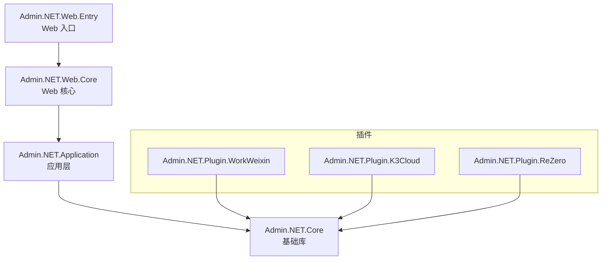
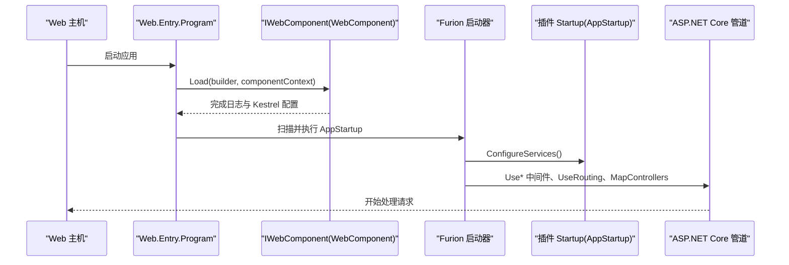
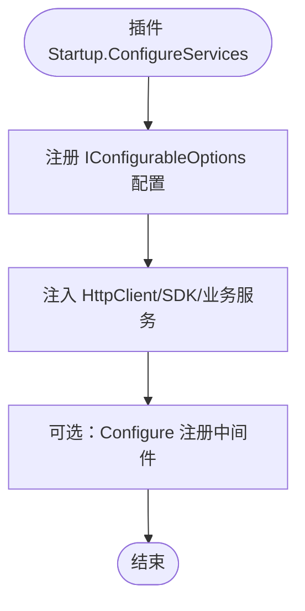
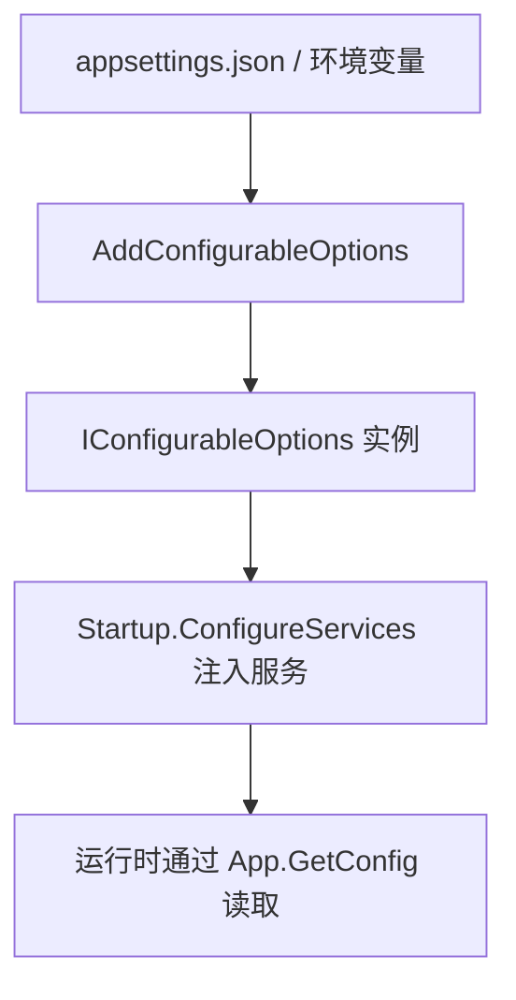
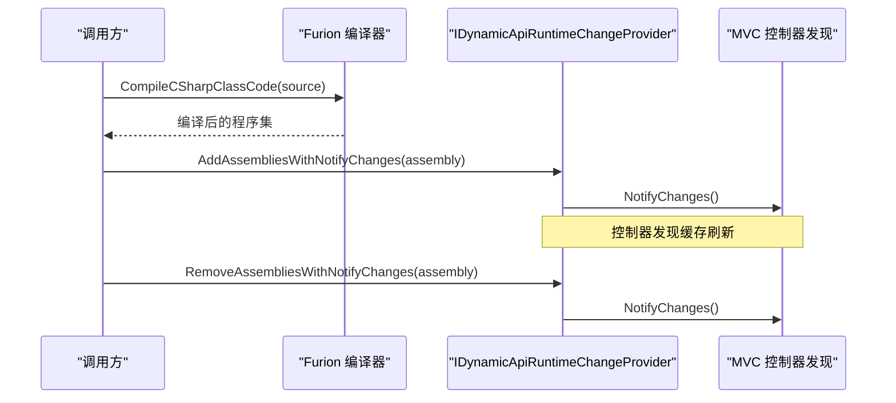
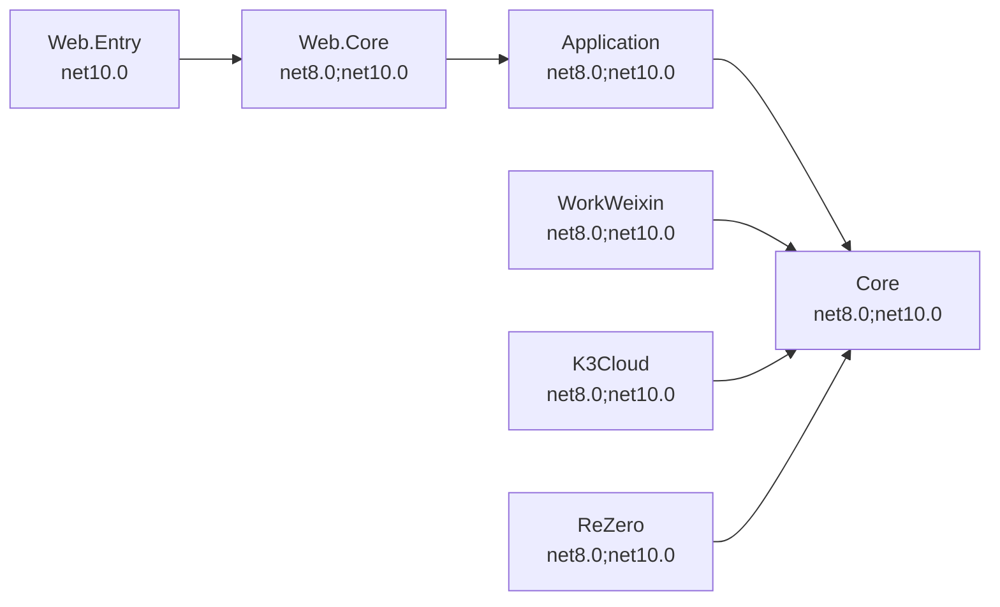

# 自定义插件开发指南

<cite>
**本文引用的文件**
- [Program.cs](file://Admin.NET/Admin.NET.Web.Entry/Program.cs)
- [Startup.cs（Web.Core）](file://Admin.NET/Admin.NET.Web.Core/Startup.cs)
- [Startup.cs（WorkWeixin 插件）](file://Admin.NET/Plugins/Admin.NET.Plugin.WorkWeixin/Startup.cs)
- [Startup.cs（K3Cloud 插件）](file://Admin.NET/Plugins/Admin.NET.Plugin.K3Cloud/Startup.cs)
- [Startup.cs（ReZero 插件）](file://Admin.NET/Plugins/Admin.NET.Plugin.ReZero/Startup.cs)
- [WorkWeixinOptions.cs](file://Admin.NET/Plugins/Admin.NET.Plugin.WorkWeixin/Option/WorkWeixinOptions.cs)
- [K3CloudOptions.cs](file://Admin.NET/Plugins/Admin.NET.Plugin.K3Cloud/Option/K3CloudOptions.cs)
- [Admin.NET.Plugin.WorkWeixin.csproj](file://Admin.NET/Plugins/Admin.NET.Plugin.WorkWeixin/Admin.NET.Plugin.WorkWeixin.csproj)
- [Admin.NET.Plugin.K3Cloud.csproj](file://Admin.NET/Plugins/Admin.NET.Plugin.K3Cloud/Admin.NET.Plugin.K3Cloud.csproj)
- [Admin.NET.Plugin.ReZero.csproj](file://Admin.NET/Plugins/Admin.NET.Plugin.ReZero/Admin.NET.Plugin.ReZero.csproj)
- [Admin.NET.Application.csproj](file://Admin.NET/Admin.NET.Application/Admin.NET.Application.csproj)
- [Admin.NET.Core.csproj](file://Admin.NET/Admin.NET.Core/Admin.NET.Core.csproj)
- [Admin.NET.Web.Core.csproj](file://Admin.NET/Admin.NET.Web.Core/Admin.NET.Web.Core.csproj)
- [Admin.NET.Web.Entry.csproj](file://Admin.NET/Admin.NET.Web.Entry/Admin.NET.Web.Entry.csproj)
- [global.json](file://Admin.NET/global.json)
- [PluginRuntimeTests.cs](file://Admin.NET/Admin.NET.Test/Plugin/PluginRuntimeTests.cs)
- [PluginContractTests.cs](file://Admin.NET/Admin.NET.Test/Plugin/PluginContractTests.cs)
</cite>

## 目录
1. [简介](#简介)
2. [项目结构](#项目结构)
3. [核心组件](#核心组件)
4. [架构总览](#架构总览)
5. [详细组件分析](#详细组件分析)
6. [依赖关系分析](#依赖关系分析)
7. [性能考虑](#性能考虑)
8. [故障排查](#故障排查)
9. [结论](#结论)
10. [附录](#附录)

## 简介
本指南面向需要在 Admin.NET 平台上扩展 Web 功能、注册服务与配置的新增插件开发者。文档基于当前仓库代码，说明如何创建 .csproj 插件工程、实现 IWebComponent 或 AppStartup 扩展点、使用 Furion 的配置系统注入选项、通过中间件和控制器扩展 Web 管线，并提供打包发布、测试策略、性能优化与常见问题排查建议。

需要特别说明：
- 当前仓库的 Web 启动入口使用 Furion 的 IWebComponent 进行宿主初始化；现有内置插件则通过 AppStartup 扩展点注册服务和配置。
- 插件在运行时可能以程序集方式动态加载，并参与 MVC 控制器的发现与替换流程，因此插件的生命周期管理、版本兼容性与内存释放尤为重要。

## 项目结构
仓库采用分层与插件分离的组织方式：
- 应用层 Admin.NET.Application 与基础能力 Admin.NET.Core 提供通用服务、实体、缓存、事件总线、任务调度等基础设施。
- Web 核心 Admin.NET.Web.Core 负责 ASP.NET Core 管道、认证、限流、SignalR、响应压缩、虚拟文件系统等。
- Web 入口 Admin.NET.Web.Entry 是实际可运行的 Web 应用，使用 IWebComponent 初始化日志、Kestrel 限制等。
- Plugins 目录包含多个独立插件工程，每个插件通过自己的 Startup 和 Option 类扩展平台。

**图表来源**
- [Program.cs:10-38](file://Admin.NET/Admin.NET.Web.Entry/Program.cs#L10-L38)
- [Startup.cs（Web.Core）:40-200](file://Admin.NET/Admin.NET.Web.Core/Startup.cs#L40-L200)
- [Admin.NET.Plugin.WorkWeixin.csproj:1-23](file://Admin.NET/Plugins/Admin.NET.Plugin.WorkWeixin/Admin.NET.Plugin.WorkWeixin.csproj#L1-L23)
- [Admin.NET.Plugin.K3Cloud.csproj:1-23](file://Admin.NET/Plugins/Admin.NET.Plugin.K3Cloud/Admin.NET.Plugin.K3Cloud.csproj#L1-L23)
- [Admin.NET.Plugin.ReZero.csproj:1-40](file://Admin.NET/Plugins/Admin.NET.Plugin.ReZero/Admin.NET.Plugin.ReZero.csproj#L1-L40)

**章节来源**
- [Program.cs:10-38](file://Admin.NET/Admin.NET.Web.Entry/Program.cs#L10-L38)
- [Startup.cs（Web.Core）:40-200](file://Admin.NET/Admin.NET.Web.Core/Startup.cs#L40-L200)
- [Admin.NET.Application.csproj:4-28](file://Admin.NET/Admin.NET.Application/Admin.NET.Application.csproj#L4-L28)
- [Admin.NET.Core.csproj:4-50](file://Admin.NET/Admin.NET.Core/Admin.NET.Core.csproj#L4-L50)
- [Admin.NET.Web.Core.csproj:4-18](file://Admin.NET/Admin.NET.Web.Core/Admin.NET.Web.Core.csproj#L4-L18)
- [Admin.NET.Web.Entry.csproj:1-71](file://Admin.NET/Admin.NET.Web.Entry/Admin.NET.Web.Entry.csproj#L1-L71)

## 核心组件
- IWebComponent：由 Web 入口使用，用于在应用构建阶段注入日志过滤、Kestrel 限制等全局设置。
- AppStartup：Furion 提供的启动器扩展点，插件通过继承 AppStartup 并在 ConfigureServices 中注册服务与配置。
- IConfigurableOptions：插件配置项契约，配合 AddConfigurableOptions 将 appsettings 与环境变量映射到强类型选项对象。
- Dynamic API 与控制器发现：插件可通过控制器暴露 API；运行期还可动态编译 C# 源并更新 MVC 控制器集合。

**章节来源**
- [Program.cs:10-38](file://Admin.NET/Admin.NET.Web.Entry/Program.cs#L10-L38)
- [Startup.cs（WorkWeixin 插件）:14-25](file://Admin.NET/Plugins/Admin.NET.Plugin.WorkWeixin/Startup.cs#L14-L25)
- [Startup.cs（K3Cloud 插件）:13-29](file://Admin.NET/Plugins/Admin.NET.Plugin.K3Cloud/Startup.cs#L13-L29)
- [WorkWeixinOptions.cs:14-25](file://Admin.NET/Plugins/Admin.NET.Plugin.WorkWeixin/Option/WorkWeixinOptions.cs#L14-L25)
- [K3CloudOptions.cs:1-45](file://Admin.NET/Plugins/Admin.NET.Plugin.K3Cloud/Option/K3CloudOptions.cs#L1-L45)
- [PluginRuntimeTests.cs:1-103](file://Admin.NET/Admin.NET.Test/Plugin/PluginRuntimeTests.cs#L1-L103)

## 架构总览
下图展示插件在应用生命周期中的关键路径：入口使用 IWebComponent 初始化宿主，随后 Furion 扫描 AppStartup 执行插件服务注册，再通过 ASP.NET Core 管道注册中间件、路由与控制器。

**图表来源**
- [Program.cs:10-38](file://Admin.NET/Admin.NET.Web.Entry/Program.cs#L10-L38)
- [Startup.cs（WorkWeixin 插件）:14-25](file://Admin.NET/Plugins/Admin.NET.Plugin.WorkWeixin/Startup.cs#L14-L25)
- [Startup.cs（K3Cloud 插件）:13-29](file://Admin.NET/Plugins/Admin.NET.Plugin.K3Cloud/Startup.cs#L13-L29)
- [Startup.cs（Web.Core）:201-442](file://Admin.NET/Admin.NET.Web.Core/Startup.cs#L201-L442)

## 详细组件分析

### 新插件项目的创建步骤
1. 新建 .NET Sdk 项目，目标框架建议与现有插件保持一致，即 net8.0 与 net10.0 多目标。
2. 在 .csproj 中引用 Admin.NET.Core，以便复用基础服务与 Furion 扩展方法。
3. 新增 Startup 类，继承 AppStartup，并通过 [AppStartup] 特性声明优先级。
4. 新增 Option 类，实现 IConfigurableOptions，用于承载插件配置项。
5. 在 Startup.ConfigureServices 中调用 AddConfigurableOptions<T>() 注册配置绑定。
6. 可选：在 Startup.Configure 中注册中间件、静态资源、SignalR Hub 或其他管道扩展。

示例参考：
- 插件工程模板：[Admin.NET.Plugin.WorkWeixin.csproj](file://Admin.NET/Plugins/Admin.NET.Plugin.WorkWeixin/Admin.NET.Plugin.WorkWeixin.csproj#L1-L23)、[Admin.NET.Plugin.K3Cloud.csproj](file://Admin.NET/Plugins/Admin.NET.Plugin.K3Cloud/Admin.NET.Plugin.K3Cloud.csproj#L1-L23)
- 插件启动器：[Startup.cs（WorkWeixin 插件）](file://Admin.NET/Plugins/Admin.NET.Plugin.WorkWeixin/Startup.cs#L14-L25)、[Startup.cs（K3Cloud 插件）](file://Admin.NET/Plugins/Admin.NET.Plugin.K3Cloud/Startup.cs#L13-L29)
- 插件配置模型：[WorkWeixinOptions.cs](file://Admin.NET/Plugins/Admin.NET.Plugin.WorkWeixin/Option/WorkWeixinOptions.cs#L14-L25)、[K3CloudOptions.cs](file://Admin.NET/Plugins/Admin.NET.Plugin.K3Cloud/Option/K3CloudOptions.cs#L1-L45)

**章节来源**
- [Admin.NET.Plugin.WorkWeixin.csproj:1-23](file://Admin.NET/Plugins/Admin.NET.Plugin.WorkWeixin/Admin.NET.Plugin.WorkWeixin.csproj#L1-L23)
- [Admin.NET.Plugin.K3Cloud.csproj:1-23](file://Admin.NET/Plugins/Admin.NET.Plugin.K3Cloud/Admin.NET.Plugin.K3Cloud.csproj#L1-L23)
- [Startup.cs（WorkWeixin 插件）:14-25](file://Admin.NET/Plugins/Admin.NET.Plugin.WorkWeixin/Startup.cs#L14-L25)
- [Startup.cs（K3Cloud 插件）:13-29](file://Admin.NET/Plugins/Admin.NET.Plugin.K3Cloud/Startup.cs#L13-L29)
- [WorkWeixinOptions.cs:14-25](file://Admin.NET/Plugins/Admin.NET.Plugin.WorkWeixin/Option/WorkWeixinOptions.cs#L14-L25)
- [K3CloudOptions.cs:1-45](file://Admin.NET/Plugins/Admin.NET.Plugin.K3Cloud/Option/K3CloudOptions.cs#L1-L45)

### 实现 IWebComponent 扩展 Web 功能
IWebComponent 适合在应用构建阶段执行一次性初始化逻辑，例如：
- 控制台运行下禁用 Windows 事件日志提供者，避免权限问题。
- 添加日志过滤器，屏蔽不必要的框架日志类别，降低噪音。
- 配置 Kestrel 限制，如 KeepAliveTimeout、RequestHeadersTimeout、最大请求体大小。

推荐做法：
- 将环境判断放在 Load 方法内，区分 Windows 服务与控制台运行模式。
- 仅注册必要的日志过滤器，避免过度裁剪导致难以定位问题。
- 对上传大小、超时时间做合理上限，防止恶意请求耗尽资源。

参考实现位置：
- [Program.cs:10-38](file://Admin.NET/Admin.NET.Web.Entry/Program.cs#L10-L38)

**章节来源**
- [Program.cs:10-38](file://Admin.NET/Admin.NET.Web.Entry/Program.cs#L10-L38)

### 通过 AppStartup 注册中间件、过滤器与服务注入
插件应遵循以下约定：
- 使用 [AppStartup(优先级)] 标注启动顺序。
- 在 ConfigureServices 中注入服务、HttpClient、第三方 SDK、配置选项。
- 在 Configure 中注册中间件，注意顺序：先 UseForwardedHeaders，再 UseStaticFiles、UseAuthentication、UseAuthorization、UseRouting、UseEndpoints。
- 如需暴露 API，可直接定义控制器；若需要动态编译 C# 源生成控制器，请参考运行期变更流程。

参考实现位置：
- 企业微信插件：[Startup.cs（WorkWeixin 插件）](file://Admin.NET/Plugins/Admin.NET.Plugin.WorkWeixin/Startup.cs#L14-L25)
- K3Cloud 插件：[Startup.cs（K3Cloud 插件）](file://Admin.NET/Plugins/Admin.NET.Plugin.K3Cloud/Startup.cs#L13-L29)
- ReZero 插件：[Startup.cs（ReZero 插件）](file://Admin.NET/Plugins/Admin.NET.Plugin.ReZero/Startup.cs#L17-L54)
- Web 核心管道注册：[Startup.cs（Web.Core）:201-442](file://Admin.NET/Admin.NET.Web.Core/Startup.cs#L201-L442)

**图表来源**
- [Startup.cs（WorkWeixin 插件）:14-25](file://Admin.NET/Plugins/Admin.NET.Plugin.WorkWeixin/Startup.cs#L14-L25)
- [Startup.cs（K3Cloud 插件）:13-29](file://Admin.NET/Plugins/Admin.NET.Plugin.K3Cloud/Startup.cs#L13-L29)
- [Startup.cs（Web.Core）:201-442](file://Admin.NET/Admin.NET.Web.Core/Startup.cs#L201-L442)

**章节来源**
- [Startup.cs（WorkWeixin 插件）:14-25](file://Admin.NET/Plugins/Admin.NET.Plugin.WorkWeixin/Startup.cs#L14-L25)
- [Startup.cs（K3Cloud 插件）:13-29](file://Admin.NET/Plugins/Admin.NET.Plugin.K3Cloud/Startup.cs#L13-L29)
- [Startup.cs（ReZero 插件）:17-54](file://Admin.NET/Plugins/Admin.NET.Plugin.ReZero/Startup.cs#L17-L54)
- [Startup.cs（Web.Core）:201-442](file://Admin.NET/Admin.NET.Web.Core/Startup.cs#L201-L442)

### 插件配置管理机制
插件配置通过 IConfigurableOptions 与 AddConfigurableOptions 组合实现：
- 定义配置类，实现 IConfigurableOptions，声明属性对应配置文件键。
- 在 Startup.ConfigureServices 中调用 services.AddConfigurableOptions<T>()。
- 使用 App.GetConfig<T>(sectionName, optional) 读取强类型配置。
- 支持 appsettings.json 与环境变量注入，具体键名取决于各插件的 section 名称。

参考实现位置：
- 企业微信配置：[WorkWeixinOptions.cs](file://Admin.NET/Plugins/Admin.NET.Plugin.WorkWeixin/Option/WorkWeixinOptions.cs#L14-L25)、[Startup.cs（WorkWeixin 插件）](file://Admin.NET/Plugins/Admin.NET.Plugin.WorkWeixin/Startup.cs#L14-L25)
- K3Cloud 配置：[K3CloudOptions.cs](file://Admin.NET/Plugins/Admin.NET.Plugin.K3Cloud/Option/K3CloudOptions.cs#L1-L45)、[Startup.cs（K3Cloud 插件）](file://Admin.NET/Plugins/Admin.NET.Plugin.K3Cloud/Startup.cs#L13-L29)
- ReZero 配置：[Startup.cs（ReZero 插件）](file://Admin.NET/Plugins/Admin.NET.Plugin.ReZero/Startup.cs#L17-L54)

**图表来源**
- [WorkWeixinOptions.cs:14-25](file://Admin.NET/Plugins/Admin.NET.Plugin.WorkWeixin/Option/WorkWeixinOptions.cs#L14-L25)
- [K3CloudOptions.cs:1-45](file://Admin.NET/Plugins/Admin.NET.Plugin.K3Cloud/Option/K3CloudOptions.cs#L1-L45)
- [Startup.cs（WorkWeixin 插件）:14-25](file://Admin.NET/Plugins/Admin.NET.Plugin.WorkWeixin/Startup.cs#L14-L25)
- [Startup.cs（K3Cloud 插件）:13-29](file://Admin.NET/Plugins/Admin.NET.Plugin.K3Cloud/Startup.cs#L13-L29)

**章节来源**
- [WorkWeixinOptions.cs:14-25](file://Admin.NET/Plugins/Admin.NET.Plugin.WorkWeixin/Option/WorkWeixinOptions.cs#L14-L25)
- [K3CloudOptions.cs:1-45](file://Admin.NET/Plugins/Admin.NET.Plugin.K3Cloud/Option/K3CloudOptions.cs#L1-L45)
- [Startup.cs（WorkWeixin 插件）:14-25](file://Admin.NET/Plugins/Admin.NET.Plugin.WorkWeixin/Startup.cs#L14-L25)
- [Startup.cs（K3Cloud 插件）:13-29](file://Admin.NET/Plugins/Admin.NET.Plugin.K3Cloud/Startup.cs#L13-L29)
- [Startup.cs（ReZero 插件）:17-54](file://Admin.NET/Plugins/Admin.NET.Plugin.ReZero/Startup.cs#L17-L54)

### 运行时配置更新与动态 API
对于动态编译 C# 源码并热更新控制器的场景，测试用例展示了如下流程：
- 使用 Furion.App.CompileCSharpClassCode 编译源字符串为程序集。
- 通过 IDynamicApiRuntimeChangeProvider 向 MVC 控制器发现机制注册或移除程序集。
- 提交失败时回滚原控制器集合，确保应用状态一致。
- 释放编译句柄后仍保证已发布的控制器可被发现与调用。

该机制适用于“在线插件”或“脚本式扩展”场景，要求：
- 谨慎校验输入源码，避免注入危险代码。
- 控制程序集生命周期，及时释放不再使用的动态程序集。
- 在异常路径上恢复原控制器集合，避免污染 MVC 发现缓存。

**图表来源**
- [PluginRuntimeTests.cs:1-103](file://Admin.NET/Admin.NET.Test/Plugin/PluginRuntimeTests.cs#L1-L103)

**章节来源**
- [PluginRuntimeTests.cs:1-103](file://Admin.NET/Admin.NET.Test/Plugin/PluginRuntimeTests.cs#L1-L103)

### 插件打包与发布流程
当前仓库中的插件工程主要作为项目引用被 Web 应用消费，未直接启用 NuGet 包发布。若要对外发布插件包，建议：
- 在插件 .csproj 中增加 IsPackable=true、Version、PackageId、Description、Authors、PackageLicenseExpression 等元数据。
- 明确 PackageReference 依赖的版本范围，避免与宿主应用冲突。
- 若需要输出配置文件或静态资源，可在 .csproj 中使用 Content 或 None 元素将其复制到输出目录。
- 使用 dotnet pack 与 dotnet nuget push 发布到内部或公共 NuGet 源。
- 通过版本语义化命名（主版本.次版本.修订号）管理兼容性，并在宿主应用升级时评估依赖冲突。

参考项目结构与发布相关片段：
- 插件工程模板：[Admin.NET.Plugin.WorkWeixin.csproj](file://Admin.NET/Plugins/Admin.NET.Plugin.WorkWeixin/Admin.NET.Plugin.WorkWeixin.csproj#L1-L23)、[Admin.NET.Plugin.K3Cloud.csproj](file://Admin.NET/Plugins/Admin.NET.Plugin.K3Cloud/Admin.NET.Plugin.K3Cloud.csproj#L1-L23)、[Admin.NET.Plugin.ReZero.csproj](file://Admin.NET/Plugins/Admin.NET.Plugin.ReZero/Admin.NET.Plugin.ReZero.csproj#L1-L40)
- Web 入口版本信息：[Admin.NET.Web.Entry.csproj:14-16](file://Admin.NET/Admin.NET.Web.Entry/Admin.NET.Web.Entry.csproj#L14-L16)

**章节来源**
- [Admin.NET.Plugin.WorkWeixin.csproj:1-23](file://Admin.NET/Plugins/Admin.NET.Plugin.WorkWeixin/Admin.NET.Plugin.WorkWeixin.csproj#L1-L23)
- [Admin.NET.Plugin.K3Cloud.csproj:1-23](file://Admin.NET/Plugins/Admin.NET.Plugin.K3Cloud/Admin.NET.Plugin.K3Cloud.csproj#L1-L23)
- [Admin.NET.Plugin.ReZero.csproj:1-40](file://Admin.NET/Plugins/Admin.NET.Plugin.ReZero/Admin.NET.Plugin.ReZero.csproj#L1-L40)
- [Admin.NET.Web.Entry.csproj:14-16](file://Admin.NET/Admin.NET.Web.Entry/Admin.NET.Web.Entry.csproj#L14-L16)

### 插件测试策略
仓库已有针对插件运行期行为的测试，涵盖：
- 单元测试：验证插件输入校验、实体创建与更新约束、租户隔离、SQL 生成安全。
- 集成测试：模拟 MVC 控制器发现与替换，验证动态程序集生命周期与回滚行为。
- 端到端测试：前端 Playwright 与后端 API 链路验收不在本节展开，但插件 API 应通过接口契约与浏览器流程共同验证。

建议实践：
- 单元测试聚焦插件契约、参数校验、数据访问约束与错误分支。
- 集成测试覆盖 AppStartup 注册的服务、中间件顺序、配置注入与真实数据库交互。
- 端到端测试覆盖浏览器登录、菜单可见性、API 调用与页面渲染。
- 对动态编译与运行时替换场景，必须编写失败回滚用例，确保 MVC 控制器集合一致性。

参考测试文件：
- 运行期行为：[PluginRuntimeTests.cs:1-103](file://Admin.NET/Admin.NET.Test/Plugin/PluginRuntimeTests.cs#L1-L103)
- 契约与安全：[PluginContractTests.cs:1-132](file://Admin.NET/Admin.NET.Test/Plugin/PluginContractTests.cs#L1-L132)

**章节来源**
- [PluginRuntimeTests.cs:1-103](file://Admin.NET/Admin.NET.Test/Plugin/PluginRuntimeTests.cs#L1-L103)
- [PluginContractTests.cs:1-132](file://Admin.NET/Admin.NET.Test/Plugin/PluginContractTests.cs#L1-L132)

### 插件性能优化技巧
结合现有 Web 核心与插件模式，推荐以下优化方向：
- 异步处理：所有外部 IO、HTTP 调用、数据库查询均应使用异步 API，避免阻塞线程池。
- 缓存策略：优先使用平台提供的缓存服务；对热点数据加缓存，注意过期与失效策略。
- 内存管理：动态程序集、反射结果、临时大对象应及时释放；避免在单例中持有大量上下文对象。
- 网络优化：为外部 HTTP 客户端设置 BaseAddress、超时与重试策略；连接复用减少握手开销。
- 响应压缩：利用已有的 Brotli/Gzip 压缩中间件减少带宽占用。
- 图像与静态资源：使用 ImageSharp 与虚拟文件系统，按需处理图片，减少磁盘与内存压力。

参考实现位置：
- 响应压缩与图像处理：[Startup.cs（Web.Core）:201-442](file://Admin.NET/Admin.NET.Web.Core/Startup.cs#L201-L442)
- HttpClient 配置：[Startup.cs（K3Cloud 插件）:13-29](file://Admin.NET/Plugins/Admin.NET.Plugin.K3Cloud/Startup.cs#L13-L29)
- 动态程序集生命周期：[PluginRuntimeTests.cs:1-103](file://Admin.NET/Admin.NET.Test/Plugin/PluginRuntimeTests.cs#L1-L103)

**章节来源**
- [Startup.cs（Web.Core）:201-442](file://Admin.NET/Admin.NET.Web.Core/Startup.cs#L201-L442)
- [Startup.cs（K3Cloud 插件）:13-29](file://Admin.NET/Plugins/Admin.NET.Plugin.K3Cloud/Startup.cs#L13-L29)
- [PluginRuntimeTests.cs:1-103](file://Admin.NET/Admin.NET.Test/Plugin/PluginRuntimeTests.cs#L1-L103)

## 依赖关系分析
- 目标框架：
  - Admin.NET.Core、Admin.NET.Application、Admin.NET.Web.Core 以及多数插件均支持 net8.0 与 net10.0。
  - Admin.NET.Web.Entry 当前固定为 net10.0。
- global.json：当前只选择 Microsoft.Testing.Platform，不能据此声称已固定 .NET SDK 版本。
- 插件依赖：
  - 插件工程通常引用 Admin.NET.Core，以获得基础服务与 Furion 扩展。
  - 部分插件引入第三方 SDK（如 ReZero、ClosedXML 等），需在 .csproj 中明确版本号。

**图表来源**
- [Admin.NET.Web.Entry.csproj:1-71](file://Admin.NET/Admin.NET.Web.Entry/Admin.NET.Web.Entry.csproj#L1-L71)
- [Admin.NET.Core.csproj:4-50](file://Admin.NET/Admin.NET.Core/Admin.NET.Core.csproj#L4-L50)
- [Admin.NET.Application.csproj:4-28](file://Admin.NET/Admin.NET.Application/Admin.NET.Application.csproj#L4-L28)
- [Admin.NET.Web.Core.csproj:4-18](file://Admin.NET/Admin.NET.Web.Core/Admin.NET.Web.Core.csproj#L4-L18)
- [Admin.NET.Plugin.WorkWeixin.csproj:1-23](file://Admin.NET/Plugins/Admin.NET.Plugin.WorkWeixin/Admin.NET.Plugin.WorkWeixin.csproj#L1-L23)
- [Admin.NET.Plugin.K3Cloud.csproj:1-23](file://Admin.NET/Plugins/Admin.NET.Plugin.K3Cloud/Admin.NET.Plugin.K3Cloud.csproj#L1-L23)
- [Admin.NET.Plugin.ReZero.csproj:1-40](file://Admin.NET/Plugins/Admin.NET.Plugin.ReZero/Admin.NET.Plugin.ReZero.csproj#L1-L40)
- [global.json](file://Admin.NET/global.json)

**章节来源**
- [Admin.NET.Web.Entry.csproj:1-71](file://Admin.NET/Admin.NET.Web.Entry/Admin.NET.Web.Entry.csproj#L1-L71)
- [Admin.NET.Core.csproj:4-50](file://Admin.NET/Admin.NET.Core/Admin.NET.Core.csproj#L4-L50)
- [Admin.NET.Application.csproj:4-28](file://Admin.NET/Admin.NET.Application/Admin.NET.Application.csproj#L4-L28)
- [Admin.NET.Web.Core.csproj:4-18](file://Admin.NET/Admin.NET.Web.Core/Admin.NET.Web.Core.csproj#L4-L18)
- [Admin.NET.Plugin.WorkWeixin.csproj:1-23](file://Admin.NET/Plugins/Admin.NET.Plugin.WorkWeixin/Admin.NET.Plugin.WorkWeixin.csproj#L1-L23)
- [Admin.NET.Plugin.K3Cloud.csproj:1-23](file://Admin.NET/Plugins/Admin.NET.Plugin.K3Cloud/Admin.NET.Plugin.K3Cloud.csproj#L1-L23)
- [Admin.NET.Plugin.ReZero.csproj:1-40](file://Admin.NET/Plugins/Admin.NET.Plugin.ReZero/Admin.NET.Plugin.ReZero.csproj#L1-L40)
- [global.json](file://Admin.NET/global.json)

## 性能考虑
- 日志与监控：在 IWebComponent 中过滤冗余日志类别，降低 IO 与 CPU 开销。
- 网络与并发：为 HttpClient 配置合理的 BaseAddress、超时、重试策略，避免慢下游拖垮服务。
- 缓存与压缩：启用 Brotli/Gzip 压缩，使用 ImageSharp 处理图片，减少传输体积。
- 动态程序集：严格控制编译与注册生命周期，避免内存泄漏与控制器缓存污染。
- 数据库访问：使用异步查询、分页与索引，避免全表扫描与大事务。

[本节为通用性能建议，不直接分析具体文件]

## 故障排查
常见问题与定位思路：
- 启动阶段无法识别插件服务：检查插件是否实现 AppStartup，是否在正确命名空间与程序集中，且已被宿主应用加载。
- 配置为空或取不到值：确认 IConfigurableOptions 已注册，appsettings.json 键名与 Section 名称一致，环境变量格式符合 Furion 约定。
- 控制器未生效：确认控制器所在程序集已通过 MVC 发现机制注册；动态编译时需调用 NotifyChanges。
- 运行时替换失败：检查回滚逻辑是否正确，确保 RemoveAssembliesWithNotifyChanges 与 AddAssembliesWithNotifyChanges 成对调用。
- 依赖冲突：统一插件与宿主的第三方依赖版本，必要时使用 Version 锁定或条件引用。
- 数据库联调失败：插件集成测试应使用隔离的真实 PostgreSQL，不应以 SQLite 或 Mock 结果声称真实联调通过。

参考实现与测试：
- 动态 API 替换与回滚：[PluginRuntimeTests.cs:1-103](file://Admin.NET/Admin.NET.Test/Plugin/PluginRuntimeTests.cs#L1-L103)
- 插件契约与 SQL 安全：[PluginContractTests.cs:1-132](file://Admin.NET/Admin.NET.Test/Plugin/PluginContractTests.cs#L1-L132)
- Web 管道中间件顺序：[Startup.cs（Web.Core）:201-442](file://Admin.NET/Admin.NET.Web.Core/Startup.cs#L201-L442)

**章节来源**
- [PluginRuntimeTests.cs:1-103](file://Admin.NET/Admin.NET.Test/Plugin/PluginRuntimeTests.cs#L1-L103)
- [PluginContractTests.cs:1-132](file://Admin.NET/Admin.NET.Test/Plugin/PluginContractTests.cs#L1-L132)
- [Startup.cs（Web.Core）:201-442](file://Admin.NET/Admin.NET.Web.Core/Startup.cs#L201-L442)

## 结论
在本仓库中，插件扩展主要通过两种路径实现：
- 通过 IWebComponent 在应用构建阶段注入全局设置。
- 通过 AppStartup 在 Furion 启动过程中注册服务、配置与中间件。

插件开发的核心在于：
- 清晰的 .csproj 目标框架与依赖声明。
- 规范的 IConfigurableOptions 配置模型与 AddConfigurableOptions 注册。
- 安全的运行时动态 API 管理，包括程序集生命周期与回滚。
- 完善的测试覆盖，从单元测试到集成测试再到端到端验证。
- 持续的性能优化，关注异步、缓存、压缩与内存管理。

[本节为总结性内容，不直接分析具体文件]

## 附录
- 前端工作区与命令：
  - 业务前端入口位于 Web/apps/web-antdv-next。
  - pnpm dev、pnpm build、pnpm lint、pnpm check:type 面向业务应用，不应表述为全 workspace 检查。
  - 浏览器流程验收要求桌面端，区分 Vitest 逻辑测试、Playwright 浏览器验证与真实 API、数据库链路验收。

[本节为通用指引，不直接分析具体文件]