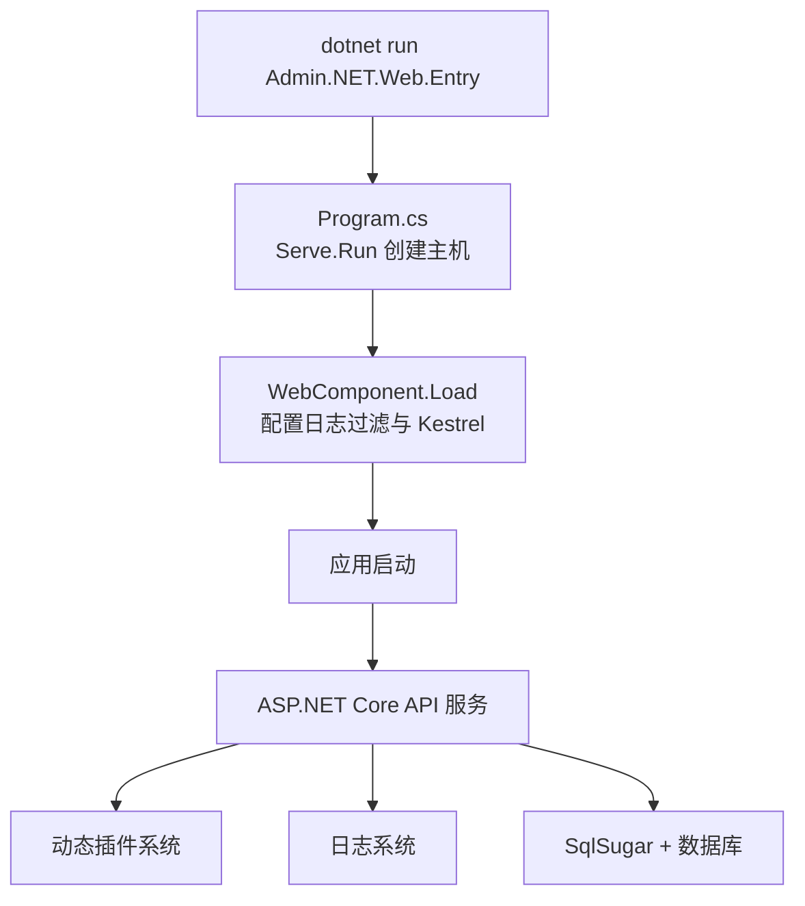
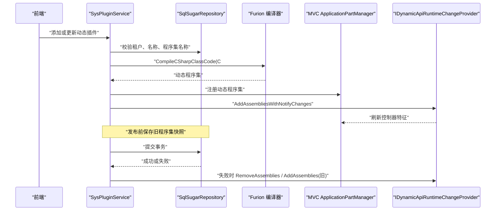
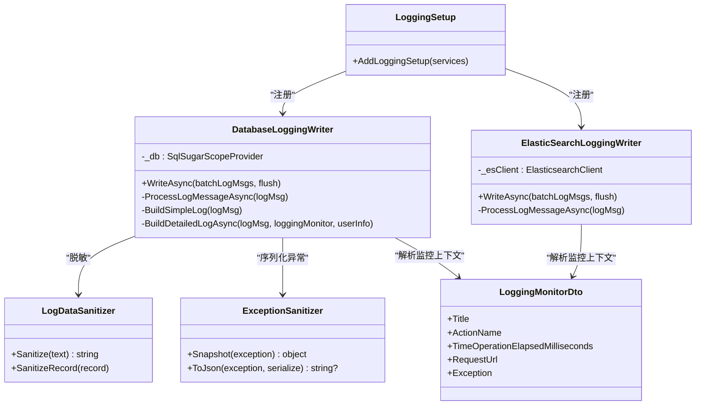
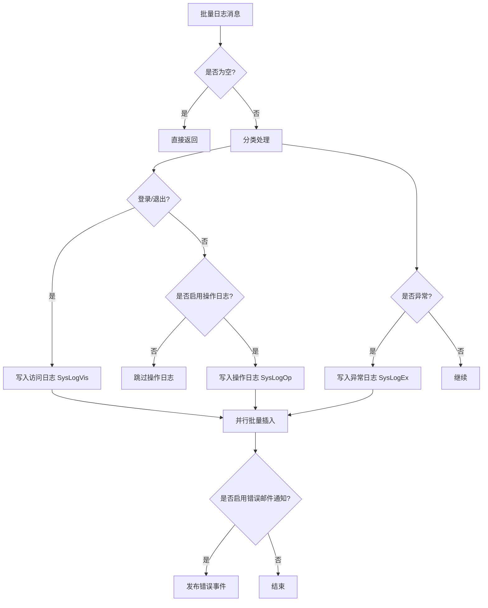
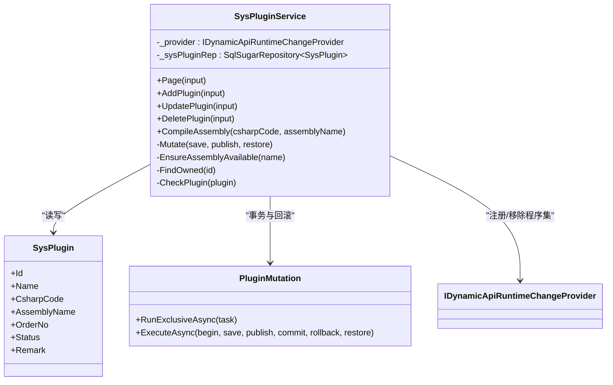
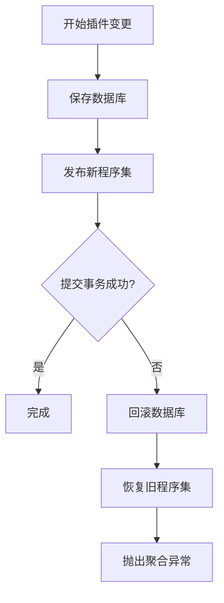
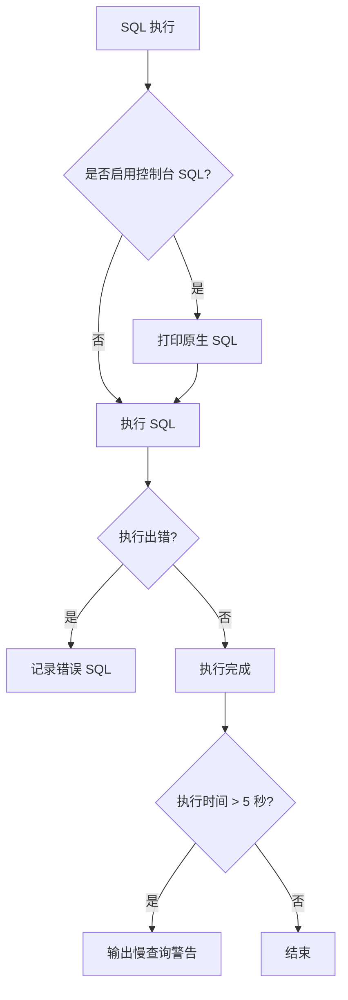
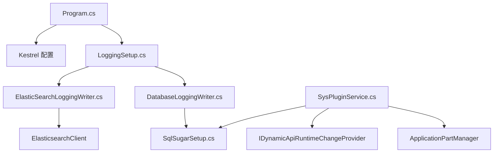
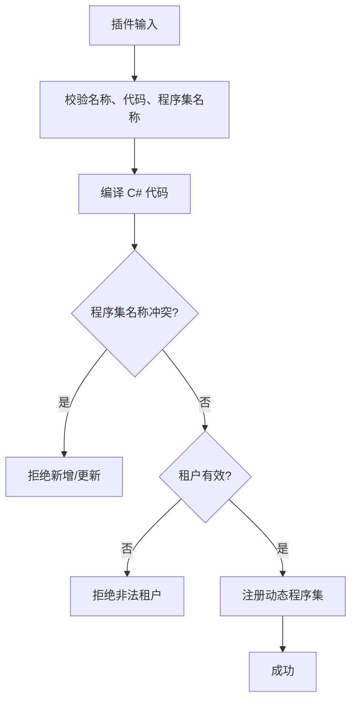

# 调试与问题排查

<cite>
**本文引用的文件列表**   
- [README.md](file://README.md)
- [Program.cs](file://Admin.NET/Admin.NET.Web.Entry/Program.cs)
- [appsettings.json](file://Admin.NET/Admin.NET.Web.Entry/appsettings.json)
- [SqlSugarSetup.cs](file://Admin.NET/Admin.NET.Core/SqlSugar/SqlSugarSetup.cs)
- [LoggingSetup.cs](file://Admin.NET/Admin.NET.Core/Logging/LoggingSetup.cs)
- [DatabaseLoggingWriter.cs](file://Admin.NET/Admin.NET.Core/Logging/DatabaseLoggingWriter.cs)
- [ElasticSearchLoggingWriter.cs](file://Admin.NET/Admin.NET.Core/Logging/ElasticSearchLoggingWriter.cs)
- [LogDataSanitizer.cs](file://Admin.NET/Admin.NET.Core/Logging/LogDataSanitizer.cs)
- [ExceptionSanitizer.cs](file://Admin.NET/Admin.NET.Core/Logging/ExceptionSanitizer.cs)
- [LoggingMonitorDto.cs](file://Admin.NET/Admin.NET.Core/Logging/LoggingMonitorDto.cs)
- [SysPluginService.cs](file://Admin.NET/Admin.NET.Core/Service/Plugin/SysPluginService.cs)
- [SysPlugin.cs](file://Admin.NET/Admin.NET.Core/Entity/SysPlugin.cs)
- [PluginRuntimeTests.cs](file://Admin.NET/Admin.NET.Test/Plugin/PluginRuntimeTests.cs)
- [PluginMutationTests.cs](file://Admin.NET/Admin.NET.Test/Plugin/PluginMutationTests.cs)
- [PluginContractTests.cs](file://Admin.NET/Admin.NET.Test/Plugin/PluginContractTests.cs)
</cite>

## 目录
1. [引言](#引言)
2. [项目结构与调试入口](#项目结构与调试入口)
3. [核心组件](#核心组件)
4. [架构总览](#架构总览)
5. [详细组件分析](#详细组件分析)
6. [依赖关系分析](#依赖关系分析)
7. [性能考虑](#性能考虑)
8. [故障排查手册](#故障排查手册)
9. [生产环境排查](#生产环境排查)
10. [结论](#结论)

## 引言
本指南面向 Admin.NET 插件开发与运行时的调试、日志记录、错误诊断和性能优化。当前仓库已完成前端移植，业务前端入口为 `Web/apps/web-antdv-next/`；后端 API 入口为 `Admin.NET/Admin.NET.Web.Entry/`。数据库集成验证要求使用隔离的真实 PostgreSQL，不能以 SQLite 或 Mock 结果代替真实联调。浏览器流程只要求桌面端验收；Vitest 逻辑测试、Playwright 浏览器验证与真实 API、数据库链路应分别理解。

## 项目结构与调试入口
后端启动入口位于 `Admin.NET/Admin.NET.Web.Entry/Program.cs`，通过 Furion 的 `Serve.Run` 创建 WebApplication 主机，并注册 `WebComponent`。该组件在 Windows 控制台运行时禁用事件日志写入，避免普通用户权限导致日志异常；同时设置全局日志过滤、Kestrel 超时和请求体大小限制。

**图表来源**  
- [Program.cs:1-38](file://Admin.NET/Admin.NET.Web.Entry/Program.cs#L1-L38)

**章节来源**  
- [README.md:1-144](file://README.md#L1-L144)
- [Program.cs:1-38](file://Admin.NET/Admin.NET.Web.Entry/Program.cs#L1-L38)

## 核心组件
- **API 入口与主机配置**：`Program.cs` 中的 `WebComponent` 控制 Windows 事件日志、日志级别过滤和 Kestrel 请求限制。
- **日志系统**：`LoggingSetup.cs` 注册监控日志、控制台日志、文件日志、Elasticsearch 日志和数据库日志；`DatabaseLoggingWriter.cs`、`ElasticSearchLoggingWriter.cs` 负责把监控日志持久化。
- **SQL 与数据库连接**：`SqlSugarSetup.cs` 初始化 SqlSugar、多租户连接、AOP SQL 打印、慢查询警告、数据审计等。
- **动态插件系统**：`SysPluginService.cs` 提供动态 C# 代码编译、程序集注册、运行时控制器替换和事务回滚保护；`SysPlugin.cs` 是动态插件实体。
- **安全与脱敏**：`LogDataSanitizer.cs` 对敏感字段进行脱敏，`ExceptionSanitizer.cs` 将异常对象投影为可安全序列化的快照。

**章节来源**  
- [LoggingSetup.cs:1-104](file://Admin.NET/Admin.NET.Core/Logging/LoggingSetup.cs#L1-L104)
- [DatabaseLoggingWriter.cs:1-200](file://Admin.NET/Admin.NET.Core/Logging/DatabaseLoggingWriter.cs#L1-L200)
- [ElasticSearchLoggingWriter.cs:1-129](file://Admin.NET/Admin.NET.Core/Logging/ElasticSearchLoggingWriter.cs#L1-L129)
- [SqlSugarSetup.cs:1-200](file://Admin.NET/Admin.NET.Core/SqlSugar/SqlSugarSetup.cs#L1-L200)
- [SysPluginService.cs:1-200](file://Admin.NET/Admin.NET.Core/Service/Plugin/SysPluginService.cs#L1-L200)
- [SysPlugin.cs:1-56](file://Admin.NET/Admin.NET.Core/Entity/SysPlugin.cs#L1-L56)
- [LogDataSanitizer.cs:1-98](file://Admin.NET/Admin.NET.Core/Logging/LogDataSanitizer.cs#L1-L98)
- [ExceptionSanitizer.cs:1-56](file://Admin.NET/Admin.NET.Core/Logging/ExceptionSanitizer.cs#L1-L56)

## 架构总览
下图展示插件开发到运行时的关键交互：前端调用 API，后端校验租户与权限，编译 C# 代码，注册动态控制器，并通过事务机制保证发布失败时恢复旧接口。

**图表来源**  
- [SysPluginService.cs:61-143](file://Admin.NET/Admin.NET.Core/Service/Plugin/SysPluginService.cs#L61-L143)
- [PluginRuntimeTests.cs:18-103](file://Admin.NET/Admin.NET.Test/Plugin/PluginRuntimeTests.cs#L18-L103)

## 详细组件分析

### 日志系统与运行时诊断
`LoggingSetup.AddLoggingSetup` 根据配置启用以下日志通道：
- 监控日志：通过 `AddMonitorLogging` 收集控制器执行上下文。
- 控制台日志：受 `Logging:Monitor:ConsoleLog` 控制。
- 文件日志：受 `Logging:File:Enabled` 控制，按日志级别分文件，支持 JSON 输出和写入失败回退文件名。
- Elasticsearch 日志：受 `Logging:ElasticSearch:Enabled` 控制，仅写入框架监控日志类别。
- 数据库日志：受 `Logging:Database:Enabled` 控制，写入操作日志、异常日志和访问日志。

**图表来源**  
- [LoggingSetup.cs:12-104](file://Admin.NET/Admin.NET.Core/Logging/LoggingSetup.cs#L12-L104)
- [DatabaseLoggingWriter.cs:12-200](file://Admin.NET/Admin.NET.Core/Logging/DatabaseLoggingWriter.cs#L12-L200)
- [ElasticSearchLoggingWriter.cs:12-129](file://Admin.NET/Admin.NET.Core/Logging/ElasticSearchLoggingWriter.cs#L12-L129)
- [LogDataSanitizer.cs:12-98](file://Admin.NET/Admin.NET.Core/Logging/LogDataSanitizer.cs#L12-L98)
- [ExceptionSanitizer.cs:12-56](file://Admin.NET/Admin.NET.Core/Logging/ExceptionSanitizer.cs#L12-L56)
- [LoggingMonitorDto.cs:12-200](file://Admin.NET/Admin.NET.Core/Logging/LoggingMonitorDto.cs#L12-L200)

#### 日志写入流程

**图表来源**  
- [DatabaseLoggingWriter.cs:40-120](file://Admin.NET/Admin.NET.Core/Logging/DatabaseLoggingWriter.cs#L40-L120)

**章节来源**  
- [LoggingSetup.cs:12-104](file://Admin.NET/Admin.NET.Core/Logging/LoggingSetup.cs#L12-L104)
- [DatabaseLoggingWriter.cs:40-200](file://Admin.NET/Admin.NET.Core/Logging/DatabaseLoggingWriter.cs#L40-L200)
- [ElasticSearchLoggingWriter.cs:40-129](file://Admin.NET/Admin.NET.Core/Logging/ElasticSearchLoggingWriter.cs#L40-L129)

### 动态插件系统
动态插件由 C# 源码编译成程序集，再注册到 MVC 的动态控制器中。`SysPluginService` 提供分页查询、新增、更新、删除和独立编译接口；所有变更都通过 `PluginMutation` 保证并发互斥和事务回滚。

**图表来源**  
- [SysPluginService.cs:12-200](file://Admin.NET/Admin.NET.Core/Service/Plugin/SysPluginService.cs#L12-L200)
- [SysPlugin.cs:12-56](file://Admin.NET/Admin.NET.Core/Entity/SysPlugin.cs#L12-L56)

#### 插件加载失败回滚流程

**图表来源**  
- [SysPluginService.cs:140-143](file://Admin.NET/Admin.NET.Core/Service/Plugin/SysPluginService.cs#L140-L143)
- [PluginMutationTests.cs:18-68](file://Admin.NET/Admin.NET.Test/Plugin/PluginMutationTests.cs#L18-L68)

**章节来源**  
- [SysPluginService.cs:12-200](file://Admin.NET/Admin.NET.Core/Service/Plugin/SysPluginService.cs#L12-L200)
- [PluginRuntimeTests.cs:18-103](file://Admin.NET/Admin.NET.Test/Plugin/PluginRuntimeTests.cs#L18-L103)
- [PluginMutationTests.cs:18-68](file://Admin.NET/Admin.NET.Test/Plugin/PluginMutationTests.cs#L18-L68)
- [PluginContractTests.cs:12-132](file://Admin.NET/Admin.NET.Test/Plugin/PluginContractTests.cs#L12-L132)

### SQL 日志与慢查询诊断
`SqlSugarSetup.SetDbAop` 根据 `DbConnection.EnableConsoleSql` 启用控制台 SQL 打印，并在执行错误时记录原始 SQL，在执行时间超过阈值时输出慢查询警告。

**图表来源**  
- [SqlSugarSetup.cs:140-200](file://Admin.NET/Admin.NET.Core/SqlSugar/SqlSugarSetup.cs#L140-L200)

**章节来源**  
- [SqlSugarSetup.cs:140-200](file://Admin.NET/Admin.NET.Core/SqlSugar/SqlSugarSetup.cs#L140-L200)

## 依赖关系分析
- `Program.cs` 依赖 Furion 主机和日志提供者，并控制 Windows 事件日志行为。
- `LoggingSetup.cs` 依赖配置、监控日志、文件日志、数据库日志和 Elasticsearch 客户端。
- `DatabaseLoggingWriter.cs` 依赖 SqlSugar 日志库连接、配置服务和事件总线。
- `ElasticSearchLoggingWriter.cs` 依赖 Elasticsearch 客户端和配置服务。
- `SysPluginService.cs` 依赖 Furion 动态 API 运行时变更提供者、MVC 程序集管理器和 SqlSugar 仓储。
- `SqlSugarSetup.cs` 依赖多租户、Snowflake ID、外部服务装配和数据库 AOP。

**图表来源**  
- [Program.cs:1-38](file://Admin.NET/Admin.NET.Web.Entry/Program.cs#L1-L38)
- [LoggingSetup.cs:12-104](file://Admin.NET/Admin.NET.Core/Logging/LoggingSetup.cs#L12-L104)
- [DatabaseLoggingWriter.cs:12-200](file://Admin.NET/Admin.NET.Core/Logging/DatabaseLoggingWriter.cs#L12-L200)
- [ElasticSearchLoggingWriter.cs:12-129](file://Admin.NET/Admin.NET.Core/Logging/ElasticSearchLoggingWriter.cs#L12-L129)
- [SysPluginService.cs:12-200](file://Admin.NET/Admin.NET.Core/Service/Plugin/SysPluginService.cs#L12-L200)
- [SqlSugarSetup.cs:140-200](file://Admin.NET/Admin.NET.Core/SqlSugar/SqlSugarSetup.cs#L140-L200)

**章节来源**  
- [Program.cs:1-38](file://Admin.NET/Admin.NET.Web.Entry/Program.cs#L1-L38)
- [LoggingSetup.cs:12-104](file://Admin.NET/Admin.NET.Core/Logging/LoggingSetup.cs#L12-L104)
- [SysPluginService.cs:12-200](file://Admin.NET/Admin.NET.Core/Service/Plugin/SysPluginService.cs#L12-L200)
- [SqlSugarSetup.cs:140-200](file://Admin.NET/Admin.NET.Core/SqlSugar/SqlSugarSetup.cs#L140-L200)

## 性能考虑
- **SQL 性能**：启用控制台 SQL 打印后，关注慢查询警告（超过 5 秒）。可通过检查 SQL 语句、索引和执行计划定位瓶颈。
- **日志 I/O 压力**：文件日志按级别分文件，JSON 模式适合集中采集；数据库日志会批量写入操作、异常和访问日志，注意数据库写入延迟和锁竞争。
- **插件热更新**：动态程序集注册和移除会触发 MVC 控制器特征刷新，应避免高频发布；现有实现通过 `PluginMutation` 保证并发互斥和回滚。
- **内存与对象生命周期**：`DatabaseLoggingWriter` 通过作用域工厂获取依赖；`ElasticSearchLoggingWriter` 显式释放作用域；动态编译的程序集会释放句柄但 MVC 仍持有已发布类型，测试验证了发布后仍可调用。

[本节为通用性能建议，不直接分析具体代码片段]

## 故障排查手册

### 开发环境调试技巧
- **断点调试**：在后端入口 `Program.cs` 和控制器方法处设置断点，结合 Visual Studio 或 VS Code 调试 ASP.NET Core 应用。
- **日志输出**：
  - 控制台日志受 `Logging:Monitor:ConsoleLog` 控制。
  - 文件日志受 `Logging:File:Enabled` 控制，默认开启，按信息、警告、错误级别分文件。
  - Elasticsearch 日志受 `Logging:ElasticSearch:Enabled` 控制，仅写入框架监控日志类别。
  - 数据库日志受 `Logging:Database:Enabled` 控制，写入操作、异常和访问日志。
- **SQL 日志**：通过 `DbConnection.EnableConsoleSql` 启用控制台 SQL 打印，查看原始 SQL、参数和执行错误。
- **性能分析**：关注慢查询警告、接口耗时字段 `TimeOperationElapsedMilliseconds`、线程 ID 和 TraceId。

**章节来源**  
- [Program.cs:16-38](file://Admin.NET/Admin.NET.Web.Entry/Program.cs#L16-L38)
- [LoggingSetup.cs:24-104](file://Admin.NET/Admin.NET.Core/Logging/LoggingSetup.cs#L24-L104)
- [SqlSugarSetup.cs:140-200](file://Admin.NET/Admin.NET.Core/SqlSugar/SqlSugarSetup.cs#L140-L200)
- [LoggingMonitorDto.cs:12-200](file://Admin.NET/Admin.NET.Core/Logging/LoggingMonitorDto.cs#L12-L200)

### 插件加载失败的常见原因与解决
- **依赖缺失**：动态 C# 代码引用未加载的类型或程序集会编译失败。应在编译阶段捕获异常，检查命名空间和依赖项。
- **版本冲突**：动态程序集与宿主进程中的类型版本不一致会导致运行时解析失败。确保插件使用的第三方库版本与宿主一致。
- **路径或程序集名称冲突**：`SysPluginService.EnsureAssemblyAvailable` 禁止与现有程序集名称重复；新增或更新插件时会检查是否存在同名程序集。
- **租户权限不足**：插件实体包含租户字段，非超级管理员只能访问所属租户；`PluginContracts.RequireAccessible` 会拒绝跨租户访问。
- **编译参数无效**：输入为空或程序集名称长度超限会被拒绝。

**图表来源**  
- [SysPluginService.cs:61-143](file://Admin.NET/Admin.NET.Core/Service/Plugin/SysPluginService.cs#L61-L143)
- [PluginContractTests.cs:48-100](file://Admin.NET/Admin.NET.Test/Plugin/PluginContractTests.cs#L48-L100)

**章节来源**  
- [SysPluginService.cs:61-143](file://Admin.NET/Admin.NET.Core/Service/Plugin/SysPluginService.cs#L61-L143)
- [PluginContractTests.cs:48-100](file://Admin.NET/Admin.NET.Test/Plugin/PluginContractTests.cs#L48-L100)

### 运行时错误诊断
- **异常堆栈分析**：`ExceptionSanitizer.ToJson` 将异常对象转换为可安全序列化的快照，避免直接序列化反射成员失败；日志入库前再由 `LogDataSanitizer` 脱敏。
- **敏感数据保护**：`LogDataSanitizer` 对密码、令牌、密钥、Cookie、连接字符串等字段进行脱敏，防止日志泄露。
- **数据库写入异常**：`DatabaseLoggingWriter.WriteAsync` 对单条日志处理异常进行捕获并记录，随后并行批量插入；若错误邮件通知启用，会通过事件总线发送异常集合。
- **Elasticsearch 写入异常**：`ElasticSearchLoggingWriter` 批量索引日志，需检查 ES 客户端连接、索引映射和操作日志开关。

**章节来源**  
- [ExceptionSanitizer.cs:12-56](file://Admin.NET/Admin.NET.Core/Logging/ExceptionSanitizer.cs#L12-L56)
- [LogDataSanitizer.cs:12-98](file://Admin.NET/Admin.NET.Core/Logging/LogDataSanitizer.cs#L12-L98)
- [DatabaseLoggingWriter.cs:60-120](file://Admin.NET/Admin.NET.Core/Logging/DatabaseLoggingWriter.cs#L60-L120)
- [ElasticSearchLoggingWriter.cs:40-129](file://Admin.NET/Admin.NET.Core/Logging/ElasticSearchLoggingWriter.cs#L40-L129)

### 常见问题手册
- **端口占用**：Kestrel 默认监听地址可能与其他进程冲突。检查操作系统端口占用情况，调整启动地址或使用不同端口。
- **数据库连接失败**：确认 `DbConnection` 配置正确，PostgreSQL 服务可达、用户名密码正确、防火墙允许连接；启用控制台 SQL 后可看到连接失败时的 SQL 错误日志。
- **配置文件错误**：`appsettings.json` 中的 `ConfigurationScanDirectories` 控制配置扫描目录；确保配置文件路径存在且可读取。
- **Windows 事件日志权限**：控制台运行时禁用事件日志提供者，避免普通用户权限写入失败；以服务形式运行时才启用事件日志。

**章节来源**  
- [Program.cs:16-38](file://Admin.NET/Admin.NET.Web.Entry/Program.cs#L16-L38)
- [appsettings.json:1-5](file://Admin.NET/Admin.NET.Web.Entry/appsettings.json#L1-L5)
- [SqlSugarSetup.cs:140-200](file://Admin.NET/Admin.NET.Core/SqlSugar/SqlSugarSetup.cs#L140-L200)

### 生产环境排查
- **远程调试**：部署后优先使用结构化日志和集中日志系统；若必须远程调试，需在容器或虚拟机中开放调试端口并限制访问来源。
- **日志收集与分析**：
  - 文件日志适合本地归档。
  - Elasticsearch 日志适合集中检索和可视化分析。
  - 数据库日志可用于在线查看操作、异常和访问日志。
- **性能瓶颈定位**：
  - 通过 `TimeOperationElapsedMilliseconds` 定位慢接口。
  - 通过 SQL 慢查询警告定位数据库瓶颈。
  - 通过线程 ID 和 TraceId 关联分布式请求链路。
- **内存泄漏检测**：关注动态程序集的生命周期；测试已验证编译句柄释放后 MVC 仍可调用已发布控制器，但频繁发布仍可能增加 GC 压力。

[本节为通用生产排查建议，不直接分析具体代码片段]

## 结论
Admin.NET 的调试与问题排查能力围绕四个关键点展开：清晰的 API 入口配置、完善的日志体系、安全的动态插件机制以及健壮的 SQL 与数据库集成。开发时应优先使用控制台 SQL、文件日志和监控 DTO；运行时应关注异常脱敏、慢查询和插件回滚；生产环境应依赖集中日志系统和性能指标进行长期运维。

[本节为总结性内容，不直接分析具体代码片段]