# 数据访问与 ORM 模式

<cite>
**本文引用的文件**   
- [SqlSugarSetup.cs](file://Admin.NET/Admin.NET.Core/SqlSugar/SqlSugarSetup.cs)
- [DbConnectionOptions.cs](file://Admin.NET/Admin.NET.Core/Option/DbConnectionOptions.cs)
- [SqlSugarFilter.cs](file://Admin.NET/Admin.NET.Core/SqlSugar/SqlSugarFilter.cs)
- [SqlSugarCache.cs](file://Admin.NET/Admin.NET.Core/Cache/SqlSugarCache.cs)
- [BaseService.cs](file://Admin.NET/Admin.NET.Core/Service/BaseService.cs)
- [RepositoryExtension.cs](file://Admin.NET/Admin.NET.Core/Extension/RepositoryExtension.cs)
- [SysProcService.cs](file://Admin.NET/Admin.NET.Core/Service/Common/SysProcService.cs)
</cite>

## 目录
1. [引言](#引言)
2. [项目结构](#项目结构)
3. [核心组件](#核心组件)
4. [架构总览](#架构总览)
5. [详细组件分析](#详细组件分析)
6. [依赖关系分析](#依赖关系分析)
7. [性能优化建议](#性能优化建议)
8. [故障排查指南](#故障排查指南)
9. [结论](#结论)
10. [附录](#附录)

## 引言
本技术文档聚焦 Admin.NET 后端的数据访问与 ORM 模式，围绕基于 SqlSugar 的多数据库连接管理、实体过滤器与租户隔离、二级缓存、通用服务基类、复杂查询与存储过程调用、数据库迁移与种子数据，以及安全审计和性能优化进行系统化说明。目标是帮助开发者理解现有实现、扩展业务逻辑并避免常见陷阱。

## 项目结构
当前仓库采用多工程结构：
- 核心领域与基础设施位于 `Admin.NET/Admin.NET.Core`。
- Web 应用入口位于 `Admin.NET/Admin.NET.Web.Entry`。
- 前端业务入口位于 `Web/apps/web-antdv-next`。
- 数据访问与 ORM 相关代码集中在 `Admin.NET/Admin.NET.Core` 的 `SqlSugar`、`Option`、`Cache`、`Extension`、`Service` 与 `SeedData` 等子目录中。

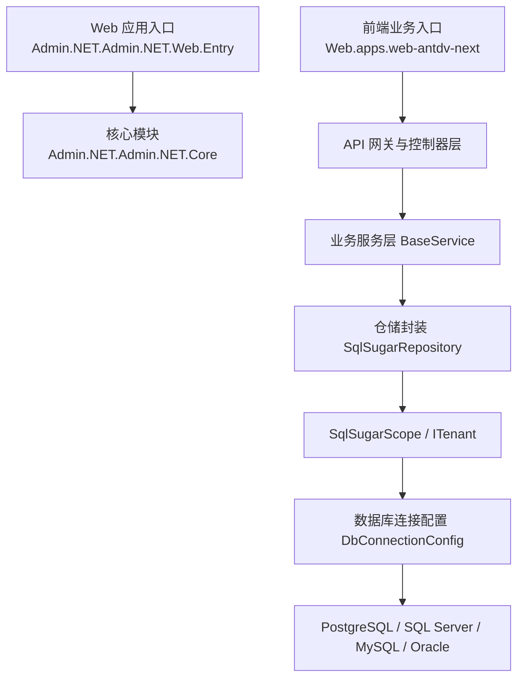

**图表来源**
- [SqlSugarSetup.cs:31-71](file://Admin.NET/Admin.NET.Core/SqlSugar/SqlSugarSetup.cs#L31-L71)
- [DbConnectionOptions.cs:27-44](file://Admin.NET/Admin.NET.Core/Option/DbConnectionOptions.cs#L27-L44)

**章节来源**
- [SqlSugarSetup.cs:31-71](file://Admin.NET/Admin.NET.Core/SqlSugar/SqlSugarSetup.cs#L31-L71)
- [DbConnectionOptions.cs:27-44](file://Admin.NET/Admin.NET.Core/Option/DbConnectionOptions.cs#L27-L44)

## 核心组件
- SqlSugar 初始化与多库管理：通过 `SqlSugarSetup.AddSqlSugar` 读取 `DbConnectionOptions`，构造 `SqlSugarScope` 并注册到 DI，同时为每个连接配置 AOP、差异日志、表结构与视图初始化、种子数据加载。
- 多数据库连接配置：`DbConnectionConfig` 继承 SqlSugar 的 `ConnectionConfig`，扩展数据库名称、表设置、种子设置、隔离方式与存储目录等；支持连接串加密、下划线映射、金仓转 PG 模型、Oracle 参数长度限制。
- 实体过滤与数据权限：`SqlSugarFilter` 提供用户机构过滤、仅本人数据过滤、自定义实体过滤器扫描与注册，结合缓存降低权限计算开销。
- 二级缓存：`SqlSugarCache` 将 SqlSugar 的 DataInfoCache 委托给系统缓存服务，统一以固定前缀命名键并提供增删改查与批量获取。
- 通用数据服务：`BaseService<TEntity>` 暴露获取详情、列表、新增、更新、删除等通用方法，底层委托 `SqlSugarRepository<TEntity>`。
- 仓储扩展：`RepositoryExtension` 提供假删除、排序构建、差异日志更新、批量操作等能力。
- 存储过程服务：`SysProcService` 封装跨租户存储过程执行与结果导出。

**章节来源**
- [SqlSugarSetup.cs:31-71](file://Admin.NET/Admin.NET.Core/SqlSugar/SqlSugarSetup.cs#L31-L71)
- [DbConnectionOptions.cs:27-44](file://Admin.NET/Admin.NET.Core/Option/DbConnectionOptions.cs#L27-L44)
- [SqlSugarFilter.cs:20-198](file://Admin.NET/Admin.NET.Core/SqlSugar/SqlSugarFilter.cs#L20-L198)
- [SqlSugarCache.cs:16-55](file://Admin.NET/Admin.NET.Core/Cache/SqlSugarCache.cs#L16-L55)
- [BaseService.cs:12-89](file://Admin.NET/Admin.NET.Core/Service/BaseService.cs#L12-L89)
- [RepositoryExtension.cs:11-200](file://Admin.NET/Admin.NET.Core/Extension/RepositoryExtension.cs#L11-L200)
- [SysProcService.cs:12-82](file://Admin.NET/Admin.NET.Core/Service/Common/SysProcService.cs#L12-L82)

## 架构总览
下图展示从 API 到数据库的整体调用链路，包括过滤器、AOP、缓存与事务工作单元。

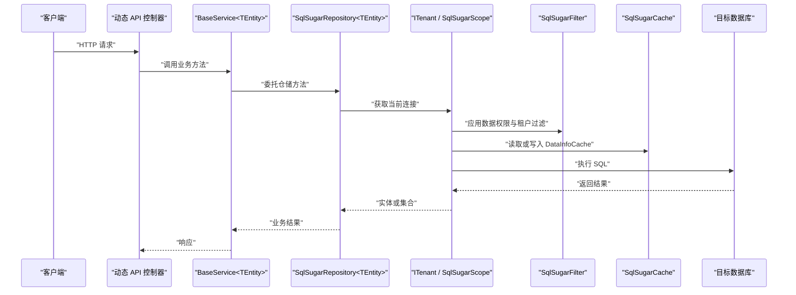

**图表来源**
- [SqlSugarSetup.cs:31-71](file://Admin.NET/Admin.NET.Core/SqlSugar/SqlSugarSetup.cs#L31-L71)
- [SqlSugarFilter.cs:20-198](file://Admin.NET/Admin.NET.Core/SqlSugar/SqlSugarFilter.cs#L20-L198)
- [SqlSugarCache.cs:16-55](file://Admin.NET/Admin.NET.Core/Cache/SqlSugarCache.cs#L16-L55)
- [BaseService.cs:12-89](file://Admin.NET/Admin.NET.Core/Service/BaseService.cs#L12-L89)

## 详细组件分析

### SqlSugar 初始化与多数据库连接管理
`SqlSugarSetup.AddSqlSugar` 是数据访问层的核心启动点，主要职责包括：
- 注入雪花 ID 生成器与动态表达式解析器。
- 读取 `DbConnectionOptions.ConnectionConfigs`，对每个配置调用 `SetDbConfig`。
- 创建 `SqlSugarScope`，为每个连接注册 AOP、差异日志，并在启动时初始化数据库、表、视图与种子数据。
- 向 DI 容器注册 `ISqlSugarClient`（单例）与 `SqlSugarRepository<T>`（作用域）。

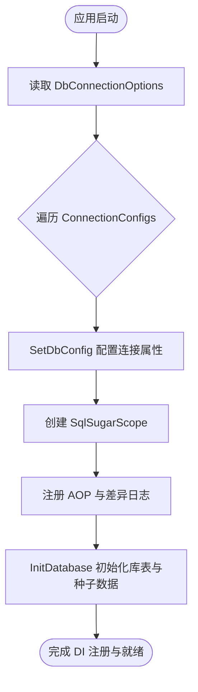

**图表来源**
- [SqlSugarSetup.cs:31-71](file://Admin.NET/Admin.NET.Core/SqlSugar/SqlSugarSetup.cs#L31-L71)
- [SqlSugarSetup.cs:78-127](file://Admin.NET/Admin.NET.Core/SqlSugar/SqlSugarSetup.cs#L78-L127)
- [SqlSugarSetup.cs:432-458](file://Admin.NET/Admin.NET.Core/SqlSugar/SqlSugarSetup.cs#L432-L458)

关键行为说明：
- 连接串加密：当 `DbSettings.EnableConnStringEncrypt` 为真时，使用 `CryptogramUtil.Decrypt` 解密后再建立连接。
- 表名与列名映射：启用 `EnableUnderLine` 后自动驼峰转下划线；支持模块前缀 `TableModuleAttribute.Prefix`。
- 特殊数据库兼容：人大金仓默认使用 PostgreSQL 模型；Oracle 限制主键与参数最大长度为 30。
- 自动缓存策略：开启 `IsAutoRemoveDataCache`、`IsAutoDeleteQueryFilter`、`IsAutoUpdateQueryFilter`，在增删改后自动清理 SqlSugar 内部缓存并更新查询过滤器。

**章节来源**
- [SqlSugarSetup.cs:31-71](file://Admin.NET/Admin.NET.Core/SqlSugar/SqlSugarSetup.cs#L31-L71)
- [SqlSugarSetup.cs:78-127](file://Admin.NET/Admin.NET.Core/SqlSugar/SqlSugarSetup.cs#L78-L127)

### 多数据库支持与连接字符串配置
`DbConnectionOptions` 承载全局数据库选项与连接集合：
- `EnableConsoleSql`：是否打印控制台 SQL。
- `SuperAdminIgnoreIDeletedFilter`：超级管理员是否忽略逻辑删除过滤。
- `ConnectionConfigs`：每个连接对应一个 `DbConnectionConfig`，可区分数据库别名、类型、隔离策略、存储目录等。
- `DbSettings`：控制是否初始化库、视图、差异日志、下划线映射与连接串加密。
- `TableSettings`：控制表初始化与增量表同步。
- `SeedSettings`：控制种子数据初始化与增量更新。

支持的数据库类型由 SqlSugar 的 `DbType` 决定，本项目显式处理了以下数据库场景：
- PostgreSQL：人大金仓 `Kdbndp` 默认使用 PostgreSQL 模型。
- SQL Server：开启 `SqlServerCodeFirstNvarchar`。
- MySQL：通过 `DbType.MySql` 配置。
- Oracle：限制主键与参数最大长度，并跳过某些 `CreateDatabase` 行为。

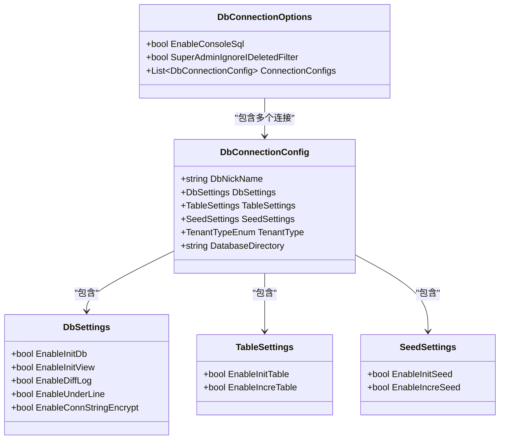

**图表来源**
- [DbConnectionOptions.cs:27-44](file://Admin.NET/Admin.NET.Core/Option/DbConnectionOptions.cs#L27-L44)
- [DbConnectionOptions.cs:47-136](file://Admin.NET/Admin.NET.Core/Option/DbConnectionOptions.cs#L47-L136)

**章节来源**
- [DbConnectionOptions.cs:27-44](file://Admin.NET/Admin.NET.Core/Option/DbConnectionOptions.cs#L27-L44)
- [DbConnectionOptions.cs:47-136](file://Admin.NET/Admin.NET.Core/Option/DbConnectionOptions.cs#L47-L136)
- [SqlSugarSetup.cs:120-127](file://Admin.NET/Admin.NET.Core/SqlSugar/SqlSugarSetup.cs#L120-L127)

### IEntityFilter 接口与数据权限过滤机制
`IEntityFilter` 是一个用于声明自定义实体过滤器的接口，配合 `SqlSugarFilter.SetCustomEntityFilter` 完成运行时扫描与注册：
- 扫描所有实现 `IEntityFilter` 的类型。
- 调用其 `AddEntityFilter` 方法，得到 `IEnumerable<TableFilterItem<object>>`。
- 根据实体上的 `TenantAttribute.configId` 判断是否属于当前连接，过滤非目标数据库实体。
- 将有效过滤器加入 `db.QueryFilter`，并缓存到内存中以减少重复反射与构造成本。

此外，`SqlSugarFilter` 还提供两类内置过滤：
- 用户机构过滤：根据用户所属组织过滤实现 `IOrgIdFilter` 的实体。
- 仅本人数据过滤：根据角色数据范围 `DataScopeEnum.Self`，对实现 `EntityBaseOrg` 或 `EntityBaseOrgDel` 的实体追加条件。

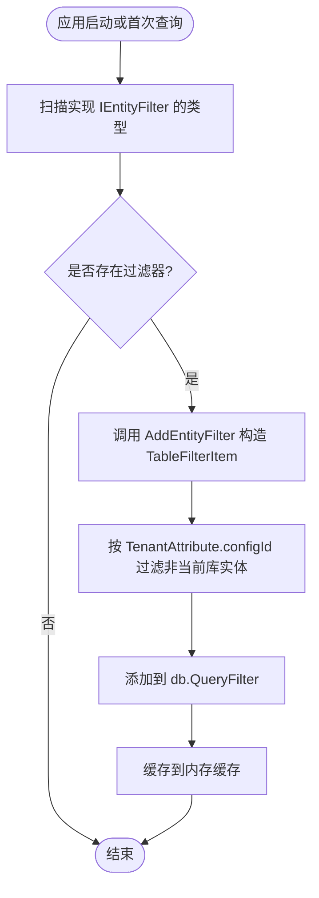

**图表来源**
- [SqlSugarFilter.cs:140-198](file://Admin.NET/Admin.NET.Core/SqlSugar/SqlSugarFilter.cs#L140-L198)

**章节来源**
- [SqlSugarFilter.cs:20-198](file://Admin.NET/Admin.NET.Core/SqlSugar/SqlSugarFilter.cs#L20-L198)

### 缓存策略：SqlSugarCache 的工作原理与失效机制
`SqlSugarCache` 实现 `ICacheService`，作为 SqlSugar 的 `DataInfoCacheService`，负责实体元信息缓存：
- 所有键以 `CacheConst.SqlSugar` 为前缀，避免与其他缓存冲突。
- 提供 `Add`、`Get`、`ContainsKey`、`GetOrCreate`、`Remove`、`GetAllKey` 等方法。
- 底层委托 `SysCacheService`，使用统一的分布式或进程内缓存实现。

SqlSugar 的自动缓存失效由 `MoreSettings.IsAutoRemoveDataCache = true` 触发，在增删改操作后自动调用 `RemoveDataCache`，从而保证元信息与数据库结构变更一致。

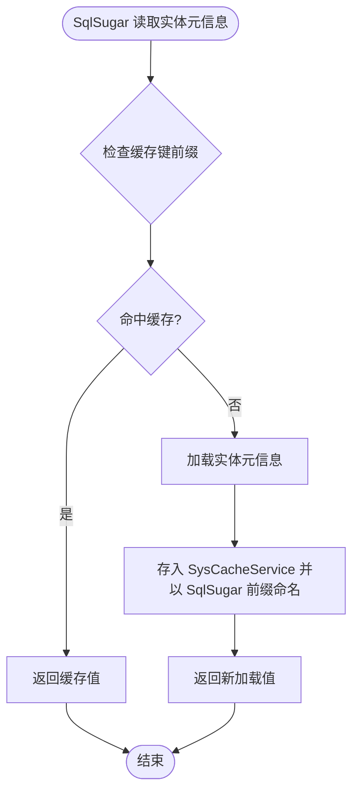

**图表来源**
- [SqlSugarCache.cs:16-55](file://Admin.NET/Admin.NET.Core/Cache/SqlSugarCache.cs#L16-L55)
- [SqlSugarSetup.cs:112-118](file://Admin.NET/Admin.NET.Core/SqlSugar/SqlSugarSetup.cs#L112-L118)

**章节来源**
- [SqlSugarCache.cs:16-55](file://Admin.NET/Admin.NET.Core/Cache/SqlSugarCache.cs#L16-L55)
- [SqlSugarSetup.cs:112-118](file://Admin.NET/Admin.NET.Core/SqlSugar/SqlSugarSetup.cs#L112-L118)

### BaseService 基类的通用数据操作方法
`BaseService<TEntity>` 是面向实体的通用服务基类，封装常见的 CRUD 操作：
- `GetDetail(id)`：按主键获取详情。
- `GetList()`：获取全部实体集合。
- `Add(entity)`：插入实体。
- `Update(entity)`：忽略空列更新实体。
- `Delete(id)`：按主键删除。

这些方法直接委托 `SqlSugarRepository<TEntity>`，而仓储封装底层 `ISqlSugarClient` 与 `ISugarRepository`。对于更复杂的业务逻辑，应扩展 `BaseService` 或在其之上编写专用服务类。

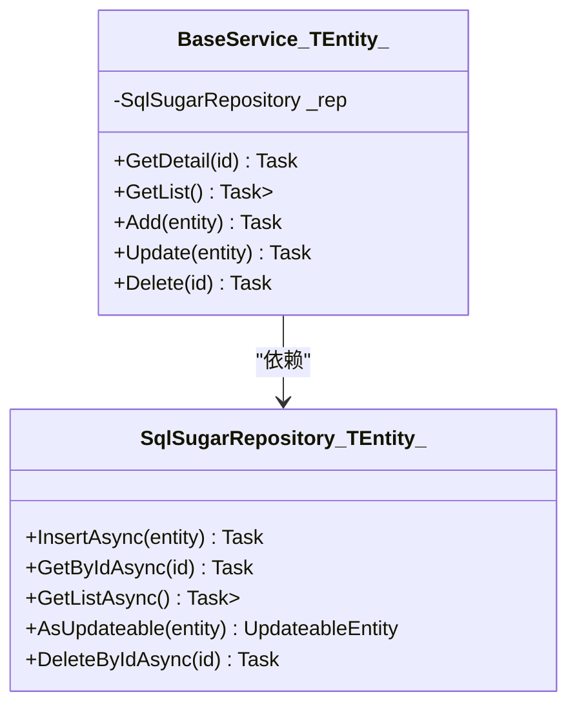

**图表来源**
- [BaseService.cs:12-89](file://Admin.NET/Admin.NET.Core/Service/BaseService.cs#L12-L89)

**章节来源**
- [BaseService.cs:12-89](file://Admin.NET/Admin.NET.Core/Service/BaseService.cs#L12-L89)

### 复杂查询、联表查询与存储过程调用最佳实践
- 复杂查询与排序：推荐使用 `RepositoryExtension.OrderBuilder` 将分页输入转换为安全的排序表达式，避免 SQL 注入。
- 联表查询：可通过 `ISqlSugarClient.AsTenant().GetConnectionScope(configId)` 获取指定租户的连接，再使用 SqlSugar 的 `Queryable` 进行联表。
- 存储过程调用：`SysProcService` 提供了标准封装，使用 `UseStoredProcedure().GetDataTableAsync` 或 `GetDataSetAllAsync`，支持 Oracle、达梦等数据库的参数顺序注意事项。

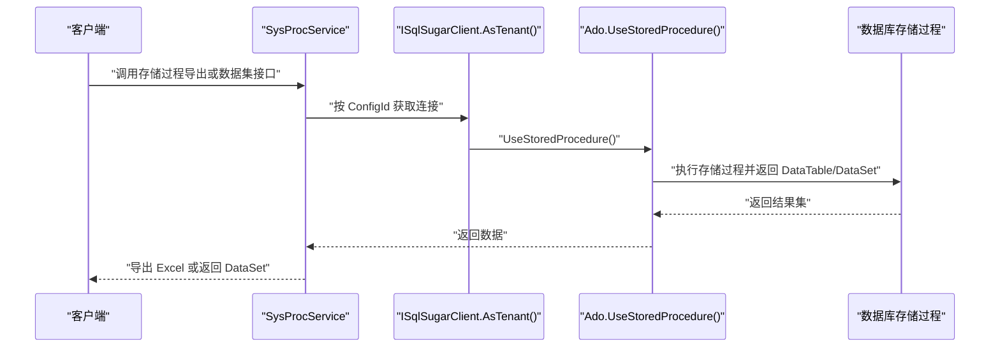

**图表来源**
- [SysProcService.cs:12-82](file://Admin.NET/Admin.NET.Core/Service/Common/SysProcService.cs#L12-L82)

**章节来源**
- [RepositoryExtension.cs:120-140](file://Admin.NET/Admin.NET.Core/Extension/RepositoryExtension.cs#L120-L140)
- [SysProcService.cs:12-82](file://Admin.NET/Admin.NET.Core/Service/Common/SysProcService.cs#L12-L82)

### 数据库迁移、种子数据与版本管理
- 数据库初始化：`InitDatabase` 支持按需创建数据库、等待连接就绪、初始化表、初始化视图与种子数据。
- 表结构同步：`InitializeTables` 会先删除视图以避免同步冲突，然后并行初始化实体表；支持分表实体 `SplitTableAttribute`。
- 字段可空修正：`UpdateNullableColumns` 将数据库中不在实体中的列设置为可空，提升兼容性。
- 视图初始化：`InitView` 扫描实现 `ISqlSugarView` 的实体，动态生成并执行 `CREATE VIEW`。
- 种子数据：`InitSeedData` 扫描实现 `ISqlSugarEntitySeedData<T>` 的类型，支持增量更新、ID 调整、忽略更新特性 `IgnoreUpdateSeedAttribute`。

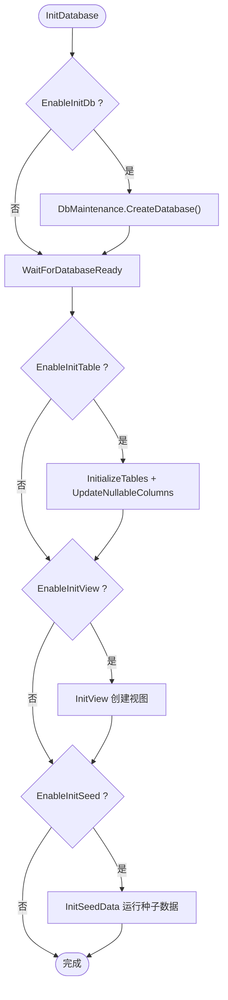

**图表来源**
- [SqlSugarSetup.cs:432-458](file://Admin.NET/Admin.NET.Core/SqlSugar/SqlSugarSetup.cs#L432-L458)
- [SqlSugarSetup.cs:460-575](file://Admin.NET/Admin.NET.Core/SqlSugar/SqlSugarSetup.cs#L460-L575)
- [SqlSugarSetup.cs:575-640](file://Admin.NET/Admin.NET.Core/SqlSugar/SqlSugarSetup.cs#L575-L640)

**章节来源**
- [SqlSugarSetup.cs:432-458](file://Admin.NET/Admin.NET.Core/SqlSugar/SqlSugarSetup.cs#L432-L458)
- [SqlSugarSetup.cs:460-575](file://Admin.NET/Admin.NET.Core/SqlSugar/SqlSugarSetup.cs#L460-L575)
- [SqlSugarSetup.cs:575-640](file://Admin.NET/Admin.NET.Core/SqlSugar/SqlSugarSetup.cs#L575-L640)

### 数据安全与审计日志
- 数据审计：`SetDbAop.DataExecuting` 在新增与更新时自动填充租户、创建者、更新者、时间等字段；若正在处理种子数据则跳过审计。
- 差异日志：`SetDbDiffLog` 订阅 `OnDiffLogEvent`，记录字段级变更，并对敏感字段进行脱敏，持久化到 `SysLogDiff`。
- SQL 错误与慢查询：`OnError` 记录失败 SQL，`OnLogExecuted` 记录超过阈值的慢 SQL，便于性能分析与排障。
- 逻辑删除与审计：`RepositoryExtension.FakeDelete` 将逻辑删除字段设为真，并启用差异日志事件。

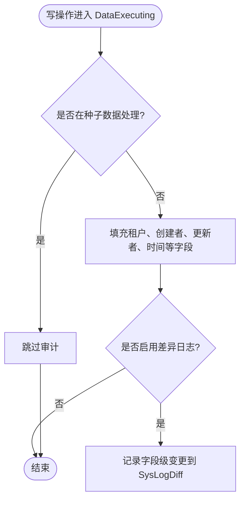

**图表来源**
- [SqlSugarSetup.cs:191-274](file://Admin.NET/Admin.NET.Core/SqlSugar/SqlSugarSetup.cs#L191-L274)
- [SqlSugarSetup.cs:306-364](file://Admin.NET/Admin.NET.Core/SqlSugar/SqlSugarSetup.cs#L306-L364)
- [RepositoryExtension.cs:11-70](file://Admin.NET/Admin.NET.Core/Extension/RepositoryExtension.cs#L11-L70)

**章节来源**
- [SqlSugarSetup.cs:191-274](file://Admin.NET/Admin.NET.Core/SqlSugar/SqlSugarSetup.cs#L191-L274)
- [SqlSugarSetup.cs:306-364](file://Admin.NET/Admin.NET.Core/SqlSugar/SqlSugarSetup.cs#L306-L364)
- [RepositoryExtension.cs:11-70](file://Admin.NET/Admin.NET.Core/Extension/RepositoryExtension.cs#L11-L70)

## 依赖关系分析
数据访问层的主要依赖如下：
- `SqlSugarSetup` 依赖 `DbConnectionOptions`、`App`、`YitIdHelper`、`StaticConfig`、`InstanceFactory`、`DynamicExpressionParser`。
- `SqlSugarFilter` 依赖 `SysOrgService`、`SysCacheService`、`Scoped`、`App.EffectiveTypes`。
- `SqlSugarCache` 依赖 `SysCacheService` 与 `CacheConst`。
- `BaseService<TEntity>` 依赖 `SqlSugarRepository<TEntity>`。
- `RepositoryExtension` 依赖 `MapsterMapper`、`InstanceFactory`、`Regex`。
- `SysProcService` 依赖 `ISqlSugarClient`、`ExcelExporter`。

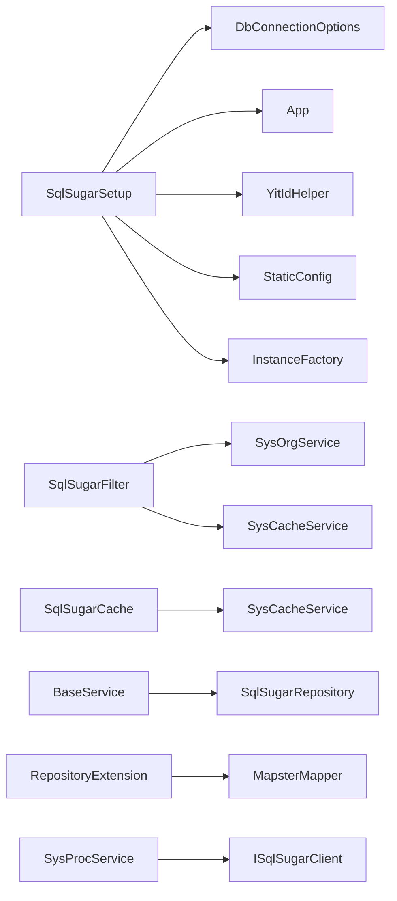

**图表来源**
- [SqlSugarSetup.cs:31-71](file://Admin.NET/Admin.NET.Core/SqlSugar/SqlSugarSetup.cs#L31-L71)
- [SqlSugarFilter.cs:20-198](file://Admin.NET/Admin.NET.Core/SqlSugar/SqlSugarFilter.cs#L20-L198)
- [SqlSugarCache.cs:16-55](file://Admin.NET/Admin.NET.Core/Cache/SqlSugarCache.cs#L16-L55)
- [BaseService.cs:12-89](file://Admin.NET/Admin.NET.Core/Service/BaseService.cs#L12-L89)
- [RepositoryExtension.cs:11-140](file://Admin.NET/Admin.NET.Core/Extension/RepositoryExtension.cs#L11-L140)
- [SysProcService.cs:12-82](file://Admin.NET/Admin.NET.Core/Service/Common/SysProcService.cs#L12-L82)

**章节来源**
- [SqlSugarSetup.cs:31-71](file://Admin.NET/Admin.NET.Core/SqlSugar/SqlSugarSetup.cs#L31-L71)
- [SqlSugarFilter.cs:20-198](file://Admin.NET/Admin.NET.Core/SqlSugar/SqlSugarFilter.cs#L20-L198)
- [SqlSugarCache.cs:16-55](file://Admin.NET/Admin.NET.Core/Cache/SqlSugarCache.cs#L16-L55)
- [BaseService.cs:12-89](file://Admin.NET/Admin.NET.Core/Service/BaseService.cs#L12-L89)
- [RepositoryExtension.cs:11-140](file://Admin.NET/Admin.NET.Core/Extension/RepositoryExtension.cs#L11-L140)
- [SysProcService.cs:12-82](file://Admin.NET/Admin.NET.Core/Service/Common/SysProcService.cs#L12-L82)

## 性能优化建议
- 查询优化
  - 使用 `OrderBuilder` 防止 SQL 注入并保证默认排序稳定。
  - 利用 `SqlSugarFilter` 的内存缓存减少权限与组织集合重复计算。
  - 避免无谓的全表查询，优先使用分页与精确条件。
- 索引设计
  - 依据常用查询条件与排序字段设计数据库索引，尤其是租户 ID、组织 ID、状态与时间字段。
  - 对频繁更新的逻辑删除字段谨慎添加索引，避免写入放大。
- 连接池与超时
  - 通过 SqlSugar 的 `CommandTimeOut` 与连接配置控制超时。
  - 合理配置连接数，避免高并发下连接耗尽。
- 缓存策略
  - 开启 `IsAutoRemoveDataCache` 确保元信息一致性。
  - 对热点字典与枚举数据使用 `SysCacheService` 进行缓存，并设置合理的过期时间。
- 异步与并行
  - 表结构与视图初始化使用并行任务加速启动。
  - 种子数据加载也使用并行任务，但需注意依赖顺序与幂等性。

[本节为通用指导，不直接分析具体文件]

## 故障排查指南
- 连接失败或数据库未就绪
  - 检查 `DbConnectionOptions` 中连接串与加密配置。
  - 确认 `EnableInitDb` 是否正确，以及 Oracle 的特殊限制。
  - 查看启动日志中“数据库尚未就绪”的警告与重试逻辑。
- SQL 执行异常
  - 启用 `EnableConsoleSql` 观察控制台 SQL 输出。
  - 检查 `OnError` 记录的失败 SQL 与参数。
- 慢查询定位
  - 关注 `OnLogExecuted` 输出的超时 SQL 与堆栈信息。
  - 结合索引设计与查询条件分析瓶颈。
- 数据权限问题
  - 检查 `SqlSugarFilter.SetOrgEntityFilter` 与 `SetDataScopeFilter` 是否生效。
  - 确认用户角色数据范围与组织集合缓存是否更新。
- 种子数据不生效
  - 检查 `SeedSettings.EnableInitSeed` 与 `IncrementalSeed` 标记。
  - 查看 `IgnoreUpdateSeedAttribute` 是否阻止了更新。
- 存储过程调用异常
  - 确认 Oracle、达梦的参数顺序与数据类型。
  - 检查 `SysProcService` 传入的 `ConfigId` 是否指向正确数据库。

**章节来源**
- [SqlSugarSetup.cs:432-458](file://Admin.NET/Admin.NET.Core/SqlSugar/SqlSugarSetup.cs#L432-L458)
- [SqlSugarSetup.cs:135-189](file://Admin.NET/Admin.NET.Core/SqlSugar/SqlSugarSetup.cs#L135-L189)
- [SqlSugarFilter.cs:20-198](file://Admin.NET/Admin.NET.Core/SqlSugar/SqlSugarFilter.cs#L20-L198)
- [SysProcService.cs:12-82](file://Admin.NET/Admin.NET.Core/Service/Common/SysProcService.cs#L12-L82)

## 结论
Admin.NET 的数据访问层以 SqlSugar 为核心，通过 `SqlSugarSetup` 统一管理多数据库连接、AOP、缓存、表结构与种子数据；通过 `SqlSugarFilter` 实现灵活的数据权限与租户隔离；通过 `SqlSugarCache` 提供一致的元信息缓存；通过 `BaseService` 与 `RepositoryExtension` 提供通用与增强数据操作；通过 `SysProcService` 封装存储过程调用。该体系兼顾可扩展性、安全性与性能，适合企业级后台系统的快速开发与持续演进。

[本节为总结，不直接分析具体文件]

## 附录
- 多数据库连接配置示例字段
  - `DbType`：PostgreSQL、SQL Server、MySQL、Oracle。
  - `ConnectionString`：明文或经 `EnableConnStringEncrypt` 加密后的值。
  - `DbSettings.EnableInitDb`：是否自动创建数据库。
  - `TableSettings.EnableInitTable`：是否同步表结构。
  - `SeedSettings.EnableInitSeed`：是否运行种子数据。
- 重要特性与约定
  - 表名与列名下划线映射由 `EnableUnderLine` 控制。
  - 人大金仓使用 PostgreSQL 模型，Oracle 限制参数名长度。
  - 逻辑删除字段通过 `FakeDelete` 更新，并触发差异日志。
  - 种子数据支持增量更新与忽略更新标记。

[本节为补充说明，不直接分析具体文件]