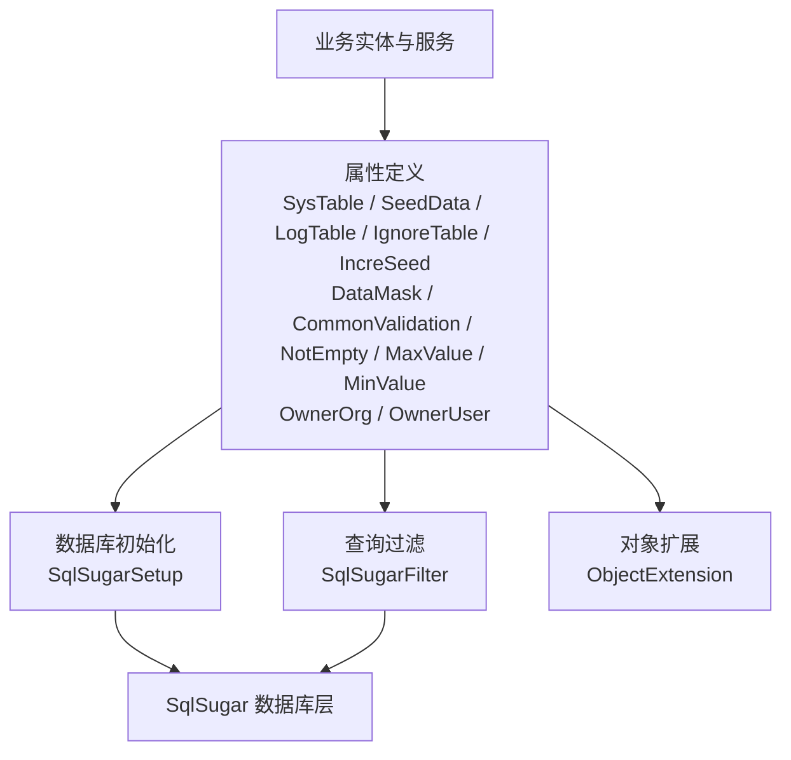
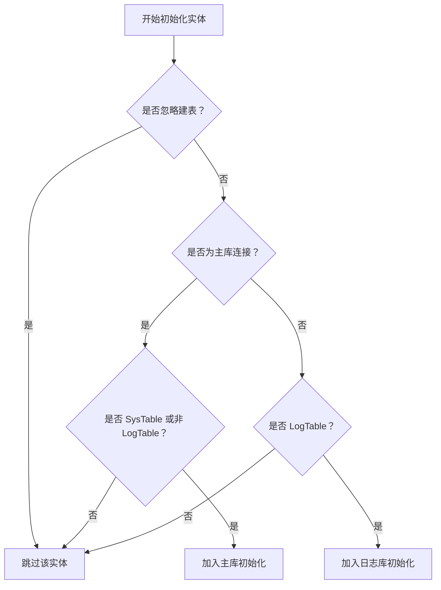
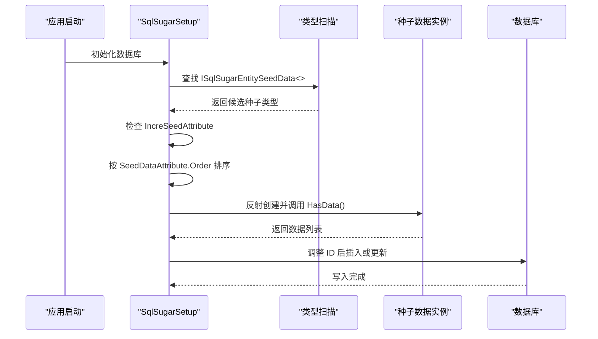
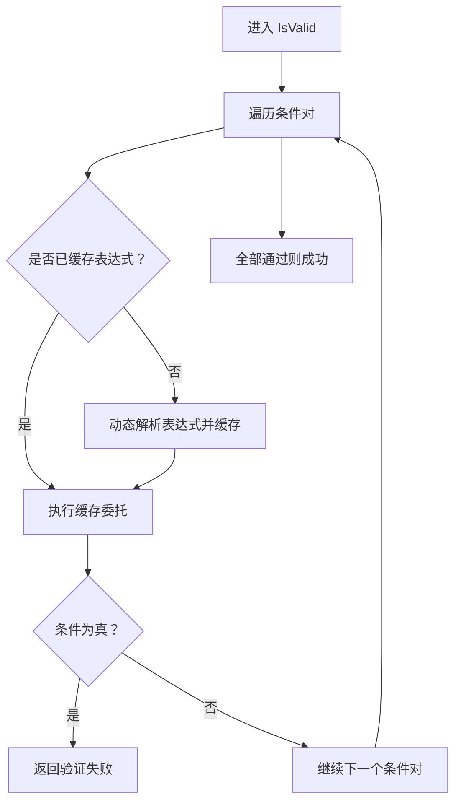
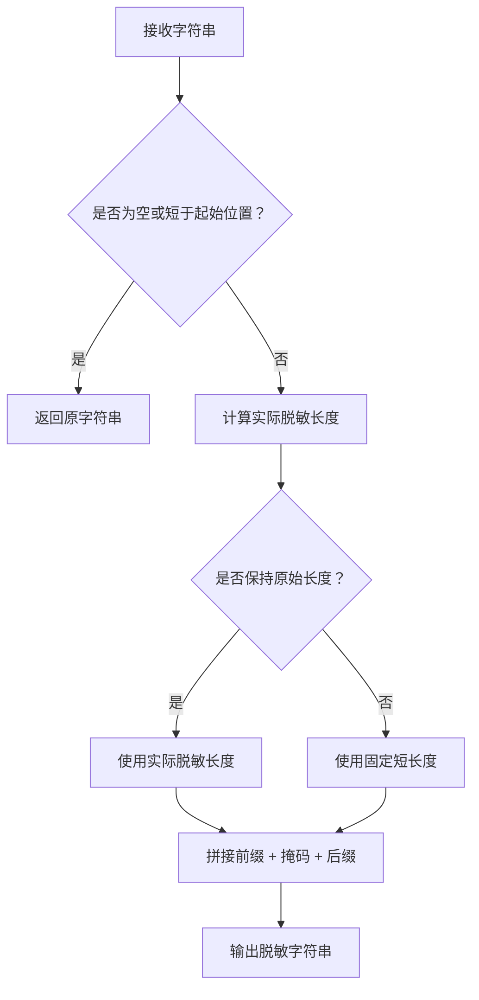
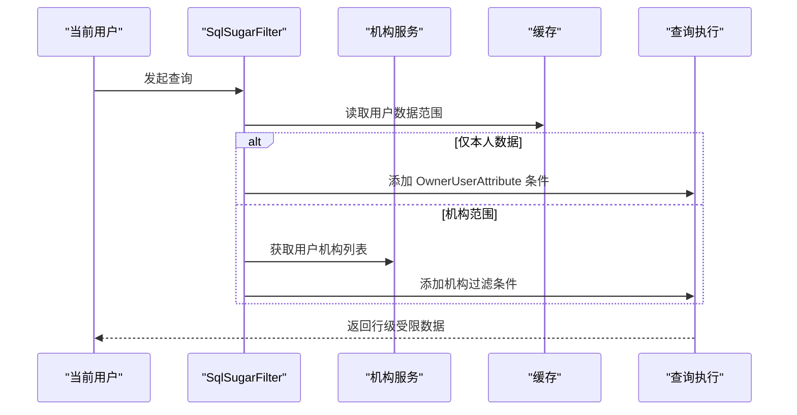
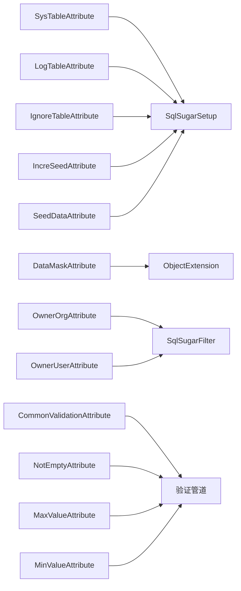

# 属性与注解系统

<cite>
**本文引用的文件**   
- [SysTableAttribute.cs](file://Admin.NET/Admin.NET.Core/Attribute/SysTableAttribute.cs)
- [SeedDataAttribute.cs](file://Admin.NET/Admin.NET.Core/Attribute/SeedDataAttribute.cs)
- [LogTableAttribute.cs](file://Admin.NET/Admin.NET.Core/Attribute/LogTableAttribute.cs)
- [CommonValidationAttribute.cs](file://Admin.NET/Admin.NET.Core/Attribute/CommonValidationAttribute.cs)
- [NotEmptyAttribute.cs](file://Admin.NET/Admin.NET.Core/Attribute/NotEmptyAttribute.cs)
- [MaxValueAttribute.cs](file://Admin.NET/Admin.NET.Core/Attribute/MaxValueAttribute.cs)
- [MinValueAttribute.cs](file://Admin.NET/Admin.NET.Core/Attribute/MinValueAttribute.cs)
- [DataMaskAttribute.cs](file://Admin.NET/Admin.NET.Core/Attribute/DataMaskAttribute.cs)
- [OwnerOrgAttribute.cs](file://Admin.NET/Admin.NET.Core/Attribute/OwnerOrgAttribute.cs)
- [OwnerUserAttribute.cs](file://Admin.NET/Admin.NET.Core/Attribute/OwnerUserAttribute.cs)
- [IgnoreTableAttribute.cs](file://Admin.NET/Admin.NET.Core/Attribute/IgnoreTableAttribute.cs)
- [IncreSeedAttribute.cs](file://Admin.NET/Admin.NET.Core/Attribute/IncreSeedAttribute.cs)
- [SqlSugarSetup.cs](file://Admin.NET/Admin.NET.Core/SqlSugar/SqlSugarSetup.cs)
- [SqlSugarFilter.cs](file://Admin.NET/Admin.NET.Core/SqlSugar/SqlSugarFilter.cs)
- [ObjectExtension.cs](file://Admin.NET/Admin.NET.Core/Extension/ObjectExtension.cs)
</cite>

## 目录
1. [简介](#简介)
2. [项目结构定位](#项目结构定位)
3. [核心组件总览](#核心组件总览)
4. [架构总览](#架构总览)
5. [详细组件分析](#详细组件分析)
6. [依赖关系分析](#依赖关系分析)
7. [性能与行为特征](#性能与行为特征)
8. [自定义开发指南](#自定义开发指南)
9. [常见问题排查](#常见问题排查)
10. [结论](#结论)

## 简介
本文聚焦 Admin.NET.Core 中的属性与注解系统，说明以下能力：
- 表结构与数据库初始化标记。
- 种子数据自动发现、排序与增量控制。
- 日志表识别与主库、日志库分流。
- 通用参数验证规则与表达式校验。
- 敏感字段脱敏输出。
- 基于组织与用户的行级权限过滤。
- 忽略建表、增量建表、增量种子等元数据标记。
- 如何扩展自定义 Attribute，并与 SqlSugar、框架服务集成。

## 项目结构定位
属性定义集中在 `Admin.NET.Admin.NET.Core/Attribute` 目录；它们被数据库初始化逻辑、查询过滤器和对象扩展所消费。关键消费方包括：
- 数据库初始化与种子数据引擎：`SqlSugarSetup.cs`
- 行级权限与数据范围过滤：`SqlSugarFilter.cs`
- 脱敏序列化辅助：`ObjectExtension.cs`

**图表来源**  
- [SqlSugarSetup.cs:450-720](file://Admin.NET/Admin.NET.Core/SqlSugar/SqlSugarSetup.cs#L450-L720)
- [SqlSugarFilter.cs:1-200](file://Admin.NET/Admin.NET.Core/SqlSugar/SqlSugarFilter.cs#L1-L200)
- [ObjectExtension.cs:480-521](file://Admin.NET/Admin.NET.Core/Extension/ObjectExtension.cs#L480-L521)

**章节来源**  
- [SysTableAttribute.cs:1-16](file://Admin.NET/Admin.NET.Core/Attribute/SysTableAttribute.cs#L1-L16)
- [SeedDataAttribute.cs:1-25](file://Admin.NET/Admin.NET.Core/Attribute/SeedDataAttribute.cs#L1-L25)
- [LogTableAttribute.cs:1-16](file://Admin.NET/Admin.NET.Core/Attribute/LogTableAttribute.cs#L1-L16)
- [IgnoreTableAttribute.cs:1-16](file://Admin.NET/Admin.NET.Core/Attribute/IgnoreTableAttribute.cs#L1-L16)
- [IncreSeedAttribute.cs:1-16](file://Admin.NET/Admin.NET.Core/Attribute/IncreSeedAttribute.cs#L1-L16)

## 核心组件总览
| 类别 | 属性或类型 | 目标位置 | 主要作用 |
|---|---|---:|---|
| 表标记 | `SysTableAttribute` | 类 | 标识系统表，用于主库初始化与租户库排除 |
| 表标记 | `LogTableAttribute` | 类 | 标识日志表，映射到日志库连接 |
| 表标记 | `IgnoreTableAttribute` | 类 | 忽略该实体的建表与初始化 |
| 表标记 | `IncreSeedAttribute` | 类 | 允许增量种子数据参与初始化 |
| 种子数据 | `SeedDataAttribute` | 类 | 为种子数据执行顺序提供排序 |
| 数据验证 | `CommonValidationAttribute` | 属性 | 支持条件对驱动的动态表达式校验 |
| 数据验证 | `NotEmptyAttribute` | 属性 | 校验集合非空 |
| 数据验证 | `MaxValueAttribute` | 属性 | 数值上限校验 |
| 数据验证 | `MinValueAttribute` | 属性 | 数值下限校验 |
| 数据脱敏 | `DataMaskAttribute` | 属性 | 指定字符串字段的脱敏起始位置、长度与掩码字符 |
| 权限标记 | `OwnerOrgAttribute` | 属性 | 标记归属机构字段，配合数据范围过滤 |
| 权限标记 | `OwnerUserAttribute` | 属性 | 标记归属用户字段，配合仅本人数据过滤 |

**章节来源**  
- [SysTableAttribute.cs:9-16](file://Admin.NET/Admin.NET.Core/Attribute/SysTableAttribute.cs#L9-L16)
- [LogTableAttribute.cs:9-16](file://Admin.NET/Admin.NET.Core/Attribute/LogTableAttribute.cs#L9-L16)
- [IgnoreTableAttribute.cs:9-16](file://Admin.NET/Admin.NET.Core/Attribute/IgnoreTableAttribute.cs#L9-L16)
- [IncreSeedAttribute.cs:9-16](file://Admin.NET/Admin.NET.Core/Attribute/IncreSeedAttribute.cs#L9-L16)
- [SeedDataAttribute.cs:9-25](file://Admin.NET/Admin.NET.Core/Attribute/SeedDataAttribute.cs#L9-L25)
- [CommonValidationAttribute.cs:9-92](file://Admin.NET/Admin.NET.Core/Attribute/CommonValidationAttribute.cs#L9-L92)
- [NotEmptyAttribute.cs:9-28](file://Admin.NET/Admin.NET.Core/Attribute/NotEmptyAttribute.cs#L9-L28)
- [MaxValueAttribute.cs:9-39](file://Admin.NET/Admin.NET.Core/Attribute/MaxValueAttribute.cs#L9-L39)
- [MinValueAttribute.cs:9-39](file://Admin.NET/Admin.NET.Core/Attribute/MinValueAttribute.cs#L9-L39)
- [DataMaskAttribute.cs:9-59](file://Admin.NET/Admin.NET.Core/Attribute/DataMaskAttribute.cs#L9-L59)
- [OwnerOrgAttribute.cs:9-16](file://Admin.NET/Admin.NET.Core/Attribute/OwnerOrgAttribute.cs#L9-L16)
- [OwnerUserAttribute.cs:9-16](file://Admin.NET/Admin.NET.Core/Attribute/OwnerUserAttribute.cs#L9-L16)

## 架构总览
属性本身大多是无状态元数据，真正能力由运行时扫描、反射与 SqlSugar 生命周期方法提供。

```mermaid
classDiagram
    class SysTableAttribute {
        <<标记>>
    }
    class LogTableAttribute {
        <<标记>>
    }
    class IgnoreTableAttribute {
        <<标记>>
    }
    class IncreSeedAttribute {
        <<标记>>
    }
    class SeedDataAttribute {
        +int Order
    }
    class DataMaskAttribute {
        -int StartIndex
        -int Length
        -char MaskChar
        -bool KeepLength
        +Mask(input) string
    }
    class CommonValidationAttribute {
        +IsValid(value, context) ValidationResult
        -CreateCondition(type, expression) Delegate
    }
    class NotEmptyAttribute {
        +IsValid(value) bool
    }
    class MaxValueAttribute {
        +IsValid(value) bool
    }
    class MinValueAttribute {
        +IsValid(value) bool
    }
    class OwnerOrgAttribute {
        <<标记>>
    }
    class OwnerUserAttribute {
        <<标记>>
    }

    SysTableAttribute <.. SqlSugarSetup : "用于主库判断"
    LogTableAttribute <.. SqlSugarSetup : "用于日志库判断"
    IgnoreTableAttribute <.. SqlSugarSetup : "跳过建表"
    IncreSeedAttribute <.. SqlSugarSetup : "启用增量种子"
    SeedDataAttribute <.. SqlSugarSetup : "排序种子"
    DataMaskAttribute <.. ObjectExtension : "脱敏输出"
    OwnerOrgAttribute <.. SqlSugarFilter : "数据范围过滤"
    OwnerUserAttribute <.. SqlSugarFilter : "仅本人过滤"
```

**图表来源**  
- [SqlSugarSetup.cs:470-492](file://Admin.NET/Admin.NET.Core/SqlSugar/SqlSugarSetup.cs#L470-L492)
- [SqlSugarSetup.cs:575-610](file://Admin.NET/Admin.NET.Core/SqlSugar/SqlSugarSetup.cs#L575-L610)
- [SqlSugarFilter.cs:50-120](file://Admin.NET/Admin.NET.Core/SqlSugar/SqlSugarFilter.cs#L50-L120)
- [ObjectExtension.cs:488-510](file://Admin.NET/Admin.NET.Core/Extension/ObjectExtension.cs#L488-L510)

## 详细组件分析

### 表结构标记：SysTableAttribute、LogTableAttribute、IgnoreTableAttribute
- `SysTableAttribute` 是系统表标记。框架在初始化时根据当前连接配置决定哪些实体应进入主库。
- `LogTableAttribute` 是日志表标记。框架会将贴有该标记的实体路由到日志库连接。
- `IgnoreTableAttribute` 表示该实体不参与代码优先建表与初始化流程。

初始化时的关键判定逻辑：
- 主库配置：实体必须包含 `SysTableAttribute`，或者既不是 `LogTableAttribute` 也不是特定租户隔离标记。
- 日志库配置：实体必须包含 `LogTableAttribute`。
- 忽略建表：任何带有 `IgnoreTableAttribute` 的实体都会跳过 `CodeFirst.InitTables`。

**图表来源**  
- [SqlSugarSetup.cs:470-492](file://Admin.NET/Admin.NET.Core/SqlSugar/SqlSugarSetup.cs#L470-L492)
- [SqlSugarSetup.cs:711-713](file://Admin.NET/Admin.NET.Core/SqlSugar/SqlSugarSetup.cs#L711-L713)

**章节来源**  
- [SysTableAttribute.cs:9-16](file://Admin.NET/Admin.NET.Core/Attribute/SysTableAttribute.cs#L9-L16)
- [LogTableAttribute.cs:9-16](file://Admin.NET/Admin.NET.Core/Attribute/LogTableAttribute.cs#L9-L16)
- [IgnoreTableAttribute.cs:9-16](file://Admin.NET/Admin.NET.Core/Attribute/IgnoreTableAttribute.cs#L9-L16)
- [SqlSugarSetup.cs:470-492](file://Admin.NET/Admin.NET.Core/SqlSugar/SqlSugarSetup.cs#L470-L492)
- [SqlSugarSetup.cs:711-713](file://Admin.NET/Admin.NET.Core/SqlSugar/SqlSugarSetup.cs#L711-L713)

### 种子数据机制：SeedDataAttribute 与 IncreSeedAttribute
种子数据通过实现 `ISqlSugarEntitySeedData<T>` 的类暴露。框架启动时会：
1. 扫描所有有效类型中实现种子接口类的类型。
2. 若启用了增量种子配置，则要求类型上存在 `IncreSeedAttribute`。
3. 按 `SeedDataAttribute.Order` 排序，值越大越晚执行。
4. 通过反射调用类型的 `HasData` 方法获取数据序列。
5. 调整主键为空或默认值的情况，避免覆盖已有数据。
6. 对普通表使用插入或更新；对分表场景调用 `Init(SqlSugarScopeProvider)`。

**图表来源**  
- [SeedDataAttribute.cs:9-25](file://Admin.NET/Admin.NET.Core/Attribute/SeedDataAttribute.cs#L9-L25)
- [IncreSeedAttribute.cs:9-16](file://Admin.NET/Admin.NET.Core/Attribute/IncreSeedAttribute.cs#L9-L16)
- [SqlSugarSetup.cs:575-610](file://Admin.NET/Admin.NET.Core/SqlSugar/SqlSugarSetup.cs#L575-L610)
- [SqlSugarSetup.cs:619-657](file://Admin.NET/Admin.NET.Core/SqlSugar/SqlSugarSetup.cs#L619-L657)
- [SqlSugarSetup.cs:657-711](file://Admin.NET/Admin.NET.Core/SqlSugar/SqlSugarSetup.cs#L657-L711)

**章节来源**  
- [SeedDataAttribute.cs:9-25](file://Admin.NET/Admin.NET.Core/Attribute/SeedDataAttribute.cs#L9-L25)
- [IncreSeedAttribute.cs:9-16](file://Admin.NET/Admin.NET.Core/Attribute/IncreSeedAttribute.cs#L9-L16)
- [SqlSugarSetup.cs:575-711](file://Admin.NET/Admin.NET.Core/SqlSugar/SqlSugarSetup.cs#L575-L711)

### 日志表机制：LogTableAttribute
`LogTableAttribute` 不直接改变 SQL 语法，而是作为元数据告诉数据库初始化器：“该实体属于日志库”。日志库连接由 `SqlSugarSetup.LogDb` 提供，当主库未单独配置日志库时回退到主连接。

实际使用建议：
- 日志实体标注 `LogTableAttribute`。
- 日志实体通常不需要业务查询过滤，也不参与租户业务库初始化。
- 日志记录由上层日志模块触发，而不是由该属性自动写库。

**章节来源**  
- [LogTableAttribute.cs:9-16](file://Admin.NET/Admin.NET.Core/Attribute/LogTableAttribute.cs#L9-L16)
- [SqlSugarSetup.cs:23-30](file://Admin.NET/Admin.NET.Core/SqlSugar/SqlSugarSetup.cs#L23-L30)
- [SqlSugarSetup.cs:487-492](file://Admin.NET/Admin.NET.Core/SqlSugar/SqlSugarSetup.cs#L487-L492)

### 数据验证属性
#### CommonValidationAttribute
这是一个通用接口参数验证特性，支持“条件表达式 + 错误消息”成对传入。内部会缓存编译后的委托，避免重复解析表达式。

关键点：
- 构造参数必须是偶数个：奇数位为条件表达式，偶数位为提示消息。
- 表达式通过动态表达式解析器解析为布尔表达式。
- 如果条件成立，则返回失败结果；否则继续下一个条件对。
- 表达式解析失败会抛出异常，便于启动期或首次校验时发现配置错误。

**图表来源**  
- [CommonValidationAttribute.cs:28-92](file://Admin.NET/Admin.NET.Core/Attribute/CommonValidationAttribute.cs#L28-L92)

**章节来源**  
- [CommonValidationAttribute.cs:9-92](file://Admin.NET/Admin.NET.Core/Attribute/CommonValidationAttribute.cs#L9-L92)

#### NotEmptyAttribute
校验集合类型不能为空。实现方式是将值转为 `IEnumerable` 并尝试枚举下一项；若值为 null，则视为空集合。

适用场景：
- 表单提交数组、列表、字典等集合参数。
- 需要区分“空引用”和“空集合”的业务校验。

**章节来源**  
- [NotEmptyAttribute.cs:9-28](file://Admin.NET/Admin.NET.Core/Attribute/NotEmptyAttribute.cs#L9-L28)

#### MaxValueAttribute 与 MinValueAttribute
两者均继承自 `ValidationAttribute`，将输入转换为 `double` 后进行边界比较：
- `MaxValueAttribute`：允许 null，非 null 时要求值小于等于最大值。
- `MinValueAttribute`：允许 null，非 null 时要求值大于最小值。

注意：
- 使用 `Convert.ToDouble`，不适合强类型数值属性时使用需确保类型可转换。
- 错误消息采用基类格式化，建议在属性上设置 `ErrorMessage`。

**章节来源**  
- [MaxValueAttribute.cs:9-39](file://Admin.NET/Admin.NET.Core/Attribute/MaxValueAttribute.cs#L9-L39)
- [MinValueAttribute.cs:9-39](file://Admin.NET/Admin.NET.Core/Attribute/MinValueAttribute.cs#L9-L39)

### 数据脱敏：DataMaskAttribute
`DataMaskAttribute` 是一个面向属性的脱敏声明，配合 `ObjectExtension` 在对象处理或序列化阶段对字符串字段进行掩码替换。

核心参数：
- `StartIndex`：从哪个索引开始脱敏，从 0 开始。
- `Length`：脱敏长度。
- `MaskChar`：掩码字符，默认星号。
- `KeepLength`：是否保持原始被替换部分的长度。

脱敏规则：
- 空字符串或长度不足以覆盖起始位置时，直接返回原值。
- 实际脱敏长度为 `min(Length, 剩余长度)`。
- 如果 `KeepLength` 为 false，则固定使用较短掩码长度。
- 最终结果是“前缀 + 掩码 + 后缀”。

**图表来源**  
- [DataMaskAttribute.cs:22-59](file://Admin.NET/Admin.NET.Core/Attribute/DataMaskAttribute.cs#L22-L59)
- [ObjectExtension.cs:488-510](file://Admin.NET/Admin.NET.Core/Extension/ObjectExtension.cs#L488-L510)

**章节来源**  
- [DataMaskAttribute.cs:9-59](file://Admin.NET/Admin.NET.Core/Attribute/DataMaskAttribute.cs#L9-L59)
- [ObjectExtension.cs:20-30](file://Admin.NET/Admin.NET.Core/Extension/ObjectExtension.cs#L20-L30)
- [ObjectExtension.cs:488-510](file://Admin.NET/Admin.NET.Core/Extension/ObjectExtension.cs#L488-L510)

### 权限控制：OwnerOrgAttribute 与 OwnerUserAttribute
这两个属性是数据权限标记，主要用于行级数据过滤：
- `OwnerOrgAttribute`：标记归属机构字段。
- `OwnerUserAttribute`：标记归属用户字段。

框架在 `SqlSugarFilter` 中根据当前用户的数据范围构建查询过滤条件：
- 若用户最大数据范围为“仅本人”，则对符合要求的实体追加 `OwnerUserAttribute` 对应的用户条件。
- 若需要机构维度过滤，则加载用户所属机构集合，并为实现机构过滤接口的实体追加 `OrgId` 过滤。
- 过滤条件会被缓存，避免每次查询重复计算。

**图表来源**  
- [OwnerOrgAttribute.cs:9-16](file://Admin.NET/Admin.NET.Core/Attribute/OwnerOrgAttribute.cs#L9-L16)
- [OwnerUserAttribute.cs:9-16](file://Admin.NET/Admin.NET.Core/Attribute/OwnerUserAttribute.cs#L9-L16)
- [SqlSugarFilter.cs:30-120](file://Admin.NET/Admin.NET.Core/SqlSugar/SqlSugarFilter.cs#L30-L120)

**章节来源**  
- [OwnerOrgAttribute.cs:9-16](file://Admin.NET/Admin.NET.Core/Attribute/OwnerOrgAttribute.cs#L9-L16)
- [OwnerUserAttribute.cs:9-16](file://Admin.NET/Admin.NET.Core/Attribute/OwnerUserAttribute.cs#L9-L16)
- [SqlSugarFilter.cs:30-120](file://Admin.NET/Admin.NET.Core/SqlSugar/SqlSugarFilter.cs#L30-L120)

### 表操作相关属性
| 属性 | 作用 | 典型场景 |
|---|---|---|
| `IgnoreTableAttribute` | 跳过 CodeFirst 建表和初始化 | 临时表、视图模型、只读快照 |
| `IncreSeedAttribute` | 允许种子类型参与增量种子初始化 | 生产环境可控的种子数据 |
| `SysTableAttribute` | 标识系统表，影响主库初始化选择 | 系统菜单、角色、租户等基础表 |
| `LogTableAttribute` | 标识日志表，影响日志库初始化选择 | 操作日志、访问日志、审计日志 |

**章节来源**  
- [IgnoreTableAttribute.cs:9-16](file://Admin.NET/Admin.NET.Core/Attribute/IgnoreTableAttribute.cs#L9-L16)
- [IncreSeedAttribute.cs:9-16](file://Admin.NET/Admin.NET.Core/Attribute/IncreSeedAttribute.cs#L9-L16)
- [SysTableAttribute.cs:9-16](file://Admin.NET/Admin.NET.Core/Attribute/SysTableAttribute.cs#L9-L16)
- [LogTableAttribute.cs:9-16](file://Admin.NET/Admin.NET.Core/Attribute/LogTableAttribute.cs#L9-L16)
- [SqlSugarSetup.cs:458-492](file://Admin.NET/Admin.NET.Core/SqlSugar/SqlSugarSetup.cs#L458-L492)

## 依赖关系分析
属性之间没有强耦合，但不同类别的属性被不同子系统消费：

**图表来源**  
- [SqlSugarSetup.cs:470-711](file://Admin.NET/Admin.NET.Core/SqlSugar/SqlSugarSetup.cs#L470-L711)
- [SqlSugarFilter.cs:50-120](file://Admin.NET/Admin.NET.Core/SqlSugar/SqlSugarFilter.cs#L50-L120)
- [ObjectExtension.cs:488-510](file://Admin.NET/Admin.NET.Core/Extension/ObjectExtension.cs#L488-L510)

**章节来源**  
- [SqlSugarSetup.cs:470-711](file://Admin.NET/Admin.NET.Core/SqlSugar/SqlSugarSetup.cs#L470-L711)
- [SqlSugarFilter.cs:50-120](file://Admin.NET/Admin.NET.Core/SqlSugar/SqlSugarFilter.cs#L50-L120)
- [ObjectExtension.cs:488-510](file://Admin.NET/Admin.NET.Core/Extension/ObjectExtension.cs#L488-L510)

## 性能与行为特征
- 表达式缓存：`CommonValidationAttribute` 将编译后的条件委托缓存在静态字典中，减少重复解析成本。
- 脱敏属性缓存：`ObjectExtension` 使用 `ConcurrentDictionary` 缓存 `DataMaskAttribute`，降低反射开销。
- 种子数据并行化：种子类型处理使用任务并行，但最终等待全部完成，适合批量初始化。
- 过滤条件缓存：`SqlSugarFilter` 对用户数据范围和自定义过滤器进行缓存，避免重复构建表达式树。
- 日志库与主库分离：通过属性标记分流实体，有助于隔离系统表、日志表与业务表的生命周期。

**章节来源**  
- [CommonValidationAttribute.cs:16-30](file://Admin.NET/Admin.NET.Core/Attribute/CommonValidationAttribute.cs#L16-L30)
- [ObjectExtension.cs:20-30](file://Admin.NET/Admin.NET.Core/Extension/ObjectExtension.cs#L20-L30)
- [SqlSugarSetup.cs:575-610](file://Admin.NET/Admin.NET.Core/SqlSugar/SqlSugarSetup.cs#L575-L610)
- [SqlSugarFilter.cs:10-20](file://Admin.NET/Admin.NET.Core/SqlSugar/SqlSugarFilter.cs#L10-L20)

## 自定义开发指南

### 设计自定义表标记
如果你的业务需要让某些实体跳过建表、跳过种子或参与特殊初始化，可以新增一个轻量 Attribute：
1. 定义 Attribute 并限制 `AttributeTargets.Class`。
2. 在数据库初始化逻辑中添加对该 Attribute 的判断。
3. 如果该 Attribute 需要携带配置，可在构造函数中保存参数。

最佳实践：
- 保持 Attribute 简单，复杂逻辑放入服务或扩展方法。
- 命名清晰，例如 `SkipMigrationAttribute`、`ReadOnlyTableAttribute`。
- 在文档中明确该 Attribute 的作用域和副作用。

### 设计自定义验证属性
推荐继承 `ValidationAttribute`，并在 `IsValid` 中实现规则：
1. 先处理 null 情况，决定是否认为空值合法。
2. 将常见错误信息通过 `ErrorMessage` 或 `FormatErrorMessage` 提供。
3. 对于复杂条件，参考 `CommonValidationAttribute` 的表达式缓存模式。

示例思路（不展示源码）：
- 邮箱格式校验：正则匹配。
- 时间区间校验：比较两个属性值。
- 业务状态机校验：根据枚举值和上下文字段组合判断。

### 设计自定义脱敏策略
如果现有 `DataMaskAttribute` 的起止位置和掩码字符不够用，可以：
1. 扩展新 Attribute，如 `CustomMaskAttribute`。
2. 在 `ObjectExtension` 中增加对应处理分支。
3. 将新 Attribute 加入属性缓存，避免每次反射。

注意事项：
- 不要破坏 JSON 序列化契约。
- 对空值、超长字符串、Unicode 文本做防御。
- 脱敏只在输出侧生效，不应修改持久化数据。

### 与 SqlSugar 集成的最佳实践
- 表名映射仍由 SqlSugar 的 `SugarTable` 负责；本项目的 `SysTableAttribute` 不替代表名映射，而是决定实体是否进入某个数据库连接。
- 如需自定义表名前缀或下划线转换，参考 `SqlSugarSetup.SetDbConfig` 中对外部服务的配置。
- 若需要自定义实体过滤，可参考 `SqlSugarFilter.SetCustomEntityFilter` 和 `IEntityFilter` 接口。

**章节来源**  
- [SqlSugarSetup.cs:80-140](file://Admin.NET/Admin.NET.Core/SqlSugar/SqlSugarSetup.cs#L80-L140)
- [SqlSugarFilter.cs:120-200](file://Admin.NET/Admin.NET.Core/SqlSugar/SqlSugarFilter.cs#L120-L200)
- [CommonValidationAttribute.cs:28-92](file://Admin.NET/Admin.NET.Core/Attribute/CommonValidationAttribute.cs#L28-L92)
- [ObjectExtension.cs:488-510](file://Admin.NET/Admin.NET.Core/Extension/ObjectExtension.cs#L488-L510)

## 常见问题排查

| 现象 | 可能原因 | 排查建议 |
|---|---|---|
| 实体未建表 | 缺少 `SugarTable` 或标记了 `IgnoreTableAttribute` | 检查实体是否贴 SqlSugar 表标记，以及是否误加忽略标记 |
| 日志实体出现在业务库 | 未正确标记 `LogTableAttribute` | 确认日志实体只标记日志库，不进入主库初始化 |
| 种子数据未执行 | 未实现种子接口或未标记 `IncreSeedAttribute` | 检查接口实现和增量种子开关 |
| 种子数据顺序不符合预期 | `SeedDataAttribute.Order` 未设置或设置错误 | 按需求从小到大或从大到小设置顺序 |
| 脱敏无效 | 字段类型不是字符串，或未被脱敏处理流程调用 | 检查属性类型和序列化路径是否调用脱敏逻辑 |
| 数据范围过滤不生效 | 用户数据范围不是“仅本人”，或未配置机构过滤 | 检查当前用户数据范围和机构列表 |
| 表达式验证报错 | `CommonValidationAttribute` 表达式语法错误或属性不存在 | 检查表达式语法和属性名称大小写 |

**章节来源**  
- [SqlSugarSetup.cs:470-711](file://Admin.NET/Admin.NET.Core/SqlSugar/SqlSugarSetup.cs#L470-L711)
- [SqlSugarFilter.cs:50-120](file://Admin.NET/Admin.NET.Core/SqlSugar/SqlSugarFilter.cs#L50-L120)
- [CommonValidationAttribute.cs:28-92](file://Admin.NET/Admin.NET.Core/Attribute/CommonValidationAttribute.cs#L28-L92)
- [ObjectExtension.cs:488-510](file://Admin.NET/Admin.NET.Core/Extension/ObjectExtension.cs#L488-L510)

## 结论
Admin.NET.Core 的属性与注解系统以“轻量声明 + 运行时扫描”的方式实现了表分流、种子数据管理、参数验证、数据脱敏和行级权限控制。大多数 Attribute 本身不直接执行业务逻辑，而是为 `SqlSugarSetup`、`SqlSugarFilter` 和 `ObjectExtension` 提供结构化元数据。

开发建议：
- 优先复用现有 Attribute，避免重复造轮子。
- 自定义 Attribute 要职责单一，并把复杂逻辑下沉到服务或扩展方法。
- 对表达式、反射和缓存做好异常处理和性能考虑。
- 在文档中明确每个 Attribute 的作用域、副作用和与其他系统的集成点。