# 工具类与扩展方法

<cite>
**本文引用的文件**   
- [CommonUtil.cs](file://Admin.NET/Admin.NET.Core/Utils/CommonUtil.cs)
- [CryptogramUtil.cs](file://Admin.NET/Admin.NET.Core/Utils/CryptogramUtil.cs)
- [HashHelper.cs](file://Admin.NET/Admin.NET.Core/Utils/HashHelper.cs)
- [DateTimeUtil.cs](file://Admin.NET/Admin.NET.Core/Utils/DateTimeUtil.cs)
- [ReflectionHelper.cs](file://Admin.NET/Admin.NET.Core/Utils/ReflectionHelper.cs)
- [CodeGenHelper.cs](file://Admin.NET/Admin.NET.Core/Utils/CodeGenHelper.cs)
- [BaseFilter.cs](file://Admin.NET/Admin.NET.Core/Utils/BaseFilter.cs)
- [BasePageInput.cs](file://Admin.NET/Admin.NET.Core/Utils/BasePageInput.cs)
- [BaseIdInput.cs](file://Admin.NET/Admin.NET.Core/Utils/BaseIdInput.cs)
- [ListExtensions.cs](file://Admin.NET/Admin.NET.Core/Utils(Collections/ListExtensions.cs)
- [DictionaryExtensions.cs](file://Admin.NET/Admin.NET.Core/Utils(Collections/DictionaryExtensions.cs)
- [CollectionExtensions.cs](file://Admin.NET/Admin.NET.Core/Utils(Collections/CollectionExtensions.cs)
- [FileHelper.cs](file://Admin.NET/Admin.NET.Core/Utils(IO/FileHelper.cs)
- [OSPlatformHelper.cs](file://Admin.NET/Admin.NET.Core/Utils(Runtime/OSPlatformHelper.cs)
- [RunningTimeHelper.cs](file://Admin.NET/Admin.NET.Core/Utils(Runtime/RunningTimeHelper.cs)
- [RuntimeInfoManger.cs](file://Admin.NET/Admin.NET.Core/Utils(Runtime/RuntimeInfoManger.cs)
</cite>

## 目录
1. [引言](#引言)
2. [项目结构](#项目结构)
3. [核心组件](#核心组件)
4. [架构总览](#架构总览)
5. [详细组件分析](#详细组件分析)
6. [依赖关系分析](#依赖关系分析)
7. [性能注意事项](#性能注意事项)
8. [故障排查指南](#故障排查指南)
9. [结论](#结论)
10. [附录：开发规范与示例](#附录开发规范与示例)

## 引言
本文面向 Admin.NET.Core 的 Utils 目录，系统化梳理通用工具类、加密哈希工具、日期时间处理、反射工具、代码生成辅助、基础输入模型、集合扩展以及 IO 和运行环境检测等能力。目标是帮助读者快速理解各工具的职责边界、典型使用场景、调用流程与安全实践，并给出可落地的自定义工具开发规范。

## 项目结构
Admin.NET.Core/Utils 以“职责域 + 类型”组织：
- 通用工具：CommonUtil
- 安全相关：CryptogramUtil、HashHelper
- 时间处理：DateTimeUtil 及 DateTime 子目录
- 反射与动态加载：ReflectionHelper
- 代码生成：CodeGenHelper
- 基础输入模型：BaseFilter、BasePageInput、BaseIdInput
- 集合扩展：Collections 下的 ListExtensions、DictionaryExtensions、CollectionExtensions 等
- IO 与压缩：IO 下的 FileHelper、DirectoryHelper、CompressHelper 等
- 运行环境：Runtime 下的 OSPlatformHelper、RunningTimeHelper、RuntimeInfoManger 等

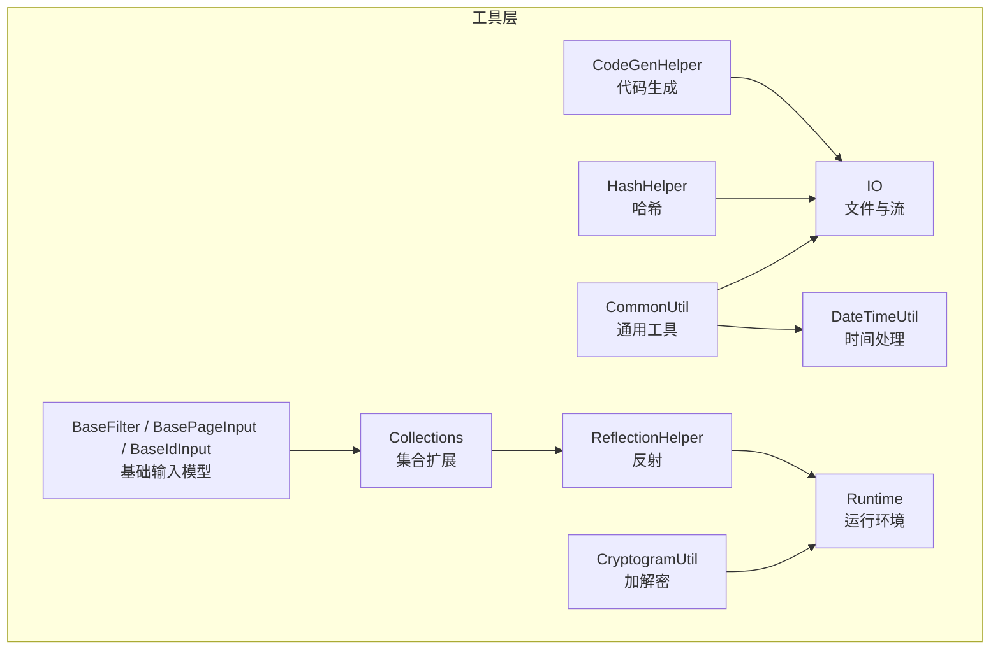

**图表来源**
- [CommonUtil.cs:1-503](file://Admin.NET/Admin.NET.Core/Utils/CommonUtil.cs#L1-L503)
- [CryptogramUtil.cs:1-120](file://Admin.NET/Admin.NET.Core/Utils/CryptogramUtil.cs#L1-L120)
- [HashHelper.cs:1-132](file://Admin.NET/Admin.NET.Core/Utils/HashHelper.cs#L1-L132)
- [DateTimeUtil.cs:1-399](file://Admin.NET/Admin.NET.Core/Utils/DateTimeUtil.cs#L1-L399)
- [ReflectionHelper.cs:1-600](file://Admin.NET/Admin.NET.Core/Utils/ReflectionHelper.cs#L1-L600)
- [CodeGenHelper.cs:1-200](file://Admin.NET/Admin.NET.Core/Utils/CodeGenHelper.cs#L1-L200)
- [BaseFilter.cs:1-200](file://Admin.NET/Admin.NET.Core/Utils/BaseFilter.cs#L1-L200)
- [BasePageInput.cs:1-200](file://Admin.NET/Admin.NET.Core/Utils/BasePagePageInput.cs#L1-L200)
- [BaseIdInput.cs:1-200](file://Admin.NET/Admin.NET.Core/Utils/BaseIdInput.cs#L1-L200)
- [ListExtensions.cs:1-200](file://Admin.NET/Admin.NET.Core/Utils(Collections/ListExtensions.cs#L1-L200)
- [DictionaryExtensions.cs:1-200](file://Admin.NET/Admin.NET.Core/Utils(Collections/DictionaryExtensions.cs#L1-L200)
- [CollectionExtensions.cs:1-200](file://Admin.NET/Admin.NET.Core/Utils(Collections/CollectionExtensions.cs#L1-L200)
- [FileHelper.cs:1-200](file://Admin.NET/Admin.NET.Core/Utils(IO/FileHelper.cs#L1-L200)
- [OSPlatformHelper.cs:1-200](file://Admin.NET/Admin.NET.Core/Utils(Runtime/OSPlatformHelper.cs#L1-L200)
- [RunningTimeHelper.cs:1-200](file://Admin.NET/Admin.NET.Core/Utils(Runtime/RunningTimeHelper.cs#L1-L200)
- [RuntimeInfoManger.cs:1-200](file://Admin.NET/Admin.NET.Core/Utils(Runtime/RuntimeInfoManger.cs#L1-L200)

**章节来源**
- [CommonUtil.cs:1-503](file://Admin.NET/Admin.NET.Core/Utils/CommonUtil.cs#L1-L503)
- [CryptogramUtil.cs:1-120](file://Admin.NET/Admin.NET.Core/Utils/CryptogramUtil.cs#L1-L120)
- [HashHelper.cs:1-132](file://Admin.NET/Admin.NET.Core/Utils/HashHelper.cs#L1-L132)
- [DateTimeUtil.cs:1-399](file://Admin.NET/Admin.NET.Core/Utils/DateTimeUtil.cs#L1-L399)
- [ReflectionHelper.cs:1-600](file://Admin.NET/Admin.NET.Core/Utils/ReflectionHelper.cs#L1-L600)

## 核心组件
本节聚焦以下关键工具类及其职责边界：
- CommonUtil：通用字符串、XML、Excel、IP、设备信息等能力
- CryptogramUtil：基于配置的 SM2/SM4/MD5 加解密入口
- HashHelper：SHA/MD5 等哈希计算
- DateTimeUtil：Unix 时间戳、本地化格式化、周期范围查询
- ReflectionHelper：程序集扫描、类型检查、属性路径读写
- CodeGenHelper：模板渲染与文件输出
- 基础输入模型：统一分页、筛选与标识参数模式
- Collections 扩展：集合与字典常用封装
- FileHelper：文件读写、编码、压缩等 IO 能力
- Runtime：平台检测、运行时长与环境信息

**章节来源**
- [CommonUtil.cs:1-503](file://Admin.NET/Admin.NET.Core/Utils/CommonUtil.cs#L1-L503)
- [CryptogramUtil.cs:1-120](file://Admin.NET/Admin.NET.Core/Utils/CryptogramUtil.cs#L1-L120)
- [HashHelper.cs:1-132](file://Admin.NET/Admin.NET.Core/Utils/HashHelper.cs#L1-L132)
- [DateTimeUtil.cs:1-399](file://Admin.NET/Admin.NET.Core/Utils/DateTimeUtil.cs#L1-L399)
- [ReflectionHelper.cs:1-600](file://Admin.NET/Admin.NET.Core/Utils/ReflectionHelper.cs#L1-L600)
- [CodeGenHelper.cs:1-200](file://Admin.NET/Admin.NET.Core/Utils/CodeGenHelper.cs#L1-L200)
- [BaseFilter.cs:1-200](file://Admin.NET/Admin.NET.Core/Utils/BaseFilter.cs#L1-L200)
- [BasePageInput.cs:1-200](file://Admin.NET/Admin.NET.Core/Utils(BasePageInput.cs#L1-L200)
- [BaseIdInput.cs:1-200](file://Admin.NET/Admin.NET.Core/Utils(BaseIdInput.cs#L1-L200)
- [ListExtensions.cs:1-200](file://Admin.NET/Admin.NET.Core/Utils(Collections/ListExtensions.cs#L1-L200)
- [DictionaryExtensions.cs:1-200](file://Admin.NET/Admin.NET.Core/Utils(Collections/DictionaryExtensions.cs#L1-L200)
- [CollectionExtensions.cs:1-200](file://Admin.NET/Admin.NET.Core/Utils(Collections/CollectionExtensions.cs#L1-L200)
- [FileHelper.cs:1-200](file://Admin.NET/Admin.NET.Core/Utils(IO/FileHelper.cs#L1-L200)
- [OSPlatformHelper.cs:1-200](file://Admin.NET/Admin.NET.Core/Utils(Runtime/OSPlatformHelper.cs#L1-L200)
- [RunningTimeHelper.cs:1-200](file://Admin.NET/Admin.NET.Core/Utils(Runtime/RunningTimeHelper.cs#L1-L200)
- [RuntimeInfoManger.cs:1-200](file://Admin.NET/Admin.NET.Core/Utils(Runtime/RuntimeInfoManger.cs#L1-L200)

## 架构总览
下图展示 Utils 内部的主要协作关系：业务侧通过 CommonUtil 完成 Excel 导入导出与 IP/UA 解析；加密与哈希由 CryptogramUtil 与 HashHelper 提供；时间处理集中在 DateTimeUtil；反射用于动态加载与属性映射；代码生成器借助 IO 写入模板结果；基础输入模型与集合扩展为上层服务提供统一的数据契约与操作封装。

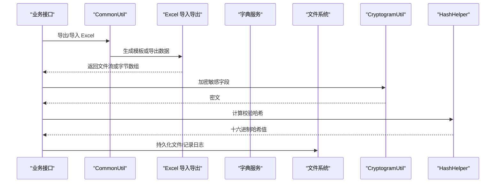

**图表来源**
- [CommonUtil.cs:1-503](file://Admin.NET/Admin.NET.Core/Utils(CommonUtil.cs#L1-L503)
- [CryptogramUtil.cs:1-120](file://Admin.NET/Admin.NET.Core/Utils(CryptogramUtil.cs#L1-L120)
- [HashHelper.cs:1-132](file://Admin.NET/Admin.NET.Core/Utils(HashHelper.cs#L1-L132)

## 详细组件分析

### CommonUtil：通用工具
职责概览
- 固定哈希与百分比计算
- 获取本地服务地址（支持代理头）
- XML 序列化/反序列化
- Excel 模板与数据导出、导入（含错误标记）
- 对象映射与字典值转换
- IP 地址解析与客户端设备信息识别

重点能力说明
- Excel 导入导出：封装导入模板、数据导出、带错误标记的导入、异步上传后导入，并在异常时聚合行级错误与模板缺失字段提示。
- 字典映射：基于 ImportDictAttribute 将字典 Label/Value 双向映射到目标属性，支持类型转换。
- IP 与 UA：调用 IPTools 解析国家/省/市/运营商经纬度，使用 Parser 解析操作系统与浏览器版本。

复杂度分析
- 对象映射 ParseList 对每个源对象遍历其属性映射表，时间复杂度近似 O(n·p)，n 为记录数，p 为属性数。
- Excel 导入/导出受 IO 与第三方库影响较大，应避免在热路径中频繁创建大型临时对象。

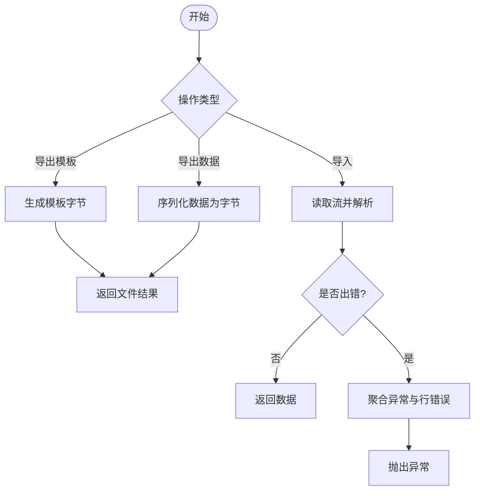

**图表来源**
- [CommonUtil.cs:1-503](file://Admin.NET/Admin.NET.Core/Utils(CommonUtil.cs#L1-L503)

**章节来源**
- [CommonUtil.cs:1-503](file://Admin.NET/Admin.NET.Core/Utils(CommonUtil.cs#L1-L503)

### CryptogramUtil：加密解密工具
职责概览
- 从配置读取加密策略与密钥
- 根据 CryptoType 分发到 MD5/SM2/SM4
- 提供 SM2 公钥/私钥加解密
- 提供 SM4 ECB/CBC 模式加解密

安全实践
- 密码强度校验开关与正则可从配置注入，便于按环境启用。
- 对称算法默认使用固定密钥与 IV，建议生产环境通过配置或安全总线注入随机密钥与 IV。
- MD5 仅用于非安全场景的校验或兼容，不应作为密码存储方案。

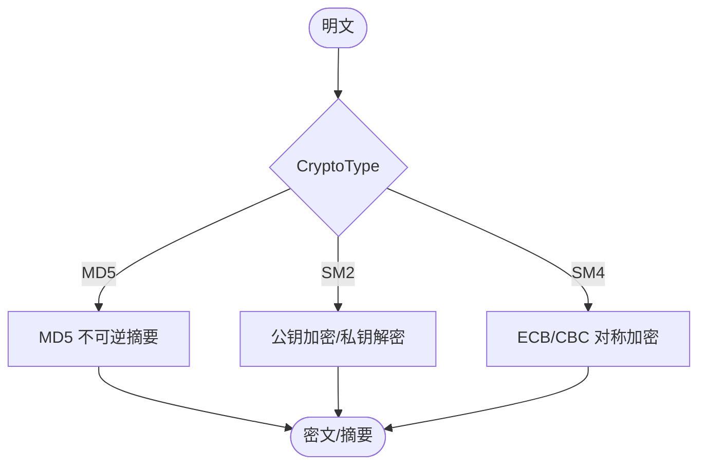

**图表来源**
- [CryptogramUtil.cs:1-120](file://Admin.NET/Admin.NET.Core/Utils(CryptogramUtil.cs#L1-L120)

**章节来源**
- [CryptogramUtil.cs:1-120](file://Admin.NET/Admin.NET.Core/Utils(CryptogramUtil.cs#L1-L120)

### HashHelper：哈希计算
职责概览
- 字符串与流式数据的 SHA1/SHA256/SHA384/SHA512 与 MD5 计算
- 二进制数组与 Stream 直接哈希

最佳实践
- 大文件优先使用 StreamMd5/StreamHash 避免内存峰值。
- 输出统一为十六进制字符串，便于比较与入库。

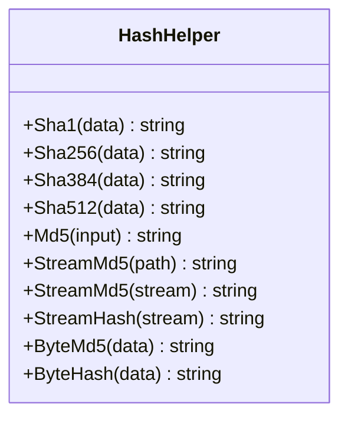

**图表来源**
- [HashHelper.cs:1-132](file://Admin.NET/Admin.NET.Core/Utils(HashHelper.cs#L1-L132)

**章节来源**
- [HashHelper.cs:1-132](file://Admin.NET/Admin.NET.Core/Utils(HashHelper.cs#L1-L132)

### DateTimeUtil：日期时间处理
职责概览
- Unix 时间戳自动判断秒/毫秒并转本地时间
- 获取当天/本周/本月/本年等起止时间
- 星期与周序计算
- 时间格式化（当年/跨年区分）

使用要点
- 若需本地化显示，结合 DateTimeFormatExtensions 进行格式扩展。
- 查询区间建议使用 GetXxxRange 元组返回值，避免手动拼接起止条件。

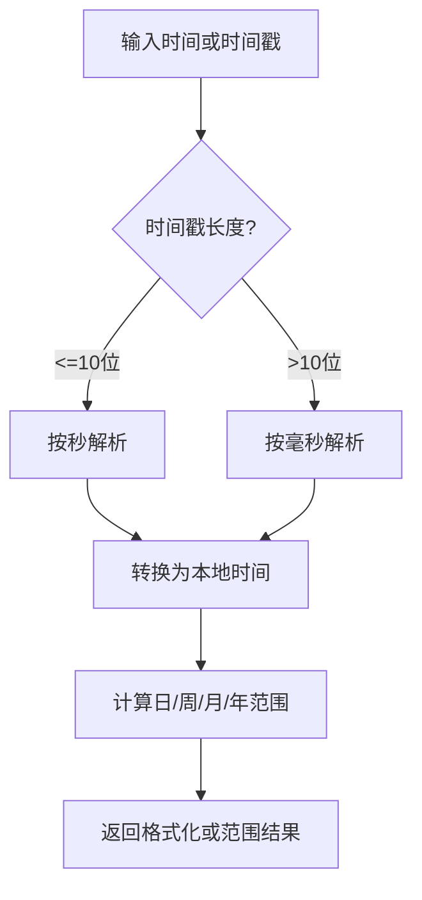

**图表来源**
- [DateTimeUtil.cs:1-399](file://Admin.NET/Admin.NET.Core/Utils(DateTimeUtil.cs#L1-L399)

**章节来源**
- [DateTimeUtil.cs:1-399](file://Admin.NET/Admin.NET.Core/Utils(DateTimeUtil.cs#L1-L399)

### ReflectionHelper：反射与动态加载
职责概览
- 程序集枚举与过滤（前缀/后缀/包含名）
- 递归扫描引用程序集
- 类型扫描与泛型实现检查
- 特性读取（成员与声明类型）
- 嵌套属性路径取值/赋值

典型用法
- 插件化扫描：GetEffectiveAssemblies 按命名约定筛选程序集。
- 动态属性访问：GetValueByPath/SetValueByPath 支持 a.b.c 路径。

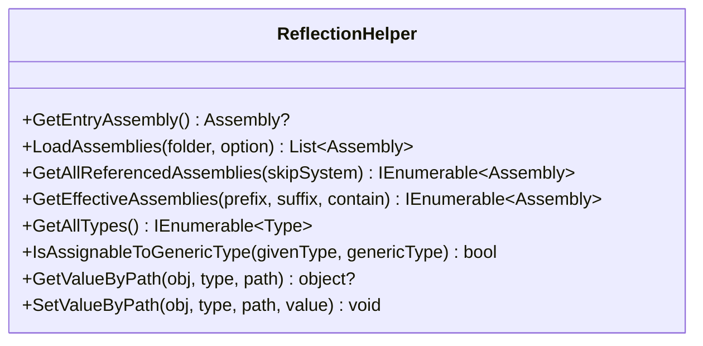

**图表来源**
- [ReflectionHelper.cs:1-600](file://Admin.NET/Admin.NET.Core/Utils(ReflectionHelper.cs#L1-L600)

**章节来源**
- [ReflectionHelper.cs:1-600](file://Admin.NET/Admin.NET.Core/Utils(ReflectionHelper.cs#L1-L600)

### CodeGenHelper：代码生成辅助
职责概览
- 模板渲染与变量替换
- 文件输出与路径管理
- 批量生成多文件

使用建议
- 模板文件集中管理，避免硬编码路径。
- 输出前先做幂等检查，避免覆盖已有文件。

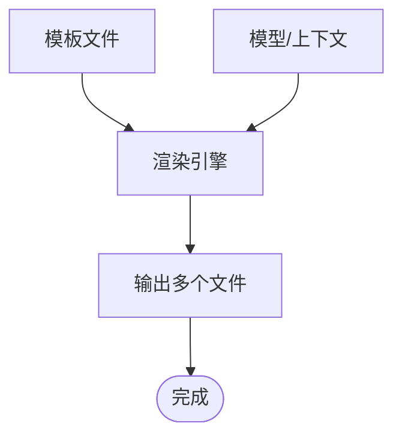

**图表来源**
- [CodeGenHelper.cs:1-200](file://Admin.NET/Admin.NET.Core/Utils(CodeGenHelper.cs#L1-L200)

**章节来源**
- [CodeGenHelper.cs:1-200](file://Admin.NET/Admin.NET.Core/Utils(CodeGenHelper.cs#L1-L200)

### 基础输入模型：BaseFilter、BasePageInput、BaseIdInput
设计意图
- BaseFilter：统一筛选条件基类，便于跨实体复用排序、状态、关键字等筛选。
- BasePageInput：分页入参（页码、每页大小），配合服务层构造分页查询。
- BaseIdInput：统一主键 ID 参数，简化删除、详情等请求体。

分页查询最佳实践
- 控制器接收 BasePageInput，传入服务层统一构建分页条件。
- 排序字段白名单校验，防止 SQL 注入。
- 将 BaseFilter 与具体查询 DTO 组合，避免重复定义公共字段。

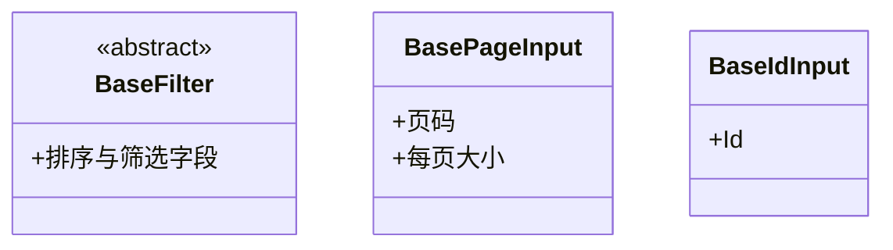

**图表来源**
- [BaseFilter.cs:1-200](file://Admin.NET/Admin.NET.Core/Utils(BaseFilter.cs#L1-L200)
- [BasePageInput.cs:1-200](file://Admin.NET/Admin.NET.Core/Utils(BasePageInput.cs#L1-L200)
- [BaseIdInput.cs:1-200](file://Admin.NET/Admin.NET.Core/Utils(BaseIdInput.cs#L1-L200)

**章节来源**
- [BaseFilter.cs:1-200](file://Admin.NET/Admin.NET.Core/Utils(BaseFilter.cs#L1-L200)
- [BasePageInput.cs:1-200](file://Admin.NET/Admin.NET.Core/Utils(BasePageInput.cs#L1-L200)
- [BaseIdInput.cs:1-200](file://Admin.NET/Admin.NET.Core/Utils(BaseIdInput.cs#L1-L200)

### 集合扩展：ListExtensions、DictionaryExtensions、CollectionExtensions
职责概览
- ListExtensions：列表去重、分组、安全取值、分页切片等常用封装。
- DictionaryExtensions：字典合并、键存在性检查、安全取值等。
- CollectionExtensions：集合判空、追加不重复项等通用操作。

使用建议
- 用扩展方法替代重复样板代码，提升可读性与一致性。
- 对大数据量集合操作注意内存分配与 LINQ 延迟执行。

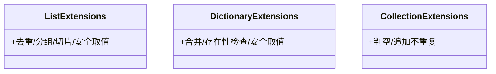

**图表来源**
- [ListExtensions.cs:1-200](file://Admin.NET/Admin.NET.Core/Utils(Collections/ListExtensions.cs#L1-L200)
- [DictionaryExtensions.cs:1-200](file://Admin.NET/Admin.NET.Core/Utils(Collections/DictionaryExtensions.cs#L1-L200)
- [CollectionExtensions.cs:1-200](file://Admin.NET/Admin.NET.Core/Utils(Collections/CollectionExtensions.cs#L1-L200)

**章节来源**
- [ListExtensions.cs:1-200](file://Admin.NET/Admin.NET.Core/Utils(Collections/ListExtensions.cs#L1-L200)
- [DictionaryExtensions.cs:1-200](file://Admin.NET/Admin.NET.Core/Utils(Collections/DictionaryExtensions.cs#L1-L200)
- [CollectionExtensions.cs:1-200](file://Admin.NET/Admin.NET.Core/Utils(Collections/CollectionExtensions.cs#L1-L200)

### IO 工具：FileHelper
职责概览
- 文件读写、编码转换、文本行处理
- 与压缩、目录操作协同工作

注意事项
- 大文件采用流式处理，避免一次性载入内存。
- 路径与文件名规范化，避免非法字符与路径穿越。

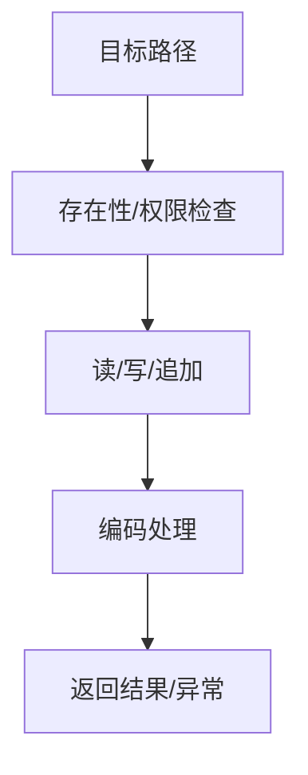

**图表来源**
- [FileHelper.cs:1-200](file://Admin.NET/Admin.NET.Core/Utils(IO/FileHelper.cs#L1-L200)

**章节来源**
- [FileHelper.cs:1-200](file://Admin.NET/Admin.NET.Core/Utils(IO/FileHelper.cs#L1-L200)

### 运行环境检测：OSPlatformHelper、RunningTimeHelper、RuntimeInfoManger
职责概览
- OSPlatformHelper：检测操作系统平台与版本
- RunningTimeHelper：计算运行时长、启动耗时
- RuntimeInfoManger：汇总运行时信息，便于监控与诊断

使用场景
- 在启动阶段收集运行环境信息并上报监控。
- 根据平台差异调整行为（如日志轮转、进程守护）。

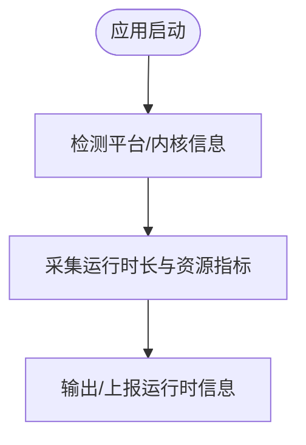

**图表来源**
- [OSPlatformHelper.cs:1-200](file://Admin.NET/Admin.NET.Core/Utils(Runtime/OSPlatformHelper.cs#L1-L200)
- [RunningTimeHelper.cs:1-200](file://Admin.NET/Admin.NET.Core/Utils(Runtime/RunningTimeHelper.cs#L1-L200)
- [RuntimeInfoManger.cs:1-200](file://Admin.NET/Admin.NET.Core/Utils(Runtime/RuntimeInfoManger.cs#L1-L200)

**章节来源**
- [OSPlatformHelper.cs:1-200](file://Admin.NET/Admin.NET.Core/Utils(Runtime/OSPlatformHelper.cs#L1-L200)
- [RunningTimeHelper.cs:1-200](file://Admin.NET/Admin.NET.Core/Utils(Runtime/RunningTimeHelper.cs#L1-L200)
- [RuntimeInfoManger.cs:1-200](file://Admin.NET/Admin.NET.Core/Utils(Runtime/RuntimeInfoManger.cs#L1-L200)

## 依赖关系分析
- CommonUtil 依赖 Excel 导入导出库、系统缓存与文件服务、字典数据仓库，用于模板与数据映射。
- CryptogramUtil 依赖 GM 工具与配置中心，负责算法分发与密钥读取。
- HashHelper 依赖 System.Security.Cryptography，提供标准哈希函数。
- DateTimeUtil 依赖 .NET 时间 API，不涉及外部数据库。
- ReflectionHelper 依赖 AssemblyLoadContext 与反射 API，用于程序集与类型扫描。
- Collections 扩展依赖 .NET 集合类型，无外部依赖。
- FileHelper 依赖 IO 原语与可能的压缩库。
- Runtime 组件依赖平台 API 与系统信息。

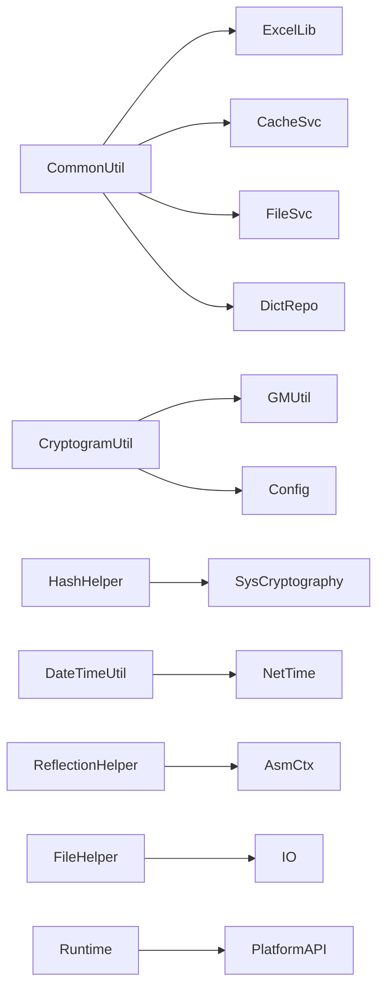

**图表来源**
- [CommonUtil.cs:1-503](file://Admin.NET/Admin.NET.Core/Utils(CommonUtil.cs#L1-L503)
- [CryptogramUtil.cs:1-120](file://Admin.NET/Admin.NET.Core/Utils(CryptogramUtil.cs#L1-L120)
- [HashHelper.cs:1-132](file://Admin.NET/Admin.NET.Core/Utils(HashHelper.cs#L1-L132)
- [DateTimeUtil.cs:1-399](file://Admin.NET/Admin.NET.Core/Utils(DateTimeUtil.cs#L1-L399)
- [ReflectionHelper.cs:1-600](file://Admin.NET/Admin.NET.Core/Utils(ReflectionHelper.cs#L1-L600)
- [FileHelper.cs:1-200](file://Admin.NET/Admin.NET.Core/Utils(IO/FileHelper.cs#L1-L200)
- [OSPlatformHelper.cs:1-200](file://Admin.NET/Admin.NET.Core/Utils(Runtime/OSPlatformHelper.cs#L1-L200)

**章节来源**
- [CommonUtil.cs:1-503](file://Admin.NET/Admin.NET.Core/Utils(CommonUtil.cs#L1-L503)
- [CryptogramUtil.cs:1-120](file://Admin.NET/Admin.NET.Core/Utils(CryptogramUtil.cs#L1-L120)
- [HashHelper.cs:1-132](file://Admin.NET/Admin.NET.Core/Utils(HashHelper.cs#L1-L132)
- [DateTimeUtil.cs:1-399](file://Admin.NET/Admin.NET.Core/Utils(DateTimeUtil.cs#L1-L399)
- [ReflectionHelper.cs:1-600](file://Admin.NET/Admin.NET.Core/Utils(ReflectionHelper.cs#L1-L600)
- [FileHelper.cs:1-200](file://Admin.NET/Admin.NET.Core/Utils(IO/FileHelper.cs#L1-L200)
- [OSPlatformHelper.cs:1-200](file://Admin.NET/Admin.NET.Core/Utils(Runtime/OSPlatformHelper.cs#L1-L200)

## 性能注意事项
- Excel 导入/导出：大量数据时建议分批处理，避免一次性加载全量对象；使用流式 IO 降低内存占用。
- 哈希计算：大文件优先使用 Stream 版本，减少内存峰值。
- 反射扫描：仅在启动或按需触发，避免在热路径反复枚举程序集与类型。
- 日期时间：尽量复用 DateTimeUtil 的范围方法，减少手工计算误差。
- 集合操作：LINQ 链过长会引入额外分配，必要时使用原地算法或分块处理。

[本节为通用指导，不直接分析具体文件]

## 故障排查指南
常见问题与建议
- Excel 导入失败：查看行级错误与模板缺失字段提示；确认字段类型与字典映射是否正确；检查文件大小与编码。
- 加解密不一致：核对 CryptoType、公钥/私钥、SM4 密钥与 IV 是否与客户端一致；确保两端字符编码统一。
- 哈希不一致：确认输入是否为 UTF-8 字节序列；对比十六进制输出大小写与前后缀。
- 反射找不到类型：确认程序集已加载；检查类型可见性与泛型约束；避免系统程序集干扰。
- 时间范围异常：确认时区与本地时间转换；检查 Unix 时间戳单位（秒/毫秒）。

**章节来源**
- [CommonUtil.cs:1-503](file://Admin.NET/Admin.NET.Core/Utils(CommonUtil.cs#L1-L503)
- [CryptogramUtil.cs:1-120](file://Admin.NET/Admin.NET.Core/Utils(CryptogramUtil.cs#L1-L120)
- [HashHelper.cs:1-132](file://Admin.NET/Admin.NET.Core/Utils(HashHelper.cs#L1-L132)
- [DateTimeUtil.cs:1-399](file://Admin.NET/Admin.NET.Core/Utils(DateTimeUtil.cs#L1-L399)
- [ReflectionHelper.cs:1-600](file://Admin.NET/Admin.NET.Core/Utils(ReflectionHelper.cs#L1-L600)

## 结论
Admin.NET.Core 的 Utils 提供了从通用工具、安全与哈希、时间处理、反射与代码生成到集合扩展与 IO、运行环境检测的完整工具集。通过统一的输入模型与扩展方法，上层服务可以稳定地复用这些能力，同时保持代码简洁与一致。建议在业务层遵循本文的最佳实践与安全规范，合理使用各工具类以提升可维护性与性能。

[本节为总结性内容，不直接分析具体文件]

## 附录：开发规范与示例

### 自定义工具类开发规范
- 单一职责：每个工具类只承担一个领域的能力，避免“万能类”。
- 静态 vs 实例：纯函数式工具使用静态类；需要状态或依赖注入时使用实例类。
- 配置驱动：可配置项通过 App.GetConfig 读取，并提供合理默认值。
- 错误处理：对外暴露明确的异常或结果对象，避免吞掉异常。
- 文档与测试：为公共 API 添加注释与使用示例，配套单元测试。
- 性能意识：避免热路径中的反射、大对象分配与阻塞 IO。

### 常见使用示例（概念性）
- 导出 Excel 模板：调用导出模板方法，返回可下载的文件结果。
- 导入 Excel 数据：读取表单文件，解析数据并返回对象集合；出现错误时抛出聚合异常。
- 加密敏感字段：根据配置选择 SM2/SM4，使用对应方法加密后入库。
- 计算文件哈希：对上传文件流计算 MD5/SHA256，用于去重与完整性校验。
- 查询本周数据：使用 DateTimeUtil 获取本周起止时间，构建查询条件。
- 动态属性赋值：使用 ReflectionHelper 的 SetValueByPath 设置嵌套属性。
- 分页查询：控制器接收 BasePageInput，传递给服务层统一分页。

[本节为概念性示例，不直接分析具体文件]