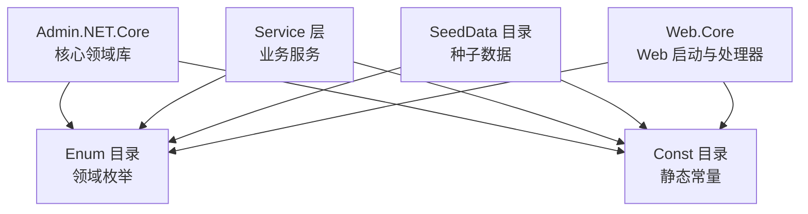
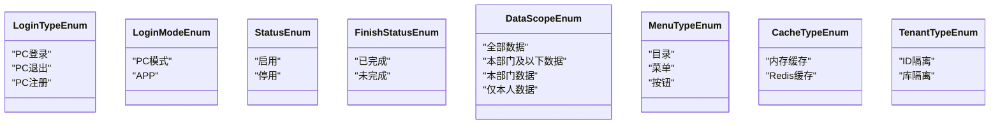
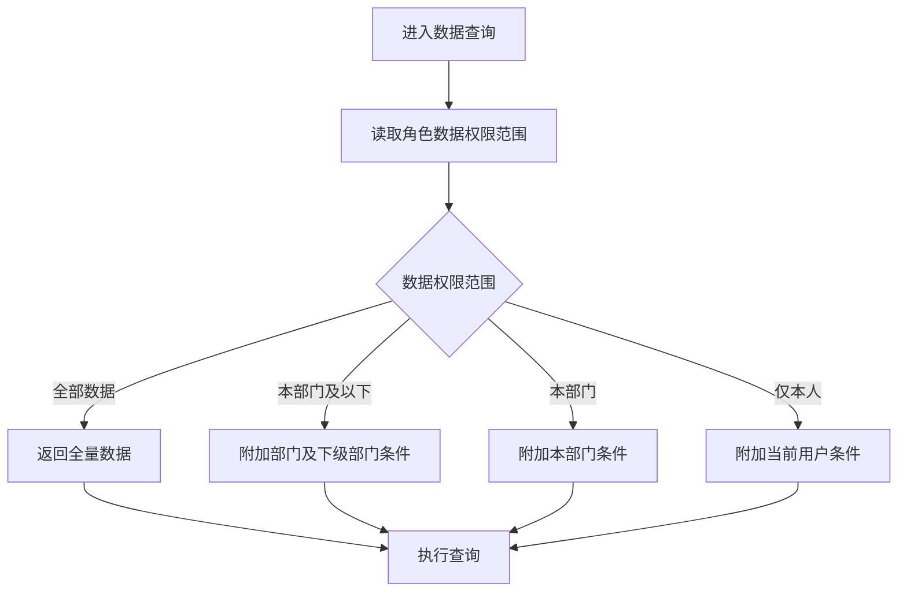
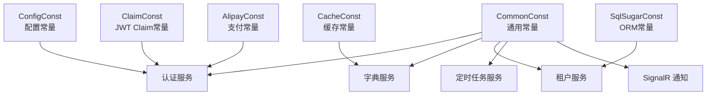
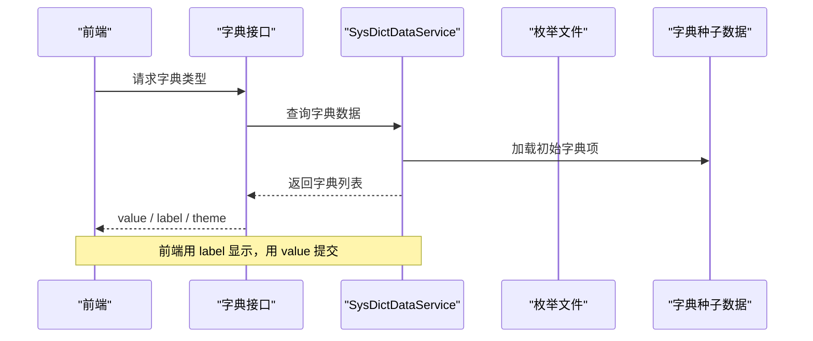
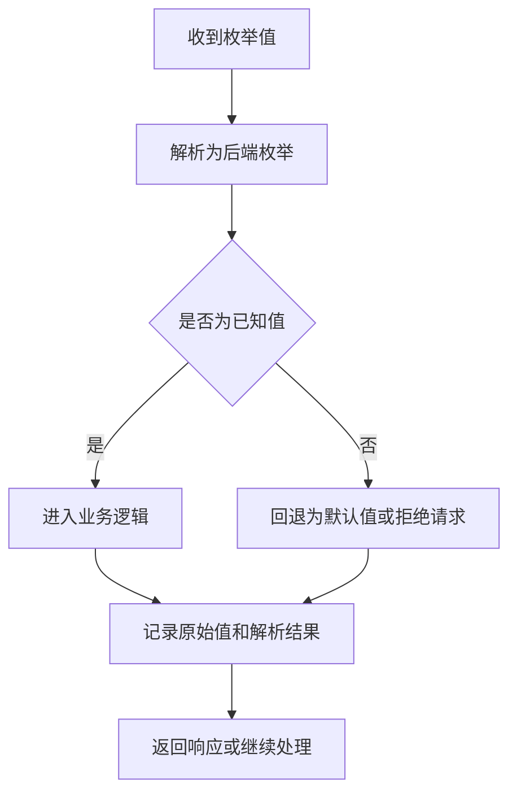
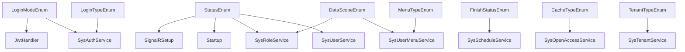

# 枚举与常量定义

<cite>
**本文引用的文件**   
- [LoginTypeEnum.cs](file://Admin.NET/Admin.NET.Core/Enum/LoginTypeEnum.cs)
- [LoginModeEnum.cs](file://Admin.NET/Admin.NET.Core/Enum/LoginModeEnum.cs)
- [StatusEnum.cs](file://Admin.NET/Admin.NET.Core/Enum/StatusEnum.cs)
- [FinishStatusEnum.cs](file://Admin.NET/Admin.NET.Core/Enum/FinishStatusEnum.cs)
- [DataScopeEnum.cs](file://Admin.NET/Admin.NET.Core/Enum/DataScopeEnum.cs)
- [MenuTypeEnum.cs](file://Admin.NET/Admin.NET.Core/Enum/MenuTypeEnum.cs)
- [CacheTypeEnum.cs](file://Admin.NET/Admin.NET.Core/Enum/CacheTypeEnum.cs)
- [TenantTypeEnum.cs](file://Admin.NET/Admin.NET.Core/Enum/TenantTypeEnum.cs)
- [CommonConst.cs](file://Admin.NET/Admin.NET.Core/Const/CommonConst.cs)
- [ConfigConst.cs](file://Admin.NET/Admin.NET.Core/Const/ConfigConst.cs)
- [CacheConst.cs](file://Admin.NET/Admin.NET.Core/Const/CacheConst.cs)
- [SqlSugarConst.cs](file://Admin.NET/Admin.NET.Core/Const/SqlSugarConst.cs)
- [ClaimConst.cs](file://Admin.NET/Admin.NET.Core/Const/ClaimConst.cs)
- [AlipayConst.cs](file://Admin.NET/Admin.NET.Core/Const/AlipayConst.cs)
- [SysDictTypeService.cs](file://Admin.NET/Admin.NET.Core/Service/Dict/SysDictTypeService.cs)
- [SysDictDataService.cs](file://Admin.NET/Admin.NET.Core/Service/Dict/SysDictDataService.cs)
- [SysAuthService.cs](file://Admin.NET/Admin.NET.Core/Service/Auth/SysAuthService.cs)
- [SysUserMenuService.cs](file://Admin.NET/Admin.NET.Core/Service/User/SysUserMenuService.cs)
- [SysUserService.cs](file://Admin.NET/Admin.NET.Core/Service/User/SysUserService.cs)
- [SysRoleService.cs](file://Admin.NET/Admin.NET.Core/Service/Role/SysRoleService.cs)
- [SysTenantService.cs](file://Admin.NET/Admin.NET.Core/Service/Tenant/SysTenantService.cs)
- [SysOpenAccessService.cs](file://Admin.NET/Admin.NET.Core/Service/OpenAccess/SysOpenAccessService.cs)
- [SignalRSetup.cs](file://Admin.NET/Admin.NET.Core/SignalR/SignalRSetup.cs)
- [SysScheduleService.cs](file://Admin.NET/Admin.NET.Core/Service/Schedule/SysScheduleService.cs)
- [JwtHandler.cs](file://Admin.NET/Admin.NET.Web.Core/Handlers/JwtHandler.cs)
- [Startup.cs](file://Admin.NET/Admin.NET.Web.Core/Startup.cs)
- [BaseStatusInput.cs](file://Admin.NET/Admin.NET.Core/Utils/BaseStatusInput.cs)
- [CommonUtil.cs](file://Admin.NET/Admin.NET.Core/Utils/CommonUtil.cs)
- [SysMenuSeedData.cs](file://Admin.NET/Admin.NET.Core/SeedData/SysMenuSeedData.cs)
- [SysDictDataSeedData.cs](file://Admin.NET/Admin.NET.Core/SeedData/SysDictDataSeedData.cs)
- [SysTenantSeedData.cs](file://Admin.NET/Admin.NET.Core/SeedData/SysTenantSeedData.cs)
- [SysRoleSeedData.cs](file://Admin.NET/Admin.NET.Core/SeedData/SysRoleSeedData.cs)
</cite>

## 目录
1. [引言](#引言)
2. [项目结构中的枚举与常量定位](#项目结构中的枚举与常量定位)
3. [枚举分类与设计原则](#枚举分类与设计原则)
4. [认证相关枚举](#认证相关枚举)
5. [状态枚举](#状态枚举)
6. [权限与菜单枚举](#权限与菜单枚举)
7. [系统配置与多租户枚举](#系统配置与多租户枚举)
8. [常量目录组织](#常量目录组织)
9. [枚举与字典、前端下拉选项的映射关系](#枚举与字典前端下拉选项的映射关系)
10. [序列化与反序列化最佳实践](#序列化与反序列化最佳实践)
11. [新增枚举与常量的规范指南](#新增枚举与常量的规范指南)
12. [依赖关系分析](#依赖关系分析)
13. [性能与可维护性建议](#性能与可维护性建议)
14. [故障排查](#故障排查)
15. [结论](#结论)

## 引言
本文聚焦 Admin.NET.Core 中 `Enum` 目录下的枚举定义以及 `Const` 目录下的常量管理，目标是帮助开发者理解：
- 各业务域枚举的职责边界；
- 枚举值如何参与认证、权限、菜单、租户、缓存等核心流程；
- 枚举与数据库字典、前端下拉选项之间的数据同步机制；
- 新增枚举和常量时应遵循的命名、值分配和向后兼容约定；
- 枚举在序列化、日志、权限校验、信号通知等场景中的使用方式。

本文不直接展示源码片段，而是通过文件路径引用具体实现位置，便于读者对照仓库源码阅读。

## 项目结构中的枚举与常量定位
Admin.NET 的核心领域模型、基础类型和共享常量集中在 `Admin.NET.Admin.NET.Core` 工程下。其中：
- `Enum` 目录存放领域级枚举，例如登录类型、登录模式、通用状态、完成状态、数据权限范围、菜单类型、缓存类型、租户类型等。
- `Const` 目录存放字符串常量、配置键名、缓存键前缀、SQL 查询关键字、JWT Claim 名称、支付参数等静态常量。

**图表来源**
- [LoginTypeEnum.cs:13-31](file://Admin.NET/Admin.NET.Core/Enum/LoginTypeEnum.cs#L13-L31)
- [CommonConst.cs](file://Admin.NET/Admin.NET.Core/Const/CommonConst.cs)
- [SysAuthService.cs](file://Admin.NET/Admin.NET.Core/Service/Auth/SysAuthService.cs)
- [SysMenuSeedData.cs](file://Admin.NET/Admin.NET.Core/SeedData/SysMenuSeedData.cs)

**章节来源**
- [LoginTypeEnum.cs:13-31](file://Admin.NET/Admin.NET.Core/Enum/LoginTypeEnum.cs#L13-L31)
- [CacheTypeEnum.cs:13-25](file://Admin.NET/Admin.NET.Core/Enum/CacheTypeEnum.cs#L13-L25)
- [TenantTypeEnum.cs:13-25](file://Admin.NET/Admin.NET.Core/Enum/TenantTypeEnum.cs#L13-L25)
- [CommonConst.cs](file://Admin.NET/Admin.NET.Core/Const/CommonConst.cs)

## 枚举分类与设计原则
Admin.NET.Core 中的枚举大致按以下维度组织：
- **认证相关**：`LoginTypeEnum`、`LoginModeEnum`。用于区分登录动作、登录客户端形态。
- **状态相关**：`StatusEnum`、`FinishStatusEnum`。用于表示通用启用停用状态、任务或事项完成状态。
- **权限相关**：`DataScopeEnum`、`MenuTypeEnum`。用于描述角色数据访问范围和菜单树节点类型。
- **系统配置相关**：`CacheTypeEnum`、`TenantTypeEnum`。用于描述缓存后端类型和多租户隔离策略。
- **其他领域枚举**：如通知状态、用户通知状态、作业状态、婚姻状况等，按领域细分。

设计原则包括：
- 使用 `[Description]` 提供中文显示文本，便于生成字典项或前端标签。
- 对需要主题色的枚举使用 `[Theme]`，配合前端 UI 渲染成功、危险、警告等信息色。
- 明确显式整型值，避免隐式默认值造成迁移、序列化或历史数据不一致。
- 将枚举作为领域语义而非纯存储字段，避免把“数字”直接当作业务含义。

**图表来源**
- [LoginTypeEnum.cs:13-31](file://Admin.NET/Admin.NET.Core/Enum/LoginTypeEnum.cs#L13-L31)
- [LoginModeEnum.cs:13-25](file://Admin.NET/Admin.NET.Core/Enum/LoginModeEnum.cs#L13-L25)
- [StatusEnum.cs:13-25](file://Admin.NET/Admin.NET.Core/Enum/StatusEnum.cs#L13-L25)
- [FinishStatusEnum.cs:13-25](file://Admin.NET/Admin.NET.Core/Enum/FinishStatusEnum.cs#L13-L25)
- [DataScopeEnum.cs:13-33](file://Admin.NET/Admin.NET.Core/Enum/DataScopeEnum.cs#L13-L33)
- [MenuTypeEnum.cs:13-32](file://Admin.NET/Admin.NET.Core/Enum/MenuTypeEnum.cs#L13-L32)
- [CacheTypeEnum.cs:13-25](file://Admin.NET/Admin.NET.Core/Enum/CacheTypeEnum.cs#L13-L25)
- [TenantTypeEnum.cs:13-25](file://Admin.NET/Admin.NET.Core/Enum/TenantTypeEnum.cs#L13-L25)

**章节来源**
- [LoginTypeEnum.cs:13-31](file://Admin.NET/Admin.NET.Core/Enum/LoginTypeEnum.cs#L13-L31)
- [LoginModeEnum.cs:13-25](file://Admin.NET/Admin.NET.Core/Enum/LoginModeEnum.cs#L13-L25)
- [StatusEnum.cs:13-25](file://Admin.NET/Admin.NET.Core/Enum/StatusEnum.cs#L13-L25)
- [FinishStatusEnum.cs:13-25](file://Admin.NET/Admin.NET.Core/Enum/FinishStatusEnum.cs#L13-L25)
- [DataScopeEnum.cs:13-33](file://Admin.NET/Admin.NET.Core/Enum/DataScopeEnum.cs#L13-L33)
- [MenuTypeEnum.cs:13-32](file://Admin.NET/Admin.NET.Core/Enum/MenuTypeEnum.cs#L13-L32)
- [CacheTypeEnum.cs:13-25](file://Admin.NET/Admin.NET.Core/Enum/CacheTypeEnum.cs#L13-L25)
- [TenantTypeEnum.cs:13-25](file://Admin.NET/Admin.NET.Core/Enum/TenantTypeEnum.cs#L13-L25)

## 认证相关枚举
### LoginTypeEnum：登录动作类型
`LoginTypeEnum` 用于区分登录流程中的不同动作，典型用途包括：
- 记录登录日志、审计日志；
- 区分登录、退出、注册等事件；
- 在认证服务中根据动作选择不同处理逻辑。

| 枚举成员 | 业务含义 | 典型使用场景 |
|---|---|---|
| `Login` | PC 登录 | 用户提交账号密码后记录登录行为 |
| `Logout` | PC 退出 | 用户主动退出或会话过期时记录退出行为 |
| `Register` | PC 注册 | 新用户注册成功后写入注册来源和动作 |

**章节来源**
- [LoginTypeEnum.cs:13-31](file://Admin.NET/Admin.NET.Core/Enum/LoginTypeEnum.cs#L13-L31)
- [SysAuthService.cs](file://Admin.NET/Admin.NET.Core/Service/Auth/SysAuthService.cs)

### LoginModeEnum：登录客户端模式
`LoginModeEnum` 用于标识登录来源终端，常见值为 PC 与 APP。其作用包括：
- 控制令牌签发策略、刷新策略；
- 影响权限加载、菜单展示、消息推送通道；
- 在审计日志中区分设备来源。

| 枚举成员 | 业务含义 | 典型使用场景 |
|---|---|---|
| `PC` | PC 模式 | Web 后台登录、浏览器端操作 |
| `APP` | APP 模式 | 移动端、第三方客户端调用 |

**章节来源**
- [LoginModeEnum.cs:13-25](file://Admin.NET/Admin.NET.Core/Enum/LoginModeEnum.cs#L13-L25)
- [JwtHandler.cs](file://Admin.NET/Admin.NET.Web.Core/Handlers/JwtHandler.cs)

## 状态枚举
### StatusEnum：通用启用停用状态
`StatusEnum` 是系统中最常见的通用状态枚举，通常对应实体的启用、停用字段，并带有 UI 主题信息：
- `Enable`：启用，适合成功态主题；
- `Disable`：停用，适合危险态主题。

它常用于：
- 用户、角色、菜单、插件、租户等资源的启用控制；
- 列表页的状态筛选；
- 批量启停接口输入。

**章节来源**
- [StatusEnum.cs:13-25](file://Admin.NET/Admin.NET.Core/Enum/StatusEnum.cs#L13-L25)
- [SysUserService.cs](file://Admin.NET/Admin.NET.Core/Service/User/SysUserService.cs)
- [SysRoleService.cs](file://Admin.NET/Admin.NET.Core/Service/Role/SysRoleService.cs)
- [BaseStatusInput.cs](file://Admin.NET/Admin.NET.Core/Utils/BaseStatusInput.cs)

### FinishStatusEnum：完成状态
`FinishStatusEnum` 用于表达某项事务是否完成，例如通知已读、任务完成、审核结果等：
- `Finish`：已完成；
- `UnFinish`：未完成。

该枚举更偏向结果态，而不是资源生命周期控制。

**章节来源**
- [FinishStatusEnum.cs:13-25](file://Admin.NET/Admin.NET.Core/Enum/FinishStatusEnum.cs#L13-L25)
- [SysNoticeService.cs](file://Admin.NET/Admin.NET.Core/Service/Notice/SysNoticeService.cs)

## 权限与菜单枚举
### DataScopeEnum：数据权限范围
`DataScopeEnum` 用于角色或用户的数据访问范围控制，典型值包括：
- `All`：全部数据；
- `DeptChild`：本部门及以下数据；
- `Dept`：本部门数据；
- 可能包含“仅本人数据”等更细粒度范围。

它在权限过滤、SQL 条件拼接、报表数据隔离中起关键作用。

**图表来源**
- [DataScopeEnum.cs:13-33](file://Admin.NET/Admin.NET.Core/Enum/DataScopeEnum.cs#L13-L33)
- [SysUserMenuService.cs](file://Admin.NET/Admin.NET.Core/Service/User/SysUserMenuService.cs)
- [SysRoleService.cs](file://Admin.NET/Admin.NET.Core/Service/Role/SysRoleService.cs)

**章节来源**
- [DataScopeEnum.cs:13-33](file://Admin.NET/Admin.NET.Core/Enum/DataScopeEnum.cs#L13-L33)
- [SysUserMenuService.cs](file://Admin.NET/Admin.NET.Core/Service/User/SysUserMenuService.cs)

### MenuTypeEnum：菜单节点类型
`MenuTypeEnum` 描述菜单树节点类型：
- `Dir`：目录，用于分组导航；
- `Menu`：菜单，指向页面或路由；
- `Btn`：按钮，用于接口级权限控制。

该枚举直接影响菜单树构建、权限码生成和前端菜单渲染。

**章节来源**
- [MenuTypeEnum.cs:13-32](file://Admin.NET/Admin.NET.Core/Enum/MenuTypeEnum.cs#L13-L32)
- [SysMenuSeedData.cs](file://Admin.NET/Admin.NET.Core/SeedData/SysMenuSeedData.cs)

## 系统配置与多租户枚举
### CacheTypeEnum：缓存类型
`CacheTypeEnum` 用于区分缓存后端：
- `Memory`：内存缓存，适合开发、测试或小规模部署；
- `Redis`：分布式缓存，适合生产环境。

它通常与配置中心或启动配置结合，决定应用使用哪种缓存实现。

**章节来源**
- [CacheTypeEnum.cs:13-25](file://Admin.NET/Admin.NET.Core/Enum/CacheTypeEnum.cs#L13-L25)
- [SysOpenAccessService.cs](file://Admin.NET/Admin.NET.Core/Service/OpenAccess/SysOpenAccessService.cs)

### TenantTypeEnum：多租户隔离类型
`TenantTypeEnum` 描述多租户隔离策略：
- `Id`：基于租户 ID 的逻辑隔离；
- `Db`：基于独立数据库的物理隔离。

该枚举与租户服务、数据库连接、数据初始化、菜单授权共同工作。

**章节来源**
- [TenantTypeEnum.cs:13-25](file://Admin.NET/Admin.NET.Core/Enum/TenantTypeEnum.cs#L13-L25)
- [SysTenantService.cs](file://Admin.NET/Admin.NET.Core/Service/Tenant/SysTenantService.cs)
- [SysTenantSeedData.cs](file://Admin.NET/Admin.NET.Core/SeedData/SysTenantSeedData.cs)

## 常量目录组织
`Const` 目录按职责划分常量，避免魔法字符串散落各处：

| 文件 | 主要职责 | 典型内容 |
|---|---|---|
| `CommonConst.cs` | 通用常量 | 通用错误提示、通用键名、通用业务标记 |
| `ConfigConst.cs` | 配置相关常量 | 配置项键名、配置文件前缀 |
| `CacheConst.cs` | 缓存相关常量 | 缓存键前缀、缓存超时时间 |
| `SqlSugarConst.cs` | ORM 查询常量 | SQL 关键字、分页常量、排序字段名 |
| `ClaimConst.cs` | JWT Claim 常量 | 用户标识、角色、租户等 Claim 名称 |
| `AlipayConst.cs` | 支付宝相关常量 | 支付回调、签名参数键名 |

这些常量通常被 `Service`、`Entity`、`SeedData`、`Web.Core` 等模块引用，保证跨层一致性。

**图表来源**
- [CommonConst.cs](file://Admin.NET/Admin.NET.Core/Const/CommonConst.cs)
- [ConfigConst.cs](file://Admin.NET/Admin.NET.Core/Const/ConfigConst.cs)
- [CacheConst.cs](file://Admin.NET/Admin.NET.Core/Const/CacheConst.cs)
- [SqlSugarConst.cs](file://Admin.NET/Admin.NET.Core/Const/SqlSugarConst.cs)
- [ClaimConst.cs](file://Admin.NET/Admin.NET.Core/Const/ClaimConst.cs)
- [AlipayConst.cs](file://Admin.NET/Admin.NET.Core/Const/AlipayConst.cs)
- [SysAuthService.cs](file://Admin.NET/Admin.NET.Core/Service/Auth/SysAuthService.cs)
- [SysDictTypeService.cs](file://Admin.NET/Admin.NET.Core/Service/Dict/SysDictTypeService.cs)
- [SysTenantService.cs](file://Admin.NET/Admin.NET.Core/Service/Tenant/SysTenantService.cs)
- [SysScheduleService.cs](file://Admin.NET/Admin.NET.Core/Service/Schedule/SysScheduleService.cs)
- [SignalRSetup.cs](file://Admin.NET/Admin.NET.Core/SignalR/SignalRSetup.cs)

**章节来源**
- [CommonConst.cs](file://Admin.NET/Admin.NET.Core/Const/CommonConst.cs)
- [ConfigConst.cs](file://Admin.NET/Admin.NET.Core/Const/ConfigConst.cs)
- [CacheConst.cs](file://Admin.NET/Admin.NET.Core/Const/CacheConst.cs)
- [SqlSugarConst.cs](file://Admin.NET/Admin.NET.Core/Const/SqlSugarConst.cs)
- [ClaimConst.cs](file://Admin.NET/Admin.NET.Core/Const/ClaimConst.cs)
- [AlipayConst.cs](file://Admin.NET/Admin.NET.Core/Const/AlipayConst.cs)

## 枚举与字典、前端下拉选项的映射关系
Admin.NET 通常通过以下方式把后端枚举映射到前端下拉选项：
1. 后端枚举使用 `[Description]` 提供中文文本，部分枚举还附带 `[Theme]`。
2. 字典服务通过 `SysDictTypeService`、`SysDictDataService` 提供字典类型和数据。
3. 种子数据通过 `SysDictDataSeedData` 等初始化常用字典项。
4. 前端从字典接口获取 `value`、`label`、可选 `theme`，渲染为下拉框、Tag、状态列。

**图表来源**
- [SysDictTypeService.cs](file://Admin.NET/Admin.NET.Core/Service/Dict/SysDictTypeService.cs)
- [SysDictDataService.cs](file://Admin.NET/Admin.NET.Core/Service/Dict/SysDictDataService.cs)
- [SysDictDataSeedData.cs](file://Admin.NET/Admin.NET.Core/SeedData/SysDictDataSeedData.cs)
- [LoginTypeEnum.cs:13-31](file://Admin.NET/Admin.NET.Core/Enum/LoginTypeEnum.cs#L13-L31)
- [StatusEnum.cs:13-25](file://Admin.NET/Admin.NET.Core/Enum/StatusEnum.cs#L13-L25)

需要注意：
- 如果某个枚举值只在内部使用且不对应数据库字典表，则不必强制加入前端字典；
- 如果枚举值会出现在表单、列表、导出文件中，则应确保有稳定 `value` 和可读 `label`；
- 若前端需要主题颜色，应保留 `[Theme]` 并在字典输出中透传。

**章节来源**
- [SysDictTypeService.cs](file://Admin.NET/Admin.NET.Core/Service/Dict/SysDictTypeService.cs)
- [SysDictDataService.cs](file://Admin.NET/Admin.NET.Core/Service/Dict/SysDictDataService.cs)
- [SysDictDataSeedData.cs](file://Admin.NET/Admin.NET.Core/SeedData/SysDictDataSeedData.cs)

## 序列化与反序列化最佳实践
针对枚举在 API、日志、缓存、消息队列中的传输，建议遵循以下实践：

- **优先使用整数或稳定字符串值**：不要依赖 C# 默认枚举顺序，显式赋值可减少迁移风险。
- **保持向后兼容**：新增枚举值放在末尾，不要修改已有值的整数序号；删除值时先废弃再移除。
- **统一解析入口**：在公共工具类中提供安全转换方法，遇到未知值返回默认值或抛出明确异常。
- **日志中同时记录数值和名称**：便于排查历史数据和新版本差异。
- **前端提交时验证取值范围**：避免非法枚举值进入数据库。
- **缓存键和业务键中使用常量**：避免硬编码字符串导致键冲突。

**图表来源**
- [CommonUtil.cs](file://Admin.NET/Admin.NET.Core/Utils/CommonUtil.cs)
- [BaseStatusInput.cs](file://Admin.NET/Admin.NET.Core/Utils/BaseStatusInput.cs)

**章节来源**
- [CommonUtil.cs](file://Admin.NET/Admin.NET.Core/Utils/CommonUtil.cs)
- [BaseStatusInput.cs](file://Admin.NET/Admin.NET.Core/Utils/BaseStatusInput.cs)

## 新增枚举与常量的规范指南
### 命名约定
- 枚举类型以 `XxxEnum` 命名，例如 `LoginTypeEnum`、`DataScopeEnum`。
- 枚举成员使用 PascalCase，语义清晰，避免缩写歧义，例如 `Login`、`Logout`、`Enable`、`Disable`。
- 常量类以 `XxxConst` 命名，内部字段按用途分组，例如缓存键、配置键、Claim 名称。
- 不要在全局命名空间中放置无归属的魔法字符串或裸枚举。

### 值分配原则
- 显式指定整型值，尤其是用于持久化、序列化、权限判断的值。
- 新增枚举值时追加到末尾，避免破坏既有 `switch` 分支。
- 对“启用/停用”“完成/未完成”等二元状态，保持语义一致：成功态为正数或正向值，失败态为负数或反向值。
- 对权限、菜单、租户等关键枚举，先在需求文档中确定完整值集，再一次性建模。

### 向后兼容性
- 删除旧值前先标记废弃，保留至少一个版本周期。
- 对历史数据做迁移脚本，把未知值映射到新默认值。
- 对外暴露的 API、导出文件、日志格式变更需评估兼容性。
- 前端下拉选项不应假设后端枚举顺序，应通过 `value` 匹配。

### 文档与种子数据
- 在枚举上添加 `[Description]`，必要时添加 `[Theme]`。
- 若枚举会出现在用户界面，应在字典种子数据中补充对应条目。
- 对菜单、租户、角色等种子数据，确保使用稳定枚举值。

**章节来源**
- [LoginTypeEnum.cs:13-31](file://Admin.NET/Admin.NET.Core/Enum/LoginTypeEnum.cs#L13-L31)
- [StatusEnum.cs:13-25](file://Admin.NET/Admin.NET.Core/Enum/StatusEnum.cs#L13-L25)
- [MenuTypeEnum.cs:13-32](file://Admin.NET/Admin.NET.Core/Enum/MenuTypeEnum.cs#L13-L32)
- [SysMenuSeedData.cs](file://Admin.NET/Admin.NET.Core/SeedData/SysMenuSeedData.cs)
- [SysRoleSeedData.cs](file://Admin.NET/Admin.NET.Core/SeedData/SysRoleSeedData.cs)
- [SysTenantSeedData.cs](file://Admin.NET/Admin.NET.Core/SeedData/SysTenantSeedData.cs)

## 依赖关系分析
枚举和常量不是孤立存在，它们被多个子系统消费：

**图表来源**
- [LoginTypeEnum.cs:13-31](file://Admin.NET/Admin.NET.Core/Enum/LoginTypeEnum.cs#L13-L31)
- [LoginModeEnum.cs:13-25](file://Admin.NET/Admin.NET.Core/Enum/LoginModeEnum.cs#L13-L25)
- [StatusEnum.cs:13-25](file://Admin.NET/Admin.NET.Core/Enum/StatusEnum.cs#L13-L25)
- [FinishStatusEnum.cs:13-25](file://Admin.NET/Admin.NET.Core/Enum/FinishStatusEnum.cs#L13-L25)
- [DataScopeEnum.cs:13-33](file://Admin.NET/Admin.NET.Core/Enum/DataScopeEnum.cs#L13-L33)
- [MenuTypeEnum.cs:13-32](file://Admin.NET/Admin.NET.Core/Enum/MenuTypeEnum.cs#L13-L32)
- [CacheTypeEnum.cs:13-25](file://Admin.NET/Admin.NET.Core/Enum/CacheTypeEnum.cs#L13-L25)
- [TenantTypeEnum.cs:13-25](file://Admin.NET/Admin.NET.Core/Enum/TenantTypeEnum.cs#L13-L25)
- [SysAuthService.cs](file://Admin.NET/Admin.NET.Core/Service/Auth/SysAuthService.cs)
- [SysUserService.cs](file://Admin.NET/Admin.NET.Core/Service/User/SysUserService.cs)
- [SysRoleService.cs](file://Admin.NET/Admin.NET.Core/Service/Role/SysRoleService.cs)
- [SysUserMenuService.cs](file://Admin.NET/Admin.NET.Core/Service/User/SysUserMenuService.cs)
- [SysTenantService.cs](file://Admin.NET/Admin.NET.Core/Service/Tenant/SysTenantService.cs)
- [SysOpenAccessService.cs](file://Admin.NET/Admin.NET.Core/Service/OpenAccess/SysOpenAccessService.cs)
- [JwtHandler.cs](file://Admin.NET/Admin.NET.Web.Core/Handlers/JwtHandler.cs)
- [Startup.cs](file://Admin.NET/Admin.NET.Web.Core/Startup.cs)
- [SignalRSetup.cs](file://Admin.NET/Admin.NET.Core/SignalR/SignalRSetup.cs)
- [SysScheduleService.cs](file://Admin.NET/Admin.NET.Core/Service/Schedule/SysScheduleService.cs)

**章节来源**
- [SysAuthService.cs](file://Admin.NET/Admin.NET.Core/Service/Auth/SysAuthService.cs)
- [SysUserMenuService.cs](file://Admin.NET/Admin.NET.Core/Service/User/SysUserMenuService.cs)
- [SysTenantService.cs](file://Admin.NET/Admin.NET.Core/Service/Tenant/SysTenantService.cs)
- [JwtHandler.cs](file://Admin.NET/Admin.NET.Web.Core/Handlers/JwtHandler.cs)

## 性能与可维护性建议
- **减少运行时字符串比较**：对高频路径优先使用枚举或整型判断。
- **避免重复解析**：对枚举转字典、枚举转标签的结果可缓存。
- **避免在循环中构造字典**：字典项应在启动阶段或首次使用时初始化。
- **日志只记录必要上下文**：不要在敏感日志中输出密码、Token、完整请求体。
- **枚举变更走代码评审**：尤其涉及权限、菜单、租户、缓存键等基础设施枚举。

[本节为通用建议，不直接分析具体文件]

## 故障排查
常见问题与排查思路：

| 现象 | 可能原因 | 排查方向 |
|---|---|---|
| 前端下拉选项缺少新枚举值 | 未更新字典种子数据或未暴露字典接口 | 检查字典种子数据和字典服务 |
| 登录后行为不符合预期 | `LoginModeEnum` 或 `LoginTypeEnum` 传入错误 | 检查认证服务和 JWT 处理器 |
| 菜单权限异常 | `MenuTypeEnum` 或 `DataScopeEnum` 配置错误 | 检查菜单种子数据和角色权限 |
| 租户数据串扰 | `TenantTypeEnum` 配置与实际部署不一致 | 检查租户服务和数据库连接配置 |
| 缓存键冲突 | 常量键名重复或缓存类型切换 | 检查 `CacheConst` 和 `CacheTypeEnum` |
| 状态列显示异常 | 前端未正确映射 `StatusEnum` 的 `Theme` | 检查字典输出和前端渲染逻辑 |

**章节来源**
- [SysDictDataSeedData.cs](file://Admin.NET/Admin.NET.Core/SeedData/SysDictDataSeedData.cs)
- [SysAuthService.cs](file://Admin.NET/Admin.NET.Core/Service/Auth/SysAuthService.cs)
- [JwtHandler.cs](file://Admin.NET/Admin.NET.Web.Core/Handlers/JwtHandler.cs)
- [SysMenuSeedData.cs](file://Admin.NET/Admin.NET.Core/SeedData/SysMenuSeedData.cs)
- [SysTenantService.cs](file://Admin.NET/Admin.NET.Core/Service/Tenant/SysTenantService.cs)
- [CacheConst.cs](file://Admin.NET/Admin.NET.Core/Const/CacheConst.cs)
- [CacheTypeEnum.cs:13-25](file://Admin.NET/Admin.NET.Core/Enum/CacheTypeEnum.cs#L13-L25)

## 结论
Admin.NET.Core 的枚举与常量体系是平台的基础设施：
- 枚举负责表达领域语义，包括认证、状态、权限、菜单、缓存、租户等；
- 常量负责消除魔法字符串，统一配置键、缓存键、Claim 名称和 ORM 关键字；
- 枚举通过 `[Description]`、`[Theme]` 与字典、前端 UI 建立映射；
- 新增枚举和常量时必须考虑持久化、序列化、权限、前后端交互和向后兼容；
- 实际使用中应结合认证、权限、租户、缓存、日志等子系统一起验证，避免局部正确但全局不一致。

[本节为总结性内容，不直接分析具体文件]