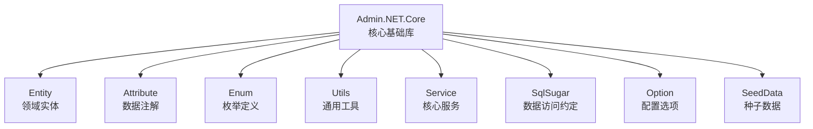
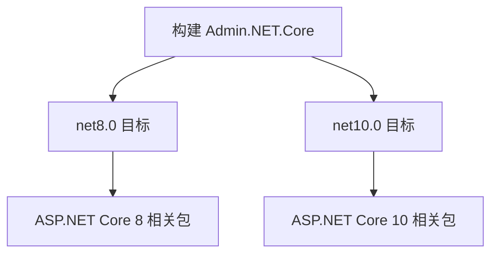
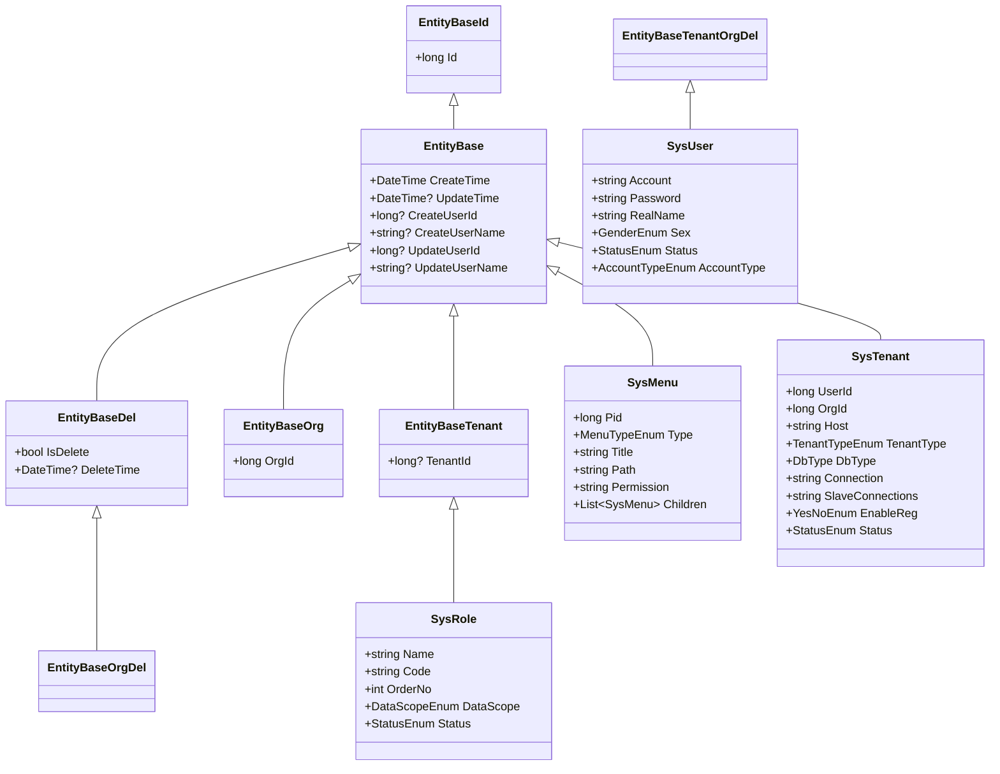
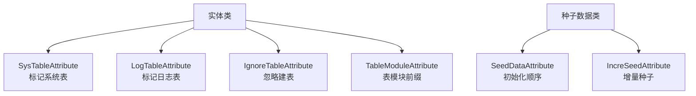
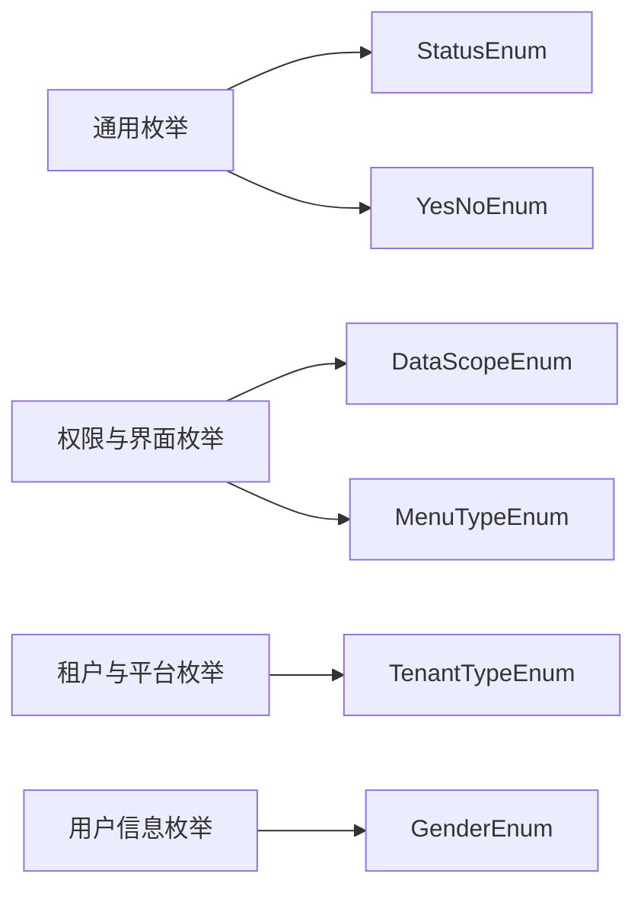
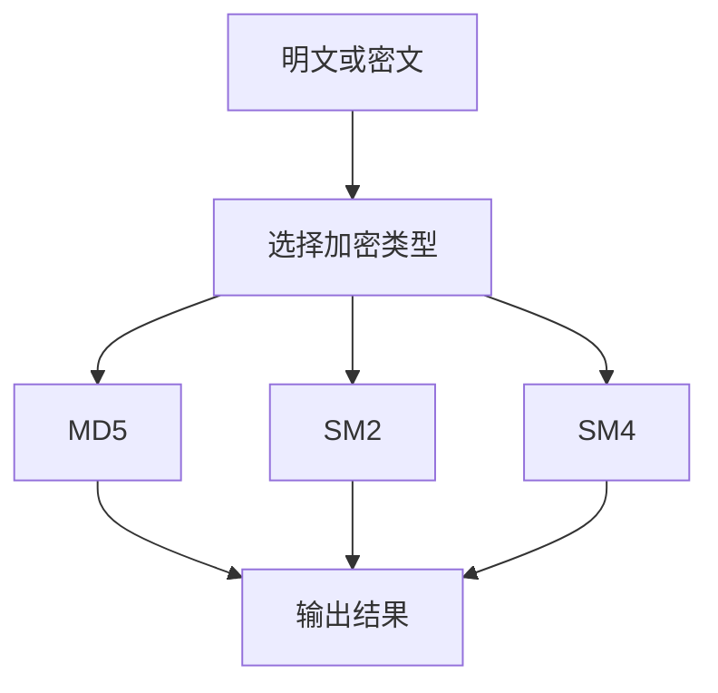
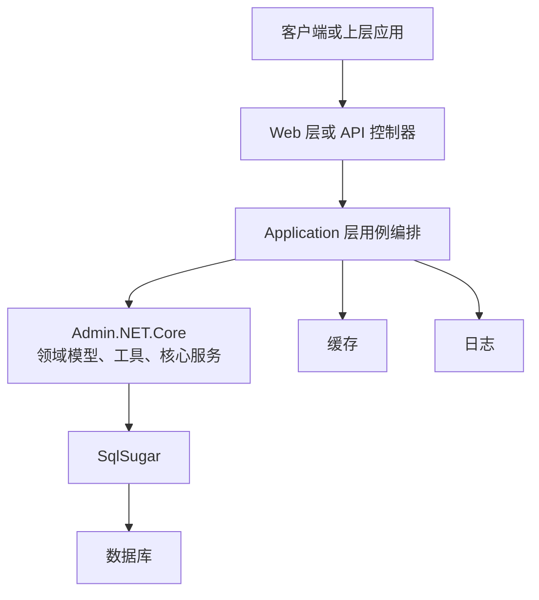
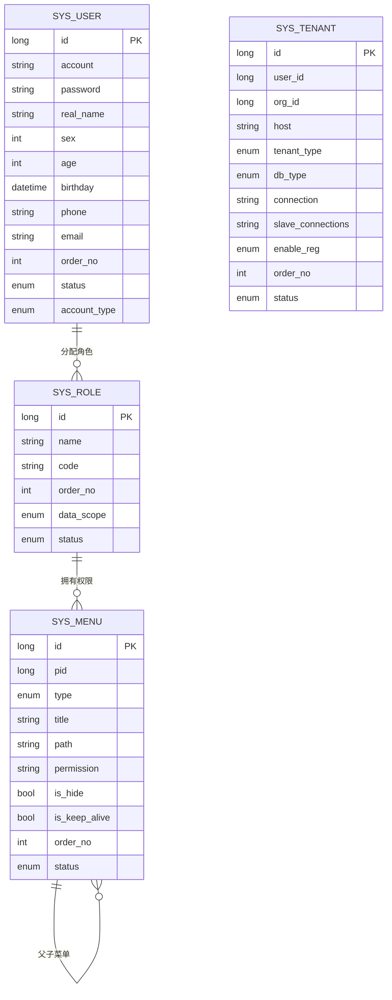
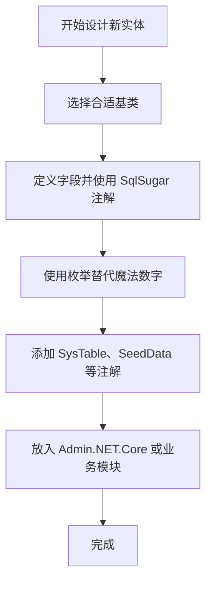
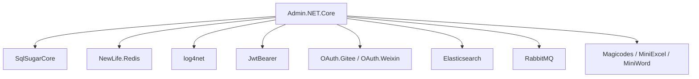

# 核心层 Admin.NET.Core

<cite>
**本文引用的文件**   
- [Admin.NET.Core.csproj](file://Admin.NET/Admin.NET.Core/Admin.NET.Core.csproj)
- [global.json](file://Admin.NET/global.json)
- [EntityBase.cs](file://Admin.NET/Admin.NET.Core/Entity/EntityBase.cs)
- [IEntityFilter.cs](file://Admin.NET/Admin.NET.Core/Entity/IEntityFilter.cs)
- [SysUser.cs](file://Admin.NET/Admin.NET.Core/Entity/SysUser.cs)
- [SysRole.cs](file://Admin.NET/Admin.NET.Core/Entity/SysRole.cs)
- [SysMenu.cs](file://Admin.NET/Admin.NET.Core/Entity/SysMenu.cs)
- [SysTenant.cs](file://Admin.NET/Admin.NET.Core/Entity/SysTenant.cs)
- [SysTableAttribute.cs](file://Admin.NET/Admin.NET.Core/Attribute/SysTableAttribute.cs)
- [SeedDataAttribute.cs](file://Admin.NET/Admin.NET.Core/Attribute/SeedDataAttribute.cs)
- [LogTableAttribute.cs](file://Admin.NET/Admin.NET.Core/Attribute/LogTableAttribute.cs)
- [TableModuleAttribute.cs](file://Admin.NET/Admin.NET.Core/Attribute/TableModuleAttribute.cs)
- [IgnoreTableAttribute.cs](file://Admin.NET/Admin.NET.Core/Attribute/IgnoreTableAttribute.cs)
- [IncreSeedAttribute.cs](file://Admin.NET/Admin.NET.Core/Attribute/IncreSeedAttribute.cs)
- [StatusEnum.cs](file://Admin.NET/Admin.NET.Core/Enum/StatusEnum.cs)
- [DataScopeEnum.cs](file://Admin.NET/Admin.NET.Core/Enum/DataScopeEnum.cs)
- [TenantTypeEnum.cs](file://Admin.NET/Admin.NET.Core/Enum/TenantTypeEnum.cs)
- [YesNoEnum.cs](file://Admin.NET/Admin.NET.Core/Enum/YesNoEnum.cs)
- [GenderEnum.cs](file://Admin.NET/Admin.NET.Core/Enum/GenderEnum.cs)
- [MenuTypeEnum.cs](file://Admin.NET/Admin.NET.Core/Enum/MenuTypeEnum.cs)
- [CryptogramUtil.cs](file://Admin.NET/Admin.NET.Core/Utils/CryptogramUtil.cs)
</cite>

## 目录

1. [引言](#引言)
2. [项目结构](#项目结构)
3. [核心组件](#核心组件)
4. [架构总览](#架构总览)
5. [详细组件分析](#详细组件分析)
6. [依赖分析](#依赖分析)
7. [性能与多数据库配置建议](#性能与多数据库配置建议)
8. [故障排查指南](#故障排查指南)
9. [结论](#结论)

## 引言

Admin.NET.Core 是 Admin.NET 权限开发平台的核心基础库。它不负责具体业务实现，而是为所有上层应用模块提供领域实体基类、数据注解、枚举常量、通用工具、缓存与日志抽象、SqlSugar 集成约定以及种子数据等基础设施。当前工程以 net8.0 和 net10.0 双目标框架编译，同时通过条件引用适配不同 ASP.NET Core 运行时版本。

该文档面向需要扩展 Admin.NET 的开发者，重点说明：

- 如何理解并继承 EntityBase 系列基类设计领域实体。
- 如何使用 Sys* 系统实体建模用户、角色、菜单、租户等核心资源。
- 如何通过 Attribute 体系控制表映射、日志表、种子数据和表模块前缀。
- 如何组织枚举、常量和工具方法。
- 如何在现有架构下新增自定义实体和服务。
- 如何结合 SqlSugar 进行多数据库配置与性能优化。

## 项目结构

Admin.NET.Core 采用按职责分层的目录组织方式：

| 目录 | 主要职责 | 典型内容 |
|---|---|---|
| Entity | 领域实体与过滤接口 | EntityBase、IEntityFilter、SysUser、SysRole、SysMenu、SysTenant |
| Attribute | 数据与行为注解 | SysTableAttribute、SeedDataAttribute、LogTableAttribute、TableModuleAttribute |
| Enum | 业务与系统枚举 | StatusEnum、DataScopeEnum、TenantTypeEnum、YesNoEnum |
| Utils | 通用工具类 | CryptogramUtil、CommonHelper、ReflectionHelper、SafeMath |
| Cache | 缓存抽象 | ICacheProvider、CacheProvider |
| Logging | 日志抽象 | 日志记录器、上下文、格式化器等 |
| Option | 配置选项对象 | 各类 IOptionConfig 绑定模型 |
| Service | 核心服务 | 枚举服务、通用服务、领域服务入口 |
| SqlSugar | 数据访问约定 | 查询构建、分页、审计、动态表达式等 |
| SeedData | 种子数据 | 初始数据加载逻辑 |
| Extension | 扩展方法 | 类型转换、集合操作、反射辅助 |
| EventBus / Job / Hub / SignalR | 异步通信与任务 | 事件总线、定时任务、SignalR 支持 |

**图表来源**   
- [Admin.NET.Core.csproj:1-70](file://Admin.NET/Admin.NET.Core/Admin.NET.Core.csproj#L1-L70)

**章节来源**   
- [Admin.NET.Core.csproj:1-70](file://Admin.NET/Admin.NET.Core/Admin.NET.Core.csproj#L1-L70)

## 核心组件

### 目标框架与工程边界

Admin.NET.Core 的工程文件声明了双目标框架：net8.0 与 net10.0。这意味着同一份源码可以分别编译到两个不同的 .NET 运行时目标，从而兼容较旧的生产环境和较新的预览或长期支持环境。

| 目标框架 | 作用 |
|---|---|
| net8.0 | 兼容当前广泛使用的 ASP.NET Core 8 生态 |
| net10.0 | 面向更高版本的 ASP.NET Core 运行时，使用对应版本的 OAuth、SignalR 和数据保护包 |

根级 global.json 仅指定测试运行器 Microsoft.Testing.Platform，并未固定全局 .NET SDK 版本；因此不能据此声称仓库已锁定某个 SDK 版本。实际编译时仍由调用方 SDK 和目标框架决定。

**图表来源**   
- [Admin.NET.Core.csproj:1-70](file://Admin.NET/Admin.NET.Core/Admin.NET.Core.csproj#L1-L70)
- [global.json:1-5](file://Admin.NET/global.json#L1-L5)

**章节来源**   
- [Admin.NET.Core.csproj:1-70](file://Admin.NET/Admin.NET.Core/Admin.NET.Core.csproj#L1-L70)
- [global.json:1-5](file://Admin.NET/global.json#L1-L5)

### 领域实体设计模式

#### 基类层次

Admin.NET 的实体模型围绕 Id、时间戳、创建修改人、软删除、机构隔离和租户隔离展开。核心基类如下：

| 类型 | 职责 |
|---|---|
| EntityBaseId | 定义雪花 Id 主键 |
| EntityBase | 增加创建时间、更新时间、创建者、修改者等审计字段 |
| EntityBaseDel | 增加 IsDelete 和 DeleteTime，实现软删除过滤 |
| EntityBaseOrg | 增加 OrgId，接入机构数据权限过滤 |
| EntityBaseTenant | 增加 TenantId，接入租户数据隔离 |
| EntityBaseTenantOrgDel 等组合基类 | 组合租户、机构、删除标志等多重能力 |

#### 过滤接口

IEntityFilter 定义了三种常见数据过滤维度：

| 接口 | 字段 | 用途 |
|---|---|---|
| IDeletedFilter | IsDelete | 软删除过滤 |
| ITenantIdFilter | TenantId | 租户隔离过滤 |
| IOrgIdFilter | OrgId | 机构数据权限过滤 |

这些接口由 SqlSugar 的过滤器机制识别，并在查询时自动注入 where 条件，避免业务代码重复编写数据范围判断。

#### 系统实体关系

| 实体 | 基类 | 主要职责 |
|---|---|---|
| SysUser | EntityBaseTenantOrg | 系统用户，包含账号、密码、联系方式、状态、账号类型等 |
| SysRole | EntityBaseTenant | 系统角色，包含名称、编码、排序、数据范围和状态 |
| SysMenu | EntityBase | 系统菜单，包含父节点、类型、路由、权限标识、图标和子菜单 |
| SysTenant | EntityBase | 系统租户，包含域名、租户类型、数据库类型、连接串和注册配置 |

**图表来源**   
- [EntityBase.cs:1-200](file://Admin.NET/Admin.NET.Core/Entity/EntityBase.cs#L1-L200)
- [IEntityFilter.cs:1-40](file://Admin.NET/Admin.NET.Core/Entity/IEntityFilter.cs#L1-L40)
- [SysUser.cs:1-200](file://Admin.NET/Admin.NET.Core/Entity/SysUser.cs#L1-L200)
- [SysRole.cs:1-56](file://Admin.NET/Admin.NET.Core/Entity/SysRole.cs#L1-L56)
- [SysMenu.cs:1-134](file://Admin.NET/Admin.NET.Core/Entity/SysMenu.cs#L1-L134)
- [SysTenant.cs:1-145](file://Admin.NET/Admin.NET.Core/Entity/SysTenant.cs#L1-L145)

**章节来源**   
- [EntityBase.cs:1-200](file://Admin.NET/Admin.NET.Core/Entity/EntityBase.cs#L1-L200)
- [IEntityFilter.cs:1-40](file://Admin.NET/Admin.NET.Core/Entity/IEntityFilter.cs#L1-L40)
- [SysUser.cs:1-200](file://Admin.NET/Admin.NET.Core/Entity/SysUser.cs#L1-L200)
- [SysRole.cs:1-56](file://Admin.NET/Admin.NET.Core/Entity/SysRole.cs#L1-L56)
- [SysMenu.cs:1-134](file://Admin.NET/Admin.NET.Core/Entity/SysMenu.cs#L1-L134)
- [SysTenant.cs:1-145](file://Admin.NET/Admin.NET.Core/Entity/SysTenant.cs#L1-L145)

### Attribute 体系

Admin.NET.Core 的 Attribute 主要用于描述实体的元数据、数据访问行为和初始化策略，而不是直接执行复杂业务逻辑。

| 特性 | 作用 | 使用建议 |
|---|---|---|
| SysTableAttribute | 标记系统表 | 用于区分系统内置表与业务扩展表，便于生成、迁移或扫描 |
| LogTableAttribute | 标记日志表 | 配合日志写入逻辑，将操作日志持久化到独立表 |
| SeedDataAttribute | 标记种子数据类 | 指定初始化顺序，Order 越大越晚执行 |
| IncreSeedAttribute | 标记增量种子数据 | 用于可重复执行的增量初始化逻辑 |
| TableModuleAttribute | 指定表前缀 | 用于按模块划分表命名空间 |
| IgnoreTableAttribute | 忽略表结构初始化 | 实体不参与建表或同步结构 |

**图表来源**   
- [SysTableAttribute.cs:1-16](file://Admin.NET/Admin.NET.Core/Attribute/SysTableAttribute.cs#L1-L16)
- [LogTableAttribute.cs:1-16](file://Admin.NET/Admin.NET.Core/Attribute/LogTableAttribute.cs#L1-L16)
- [SeedDataAttribute.cs:1-25](file://Admin.NET/Admin.NET.Core/Attribute/SeedDataAttribute.cs#L1-L25)
- [IncreSeedAttribute.cs:1-16](file://Admin.NET/Admin.NET.Core/Attribute/IncreSeedAttribute.cs#L1-L16)
- [TableModuleAttribute.cs:1-18](file://Admin.NET/Admin.NET.Core/Attribute/TableModuleAttribute.cs#L1-L18)
- [IgnoreTableAttribute.cs:1-16](file://Admin.NET/Admin.NET.Core/Attribute/IgnoreTableAttribute.cs#L1-L16)

**章节来源**   
- [SysTableAttribute.cs:1-16](file://Admin.NET/Admin.NET.Core/Attribute/SysTableAttribute.cs#L1-L16)
- [SeedDataAttribute.cs:1-25](file://Admin.NET/Admin.NET.Core/Attribute/SeedDataAttribute.cs#L1-L25)
- [LogTableAttribute.cs:1-16](file://Admin.NET/Admin.NET.Core/Attribute/LogTableAttribute.cs#L1-L16)
- [TableModuleAttribute.cs:1-18](file://Admin.NET/Admin.NET.Core/Attribute/TableModuleAttribute.cs#L1-L18)
- [IgnoreTableAttribute.cs:1-16](file://Admin.NET/Admin.NET.Core/Attribute/IgnoreTableAttribute.cs#L1-L16)
- [IncreSeedAttribute.cs:1-16](file://Admin.NET/Admin.NET.Core/Attribute/IncreSeedAttribute.cs#L1-L16)

### 枚举分类与组织方式

枚举集中在 Admin.NET.Core/Enum 目录，主要分类如下：

| 分类 | 代表枚举 | 用途 |
|---|---|---|
| 通用状态 | StatusEnum、YesNoEnum | 启用停用、是否开关 |
| 权限与数据范围 | DataScopeEnum、MenuTypeEnum | 角色数据范围、菜单类型 |
| 租户与平台 | TenantTypeEnum、PlatformTypeEnum | 租户隔离方式、第三方平台 |
| 用户信息 | GenderEnum、NationEnum、CultureLevelEnum | 性别、民族、文化程度 |
| 系统与运维 | JobStatusEnum、NoticeTypeEnum、CacheTypeEnum | 任务、通知、缓存策略 |
| 错误码 | ErrorCodeEnum | 统一错误码定义 |

每个枚举通常带有 Description 标签，部分枚举还带有 Theme 标签，便于前端展示主题色。

**图表来源**   
- [StatusEnum.cs:1-26](file://Admin.NET/Admin.NET.Core/Enum/StatusEnum.cs#L1-L26)
- [YesNoEnum.cs:1-26](file://Admin.NET/Admin.NET.Core/Enum/YesNoEnum.cs#L1-L26)
- [DataScopeEnum.cs:1-44](file://Admin.NET/Admin.NET.Core/Enum/DataScopeEnum.cs#L1-L44)
- [MenuTypeEnum.cs:1-33](file://Admin.NET/Admin.NET.Core/Enum/MenuTypeEnum.cs#L1-L33)
- [TenantTypeEnum.cs:1-26](file://Admin.NET/Admin.NET.Core/Enum/TenantTypeEnum.cs#L1-L26)
- [GenderEnum.cs:1-38](file://Admin.NET/Admin.NET.Core/Enum/GenderEnum.cs#L1-L38)

**章节来源**   
- [StatusEnum.cs:1-26](file://Admin.NET/Admin.NET.Core/Enum/StatusEnum.cs#L1-L26)
- [DataScopeEnum.cs:1-44](file://Admin.NET/Admin.NET.Core/Enum/DataScopeEnum.cs#L1-L44)
- [TenantTypeEnum.cs:1-26](file://Admin.NET/Admin.NET.Core/Enum/TenantTypeEnum.cs#L1-L26)
- [YesNoEnum.cs:1-26](file://Admin.NET/Admin.NET.Core/Enum/YesNoEnum.cs#L1-L26)
- [GenderEnum.cs:1-38](file://Admin.NET/Admin.NET.Core/Enum/GenderEnum.cs#L1-L38)
- [MenuTypeEnum.cs:1-33](file://Admin.NET/Admin.NET.Core/Enum/MenuTypeEnum.cs#L1-L33)

### 工具类与通用能力

#### 加密工具

CryptogramUtil 提供统一的加解密入口，并根据配置选择 MD5、SM2 或 SM4。它从配置中读取加密类型、公钥、私钥和密码强度规则。

| 能力 | 说明 |
|---|---|
| Encrypt / Decrypt | 根据 CryptoType 分发到具体算法 |
| SM2Encrypt / SM2Decrypt | 基于公钥私钥的非对称加密 |
| SM4EncryptECB / SM4DecryptECB | SM4 ECB 模式 |
| SM4EncryptCBC / SM4DecryptCBC | SM4 CBC 模式 |

**图表来源**   
- [CryptogramUtil.cs:1-120](file://Admin.NET/Admin.NET.Core/Utils/CryptogramUtil.cs#L1-L120)

**章节来源**   
- [CryptogramUtil.cs:1-120](file://Admin.NET/Admin.NET.Core/Utils/CryptogramUtil.cs#L1-L120)

#### 其他工具类

| 工具类 | 职责 |
|---|---|
| CommonHelper | 常用字符串、日期、路径、安全处理等 |
| ReflectionHelper | 反射获取属性、特性、类型信息 |
| SafeMath | 安全的数学计算，防止溢出或异常 |
| DateTimeUtil | 日期时间格式化和转换 |
| ExcelHelper / MiniExcelUtil | Excel 导入导出 |
| RoutePermissionUtil | 路由权限解析 |
| HashHelper | 哈希计算 |
| SSHHelper | SSH 远程操作 |
| GiteeHelper | Git 平台辅助 |
| CodeGenHelper / CodeGenUtil | 代码生成相关辅助 |

这些工具类应保持无状态或弱状态，尽量不持有跨请求的全局可变状态，以便在多线程和分布式环境中稳定运行。

**章节来源**   
- [CryptogramUtil.cs:1-120](file://Admin.NET/Admin.NET.Core/Utils/CryptogramUtil.cs#L1-L120)

### 依赖注入与服务边界

Admin.NET.Core 中的 Service 目录提供的是“核心服务”，例如枚举服务、通用查询服务、系统能力服务等。它们通常通过依赖注入暴露给上层 Application 层或 Web 层。

推荐遵循以下边界：

| 层级 | 应做什么 | 不应做什么 |
|---|---|---|
| Core | 提供实体、枚举、工具、通用服务、SqlSugar 约定 | 不写具体业务编排逻辑 |
| Application | 编排用例、事务、领域流程 | 不直接操作数据库细节 |
| Web / Entry | 接收请求、返回响应、组装 DTO | 不承载核心领域模型 |

**章节来源**   
- [Admin.NET.Core.csproj:1-70](file://Admin.NET/Admin.NET.Core/Admin.NET.Core.csproj#L1-L70)

## 架构总览

该图展示了 Admin.NET.Core 作为基础库的位置：它向上为 Application 层提供领域模型和通用能力，向下通过 SqlSugar 访问数据库，并与缓存、日志等横切能力协作。

**图表来源**   
- [Admin.NET.Core.csproj:1-70](file://Admin.NET/Admin.NET.Core/Admin.NET.Core.csproj#L1-L70)
- [EntityBase.cs:1-200](file://Admin.NET/Admin.NET.Core/Entity/EntityBase.cs#L1-L200)

## 详细组件分析

### 领域实体建模示例

#### 用户角色菜单模型

SysUser、SysRole、SysMenu 共同构成权限系统的基础：

- SysUser 继承租户和机构基类，适合按租户隔离并按机构做数据权限。
- SysRole 继承租户基类，适合按租户维护角色。
- SysMenu 继承基础实体，通过 Pid 形成树形菜单结构，Children 用于前端渲染。

**图表来源**   
- [SysUser.cs:1-200](file://Admin.NET/Admin.NET.Core/Entity/SysUser.cs#L1-L200)
- [SysRole.cs:1-56](file://Admin.NET/Admin.NET.Core/Entity/SysRole.cs#L1-L56)
- [SysMenu.cs:1-134](file://Admin.NET/Admin.NET.Core/Entity/SysMenu.cs#L1-L134)
- [SysTenant.cs:1-145](file://Admin.NET/Admin.NET.Core/Entity/SysTenant.cs#L1-L145)

**章节来源**   
- [SysUser.cs:1-200](file://Admin.NET/Admin.NET.Core/Entity/SysUser.cs#L1-L200)
- [SysRole.cs:1-56](file://Admin.NET/Admin.NET.Core/Entity/SysRole.cs#L1-L56)
- [SysMenu.cs:1-134](file://Admin.NET/Admin.NET.Core/Entity/SysMenu.cs#L1-L134)
- [SysTenant.cs:1-145](file://Admin.NET/Admin.NET.Core/Entity/SysTenant.cs#L1-L145)

### 自定义实体开发规范

新增一个自定义业务实体时，建议遵循以下规则：

1. **选择合适的基类**
   - 仅需 Id 和时间戳：继承 EntityBase。
   - 需要软删除：继承 EntityBaseDel。
   - 需要机构数据权限：继承 EntityBaseOrg 或 EntityBaseOrgDel。
   - 需要租户隔离：继承 EntityBaseTenant 或组合租户基类。

2. **使用 SqlSugar 注解**
   - 使用 SugarTable 指定表名和中文注释。
   - 使用 SugarColumn 指定列名、长度、是否可空、是否忽略更新等。
   - 对查询频繁的字段添加 SugarIndex。

3. **使用业务枚举**
   - 优先复用现有枚举，如 StatusEnum、YesNoEnum。
   - 新增枚举放在 Enum 目录，并添加 Description。

4. **可选标注**
   - 如果是系统表，添加 SysTableAttribute。
   - 如果需要参与种子数据初始化，添加 SeedDataAttribute 或 IncreSeedAttribute。
   - 如果表属于特定模块，考虑 TableModuleAttribute。

5. **避免把业务编排放入 Core**
   - Core 只放实体、枚举、工具、通用服务。
   - 业务流程放在 Application 层或业务模块。

**图表来源**   
- [EntityBase.cs:1-200](file://Admin.NET/Admin.NET.Core/Entity/EntityBase.cs#L1-L200)
- [SysTableAttribute.cs:1-16](file://Admin.NET/Admin.NET.Core/Attribute/SysTableAttribute.cs#L1-L16)
- [SeedDataAttribute.cs:1-25](file://Admin.NET/Admin.NET.Core/Attribute/SeedDataAttribute.cs#L1-L25)

**章节来源**   
- [EntityBase.cs:1-200](file://Admin.NET/Admin.NET.Core/Entity/EntityBase.cs#L1-L200)
- [SysTableAttribute.cs:1-16](file://Admin.NET/Admin.NET.Core/Attribute/SysTableAttribute.cs#L1-L16)
- [SeedDataAttribute.cs:1-25](file://Admin.NET/Admin.NET.Core/Attribute/SeedDataAttribute.cs#L1-L25)

### 自定义服务开发规范

Admin.NET.Core 中的服务通常是“核心能力服务”，例如枚举服务、通用查询封装、系统配置读取等。扩展时应注意：

- 服务应面向接口或可替换实现，便于测试和替换底层依赖。
- 不要直接在服务中硬编码业务规则；业务规则应放在 Application 层。
- 对数据库访问尽量通过 SqlSugar 提供的封装，而不是拼接 SQL。
- 对敏感信息（密码、密钥、连接串）应通过配置或加密工具处理。

**章节来源**   
- [Admin.NET.Core.csproj:1-70](file://Admin.NET/Admin.NET.Core/Admin.NET.Core.csproj#L1-L70)

## 依赖分析

Admin.NET.Core 的外部依赖包括：

| 类别 | 代表依赖 | 作用 |
|---|---|---|
| ORM | SqlSugarCore、SqlSugar.MongoDbCore | 数据库映射、查询、MongoDB 支持 |
| 配置与反射 | Furion、AspectCore.Extensions.Reflection | 配置、反射增强 |
| 认证 | JwtBearer、OAuth.Gitee、OAuth.Weixin | JWT 和第三方登录 |
| 缓存 | NewLife.Redis | Redis 缓存 |
| 日志 | log4net | 日志框架 |
| 邮件 | MailKit | 邮件发送 |
| 办公文档 | Magicodes.IE、MiniExcel、MiniWord | Excel、PDF、Word 处理 |
| 搜索 | Elastic.Clients.Elasticsearch | Elasticsearch 集成 |
| 消息 | RabbitMQ.Client | 消息队列 |
| 图像处理 | SixLabors.ImageSharp.Web | 图片处理 |
| 支付 | AlipaySDKNet.Standard、TencentCloudSDK.Sms、AlibabaCloud.SDK.Dysmsapi20170525 | 支付宝、短信 |
| 工具 | Yitter.IdGenerator、Hashids.net、IPTools、UAParser | ID、哈希、IP、UA 解析 |

net8.0 和 net10.0 的差异主要体现在 ASP.NET Core 相关包版本上，例如 OAuth、SignalR、DataProtection 的 StackExchangeRedis 实现。

**图表来源**   
- [Admin.NET.Core.csproj:1-70](file://Admin.NET/Admin.NET.Core/Admin.NET.Core.csproj#L1-L70)

**章节来源**   
- [Admin.NET.Core.csproj:1-70](file://Admin.NET/Admin.NET.Core/Admin.NET.Core.csproj#L1-L70)

## 性能与多数据库配置建议

### 双目标框架注意事项

- 编译 Admin.NET.Core 时，net8.0 和 net10.0 会分别引入对应版本的 ASP.NET Core 依赖。
- 生产部署时，应确保宿主应用的运行时版本与目标框架一致。
- 不要混用 net8.0 编译的 Core 二进制与 net10.0 宿主应用，反之亦然。

### 多数据库支持

SysTenant 已经体现多数据库能力：

| 字段 | 含义 |
|---|---|
| DbType | 数据库类型 |
| Connection | 主库连接串 |
| SlaveConnections | 从库连接串，可用于读写分离 |
| ConfigId | 连接配置标识 |

建议在租户层面管理连接串，而不是在应用启动时硬编码数据库地址。这样可以支持：

- 按租户切换数据库。
- 主库写、从库读。
- 不同租户使用不同数据库类型或实例。

### SqlSugar 性能建议

| 建议 | 说明 |
|---|---|
| 合理索引 | 对频繁查询字段添加 SugarIndex |
| 避免 N+1 | 使用导航属性或显式加载关联数据 |
| 分页查询 | 使用分页接口，避免一次性拉取大表 |
| 投影字段 | 只查询必要字段，减少网络传输 |
| 批量操作 | 大量插入或更新时使用批量接口 |
| 连接池 | 保持合理的数据库连接数 |
| 缓存热点数据 | 使用缓存减少重复查询 |

### 缓存与日志建议

- 缓存适合存放字典、枚举、菜单、租户配置等相对稳定的数据。
- 敏感数据不应进入缓存，除非经过脱敏或加密。
- 日志应区分操作日志、访问日志和异常日志，避免日志量过大影响性能。
- 日志写入可采用异步或缓冲策略，避免阻塞主流程。

**章节来源**   
- [SysTenant.cs:1-145](file://Admin.NET/Admin.NET.Core/Entity/SysTenant.cs#L1-L145)
- [EntityBase.cs:1-200](file://Admin.NET/Admin.NET.Core/Entity/EntityBase.cs#L1-L200)

## 故障排查指南

### 实体未建表或字段缺失

可能原因：

- 实体未正确继承 EntityBase 系列基类。
- 使用了 IgnoreTableAttribute。
- SugarTable 或 SugarColumn 配置不正确。
- 实体未被 SqlSugar 发现或映射。

排查步骤：

1. 检查实体是否继承合适的基类。
2. 检查是否误加 IgnoreTableAttribute。
3. 检查 SugarTable 和 SugarColumn 是否与数据库字段一致。
4. 查看数据库迁移或建表脚本是否包含该表。

### 租户数据污染

可能原因：

- 实体未继承 ITenantIdFilter 对应的基类。
- 查询时未启用租户过滤。
- 管理员或系统级查询未正确处理租户隔离。

排查步骤：

1. 确认实体继承 EntityBaseTenant 或组合租户基类。
2. 检查 SqlSugar 过滤器是否启用。
3. 确认查询上下文是否正确设置租户 Id。

### 软删除导致数据查不到

可能原因：

- 实体继承 EntityBaseDel，但查询未关闭软删除过滤。
- 历史数据清理逻辑误删数据。

排查步骤：

1. 检查实体是否继承 EntityBaseDel。
2. 确认查询是否期望包含已删除数据。
3. 核对 IsDelete 和 DeleteTime 字段值。

### 加密失败或明文存储

可能原因：

- CryptogramUtil 配置的 CryptoType 与实际算法不一致。
- SM2 或 SM4 密钥未正确配置。
- 升级后加密算法发生变化。

排查步骤：

1. 检查 Cryptogram 配置项。
2. 确认公钥、私钥和密钥参数。
3. 对已有数据进行一致性校验。

**章节来源**   
- [EntityBase.cs:1-200](file://Admin.NET/Admin.NET.Core/Entity/EntityBase.cs#L1-L200)
- [IEntityFilter.cs:1-40](file://Admin.NET/Admin.NET.Core/Entity/IEntityFilter.cs#L1-L40)
- [CryptogramUtil.cs:1-120](file://Admin.NET/Admin.NET.Core/Utils/CryptogramUtil.cs#L1-L120)
- [IgnoreTableAttribute.cs:1-16](file://Admin.NET/Admin.NET.Core/Attribute/IgnoreTableAttribute.cs#L1-L16)

## 结论

Admin.NET.Core 是 Admin.NET 平台的基石。它通过 EntityBase 基类、过滤接口、Sys* 系统实体、数据注解、枚举体系和通用工具，为权限、租户、菜单、角色、日志、任务、缓存和数据库访问提供了统一抽象。

开发扩展时应遵循以下原则：

- 使用 EntityBase 系列基类建立一致的实体模型。
- 使用枚举表达业务状态，避免魔法数字。
- 使用 Attribute 描述表的系统语义、日志语义和初始化语义。
- 将核心领域模型放在 Core，将业务编排放在 Application 层。
- 通过 SysTenant 和 SqlSugar 实现多租户和多数据库能力。
- 谨慎选择 net8.0 或 net10.0 目标，并确保宿主运行时匹配。

这样可以在保证架构一致性的前提下，逐步扩展 Admin.NET 的业务能力。