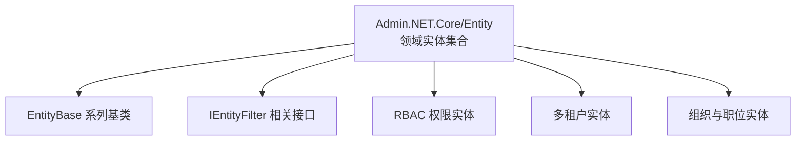
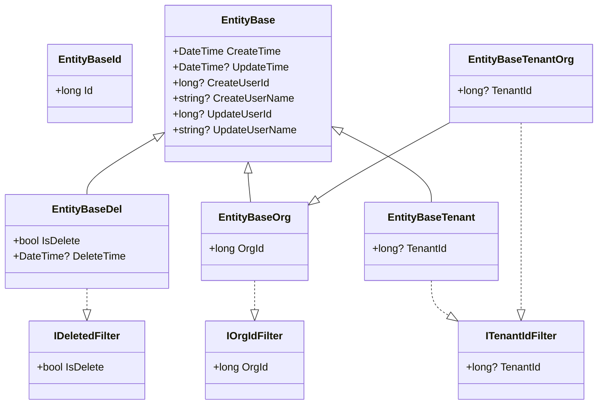
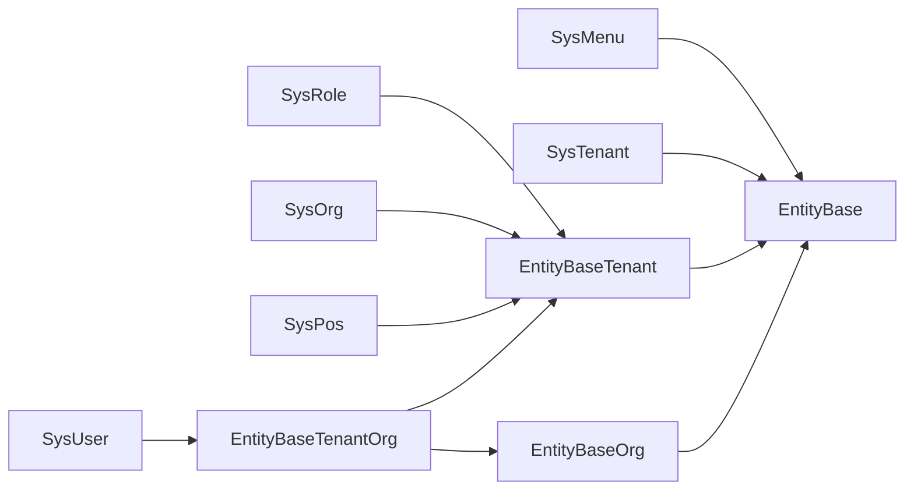
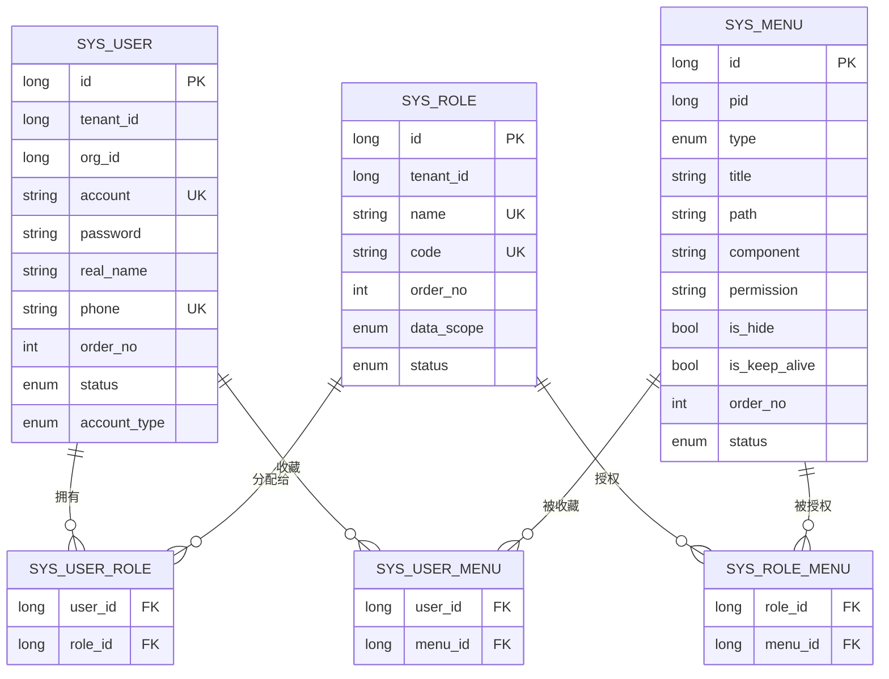
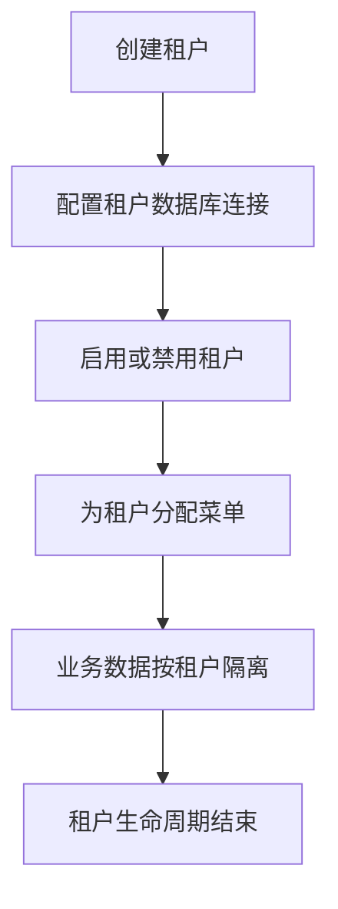
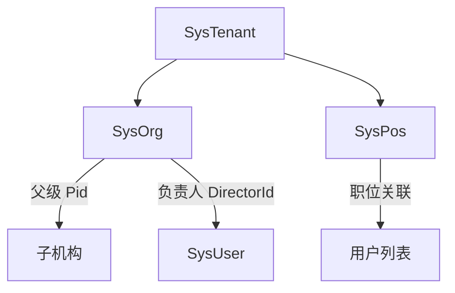
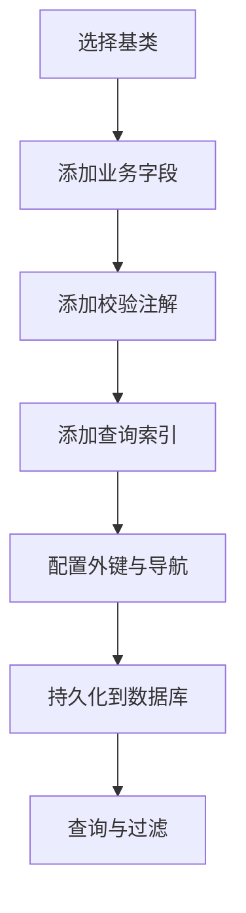
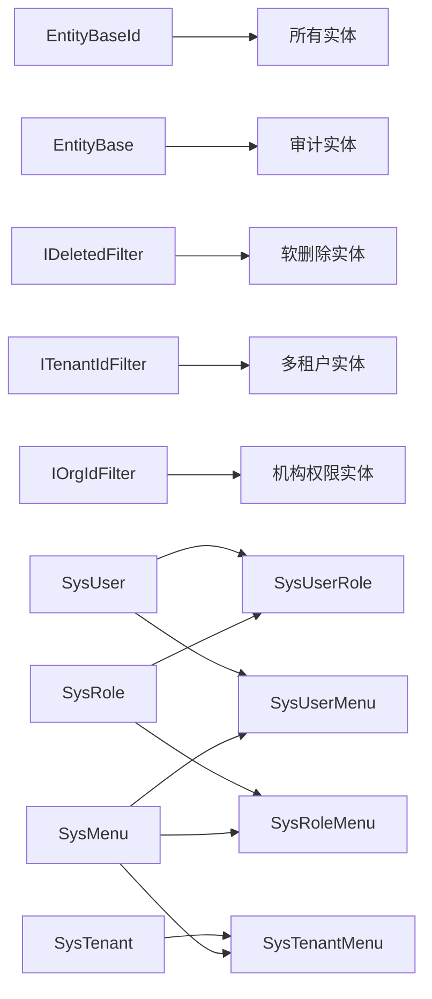

# 领域实体设计

<cite>
**本文引用的文件**   
- [EntityBase.cs](file://Admin.NET/Admin.NET.Core/Entity/EntityBase.cs)
- [IEntityFilter.cs](file://Admin.NET/Admin.NET.Core/Entity/IEntityFilter.cs)
- [SysUser.cs](file://Admin.NET/Admin.NET.Core/Entity/SysUser.cs)
- [SysRole.cs](file://Admin.NET/Admin.NET.Core/Entity/SysRole.cs)
- [SysMenu.cs](file://Admin.NET/Admin.NET.Core/Entity/SysMenu.cs)
- [SysRoleMenu.cs](file://Admin.NET/Admin.NET.Core/Entity/SysRoleMenu.cs)
- [SysUserRole.cs](file://Admin.NET/Admin.NET.Core/Entity/SysUserRole.cs)
- [SysUserMenu.cs](file://Admin.NET/Admin.NET.Core/Entity/SysUserMenu.cs)
- [SysTenant.cs](file://Admin.NET/Admin.NET.Core/Entity/SysTenant.cs)
- [SysTenantConfig.cs](file://Admin.NET/Admin.NET.Core/Entity/SysTenantConfig.cs)
- [SysTenantMenu.cs](file://Admin.NET/Admin.NET.Core/Entity/SysTenantMenu.cs)
- [SysOrg.cs](file://Admin.NET/Admin.NET.Core/Entity/SysOrg.cs)
- [SysPos.cs](file://Admin.NET/Admin.NET.Core/Entity/SysPos.cs)
</cite>

## 目录
1. [引言](#引言)
2. [项目结构定位](#项目结构定位)
3. [核心实体基类与过滤接口](#核心实体基类与过滤接口)
4. [架构总览](#架构总览)
5. [权限模型实体详解](#权限模型实体详解)
6. [多租户实体详解](#多租户实体详解)
7. [组织机构与职位实体详解](#组织机构与职位实体详解)
8. [自定义实体开发指南](#自定义实体开发指南)
9. [依赖关系分析](#依赖关系分析)
10. [性能与索引优化建议](#性能与索引优化建议)
11. [常见问题排查](#常见问题排查)
12. [结论](#结论)

## 引言
本文面向 Admin.NET.Core 领域的数据库实体设计，重点说明以下目标：
- EntityBase 系列基类的字段职责、生命周期约定和组合方式。
- IEntityFilter 相关接口在软删除、多租户、机构数据权限中的作用。
- RBAC 权限模型（用户、角色、菜单及关联表）的建模方式。
- 多租户隔离策略在 SysTenant、SysTenantConfig、SysTenantMenu 中的体现。
- 组织机构树形结构 SysOrg 与职位 SysPos 的设计。
- 如何基于现有基类和注解扩展自定义业务实体。

本说明以当前仓库中 `Admin.NET.Admin.NET.Core/Entity` 下的实体源码为依据，不引入未在当前分支出现的实现细节。

## 项目结构定位
Admin.NET 的核心领域模型集中在 `Admin.NET.Admin.NET.Core/Entity` 目录中。本文关注的领域实体包括：
- 基础框架实体：EntityBaseId、EntityBase、EntityBaseDel、EntityBaseOrg、EntityBaseTenant、EntityBaseTenantOrg 等。
- 权限实体：SysUser、SysRole、SysMenu、SysRoleMenu、SysUserRole、SysUserMenu。
- 多租户实体：SysTenant、SysTenantConfig、SysTenantMenu。
- 组织与职位实体：SysOrg、SysPos。
- 过滤接口：IDeletedFilter、ITenantIdFilter、IOrgIdFilter。

**图示来源**
- [EntityBase.cs:1-203](file://Admin.NET/Admin.NET.Core/Entity/EntityBase.cs#L1-L203)
- [IEntityFilter.cs:1-40](file://Admin.NET/Admin.NET.Core/Entity/IEntityFilter.cs#L1-L40)
- [SysUser.cs:1-353](file://Admin.NET/Admin.NET.Core/Entity/SysUser.cs#L1-L353)
- [SysRole.cs:1-56](file://Admin.NET/Admin.NET.Core/Entity/SysRole.cs#L1-L56)
- [SysMenu.cs:1-134](file://Admin.NET/Admin.NET.Core/Entity/SysMenu.cs#L1-L134)
- [SysTenant.cs:1-145](file://Admin.NET/Admin.NET.Core/Entity/SysTenant.cs#L1-L145)
- [SysOrg.cs:1-96](file://Admin.NET/Admin.NET.Core/Entity/SysOrg.cs#L1-L96)
- [SysPos.cs:1-56](file://Admin.NET/Admin.NET.Core/Entity/SysPos.cs#L1-L56)

**章节来源**
- [EntityBase.cs:1-203](file://Admin.NET/Admin.NET.Core/Entity/EntityBase.cs#L1-L203)
- [IEntityFilter.cs:1-40](file://Admin.NET/Admin.NET.Core/Entity/IEntityFilter.cs#L1-L40)

## 核心实体基类与过滤接口
### EntityBaseId
- 定义通用主键 Id，类型为 long，使用雪花 Id 生成；对应数据库列名为 Id，并标记为主键且非自增。
- 作为所有其他基类的主键来源。

### EntityBase
- 继承 EntityBaseId。
- 提供审计字段：CreateTime、UpdateTime、CreateUserId、CreateUserName、UpdateUserId、UpdateUserName。
- CreateTime 创建后不再更新；UpdateTime 每次修改都会刷新。
- 为 CreateTime 添加升序索引，便于按创建时间排序或查询历史。

### EntityBaseDel
- 继承 EntityBase，并实现 IDeletedFilter。
- 提供 IsDelete 和 DeleteTime 两个软删除字段。
- 为 IsDelete 和 DeleteTime 分别添加升序索引，支持按删除状态和时间筛选。

### EntityBaseOrg
- 继承 EntityBase，并实现 IOrgIdFilter。
- 提供 OrgId 字段，用于机构级数据权限控制。

### EntityBaseOrgDel
- 继承 EntityBaseDel，并实现 IOrgIdFilter。
- 同时具备软删除和机构数据权限能力。

### EntityBaseTenant 系列
- EntityBaseTenant：增加 TenantId 字段，标记为仅忽略更新，常用于多租户隔离。
- EntityBaseTenantDel：在软删除基础上增加租户隔离。
- EntityBaseTenantId：仅保留租户隔离主键基类。
- EntityBaseTenantOrg：同时具备租户隔离与机构数据权限。
- EntityBaseTenantOrgDel：同时具备租户隔离、机构数据权限和软删除。

### 过滤接口
- IDeletedFilter：暴露 IsDelete 属性，供软删除过滤器使用。
- ITenantIdFilter：暴露 TenantId 属性，供多租户过滤使用。
- IOrgIdFilter：暴露 OrgId 属性，供机构数据权限过滤使用。

**图示来源**
- [EntityBase.cs:1-203](file://Admin.NET/Admin.NET.Core/Entity/EntityBase.cs#L1-L203)
- [IEntityFilter.cs:1-40](file://Admin.NET/Admin.NET.Core/Entity/IEntityFilter.cs#L1-L40)

**章节来源**
- [EntityBase.cs:1-203](file://Admin.NET/Admin.NET.Core/Entity/EntityBase.cs#L1-L203)
- [IEntityFilter.cs:1-40](file://Admin.NET/Admin.NET.Core/Entity/IEntityFilter.cs#L1-L40)

## 架构总览
领域实体整体采用“基类组合 + 业务实体”的分层方式：
- 所有实体最终继承 EntityBaseId，保证统一主键。
- 通过 EntityBase 注入审计信息。
- 通过 EntityBaseDel 启用软删除。
- 通过 EntityBaseOrg 注入机构数据权限。
- 通过 EntityBaseTenant 系列注入多租户隔离。
- 业务实体在此基础上叠加业务字段、枚举、校验注解和导航属性。

**图示来源**
- [SysUser.cs:1-353](file://Admin.NET/Admin.NET.Core/Entity/SysUser.cs#L1-L353)
- [SysRole.cs:1-56](file://Admin.NET/Admin.NET.Core/Entity/SysRole.cs#L1-L56)
- [SysMenu.cs:1-134](file://Admin.NET/Admin.NET.Core/Entity/SysMenu.cs#L1-L134)
- [SysTenant.cs:1-145](file://Admin.NET/Admin.NET.Core/Entity/SysTenant.cs#L1-L145)
- [SysOrg.cs:1-96](file://Admin.NET/Admin.NET.Core/Entity/SysOrg.cs#L1-L96)
- [SysPos.cs:1-56](file://Admin.NET/Admin.NET.Core/Entity/SysPos.cs#L1-L56)
- [EntityBase.cs:1-203](file://Admin.NET/Admin.NET.Core/Entity/EntityBase.cs#L1-L203)

## 权限模型实体详解
### SysUser
- 继承 EntityBaseTenantOrg，表示用户既属于某个租户，又受机构数据权限控制。
- 关键字段：Account、Password、RealName、NickName、Avatar、Sex、Age、Birthday、Nation、Phone、CardType、IdCardNum、Email、Address、CultureLevel、PoliticalOutlook、College、OfficePhone、EmergencyContact、EmergencyPhone、EmergencyAddress、Introduction、OrderNo、Status、AccountType、Remark。
- 账号 Phone 和 Account 都建立索引，便于登录、注册和快速检索。
- Password 被忽略 JSON 序列化，避免敏感信息泄露。

### SysRole
- 继承 EntityBaseTenant，表示角色属于特定租户。
- 关键字段：Name、Code、OrderNo、DataScope、Remark、Status。
- Name 和 Code 均建立索引，便于按角色名称和编码查询。
- DataScope 表示数据范围，是数据权限的重要维度。

### SysMenu
- 继承 EntityBase，菜单本身不带租户隔离，但通过 SysTenantMenu 建立租户与菜单的映射。
- 关键字段：Pid、Type、Name、Path、Component、Redirect、Permission、Title、Icon、IsIframe、OutLink、IsHide、IsKeepAlive、IsAffix、OrderNo、Status、Remark。
- Title 和 Type 建立索引，便于按菜单标题和类型筛选。
- Children 使用忽略持久化字段，用于前端树形展示。

### SysRoleMenu
- 用户角色到菜单的关联表，继承 EntityBaseId。
- 包含 RoleId、MenuId，以及可选的 SysMenu 导航属性。

### SysUserRole
- 用户到角色的关联表，继承 EntityBaseId。
- 包含 UserId、RoleId，以及 SysUser、SysRole 导航属性。

### SysUserMenu
- 用户快捷菜单导航表，继承 EntityBaseId。
- 包含 UserId、MenuId，以及 SysUser、SysMenu 导航属性。

**图示来源**
- [SysUser.cs:1-353](file://Admin.NET/Admin.NET.Core/Entity/SysUser.cs#L1-L353)
- [SysRole.cs:1-56](file://Admin.NET/Admin.NET.Core/Entity/SysRole.cs#L1-L56)
- [SysMenu.cs:1-134](file://Admin.NET/Admin.NET.Core/Entity/SysMenu.cs#L1-L134)
- [SysRoleMenu.cs:1-35](file://Admin.NET/Admin.NET.Core/Entity/SysRoleMenu.cs#L1-L35)
- [SysUserRole.cs:1-41](file://Admin.NET/Admin.NET.Core/Entity/SysUserRole.cs#L1-L41)
- [SysUserMenu.cs:1-41](file://Admin.NET/Admin.NET.Core/Entity/SysUserMenu.cs#L1-L41)

**章节来源**
- [SysUser.cs:1-353](file://Admin.NET/Admin.NET.Core/Entity/SysUser.cs#L1-L353)
- [SysRole.cs:1-56](file://Admin.NET/Admin.NET.Core/Entity/SysRole.cs#L1-L56)
- [SysMenu.cs:1-134](file://Admin.NET/Admin.NET.Core/Entity/SysMenu.cs#L1-L134)
- [SysRoleMenu.cs:1-35](file://Admin.NET/Admin.NET.Core/Entity/SysRoleMenu.cs#L1-L35)
- [SysUserRole.cs:1-41](file://Admin.NET/Admin.NET.Core/Entity/SysUserRole.cs#L1-L41)
- [SysUserMenu.cs:1-41](file://Admin.NET/Admin.NET.Core/Entity/SysUserMenu.cs#L1-L41)

## 多租户实体详解
### SysTenant
- 继承 EntityBase，表示一个独立租户。
- 关键字段：UserId、OrgId、Host、TenantType、DbType、Connection、ConfigId、SlaveConnections、EnableReg、RegWayId、Logo、Title、ViceTitle、ViceDesc、Watermark、Copyright、Icp、IcpUrl、OrderNo、Remark、Status。
- Connection 和 SlaveConnections 用于配置租户数据库连接，支持读写分离场景。
- Status 控制租户是否启用。

### SysTenantConfig
- 继承 SysConfig，表示租户配置参数。
- 显式忽略 Value 字段，以避免与父类 Value 字段产生冲突。

### SysTenantMenu
- 租户与菜单的映射表，继承 EntityBaseId。
- 包含 TenantId、MenuId，用于实现“不同租户可见不同菜单”。

**图示来源**
- [SysTenant.cs:1-145](file://Admin.NET/Admin.NET.Core/Entity/SysTenant.cs#L1-L145)
- [SysTenantConfig.cs:1-21](file://Admin.NET/Admin.NET.Core/Entity/SysTenantConfig.cs#L1-L21)
- [SysTenantMenu.cs:1-27](file://Admin.NET/Admin.NET.Core/Entity/SysTenantMenu.cs#L1-L27)

**章节来源**
- [SysTenant.cs:1-145](file://Admin.NET/Admin.NET.Core/Entity/SysTenant.cs#L1-L145)
- [SysTenantConfig.cs:1-21](file://Admin.NET/Admin.NET.Core/Entity/SysTenantConfig.cs#L1-L21)
- [SysTenantMenu.cs:1-27](file://Admin.NET/Admin.NET.Core/Entity/SysTenantMenu.cs#L1-L27)

## 组织机构与职位实体详解
### SysOrg
- 继承 EntityBaseTenant，表示机构属于某租户。
- 使用 Pid 实现树形结构，Level 表示层级深度。
- 关键字段：Pid、Name、Code、Level、Type、DirectorId、OrderNo、Status、Remark。
- Director 导航到 SysUser，表示机构负责人。
- Children 和 Disabled 是忽略持久化的显示字段，用于前端树形控件渲染。
- Name、Code、Type 均建立索引，便于按名称、编码和类型查询。

### SysPos
- 继承 EntityBaseTenant，表示职位属于某租户。
- 关键字段：Name、Code、OrderNo、Remark、Status。
- UserList 是忽略持久化的导航字段，表示该职位下在职人员列表。
- Name、Code 建立索引，便于快速查找职位。

**图示来源**
- [SysOrg.cs:1-96](file://Admin.NET/Admin.NET.Core/Entity/SysOrg.cs#L1-L96)
- [SysPos.cs:1-56](file://Admin.NET/Admin.NET.Core/Entity/SysPos.cs#L1-L56)
- [SysUser.cs:1-353](file://Admin.NET/Admin.NET.Core/Entity/SysUser.cs#L1-L353)

**章节来源**
- [SysOrg.cs:1-96](file://Admin.NET/Admin.NET.Core/Entity/SysOrg.cs#L1-L96)
- [SysPos.cs:1-56](file://Admin.NET/Admin.NET.Core/Entity/SysPos.cs#L1-L56)

## 自定义实体开发指南
### 选择合适基类
- 需要审计字段但不需要软删除、租户或机构权限：继承 EntityBase。
- 需要软删除：继承 EntityBaseDel。
- 需要机构数据权限：继承 EntityBaseOrg 或 EntityBaseOrgDel。
- 需要多租户隔离：继承 EntityBaseTenant、EntityBaseTenantDel 或更高层组合基类。
- 同时需要多租户和机构权限：继承 EntityBaseTenantOrg 或 EntityBaseTenantOrgDel。

### 添加业务字段
- 使用 SugarColumn 指定列描述、长度、数据类型和是否忽略持久化。
- 使用 Required、MaxLength 等验证注解约束输入。
- 对敏感字段使用 JsonIgnore 防止序列化泄露。
- 对枚举字段使用业务枚举类型，提高可读性和一致性。

### 建立外键关系
- 直接保存外键 Id，例如 RoleId、MenuId、UserId。
- 如需对象导航，可使用 Navigate 注解声明一对一关系。
- 对于一对多或集合导航，建议使用忽略持久化字段承载前端展示数据。

### 配置索引
- 对常用查询字段添加 SugarIndex，如账号、电话、名称、编码、类型等。
- 避免为高基数低选择性字段加过多索引。

### 生命周期管理
- CreateTime 由框架在插入时设置，不应手动覆盖。
- UpdateTime 由框架在更新时刷新。
- IsDelete 与 DeleteTime 由软删除逻辑控制，避免直接写死。
- TenantId 通常只读或由上下文自动填充，不建议业务代码随意修改。

**图示来源**
- [EntityBase.cs:1-203](file://Admin.NET/Admin.NET.Core/Entity/EntityBase.cs#L1-L203)
- [SysMenu.cs:1-134](file://Admin.NET/Admin.NET.Core/Entity/SysMenu.cs#L1-L134)
- [SysRoleMenu.cs:1-35](file://Admin.NET/Admin.NET.Core/Entity/SysRoleMenu.cs#L1-L35)

**章节来源**
- [EntityBase.cs:1-203](file://Admin.NET/Admin.NET.Core/Entity/EntityBase.cs#L1-L203)
- [SysMenu.cs:1-134](file://Admin.NET/Admin.NET.Core/Entity/SysMenu.cs#L1-L134)
- [SysRoleMenu.cs:1-35](file://Admin.NET/Admin.NET.Core/Entity/SysRoleMenu.cs#L1-L35)

## 依赖关系分析
### 实体继承依赖
- 所有业务实体依赖 EntityBaseId 提供主键。
- 审计依赖 EntityBase。
- 软删除依赖 IDeletedFilter。
- 多租户依赖 ITenantIdFilter。
- 机构权限依赖 IOrgIdFilter。

### 业务关系依赖
- SysUser 与 SysRole 通过 SysUserRole 关联。
- SysRole 与 SysMenu 通过 SysRoleMenu 关联。
- SysUser 与 SysMenu 可通过 SysUserMenu 进行快捷收藏。
- SysTenant 与 SysMenu 通过 SysTenantMenu 进行菜单隔离。
- SysOrg 通过 SysUser 的负责人字段形成组织与人员的弱关联。

**图示来源**
- [EntityBase.cs:1-203](file://Admin.NET/Admin.NET.Core/Entity/EntityBase.cs#L1-L203)
- [IEntityFilter.cs:1-40](file://Admin.NET/Admin.NET.Core/Entity/IEntityFilter.cs#L1-L40)
- [SysUser.cs:1-353](file://Admin.NET/Admin.NET.Core/Entity/SysUser.cs#L1-L353)
- [SysRole.cs:1-56](file://Admin.NET/Admin.NET.Core/Entity/SysRole.cs#L1-L56)
- [SysMenu.cs:1-134](file://Admin.NET/Admin.NET.Core/Entity/SysMenu.cs#L1-L134)
- [SysRoleMenu.cs:1-35](file://Admin.NET/Admin.NET.Core/Entity/SysRoleMenu.cs#L1-L35)
- [SysUserRole.cs:1-41](file://Admin.NET/Admin.NET.Core/Entity/SysUserRole.cs#L1-L41)
- [SysUserMenu.cs:1-41](file://Admin.NET/Admin.NET.Core/Entity/SysUserMenu.cs#L1-L41)
- [SysTenant.cs:1-145](file://Admin.NET/Admin.NET.Core/Entity/SysTenant.cs#L1-L145)
- [SysTenantMenu.cs:1-27](file://Admin.NET/Admin.NET.Core/Entity/SysTenantMenu.cs#L1-L27)

**章节来源**
- [EntityBase.cs:1-203](file://Admin.NET/Admin.NET.Core/Entity/EntityBase.cs#L1-L203)
- [IEntityFilter.cs:1-40](file://Admin.NET/Admin.NET.Core/Entity/IEntityFilter.cs#L1-L40)
- [SysUser.cs:1-353](file://Admin.NET/Admin.NET.Core/Entity/SysUser.cs#L1-L353)
- [SysRole.cs:1-56](file://Admin.NET/Admin.NET.Core/Entity/SysRole.cs#L1-L56)
- [SysMenu.cs:1-134](file://Admin.NET/Admin.NET.Core/Entity/SysMenu.cs#L1-L134)
- [SysRoleMenu.cs:1-35](file://Admin.NET/Admin.NET.Core/Entity/SysRoleMenu.cs#L1-L35)
- [SysUserRole.cs:1-41](file://Admin.NET/Admin.NET.Core/Entity/SysUserRole.cs#L1-L41)
- [SysUserMenu.cs:1-41](file://Admin.NET/Admin.NET.Core/Entity/SysUserMenu.cs#L1-L41)
- [SysTenant.cs:1-145](file://Admin.NET/Admin.NET.Core/Entity/SysTenant.cs#L1-L145)
- [SysTenantMenu.cs:1-27](file://Admin.NET/Admin.NET.Core/Entity/SysTenantMenu.cs#L1-L27)

## 性能与索引优化建议
- 主键 Id 使用雪花 Id，避免自增瓶颈，适合分布式写入。
- 对高频查询字段添加索引：
  - SysUser：Account、Phone。
  - SysRole：Name、Code。
  - SysMenu：Title、Type。
  - SysOrg：Name、Code、Type。
  - SysPos：Name、Code。
- 软删除表注意 IsDelete 和 DeleteTime 索引已存在，但仍应避免全表扫描，尽量带上租户、机构或业务条件。
- 多租户查询应始终携带 TenantId，避免跨租户扫描。
- 机构权限查询应结合 OrgId 或使用框架提供的数据权限过滤。
- 大文本字段（如密码、备注、简介）避免出现在 SELECT 和 JOIN 条件中。
- 导航属性不要盲目加载，按需使用 Include 或延迟加载。
- 树形结构（菜单、机构）优先使用 Pid 递归查询或缓存扁平化结果，减少深层递归带来的性能问题。

[本节为通用性能建议，不直接分析具体代码行]

## 常见问题排查
- 新增实体后未迁移数据库：检查是否使用代码优先或迁移脚本，确保表结构同步。
- 租户数据混用：确认查询时是否传入正确的 TenantId，并检查基类是否正确继承带 ITenantIdFilter 的类型。
- 软删除导致记录查不到：检查 IsDelete 是否为 true，必要时调整查询条件或关闭全局软删除过滤。
- 机构权限异常：确认用户所在 OrgId 是否与业务数据一致，检查数据权限过滤是否生效。
- 菜单不显示：检查 SysTenantMenu 是否配置了菜单，SysMenu.Status 是否启用，以及用户是否拥有对应角色和菜单权限。
- 密码字段序列化泄露：确认 Password 字段是否配置 JsonIgnore。
- 树形组件无子节点：检查 SysOrg.Children 或 SysMenu.Children 是否为空，确保后端正确组装父子关系。

**章节来源**
- [EntityBase.cs:1-203](file://Admin.NET/Admin.NET.Core/Entity/EntityBase.cs#L1-L203)
- [SysUser.cs:1-353](file://Admin.NET/Admin.NET.Core/Entity/SysUser.cs#L1-L353)
- [SysMenu.cs:1-134](file://Admin.NET/Admin.NET.Core/Entity/SysMenu.cs#L1-L134)
- [SysOrg.cs:1-96](file://Admin.NET/Admin.NET.Core/Entity/SysOrg.cs#L1-L96)

## 结论
Admin.NET.Core 的领域实体设计以 EntityBase 系列基类为核心，将主键、审计、软删除、机构权限和多租户隔离抽象为可组合的能力。权限模型通过 SysUser、SysRole、SysMenu 及其关联表实现 RBAC；多租户通过 SysTenant、SysTenantConfig、SysTenantMenu 实现租户级菜单和数据隔离；组织机构通过 SysOrg 的 Pid 实现树形结构，SysPos 则提供租户内职位定义。扩展自定义实体时，应优先选择合适的基类，合理使用注解、索引和导航属性，并在查询中遵循租户、机构和软删除的生命周期约定，以保证数据一致性、安全性和性能。