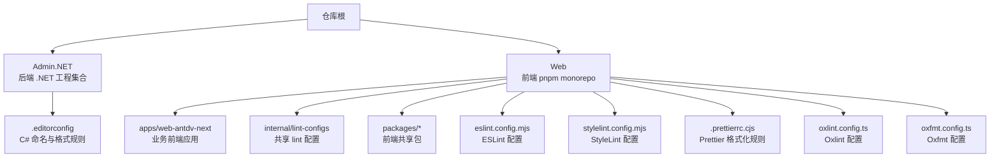
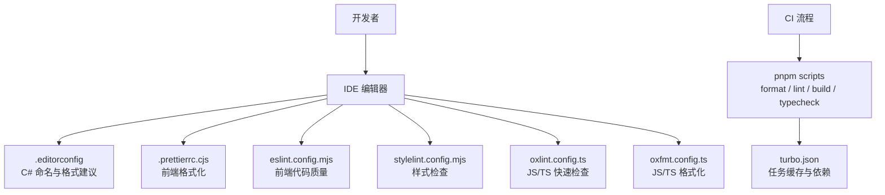
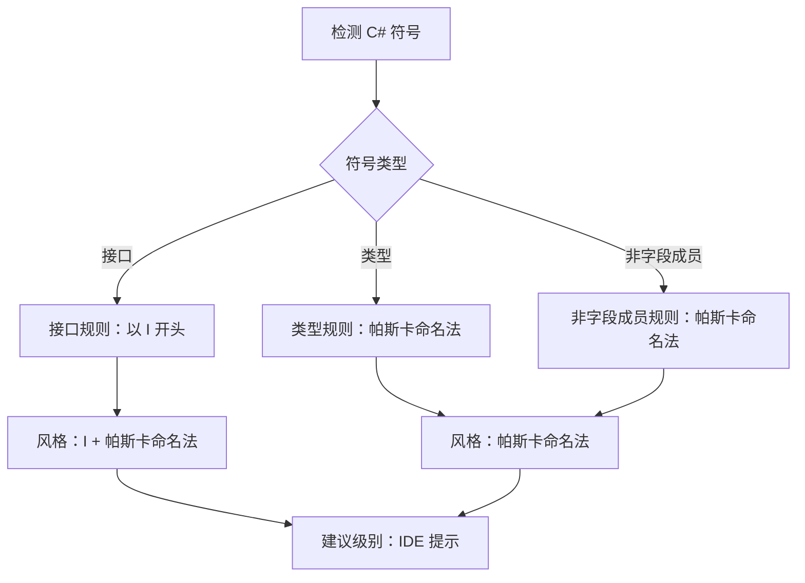
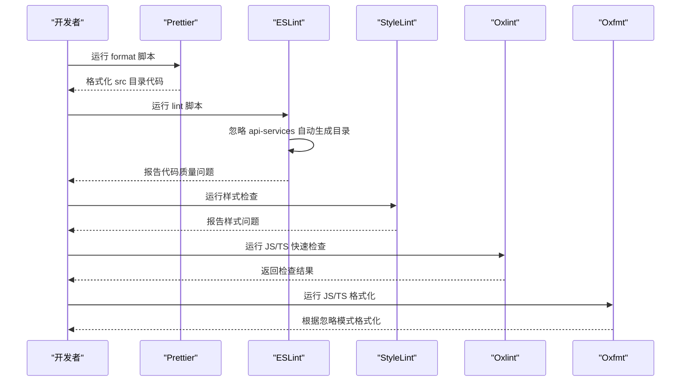
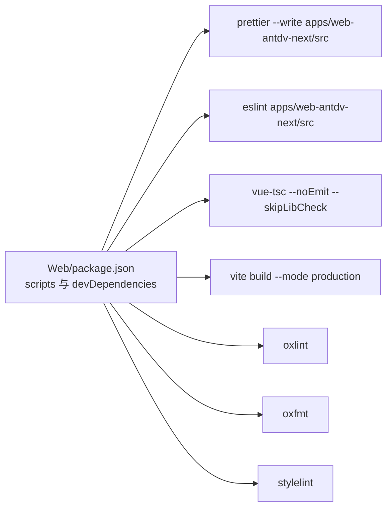

# 代码规范

<cite>
**本文引用的文件**   
- [Admin.NET/.editorconfig](file://Admin.NET/.editorconfig)
- [Web/eslint.config.mjs](file://Web/eslint.config.mjs)
- [Web/stylelint.config.mjs](file://Web/stylelint.config.mjs)
- [Web/.prettierrc.cjs](file://Web/.prettierrc.cjs)
- [Web/oxlint.config.ts](file://Web/oxlint.config.ts)
- [Web/oxfmt.config.ts](file://Web/oxfmt.config.ts)
- [Web/.stylelintignore](file://Web/.stylelintignore)
- [Web/package.json](file://Web/package.json)
- [Web/apps/web-antdv-next/package.json](file://Web/apps/web-antdv-next/package.json)
- [Web/turbo.json](file://Web/turbo.json)
</cite>

## 目录
1. [引言](#引言)
2. [项目结构](#项目结构)
3. [后端 C# 代码规范](#后端-c-代码规范)
4. [前端 TypeScript 与 Vue 代码规范](#前端-typescript-与-vue-代码规范)
5. [样式与格式化规范](#样式与格式化规范)
6. [架构总览](#架构总览)
7. [详细组件分析](#详细组件分析)
8. [依赖关系分析](#依赖关系分析)
9. [性能与可维护性考虑](#性能与可维护性考虑)
10. [IDE 配置指南](#ide-配置指南)
11. [CI 与自动化检查](#ci-与自动化检查)
12. [常见问题排查](#常见问题排查)
13. [结论](#结论)

## 引言
本规范文档面向 Admin.NET 项目的后端 C# 代码和前端 TypeScript/Vue 代码，目标是统一命名、缩进、注释、文件组织、导入顺序、错误处理模式和代码质量检查方式。当前仓库以前端业务应用 `Web/apps/web-antdv-next` 为业务入口，后端以 `.editorconfig` 中的 .NET 规则为核心；ESLint、StyleLint、Prettier、Oxlint 和 Oxfmt 在前端通过共享配置集中管理。

## 项目结构
本项目采用前后端分离、多工程协作的结构：
- 后端位于 `Admin.NET`，使用 .NET 工程文件和 `.editorconfig` 管理代码风格。
- 前端位于 `Web`，是 pnpm monorepo，业务应用位于 `apps/web-antdv-next`，公共配置位于根目录和各内部包中。

**图表来源**
- [Admin.NET/.editorconfig:1-177](file://Admin.NET/.editorconfig#L1-L177)
- [Web/eslint.config.mjs:1-9](file://Web/eslint.config.mjs#L1-L9)
- [Web/stylelint.config.mjs:1-4](file://Web/stylelint.config.mjs#L1-L4)
- [Web/.prettierrc.cjs:1-39](file://Web/.prettierrc.cjs#L1-L39)
- [Web/oxlint.config.ts:1-5](file://Web/oxlint.config.ts#L1-L5)
- [Web/oxfmt.config.ts:1-26](file://Web/oxfmt.config.ts#L1-L26)

**章节来源**
- [Admin.NET/.editorconfig:1-177](file://Admin.NET/.editorconfig#L1-L177)
- [Web/package.json:1-102](file://Web/package.json#L1-L102)
- [Web/apps/web-antdv-next/package.json:1-72](file://Web/apps/web-antdv-next/package.json#L1-L72)

## 后端 C# 代码规范
### 命名约定
`.editorconfig` 定义了 .NET 命名规则，核心约定如下：
- 接口名称必须以大写 `I` 开头，并使用帕斯卡命名法。
- 类型包括类、结构体、接口、枚举，必须使用帕斯卡命名法。
- 非字段成员包括属性、事件、方法，必须使用帕斯卡命名法。
- 上述规则均标记为 `suggestion` 级别，IDE 会以建议形式提示不符合约定的命名。

这些规则由 `dotnet_naming_rule.*` 和 `dotnet_naming_style.*` 共同控制，覆盖范围通过 `dotnet_naming_symbols.*` 指定。

**章节来源**
- [Admin.NET/.editorconfig:1-64](file://Admin.NET/.editorconfig#L1-L64)

### 缩进、换行与基础格式
- C# 与 VB 共用基础格式设置：
  - 行尾换行符为 `crlf`。
  - 缩进大小为 4。
  - 制表位宽度为 4。
  - 运算符在换行时放在下一行的起始位置。
- C# 特有格式：
  - 使用文件级命名空间声明。
  - 优先使用顶级语句。
  - 方法组转换、表达式主体属性和索引器、访问器等启用建议或默认行为。
  - 二元运算符两侧保留空格。
  - 标签缩进比当前块少一级。

**章节来源**
- [Admin.NET/.editorconfig:65-177](file://Admin.NET/.editorconfig#L65-L177)

### 代码风格与语言特性建议
`.editorconfig` 中包含大量 .NET 代码质量建议，例如：
- 条件委托调用、模式匹配、空检查替代类型检查、元组交换、UTF-8 字符串字面量、内联变量声明、解构变量声明。
- 未使用值赋值建议使用丢弃变量。
- 对象初始化和集合初始化建议使用。
- 复合赋值、简化布尔表达式、简化插值等。
- 局部函数优于匿名函数。
- 空传播、合并空操作符、自动属性等。

这些规则大多为 `suggestion`，用于提升可读性和现代 C# 写法，但不会强制阻止构建。

**章节来源**
- [Admin.NET/.editorconfig:33-140](file://Admin.NET/.editorconfig#L33-L140)

### 文件组织与版权头
- 命名空间与文件夹匹配被标记为建议，鼓励将命名空间与实际目录结构保持一致。
- 文件模板会插入项目版权声明，说明项目受法律法规保护、遵循 MIT 和 Apache 许可证、禁止违法用途等。

注意：该版权头属于文件模板，不应把具体文本复制到每个源码文件中作为实现细节；它由编辑器或工具根据模板生成。

**章节来源**
- [Admin.NET/.editorconfig:141-177](file://Admin.NET/.editorconfig#L141-L177)

### C# 命名与结构示例说明（不直接展示代码）
- 接口应命名为类似 `IUserRepository`，体现职责并以 `I` 开头。
- 类型应命名为类似 `UserService`、`OrderStatus`。
- 方法应命名为类似 `GetUserById`、`SubmitOrder`。
- 属性应命名为类似 `UserName`、`IsEnabled`。
- 避免在本地变量和参数中使用 `var`，因为相关规则关闭了隐式类型推断建议。

这些示例来自 `.editorconfig` 的命名规则语义，实际实现应遵循相同模式。

**章节来源**
- [Admin.NET/.editorconfig:1-64](file://Admin.NET/.editorconfig#L1-L64)

## 前端 TypeScript 与 Vue 代码规范
### ESLint 定位
前端 ESLint 配置的核心策略是：
- 使用 `@vben/eslint-config` 提供基础规则。
- 使用 `eslint-config-prettier` 关闭与 Prettier 冲突的规则。
- 自动生成 SDK 所在目录 `apps/web-antdv-next/src/api-services/**` 被忽略，不执行手写代码检查。
- 注释明确说明：格式由 Prettier 管理，ESLint 继续负责代码质量检查。

这意味着前端代码质量主要由 `@vben/eslint-config` 决定，而不是在根目录逐个定义规则。

**章节来源**
- [Web/eslint.config.mjs:1-9](file://Web/eslint.config.mjs#L1-L9)

### StyleLint 定位
StyleLint 配置继承自 `@vben/stylelint-config`，并在根目录启用 `root: true`，表示这是工作区样式检查的根配置。

样式规则的具体内容不在根配置文件展开，而是集中在共享配置包中；根配置只负责启用和扩展。

**章节来源**
- [Web/stylelint.config.mjs:1-4](file://Web/stylelint.config.mjs#L1-L4)

### Oxlint 与 Oxfmt 定位
- Oxlint 配置继承自 `@vben/oxlint-config`，并通过 `defineConfig` 导出。
- Oxfmt 配置继承自 `@vben/oxfmt-config`，并显式排除构建产物、缓存、公共静态资源、锁文件等目录和文件。

两者都是对 TypeScript/JavaScript 进行快速检查和格式化的辅助工具，规则来源同样集中在共享配置包中。

**章节来源**
- [Web/oxlint.config.ts:1-5](file://Web/oxlint.config.ts#L1-L5)
- [Web/oxfmt.config.ts:1-26](file://Web/oxfmt.config.ts#L1-L26)

### 业务前端应用边界
业务前端应用是 `@vben/web-antdv-next`，其 `package.json` 暴露开发、预览、构建和类型检查脚本。根 `package.json` 的 `dev`、`build`、`typecheck` 都转发到该应用。

因此，编写 Vue 单文件组件、TypeScript 模块和业务逻辑时，应以 `apps/web-antdv-next/src` 为主要修改范围，而不要误以为根脚本会检查整个 pnpm workspace。

**章节来源**
- [Web/apps/web-antdv-next/package.json:1-72](file://Web/apps/web-antdv-next/package.json#L1-L72)
- [Web/package.json:1-102](file://Web/package.json#L1-L102)

## 样式与格式化规范
### Prettier 格式化规则
Prettier 是当前前端的唯一格式化器，关键规则如下：
- 每行最大长度 200。
- 缩进宽度为 2。
- 使用制表符缩进。
- 语句末尾加分号。
- 字符串使用单引号。
- 对象属性引用按需添加引号。
- JSX 不使用单引号。
- 尾随逗号按 ES5 标准。
- 花括号之间保留空格。
- 箭头函数参数始终加括号。
- Vue 文件脚本和样式标签不额外缩进。
- 行尾换行符为 `lf`。

注意：`.editorconfig` 中 C# 的行尾换行符是 `crlf`，而 Prettier 前端代码使用 `lf`。跨平台提交时应确保 Git 换行策略一致，避免混用导致重复换行差异。

**章节来源**
- [Web/.prettierrc.cjs:1-39](file://Web/.prettierrc.cjs#L1-L39)
- [Admin.NET/.editorconfig:141-177](file://Admin.NET/.editorconfig#L141-L177)

### StyleLint 忽略路径
StyleLint 忽略以下目录和文件：
- `dist`
- `public`
- `__tests__`
- `coverage`
- Claude、Agent、Codex 等临时目录

这表示样式检查主要针对源代码中的样式文件，跳过构建产物和测试输出。

**章节来源**
- [Web/.stylelintignore:1-8](file://Web/.stylelintignore#L1-L8)

### 导入与导出顺序
当前根 ESLint 配置没有自定义导入顺序规则；导入导出顺序应由 `@vben/eslint-config` 决定。若团队需要统一第三方库、相对模块、类型导入的顺序，应在共享 ESLint 配置中扩展，而不是在根目录复制重复规则。

**章节来源**
- [Web/eslint.config.mjs:1-9](file://Web/eslint.config.mjs#L1-L9)

### 注释与代码质量
- 后端注释和 XML 文档未在 `.editorconfig` 中强制，应遵循现有后端工程的注释习惯，并保持可读性。
- 前端注释和类型注解应配合 TypeScript 类型检查使用，避免无意义的冗余注释。
- 自动生成 SDK 目录不参与 ESLint 检查，因此不应手动修改生成结果。

**章节来源**
- [Web/eslint.config.mjs:1-9](file://Web/eslint.config.mjs#L1-L9)

## 架构总览
下图展示代码规范相关工具在后端和前端的职责分工。

**图表来源**
- [Admin.NET/.editorconfig:1-177](file://Admin.NET/.editorconfig#L1-L177)
- [Web/.prettierrc.cjs:1-39](file://Web/.prettierrc.cjs#L1-L39)
- [Web/eslint.config.mjs:1-9](file://Web/eslint.config.mjs#L1-L9)
- [Web/stylelint.config.mjs:1-4](file://Web/stylelint.config.mjs#L1-L4)
- [Web/oxlint.config.ts:1-5](file://Web/oxlint.config.ts#L1-L5)
- [Web/oxfmt.config.ts:1-26](file://Web/oxfmt.config.ts#L1-L26)
- [Web/turbo.json:1-48](file://Web/turbo.json#L1-L48)

## 详细组件分析
### C# 命名规则解析
`.editorconfig` 中的命名规则分为三部分：
1. 规则：将命名风格绑定到符号类别。
2. 符号：限定哪些符号适用规则。
3. 风格：规定前缀、后缀、分隔符和大小写。

**图表来源**
- [Admin.NET/.editorconfig:1-64](file://Admin.NET/.editorconfig#L1-L64)

**章节来源**
- [Admin.NET/.editorconfig:1-64](file://Admin.NET/.editorconfig#L1-L64)

### 前端格式化与检查流程

**图表来源**
- [Web/package.json:1-102](file://Web/package.json#L1-L102)
- [Web/eslint.config.mjs:1-9](file://Web/eslint.config.mjs#L1-L9)
- [Web/stylelint.config.mjs:1-4](file://Web/stylelint.config.mjs#L1-L4)
- [Web/oxlint.config.ts:1-5](file://Web/oxlint.config.ts#L1-L5)
- [Web/oxfmt.config.ts:1-26](file://Web/oxfmt.config.ts#L1-L26)

**章节来源**
- [Web/package.json:1-102](file://Web/package.json#L1-L102)
- [Web/eslint.config.mjs:1-9](file://Web/eslint.config.mjs#L1-L9)

### 错误处理模式
- 后端 C# 代码应结合 `.editorconfig` 中的语言特性建议，例如空传播、空检查、模式匹配、异常表达式等，使错误分支更清晰。
- 前端 TypeScript 应利用类型系统和 ESLint 检查发现潜在运行时错误，避免在自动生成 SDK 目录中手工修复。
- 样式错误通过 StyleLint 报告，格式错误通过 Prettier 或 Oxfmt 修复。

**章节来源**
- [Admin.NET/.editorconfig:33-140](file://Admin.NET/.editorconfig#L33-L140)
- [Web/eslint.config.mjs:1-9](file://Web/eslint.config.mjs#L1-L9)

## 依赖关系分析
前端 lint 和格式化依赖集中在根 `package.json` 的脚本和依赖项中：
- `format` 脚本只对 `apps/web-antdv-next/src` 执行 Prettier。
- `lint` 脚本只对 `apps/web-antdv-next/src` 执行 ESLint。
- `typecheck` 脚本转发到业务应用的 `vue-tsc`。
- `build` 脚本转发到业务应用的 Vite 构建。
- Oxlint、Oxfmt、ESLint、StyleLint、Prettier 均为开发依赖。

**图表来源**
- [Web/package.json:1-102](file://Web/package.json#L1-L102)

**章节来源**
- [Web/package.json:1-102](file://Web/package.json#L1-L102)
- [Web/apps/web-antdv-next/package.json:1-72](file://Web/apps/web-antdv-next/package.json#L1-L72)

## 性能与可维护性考虑
- 前端格式化范围明确限制在业务应用 `src` 目录，避免对整个 workspace 执行低效的全仓格式化。
- ESLint 忽略自动生成 SDK，减少误报和维护成本。
- StyleLint 忽略构建产物和公共静态目录，提高检查速度。
- Oxfmt 显式忽略大量临时和二进制友好目录，避免对不需要格式化的文件产生噪音。
- `.editorconfig` 的建议级别规则有助于逐步现代化 C# 代码，而不是一次性强制破坏现有代码风格。

[本节为通用指导，不直接分析具体文件]

## IDE 配置指南
### Visual Studio 或 .NET 编辑器
- 打开项目后，IDE 应自动识别 `Admin.NET/.editorconfig`。
- 命名规则会显示为建议，IDE 通常会提供“重命名为符合命名约定”的快速操作。
- 文件格式、缩进、行尾换行由 `.editorconfig` 控制，建议在保存时应用。
- 文件头模板会在创建新文件时插入项目版权信息。

**章节来源**
- [Admin.NET/.editorconfig:1-177](file://Admin.NET/.editorconfig#L1-L177)

### VS Code 或支持 Node 的前端编辑环境
- 安装 Prettier 插件，并确保使用仓库根 `.prettierrc.cjs` 的配置。
- 安装 ESLint 插件，确保 ESLint 使用根目录 `eslint.config.mjs`。
- 安装 StyleLint 插件，确保 StyleLint 使用根目录 `stylelint.config.mjs`。
- 如需 Oxlint/Oxfmt，可按各自配置启用对应插件。
- 保存时建议同时触发 Prettier 格式化；ESLint 可在保存时尝试修复，但应避免与 Prettier 冲突。

**章节来源**
- [Web/.prettierrc.cjs:1-39](file://Web/.prettierrc.cjs#L1-L39)
- [Web/eslint.config.mjs:1-9](file://Web/eslint.config.mjs#L1-L9)
- [Web/stylelint.config.mjs:1-4](file://Web/stylelint.config.mjs#L1-L4)
- [Web/oxlint.config.ts:1-5](file://Web/oxlint.config.ts#L1-L5)
- [Web/oxfmt.config.ts:1-26](file://Web/oxfmt.config.ts#L1-L26)

## CI 与自动化检查
### 推荐在 CI 中执行的命令
- 安装依赖：使用根 `bootstrap` 脚本。
- 格式化：执行根 `format` 脚本，仅格式化业务前端 `apps/web-antdv-next/src`。
- 代码检查：执行根 `lint` 脚本，仅检查业务前端 `apps/web-antdv-next/src`。
- 类型检查：执行根 `check:type`，最终调用业务应用的 `typecheck`。
- 构建：执行根 `build`，最终调用业务应用的 Vite 构建。
- 全量检查：执行根 `check`，会依次执行循环依赖检查、依赖检查、类型检查和拼写检查。

### 注意事项
- 不要假设根脚本会检查整个 workspace；当前脚本明确指向业务应用。
- 如果需要在 CI 中增加 Oxlint、StyleLint 或 Oxfmt 检查，应先在根 `package.json` 中添加脚本，再在 CI 流程中调用。
- `turbo.json` 目前定义了 `build`、`preview`、`build:analyze`、`test:e2e`、`dev`、`typecheck` 等任务，但未直接定义 `format`、`lint`、`stylelint`、`oxlint`、`oxfmt` 任务；新增任务应在 `turbo.json` 中补充。

**章节来源**
- [Web/package.json:1-102](file://Web/package.json#L1-L102)
- [Web/turbo.json:1-48](file://Web/turbo.json#L1-L48)

## 常见问题排查
### 为什么 ESLint 不检查生成的 SDK？
根 ESLint 配置显式忽略 `apps/web-antdv-next/src/api-services/**`，因为该目录由生成链自动生成，应由生成器和 TypeScript 验证保障正确性，而不是由手写代码规则约束。

**章节来源**
- [Web/eslint.config.mjs:1-9](file://Web/eslint.config.mjs#L1-L9)

### 为什么 Prettier 和 C# 换行符不同？
Prettier 前端使用 `lf`，而 `.editorconfig` 中 C# 使用 `crlf`。若出现提交差异，应检查 Git 的 `core.autocrlf` 和项目级换行策略，确保同一仓库在不同操作系统上行为一致。

**章节来源**
- [Web/.prettierrc.cjs:1-39](file://Web/.prettierrc.cjs#L1-L39)
- [Admin.NET/.editorconfig:141-177](file://Admin.NET/.editorconfig#L141-L177)

### 为什么 StyleLint 没有报错？
请确认：
- 样式文件未被 `.stylelintignore` 忽略。
- 当前修改的是源代码中的样式文件，而不是 `dist`、`public` 或测试输出。
- StyleLint 使用的是根配置，继承自 `@vben/stylelint-config`。

**章节来源**
- [Web/.stylelintignore:1-8](file://Web/.stylelintignore#L1-L8)
- [Web/stylelint.config.mjs:1-4](file://Web/stylelint.config.mjs#L1-L4)

### 为什么命名建议没有变成错误？
`.editorconfig` 中 C# 命名规则大多数是 `suggestion`，不是 `error`。IDE 会提示但不一定阻止保存。若需要强制，应在 .NET 分析器或团队规则中提升到更高严重级别，而不是直接修改 `.editorconfig` 的语义。

**章节来源**
- [Admin.NET/.editorconfig:1-64](file://Admin.NET/.editorconfig#L1-L64)

## 结论
Admin.NET 的代码规范由后端 `.editorconfig` 和前端多个 lint/format 工具共同组成：
- 后端 C# 以 .NET 命名规则和语言特性建议为主，强调接口以 `I` 开头、类型和非字段成员使用帕斯卡命名法，并鼓励现代 C# 写法。
- 前端 TypeScript/Vue 以 Prettier 负责格式，ESLint 负责代码质量，StyleLint 负责样式，Oxlint 和 Oxfmt 作为快速检查和格式化补充。
- 业务前端入口是 `apps/web-antdv-next`，根脚本和 CI 都应围绕该应用执行。
- 共享规则集中在 `@vben/*` 配置包中，根目录只做最小化选择与忽略策略。

按照本规范开发，可以在保证可读性的前提下，减少风格分歧，降低代码审查成本，并让自动化检查真正发挥作用。