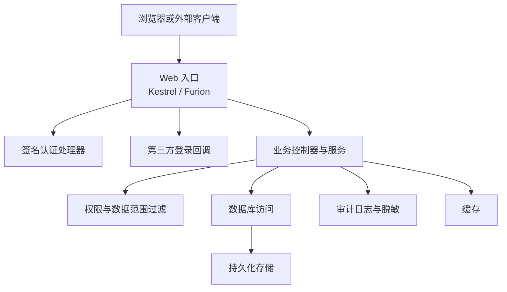
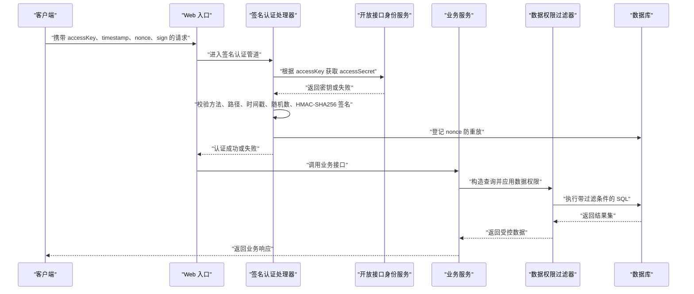
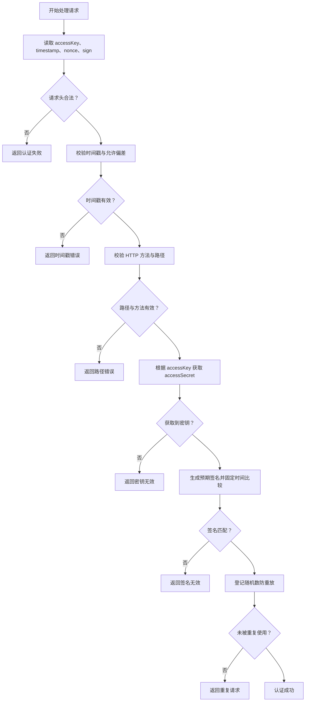
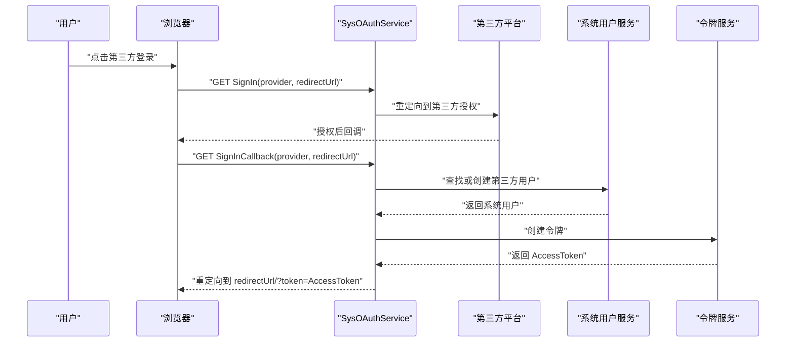
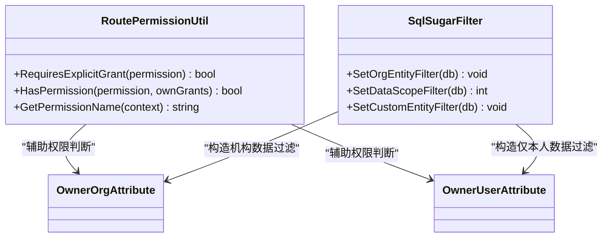
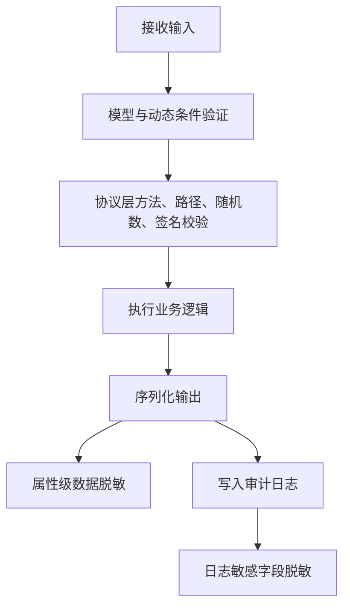
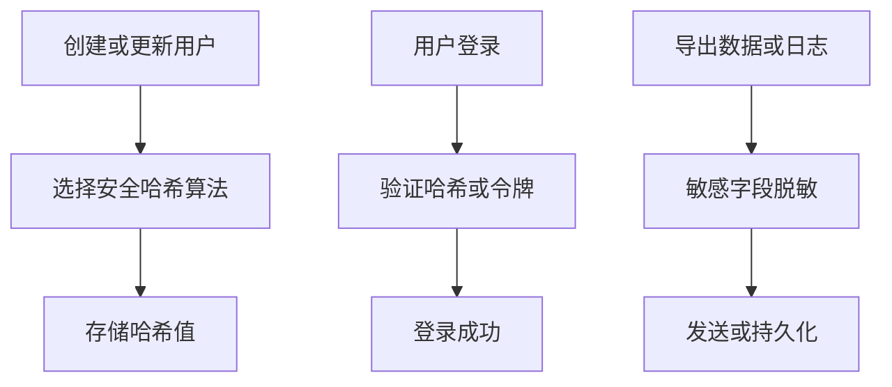
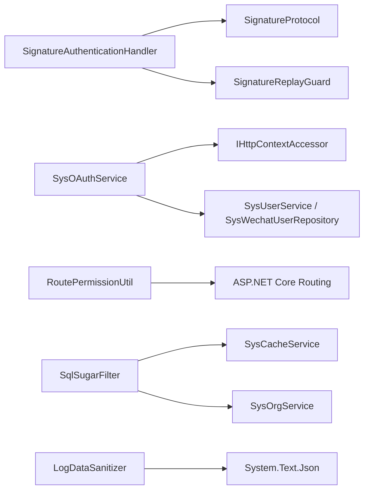

# 安全实践

<cite>
**本文引用的文件**   
- [README.md](file://README.md)
- [Program.cs](file://Admin.NET/Admin.NET.Web.Entry/Program.cs)
- [appsettings.json](file://Admin.NET/Admin.NET.Web.Entry/appsettings.json)
- [SignatureAuthenticationHandler.cs](file://Admin.NET/Admin.NET.Core/SignatureAuth/SignatureAuthenticationHandler.cs)
- [SignatureProtocol.cs](file://Admin.NET/Admin.NET.Core/SignatureAuth/SignatureProtocol.cs)
- [SignatureReplayGuard.cs](file://Admin.NET/Admin.NET.Core/SignatureAuth/SignatureReplayGuard.cs)
- [SysOAuthService.cs](file://Admin.NET/Admin.NET.Core/Service/OAuth/SysOAuthService.cs)
- [OAuthOptions.cs](file://Admin.NET/Admin.NET.Core/Option/OAuthOptions.cs)
- [RateLimitOptions.cs](file://Admin.NET/Admin.NET.Core/Option/RateLimitOptions.cs)
- [SqlSugarFilter.cs](file://Admin.NET/Admin.NET.Core/SqlSugar/SqlSugarFilter.cs)
- [RoutePermissionUtil.cs](file://Admin.NET/Admin.NET.Core/Utils/RoutePermissionUtil.cs)
- [DataMaskAttribute.cs](file://Admin.NET/Admin.NET.Core/Attribute/DataMaskAttribute.cs)
- [CommonValidationAttribute.cs](file://Admin.NET/Admin.NET.Core/Attribute/CommonValidationAttribute.cs)
- [CryptogramUtil.cs](file://Admin.NET/Admin.NET.Core/Utils/CryptogramUtil.cs)
- [HashHelper.cs](file://Admin.NET/Admin.NET.Core/Utils/HashHelper.cs)
- [LogDataSanitizer.cs](file://Admin.NET/Admin.NET.Core/Logging/LogDataSanitizer.cs)
- [SysOpenAccess.cs](file://Admin.NET/Admin.NET.Core/Entity/SysOpenAccess.cs)
</cite>

## 目录
1. [简介](#简介)
2. [项目结构与安全边界](#项目结构与安全边界)
3. [核心安全组件](#核心安全组件)
4. [架构总览](#架构总览)
5. [详细组件分析](#详细组件分析)
6. [依赖关系与耦合分析](#依赖关系与耦合分析)
7. [性能与安全权衡](#性能与安全权衡)
8. [故障排查与常见问题](#故障排查与常见问题)
9. [结论与落地建议](#结论与落地建议)
10. [附录：配置清单与检查表](#附录配置清单与检查表)

## 简介
本指南面向 Admin.NET 开发者，说明当前代码库中已实现的安全能力，并给出补充建议。框架基于 ASP.NET Core、Furion 和 SqlSugar，提供多租户、权限管理、开放接口签名、限流选项、日志脱敏等基础能力；前端以 `Web/apps/web-antdv-next` 为业务入口，后端入口为 `Admin.NET/Admin.NET.Web.Entry`。本文不直接复制源码内容，而是通过路径定位实现位置，帮助读者在仓库中对照验证。

需要特别注意：
- 认证与授权实现应优先使用内置的签名认证、OAuth 回调、角色菜单权限和数据范围过滤。
- 输入验证应结合模型校验特性、SQL 参数化查询与数据权限过滤。
- 敏感数据应避免明文落盘或进入日志，应使用加密工具、哈希方法和日志脱敏。
- API 防护应结合签名校验、随机数防重放、限流策略、审计日志和安全响应头。

**章节来源**
- [README.md:1-50](file://README.md#L1-L50)

## 项目结构与安全边界
Admin.NET 采用前后端分离和模块化设计：
- 后端共享能力集中在 `Admin.NET.Admin.NET.Core`，包括实体、服务、属性、选项、工具、日志和签名认证。
- Web 入口工程 `Admin.NET.Admin.NET.Web.Entry` 负责启动主机、注册组件、设置 Kestrel 限制和日志过滤。
- 前端应用位于 `Web/apps/web-antdv-next`，路由、授权和页面逻辑应与后端权限保持一致。

**图表来源**
- [Program.cs:12-38](file://Admin.NET/Admin.NET.Web.Entry/Program.cs#L12-L38)
- [SignatureAuthenticationHandler.cs:1-133](file://Admin.NET/Admin.NET.Core/SignatureAuth/SignatureAuthenticationHandler.cs#L1-L133)
- [SysOAuthService.cs:1-120](file://Admin.NET/Admin.NET.Core/Service/OAuth/SysOAuthService.cs#L1-L120)
- [SqlSugarFilter.cs:1-205](file://Admin.NET/Admin.NET.Core/SqlSugar/SqlSugarFilter.cs#L1-L205)

**章节来源**
- [README.md:1-50](file://README.md#L1-L50)
- [Program.cs:12-38](file://Admin.NET/Admin.NET.Web.Entry/Program.cs#L12-L38)

## 核心安全组件
本节梳理仓库中与安全性直接相关的核心模块。

| 类别 | 主要实现 | 安全职责 | 关键风险点 |
|---|---|---|---|
| 开放接口签名 | `SignatureAuthenticationHandler`、`SignatureProtocol`、`SignatureReplayGuard` | 校验 `accessKey`、`timestamp`、`nonce`、`sign`，防止重放、时间漂移越界和无效请求 | 随机数存储是否可横向扩展、密钥是否妥善配置、错误消息是否泄露细节 |
| 第三方登录 | `SysOAuthService`、`OAuthOptions` | 支持微信、Gitee 等 OAuth 回调，创建系统用户并发行令牌 | 回调 URL 拼接、未绑定账号自动创建行为、令牌返回方式 |
| 权限控制 | `RoutePermissionUtil`、`SqlSugarFilter`、`OwnerOrgAttribute`、`OwnerUserAttribute` | 将路由映射为权限标识，强制显式授予高风险操作，按机构/用户过滤数据 | 权限命名不一致、高危权限默认放行、数据权限缓存失效 |
| 输入验证 | `CommonValidationAttribute`、正则工具、路径与方法白名单 | 对动态条件表达式进行校验，限制 HTTP 方法、路径和请求头格式 | 动态表达式执行能力、非法字符绕过、超长请求 |
| 数据加密与脱敏 | `CryptogramUtil`、`HashHelper`、`DataMaskAttribute`、`LogDataSanitizer` | 提供 SM2/SM4/MD5/SHA 工具，属性级脱敏，日志字段脱敏 | 弱算法用于密码、硬编码密钥、日志包含凭据 |
| 限流 | `IpRateLimitingOptions`、`ClientRateLimitingOptions` | 定义 IP 与客户端限流选项 | 限流策略未启用或未配置 |
| 审计日志 | 日志写入器与脱敏工具 | 记录访问日志、操作日志、异常日志，并对敏感值脱敏 | 日志级别过高、连接字符串或令牌进入日志 |

**章节来源**
- [SignatureAuthenticationHandler.cs:1-133](file://Admin.NET/Admin.NET.Core/SignatureAuth/SignatureAuthenticationHandler.cs#L1-L133)
- [SignatureProtocol.cs:1-139](file://Admin.NET/Admin.NET.Core/SignatureAuth/SignatureProtocol.cs#L1-L139)
- [SignatureReplayGuard.cs:1-24](file://Admin.NET/Admin.NET.Core/SignatureAuth/SignatureReplayGuard.cs#L1-L24)
- [SysOAuthService.cs:1-120](file://Admin.NET/Admin.NET.Core/Service/OAuth/SysOAuthService.cs#L1-L120)
- [OAuthOptions.cs:1-23](file://Admin.NET/Admin.NET.Core/Option/OAuthOptions.cs#L1-L23)
- [RateLimitOptions.cs:1-37](file://Admin.NET/Admin.NET.Core/Option/RateLimitOptions.cs#L1-L37)
- [RoutePermissionUtil.cs:1-95](file://Admin.NET/Admin.NET.Core/Utils/RoutePermissionUtil.cs#L1-L95)
- [SqlSugarFilter.cs:1-205](file://Admin.NET/Admin.NET.Core/SqlSugar/SqlSugarFilter.cs#L1-L205)
- [CommonValidationAttribute.cs:1-92](file://Admin.NET/Admin.NET.Core/Attribute/CommonValidationAttribute.cs#L1-L92)
- [DataMaskAttribute.cs:1-59](file://Admin.NET/Admin.NET.Core/Attribute/DataMaskAttribute.cs#L1-L59)
- [CryptogramUtil.cs:1-120](file://Admin.NET/Admin.NET.Core/Utils/CryptogramUtil.cs#L1-L120)
- [HashHelper.cs:1-132](file://Admin.NET/Admin.NET.Core/Utils/HashHelper.cs#L1-L132)
- [LogDataSanitizer.cs:1-98](file://Admin.NET/Admin.NET.Core/Logging/LogDataSanitizer.cs#L1-L98)

## 架构总览
下图展示一次开放接口调用从浏览器到数据库的完整安全链路。

**图表来源**
- [SignatureAuthenticationHandler.cs:30-115](file://Admin.NET/Admin.NET.Core/SignatureAuth/SignatureAuthenticationHandler.cs#L30-L115)
- [SignatureProtocol.cs:20-139](file://Admin.NET/Admin.NET.Core/SignatureAuth/SignatureProtocol.cs#L20-L139)
- [SignatureReplayGuard.cs:10-24](file://Admin.NET/Admin.NET.Core/SignatureAuth/SignatureReplayGuard.cs#L10-L24)
- [SqlSugarFilter.cs:30-170](file://Admin.NET/Admin.NET.Core/SqlSugar/SqlSugarFilter.cs#L30-L170)

## 详细组件分析

### 开放接口签名认证
签名认证是对外部系统调用的重要防线。实现包含三部分：
- 协议层：限定必须存在的请求头、HTTP 方法白名单、路径合法性、时间戳解析与允许偏差、随机数有效期、HMAC-SHA256 签名生成与固定时间比较。
- 处理器层：读取请求头、调用事件获取 `accessSecret`、验证签名、消费随机数、构造认证主体。
- 防重放层：进程内锁保证随机数存在性检查与写入原子化。

**图表来源**
- [SignatureAuthenticationHandler.cs:30-115](file://Admin.NET/Admin.NET.Core/SignatureAuth/SignatureAuthenticationHandler.cs#L30-L115)
- [SignatureProtocol.cs:20-139](file://Admin.NET/Admin.NET.Core/SignatureAuth/SignatureProtocol.cs#L20-L139)
- [SignatureReplayGuard.cs:10-24](file://Admin.NET/Admin.NET.Core/SignatureAuth/SignatureReplayGuard.cs#L10-L24)

安全要点：
- 使用 HMAC-SHA256 计算签名，避免简单 MD5 作为最终签名。
- 使用固定时间比较，降低时序侧信道风险。
- 严格限制 HTTP 方法、路径和请求头格式。
- 使用时间戳与随机数组合防止重放攻击。
- 成功认证后才消耗随机数，失败请求不应占用合法随机数窗口。

潜在改进：
- 将进程内随机数登记替换为分布式缓存方案，以便多实例部署时仍能防重放。
- 对 `accessSecret` 增加轮换机制和最小长度、复杂度约束。
- 对签名失败次数进行速率限制，防止暴力猜测。

**章节来源**
- [SignatureAuthenticationHandler.cs:1-133](file://Admin.NET/Admin.NET.Core/SignatureAuth/SignatureAuthenticationHandler.cs#L1-L133)
- [SignatureProtocol.cs:1-139](file://Admin.NET/Admin.NET.Core/SignatureAuth/SignatureProtocol.cs#L1-L139)
- [SignatureReplayGuard.cs:1-24](file://Admin.NET/Admin.NET.Core/SignatureAuth/SignatureReplayGuard.cs#L1-L24)
- [SysOpenAccess.cs:1-56](file://Admin.NET/Admin.NET.Core/Entity/SysOpenAccess.cs#L1-L56)

### OAuth2.0 第三方登录
当前 OAuth 实现通过 `SysOAuthService` 暴露第三方登录入口和回调，支持微信与 Gitee。流程如下：
- 发起登录时构造挑战 URL，携带 provider 和 redirectUrl。
- 回调时验证 provider、完成第三方认证、提取用户标识。
- 若本地无对应账号则自动创建用户，并绑定默认组织与角色。
- 调用内部认证服务创建令牌，并将令牌拼接到 redirectUrl 中跳转回前端。

**图表来源**
- [SysOAuthService.cs:20-120](file://Admin.NET/Admin.NET.Core/Service/OAuth/SysOAuthService.cs#L20-L120)
- [OAuthOptions.cs:1-23](file://Admin.NET/Admin.NET.Core/Option/OAuthOptions.cs#L1-L23)

安全要点：
- 回调前校验 provider 是否受支持。
- 使用第三方平台返回的唯一标识建立本地用户关联。
- 自动创建用户时应明确默认角色和组织，避免赋予管理员权限。

潜在改进：
- 避免将 `AccessToken` 放在 URL 中，应改用安全 Cookie 或前端安全存储。
- 对回调地址做白名单校验，防止开放重定向。
- 对首次登录用户增加二次确认或后台审核流程。

**章节来源**
- [SysOAuthService.cs:1-120](file://Admin.NET/Admin.NET.Core/Service/OAuth/SysOAuthService.cs#L1-L120)
- [OAuthOptions.cs:1-23](file://Admin.NET/Admin.NET.Core/Option/OAuthOptions.cs#L1-L23)

### 权限验证与数据访问控制
权限控制分为两个层次：
- 接口级权限：通过 `RoutePermissionUtil` 将路由模板转换为权限标识，并对高风险操作要求显式授权。
- 数据级权限：通过 `SqlSugarFilter` 注入全局查询过滤器，按用户最大数据范围、所属机构和自定义过滤条件限制查询结果。

**图表来源**
- [RoutePermissionUtil.cs:1-95](file://Admin.NET/Admin.NET.Core/Utils/RoutePermissionUtil.cs#L1-L95)
- [SqlSugarFilter.cs:30-170](file://Admin.NET/Admin.NET.Core/SqlSugar/SqlSugarFilter.cs#L30-L170)

安全要点：
- 高危权限如作业、服务器、更新、日志、开放接口、模板、插件、微信用户、数据库等必须显式授予。
- 数据范围过滤会按用户角色最大数据范围注入过滤条件，避免跨机构或跨用户越权访问。
- 自定义过滤器通过实现统一接口注册，便于扩展数据访问边界。

潜在改进：
- 对权限名称映射增加单元测试，防止新增路由被误判为低风险权限。
- 对数据范围缓存失效场景增加重试与降级策略。
- 对批量写入操作增加二次权限校验。

**章节来源**
- [RoutePermissionUtil.cs:1-95](file://Admin.NET/Admin.NET.Core/Utils/RoutePermissionUtil.cs#L1-L95)
- [SqlSugarFilter.cs:1-205](file://Admin.NET/Admin.NET.Core/SqlSugar/SqlSugarFilter.cs#L1-L205)
- [OwnerOrgAttribute.cs:1-16](file://Admin.NET/Admin.NET.Core/Attribute/OwnerOrgAttribute.cs#L1-L16)
- [OwnerUserAttribute.cs:1-16](file://Admin.NET/Admin.NET.Core/Attribute/OwnerUserAttribute.cs#L1-L16)

### 输入验证与输出编码
输入验证方面，框架提供了通用验证特性和协议层强校验；输出方面提供数据脱敏和日志脱敏。

- 输入验证：
  - 通用验证特性支持动态表达式条件，适合复杂字段联动校验。
  - 签名协议层严格校验 HTTP 方法、路径、随机数和 Base64 签名。
  - 路径不允许冒号、问号、井号、反斜杠和控制字符，减少路径注入风险。
- 输出编码与脱敏：
  - `DataMaskAttribute` 可对字符串指定起始位置和长度进行掩码。
  - `LogDataSanitizer` 对日志中的令牌、密码、密钥、连接串、Cookie、签名等进行脱敏。
  - JSON 结构中的列名、参数名及值也参与敏感字段识别。

**图表来源**
- [CommonValidationAttribute.cs:1-92](file://Admin.NET/Admin.NET.Core/Attribute/CommonValidationAttribute.cs#L1-L92)
- [SignatureProtocol.cs:20-139](file://Admin.NET/Admin.NET.Core/SignatureAuth/SignatureProtocol.cs#L20-L139)
- [DataMaskAttribute.cs:1-59](file://Admin.NET/Admin.NET.Core/Attribute/DataMaskAttribute.cs#L1-L59)
- [LogDataSanitizer.cs:1-98](file://Admin.NET/Admin.NET.Core/Logging/LogDataSanitizer.cs#L1-L98)

安全要点：
- 不要信任前端校验，所有接口应在服务端完成输入验证。
- 对动态表达式校验保持最小权限，避免执行任意代码。
- 对敏感字段统一脱敏，而不是在每个控制器中手动处理。
- 对日志中的 JSON、URL 参数、Bearer Token 进行模式匹配脱敏。

潜在改进：
- 为常见敏感字段类型增加预定义脱敏规则，例如身份证号、银行卡号、手机号。
- 对动态表达式增加语法白名单，禁止危险函数调用。
- 对输出响应增加内容类型检查和 XSS 防护头。

**章节来源**
- [CommonValidationAttribute.cs:1-92](file://Admin.NET/Admin.NET.Core/Attribute/CommonValidationAttribute.cs#L1-L92)
- [SignatureProtocol.cs:1-139](file://Admin.NET/Admin.NET.Core/SignatureAuth/SignatureProtocol.cs#L1-L139)
- [DataMaskAttribute.cs:1-59](file://Admin.NET/Admin.NET.Core/Attribute/DataMaskAttribute.cs#L1-L59)
- [LogDataSanitizer.cs:1-98](file://Admin.NET/Admin.NET.Core/Logging/LogDataSanitizer.cs#L1-L98)

### API 安全防护措施
API 安全在当前仓库中体现为签名认证、随机数防重放、限流选项、审计日志和 Kestrel 配置。

| 防护措施 | 当前实现 | 建议 |
|---|---|---|
| 请求签名 | HMAC-SHA256、时间戳、随机数、固定时间比较 | 启用签名强制、限制签名算法、轮换密钥 |
| 防重放 | 进程内随机数登记 | 多实例时使用分布式缓存 |
| 速率限制 | 定义了 IP 和客户端限流选项 | 在生产环境启用策略并监控拒绝率 |
| IP 白名单 | 未在分析文件中直接看到集中实现 | 可在网关或中间件层实现 |
| 审计日志 | 访问日志、操作日志、异常日志与脱敏 | 关闭调试日志，限制日志大小和保留周期 |
| 传输加密 | README 提示部署前结合实际环境验证 | 生产环境强制 HTTPS 和 HSTS |
| CSRF | 未在前端或后端分析片段中看到专用实现 | 对状态变更接口使用同源策略、SameSite Cookie 和双提交令牌 |

**章节来源**
- [SignatureAuthenticationHandler.cs:30-115](file://Admin.NET/Admin.NET.Core/SignatureAuth/SignatureAuthenticationHandler.cs#L30-L115)
- [RateLimitOptions.cs:1-37](file://Admin.NET/Admin.NET.Core/Option/RateLimitOptions.cs#L1-L37)
- [LogDataSanitizer.cs:1-98](file://Admin.NET/Admin.NET.Core/Logging/LogDataSanitizer.cs#L1-L98)
- [Program.cs:20-38](file://Admin.NET/Admin.NET.Web.Entry/Program.cs#L20-L38)
- [README.md:12-40](file://README.md#L12-L40)

### 数据安全策略
数据安全涉及密码存储、敏感数据处理、数据传输和备份安全。

- 密码与哈希：
  - `HashHelper` 提供 SHA1、SHA256、SHA384、SHA512、MD5 等哈希方法。
  - 不建议使用 MD5 或 SHA1 作为密码存储算法；推荐 bcrypt、scrypt 或 Argon2。
- 对称与非对称加密：
  - `CryptogramUtil` 支持 SM2、SM4 以及 MD5 选择，但部分常量密钥存在于源码中，不适合生产直接使用。
  - 建议使用运行时配置或密钥管理服务加载密钥，避免硬编码。
- 敏感数据脱敏：
  - 日志脱敏覆盖常见凭据字段和 URL 参数。
  - 数据脱敏特性可用于响应对象字段掩码。
- 传输加密：
  - 前端说明强调部署前按实际环境验证数据库连接、代理和 API 地址。
  - 生产环境应启用 HTTPS、证书校验和 HSTS。
- 备份安全：
  - 配置项中存在 CI/CD 相关备份数量与隔离部署根目录，但具体备份实现不在当前分析范围内。
  - 建议数据库备份加密、离线存储、访问控制和恢复演练。

**图表来源**
- [HashHelper.cs:1-132](file://Admin.NET/Admin.NET.Core/Utils/HashHelper.cs#L1-L132)
- [CryptogramUtil.cs:1-120](file://Admin.NET/Admin.NET.Core/Utils/CryptogramUtil.cs#L1-L120)
- [LogDataSanitizer.cs:1-98](file://Admin.NET/Admin.NET.Core/Logging/LogDataSanitizer.cs#L1-L98)

**章节来源**
- [HashHelper.cs:1-132](file://Admin.NET/Admin.NET.Core/Utils/HashHelper.cs#L1-L132)
- [CryptogramUtil.cs:1-120](file://Admin.NET/Admin.NET.Core/Utils/CryptogramUtil.cs#L1-L120)
- [LogDataSanitizer.cs:1-98](file://Admin.NET/Admin.NET.Core/Logging/LogDataSanitizer.cs#L1-L98)
- [README.md:12-40](file://README.md#L12-L40)

## 依赖关系与耦合分析
签名认证依赖协议工具和随机数守卫；OAuth 服务依赖上下文访问器和第三方认证提供者；权限工具依赖路由信息；数据权限依赖用户角色、组织和缓存；日志脱敏依赖日志实体和 JSON 解析。

**图表来源**
- [SignatureAuthenticationHandler.cs:1-133](file://Admin.NET/Admin.NET.Core/SignatureAuth/SignatureAuthenticationHandler.cs#L1-L133)
- [SignatureProtocol.cs:1-139](file://Admin.NET/Admin.NET.Core/SignatureAuth/SignatureProtocol.cs#L1-L139)
- [SignatureReplayGuard.cs:1-24](file://Admin.NET/Admin.NET.Core/SignatureAuth/SignatureReplayGuard.cs#L1-L24)
- [SysOAuthService.cs:1-120](file://Admin.NET/Admin.NET.Core/Service/OAuth/SysOAuthService.cs#L1-L120)
- [RoutePermissionUtil.cs:1-95](file://Admin.NET/Admin.NET.Core/Utils/RoutePermissionUtil.cs#L1-L95)
- [SqlSugarFilter.cs:1-205](file://Admin.NET/Admin.NET.Core/SqlSugar/SqlSugarFilter.cs#L1-L205)
- [LogDataSanitizer.cs:1-98](file://Admin.NET/Admin.NET.Core/Logging/LogDataSanitizer.cs#L1-L98)

**章节来源**
- [SignatureAuthenticationHandler.cs:1-133](file://Admin.NET/Admin.NET.Core/SignatureAuth/SignatureAuthenticationHandler.cs#L1-L133)
- [SysOAuthService.cs:1-120](file://Admin.NET/Admin.NET.Core/Service/OAuth/SysOAuthService.cs#L1-L120)
- [SqlSugarFilter.cs:1-205](file://Admin.NET/Admin.NET.Core/SqlSugar/SqlSugarFilter.cs#L1-L205)

## 性能与安全权衡
- 签名校验会增加每次请求的计算开销，但 HMAC-SHA256 在现代 CPU 上成本较低。
- 随机数防重放使用进程内锁，单实例性能较好，但多实例下需改为分布式锁或缓存去重。
- 数据权限过滤器会扫描实体类型并缓存 Lambda 表达式，首次构建有成本，后续命中缓存较快。
- 日志脱敏会对 JSON 文本进行解析和重写，高吞吐场景应考虑异步脱敏或采样记录。
- Kestrel 配置中上传大小设置为不限制，生产环境应限制请求体大小以防止资源耗尽。

**章节来源**
- [SignatureProtocol.cs:90-139](file://Admin.NET/Admin.NET.Core/SignatureAuth/SignatureProtocol.cs#L90-L139)
- [SignatureReplayGuard.cs:10-24](file://Admin.NET/Admin.NET.Core/SignatureAuth/SignatureReplayGuard.cs#L10-L24)
- [SqlSugarFilter.cs:60-140](file://Admin.NET/Admin.NET.Core/SqlSugar/SqlSugarFilter.cs#L60-L140)
- [LogDataSanitizer.cs:40-98](file://Admin.NET/Admin.NET.Core/Logging/LogDataSanitizer.cs#L40-L98)
- [Program.cs:28-38](file://Admin.NET/Admin.NET.Web.Entry/Program.cs#L28-L38)

## 故障排查与常见问题
| 现象 | 可能原因 | 排查步骤 | 建议修复 |
|---|---|---|---|
| 开放接口返回“重复的请求” | 同一 `accessKey` 与 `nonce` 重复提交 | 检查客户端是否重试未更新随机数 | 确保每次请求生成新随机数 |
| 开放接口返回“timestamp 值已超过允许的偏差范围” | 客户端时间与服务器时间差异过大 | 同步服务器 NTP 时间，调整允许偏差 | 合理设置时间漂移上限 |
| 第三方登录回调失败 | provider 不支持或第三方认证失败 | 检查 OAuth 配置和回调地址 | 校验 provider 并记录非敏感日志 |
| 登录后跳转到前端仍缺少令牌 | 回调 URL 拼接错误或前端未解析 token | 检查 redirectUrl 拼接逻辑 | 使用安全存储替代 URL 传参 |
| 查询结果越权 | 数据权限未生效或缓存未刷新 | 检查用户角色、数据范围和缓存键 | 清除权限缓存并重新加载 |
| 日志中出现密码或连接串 | 日志写入未脱敏或字段名不在白名单 | 检查日志内容和脱敏规则 | 扩展敏感字段列表 |
| 接口被恶意请求打满 | 未启用限流或限流策略过宽 | 查看限流配置和拒绝计数 | 启用 IP/客户端限流并设置阈值 |

**章节来源**
- [SignatureAuthenticationHandler.cs:60-115](file://Admin.NET/Admin.NET.Core/SignatureAuth/SignatureAuthenticationHandler.cs#L60-L115)
- [SignatureProtocol.cs:60-120](file://Admin.NET/Admin.NET.Core/SignatureAuth/SignatureProtocol.cs#L60-L120)
- [SysOAuthService.cs:40-120](file://Admin.NET/Admin.NET.Core/Service/OAuth/SysOAuthService.cs#L40-L120)
- [SqlSugarFilter.cs:60-170](file://Admin.NET/Admin.NET.Core/SqlSugar/SqlSugarFilter.cs#L60-L170)
- [LogDataSanitizer.cs:10-98](file://Admin.NET/Admin.NET.Core/Logging/LogDataSanitizer.cs#L10-L98)

## 结论与落地建议
Admin.NET 已在开放接口签名、第三方登录、权限映射、数据范围过滤、输入校验、数据脱敏和日志脱敏方面提供了较完整的基础能力。为确保生产安全，建议：
- 强制使用 HTTPS，限制请求体大小，启用审计日志并限制敏感字段输出。
- 使用安全的密码哈希算法，避免 MD5 和 SHA1 作为密码存储。
- 将密钥从源码移除，改用环境变量或密钥管理服务。
- 启用并测试 IP 与客户端限流策略，监控拒绝率。
- 对高风险权限实行最小授权原则，并定期审计角色与菜单权限。
- 对开放接口实施签名强制、随机数防重放和时间漂移限制。
- 对第三方登录回调增加白名单校验，避免令牌通过 URL 泄露。
- 建立安全漏洞扫描、静态代码分析和渗透测试流程，并在发布前复测。

[本节为总结性内容，不直接分析具体文件]

## 附录：配置清单与检查表

### 认证与授权检查
- [ ] 开放接口是否启用签名认证
- [ ] `accessKey` 和 `accessSecret` 是否唯一且长度符合要求
- [ ] 时间戳允许偏差是否合理
- [ ] 随机数是否每次请求唯一
- [ ] HMAC-SHA256 签名是否正确生成
- [ ] 第三方登录 provider 是否受限支持列表
- [ ] 回调地址是否校验并限制重定向目标
- [ ] 高风险权限是否显式授权

### 输入与输出安全检查
- [ ] 所有接口均进行服务端参数校验
- [ ] HTTP 方法、路径、请求头均经过白名单或格式校验
- [ ] 不使用动态 SQL 拼接用户输入
- [ ] 敏感字段在响应中脱敏
- [ ] 日志不包含密码、令牌、连接串、签名等敏感值

### 数据安全与传输安全
- [ ] 密码使用安全哈希算法
- [ ] 密钥不硬编码在源码中
- [ ] 传输层启用 HTTPS
- [ ] 数据库连接串加密存储
- [ ] 备份文件加密并限制访问

### API 防护与审计
- [ ] 启用请求签名验证
- [ ] 启用随机数防重放
- [ ] 启用 IP 或客户端限流
- [ ] 配置审计日志并脱敏敏感字段
- [ ] 定期审查日志和权限变更记录

**章节来源**
- [SignatureProtocol.cs:20-139](file://Admin.NET/Admin.NET.Core/SignatureAuth/SignatureProtocol.cs#L20-L139)
- [SysOAuthService.cs:20-120](file://Admin.NET/Admin.NET.Core/Service/OAuth/SysOAuthService.cs#L20-L120)
- [LogDataSanitizer.cs:10-98](file://Admin.NET/Admin.NET.Core/Logging/LogDataSanitizer.cs#L10-L98)
- [RateLimitOptions.cs:1-37](file://Admin.NET/Admin.NET.Core/Option/RateLimitOptions.cs#L1-L37)