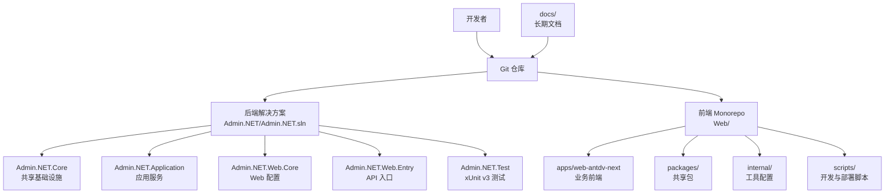
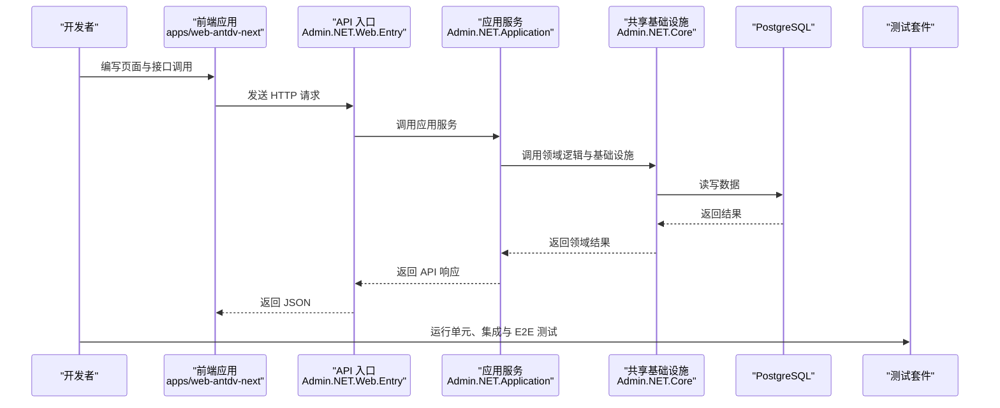
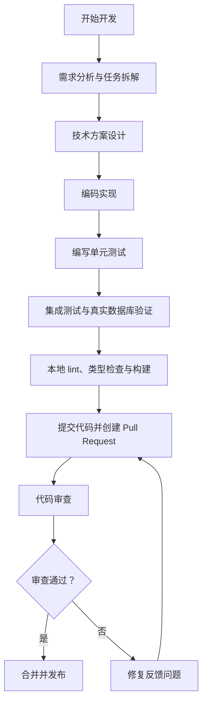
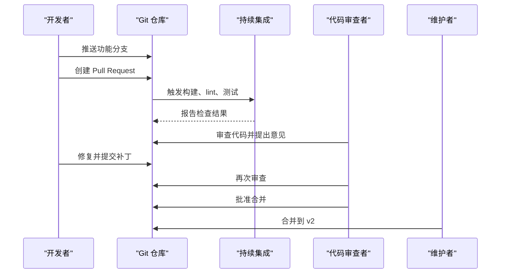
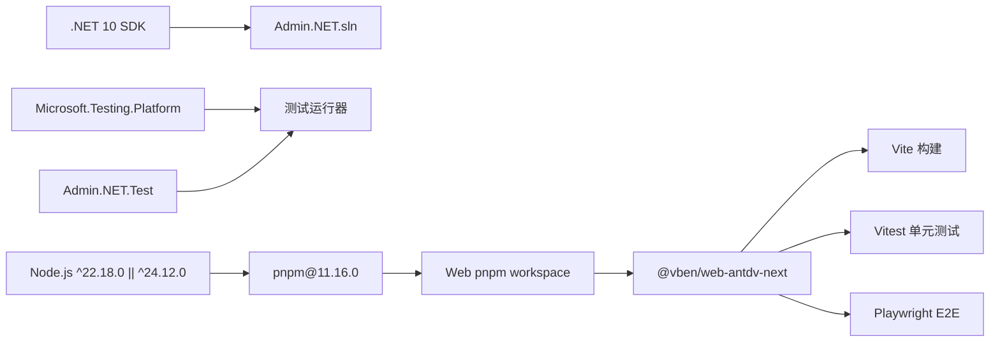

# 开发工作流程

<cite>
**本文引用的文件**   
- [README.md](file://README.md)
- [AGENTS.md](file://AGENTS.md)
- [docs/development.md](file://docs/development.md)
- [docs/maintenance.md](file://docs/maintenance.md)
- [.gitee/PULL_REQUEST_TEMPLATE.md](file://.gitee/PULL_REQUEST_TEMPLATE.md)
- [Web/package.json](file://Web/package.json)
- [Admin.NET/global.json](file://Admin.NET/global.json)
</cite>

## 目录
1. [引言](#引言)
2. [项目结构](#项目结构)
3. [核心组件与职责边界](#核心组件与职责边界)
4. [架构总览](#架构总览)
5. [详细开发流程](#详细开发流程)
6. [分支管理与提交规范](#分支管理与提交规范)
7. [代码审查与合并流程](#代码审查与合并流程)
8. [依赖与工具链分析](#依赖与工具链分析)
9. [性能与质量门禁](#性能与质量门禁)
10. [常见问题排查](#常见问题排查)
11. [结论](#结论)
12. [附录：常用命令速查](#附录常用命令速查)

## 引言
本文件面向 Admin.NET 仓库的开发者，说明从需求分析到代码提交的完整工作流。仓库当前已完成前端移植，业务前端入口为 `Web/apps/web-antdv-next/`；后端以 `Admin.NET/Admin.NET.Web.Entry/` 为 API 入口，共享能力位于 `Admin.NET.Core`，应用服务位于 `Admin.NET.Application`，测试位于 `Admin.NET.Test`。

仓库采用前后端分离、模块化设计和 pnpm workspace 管理前端工程。后端使用 .NET 生态，前端使用 Vue 3、Vben、antdv-next 和 Vite。文档、验证、部署和维护约定集中在 `docs/`，协作规则集中在 `AGENTS.md`。

## 项目结构
仓库按领域和运行角色划分：

- 后端解决方案：`Admin.NET/Admin.NET.sln`
  - `Admin.NET.Core`：领域模型、基础设施、通用服务、常量、枚举、扩展方法等。
  - `Admin.NET.Application`：应用服务层，承载具体业务编排。
  - `Admin.NET.Web.Core`：Web 配置与启动相关逻辑。
  - `Admin.NET.Web.Entry`：API 入口、控制器、视图、静态资源、Docker 配置等。
  - `Admin.NET.Test`：基于 xUnit v3 的后端测试。
  - `Plugins/`：可选插件，是否启用取决于实际项目引用和启动注册。
- 前端 monorepo：`Web/`
  - 业务应用：`Web/apps/web-antdv-next/`
  - 共享包：`Web/packages/`
  - 内部工具与配置：`Web/internal/`
  - 脚本与部署辅助：`Web/scripts/`
  - E2E 浏览器测试：`Web/apps/web-antdv-next/e2e/`
- 长期文档：`docs/`
- 临时工作区：`.scratch/`（默认忽略，历史资料需谨慎处理）

**图示来源**
- [README.md:1-60](file://README.md#L1-L60)
- [AGENTS.md:1-40](file://AGENTS.md#L1-L40)
- [docs/development.md:1-30](file://docs/development.md#L1-L30)

**章节来源**
- [README.md:1-60](file://README.md#L1-L60)
- [AGENTS.md:1-40](file://AGENTS.md#L1-L40)
- [docs/development.md:1-30](file://docs/development.md#L1-L30)

## 核心组件与职责边界
| 组件 | 主要职责 | 开发注意事项 |
|---|---|---|
| `Admin.NET.Core` | 领域实体、基础设施、通用服务、常量、枚举、扩展方法、日志、缓存、事件总线、SQL 适配等 | 修改公共能力时需评估调用方、测试影响范围和向后兼容性 |
| `Admin.NET.Application` | 应用服务层，编排业务流程 | 新增业务建议放在独立应用工程或现有 Application 工程中 |
| `Admin.NET.Web.Core` | Web 配置、中间件、服务注册等 | 通常不直接写业务逻辑 |
| `Admin.NET.Web.Entry` | API 入口、控制器、视图、静态资源、配置文件、Docker 配置 | 端口、协议、代理地址以实际启动输出为准 |
| `Admin.NET.Test` | xUnit v3 单元测试与集成测试 | 数据库验收必须使用隔离 PostgreSQL |
| `Web/apps/web-antdv-next` | 业务前端页面、路由、接口封装 | 旧版 `Web/src/` 不再作为开发入口 |
| `Web/packages` | 前端共享包 | 改动应补充对应包的 lint、类型检查与测试 |
| `Web/scripts` | 构建、部署、发布辅助脚本 | 不要误改生产部署路径或凭据 |
| `docs` | 长期维护的开发、验证、维护和协作文档 | 只记录可复用约定，不保留机器绝对路径 |
| `.scratch` | 临时工作区 | 清理前核对 Git 状态、绝对路径和引用 |

**章节来源**
- [AGENTS.md:10-40](file://AGENTS.md#L10-L40)
- [docs/development.md:1-30](file://docs/development.md#L1-L30)
- [docs/maintenance.md:1-20](file://docs/maintenance.md#L1-L20)

## 架构总览
开发时通常涉及以下交互链路：

**图示来源**
- [README.md:20-50](file://README.md#L20-L50)
- [docs/development.md:1-40](file://docs/development.md#L1-L40)

## 详细开发流程

### 1. 需求分析与任务拆解
- 明确业务目标、用户角色、权限边界、租户范围和数据流向。
- 将需求拆分为可交付的任务，优先定位受影响的后端模块、前端页面和共享包。
- 在 Issue 或任务跟踪系统中描述问题背景、预期行为和验收标准。
- 如果需求涉及外部系统，提前确认接口契约、限流、重试和错误码。

### 2. 技术方案设计
- 确定新增内容属于 `Admin.NET.Core`、`Admin.NET.Application`、前端业务页面还是共享包。
- 设计实体、服务接口、DTO、权限标识、菜单项、路由和国际化文案。
- 如需数据库变更，规划迁移、种子数据和回滚策略。
- 对第三方集成方案写出最小可行验证步骤，避免一次性接入过多外部依赖。

### 3. 编码实现
- 后端遵循 C# 风格约定，保持类型与成员命名一致，新增文件保留版权声明。
- 前端业务页面放在 `Web/apps/web-antdv-next/src/views/`，接口封装与路由沿用当前应用结构。
- 共享能力放入 `Web/packages/`，并同步更新类型、文档和测试。
- 修改前阅读 `AGENTS.md`、前端 `AGENTS.md` 或模块旁的 `CLAUDE.md`。

### 4. 单元测试编写
- 后端使用 xUnit v3，测试类命名为 `*Tests`，方法命名遵循 `Method_Scenario_ExpectedResult`。
- 前端逻辑使用 Vitest，浏览器交互使用 Playwright。
- 纯逻辑优先用单元测试；需要真实数据访问时使用隔离 PostgreSQL。
- 调试单项测试超过 30 分钟仍未解决时，停止扩展测试驱动，改用 Mock 并记录人工核验步骤。

### 5. 集成测试验证
- 使用独立 PostgreSQL，覆盖本次受影响的读写、权限、租户边界和清理操作。
- 不得以 SQLite 或 Mock 结果声称真实联调通过。
- 桌面 E2E 统一入口为 `pnpm test:e2e`；先核对 `playwright.config.ts`、目标用例和环境变量。
- 涉及打印、通知、任务调度或第三方插件时，使用隔离服务和测试数据分别核验状态。

### 6. 自测与本地验收
- 后端：`dotnet restore` → `dotnet build` → `dotnet run` → 接口验收。
- 前端：`pnpm install --frozen-lockfile` → `pnpm dev` → 页面与接口联调。
- 类型检查：`pnpm check:type`。
- 代码风格：`pnpm lint`。
- 单元测试：`pnpm test:unit`。
- E2E：`pnpm test:e2e`。

**图示来源**
- [AGENTS.md:40-74](file://AGENTS.md#L40-L74)
- [docs/development.md:30-64](file://docs/development.md#L30-L64)

**章节来源**
- [AGENTS.md:40-74](file://AGENTS.md#L40-L74)
- [docs/development.md:30-64](file://docs/development.md#L30-L64)

## 分支管理与提交规范

### 分支管理策略
- 主分支：`v2` 是当前主要分支，也是 PR 合并的目标分支。
- 功能分支：建议使用语义化命名，如 `feature/模块名-简短描述`、`fix/模块名-问题描述`、`docs/模块名-文档说明`。
- 紧急修复：可从 `v2` 拉取修复分支，修复完成后尽快合并回 `v2`。
- 特性分支：大功能建议拆分为多个小 PR，降低审查难度和冲突概率。
- 保护要求：主分支应启用强制审查和 CI 校验，禁止未经审查直接推送。

### 提交信息规范
- 使用中文 Conventional Commits。
- 示例格式：`docs: 更新前端开发与验收说明`、`feat: 增加用户导出功能`、`fix: 修复权限校验空指针异常`。
- 提交内容应聚焦单一职责，避免混合无关改动。
- 不要提交密钥、连接凭据、证书、业务上传文件或构建产物。

### 变更日志维护
- 当前仓库保留 `Web/CHANGELOG*.md` 及共享包的历史版本语境，但不改写为当前分支的新发布记录。
- 发布前由维护者根据 Changesets 或合并的 PR 生成正式变更记录。
- 文档维护只需核对事实、路径、命令、引用和差异，不构成业务回归。

**章节来源**
- [README.md:50-90](file://README.md#L50-L90)
- [AGENTS.md:60-74](file://AGENTS.md#L60-L74)
- [docs/maintenance.md:1-20](file://docs/maintenance.md#L1-L20)

## 代码审查与合并流程

### Pull Request 模板
仓库提供 Gitee PR 模板，包含以下必填部分：
- 问题与关联 Issue
- 修改内容
- 验证结果
- 部署或配置影响

PR 描述应写明：
- 具体问题或需求背景
- 行为变化及受影响的前后端模块
- 执行的命令、结果和未验证范围
- 真实集成是否使用隔离 PostgreSQL
- 界面变更是否附截图
- 是否有配置、数据迁移、外部服务或回退要求

### 代码审查清单
- 需求是否已明确并可验收。
- 代码是否符合 `AGENTS.md` 和对应模块约定。
- 新增 API、实体、权限、菜单、路由是否同步完善。
- 是否添加或更新单元测试、集成测试和 E2E 用例。
- 是否引入新的外部依赖且具备合理理由。
- 是否遗漏敏感信息、临时文件、构建产物或机器绝对路径。
- 文档、命令、路径和链接是否与实际源码一致。

### 合并标准
- 至少一名审查者批准。
- 所有必要检查通过：构建、lint、类型检查、单元测试、必要时 E2E。
- 无未决评论或已闭环。
- 变更日志或发布说明已准备（由维护者负责）。
- 主分支保护规则生效，禁止跳过审查合并。

**图示来源**
- [.gitee/PULL_REQUEST_TEMPLATE.md:1-15](file://.gitee/PULL_REQUEST_TEMPLATE.md#L1-L15)
- [AGENTS.md:60-74](file://AGENTS.md#L60-L74)

**章节来源**
- [.gitee/PULL_REQUEST_TEMPLATE.md:1-15](file://.gitee/PULL_REQUEST_TEMPLATE.md#L1-L15)
- [AGENTS.md:60-74](file://AGENTS.md#L60-L74)

## 依赖与工具链分析

### 后端工具链
- SDK：.NET 10 SDK。
- 解决方案：`Admin.NET/Admin.NET.sln`。
- 测试运行器：Microsoft.Testing.Platform，由 `Admin.NET/global.json` 选择。
- 测试项目：`Admin.NET.Admin.NET.Test.csproj`，基于 xUnit v3。
- 注意：根目录 `global.json` 当前只选择 Microsoft.Testing.Platform，未固定 SDK 版本；各后端工程目标框架以各自 `.csproj` 为准。

### 前端工具链
- Node.js：`^22.18.0 || ^24.12.0`。
- pnpm：`packageManager` 指定为 `pnpm@11.16.0`。
- 工作区：`Web/pnpm-workspace.yaml`。
- 业务应用：`@vben/web-antdv-next`。
- 测试：Vitest 用于单元测试，Playwright 用于桌面 E2E。
- 构建：Vite 输出到 `Web/dist/`。

**图示来源**
- [Admin.NET/global.json:1-5](file://Admin.NET/global.json#L1-L5)
- [Web/package.json:1-102](file://Web/package.json#L1-L102)
- [docs/development.md:10-40](file://docs/development.md#L10-L40)

**章节来源**
- [Admin.NET/global.json:1-5](file://Admin.NET/global.json#L1-L5)
- [Web/package.json:1-102](file://Web/package.json#L1-L102)
- [docs/development.md:10-40](file://docs/development.md#L10-L40)

## 性能与质量门禁
- 不要在每次任务中无条件执行全仓格式化或全量检查；按改动范围选择检查。
- `pnpm lint-fix`、`pnpm format` 会写入源码，只对明确需要格式化的范围使用。
- 构建、CLI 帮助可用不等于集成测试通过；真实数据库验收不可省略。
- 前端代理、API 地址和生产路由须与实际部署一致。
- 后端首次启动可能初始化表和种子数据，运行前确认数据库用途。
- 仅文档改动通常无需启动业务服务或运行修改型全仓格式化。

**章节来源**
- [AGENTS.md:40-74](file://AGENTS.md#L40-L74)
- [docs/development.md:30-64](file://docs/development.md#L30-L64)

## 常见问题排查

| 问题 | 原因 | 处理方式 |
|---|---|---|
| 直接在仓库根运行 `dotnet test` 参数不匹配 | 根目录未正确选择 Microsoft.Testing.Platform | 在 `Admin.NET/` 目录执行测试命令并使用 `--project` 指定测试项目 |
| 集成测试使用 SQLite 被判定为未真实联调 | 项目要求隔离的真实 PostgreSQL | 切换到独立 PostgreSQL，重新验证读写、权限和租户边界 |
| 前端命令找不到 `pnpm` | Node 或 pnpm 版本不符合 `engines` 或 `packageManager` | 安装匹配的 Node.js 和 `pnpm@11.16.0`，使用 `pnpm install --frozen-lockfile` |
| 前端构建或类型检查失败 | 业务应用或共享包存在类型错误或 ESLint 问题 | 先运行 `pnpm check:type` 和 `pnpm lint`，再定位具体包和问题文件 |
| E2E 用例不稳定 | 浏览器环境、Mock 或真实后端不一致 | 核对 `playwright.config.ts`、环境变量、目标用例和后端状态 |
| 文档维护后仍提示路径错误 | 路径、命令或引用未同步更新 | 对照源码、`git diff` 和 `docs/development.md` 逐项核对 |
| 提交信息不规范 | 未使用中文 Conventional Commits | 修正提交信息，避免混合无关改动 |
| PR 被拒绝 | 缺少验证结果、未覆盖关键场景或存在风险 | 补充测试、截图和部署影响说明，回应审查意见 |

**章节来源**
- [docs/development.md:10-64](file://docs/development.md#L10-L64)
- [AGENTS.md:40-74](file://AGENTS.md#L40-L74)
- [.gitee/PULL_REQUEST_TEMPLATE.md:1-15](file://.gitee/PULL_REQUEST_TEMPLATE.md#L1-L15)

## 结论
Admin.NET 的开发流程强调“需求清晰、边界明确、测试真实、审查严格”。后端以 `Admin.NET.Core` 为基础、`Admin.NET.Application` 承载业务、`Admin.NET.Web.Entry` 暴露 API；前端以 `Web/apps/web-antdv-next/` 为业务入口，配合 pnpm workspace 管理共享包。开发过程中应优先遵循 `AGENTS.md` 和 `docs/development.md`，使用隔离 PostgreSQL 完成真实集成验收，并通过 PR 模板和规范提交信息保证团队协作质量。

## 附录：常用命令速查

### 后端命令
- 恢复依赖：`dotnet restore Admin.NET/Admin.NET.sln`
- 构建解决方案：`dotnet build Admin.NET/Admin.NET.sln -c Debug`
- 运行 API 入口：`dotnet run --project Admin.NET/Admin.NET.Web.Entry/Admin.NET.Web.Entry.csproj`
- 运行测试：`dotnet test --project Admin.NET.Test/Admin.NET.Test.csproj`

### 前端命令
- 安装依赖：`pnpm install --frozen-lockfile`
- 启动开发服务器：`pnpm dev`
- 生产构建：`pnpm build`
- 代码检查：`pnpm lint`
- 类型检查：`pnpm check:type`
- 单元测试：`pnpm test:unit`
- E2E 测试：`pnpm test:e2e`

**章节来源**
- [README.md:20-50](file://README.md#L20-L50)
- [AGENTS.md:40-60](file://AGENTS.md#L40-L60)
- [docs/development.md:30-64](file://docs/development.md#L30-L64)
- [Web/package.json:20-80](file://Web/package.json#L20-L80)