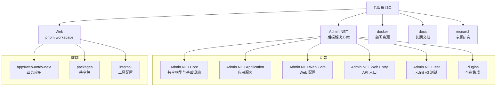
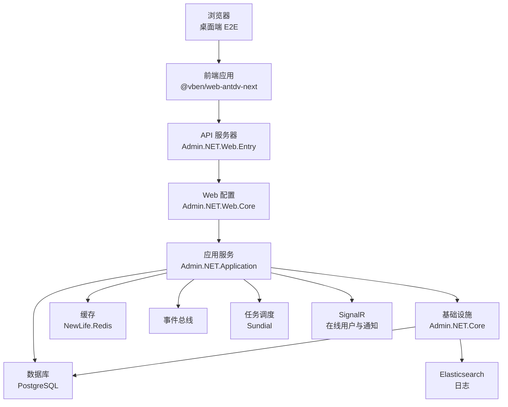
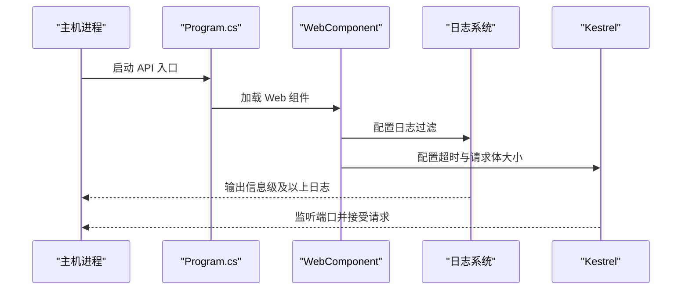
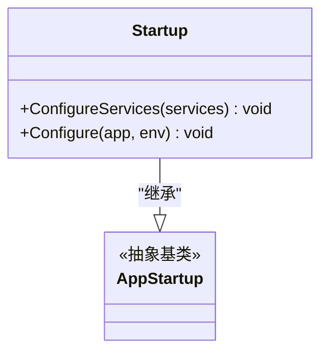
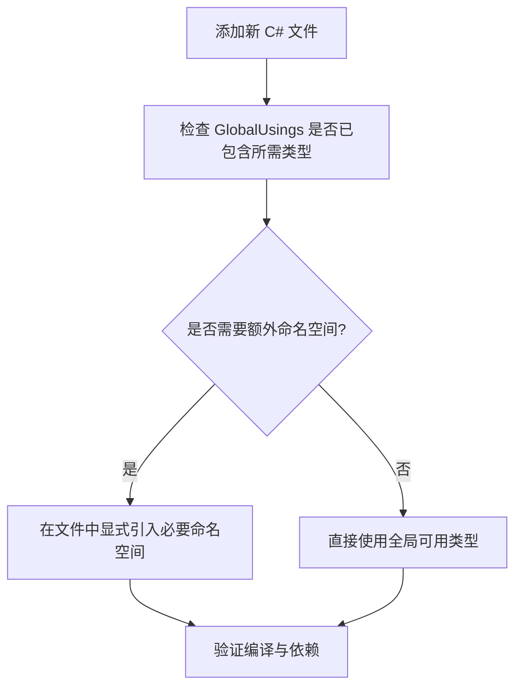
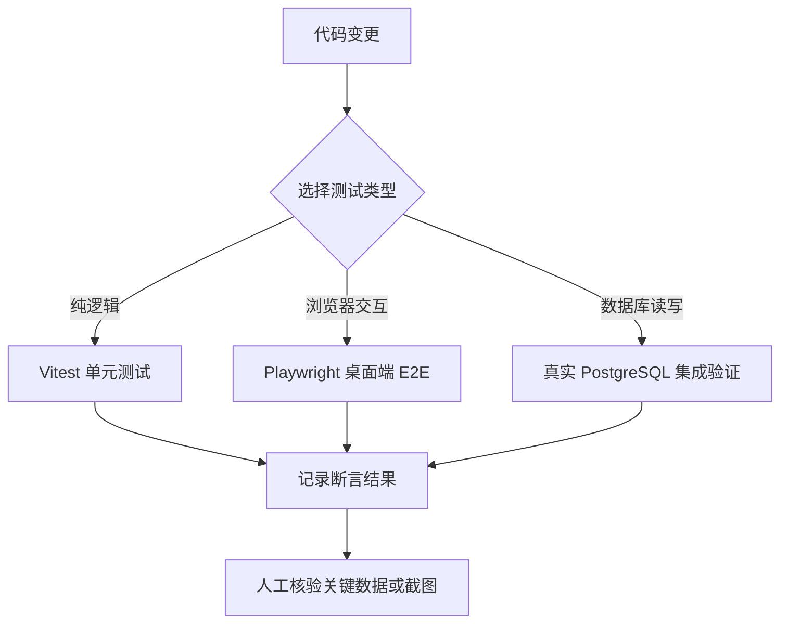
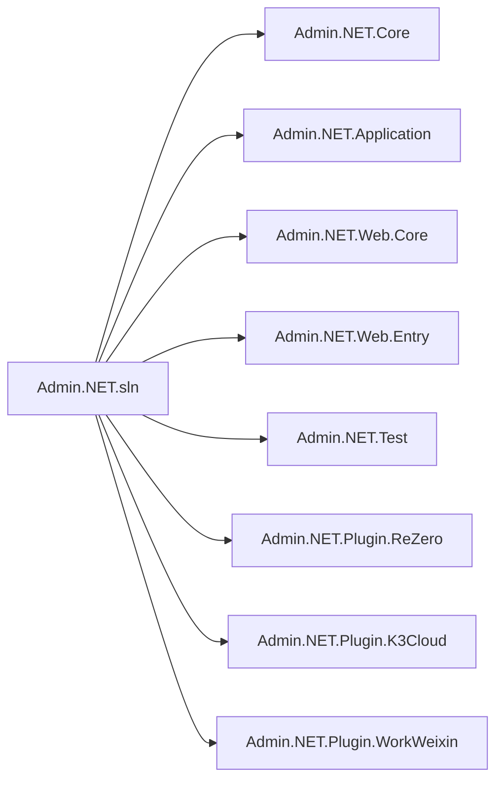
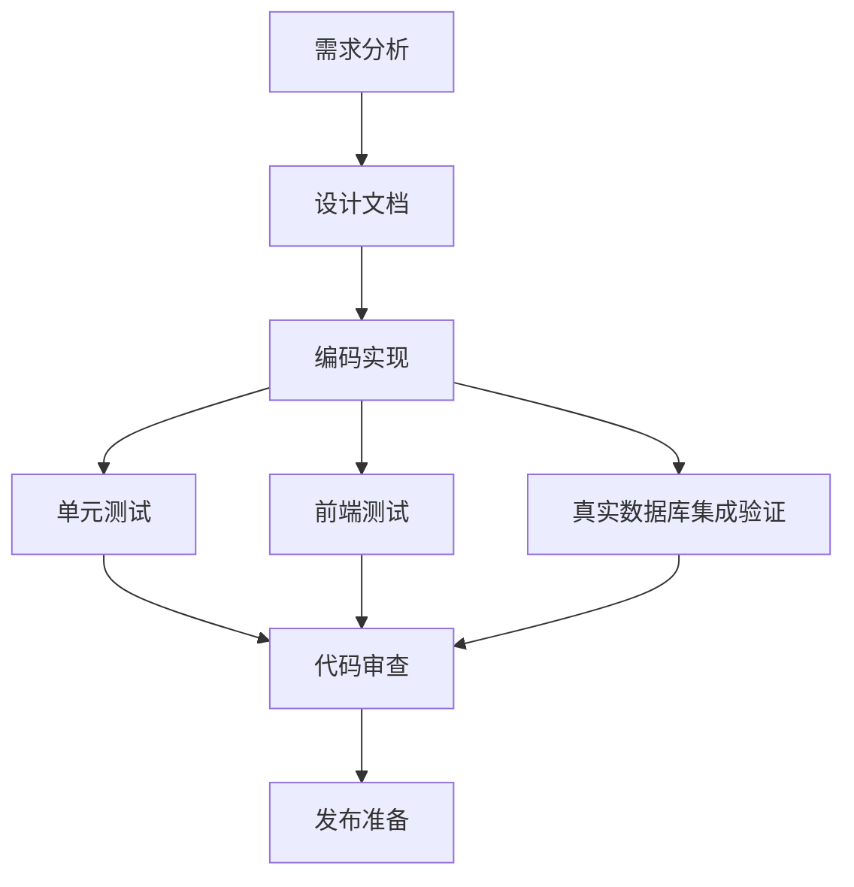

# 开发指南

<cite>
**本文引用的文件**   
- [README.md](file://README.md)
- [AGENTS.md](file://AGENTS.md)
- [docs/development.md](file://docs/development.md)
- [docs/maintenance.md](file://docs/maintenance.md)
- [Admin.NET/global.json](file://Admin.NET/global.json)
- [Admin.NET/Admin.NET.sln](file://Admin.NET/Admin.NET.sln)
- [Admin.NET/.editorconfig](file://Admin.NET/.editorconfig)
- [Admin.NET/Admin.NET.Web.Entry/Program.cs](file://Admin.NET/Admin.NET.Web.Entry/Program.cs)
- [Admin.NET/Admin.NET.Web.Entry/appsettings.json](file://Admin.NET/Admin.NET.Web.Entry/appsettings.json)
- [Admin.NET/Admin.NET.Application/Startup.cs](file://Admin.NET/Admin.NET.Application/Startup.cs)
- [Admin.NET/Admin.NET.Core/GlobalUsings.cs](file://Admin.NET/Admin.NET.Core/GlobalUsings.cs)
- [Web/package.json](file://Web/package.json)
- [Web/apps/web-antdv-next/package.json](file://Web/apps/web-antdv-next/package.json)
- [Web/eslint.config.mjs](file://Web/eslint.config.mjs)
- [Web/stylelint.config.mjs](file://Web/stylelint.config.mjs)
- [Web/playwright.config.ts](file://Web/playwright.config.ts)
- [Web/vitest.config.ts](file://Web/vitest.config.ts)
</cite>

## 目录
1. [引言](#引言)
2. [项目结构](#项目结构)
3. [核心组件](#核心组件)
4. [架构总览](#架构总览)
5. [详细组件分析](#详细组件分析)
6. [依赖关系分析](#依赖关系分析)
7. [性能与优化建议](#性能与优化建议)
8. [调试与故障排查](#调试与故障排查)
9. [代码规范与命名约定](#代码规范与命名约定)
10. [Git 工作流与代码审查](#git-工作流与代码审查)
11. [新功能开发生命周期](#新功能开发生命周期)
12. [安全注意事项](#安全注意事项)
13. [贡献代码流程](#贡献代码流程)
14. [结论](#结论)

## 引言
Admin.NET 是一个基于 ASP.NET Core、Furion 和 SqlSugar 的通用权限开发框架，提供多租户、权限管理、任务调度、消息通知、文件管理、代码生成等能力。当前仓库已完成前端移植：业务前端入口为 `Web/apps/web-antdv-next/`，后端 API 入口为 `Admin.NET/Admin.NET.Web.Entry/`。解决方案采用前后端分离与模块化设计，可按业务扩展应用服务、数据库适配和插件。

本开发指南面向团队成员，统一说明代码规范、Git 工作流、新功能开发生命周期、调试技巧、性能优化、安全检查和质量工具使用方式。文档以仓库当前源码、配置文件和现有说明为依据；上游在线文档仅作为背景参考。

**章节来源**
- [README.md:1-40](file://README.md#L1-L40)
- [docs/development.md:1-20](file://docs/development.md#L1-L20)

## 项目结构
仓库主要分为后端 .NET 解决方案、前端 pnpm workspace、Docker 资源、长期文档、研究资料和临时脚本。

| 区域 | 主要职责 | 关键路径 |
|---|---|---|
| 后端解决方案 | 共享基础设施、应用服务、Web 配置、API 入口、测试、可选插件 | `Admin.NET/` |
| 前端工作区 | Vben / antdv-next 业务应用、共享包、内部工具、E2E 与单元测试 | `Web/` |
| Docker | 应用、MySQL、Redis、Nginx 相关资源 | `docker/` |
| 文档 | 开发、维护、领域与协作约定 | `docs/` |
| 研究 | 审批绑定、文档存储版本化等专题研究 | `research/` |
| 脚本 | Agent 辅助脚本 | `scripts/scripts/agents/` |

**图表来源**
- [Admin.NET/Admin.NET.sln:5-20](file://Admin.NET/Admin.NET.sln#L5-L20)
- [docs/development.md:1-16](file://docs/development.md#L1-L16)
- [AGENTS.md:10-22](file://AGENTS.md#L10-L22)

**章节来源**
- [AGENTS.md:10-22](file://AGENTS.md#L10-L22)
- [docs/development.md:1-16](file://docs/development.md#L1-L16)
- [Admin.NET/Admin.NET.sln:5-20](file://Admin.NET/Admin.NET.sln#L5-L20)

## 核心组件
后端以 Furion 和 SqlSugar 为基础，按层次划分：

- `Admin.NET.Core`：领域模型、枚举、实体、扩展、日志、缓存、事件总线、Job、SignalR、签名认证、SqlSugar 封装、工具类、种子数据等共享能力。
- `Admin.NET.Application`：应用服务层，放置业务服务；通过启动类装配服务与中间件。
- `Admin.NET.Web.Core`：Web 层配置，由 API 入口引用需要启用的应用或插件。
- `Admin.NET.Web.Entry`：Kestrel API 入口，负责主机初始化、日志过滤、接口超时与请求体大小配置。
- `Admin.NET.Test`：xUnit v3 测试工程，覆盖用户、角色、菜单、租户、插件、更新、日志、开放授权等功能场景。
- `Plugins`：可选插件，例如钉钉、GoView、金蝶 K3 Cloud、ReZero、WMS Oracle、企业微信等，是否启用需检查实际项目引用和启动注册。

前端以 pnpm workspace 管理，业务应用位于 `Web/apps/web-antdv-next/`，共享能力位于 `Web/packages/`，内部工具位于 `Web/internal/`。旧版 `Web/src/` 不再作为开发入口。

**章节来源**
- [README.md:12-20](file://README.md#L12-L20)
- [docs/development.md:1-16](file://docs/development.md#L1-L16)
- [Admin.NET/Admin.NET.Application/Startup.cs:1-22](file://Admin.NET/Admin.NET.Application/Startup.cs#L1-L22)
- [Admin.NET/Admin.NET.Core/GlobalUsings.cs:1-56](file://Admin.NET/Admin.NET.Core/GlobalUsings.cs#L1-L56)

## 架构总览
系统采用前后端分离架构。前端通过浏览器发起 HTTP 请求并调用 SignalR 实现实时通信；后端使用 Kestrel 暴露 API，结合 Furion 动态控制器、权限、日志、任务调度、缓存、OAuth、限流、ES 日志等能力；数据持久化由 SqlSugar 驱动到 PostgreSQL 或其他数据库。

**图表来源**
- [README.md:12-20](file://README.md#L12-L20)
- [Admin.NET/Admin.NET.Web.Entry/Program.cs:1-38](file://Admin.NET/Admin.NET.Web.Entry/Program.cs#L1-L38)
- [Admin.NET/Admin.NET.Core/GlobalUsings.cs:1-56](file://Admin.NET/Admin.NET.Core/GlobalUsings.cs#L1-L56)

## 详细组件分析

### 后端启动与运行环境
后端 API 入口通过 `Serve.Run` 创建 WebApplication 主机，并使用 Furion 的 `AddWebComponent<WebComponent>()` 加载 Web 组件。`WebComponent.Load` 中完成以下关键配置：

- 控制台运行时禁用 Windows 事件日志提供者，避免普通用户权限导致写入失败。
- 设置日志过滤，忽略部分 Microsoft.Hosting 和 Microsoft.AspNetCore 类别，并限制最低日志级别。
- 配置 Kestrel 的 KeepAliveTimeout、RequestHeadersTimeout 和 MaxRequestBodySize。

**图表来源**
- [Admin.NET/Admin.NET.Web.Entry/Program.cs:1-38](file://Admin.NET/Admin.NET.Web.Entry/Program.cs#L1-L38)

**章节来源**
- [Admin.NET/Admin.NET.Web.Entry/Program.cs:1-38](file://Admin.NET/Admin.NET.Web.Entry/Program.cs#L1-L38)
- [Admin.NET/Admin.NET.Web.Entry/appsettings.json:1-5](file://Admin.NET/Admin.NET.Web.Entry/appsettings.json#L1-L5)

### 应用启动类与模块装配
`Admin.NET.Application.Startup` 继承 Furion 的 `AppStartup`，并通过 `[AppStartup(100)]` 指定装配顺序。当前模板中的 `ConfigureServices` 和 `Configure` 为空，但它是应用服务层的标准装配点：新增服务注册、中间件管道、外部系统集成应放在此处，并遵循现有启动顺序约定。

**图表来源**
- [Admin.NET/Admin.NET.Application/Startup.cs:1-22](file://Admin.NET/Admin.NET.Application/Startup.cs#L1-L22)

**章节来源**
- [Admin.NET/Admin.NET.Application/Startup.cs:1-22](file://Admin.NET/Admin.NET.Application/Startup.cs#L1-L22)

### 全局引用与基础设施依赖
`Admin.NET.Core.GlobalUsings.cs` 集中引入 Furion、SqlSugar、Mapster、Magicodes、Microsoft.Extensions.*、NewLife、SKIT.FlurlHttpClient.Wechat、UAParser、Yitter.IdGenerator 等常用命名空间。这降低了每个文件的导入成本，但也意味着团队修改公共行为时需要关注这些全局依赖的影响范围。

**图表来源**
- [Admin.NET/Admin.NET.Core/GlobalUsings.cs:1-56](file://Admin.NET/Admin.NET.Core/GlobalUsings.cs#L1-L56)

**章节来源**
- [Admin.NET/Admin.NET.Core/GlobalUsings.cs:1-56](file://Admin.NET/Admin.NET.Core/GlobalUsings.cs#L1-L56)

### 前端应用与构建入口
业务前端应用为 `@vben/web-antdv-next`，其 package.json 定义了开发、生产构建、预览和类型检查脚本。工作区根 `Web/package.json` 将 `dev`、`build`、`check:type`、`lint`、`test:unit`、`test:e2e` 等命令转发给该业务应用或共享工具。

| 命令 | 作用 | 适用范围 |
|---|---|---|
| `pnpm dev` | 启动业务前端开发服务器 | `@vben/web-antdv-next` |
| `pnpm build` | 构建生产产物 | `@vben/web-antdv-next` |
| `pnpm lint` | 检查业务应用 `src/` | 不保证覆盖所有共享包 |
| `pnpm check:type` | TypeScript 类型检查 | `@vben/web-antdv-next` |
| `pnpm test:unit` | Vitest 逻辑测试 | 全工作区，排除 e2e 与 dist |
| `pnpm test:e2e` | Playwright 桌面浏览器端到端测试 | 桌面 Chrome，1440×1000 |

**章节来源**
- [Web/package.json:1-102](file://Web/package.json#L1-L102)
- [Web/apps/web-antdv-next/package.json:1-72](file://Web/apps/web-antdv-next/package.json#L1-L72)

### 测试与验收边界
- 纯逻辑使用 Vitest，环境为 happy-dom。
- 桌面浏览器流程使用 Playwright，测试目录为 `Web/apps/web-antdv-next/e2e`。
- 真实数据库验收必须使用独立 PostgreSQL，不能用 SQLite 替代。
- 只验证本次受影响范围，避免触发无关的外部副作用。

**图表来源**
- [Web/vitest.config.ts:1-28](file://Web/vitest.config.ts#L1-L28)
- [Web/playwright.config.ts:1-31](file://Web/playwright.config.ts#L1-L31)
- [docs/development.md:41-64](file://docs/development.md#L41-L64)

**章节来源**
- [Web/vitest.config.ts:1-28](file://Web/vitest.config.ts#L1-L28)
- [Web/playwright.config.ts:1-31](file://Web/playwright.config.ts#L1-L31)
- [docs/development.md:41-64](file://docs/development.md#L41-L64)

## 依赖关系分析
后端解决方案包含核心库、应用层、Web 层、API 入口、测试工程和多个插件。解决方案文件明确列出各项目的相对路径和项目类型，插件默认归入 `Plugins` 分组。

**图表来源**
- [Admin.NET/Admin.NET.sln:5-20](file://Admin.NET/Admin.NET.sln#L5-L20)
- [Admin.NET/Admin.NET.sln:21-40](file://Admin.NET/Admin.NET.sln#L21-L40)

**章节来源**
- [Admin.NET/Admin.NET.sln:5-40](file://Admin.NET/Admin.NET.sln#L5-L40)

## 性能与优化建议
- 后端接口超时和请求体大小已在 API 入口中配置，新增大文件上传或长连接接口时应评估是否需要调整 Kestrel 配置。
- 日志过滤已屏蔽部分 Microsoft.Hosting 和 Microsoft.AspNetCore 类别，并限制最低日志级别；生产环境应避免开启过高日志级别导致磁盘和 IO 压力。
- 前端构建命令设置了较大的 Node.js 堆内存上限，适合大型 monorepo；若本地内存不足可适当调低，但不应盲目关闭。
- 数据库查询应优先复用已有 Service 和 SqlSugar 封装，避免在应用层拼装复杂 SQL。
- 对高频读路径考虑使用缓存，写路径注意缓存一致性。
- 前端按需拆分路由和组件，减少首屏体积；共享能力放入 `Web/packages/`，避免重复实现。

[本节为通用优化建议，未直接分析具体源码文件]

## 调试与故障排查

### 后端调试
- 在 `Admin.NET/` 目录执行 `dotnet restore`、`dotnet build -c Debug`、`dotnet run --project Admin.NET.Admin.NET.Web.Entry/Admin.NET.Web.Entry.csproj`。
- 首次启动可能初始化表和种子数据，务必确认目标数据库是独立开发库。
- 日志已过滤 Microsoft.Hosting 和 Microsoft.AspNetCore 前缀，并在 Windows 控制台运行时禁用事件日志提供者。
- 若无法写入 Windows 事件日志，属于预期行为；可通过控制台日志定位问题。

**章节来源**
- [docs/development.md:21-38](file://docs/development.md#L21-L38)
- [Admin.NET/Admin.NET.Web.Entry/Program.cs:1-38](file://Admin.NET/Admin.NET.Web.Entry/Program.cs#L1-L38)

### 前端调试
- 在 `Web/` 目录执行 `pnpm install --frozen-lockfile` 和 `pnpm dev`。
- 业务应用开发服务器由 `@vben/web-antdv-next` 提供。
- 类型检查使用 `pnpm check:type`，逻辑测试使用 `pnpm test:unit`。
- 如果代理或 API 地址错误，请检查前端代理配置与实际部署一致，不要沿用移植阶段的个人机器端口。

**章节来源**
- [docs/development.md:49-64](file://docs/development.md#L49-L64)
- [Web/package.json:1-102](file://Web/package.json#L1-L102)

### 数据库问题诊断
- 集成测试必须使用独立 PostgreSQL，不能以 SQLite 或 Mock 结果声称联调通过。
- 首次运行可能创建表结构和种子数据，运行前应确认数据库用途。
- 涉及租户、权限、数据范围的问题应检查真实数据，而不是只看单元测试断言。

**章节来源**
- [docs/development.md:21-40](file://docs/development.md#L21-L40)
- [docs/development.md:41-56](file://docs/development.md#L41-L56)

### 网络请求调试
- 后端日志会过滤部分框架日志，优先查看业务模块日志。
- 前端浏览器调试可先确认代理是否指向正确 API 地址。
- SDK 生成链用于根据后端接口生成前端客户端代码，后端接口变化后应重新生成并检查差异。

**章节来源**
- [Admin.NET/Admin.NET.Web.Entry/Program.cs:15-38](file://Admin.NET/Admin.NET.Web.Entry/Program.cs#L15-L38)
- [docs/development.md:57-64](file://docs/development.md#L57-L64)

## 代码规范与命名约定

### C# 代码规范
后端使用 `.editorconfig` 统一 C# 风格：

- 缩进使用 4 空格，行尾使用 CRLF。
- 命名空间使用文件范围声明。
- 类型和非字段成员使用 PascalCase。
- 接口以 `I` 开头。
- 推荐表达式体属性、索引器、访问器、lambda 和局部函数等现代语法。
- 推荐使用 null 传播、空值判断简化、元组交换、索引和范围操作符。
- 文件头自动添加版权和许可证声明。

| 规则类别 | 约定 |
|---|---|
| 接口命名 | 以 `I` 开头的 PascalCase |
| 类型命名 | PascalCase |
| 非字段成员 | PascalCase |
| 缩进 | 4 空格 |
| 换行符 | CRLF |
| 命名空间 | 文件范围命名空间 |
| 表达式体 | 属性、索引器、访问器、lambda 等允许 |
| 文件头 | 自动生成版权声明 |

**章节来源**
- [Admin.NET/.editorconfig:1-177](file://Admin.NET/.editorconfig#L1-L177)

### TypeScript 与 Vue 代码规范
前端质量检查由 ESLint、StyleLint、Prettier、oxlint、oxfmt 等工具共同组成：

- ESLint 使用 `@vben/eslint-config`，并集成 `eslint-config-prettier`，格式主要由 Prettier 管理。
- StyleLint 继承 `@vben/stylelint-config`。
- 业务应用格式参考 `Web/.prettierrc.cjs`。
- 自动生成生成的 SDK 代码被 ESLint 忽略，不执行手写代码格式规则。
- 共享包的改动应补充对应范围的检查，不要只检查业务应用 `src/`。

| 工具 | 配置位置 | 作用 |
|---|---|---|
| ESLint | `Web/eslint.config.mjs` | 代码质量检查 |
| StyleLint | `Web/stylelint.config.mjs` | 样式检查 |
| Prettier | `Web/.prettierrc.cjs` | 代码格式化 |
| oxlint / oxfmt | `Web/oxlint.config.ts`、`Web/oxfmt.config.ts` | 快速 lint 与格式化 |
| TypeScript | `vue-tsc` | 类型检查 |

**章节来源**
- [Web/eslint.config.mjs:1-9](file://Web/eslint.config.mjs#L1-L9)
- [Web/stylelint.config.mjs:1-4](file://Web/stylelint.config.mjs#L1-L4)
- [AGENTS.md:52-62](file://AGENTS.md#L52-L62)

### 注释规范
- C# 文件应保留项目提供的版权和许可证声明。
- 公共 API、复杂算法、跨模块契约应添加可读性强的中文注释。
- 临时调试代码、个人笔记和敏感信息不应提交到仓库。
- 文档只记录可复用的配置、契约和流程；阶段交接资料留在临时工作区。

**章节来源**
- [Admin.NET/.editorconfig:150-177](file://Admin.NET/.editorconfig#L150-L177)
- [AGENTS.md:52-62](file://AGENTS.md#L52-L62)
- [docs/maintenance.md:1-12](file://docs/maintenance.md#L1-L12)

## Git 工作流与代码审查

### 分支策略
- 当前主分支为 `v2`。
- 功能开发应在独立分支进行，提交后再合并回主分支。
- 提交信息使用中文 Conventional Commits，例如 `docs: 更新前端开发与验收说明`。

### 提交要求
- PR 应写明问题、行为变化、受影响模块、关联 Issue 和验证结果。
- 界面变更需提供必要截图。
- 不得提交密钥、连接凭据、证书、业务上传文件或构建产物。
- 不因文档维护升级依赖，除非确有必要。

### 代码审查重点
- 是否遵循 `.editorconfig` 和前端 lint 配置。
- 是否保持数据库隔离，不使用 SQLite 替代真实 PostgreSQL。
- 是否明确区分单元测试、Mock 验证和真实集成验收。
- 是否保留必要的中文注释和变更记录。
- 是否清理临时文件和绝对路径。

**章节来源**
- [AGENTS.md:63-74](file://AGENTS.md#L63-L74)
- [README.md:41-56](file://README.md#L41-L56)

## 新功能开发生命周期

### 需求分析
- 明确业务目标、用户角色、权限边界和数据范围。
- 确认是否需要多租户、任务调度、文件存储、消息通知或第三方集成。
- 识别外部依赖，包括数据库、缓存、邮件、短信、微信、OSS 等。

### 设计文档
- 在后端新增应用服务时，优先考虑放入 `Admin.NET.Application` 或独立应用工程，复用 `Admin.NET.Core`。
- 前端页面放在 `Web/apps/web-antdv-next/src/views/`，接口封装、授权与路由沿用当前应用结构。
- 共享能力按职责放入 `Web/packages/`。
- 重要设计决策应写入 `docs/`，并保持与源码一致。

### 编码实现
- 后端新增类遵循 C# 命名规范，保留文件头。
- 前端新增组件遵循 ESLint、StyleLint、Prettier 和 TypeScript 类型约束。
- 配置项不硬编码，通过配置结构和本机忽略文件或环境变量注入。

### 测试验证
- 纯逻辑编写 Vitest 单元测试。
- 浏览器交互编写 Playwright 桌面端 E2E。
- 数据库读写使用独立 PostgreSQL 进行真实联调。
- 第三方服务使用隔离环境和 Mock，明确标注未完成真实集成验收的部分。

**图表来源**
- [README.md:41-56](file://README.md#L41-L56)
- [docs/development.md:21-64](file://docs/development.md#L21-L64)
- [AGENTS.md:33-51](file://AGENTS.md#L33-L51)

**章节来源**
- [README.md:41-56](file://README.md#L41-L56)
- [docs/development.md:21-64](file://docs/development.md#L21-L64)
- [AGENTS.md:33-51](file://AGENTS.md#L33-L51)

## 安全注意事项
- 数据库连接、缓存、OAuth、文件存储等凭据通过本机忽略文件或部署环境注入，不在文档和日志中记录真实密码。
- 前端敏感处理可使用 `sm-crypto-v2` 等加密依赖，但密钥管理仍应放在服务端和安全配置中。
- 文件上传、下载和打印功能应校验文件类型、大小和来源，防止恶意文件执行。
- 权限控制应结合菜单、按钮标识、角色和数据权限范围，避免仅在前端隐藏控件。
- 日志中不要输出用户令牌、密码、身份证号或业务敏感字段。

**章节来源**
- [docs/development.md:27-38](file://docs/development.md#L27-L38)
- [Web/apps/web-antdv-next/package.json:41-72](file://Web/apps/web-antdv-next/package.json#L41-L72)
- [README.md:60-100](file://README.md#L60-L100)

## 贡献代码流程
1. 克隆仓库并切换到合适的工作分支。
2. 安装后端依赖：`dotnet restore Admin.NET/Admin.NET.sln`。
3. 安装前端依赖：`pnpm install --frozen-lockfile`。
4. 实现功能，遵循 C# 和前端代码规范。
5. 编写单元测试和必要的 E2E 用例。
6. 使用独立 PostgreSQL 进行真实集成验证。
7. 运行 `pnpm lint`、`pnpm check:type` 和后端构建命令。
8. 提交中文 Conventional Commits，创建 PR 并附上影响范围和验证结果。
9. 通过代码审查后合并到主分支。

**章节来源**
- [README.md:21-40](file://README.md#L21-L40)
- [docs/development.md:21-64](file://docs/development.md#L21-L64)
- [AGENTS.md:52-74](file://AGENTS.md#L52-L74)

## 结论
Admin.NET 的开发流程围绕清晰的模块边界、统一的代码规范、严格的测试验收和安全实践展开。团队应在后端使用 `.editorconfig` 和 C# 最佳实践，在前端使用 ESLint、StyleLint、Prettier 和 TypeScript 类型检查；在测试上区分单元测试、Mock 验证和真实 PostgreSQL 集成；在 Git 流程上使用中文 Conventional Commits，并在 PR 中完整描述变更与验证结果。新功能开发应从需求分析出发，经过设计、编码、测试和审查，最终进入发布准备。

[本节为总结性内容，未直接分析具体源码文件]