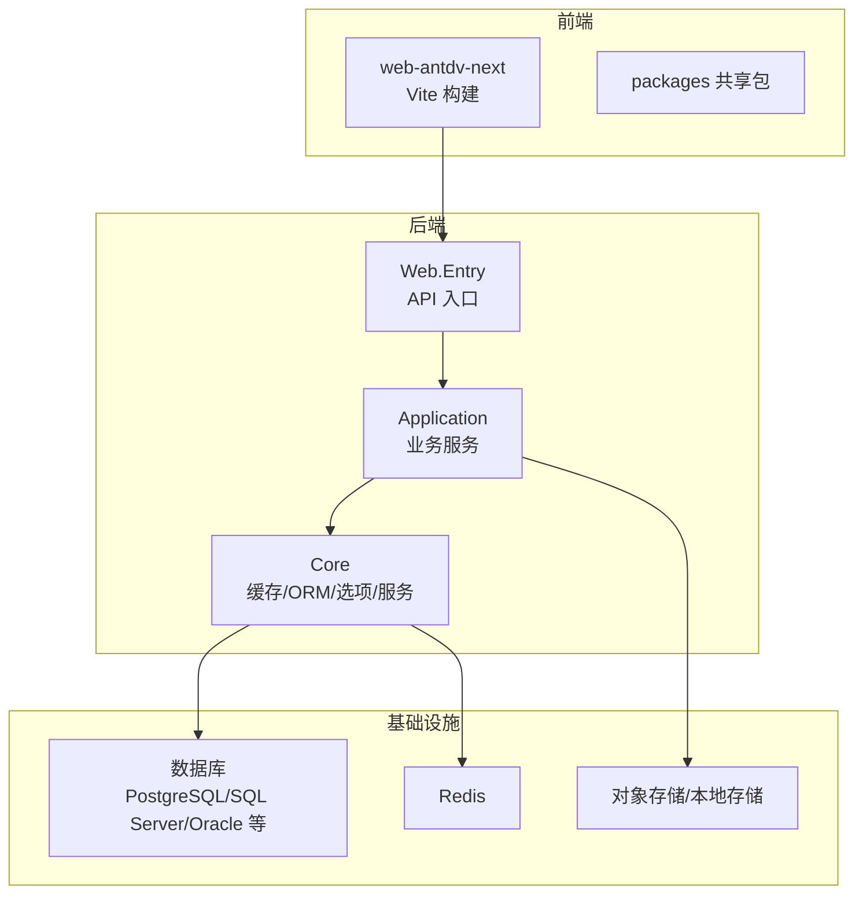
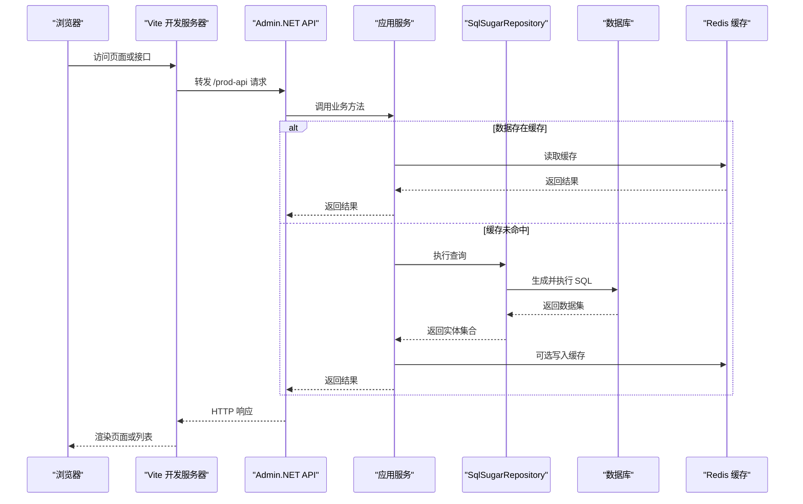
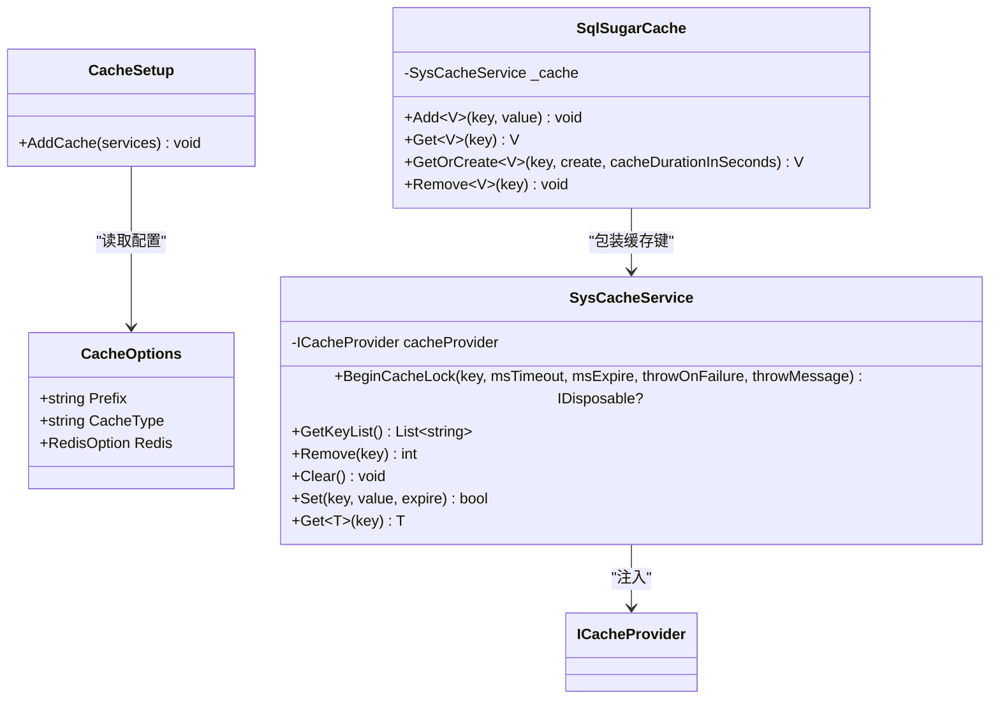
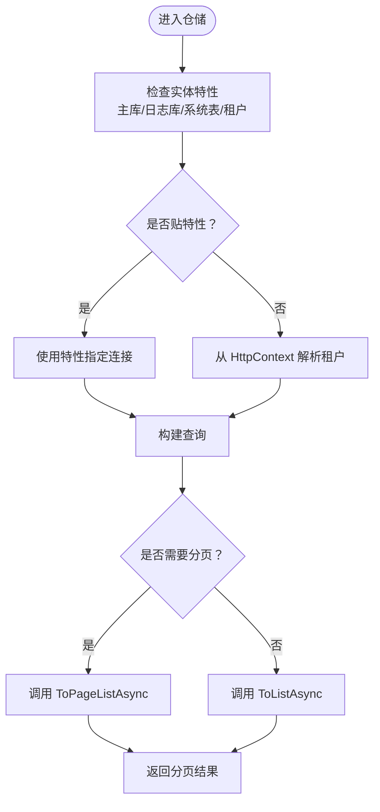
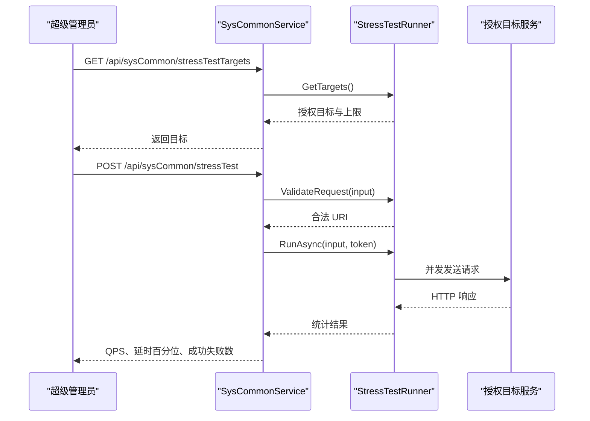
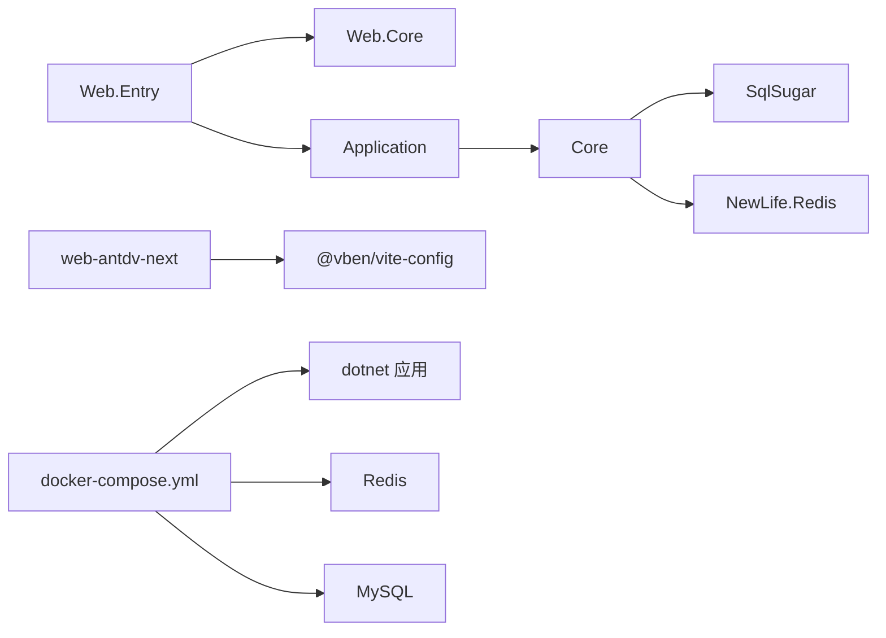
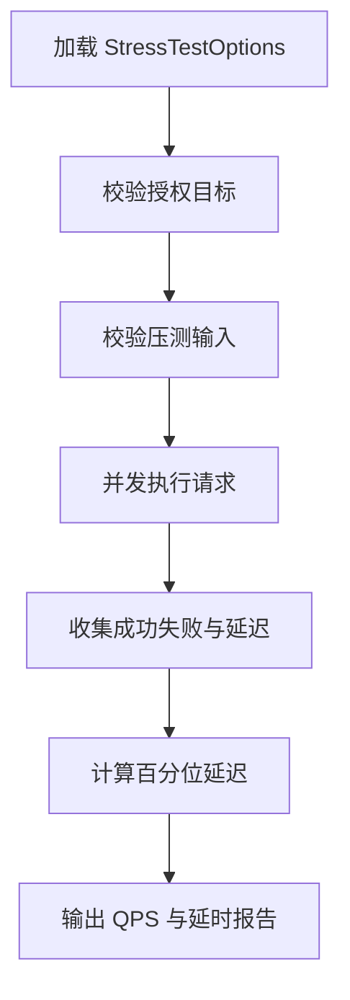

# 性能优化

<cite>
**本文引用的文件**   
- [README.md](file://README.md)
- [global.json](file://Admin.NET/global.json)
- [Web/package.json](file://Web/package.json)
- [Web/apps/web-antdv-next/vite.config.ts](file://Web/apps/web-antdv-next/vite.config.ts)
- [docker-compose.yml](file://docker/docker-compose.yml)
- [CacheSetup.cs](file://Admin.NET/Admin.NET.Core/Cache/CacheSetup.cs)
- [SqlSugarCache.cs](file://Admin.NET/Admin.NET.Core/Cache/SqlSugarCache.cs)
- [CacheOptions.cs](file://Admin.NET/Admin.NET.Core/Option/CacheOptions.cs)
- [SysCacheService.cs](file://Admin.NET/Admin.NET.Core/Service/Cache/SysCacheService.cs)
- [StressTestOptions.cs](file://Admin.NET/Admin.NET.Core/Option/StressTestOptions.cs)
- [StressTestRunner.cs](file://Admin.NET/Admin.NET.Core/Service/Common/StressTestRunner.cs)
- [SysCommonService.cs](file://Admin.NET/Admin.NET.Core/Service/Common/SysCommonService.cs)
- [SysCommonInput.cs](file://Admin.NET/Admin.NET.Core/Service/Common/Dto/SysCommonInput.cs)
- [StressTestBoundaryTests.cs](file://Admin.NET/Admin.NET.Test/Stress/StressTestBoundaryTests.cs)
- [SqlSugarSetup.cs](file://Admin.NET/Admin.NET.Core/SqlSugar/SqlSugarSetup.cs)
- [SqlSugarRepository.cs](file://Admin.NET/Admin.NET.Core/SqlSugar/SqlSugarRepository.cs)
- [SqlSugarPagedList.cs](file://Admin.NET/Admin.NET.Core/SqlSugar/SqlSugarPagedList.cs)
</cite>

## 目录
1. [简介](#简介)
2. [项目结构](#项目结构)
3. [核心组件](#核心组件)
4. [架构总览](#架构总览)
5. [详细组件分析](#详细组件分析)
6. [依赖关系分析](#依赖关系分析)
7. [性能优化指南](#性能优化指南)
8. [常见问题诊断与解决](#常见问题诊断与解决)
9. [性能基准测试与回归预防](#性能基准测试与回归预防)
10. [结论](#结论)

## 简介
本指南面向 Admin.NET 后端开发者、前端工程师和运维人员，聚焦当前仓库已实现的后端与前端能力，提供可落地的性能优化建议。项目基于 ASP.NET Core、Furion 和 SqlSugar，使用 NewLife.Redis 提供 Redis 缓存能力；前端为 Vue 3 + Vben + antdv-next + Vite 8，采用 pnpm workspace 管理。文档中的优化建议均以仓库中现有配置、服务、选项和测试为依据，不虚构未实现的特性。

## 项目结构
Admin.NET 后端按模块划分：Core 提供缓存、ORM、实体、选项、日志、任务调度等基础能力；Application 承载应用服务；Web.Entry 是 API 入口；Web 目录下包含业务前端 `apps/web-antdv-next`。部署相关资源位于 `docker/`，包含 Nginx、MySQL、Redis、MinIO、TDengine 及 .NET 运行容器编排。

**图表来源**
- [README.md:14-24](file://README.md#L14-L24)
- [docker-compose.yml:1-110](file://docker/docker-compose.yml#L1-L110)

**章节来源**
- [README.md:14-24](file://README.md#L14-L24)
- [docker-compose.yml:1-110](file://docker/docker-compose.yml#L1-L110)

## 核心组件
- 缓存系统：通过 `CacheSetup` 根据 `CacheOptions.CacheType` 注册 `ICacheProvider`，默认回退到内存缓存；支持 NewLife Redis 并暴露 `SysCacheService` 作为统一缓存访问层。
- ORM 与分页：基于 SqlSugar，提供 `SqlSugarRepository`、`SqlSugarSetup`、`SqlSugarPagedList`，内置 SQL 执行日志、慢查询告警、多租户过滤、视图初始化与种子数据。
- 压测工具：`StressTestRunner` 提供授权目标校验、并发控制、超时控制和响应时间百分位统计；`SysCommonService` 暴露受控接口供超级管理员调用；边界用例在 `StressTestBoundaryTests` 中验证。
- 前端构建：Vite 8 配合 `@vben/vite-config`，根脚本 `pnpm build` 构建业务应用，`pnpm test:benchmark` 暴露 Vitest bench 入口。

**章节来源**
- [CacheSetup.cs:18-42](file://Admin.NET/Admin.NET.Core/Cache/CacheSetup.cs#L18-L42)
- [CacheOptions.cs:16-38](file://Admin.NET/Admin.NET.Core/Option/CacheOptions.cs#L16-L38)
- [SysCacheService.cs:1-40](file://Admin.NET/Admin.NET.Core/Service/Cache/SysCacheService.cs#L1-L40)
- [SqlSugarSetup.cs:30-120](file://Admin.NET/Admin.NET.Core/SqlSugar/SqlSugarSetup.cs#L30-L120)
- [SqlSugarRepository.cs:12-125](file://Admin.NET/Admin.NET.Core/SqlSugar/SqlSugarRepository.cs#L12-L125)
- [SqlSugarPagedList.cs:13-183](file://Admin.NET/Admin.NET.Core/SqlSugar/SqlSugarPagedList.cs#L13-L183)
- [StressTestRunner.cs:10-183](file://Admin.NET/Admin.NET.Core/Service/Common/StressTestRunner.cs#L10-L183)
- [SysCommonService.cs:13-139](file://Admin.NET/Admin.NET.Core/Service/Common/SysCommonService.cs#L13-L139)
- [Web/package.json:1-102](file://Web/package.json#L1-L102)

## 架构总览
下图展示一次典型页面加载或 API 调用的性能关键路径：前端通过 Vite 开发服务器代理请求到后端，后端由控制器进入应用服务，再通过仓储访问数据库；高频数据可通过 Redis 缓存；启动时数据库连接、表结构、视图和种子数据会初始化，并记录慢查询。

**图表来源**
- [Web/apps/web-antdv-next/vite.config.ts:1-36](file://Web/apps/web-antdv-next/vite.config.ts#L1-L36)
- [SysCacheService.cs:1-200](file://Admin.NET/Admin.NET.Core/Service/Cache/SysCacheService.cs#L1-L200)
- [SqlSugarRepository.cs:12-125](file://Admin.NET/Admin.NET.Core/SqlSugar/SqlSugarRepository.cs#L12-L125)
- [SqlSugarSetup.cs:30-120](file://Admin.NET/Admin.NET.Core/SqlSugar/SqlSugarSetup.cs#L30-L120)

## 详细组件分析

### 缓存系统
`CacheSetup` 根据 `CacheOptions.CacheType` 决定使用 NewLife Redis 还是内存缓存；当 Redis 未配置时自动降级为内存缓存，使上层代码无需修改即可获得缓存语义。`SysCacheService` 封装了分布式锁、键前缀扫描、删除、清空和值类型判断；`SqlSugarCache` 将 SqlSugar 二级缓存键加上统一前缀，避免与业务缓存冲突。

**图表来源**
- [CacheSetup.cs:18-42](file://Admin.NET/Admin.NET.Core/Cache/CacheSetup.cs#L18-L42)
- [CacheOptions.cs:16-38](file://Admin.NET/Admin.NET.Core/Option/CacheOptions.cs#L16-L38)
- [SysCacheService.cs:1-200](file://Admin.NET/Admin.NET.Core/Service/Cache/SysCacheService.cs#L1-L200)
- [SqlSugarCache.cs:17-56](file://Admin.NET/Admin.NET.Core/Cache/SqlSugarCache.cs#L17-L56)

**章节来源**
- [CacheSetup.cs:18-42](file://Admin.NET/Admin.NET.Core/Cache/CacheSetup.cs#L18-L42)
- [CacheOptions.cs:16-38](file://Admin.NET/Admin.NET.Core/Option/CacheOptions.cs#L16-L38)
- [SysCacheService.cs:1-200](file://Admin.NET/Admin.NET.Core/Service/Cache/SysCacheService.cs#L1-L200)
- [SqlSugarCache.cs:17-56](file://Admin.NET/Admin.NET.Core/Cache/SqlSugarCache.cs#L17-L56)

### 数据库与分页
`SqlSugarSetup` 负责雪花 ID、外部映射、连接池设置、AOP SQL 日志、慢查询告警、软删除与租户过滤器、差异日志、视图初始化、种子数据等。`SqlSugarRepository` 根据实体特性选择主库、日志库或租户库，并提供分表操作。`SqlSugarPagedList` 提供异步分页扩展，支持脱敏字段分页。

**图表来源**
- [SqlSugarRepository.cs:12-125](file://Admin.NET/Admin.NET.Core/SqlSugar/SqlSugarRepository.cs#L12-L125)
- [SqlSugarPagedList.cs:53-183](file://Admin.NET/Admin.NET.Core/SqlSugar/SqlSugarPagedList.cs#L53-L183)

**章节来源**
- [SqlSugarSetup.cs:30-120](file://Admin.NET/Admin.NET.Core/SqlSugar/SqlSugarSetup.cs#L30-L120)
- [SqlSugarRepository.cs:12-125](file://Admin.NET/Admin.NET.Core/SqlSugar/SqlSugarRepository.cs#L12-L125)
- [SqlSugarPagedList.cs:13-183](file://Admin.NET/Admin.NET.Core/SqlSugar/SqlSugarPagedList.cs#L13-L183)

### 压测与隔离执行
`StressTestRunner` 仅接受配置中授权的数值 IP 与路径前缀，禁止凭据、片段、相对路径和危险请求头；通过信号量串行执行压测，并行度受 `MaxConcurrency` 限制，并使用 `Parallel.ForEachAsync` 并发发送请求，记录成功次数、失败次数、平均响应时间和多个百分位。`SysCommonService` 对超级管理员暴露获取目标和执行压测的接口，且需要显式权限授予；边界测试覆盖非法目标、重复键、越界参数、危险头部和取消令牌。

**图表来源**
- [SysCommonService.cs:89-139](file://Admin.NET/Admin.NET.Core/Service/Common/SysCommonService.cs#L89-L139)
- [StressTestRunner.cs:27-183](file://Admin.NET/Admin.NET.Core/Service/Common/StressTestRunner.cs#L27-L183)
- [SysCommonInput.cs:10-69](file://Admin.NET/Admin.NET.Core/Service/Common/Dto/SysCommonInput.cs#L10-L69)

**章节来源**
- [StressTestRunner.cs:10-183](file://Admin.NET/Admin.NET.Core/Service/Common/StressTestRunner.cs#L10-L183)
- [SysCommonService.cs:89-139](file://Admin.NET/Admin.NET.Core/Service/Common/SysCommonService.cs#L89-L139)
- [SysCommonInput.cs:10-69](file://Admin.NET/Admin.NET.Core/Service/Common/Dto/SysCommonInput.cs#L10-L69)
- [StressTestBoundaryTests.cs:18-159](file://Admin.NET/Admin.NET.Test/Stress/StressTestBoundaryTests.cs#L18-L159)

## 依赖关系分析
后端以 `Admin.NET.Web.Entry` 为入口，引用 `Admin.NET.Web.Core` 与 `Admin.NET.Application`，共享 `Admin.NET.Core` 的缓存、ORM、选项与服务；前端以 `Web/apps/web-antdv-next` 为业务应用，依赖 `@vben/vite-config` 与 Vite。Docker Compose 将 Nginx、MySQL、Redis、MinIO、TDengine 与 .NET 应用容器组合在一起，其中 .NET 应用依赖 MySQL 与 Redis。

**图表来源**
- [README.md:14-24](file://README.md#L14-L24)
- [Web/package.json:1-102](file://Web/package.json#L1-L102)
- [docker-compose.yml:1-110](file://docker/docker-compose.yml#L1-L110)

**章节来源**
- [README.md:14-24](file://README.md#L14-L24)
- [Web/package.json:1-102](file://Web/package.json#L1-L102)
- [docker-compose.yml:1-110](file://docker/docker-compose.yml#L1-L110)

## 性能优化指南

### 后端性能优化

#### 数据库查询优化
- 索引设计
  - 优先为常用查询条件、排序字段、外键和分页范围建立复合索引。
  - 避免在大文本、二进制列上建索引；对高基数列更有效。
  - 定期分析慢查询日志，结合执行计划调整索引顺序。
- SQL 优化
  - 使用 `SqlSugarSetup` 的 SQL 日志和慢查询告警定位超过阈值的语句。
  - 减少 `SELECT *`，只选取必要列；避免在 WHERE 中对列进行函数计算。
  - 使用分页查询而非全量拉取，结合 `SqlSugarPagedList` 的异步分页。
- 分页策略
  - 小页适合频繁翻页；大页适合导出或报表场景，但会增加数据库压力。
  - 大数据集建议使用游标式分页或基于时间戳的分页，避免深分页导致的性能退化。
  - 对复杂查询先聚合再分页，必要时使用物化视图或临时表。

#### 缓存策略
- Redis 缓存
  - 通过 `CacheOptions.CacheType=Redis` 启用分布式缓存；合理设置 `Prefix` 避免键冲突。
  - 使用 `SysCacheService.BeginCacheLock` 实现分布式锁，防止缓存击穿与雪崩。
  - 对热点数据设置较短过期时间，对低频更新数据设置较长过期时间。
- 内存缓存
  - 未配置 Redis 时自动降级为内存缓存，适合单机开发和小型部署。
  - 注意进程重启后缓存丢失；生产环境建议始终启用 Redis。
- 分布式缓存一致性
  - 写操作后主动删除或更新对应缓存键；批量更新时使用事务或队列保证最终一致。
  - 对缓存失效风暴，可使用随机过期时间或互斥重建。

#### 异步处理模式
- 使用 `SqlSugarPagedList` 的异步分页与仓储异步方法，避免阻塞请求线程。
- 对耗时任务（邮件、短信、文件处理）使用消息队列或任务调度；本项目已集成任务调度能力。
- 对外部 API 调用使用带超时的 HttpClient，避免长尾请求拖垮线程池。

### 前端性能优化

#### 代码分割与懒加载
- 路由级懒加载：将非首屏页面拆分为独立 chunk，减少初始包体积。
- 组件级懒加载：对重型组件使用动态导入；避免一次性加载全部第三方库。
- 列表与表格：按需渲染，虚拟滚动减少 DOM 节点数量。

#### 资源压缩与 CDN 加速
- 构建输出启用 Gzip/Brotli；静态资源上传至 CDN，利用边缘缓存降低延迟。
- 字体和图片使用合适格式（WebP、AVIF），并设置长期缓存与版本号。
- 通过 Nginx 反向代理静态资源，开启缓存头和压缩。

#### 渲染优化
- 首屏优化：精简样式、延迟非关键脚本、预加载关键资源。
- 状态管理：避免全局状态过大；按模块拆分 store。
- 网络优化：合并小请求、使用缓存策略、减少重复请求。

### 系统级优化

#### 内存管理
- 监控进程 RSS、GC 次数和代际分布；避免长生命周期对象持有大集合。
- 对流式数据处理，及时释放资源；避免在缓存中存储过大的序列化对象。
- 压测场景下关注内存峰值，适当调优堆大小和 GC 模式。

#### 线程池与连接池
- 观察 CPU 使用率和线程等待时间，避免过多同步阻塞 IO。
- 调整数据库连接池大小，使其与数据库最大连接数和并发请求匹配。
- 对 I/O 密集型任务使用异步；对 CPU 密集型任务考虑专用线程池或工作进程。

#### 资源监控
- 使用系统指标、应用日志、数据库慢查询和 Redis 监控面板。
- 对关键接口添加 APM 埋点，收集端到端延迟、错误率和吞吐。
- 对压测接口使用 `StressTestRunner` 输出的百分位延迟评估稳定性。

## 常见问题诊断与解决

### 慢查询
- 现象：数据库执行时间超过阈值，日志中出现慢查询告警。
- 排查步骤
  - 启用 SQL 控制台日志，定位具体 SQL 与参数。
  - 查看执行计划，确认是否走索引、是否存在全表扫描。
  - 检查是否存在隐式类型转换、函数包裹列、缺少复合索引。
- 解决方案
  - 添加或调整索引；改写 SQL 避免无法走索引的条件。
  - 引入分页、投影、缓存或物化视图。
  - 对热点查询增加 Redis 缓存。

**章节来源**
- [SqlSugarSetup.cs:80-120](file://Admin.NET/Admin.NET.Core/SqlSugar/SqlSugarSetup.cs#L80-L120)

### 内存泄漏
- 现象：进程内存持续增长，GC 无法回收。
- 排查步骤
  - 检查长生命周期单例中是否持有大对象、事件订阅未释放、静态字典无限增长。
  - 分析缓存键数量和值大小，避免缓存未设置过期或未清理。
- 解决方案
  - 限制缓存条目数量与大小；使用 LRU 或定时清理。
  - 确保异步任务和回调不再被强引用。
  - 对文件流、数据库连接、HttpClient 使用 using 或依赖注入生命周期管理。

**章节来源**
- [SysCacheService.cs:1-200](file://Admin.NET/Admin.NET.Core/Service/Cache/SysCacheService.cs#L1-L200)

### CPU 占用过高
- 现象：CPU 持续高位，响应延迟升高。
- 排查步骤
  - 定位热点方法，检查是否存在密集计算、正则回溯、循环内数据库或网络调用。
  - 检查压测并发是否超过硬件能力或配置上限。
- 解决方案
  - 将 CPU 密集型任务移出请求线程；使用任务调度或专用处理器。
  - 优化算法复杂度，减少不必要的字符串拼接和反射。
  - 调整 `StressTestOptions.MaxConcurrency` 与实际负载匹配。

**章节来源**
- [StressTestOptions.cs:12-25](file://Admin.NET/Admin.NET.Core/Option/StressTestOptions.cs#L12-L25)
- [StressTestRunner.cs:100-160](file://Admin.NET/Admin.NET.Core/Service/Common/StressTestRunner.cs#L100-L160)

### 网络延迟
- 现象：前端请求延迟高，CDN 命中率低或跨域问题。
- 排查步骤
  - 检查 Vite 代理和目标地址；确认 Nginx 反向代理配置正确。
  - 检查 DNS、TLS 握手、TCP 重传和远端服务响应时间。
- 解决方案
  - 使用 CDN 缓存静态资源；后端 API 启用 gzip。
  - 缩短域名解析路径，避免中间跳转。
  - 对跨地域用户考虑多区域部署或边缘缓存。

**章节来源**
- [Web/apps/web-antdv-next/vite.config.ts:10-36](file://Web/apps/web-antdv-next/vite.config.ts#L10-L36)
- [docker-compose.yml:1-40](file://docker/docker-compose.yml#L1-L40)

## 性能基准测试与回归预防

### 后端基准测试
- 使用 `StressTestRunner` 对授权目标进行压测，关注 QPS、平均延迟和 P90/P99 延迟。
- 通过 `SysCommonService.GetStressTestTargets` 获取可用目标与上限，通过 `SysCommonService.StressTest` 执行压测。
- 压测参数应受 `StressTestOptions` 约束，避免超出安全上限；测试覆盖取消、非法目标、危险请求头等边界条件。

**图表来源**
- [StressTestOptions.cs:12-25](file://Admin.NET/Admin.NET.Core/Option/StressTestOptions.cs#L12-L25)
- [StressTestRunner.cs:27-183](file://Admin.NET/Admin.NET.Core/Service/Common/StressTestRunner.cs#L27-L183)
- [SysCommonService.cs:89-139](file://Admin.NET/Admin.NET.Core/Service/Common/SysCommonService.cs#L89-L139)

**章节来源**
- [StressTestRunner.cs:10-183](file://Admin.NET/Admin.NET.Core/Service/Common/StressTestRunner.cs#L10-L183)
- [SysCommonService.cs:89-139](file://Admin.NET/Admin.NET.Core/Service/Common/SysCommonService.cs#L89-L139)
- [StressTestBoundaryTests.cs:18-159](file://Admin.NET/Admin.NET.Test/Stress/StressTestBoundaryTests.cs#L18-L159)

### 前端基准测试
- 使用根脚本 `pnpm test:benchmark` 运行 Vitest bench；该脚本面向业务应用，不等同于全 workspace 检查。
- 对关键 UI 组件、数据处理逻辑和 API 调用编写基准用例，跟踪渲染时间、序列化时间和网络请求时间。
- 结合构建分析命令 `pnpm build:analyze` 分析包体积与依赖密度。

**章节来源**
- [Web/package.json:10-44](file://Web/package.json#L10-L44)

### 回归检测与预防
- 在 CI 中加入性能基准用例，对比历史基线，发现 P95/P99 显著上升时阻断合并。
- 对数据库变更加入慢查询阈值检查；对缓存变更加入键空间与命中率监控。
- 对前端变更加入包体积和构建时间监控，避免无意引入大依赖。
- 压测用例应覆盖正常负载与异常输入，确保安全边界不被绕过。

## 结论
Admin.NET 的性能优化应以“数据库先行、缓存兜底、异步解耦、监控闭环”为主线：先用索引与分页解决数据库瓶颈，再用 Redis 与内存缓存减轻读压力，用异步和任务调度隔离耗时操作，最后用 SQL 日志、慢查询告警、Redis 监控和压测报告形成闭环。前端侧则聚焦首屏包体、懒加载、静态资源缓存与 CDN 加速，并通过 Vite 构建分析与 Vitest bench 维持长期性能基线。