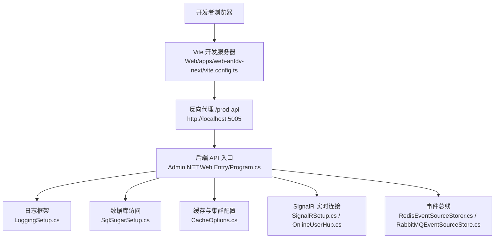
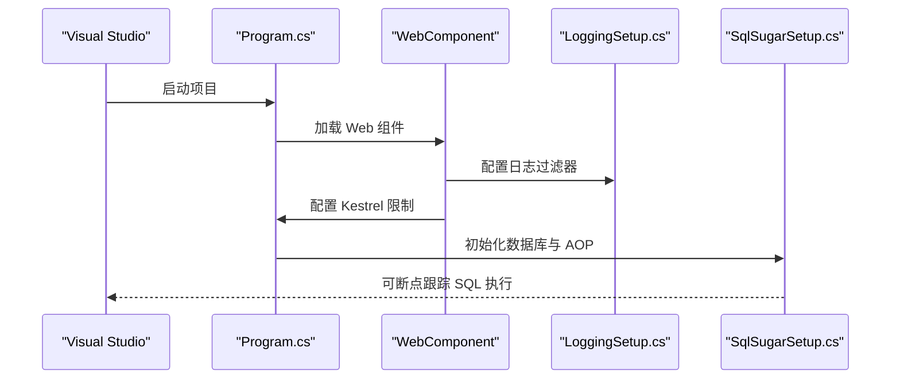
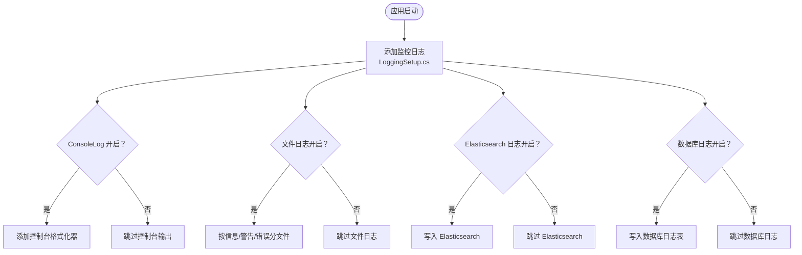
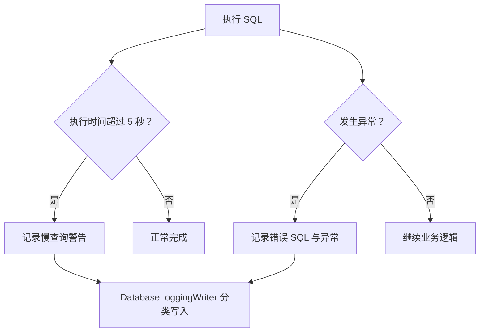
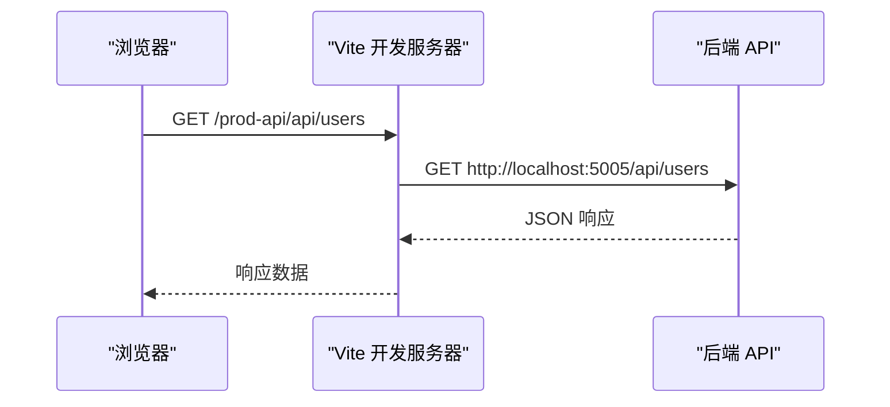
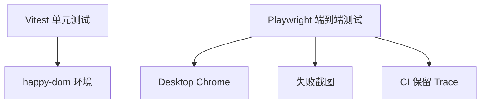
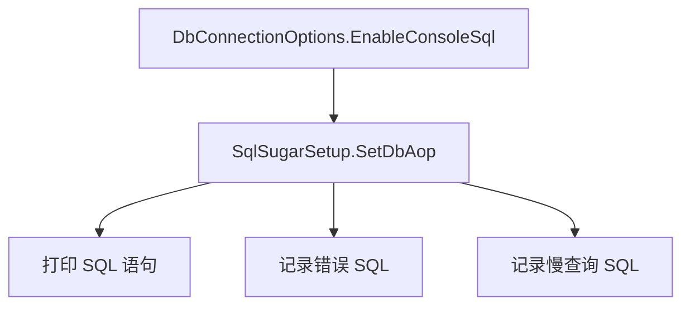
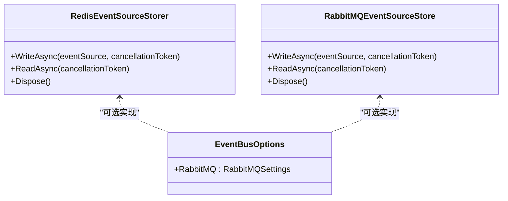
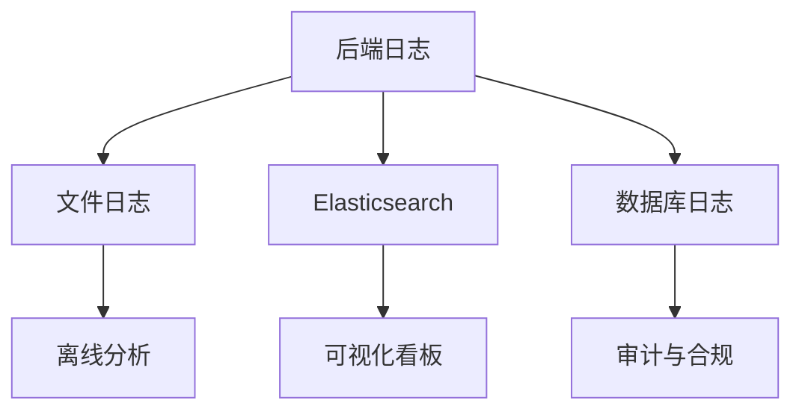

# 调试指南

<cite>
**本文引用的文件**   
- [README.md](file://README.md)
- [Program.cs](file://Admin.NET/Admin.NET.Web.Entry/Program.cs)
- [appsettings.json](file://Admin.NET/Admin.NET.Web.Entry/appsettings.json)
- [appsettings.Development.json](file://Admin.NET/Admin.NET.Web.Entry/appsettings.Development.json)
- [global.json](file://Admin.NET/global.json)
- [package.json](file://Web/package.json)
- [apps/web-antdv-next/package.json](file://Web/apps/web-antdv-next/package.json)
- [vite.config.ts](file://Web/apps/web-antdv-next/vite.config.ts)
- [vitest.config.ts](file://Web/vitest.config.ts)
- [playwright.config.ts](file://Web/playwright.config.ts)
- [docker-compose.yml](file://docker/docker-compose.yml)
- [LoggingSetup.cs](file://Admin.NET/Admin.NET.Core/Logging/LoggingSetup.cs)
- [ElasticSearchLoggingWriter.cs](file://Admin.NET/Admin.NET.Core/Logging/ElasticSearchLoggingWriter.cs)
- [DatabaseLoggingWriter.cs](file://Admin.NET/Admin.NET.Core/Logging/DatabaseLoggingWriter.cs)
- [DbConnectionOptions.cs](file://Admin.NET/Admin.NET.Core/Option/DbConnectionOptions.cs)
- [SqlSugarSetup.cs](file://Admin.NET/Admin.NET.Core/SqlSugar/SqlSugarSetup.cs)
- [CacheOptions.cs](file://Admin.NET/Admin.NET.Core/Option/CacheOptions.cs)
- [SignalRSetup.cs](file://Admin.NET/Admin.NET.Core/SignalR/SignalRSetup.cs)
- [OnlineUserHub.cs](file://Admin.NET/Admin.NET.Core/Hub/OnlineUserHub.cs)
- [EventBusOptions.cs](file://Admin.NET/Admin.NET.Core/Option/EventBusOptions.cs)
- [RedisEventSourceStorer.cs](file://Admin.NET/Admin.NET.Core/EventBus/RedisEventSourceStorer.cs)
- [RabbitMQEventSourceStore.cs](file://Admin.NET/Admin.NET.Core/EventBus/RabbitMQEventSourceStore.cs)
</cite>

## 目录
1. [简介](#简介)
2. [项目结构与调试入口](#项目结构与调试入口)
3. [后端调试技巧](#后端调试技巧)
4. [前端调试方法](#前端调试方法)
5. [数据库调试技巧](#数据库调试技巧)
6. [集成调试方法](#集成调试方法)
7. [常见故障排查](#常见故障排查)
8. [调试工具与插件配置](#调试工具与插件配置)
9. [生产环境日志收集与分析](#生产环境日志收集与分析)
10. [结论](#结论)

## 简介
本调试指南面向 Admin.NET 项目的开发者，覆盖后端 .NET 调试、前端 Vue 调试、数据库调试、API 与第三方服务联调、消息队列调试、性能监控和常见问题定位。项目采用前后端分离架构：后端基于 ASP.NET Core、Furion 和 SqlSugar，当前分支已完成前端移植，业务前端入口为 `Web/apps/web-antdv-next/`；后端 API 入口为 `Admin.NET/Admin.NET.Web.Entry/`。仓库根说明文档指出集成验收使用 PostgreSQL，但 Docker Compose 示例中同时包含 MySQL、Redis、MinIO、TDengine 等依赖，实际联调时应以本机配置为准。

## 项目结构与调试入口
| 区域 | 作用 | 调试关注点 |
|---|---|---|
| `Admin.NET/Admin.NET.Web.Entry/Program.cs` | 启动 WebApplication、注册 Furion Web 组件、设置日志过滤与 Kestrel 限制 | 控制台日志开关、Windows 事件日志、接口超时与上传大小 |
| `Admin.NET/Admin.NET.Web.Entry/appsettings.json` | Furion 配置扫描目录 | 配置合并路径是否包含业务配置文件目录 |
| `Web/package.json` | pnpm workspace 根脚本、Node/pnpm 版本要求 | `pnpm dev`、`pnpm build`、`pnpm lint`、`pnpm check:type` 面向业务应用 |
| `Web/apps/web-antdv-next/vite.config.ts` | Vite 开发服务器与代理 | `/prod-api` 反向代理到本地 5005 端口，支持 WebSocket |
| `Web/playwright.config.ts` | Playwright 端到端测试 | 桌面 Chrome、默认基础地址 8890、失败截图与 Trace |
| `docker/docker-compose.yml` | 开发依赖容器编排 | Nginx、MySQL、Redis、MinIO、TDengine、后端应用镜像 |

**图示来源**  
- [Program.cs:12-37](file://Admin.NET/Admin.NET.Web.Entry/Program.cs#L12-L37)  
- [vite.config.ts:12-35](file://Web/apps/web-antdv-next/vite.config.ts#L12-L35)  
- [LoggingSetup.cs:19-103](file://Admin.NET/Admin.NET.Core/Logging/LoggingSetup.cs#L19-L103)  
- [SqlSugarSetup.cs:31-69](file://Admin.NET/Admin.NET.Core/SqlSugar/SqlSugarSetup.cs#L31-L69)  
- [SignalRSetup.cs:17-102](file://Admin.NET/Admin.NET.Core/SignalR/SignalRSetup.cs#L17-L102)  
- [RedisEventSourceStorer.cs:15-163](file://Admin.NET/Admin.NET.Core/EventBus/RedisEventSourceStorer.cs#L15-L163)

**章节来源**  
- [README.md:14-42](file://README.md#L14-L42)  
- [Program.cs:12-37](file://Admin.NET/Admin.NET.Web.Entry/Program.cs#L12-L37)  
- [appsettings.json:1-5](file://Admin.NET/Admin.NET.Web.Entry/appsettings.json#L1-L5)  
- [package.json:14-44](file://Web/package.json#L14-L44)  
- [vite.config.ts:12-35](file://Web/apps/web-antdv-next/vite.config.ts#L12-L35)  
- [playwright.config.ts:1-31](file://Web/playwright.config.ts#L1-L31)  
- [docker-compose.yml:1-110](file://docker/docker-compose.yml#L1-L110)

## 后端调试技巧

### Visual Studio 断点调试
- 使用命令 `dotnet run --project Admin.NET/Admin.NET.Web.Entry/Admin.NET.Web.Entry.csproj` 启动后端，在 Program.cs、Startup、控制器、服务层、数据库 AOP 处设置断点。
- 重点关注以下入口：
  - Program.cs 的 WebComponent.Load：日志过滤、Kestrel 限制。
  - LoggingSetup.AddLoggingSetup：监控日志、控制台日志、文件日志、Elasticsearch 日志、数据库日志。
  - SqlSugarSetup.AddSqlSugar：多租户、雪花 ID、AOP SQL 打印、错误日志、慢查询警告。
- 若 Windows 下以控制台方式运行，代码会禁用 EventLogLoggerProvider，避免普通用户权限写入 Windows 事件日志失败。

**图示来源**  
- [Program.cs:12-37](file://Admin.NET/Admin.NET.Web.Entry/Program.cs#L12-L37)  
- [LoggingSetup.cs:19-103](file://Admin.NET/Admin.NET.Core/Logging/LoggingSetup.cs#L19-L103)  
- [SqlSugarSetup.cs:31-69](file://Admin.NET/Admin.NET.Core/SqlSugar/SqlSugarSetup.cs#L31-L69)

**章节来源**  
- [Program.cs:12-37](file://Admin.NET/Admin.NET.Web.Entry/Program.cs#L12-L37)  
- [LoggingSetup.cs:19-103](file://Admin.NET/Admin.NET.Core/Logging/LoggingSetup.cs#L19-L103)  
- [SqlSugarSetup.cs:31-69](file://Admin.NET/Admin.NET.Core/SqlSugar/SqlSugarSetup.cs#L31-L69)

### 日志输出配置
LoggingSetup 提供多种日志目标：
- 控制台日志：可通过 `Logging:Monitor:ConsoleLog` 控制是否输出。
- 文件日志：通过 `Logging:File:Enabled` 启用，按级别拆分文件，支持 JSON 格式与备用文件名回退。
- Elasticsearch 日志：通过 `Logging:ElasticSearch:Enabled` 启用，仅写入监控日志类别。
- 数据库日志：通过 `Logging:Database:Enabled` 启用，将操作日志、异常日志、访问日志写入数据库表。

日志敏感字段会被忽略，包括密码、AccessToken、RefreshToken、ApiKey、SecretKey 等字节数组类型也默认忽略。

**图示来源**  
- [LoggingSetup.cs:28-103](file://Admin.NET/Admin.NET.Core/Logging/LoggingSetup.cs#L28-L103)

**章节来源**  
- [LoggingSetup.cs:28-103](file://Admin.NET/Admin.NET.Core/Logging/LoggingSetup.cs#L28-L103)

### 异常堆栈分析
- SqlSugar AOP 的 OnError 会将带参数的原始 SQL 记录为错误日志；OnLogExecuted 对超过 5 秒的 SQL 输出慢查询警告，并附带调用栈文件名、行号与方法名。
- DatabaseLoggingWriter 会分类处理访问日志、操作日志、异常日志，并在批量插入时捕获单条日志处理异常，防止单条日志写入失败影响整体流程。
- ElasticSearchLoggingWriter 会根据 SysConfigService 的操作日志开关决定是否写入 Elasticsearch，并将异常、请求参数、返回结果序列化后入库。

**图示来源**  
- [SqlSugarSetup.cs:120-168](file://Admin.NET/Admin.NET.Core/SqlSugar/SqlSugarSetup.cs#L120-L168)  
- [DatabaseLoggingWriter.cs:45-120](file://Admin.NET/Admin.NET.Core/Logging/DatabaseLoggingWriter.cs#L45-L120)

**章节来源**  
- [SqlSugarSetup.cs:120-168](file://Admin.NET/Admin.NET.Core/SqlSugar/SqlSugarSetup.cs#L120-L168)  
- [DatabaseLoggingWriter.cs:45-120](file://Admin.NET/Admin.NET.Core/Logging/DatabaseLoggingWriter.cs#L45-L120)  
- [ElasticSearchLoggingWriter.cs:41-128](file://Admin.NET/Admin.NET.Core/Logging/ElasticSearchLoggingWriter.cs#L41-L128)

### 性能监控
- Kestrel 限制：KeepAliveTimeout 与 RequestHeadersTimeout 设置为 30 分钟，MaxRequestBodySize 未限制，适合大文件上传调试，但生产环境需评估安全风险。
- 慢 SQL：超过 5 秒的 SQL 会输出警告日志，结合 SqlStackTrace 定位调用位置。
- 日志写入：文件日志、数据库日志、Elasticsearch 日志均可作为性能瓶颈点，需根据吞吐与存储能力调整。
- 前端构建：根脚本 `pnpm build` 设置 NODE_OPTIONS 最大内存 8GB，适用于大型 monorepo 构建。

**章节来源**  
- [Program.cs:28-37](file://Admin.NET/Admin.NET.Web.Entry/Program.cs#L28-L37)  
- [SqlSugarSetup.cs:120-168](file://Admin.NET/Admin.NET.Core/SqlSugar/SqlSugarSetup.cs#L120-L168)  
- [LoggingSetup.cs:37-76](file://Admin.NET/Admin.NET.Core/Logging/LoggingSetup.cs#L37-L76)  
- [package.json:14-28](file://Web/package.json#L14-L28)

## 前端调试方法

### 浏览器开发者工具
- 打开 F12 开发者工具，查看 Network、Console、Sources、Performance、Memory。
- 注意 Vite 开发服务器代理：`/prod-api` 会转发到 `http://localhost:5005`，WebSocket 已启用。
- 若后端运行端口不是 5005，请修改 vite.config.ts 的 proxy target。

**图示来源**  
- [vite.config.ts:20-33](file://Web/apps/web-antdv-next/vite.config.ts#L20-L33)

**章节来源**  
- [vite.config.ts:12-35](file://Web/apps/web-antdv-next/vite.config.ts#L12-L35)

### Vue DevTools 与状态管理调试
- 使用浏览器扩展安装 Vue DevTools，观察 Vue 组件树、Props、State、Actions。
- 前端依赖 Pinia，可在 DevTools 中查看 Store 变更历史，配合断点调试异步更新。
- 前端还使用 @microsoft/signalr，用于实时通信场景，可在网络面板或 SignalR 调试工具中检查连接状态。

**章节来源**  
- [apps/web-antdv-next/package.json:45-71](file://Web/apps/web-antdv-next/package.json#L45-L71)

### 网络请求调试
- 在 Network 面板筛选 XHR/Fetch，查看请求头、响应体、耗时。
- 检查 CORS、认证 Token、X-Forwarded-For 等头部是否正确传递。
- 若后端返回非 2xx，结合后端日志与 DatabaseLoggingWriter 的分类日志定位异常。

**章节来源**  
- [DatabaseLoggingWriter.cs:78-142](file://Admin.NET/Admin.NET.Core/Logging/DatabaseLoggingWriter.cs#L78-L142)

### 单元测试与端到端测试
- Vitest 单元测使用 happy-dom 环境，排除 e2e、dist、node_modules 等目录。
- Playwright E2E 使用 Desktop Chrome，默认 baseURL 为 8890，失败时截图，CI 环境下保留 trace。
- 建议在本地先跑 `pnpm test:unit`，再跑 `pnpm test:e2e`，确认 UI 交互与后端接口联调。

**图示来源**  
- [vitest.config.ts:1-28](file://Web/vitest.config.ts#L1-L28)  
- [playwright.config.ts:1-31](file://Web/playwright.config.ts#L1-L31)

**章节来源**  
- [vitest.config.ts:1-28](file://Web/vitest.config.ts#L1-L28)  
- [playwright.config.ts:1-31](file://Web/playwright.config.ts#L1-L31)

## 数据库调试技巧

### SQL 语句追踪
- DbConnectionOptions.EnableConsoleSql 开启后，SqlSugarSetup.SetDbAop 会打印每条 SQL，并按 SELECT、UPDATE/INSERT、DELETE 区分颜色。
- OnError 记录错误 SQL，OnLogExecuted 记录慢 SQL 及调用栈信息。
- 调试时建议开启 EnableConsoleSql，并结合 Visual Studio 断点跟踪 SQL 执行上下文。

**图示来源**  
- [DbConnectionOptions.cs:13-35](file://Admin.NET/Admin.NET.Core/Option/DbConnectionOptions.cs#L13-L35)  
- [SqlSugarSetup.cs:120-168](file://Admin.NET/Admin.NET.Core/SqlSugar/SqlSugarSetup.cs#L120-L168)

**章节来源**  
- [DbConnectionOptions.cs:13-35](file://Admin.NET/Admin.NET.Core/Option/DbConnectionOptions.cs#L13-L35)  
- [SqlSugarSetup.cs:120-168](file://Admin.NET/Admin.NET.Core/SqlSugar/SqlSugarSetup.cs#L120-L168)

### 查询性能分析
- 慢查询阈值：超过 5 秒的 SQL 会输出警告日志，包含文件名、行号、方法名。
- 连接超时：CommandTimeOut 设置为 30 秒，避免长时间阻塞。
- 建议结合数据库客户端执行计划分析与索引优化。

**章节来源**  
- [SqlSugarSetup.cs:120-168](file://Admin.NET/Admin.NET.Core/SqlSugar/SqlSugarSetup.cs#L120-L168)

### 数据一致性验证
- DbSettings 提供 EnableInitDb、EnableInitView、EnableDiffLog、EnableUnderLine 等开关，可用于开发环境初始化与差异日志。
- TableSettings 与 SeedSettings 控制表结构初始化、增量更新与种子数据初始化。
- 调试时应确保开发库独立，避免误写生产数据。

**章节来源**  
- [DbConnectionOptions.cs:48-136](file://Admin.NET/Admin.NET.Core/Option/DbConnectionOptions.cs#L48-L136)

## 集成调试方法

### API 接口测试
- Swagger/Knife4j：项目内置系统接口功能，可使用 Swagger 生成 API 文档并在线调试。
- 代理调试：前端 Vite 代理 `/prod-api` 到后端 5005 端口，可直接在浏览器 Network 面板查看请求。
- 日志关联：DatabaseLoggingWriter 会记录 HTTP 方法、URL、状态码、耗时、用户信息与异常，便于跨链路定位。

**章节来源**  
- [README.md:74-93](file://README.md#L74-L93)  
- [vite.config.ts:20-33](file://Web/apps/web-antdv-next/vite.config.ts#L20-L33)  
- [DatabaseLoggingWriter.cs:142-200](file://Admin.NET/Admin.NET.Core/Logging/DatabaseLoggingWriter.cs#L142-L200)

### 第三方服务联调
- Elasticsearch：ElasticSearchOptions 支持 Basic、ApiKey、Base64ApiKey 认证，可配置 ServerUris、DefaultIndex、证书指纹。
- MinIO：Docker Compose 提供 MinIO 服务，端口 9104/9105，用于对象存储调试。
- TDengine：Docker Compose 提供时序数据库服务，端口 6030、6041、6044-6049、6060。

**章节来源**  
- [ElasticSearchOptions.cs:10-63](file://Admin.NET/Admin.NET.Core/Option/ElasticSearchOptions.cs#L10-L63)  
- [docker-compose.yml:44-109](file://docker/docker-compose.yml#L44-L109)

### 消息队列调试
- Redis 事件源：RedisEventSourceStorer 使用 NewLife.Caching.Queues 的 FullRedis，支持广播消息与单消费队列，支持 Channel 容量限制与等待模式。
- RabbitMQ 事件源：RabbitMQEventSourceStore 使用 RabbitMQ.Client，声明路由键、手动 ACK、持久化消息。
- EventBusOptions 提供 RabbitMQ 主机、端口、用户名、密码配置。

**图示来源**  
- [RedisEventSourceStorer.cs:15-163](file://Admin.NET/Admin.NET.Core/EventBus/RedisEventSourceStorer.cs#L15-L163)  
- [RabbitMQEventSourceStore.cs:12-145](file://Admin.NET/Admin.NET.Core/EventBus/RabbitMQEventSourceStore.cs#L12-L145)  
- [EventBusOptions.cs:8-43](file://Admin.NET/Admin.NET.Core/Option/EventBusOptions.cs#L8-L43)

**章节来源**  
- [RedisEventSourceStorer.cs:15-163](file://Admin.NET/Admin.NET.Core/EventBus/RedisEventSourceStorer.cs#L15-L163)  
- [RabbitMQEventSourceStore.cs:12-145](file://Admin.NET/Admin.NET.Core/EventBus/RabbitMQEventSourceStore.cs#L12-L145)  
- [EventBusOptions.cs:8-43](file://Admin.NET/Admin.NET.Core/Option/EventBusOptions.cs#L8-L43)

## 常见故障排查

### 连接超时
- 症状：数据库连接失败、Redis 连接失败、SignalR 连接断开。
- 排查：
  - 检查 DbConnectionOptions.ConnectionConfigs 配置是否正确。
  - 检查 Redis 是否启动，SignalRSetup 中 Redis 连接失败会记录日志。
  - 检查 Docker Compose 中依赖服务端口映射与环境变量。
- 建议：在本地使用 docker-compose 启动依赖，确保端口未被占用。

**章节来源**  
- [DbConnectionOptions.cs:36-47](file://Admin.NET/Admin.NET.Core/Option/DbConnectionOptions.cs#L36-L47)  
- [SignalRSetup.cs:61-102](file://Admin.NET/Admin.NET.Core/SignalR/SignalRSetup.cs#L61-L102)  
- [docker-compose.yml:1-110](file://docker/docker-compose.yml#L1-L110)

### 权限问题
- 症状：Windows 控制台运行时无法写入事件日志，用户登录失败，角色菜单无权限。
- 排查：
  - Program.cs 已禁用 EventLogLoggerProvider，避免普通用户权限问题。
  - 检查 SystemConfig 中的单用户登录、登录退出提醒等配置。
  - 检查前端路由与后端权限注解是否匹配。

**章节来源**  
- [Program.cs:20-27](file://Admin.NET/Admin.NET.Web.Entry/Program.cs#L20-L27)  
- [OnlineUserHub.cs:41-103](file://Admin.NET/Admin.NET.Core/Hub/OnlineUserHub.cs#L41-L103)

### 缓存失效
- 症状：字典、配置、在线用户列表数据不一致。
- 排查：
  - 检查 CacheOptions.Prefix 与 CacheType 是否为 Redis。
  - 检查 Redis 服务是否可用，ClusterOptions 是否启用。
  - 检查 SignalR 集群模式下 DataProtection 与 Redis 连接是否正常。

**章节来源**  
- [CacheOptions.cs:8-33](file://Admin.NET/Admin.NET.Core/Option/CacheOptions.cs#L8-L33)  
- [SignalRSetup.cs:42-60](file://Admin.NET/Admin.NET.Core/SignalR/SignalRSetup.cs#L42-L60)

### 性能瓶颈
- 症状：接口响应慢、数据库查询慢、日志写入阻塞。
- 排查：
  - 查看慢 SQL 日志与调用栈。
  - 检查文件日志、数据库日志、Elasticsearch 日志写入频率。
  - 检查前端构建内存与 Vite 代理延迟。

**章节来源**  
- [SqlSugarSetup.cs:120-168](file://Admin.NET/Admin.NET.Core/SqlSugar/SqlSugarSetup.cs#L120-L168)  
- [LoggingSetup.cs:37-103](file://Admin.NET/Admin.NET.Core/Logging/LoggingSetup.cs#L37-L103)  
- [package.json:14-28](file://Web/package.json#L14-L28)

## 调试工具与插件配置

### 后端工具
- Visual Studio：断点调试、日志窗口、诊断工具。
- Serilog/Serilog.Sinks.Console/File/Elasticsearch：由 LoggingSetup 注入，无需额外配置即可使用。
- SQL Server Management Studio / DBeaver / pgAdmin：连接数据库执行 SQL 与查看执行计划。

**章节来源**  
- [LoggingSetup.cs:28-103](file://Admin.NET/Admin.NET.Core/Logging/LoggingSetup.cs#L28-L103)

### 前端工具
- 浏览器开发者工具：Network、Console、Sources、Performance。
- Vue DevTools：Vue 组件与状态管理调试。
- Postman / Insomnia：API 接口测试。
- Playwright：端到端自动化测试。

**章节来源**  
- [playwright.config.ts:1-31](file://Web/playwright.config.ts#L1-L31)

### 容器与依赖
- Docker Compose：一键启动 Nginx、MySQL、Redis、MinIO、TDengine、后端应用。
- 注意：README 强调集成验收使用 PostgreSQL，但当前 docker-compose.yml 示例中使用 MySQL，请以实际配置为准。

**章节来源**  
- [README.md:29-42](file://README.md#L29-L42)  
- [docker-compose.yml:1-110](file://docker/docker-compose.yml#L1-L110)

## 生产环境日志收集与分析

### 日志策略
- 控制台日志：生产环境建议关闭，减少 I/O 开销。
- 文件日志：建议开启，按级别拆分，便于离线分析。
- Elasticsearch 日志：建议开启，集中检索与可视化分析。
- 数据库日志：谨慎开启，避免高频写入影响主库性能。

### 分析维度
- 接口耗时：Elapsed 字段反映接口执行时间。
- 异常堆栈：Exception 字段记录序列化后的异常详情。
- 用户行为：Account、RealName、TenantId、RequestUrl、RequestMethod 等字段辅助定位用户与租户。
- IP 地理信息：Location、Longitude、Latitude 辅助安全审计。

**图示来源**  
- [LoggingSetup.cs:37-103](file://Admin.NET/Admin.NET.Core/Logging/LoggingSetup.cs#L37-L103)  
- [ElasticSearchLoggingWriter.cs:41-128](file://Admin.NET/Admin.NET.Core/Logging/ElasticSearchLoggingWriter.cs#L41-L128)  
- [DatabaseLoggingWriter.cs:45-200](file://Admin.NET/Admin.NET.Core/Logging/DatabaseLoggingWriter.cs#L45-L200)

**章节来源**  
- [LoggingSetup.cs:37-103](file://Admin.NET/Admin.NET.Core/Logging/LoggingSetup.cs#L37-L103)  
- [ElasticSearchLoggingWriter.cs:41-128](file://Admin.NET/Admin.NET.Core/Logging/ElasticSearchLoggingWriter.cs#L41-L128)  
- [DatabaseLoggingWriter.cs:45-200](file://Admin.NET/Admin.NET.Core/Logging/DatabaseLoggingWriter.cs#L45-L200)

## 结论
Admin.NET 提供了完善的后端日志、数据库 AOP、缓存与消息队列基础设施，前端则基于 Vite、Vue 3、Pinia 与 Playwright，形成完整的开发与调试闭环。开发者应优先利用 Visual Studio 断点、SqlSugar SQL 打印、LoggingSetup 多目标日志与前端 Network/Vue DevTools 进行快速定位；在生产环境中，建议结合 Elasticsearch 与数据库日志进行集中分析与审计，并根据性能指标优化慢查询与日志写入策略。