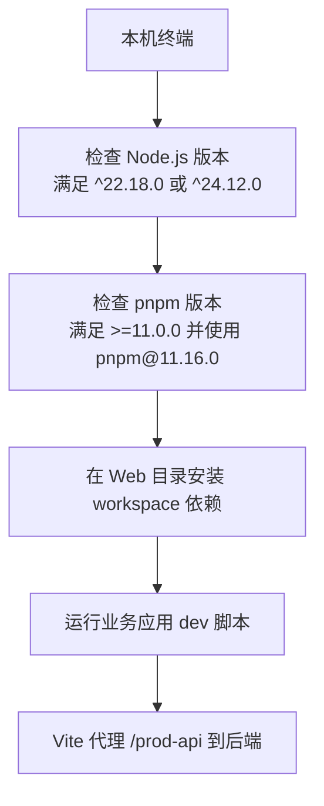
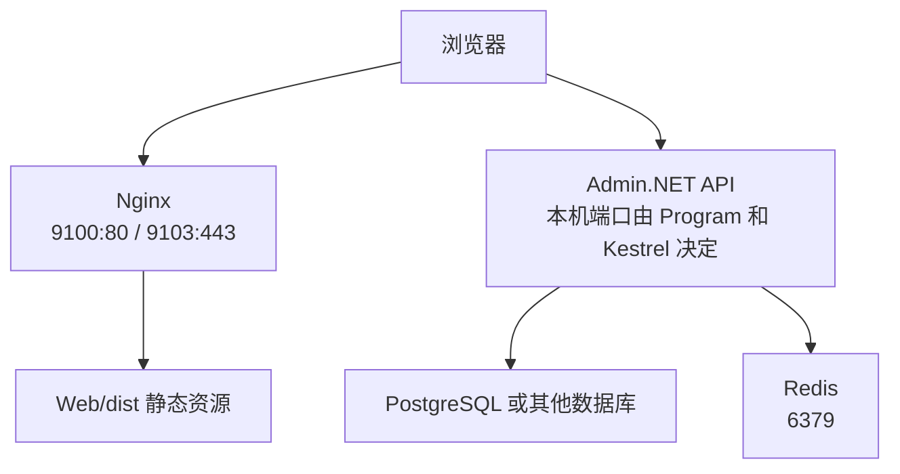
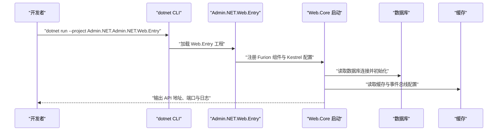
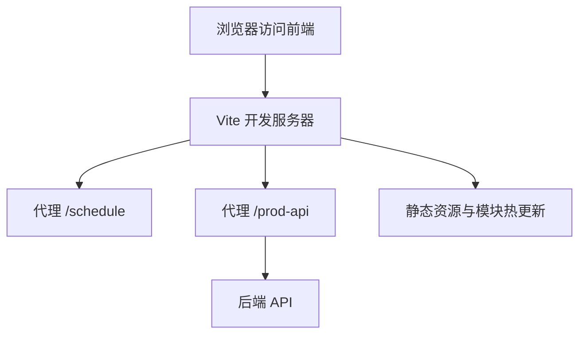
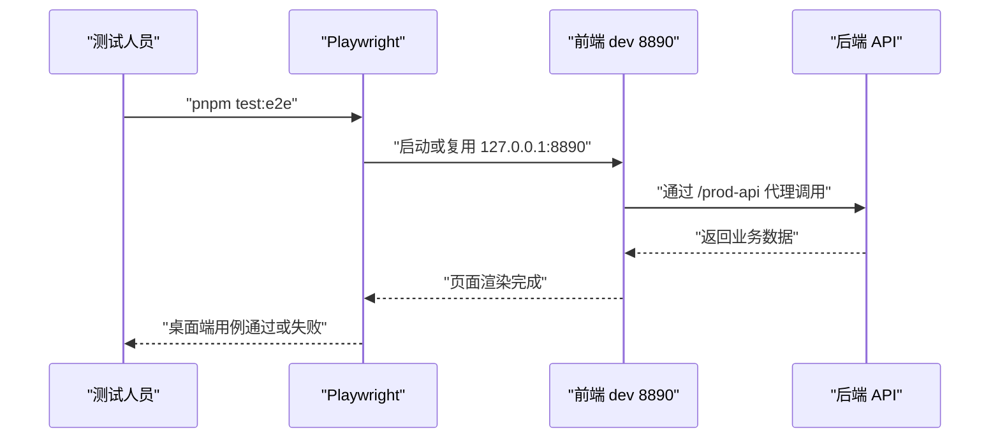
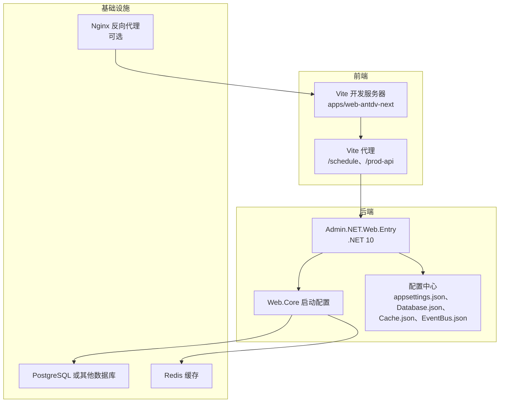

# 快速开始

<cite>
**本文引用的文件**   
- [README.md](file://README.md)
- [Admin.NET/global.json](file://Admin.NET/global.json)
- [Web/package.json](file://Web/package.json)
- [Web/apps/web-antdv-next/package.json](file://Web/apps/web-antdv-next/package.json)
- [Web/apps/web-antdv-next/vite.config.ts](file://Web/apps/web-antdv-next/vite.config.ts)
- [Web/playwright.config.ts](file://Web/playwright.config.ts)
- [Admin.NET/Admin.NET.Web.Entry/Admin.NET.Web.Entry.csproj](file://Admin.NET/Admin.NET.Web.Entry/Admin.NET.Web.Entry.csproj)
- [Admin.NET/Admin.NET.Web.Entry/Program.cs](file://Admin.NET/Admin.NET.Web.Entry/Program.cs)
- [Admin.NET/Admin.NET.Web.Entry/appsettings.json](file://Admin.NET/Admin.NET.Web.Entry/appsettings.json)
- [Admin.NET/Admin.NET.Core/Option/DbConnectionOptions.cs](file://Admin.NET/Admin.NET.Core/Option/DbConnectionOptions.cs)
- [Admin.NET/Admin.NET.Application/Configuration/Cache.json](file://Admin.NET/Admin.NET.Application/Configuration/Cache.json)
- [Admin.NET/Admin.NET.Application/Configuration/EventBus.json](file://Admin.NET/Admin.NET.Application/Configuration/EventBus.json)
- [docker/docker-compose.yml](file://docker/docker-compose.yml)
- [docs/development.md](file://docs/development.md)
</cite>

## 目录
1. [简介](#简介)
2. [环境要求](#环境要求)
3. [数据库与依赖服务](#数据库与依赖服务)
4. [启动后端服务](#启动后端服务)
5. [启动前端应用](#启动前端应用)
6. [验证前后端通信](#验证前后端通信)
7. [常见环境问题排查](#常见环境问题排查)
8. [架构概览](#架构概览)
9. [结论](#结论)

## 简介
本指南面向首次在本机搭建 Admin.NET 开发环境的开发者，目标是帮助你在本地准备 .NET、Node.js、pnpm、数据库和缓存等依赖，并成功启动后端 API 与前端业务应用。当前仓库已完成前端移植，业务前端入口为 `Web/apps/web-antdv-next`；后端 API 入口为 `Admin.NET.Admin.NET.Web.Entry`。集成验收推荐使用 PostgreSQL，避免用 SQLite 或 Mock 结果替代真实联调。

## 环境要求

### 后端运行环境
- 使用 .NET SDK 运行 `Admin.NET.Admin.NET.Web.Entry`。
- 根据项目配置，API 入口工程的目标框架为 `.NET 10`。
- `Admin.NET/global.json` 当前只选择 Microsoft.Testing.Platform，用于测试运行器，不表示固定了 .NET SDK 版本。因此不要把该文件理解为“已锁定 SDK 具体版本号”。
- Windows 下控制台运行时已禁用事件日志写入，避免普通用户权限导致日志异常。

**章节来源**
- [Admin.NET/Admin.NET.Web.Entry/Admin.NET.Web.Entry.csproj:1-18](file://Admin.NET/Admin.NET.Web.Entry/Admin.NET.Web.Entry.csproj#L1-L18)
- [Admin.NET/global.json:1-5](file://Admin.NET/global.json#L1-L5)
- [Admin.NET/Admin.NET.Web.Entry/Program.cs:10-23](file://Admin.NET/Admin.NET.Web.Entry/Program.cs#L10-L23)

### 前端运行环境
- Node.js：由 `Web/package.json` 的 `engines.node` 指定，当前接受 `^22.18.0 || ^24.12.0`。
- pnpm：由 `Web/package.json` 的 `engines.pnpm` 和 `packageManager` 指定，当前推荐 `pnpm@11.16.0`，且要求 `>=11.0.0`。
- 前端是 pnpm workspace，业务应用位于 `Web/apps/web-antdv-next`，共享包位于 `Web/packages`，工具配置位于 `Web/internal`。
- 根脚本中的 `pnpm dev`、`pnpm build`、`pnpm lint`、`pnpm check:type` 都通过 `--filter @vben/web-antdv-next` 指向业务应用，不是对整个 workspace 执行全量检查。

**图示来源**
- [Web/package.json:67-102](file://Web/package.json#L67-L102)
- [Web/apps/web-antdv-next/vite.config.ts:1-36](file://Web/apps/web-antdv-next/vite.config.ts#L1-L36)

**章节来源**
- [Web/package.json:1-102](file://Web/package.json#L1-L102)
- [Web/apps/web-antdv-next/package.json:1-72](file://Web/apps/web-antdv-next/package.json#L1-L72)
- [docs/development.md:28-46](file://docs/development.md#L28-L46)

## 数据库与依赖服务

### 推荐数据库
- 文档明确说明集成验收使用 PostgreSQL。
- 不要以 SQLite 或 Mock 结果声称真实联调通过。
- 数据库初始化可能创建表结构和种子数据，应使用独立的开发库，不应指向生产库。

### Docker 依赖服务说明
`docker/docker-compose.yml` 提供 MySQL、Redis、Nginx、MinIO、TDengine 以及一个示例后端容器。对于快速开始，建议优先准备 PostgreSQL 作为主数据库，再根据需要启用 Redis、Nginx 等辅助服务。

| 服务 | 镜像与用途 | 端口映射 | 重要环境变量或卷 | 说明 |
|---|---|---:|---|---|
| Nginx | `nginx:1.20.2` | `9100:80`、`9103:443` | 挂载 `../Web/dist`、`./nginx/conf/nginx.conf`、`./nginx/key` | 用于静态资源反向代理，默认把 `Web/dist` 映射到 `/usr/share/nginx/html` |
| MySQL | `mysql:5.7` | `9101:3306` | `MYSQL_DATABASE=admin`、`MYSQL_ROOT_PASSWORD=root` | 示例服务，非本次推荐的 PostgreSQL；如需使用请调整连接配置 |
| Redis | `redis:latest` | `6379:6379` | 挂载 `./redis/redis.conf`、`./redis/data`、`./redis/logs`，环境变量 `REDIS_PASSWORD=123456` | 用于缓存、事件源存储或 SignalR 集群场景 |
| MinIO | `minio/minio:RELEASE.2025-04-22T22-12-26Z` | `9104:9000`、`9105:9001` | `MINIO_ROOT_USER=admin`、`MINIO_ROOT_PASSWORD=admin123456` | 对象存储示例服务 |
| TDengine | `tdengine/tdengine:3.3.6.13` | `6030`、`6041`、`6044-6049`、`6060` 等 | `TAOS_FQDN=tdengine`、`TAOS_FIRST_EP=tdengine` | 时序数据库示例服务 |
| adminNet | `mcr.microsoft.com/dotnet/aspnet:9.0` | `9102:5050` | 挂载发布后的 `wwwroot` 与应用配置目录 | 示例容器依赖 MySQL 与 Redis，等待 MySQL 就绪后启动 |

**图示来源**
- [docker/docker-compose.yml:1-110](file://docker/docker-compose.yml#L1-L110)
- [Admin.NET/Admin.NET.Web.Entry/Program.cs:28-36](file://Admin.NET/Admin.NET.Web.Entry/Program.cs#L28-L36)

### 数据库连接与缓存配置
- 数据库连接选项模型定义在 `DbConnectionOptions`，支持多个连接配置、库表初始化、视图初始化、差异日志、驼峰转下划线、种子数据初始化等能力。
- 缓存默认可配置为内存或 Redis。示例中 Redis 配置包含服务器地址、密码、数据库索引和前缀。
- 事件总线默认使用内存存储，也可切换到 Redis、RabbitMQ 或 Kafka；若使用 Redis，需要与缓存配置保持一致。

**章节来源**
- [README.md:29-45](file://README.md#L29-L45)
- [Admin.NET/Admin.NET.Core/Option/DbConnectionOptions.cs:1-136](file://Admin.NET/Admin.NET.Core/Option/DbConnectionOptions.cs#L1-L136)
- [Admin.NET/Admin.NET.Application/Configuration/Cache.json:1-38](file://Admin.NET/Admin.NET.Application/Configuration/Cache.json#L1-L38)
- [Admin.NET/Admin.NET.Application/Configuration/EventBus.json:1-16](file://Admin.NET/Admin.NET.Application/Configuration/EventBus.json#L1-L16)

## 启动后端服务

### 步骤
1. 确认已安装满足要求的 .NET SDK。
2. 打开终端，进入 `Admin.NET` 目录。
3. 恢复解决方案依赖：
   - `dotnet restore Admin.NET.sln`
4. 构建解决方案（可选）：
   - `dotnet build Admin.NET.sln -c Debug`
5. 启动 API 入口工程：
   - `dotnet run --project Admin.NET/Admin.NET.Web.Entry/Admin.NET.Web.Entry.csproj`

### 注意事项
- 首次启动可能初始化数据库表结构和种子数据，请先准备好独立开发库。
- Kestrel 配置中设置了 KeepAlive 超时、请求头超时和最大请求体大小；实际监听地址、端口和协议应以程序启动输出为准。
- 如果通过反向代理部署，还需按后端代码中的转发头配置处理客户端真实 IP。

**图示来源**
- [Admin.NET/Admin.NET.Web.Entry/Admin.NET.Web.Entry.csproj:1-18](file://Admin.NET/Admin.NET.Web.Entry/Admin.NET.Web.Entry.csproj#L1-L18)
- [Admin.NET/Admin.NET.Web.Entry/Program.cs:10-36](file://Admin.NET/Admin.NET.Web.Entry/Program.cs#L10-L36)
- [Admin.NET/Admin.NET.Web.Entry/appsettings.json:1-5](file://Admin.NET/Admin.NET.Web.Entry/appsettings.json#L1-L5)

**章节来源**
- [README.md:33-41](file://README.md#L33-L41)
- [docs/development.md:18-35](file://docs/development.md#L18-L35)
- [Admin.NET/Admin.NET.Web.Entry/Program.cs:28-36](file://Admin.NET/Admin.NET.Web.Entry/Program.cs#L28-L36)

## 启动前端应用

### 步骤
1. 确认 Node.js 版本满足 `^22.18.0 || ^24.12.0`，pnpm 版本满足 `>=11.0.0`，并使用仓库指定的 `pnpm@11.16.0`。
2. 进入 `Web` 目录。
3. 安装 workspace 依赖：
   - `pnpm install --frozen-lockfile`
4. 启动业务应用开发服务器：
   - `pnpm dev`

### 根脚本适用范围
- `pnpm dev`：启动 `@vben/web-antdv-next` 的开发服务器。
- `pnpm build`：构建 `@vben/web-antdv-next`，产物输出到 `Web/dist`。
- `pnpm lint`：对 `apps/web-antdv-next/src` 执行 ESLint。
- `pnpm check:type`：对 `@vben/web-antdv-next` 执行类型检查。
- 这些命令都不是对整个 workspace 做无差别检查；共享包变更需补充对应范围的验证。

### 前端代理与 API 地址
- `vite.config.ts` 将 `/schedule` 和 `/prod-api` 代理到 `http://localhost:5005`。
- `/prod-api` 会去掉前缀，并把 WebSocket 也转发到后端。
- 如果后端不在 `5005` 端口，需要修改代理目标，使其与本机 API 实际端口一致。

**图示来源**
- [Web/apps/web-antdv-next/vite.config.ts:1-36](file://Web/apps/web-antdv-next/vite.config.ts#L1-L36)

**章节来源**
- [README.md:33-45](file://README.md#L33-L45)
- [Web/package.json:17-63](file://Web/package.json#L17-L63)
- [Web/apps/web-antdv-next/vite.config.ts:1-36](file://Web/apps/web-antdv-next/vite.config.ts#L1-L36)
- [docs/development.md:48-64](file://docs/development.md#L48-L64)

## 验证前后端通信

### 基本验证
1. 启动后端服务，记录其监听的 HTTP 地址和端口。
2. 启动前端 `pnpm dev`，确认 Vite 开发服务器可用。
3. 检查浏览器控制台是否有跨域错误或接口 404。
4. 若后端不在 `5005` 端口，请同步修改 `vite.config.ts` 中的代理目标。
5. 调用登录或获取菜单等基础接口，确认返回正常响应。

### Playwright 桌面端 E2E 验证
- 默认 E2E 基地址为 `http://127.0.0.1:8890`。
- 未设置 `ADMINNET_E2E_BASE_URL` 时，Playwright 会启动 `pnpm --filter @vben/web-antdv-next dev --port 8890 --host 127.0.0.1`。
- 用例设备固定为桌面 Chrome，视口为 `1440×1000`。
- 如果已有外部前端地址，可通过环境变量覆盖 `ADMINNET_E2E_BASE_URL`。

**图示来源**
- [Web/playwright.config.ts:1-31](file://Web/playwright.config.ts#L1-L31)
- [Web/apps/web-antdv-next/vite.config.ts:18-32](file://Web/apps/web-antdv-next/vite.config.ts#L18-L32)

**章节来源**
- [Web/playwright.config.ts:1-31](file://Web/playwright.config.ts#L1-L31)
- [Web/apps/web-antdv-next/vite.config.ts:1-36](file://Web/apps/web-antdv-next/vite.config.ts#L1-L36)
- [docs/development.md:56-64](file://docs/development.md#L56-L64)

## 常见环境问题排查

| 问题现象 | 可能原因 | 排查方法 |
|---|---|---|
| 无法解析 Node.js 或 pnpm 版本 | 使用了不支持的 Node.js 或 pnpm 版本 | 查看 `Web/package.json` 的 `engines` 与 `packageManager`；使用 `pnpm --version` 确认；不要用全局旧版 pnpm 覆盖仓库锁文件 |
| `pnpm install` 报错 | workspace 依赖或 lockfile 不一致 | 在 `Web` 目录重新执行 `pnpm install --frozen-lockfile`；不要随意升级依赖 |
| 前端代理请求失败 | 后端不在 `localhost:5005` | 修改 `Web/apps/web-antdv-next/vite.config.ts` 中 `/prod-api` 的代理目标，使其与实际后端端口一致 |
| 端口冲突 | 本机已有服务占用 5005、6379、9100、9101、9102、9103、9104、9105 等端口 | 停止占用进程；或修改 docker-compose、Kestrel、Vite 及 Nginx 端口配置 |
| 数据库连接失败 | 连接字符串、用户名、密码、主机名或数据库名称错误 | 检查 `Database.json` 等数据库配置；确保 PostgreSQL 或其他数据库已启动并可连接 |
| Redis 连接失败 | Redis 未启动、密码或数据库索引不匹配 | 检查 `Cache.json` 中 Redis 配置；确认 `docker/docker-compose.yml` 中 Redis 端口和环境变量 |
| 事件总线或队列异常 | 事件源存储与缓存后端不一致 | 若使用 Redis 缓存，同时确认事件总线是否切换到 Redis；保持缓存与事件源配置一致 |
| 首次启动报建库或种子数据相关错误 | 开发库不存在或权限不足 | 提前创建独立开发库；不要指向生产库 |
| 浏览器 E2E 无法访问前端 | Playwright 默认基地址或前端端口配置不一致 | 检查 `playwright.config.ts` 的 `baseURL` 与 `webServer.command`，或通过 `ADMINNET_E2E_BASE_URL` 覆盖 |
| 构建产物路径不符合预期 | 误以为根脚本作用于整个 workspace | 根脚本只对 `@vben/web-antdv-next` 生效；生产产物输出到 `Web/dist` |

**章节来源**
- [Web/package.json:17-102](file://Web/package.json#L17-L102)
- [Web/apps/web-antdv-next/vite.config.ts:1-36](file://Web/apps/web-antdv-next/vite.config.ts#L1-L36)
- [docker/docker-compose.yml:1-110](file://docker/docker-compose.yml#L1-L110)
- [Admin.NET/Admin.NET.Application/Configuration/Cache.json:1-38](file://Admin.NET/Admin.NET.Application/Configuration/Cache.json#L1-L38)
- [Admin.NET/Admin.NET.Application/Configuration/EventBus.json:1-16](file://Admin.NET/Admin.NET.Application/Configuration/EventBus.json#L1-L16)
- [Web/playwright.config.ts:1-31](file://Web/playwright.config.ts#L1-L31)
- [docs/development.md:18-64](file://docs/development.md#L18-L64)

## 架构概览

**图示来源**
- [Web/apps/web-antdv-next/vite.config.ts:1-36](file://Web/apps/web-antdv-next/vite.config.ts#L1-L36)
- [Admin.NET/Admin.NET.Web.Entry/Admin.NET.Web.Entry.csproj:1-18](file://Admin.NET/Admin.NET.Web.Entry/Admin.NET.Web.Entry.csproj#L1-L18)
- [Admin.NET/Admin.NET.Web.Entry/appsettings.json:1-5](file://Admin.NET/Admin.NET.Web.Entry/appsettings.json#L1-L5)
- [Admin.NET/Admin.NET.Application/Configuration/Cache.json:1-38](file://Admin.NET/Admin.NET.Application/Configuration/Cache.json#L1-L38)
- [Admin.NET/Admin.NET.Application/Configuration/EventBus.json:1-16](file://Admin.NET/Admin.NET.Application/Configuration/EventBus.json#L1-L16)
- [docker/docker-compose.yml:1-110](file://docker/docker-compose.yml#L1-L110)

## 结论
搭建 Admin.NET 本地开发环境的关键是：使用正确的 .NET SDK、Node.js 和 pnpm 版本；准备独立的 PostgreSQL 和其他依赖服务；先启动后端 API，再启动前端业务应用；最后通过浏览器接口调用或 Playwright 桌面端 E2E 验证前后端通信。根脚本 `pnpm dev`、`pnpm build`、`pnpm lint`、`pnpm check:type` 仅面向业务应用 `@vben/web-antdv-next`，不应被误解为对整个 workspace 的全量操作。遇到端口、数据库、Redis、代理或包管理器问题时，优先对照配置文件、端口映射和仓库锁文件进行定位。