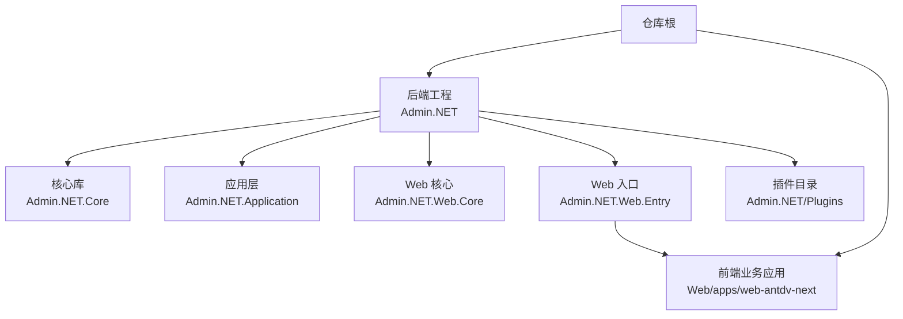
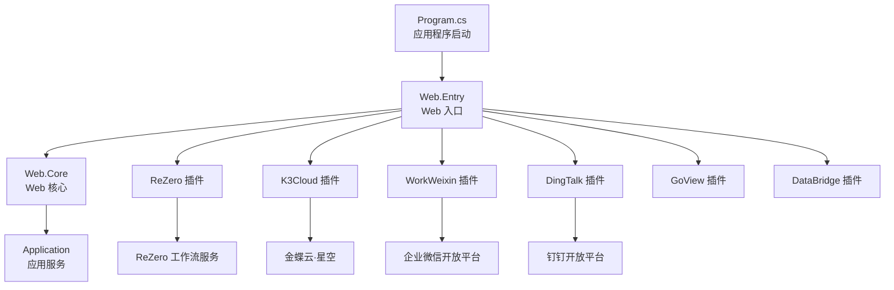
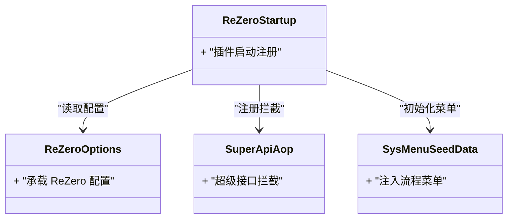
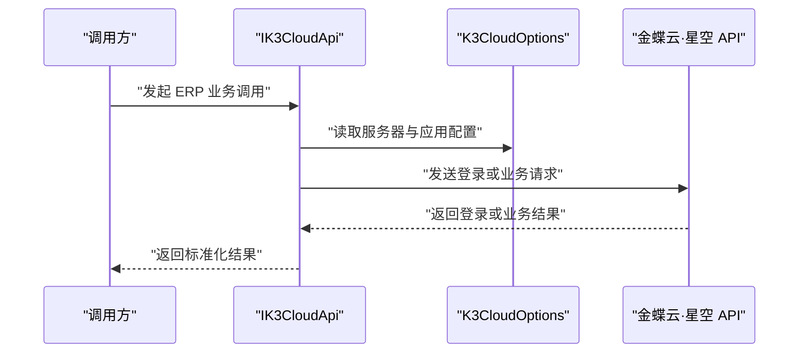
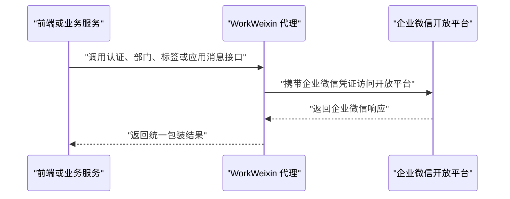
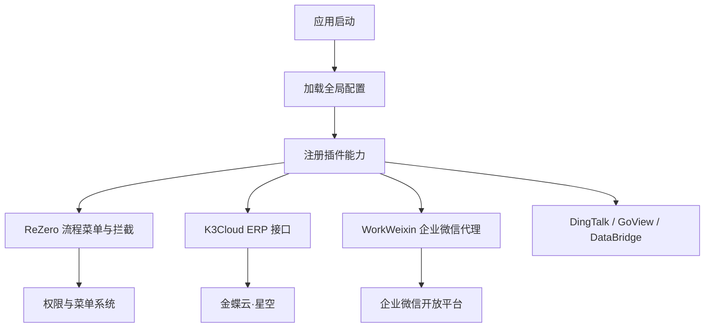
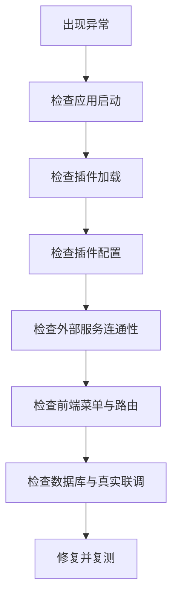

# 内置插件说明

<cite>
**本文引用的文件**   
- [README.md](file://README.md)
- [Admin.NET.sln](file://Admin.NET/Admin.NET.sln)
- [global.json](file://Admin.NET/global.json)
- [Application Startup.cs](file://Admin.NET/Admin.NET.Application/Startup.cs)
- [Web.Core ProjectOptions.cs](file://Admin.NET/Admin.NET.Web.Core/ProjectOptions.cs)
- [Web.Entry Program.cs](file://Admin.NET/Admin.NET.Web.Entry/Program.cs)
- [Web.Entry appsettings.json](file://Admin.NET/Admin.NET.Web.Entry/appsettings.json)
- [ReZero 插件 CLAUDE.md](file://Admin.NET/Plugins/Admin.NET.Plugin.ReZero/CLAUDE.md)
- [ReZero 插件 Startup.cs](file://Admin.NET/Plugins/Admin.NET.Plugin.ReZero/Startup.cs)
- [ReZero 插件 ReZeroOptions.cs](file://Admin.NET/Plugins/Admin.NET.Plugin.ReZero/Option/ReZeroOptions.cs)
- [ReZero 插件 SuperApiAop.cs](file://Admin.NET/Plugins/Admin.NET.Plugin.ReZero/Service/SuperApiAop.cs)
- [ReZero 插件 SysMenuSeedData.cs](file://Admin.NET/Plugins/Admin.NET.Plugin.ReZero/SeedData/SysMenuSeedData.cs)
- [K3Cloud 插件 CLAUDE.md](file://Admin.NET/Plugins/Admin.NET.Plugin.K3Cloud/CLAUDE.md)
- [K3Cloud 插件 Startup.cs](file://Admin.NET/Plugins/Admin.NET.Plugin.K3Cloud/Startup.cs)
- [K3Cloud 插件 K3CloudOptions.cs](file://Admin.NET/Plugins/Admin.NET.Plugin.K3Cloud/Option/K3CloudOptions.cs)
- [K3Cloud 插件 IK3CloudApi.cs](file://Admin.NET/Plugins/Admin.NET.Plugin.K3Cloud\Service/IK3CloudApi.cs)
- [K3Cloud 插件 K3CloudLoginInput.cs](file://Admin.NET/Plugins/Admin.NET.Plugin.K3Cloud@Service\Dto\K3CloudLoginInput.cs)
- [K3Cloud 插件 K3CloudLoginOutput.cs](file://Admin.NET/Plugins/Admin.NET.Plugin.K3Cloud\Service\Dto\K3CloudLoginOutput.cs)
- [K3Cloud 插件 K3CloudBaeInput.cs](file://Admin.NET/Plugins/Admin.NET.Plugin.K3Cloud\Service\Dto\K3CloudBaeInput.cs)
- [K3Cloud 插件 K3CloudPushResultOutput.cs](file://Admin.NET/Plugins/Admin.NET.Plugin.K3Cloud\Service\Dto\K3CloudPushResultOutput.cs)
- [WorkWeixin 插件 CLAUDE.md](file://Admin.NET/Plugins/Admin.NET.Plugin.WorkWeixin/CLAUDE.md)
- [WorkWeixin 插件 Startup.cs](file://Admin.NET/Plugins/Admin.NET.Plugin.WorkWeixin/Startup.cs)
- [WorkWeixin 插件 WorkWeixinOptions.cs](file://Admin.NET/Plugins/Admin.NET.Plugin.WorkWeixin/Option/WorkWeixinOptions.cs)
- [WorkWeixin 插件 BaseHttpOutput.cs](file://Admin.NET/Plugins/Admin.NET.Plugin.WorkWeixin/Utils/BaseHttpOutput.cs)
- [WorkWeixin 插件 IWorkWeixinAuthHttp.cs](file://Admin.NET/Plugins/Admin.NET.Plugin.WorkWeixin/Proxy/Auth/IWorkWeixinAuthHttp.cs)
- [WorkWeixin 插件 IDepartmentHttp.cs](file://Admin.NET/Plugins/Admin.NET.Plugin.WorkWeixin/Proxy/Department/IDepartmentHttp.cs)
- [WorkWeixin 插件 ITagHttp.cs](file://Admin.NET/Plugins/Admin.NET.Plugin.WorkWeixin/Proxy/Tag/ITagHttp.cs)
- [WorkWeixin 插件 IWorkWeixinAppChatHttp.cs](file://Admin.NET/Plugins/Admin.NET.Plugin.WorkWeixin/Proxy/AppChat/IWorkWeixinAppChatHttp.cs)
- [DingTalk 插件目录信息](file://Admin.NET/Plugins/Admin.NET.Plugin.DingTalk)
- [GoView 插件目录信息](file://Admin.NET/Plugins/Admin.NET.Plugin.GoView)
- [DataBridge 插件目录信息](file://Admin.NET/Plugins/Admin.NET.Plugin.DataBridge)
</cite>

## 目录
1. [引言](#引言)
2. [项目结构与插件定位](#项目结构与插件定位)
3. [核心组件与插件总览](#核心组件与插件总览)
4. [架构总览与数据流](#架构总览与数据流)
5. [详细插件说明](#详细插件说明)
6. [插件间协作关系](#插件间协作关系)
7. [启用、禁用与前端集成](#启用禁用与前端集成)
8. [依赖、版本与兼容性](#依赖版本与兼容性)
9. [性能调优与安全配置](#性能调优与安全配置)
10. [故障排查指南](#故障排查指南)
11. [结论](#结论)

## 引言
本文面向 Admin.NET 的内置插件，重点说明 ReZero、K3Cloud、WorkWeixin、DingTalk、GoView 和 DataBridge 的功能特性、适用场景、技术实现、配置方式、外部依赖、前端集成方式和典型使用案例。文档以当前仓库源码为事实依据：后端采用 .NET 与 Furion 生态，前端业务入口为 `Web/apps/web-antdv-next`；插件位于 `Admin.NET/Plugins` 下，由解决方案 `Admin.NET/Admin.NET.sln` 管理。

本仓库 README 明确后端入口为 `Admin.NET/Admin.NET.Web.Entry/`，前端入口为 `Web/apps/web-antdv-next/`，并强调数据库集成验收应使用 PostgreSQL。因此，本文在涉及数据库联调时不会将 SQLite 或 Mock 结果视为真实联调通过。

**章节来源**
- [README.md:1-40](file://README.md#L1-L40)

## 项目结构与插件定位
Admin.NET 采用前后端分离与模块化设计。后端共享能力集中在 `Admin.NET.Admin.NET.Core`，应用服务集中在 `Admin.NET.Admin.NET.Application`，Web 层入口为 `Admin.NET.Admin.NET.Web.Entry`，插件统一放在 `Admin.NET/Plugins`。前端工程基于 pnpm workspace，业务页面位于 `Web/apps/web-antdv-next/src/views`，接口封装沿用当前应用结构。

**图表来源**
- [Admin.NET.sln](file://Admin.NET/Admin.NET.sln)
- [README.md:20-40](file://README.md#L20-L40)

**章节来源**
- [README.md:20-40](file://README.md#L20-L40)
- [Admin.NET.sln](file://Admin.NET/Admin.NET.sln)

## 核心组件与插件总览
| 插件 | 核心功能概述 | 主要接口或扩展点 | 配置项位置 | 外部依赖 | 适用场景 |
|---|---|---|---|---|---|
| ReZero | 企业级工作流引擎集成，提供超级接口拦截、菜单种子数据与可配置选项 | `ReZeroOptions`、`SuperApiAop`、菜单种子数据、插件启动类 | `Option/ReZeroOptions.cs`、`Startup.cs` | ReZero 工作流服务或 API | 需要审批流、流程编排、企业级流程治理的系统 |
| K3Cloud | 金蝶云·星空 ERP 集成，封装登录、业务操作及推送结果 | `IK3CloudApi`、`K3CloudOptions`、登录输入输出、BAE 输入、推送结果 | `Option/K3CloudOptions.cs`、`Startup.cs` | 金蝶云·星空 API | 需要对接金蝶 ERP 订单、库存、财务等业务的系统 |
| WorkWeixin | 企业微信生态集成，封装认证、部门、标签、应用消息等 HTTP 代理 | 多个 `I*Http` 代理、`WorkWeixinOptions`、基础响应类型 | `Option/WorkWeixinOptions.cs`、`Startup.cs` | 企业微信开放平台 | 需要企业微信通讯录、消息、扫码、应用消息的企业应用 |
| DingTalk | 钉钉平台对接插件（当前目录存在但本次未深入解析具体实现） | 以实际源码为准 | 以插件配置为准 | 钉钉开放平台 | 需要钉钉组织架构、消息、审批等集成的场景 |
| GoView | 数据可视化插件（当前目录存在但本次未深入解析具体实现） | 以实际源码为准 | 以插件配置为准 | 可能依赖可视化服务或前端资源 | 大屏、报表、数据看板等业务 |
| DataBridge | 数据桥接插件（当前目录存在但本次未深入解析具体实现） | 以实际源码为准 | 以插件配置为准 | 可能依赖多数据源或第三方数据服务 | 跨系统数据同步、数据汇聚与分发 |

上述分类中，ReZero、K3Cloud、WorkWeixin 在当前仓库中有较完整的代码结构；DingTalk、GoView、DataBridge 在本分支中存在插件目录，但未在本次分析中读取其内部实现细节，因此“主要接口”和“配置参数”以“以实际源码为准”标注，避免臆造。

**章节来源**
- [ReZero 插件 CLAUDE.md](file://Admin.NET/Plugins/Admin.NET.Plugin.ReZero/CLAUDE.md)
- [K3Cloud 插件 CLAUDE.md](file://Admin.NET/Plugins/Admin.NET.Plugin.K3Cloud/CLAUDE.md)
- [WorkWeixin 插件 CLAUDE.md](file://Admin.NET/Plugins/Admin.NET.Plugin.WorkWeixin/CLAUDE.md)
- [DingTalk 插件目录信息](file://Admin.NET/Plugins/Admin.NET.Plugin.DingTalk)
- [GoView 插件目录信息](file://Admin.NET/Plugins/Admin.NET.Plugin.GoView)
- [DataBridge 插件目录信息](file://Admin.NET/Plugins/Admin.NET.Plugin.DataBridge)

## 架构总览与数据流
插件整体遵循 Admin.NET 的模块加载模式：Web 入口程序启动后加载 Web 核心与应用层，再由各插件的 `Startup` 注册选项、服务、代理、中间件或种子数据。不同插件对外暴露的能力不同：

- ReZero 通过选项类注入配置，通过 AOP 拦截超级接口，并通过菜单种子数据向系统注入流程相关菜单。
- K3Cloud 通过选项类保存金蝶云配置，通过 API 接口抽象封装登录和业务调用。
- WorkWeixin 通过选项类保存企业微信配置，通过多个 HTTP 代理分别处理认证、部门、标签和应用消息。
- DingTalk、GoView、DataBridge 在本分支中以插件目录形式存在，具体数据流取决于各自 `Startup`、选项和服务实现。

**图表来源**
- [Web.Entry Program.cs](file://Admin.NET/Admin.NET.Web.Entry/Program.cs)
- [Web.Core ProjectOptions.cs](file://Admin.NET/Admin.NET.Web.Core/ProjectOptions.cs)
- [Application Startup.cs](file://Admin.NET/Admin.NET.Application/Startup.cs)
- [ReZero 插件 Startup.cs](file://Admin.NET/Plugins/Admin.NET.Plugin.ReZero/Startup.cs)
- [K3Cloud 插件 Startup.cs](file://Admin.NET/Plugins/Admin.NET.Plugin.K3Cloud/Startup.cs)
- [WorkWeixin 插件 Startup.cs](file://Admin.NET/Plugins/Admin.NET.Plugin.WorkWeixin/Startup.cs)

## 详细插件说明

### ReZero 插件：企业级工作流扩展
ReZero 插件围绕工作流与企业级流程能力展开，主要包含以下层次：

1. **配置层**：`ReZeroOptions` 用于承载 ReZero 相关的运行配置。
2. **启动层**：`Startup.cs` 负责在插件初始化阶段注册 ReZero 相关能力。
3. **拦截层**：`SuperApiAop.cs` 提供超级接口拦截逻辑，通常用于统一处理工作流相关的请求增强、日志、鉴权或参数转换。
4. **数据层**：`SysMenuSeedData.cs` 向系统注入流程相关菜单，使流程管理界面可在权限系统中可见。

该插件适合需要审批流、任务流转、流程状态追踪、流程审计等企业级场景。它不直接定义业务实体表，而是通过菜单与拦截机制融入 Admin.NET 的整体权限与工作流体系。

**图表来源**
- [ReZero 插件 ReZeroOptions.cs](file://Admin.NET/Plugins/Admin.NET.Plugin.ReZero/Option/ReZeroOptions.cs)
- [ReZero 插件 Startup.cs](file://Admin.NET/Plugins/Admin.NET.Plugin.ReZero/Startup.cs)
- [ReZero 插件 SuperApiAop.cs](file://Admin.NET/Plugins/Admin.NET.Plugin.ReZero/Service/SuperApiAop.cs)
- [ReZero 插件 SysMenuSeedData.cs](file://Admin.NET/Plugins/Admin.NET.Plugin.ReZero/SeedData/SysMenuSeedData.cs)

**章节来源**
- [ReZero 插件 CLAUDE.md](file://Admin.NET/Plugins/Admin.NET.Plugin.ReZero/CLAUDE.md)
- [ReZero 插件 Startup.cs](file://Admin.NET/Plugins/Admin.NET.Plugin.ReZero/Startup.cs)
- [ReZero 插件 ReZeroOptions.cs](file://Admin.NET/Plugins/Admin.NET.Plugin.ReZero/Option/ReZeroOptions.cs)
- [ReZero 插件 SuperApiAop.cs](file://Admin.NET/Plugins/Admin.NET.Plugin.ReZero/Service/SuperApiAop.cs)
- [ReZero 插件 SysMenuSeedData.cs](file://Admin.NET/Plugins/Admin.NET.Plugin.ReZero/SeedData/SysMenuSeedData.cs)

### K3Cloud 插件：金蝶 ERP 集成
K3Cloud 插件聚焦于金蝶云·星空 ERP 的对接能力，核心包括：

- **配置模型**：`K3CloudOptions` 保存服务器地址、应用标识、密钥等连接参数。
- **API 抽象**：`IK3CloudApi` 定义与金蝶云交互的统一接口。
- **登录模型**：`K3CloudLoginInput` 与 `K3CloudLoginOutput` 描述登录请求与返回。
- **业务模型**：`K3CloudBaeInput` 表示业务操作输入，`K3CloudPushResultOutput` 表示推送结果。
- **启动注册**：`Startup.cs` 负责注册选项与服务。

典型数据流如下：

**图表来源**
- [K3Cloud 插件 IK3CloudApi.cs](file://Admin.NET/Plugins/Admin.NET.Plugin.K3Cloud\Service/IK3CloudApi.cs)
- [K3Cloud 插件 K3CloudOptions.cs](file://Admin.NET/Plugins/Admin.NET.Plugin.K3Cloud/Option/K3CloudOptions.cs)
- [K3Cloud 插件 K3CloudLoginInput.cs](file://Admin.NET/Plugins/Admin.NET.Plugin.K3Cloud@Service\Dto\K3CloudLoginInput.cs)
- [K3Cloud 插件 K3CloudLoginOutput.cs](file://Admin.NET/Plugins/Admin.NET.Plugin.K3Cloud\Service\Dto\K3CloudLoginOutput.cs)
- [K3Cloud 插件 K3CloudBaeInput.cs](file://Admin.NET/Plugins/Admin.NET.Plugin.K3Cloud\Service\Dto\K3CloudBaeInput.cs)
- [K3Cloud 插件 K3CloudPushResultOutput.cs](file://Admin.NET/Plugins/Admin.NET.Plugin.K3Cloud\Service\Dto\K3CloudPushResultOutput.cs)

**章节来源**
- [K3Cloud 插件 CLAUDE.md](file://Admin.NET/Plugins/Admin.NET.Plugin.K3Cloud/CLAUDE.md)
- [K3Cloud 插件 Startup.cs](file://Admin.NET/Plugins/Admin.NET.Plugin.K3Cloud/Startup.cs)
- [K3Cloud 插件 K3CloudOptions.cs](file://Admin.NET/Plugins/Admin.NET.Plugin.K3Cloud/Option/K3CloudOptions.cs)
- [K3Cloud 插件 IK3CloudApi.cs](file://Admin.NET/Plugins/Admin.NET.Plugin.K3Cloud\Service/IK3CloudApi.cs)
- [K3Cloud 插件 K3CloudLoginInput.cs](file://Admin.NET/Plugins/Admin.NET.Plugin.K3Cloud@Service\Dto\K3CloudLoginInput.cs)
- [K3Cloud 插件 K3CloudLoginOutput.cs](file://Admin.NET/Plugins/Admin.NET.Plugin.K3Cloud\Service\Dto\K3CloudLoginOutput.cs)
- [K3Cloud 插件 K3CloudBaeInput.cs](file://Admin.NET/Plugins/Admin.NET.Plugin.K3Cloud\Service\Dto\K3CloudBaeInput.cs)
- [K3Cloud 插件 K3CloudPushResultOutput.cs](file://Admin.NET/Plugins/Admin.NET.Plugin.K3Cloud\Service\Dto\K3CloudPushResultOutput.cs)

### WorkWeixin 插件：企业微信生态集成
WorkWeixin 插件将企业微信开放平台能力抽象为多个 HTTP 代理，覆盖认证、部门、标签和应用消息等常见场景：

- **认证代理**：`IWorkWeixinAuthHttp.cs`
- **部门代理**：`IDepartmentHttp.cs`
- **标签代理**：`ITagHttp.cs`
- **应用消息代理**：`IWorkWeixinAppChatHttp.cs`
- **基础响应**：`BaseHttpOutput.cs`
- **配置**：`WorkWeixinOptions.cs`
- **启动注册**：`Startup.cs`

典型调用流程如下：

**图表来源**
- [WorkWeixin 插件 IWorkWeixinAuthHttp.cs](file://Admin.NET/Plugins/Admin.NET.Plugin.WorkWeixin/Proxy/Auth/IWorkWeixinAuthHttp.cs)
- [WorkWeixin 插件 IDepartmentHttp.cs](file://Admin.NET/Plugins/Admin.NET.Plugin.WorkWeixin/Proxy/Department/IDepartmentHttp.cs)
- [WorkWeixin 插件 ITagHttp.cs](file://Admin.NET/Plugins/Admin.NET.Plugin.WorkWeixin/Proxy/Tag/ITagHttp.cs)
- [WorkWeixin 插件 IWorkWeixinAppChatHttp.cs](file://Admin.NET/Plugins/Admin.NET.Plugin.WorkWeixin/Proxy/AppChat/IWorkWeixinAppChatHttp.cs)
- [WorkWeixin 插件 BaseHttpOutput.cs](file://Admin.NET/Plugins/Admin.NET.Plugin.WorkWeixin/Utils/BaseHttpOutput.cs)
- [WorkWeixin 插件 WorkWeixinOptions.cs](file://Admin.NET/Plugins/Admin.NET.Plugin.WorkWeixin/Option/WorkWeixinOptions.cs)

**章节来源**
- [WorkWeixin 插件 CLAUDE.md](file://Admin.NET/Plugins/Admin.NET.Plugin.WorkWeixin/CLAUDE.md)
- [WorkWeixin 插件 Startup.cs](file://Admin.NET/Plugins/Admin.NET.Plugin.WorkWeixin/Startup.cs)
- [WorkWeixin 插件 WorkWeixinOptions.cs](file://Admin.NET/Plugins/Admin.NET.Plugin.WorkWeixin/Option/WorkWeixinOptions.cs)
- [WorkWeixin 插件 BaseHttpOutput.cs](file://Admin.NET/Plugins/Admin.NET.Plugin.WorkWeixin/Utils/BaseHttpOutput.cs)
- [WorkWeixin 插件 IWorkWeixinAuthHttp.cs](file://Admin.NET/Plugins/Admin.NET.Plugin.WorkWeixin/Proxy/Auth/IWorkWeixinAuthHttp.cs)
- [WorkWeixin 插件 IDepartmentHttp.cs](file://Admin.NET/Plugins/Admin.NET.Plugin.WorkWeixin/Proxy/Department/IDepartmentHttp.cs)
- [WorkWeixin 插件 ITagHttp.cs](file://Admin.NET/Plugins/Admin.NET.Plugin.WorkWeixin/Proxy/Tag/ITagHttp.cs)
- [WorkWeixin 插件 IWorkWeixinAppChatHttp.cs](file://Admin.NET/Plugins/Admin.NET.Plugin.WorkWeixin/Proxy/AppChat/IWorkWeixinAppChatHttp.cs)

### DingTalk 插件：钉钉平台对接
DingTalk 插件在本分支中存在插件目录，但本次未读取其具体源码。因此，其核心功能、接口列表、配置参数和前端集成方式应以 `Admin.NET/Plugins/Admin.NET.Plugin.DingTalk` 下的实际实现为准。从命名与插件分组看，该插件预期对接钉钉开放平台，可能涵盖组织同步、消息通知、审批回调等能力。

由于无法确认当前实现，本文不列出具体接口清单或配置字段，建议开发者优先查看该插件的 `Startup.cs`、选项类和对外 API。

**章节来源**
- [DingTalk 插件目录信息](file://Admin.NET/Plugins/Admin.NET.Plugin.DingTalk)

### GoView 插件：数据可视化能力
GoView 插件在本分支中存在插件目录，但本次未读取其具体源码。若该插件用于对接 GoView 可视化平台，则通常需要提供可视化模板、大屏渲染或数据聚合能力。其具体接口、配置与前端页面集成方式应以插件源码为准。

**章节来源**
- [GoView 插件目录信息](file://Admin.NET/Plugins/Admin.NET.Plugin.GoView)

### DataBridge 插件：数据桥接功能
DataBridge 插件在本分支中存在插件目录，但本次未读取其具体源码。作为数据桥接插件，其职责通常是连接多个数据源、执行数据同步、转换或路由。具体数据模型、任务调度、目标系统接入方式应以插件源码为准。

**章节来源**
- [DataBridge 插件目录目录信息](file://Admin.NET/Plugins/Admin.NET.Plugin.DataBridge)

## 插件间协作关系
各插件并非孤立存在，它们通过 Admin.NET 的启动管线、配置体系和 Web 层进行协作：

1. **共同依赖 Admin.NET 核心能力**：所有插件都复用框架提供的配置加载、服务注册、日志、缓存、数据库访问等基础设施。
2. **通过 Web 入口加载**：`Program.cs` 是应用程序启动入口，Web 层会加载插件能力。
3. **通过选项类统一配置**：ReZero、K3Cloud、WorkWeixin 均通过独立的 `*Options` 类暴露配置，便于在 `appsettings.json` 或环境配置中管理。
4. **菜单与前端集成**：ReZero 通过菜单种子数据影响系统菜单；其他插件是否生成菜单或前端页面，取决于各自实现。
5. **外部系统集成**：K3Cloud 对接金蝶 ERP，WorkWeixin 对接企业微信，DingTalk 对接钉钉，ReZero 对接工作流服务。

**图表来源**
- [Web.Entry Program.cs](file://Admin.NET/Admin.NET.Web.Entry/Program.cs)
- [ReZero 插件 SysMenuSeedData.cs](file://Admin.NET/Plugins/Admin.NET.Plugin.ReZero/SeedData/SysMenuSeedData.cs)
- [K3Cloud 插件 Startup.cs](file://Admin.NET/Plugins/Admin.NET.Plugin.K3Cloud/Startup.cs)
- [WorkWeixin 插件 Startup.cs](file://Admin.NET/Plugins/Admin.NET.Plugin.WorkWeixin/Startup.cs)

**章节来源**
- [Web.Entry Program.cs](file://Admin.NET/Admin.NET.Web.Entry/Program.cs)
- [ReZero 插件 SysMenuSeedData.cs](file://Admin.NET/Plugins/Admin.NET.Plugin.ReZero/SeedData/SysMenuSeedData.cs)
- [K3Cloud 插件 Startup.cs](file://Admin.NET/Plugins/Admin.NET.Plugin.K3Cloud/Startup.cs)
- [WorkWeixin 插件 Startup.cs](file://Admin.NET/Plugins/Admin.NET.Plugin.WorkWeixin/Startup.cs)

## 启用、禁用与前端集成
### 启用与禁用
- **后端启用**：插件是否启用通常由解决方案引用、Web 层启动类、插件 `Startup` 以及应用配置共同决定。对于有明确 `Startup.cs` 的插件，启用方式一般包括：确保插件被解决方案引用、确保 Web 入口加载插件、并在配置文件中提供所需参数。
- **配置控制**：ReZero、K3Cloud、WorkWeixin 均通过独立选项类暴露配置，建议在 `appsettings.json` 中按需填写对应配置段。
- **禁用方式**：若某插件未启用，通常表现为其 `Startup` 未被加载、对应配置段为空、或其对外接口不可用。

### 前端集成
- **业务前端入口**：当前业务前端为 `Web/apps/web-antdv-next`。
- **ReZero**：通过菜单种子数据向系统注入流程相关菜单，前端可在权限菜单中看到相应页面。
- **K3Cloud、WorkWeixin、DingTalk、GoView、DataBridge**：是否在前端展示新菜单或页面，取决于插件是否提供菜单种子数据、控制器或前端资源。当前仅能确认 ReZero 明确注入菜单种子数据。

### 典型使用案例
- **ReZero**：在企业应用中新增审批流程，通过流程菜单进入流程管理，利用超级接口拦截完成流程请求的统一处理。
- **K3Cloud**：在业务订单确认后，调用 K3Cloud API 同步订单到金蝶 ERP，并记录推送结果。
- **WorkWeixin**：在企业微信应用中获取用户身份、拉取部门或标签信息，或向企业微信应用发送消息。
- **DingTalk**：以插件源码为准，常见场景包括钉钉用户同步、消息通知和审批回调。
- **GoView**：以插件源码为准，常见场景包括可视化大屏数据接入与展示。
- **DataBridge**：以插件源码为准，常见场景包括多数据源同步、定时数据迁移。

**章节来源**
- [Web.Entry appsettings.json](file://Admin.NET/Admin.NET.Web.Entry/appsettings.json)
- [ReZero 插件 SysMenuSeedData.cs](file://Admin.NET/Plugins/Admin.NET.Plugin.ReZero/SeedData/SysMenuSeedData.cs)
- [ReZero 插件 ReZeroOptions.cs](file://Admin.NET/Plugins/Admin.NET.Plugin.ReZero/Option/ReZeroOptions.cs)
- [K3Cloud 插件 K3CloudOptions.cs](file://Admin.NET/Plugins/Admin.NET.Plugin.K3Cloud/Option/K3CloudOptions.cs)
- [WorkWeixin 插件 WorkWeixinOptions.cs](file://Admin.NET/Plugins/Admin.NET.Plugin.WorkWeixin/Option/WorkWeixinOptions.cs)

## 依赖、版本与兼容性
### 运行时与 SDK
- **后端入口**：`Admin.NET/Admin.NET.Web.Entry/`
- **前端入口**：`Web/apps/web-antdv-next/`
- **.NET 版本**：README 声明后端共享工程支持 .NET 8 / .NET 10，API 入口与测试项目使用 .NET 10；`global.json` 当前只选择 Microsoft.Testing.Platform，不能据此声称已固定 .NET SDK 版本。
- **Node.js 与包管理器**：README 要求 Node.js `^22.18.0 || ^24.12.0` 和 `pnpm@11.16.0`；前端命令以 `Web/package.json` 的 `packageManager`、`engines` 及 workspace 配置为准。

### 数据库与集成验证
- README 明确指出集成验收使用 PostgreSQL。
- 不得以 SQLite 或 Mock 结果声称真实联调通过。
- 插件若涉及数据库操作，应使用真实 PostgreSQL 实例验证。

### 插件自身依赖
- **ReZero**：依赖 ReZero 工作流服务或 API。
- **K3Cloud**：依赖金蝶云·星空开放 API。
- **WorkWeixin**：依赖企业微信开放平台。
- **DingTalk**：依赖钉钉开放平台。
- **GoView、DataBridge**：以插件源码确认为准。

**章节来源**
- [README.md:20-40](file://README.md#L20-L40)
- [global.json](file://Admin.NET/global.json)

## 性能调优与安全配置
### 通用建议
- **配置隔离**：将插件配置放入独立配置文件或环境变量，避免硬编码敏感值。
- **最小权限**：仅启用必要的插件和接口，减少攻击面。
- **网络访问控制**：对 K3Cloud、WorkWeixin、DingTalk 等外部 API 访问增加超时、重试上限和错误重试策略。
- **日志与监控**：对关键外部调用增加请求日志、耗时统计和异常告警。
- **数据库连接**：使用连接池、合理事务边界，避免长事务占用连接。

### ReZero 插件
- 对超级接口拦截器注意避免过度增强导致请求延迟。
- 流程菜单和数据权限应结合权限系统精细控制。
- 工作流服务调用应设置超时和降级策略。

### K3Cloud 插件
- 登录态和令牌应缓存并按有效期刷新。
- 批量业务操作应避免频繁小请求，合并调用。
- 推送失败应有重试和人工补偿机制。

### WorkWeixin 插件
- 企业微信凭据应加密存储，避免明文出现在配置文件中。
- 部门、标签等高频查询可考虑本地缓存，但需考虑过期策略。
- 消息发送应限制频率，避免触发平台限流。

### 前端安全
- 前端不应直接存放插件密钥。
- 前端请求应通过后端代理或网关统一鉴权。
- 生产构建使用 `pnpm build`，输出至 `Web/dist/`。

**章节来源**
- [README.md:20-40](file://README.md#L20-L40)
- [ReZero 插件 SuperApiAop.cs](file://Admin.NET/Plugins/Admin.NET.Plugin.ReZero/Service/SuperApiAop.cs)
- [K3Cloud 插件 IK3CloudApi.cs](file://Admin.NET/Plugins/Admin.NET.Plugin.K3Cloud\Service/IK3CloudApi.cs)
- [WorkWeixin 插件 BaseHttpOutput.cs](file://Admin.NET/Plugins/Admin.NET.Plugin.WorkWeixin/Utils/BaseHttpOutput.cs)

## 故障排查指南
### 启动与加载问题
- 检查 `Program.cs` 是否正常启动 Web 应用。
- 检查插件是否被解决方案引用并被 Web 层加载。
- 检查插件 `Startup.cs` 是否抛出异常。

### 配置问题
- ReZero：检查 `ReZeroOptions` 是否缺少必要字段。
- K3Cloud：检查 `K3CloudOptions` 中的服务器地址、应用标识和密钥是否正确。
- WorkWeixin：检查 `WorkWeixinOptions` 中的企业微信配置是否完整。
- 全局配置：检查 `appsettings.json` 是否与插件期望的配置键一致。

### 外部服务连通性
- K3Cloud：确认金蝶云·星空 API 可访问，登录接口返回正常。
- WorkWeixin：确认企业微信开放平台可达，认证、部门、标签、应用消息接口返回正常。
- DingTalk：确认钉钉开放平台可达，并根据插件源码排查签名、回调和权限。

### 前端集成问题
- 确认业务前端入口为 `Web/apps/web-antdv-next`。
- ReZero 流程菜单未显示时，检查菜单种子数据是否生效。
- 其他插件前端页面未显示时，检查插件是否提供菜单、路由或前端资源。

### 数据库与集成验证
- 使用真实 PostgreSQL 进行联调验证。
- 不要将 SQLite 或 Mock 结果当作真实联调通过。
- 对涉及数据持久化的插件，检查连接字符串、表结构和权限。

**图表来源**
- [Web.Entry Program.cs](file://Admin.NET/Admin.NET.Web.Entry/Program.cs)
- [Web.Entry appsettings.json](file://Admin.NET/Admin.NET.Web.Entry/appsettings.json)
- [ReZero 插件 SysMenuSeedData.cs](file://Admin.NET/Plugins/Admin.NET.Plugin.ReZero/SeedData/SysMenuSeedData.cs)
- [K3Cloud 插件 IK3CloudApi.cs](file://Admin.NET/Plugins/Admin.NET.Plugin.K3Cloud\Service/IK3CloudApi.cs)
- [WorkWeixin 插件 IWorkWeixinAuthHttp.cs](file://Admin.NET/Plugins/Admin.NET.Plugin.WorkWeixin/Proxy/Auth/IWorkWeixinAuthHttp.cs)

**章节来源**
- [Web.Entry Program.cs](file://Admin.NET/Admin.NET.Web.Entry/Program.cs)
- [Web.Entry appsettings.json](file://Admin.NET/Admin.NET.Web.Entry/appsettings.json)
- [ReZero 插件 SysMenuSeedData.cs](file://Admin.NET/Plugins/Admin.NET.Plugin.ReZero/SeedData/SysMenuSeedData.cs)
- [K3Cloud 插件 IK3CloudApi.cs](file://Admin.NET/Plugins/Admin.NET.Plugin.K3Cloud\Service/IK3CloudApi.cs)
- [WorkWeixin 插件 IWorkWeixinAuthHttp.cs](file://Admin.NET/Plugins/Admin.NET.Plugin.WorkWeixin/Proxy/Auth/IWorkWeixinAuthHttp.cs)

## 结论
Admin.NET 的内置插件围绕企业级工作流、ERP 集成和企业通讯平台展开。ReZero 提供流程治理与超级接口拦截能力，K3Cloud 提供金蝶 ERP 对接能力，WorkWeixin 提供企业微信生态集成能力；DingTalk、GoView、DataBridge 在本分支中以插件目录形式存在，具体实现应以源码为准。

在实际使用中，应优先确认插件是否被正确加载、配置是否完整、外部服务是否可达、前端菜单是否可用，并使用真实 PostgreSQL 进行数据库联调。性能方面应关注外部 API 调用优化、缓存策略和日志监控；安全方面应严格管理凭据、最小化权限并加强访问控制。