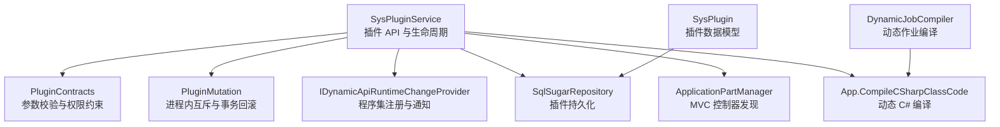
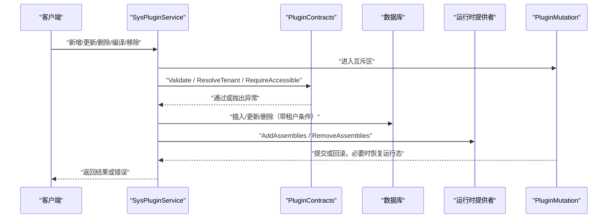
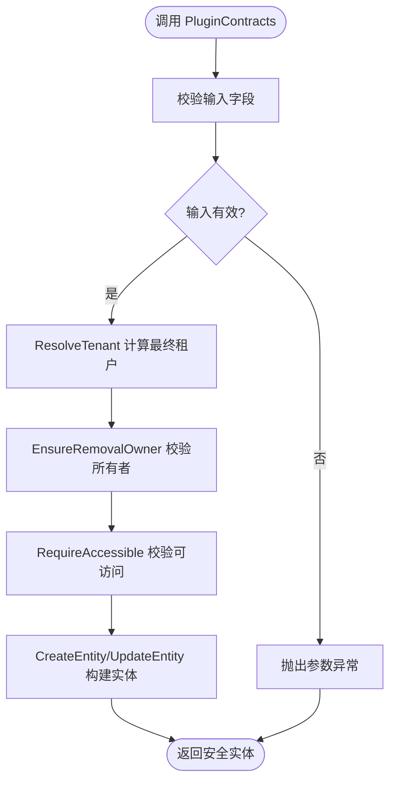
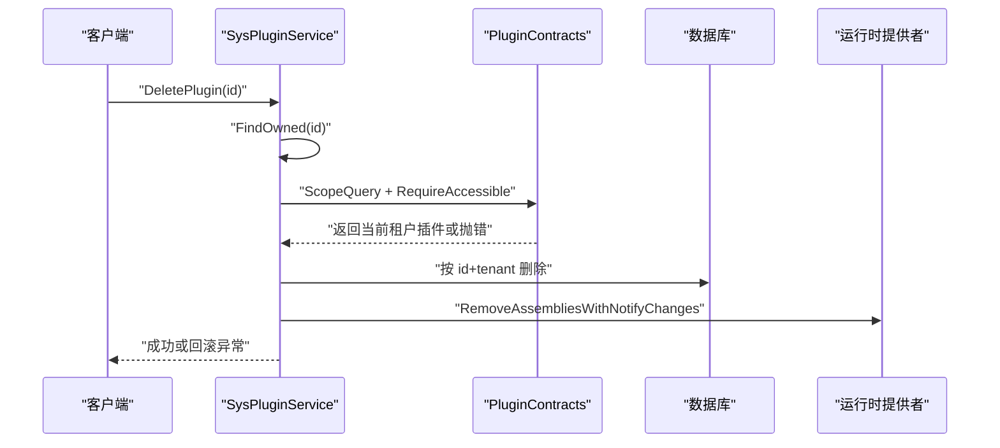
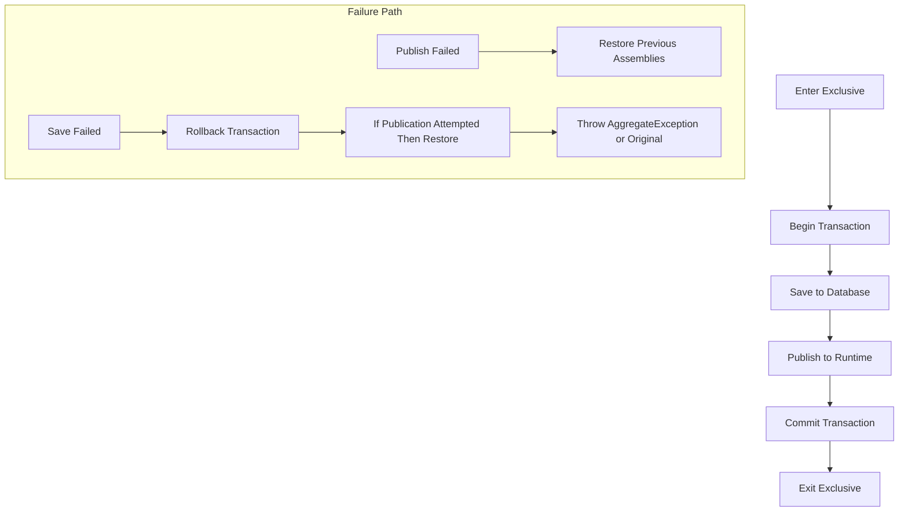
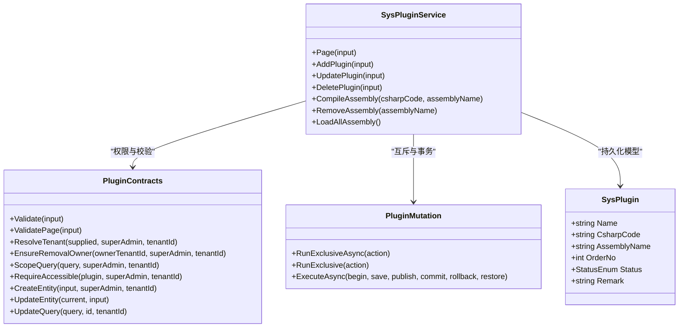

# 插件安全与管理

<cite>
**本文引用的文件**   
- [PluginContracts.cs](file://Admin.NET/Admin.NET.Core/Service/Plugin/PluginContracts.cs)
- [SysPluginService.cs](file://Admin.NET/Admin.NET.Core/Service/Plugin/SysPluginService.cs)
- [PluginMutation.cs](file://Admin.NET/Admin.NET.Core/Service/Plugin/PluginMutation.cs)
- [SysPlugin.cs](file://Admin.NET/Admin.NET.Core/Entity/SysPlugin.cs)
- [DynamicJobCompiler.cs](file://Admin.NET/Admin.NET.Core/Job/DynamicJobCompiler.cs)
- [ErrorCodeEnum.cs](file://Admin.NET/Admin.NET.Core/Enum/ErrorCodeEnum.cs)
- [PluginContractTests.cs](file://Admin.NET/Admin.NET.Test/Plugin/PluginContractTests.cs)
- [PluginRuntimeTests.cs](file://Admin.NET/Admin.NET.Test/Plugin/PluginRuntimeTests.cs)
- [PluginMutationTests.cs](file://Admin.NET/Admin.NET.Test/Plugin/PluginMutationTests.cs)
</cite>

## 目录
1. [引言](#引言)
2. [项目结构](#项目结构)
3. [核心组件](#核心组件)
4. [架构总览](#架构总览)
5. [详细组件分析](#详细组件分析)
6. [依赖关系分析](#依赖关系分析)
7. [性能与运行时特性](#性能与运行时特性)
8. [故障排查指南](#故障排查指南)
9. [结论](#结论)
10. [附录：安全配置与合规实践](#附录安全配置与合规实践)

## 引言
本文聚焦 Admin.NET 的插件系统，围绕权限控制、租户隔离、所有者校验、超管处理、动态编译与程序集加载、事务与运行时回滚、以及审计与安全加固策略展开。当前仓库已完成前端移植，业务前端入口为 Web/apps/web-antdv-next；但本专题关注后端插件安全与管理逻辑，主要代码位于 Admin.NET/Admin.NET.Core 中。

## 项目结构
插件相关的安全与管理能力集中在以下位置：
- 合同与校验：Admin.NET/Admin.NET.Core/Service/Plugin/PluginContracts.cs
- 插件服务与 API：Admin.NET/Admin.NET.Core/Service/Plugin/SysPluginService.cs
- 变更互斥与事务协调：Admin.NET/Admin.NET.Core/Service/Plugin/PluginMutation.cs
- 插件实体模型：Admin.NET/Admin.NET.Core/Entity/SysPlugin.cs
- 动态作业编译入口：Admin.NET/Admin.NET.Core/Job/DynamicJobCompiler.cs
- 错误码定义：Admin.NET/Admin.NET.Core/Enum/ErrorCodeEnum.cs
- 单元测试：Admin.NET/Admin.NET.Test/Plugin/*

**图表来源**
- [SysPluginService.cs:20-264](file://Admin.NET/Admin.NET.Core/Service/Plugin/SysPluginService.cs#L20-L264)
- [PluginContracts.cs:13-97](file://Admin.NET/Admin.NET.Core/Service/Plugin/PluginContracts.cs#L13-L97)
- [PluginMutation.cs:13-55](file://Admin.NET/Admin.NET.Core/Service/Plugin/PluginMutation.cs#L13-L55)
- [SysPlugin.cs:13-56](file://Admin.NET/Admin.NET.Core/Entity/SysPlugin.cs#L13-L56)
- [DynamicJobCompiler.cs:13-25](file://Admin.NET/Admin.NET.Core/Job/DynamicJobCompiler.cs#L13-L25)

**章节来源**
- [SysPluginService.cs:20-264](file://Admin.NET/Admin.NET.Core/Service/Plugin/SysPluginService.cs#L20-L264)
- [PluginContracts.cs:13-97](file://Admin.NET/Admin.NET.Core/Service/Plugin/PluginContracts.cs#L13-L97)
- [PluginMutation.cs:13-55](file://Admin.NET/Admin.NET.Core/Service/Plugin/PluginMutation.cs#L13-L55)
- [SysPlugin.cs:13-56](file://Admin.NET/Admin.NET.Core/Entity/SysPlugin.cs#L13-L56)
- [DynamicJobCompiler.cs:13-25](file://Admin.NET/Admin.NET.Core/Job/DynamicJobCompiler.cs#L13-L25)

## 核心组件
- PluginContracts：集中实现插件输入校验、租户解析、可访问性检查、更新列白名单与查询范围过滤。
- SysPluginService：提供新增、更新、删除、编译接口、移除程序集和启动时加载等 API，串联权限、校验、编译、持久化和运行时发布。
- PluginMutation：单进程信号量互斥，封装“开始事务→保存→发布→提交”及失败时的“回滚→恢复运行态”流程。
- SysPlugin：插件表实体，包含名称、C# 源码、程序集名、排序、状态和备注。
- DynamicJobCompiler：将脚本编译为 IJob 类型，复用同一动态编译能力。
- ErrorCodeEnum：统一错误码，如跨租户访问、目标不存在、程序集冲突等。

**章节来源**
- [PluginContracts.cs:13-97](file://Admin.NET/Admin.NET.Core/Service/Plugin/PluginContracts.cs#L13-L97)
- [SysPluginService.cs:20-264](file://Admin.NET/Admin.NET.Core/Service/Plugin/SysPluginService.cs#L20-L264)
- [PluginMutation.cs:13-55](file://Admin.NET/Admin.NET.Core/Service/Plugin/PluginMutation.cs#L13-L55)
- [SysPlugin.cs:13-56](file://Admin.NET/Admin.NET.Core/Entity/SysPlugin.cs#L13-L56)
- [DynamicJobCompiler.cs:13-25](file://Admin.NET/Admin.NET.Core/Job/DynamicJobCompiler.cs#L13-L25)
- [ErrorCodeEnum.cs](file://Admin.NET/Admin.NET.Core/Enum/ErrorCodeEnum.cs)

## 架构总览
插件系统的整体流程如下：
- 用户通过 API 调用 SysPluginService 的接口。
- PluginContracts 对请求参数进行严格校验，并基于当前登录用户身份判断是否允许跨租户操作。
- SysPluginService 使用 App.CompileCSharpClassCode 动态编译 C# 代码，生成临时程序集。
- 通过 ApplicationPartManager 和 IDynamicApiRuntimeChangeProvider 向 MVC 框架注册或移除程序集。
- 所有写操作由 PluginMutation 加锁保护，保证数据库事务与运行时状态的一致性。
- 启动时 SysPluginService.LoadAllAssembly 会重新编译并注册已启用插件的程序集。

**图表来源**
- [SysPluginService.cs:48-264](file://Admin.NET/Admin.NET.Core/Service/Plugin/SysPluginService.cs#L48-L264)
- [PluginContracts.cs:17-97](file://Admin.NET/Admin.NET.Core/Service/Plugin/PluginContracts.cs#L17-L97)
- [PluginMutation.cs:18-55](file://Admin.NET/Admin.NET.Core/Service/Plugin/PluginMutation.cs#L18-L55)

## 详细组件分析

### 权限与租户隔离：PluginContracts
PluginContracts 是插件系统的安全边界，承担以下职责：
- Validate/AddPluginInput：拒绝空参数、非法名称长度、空源码、超长程序集名、无效状态和非法租户 Id。
- ValidatePage/PagePluginInput：分页参数必须有效，查询字段长度和租户 Id 需合法。
- ResolveTenant：普通用户不能把租户 Id 指向其他租户；超管可以显式选择租户，但最终租户 Id 必须为正数。
- EnsureRemovalOwner：仅允许程序集归属者或宿主侧记录被移除；注释明确“没有插件归属的名称不能用于移除宿主程序集，超管也不例外”。
- ScopeQuery：非超管查询强制按当前租户过滤。
- RequireAccessible：读取插件时必须存在且属于当前租户或超管上下文。
- CreateEntity/UpdateEntity：只允许写入白名单字段，忽略 Id、创建人、更新人等敏感字段；更新时禁止修改租户。
- UpdateQuery：显式构造更新列集合，并附加主键和租户条件，防止 ORM 自定义 Where 覆盖安全条件。

**图表来源**
- [PluginContracts.cs:17-97](file://Admin.NET/Admin.NET.Core/Service/Plugin/PluginContracts.cs#L17-L97)

**章节来源**
- [PluginContracts.cs:17-97](file://Admin.NET/Admin.NET.Core/Service/Plugin/PluginContracts.cs#L17-L97)
- [PluginContractTests.cs:19-132](file://Admin.NET/Admin.NET.Test/Plugin/PluginContractTests.cs#L19-L132)

### 插件服务：SysPluginService
SysPluginService 暴露插件管理的 HTTP API，并负责：
- 列表分页：结合 UserManager.SuperAdmin 和 TenantId 过滤。
- 新增插件：校验 → 编译 → 确保程序集未冲突 → 持久化 → 根据状态决定是否发布到运行时。
- 更新插件：先快照旧程序集，再编译新代码，成功后替换，失败时恢复。
- 删除插件：校验所有权后删除，并卸载对应程序集。
- 编译接口：独立接口 CompileAssembly，记录临时程序集所有者。
- 移除程序集：RemoveAssembly，支持从存储或临时所有者表中定位归属，再进行权限校验与卸载。
- 启动加载：LoadAllAssembly，遍历启用状态的插件并重新编译注册。

**图表来源**
- [SysPluginService.cs:118-180](file://Admin.NET/Admin.NET.Core/Service/Plugin/SysPluginService.cs#L118-L180)
- [PluginContracts.cs:43-66](file://Admin.NET/Admin.NET.Core/Service/Plugin/PluginContracts.cs#L43-L66)

**章节来源**
- [SysPluginService.cs:20-264](file://Admin.NET/Admin.NET.Core/Service/Plugin/SysPluginService.cs#L20-L264)

### 变更互斥与事务一致性：PluginMutation
PluginMutation 提供两类能力：
- RunExclusiveAsync/RunExclusive：使用 SemaphoreSlim(1,1) 保证同一时刻只有一个插件变更执行。
- ExecuteAsync：封装“begin→save→publish→commit”和“rollback→restore”，并在多阶段失败时聚合异常，同时尽可能完成恢复。

测试覆盖了不同失败阶段的调用顺序、回滚失败时仍恢复运行态，以及并发场景下第二个任务等待并释放锁。

**图表来源**
- [PluginMutation.cs:18-55](file://Admin.NET/Admin.NET.Core/Service/Plugin/PluginMutation.cs#L18-L55)

**章节来源**
- [PluginMutation.cs:18-55](file://Admin.NET/Admin.NET.Core/Service/Plugin/PluginMutation.cs#L18-L55)
- [PluginMutationTests.cs:13-68](file://Admin.NET/Admin.NET.Test/Plugin/PluginMutationTests.cs#L13-L68)

### 插件数据模型：SysPlugin
SysPlugin 表示动态插件的持久化信息：
- Name：插件显示名称，最大长度 64。
- CsharpCode：待动态编译的 C# 源码。
- AssemblyName：编译后的程序集名称，最大长度 512。
- OrderNo：排序号。
- Status：启用状态。
- Remark：备注。

该模型继承自租户基类，因此天然携带租户标识，供 PluginContracts 和 Repository 层做租户隔离。

**章节来源**
- [SysPlugin.cs:13-56](file://Admin.NET/Admin.NET.Core/Entity/SysPlugin.cs#L13-L56)

### 动态编译与作业扩展：App.CompileCSharpClassCode 与 DynamicJobCompiler
- SysPluginService 使用 App.CompileCSharpClassCode 编译插件源码，生成临时程序集，并通过运行时提供者注册 MVC 控制器。
- DynamicJobCompiler.BuildJob 同样使用该编译能力，查找实现 IJob 的类型，说明动态编译不仅用于 API 插件，也用于作业。
- 运行时测试表明：即使编译句柄释放，只要 MVC 已持有程序集，控制器仍可调用；而编译失败不会污染已发布的控制器。

**章节来源**
- [SysPluginService.cs:60-264](file://Admin.NET/Admin.NET.Core/Service/Plugin/SysPluginService.cs#L60-L264)
- [DynamicJobCompiler.cs:13-25](file://Admin.NET/Admin.NET.Core/Job/DynamicJobCompiler.cs#L13-L25)
- [PluginRuntimeTests.cs:21-103](file://Admin.NET/Admin.NET.Test/Plugin/PluginRuntimeTests.cs#L21-L103)

## 依赖关系分析
- SysPluginService 依赖：
  - PluginContracts：权限与数据契约。
  - PluginMutation：并发与事务一致性。
  - SqlSugarRepository<SysPlugin>：插件数据的增删改查。
  - UserManager：获取当前用户是否超管和租户 Id。
  - ApplicationPartManager：发现 MVC 控制器。
  - IDynamicApiRuntimeChangeProvider：添加/移除程序集并通知变化。
  - App.CompileCSharpClassCode：动态编译。
- PluginMutation 不直接依赖业务表，只管理临界区和回调。
- PluginContracts 不依赖外部基础设施，只做输入校验和简单业务规则。

**图表来源**
- [SysPluginService.cs:20-264](file://Admin.NET/Admin.NET.Core/Service/Plugin/SysPluginService.cs#L20-L264)
- [PluginContracts.cs:13-97](file://Admin.NET/Admin.NET.Core/Service/Plugin/PluginContracts.cs#L13-L97)
- [PluginMutation.cs:13-55](file://Admin.NET/Admin.NET.Core/Service/Plugin/PluginMutation.cs#L13-L55)
- [SysPlugin.cs:13-56](file://Admin.NET/Admin.NET.Core/Entity/SysPlugin.cs#L13-L56)

**章节来源**
- [SysPluginService.cs:20-264](file://Admin.NET/Admin.NET.Core/Service/Plugin/SysPluginService.cs#L20-L264)
- [PluginContracts.cs:13-97](file://Admin.NET/Admin.NET.Core/Service/Plugin/PluginContracts.cs#L13-L97)
- [PluginMutation.cs:13-55](file://Admin.NET/Admin.NET.Core/Service/Plugin/PluginMutation.cs#L13-L55)
- [SysPlugin.cs:13-56](file://Admin.NET/Admin.NET.Core/Entity/SysPlugin.cs#L13-L56)

## 性能与运行时特性
- 进程内互斥：PluginMutation 使用信号量限制并发插件变更，避免程序集注册竞争。
- 编译句柄与程序集分离：测试表明编译句柄释放后，MVC 仍可调用已注册的控制器；这要求 AddAssemblies/RemoveAssemblies 与通知机制正确协作。
- 启动加载去重：LoadAllAssembly 在重复触发时跳过已存在的程序集，避免重复注册。
- 更新原子性：先快照旧程序集，成功后替换，失败时恢复，减少运行时抖动。

**章节来源**
- [PluginMutation.cs:18-55](file://Admin.NET/Admin.NET.Core/Service/Plugin/PluginMutation.cs#L18-L55)
- [PluginRuntimeTests.cs:21-103](file://Admin.NET/Admin.NET.Test/Plugin/PluginRuntimeTests.cs#L21-L103)
- [SysPluginService.cs:249-264](file://Admin.NET/Admin.NET.Core/Service/Plugin/SysPluginService.cs#L249-L264)

## 故障排查指南
常见错误与处理建议：
- 跨租户访问：ResolveTenant、ScopeQuery、RequireAccessible 会拒绝普通用户访问其他租户资源。确认当前用户租户与请求租户一致，或使用超管账号。
- 插件不存在或不可访问：FindOwned 与 RequireAccessible 组合校验，缺失或非当前租户会报错。
- 程序集冲突：EnsureAssemblyAvailable 与 CheckPlugin 会拒绝重复的程序集名称和功能名称。清理已占用的程序集或更换名称。
- 删除失败：EnsureRemovalOwner 要求调用方拥有该程序集；若 owner 为空或不属于当前租户则拒绝。
- 运行时恢复失败：PluginMutation.ExecuteAsync 在多阶段失败时会聚合异常，并尝试恢复。若恢复也失败，应检查运行时提供者和 MVC 程序集状态。
- 数据库一致性：插件写操作均包裹在事务中；若提交失败会回滚并恢复程序集。若出现不一致，需人工核对数据库与运行程序集。

**章节来源**
- [PluginContracts.cs:17-97](file://Admin.NET/Admin.NET.Core/Service/Plugin/PluginContracts.cs#L17-L97)
- [SysPluginService.cs:60-220](file://Admin.NET/Admin.NET.Core/Service/Plugin/SysPluginService.cs#L60-L220)
- [PluginMutation.cs:18-55](file://Admin.NET/Admin.NET.Core/Service/Plugin/PluginMutation.cs#L18-L55)
- [ErrorCodeEnum.cs](file://Admin.NET/Admin.NET.Core/Enum/ErrorCodeEnum.cs)

## 结论
Admin.NET 的插件系统通过 PluginContracts 实现强化的输入校验与租户隔离，由 SysPluginService 统一编排编译、持久化和运行时发布流程，并由 PluginMutation 保证并发与事务一致性。虽然代码以“动态编译并注入程序集”的方式运行，但仍提供了明确的权限边界、所有者校验和回滚恢复机制。对于生产环境，应在现有机制基础上补充沙箱隔离、反射限制、资源配额和安全审计，进一步收敛攻击面。

## 附录：安全配置与合规实践

### 权限最小化与租户隔离最佳实践
- 始终通过 UserManager.SuperAdmin 和 TenantId 传递当前用户上下文，不要在请求体中信任租户标识。
- 使用 PluginContracts.ResolveTenant 确定最终租户，禁止绕过该方法直接赋值。
- 删除或卸载程序集前必须调用 EnsureRemovalOwner，避免越权移除宿主或其他租户的程序集。
- 对外部输入的 Name、CsharpCode、AssemblyName、Remark 严格使用 Validate 校验，不要自行放宽长度或格式。

**章节来源**
- [PluginContracts.cs:17-97](file://Admin.NET/Admin.NET.Core/Service/Plugin/PluginContracts.cs#L17-L97)

### 代码白名单与字段控制
- 使用 PluginContracts.CreateEntity 和 UpdateEntity，只允许写入白名单字段；避免 Id、CreateUserId、UpdateUserName 等字段被伪造。
- 使用 UpdateQuery 时保留默认列集合，不要拼接自定义 Where 覆盖主键或租户条件。
- 对插件名称与程序集名称实施唯一性检查，避免冲突导致的运行时替换风险。

**章节来源**
- [PluginContracts.cs:68-97](file://Admin.NET/Admin.NET.Core/Service/Plugin/PluginContracts.cs#L68-L97)
- [SysPluginService.cs:140-180](file://Admin.NET/Admin.NET.Core/Service/Plugin/SysPluginService.cs#L140-L180)

### 敏感信息与审计建议
- 插件源码 CsharpCode 可能包含密钥或业务敏感信息，建议：
  - 存储加密或脱敏。
  - 日志中隐藏或截断敏感字段。
  - 访问审计记录操作人、租户、插件 Id、动作和时间。
- 对编译、发布、卸载等关键事件记录安全审计日志，便于追踪违规操作。
- 对超管操作增加二次确认与审批流，降低误用风险。

### 漏洞扫描与安全评估方法
- 对 CsharpCode 进行静态分析，识别危险 API 调用、反射滥用、文件/网络访问。
- 对程序集名称和插件名称做黑名单校验，防止恶意命名覆盖宿主程序集。
- 对动态编译产物进行签名校验与完整性检查。
- 建立插件准入评审流程，包括代码审查、依赖扫描、许可证合规检查。

### 沙箱与资源隔离建议
当前实现通过动态编译并将程序集注册到宿主进程，尚未体现进程级沙箱、反射白名单或内存/CPU 配额。建议后续增强：
- 在 App.CompileCSharpClassCode 之上增加受限编译器，禁用危险 API。
- 对反射访问进行白名单控制，仅允许插件访问预定义接口。
- 为每个插件分配独立资源预算，限制 CPU、内存、I/O 和网络访问。
- 将高风险操作放入隔离进程或容器，使用 IPC 通信而非共享进程内存。

### 应急响应预案
- 发现恶意插件时：
  - 立即停止其运行：调用 RemoveAssembly 或禁用对应插件状态。
  - 锁定相关账户与租户，冻结其插件编辑权限。
  - 保留编译源码、程序集、审计日志和数据库变更记录。
  - 回滚运行时状态：利用 PluginMutation 的恢复语义或手动恢复之前快照的程序集。
  - 修复权限配置，收紧超管与租户隔离策略。
  - 事后复盘：完善代码白名单、编译限制和资源隔离。