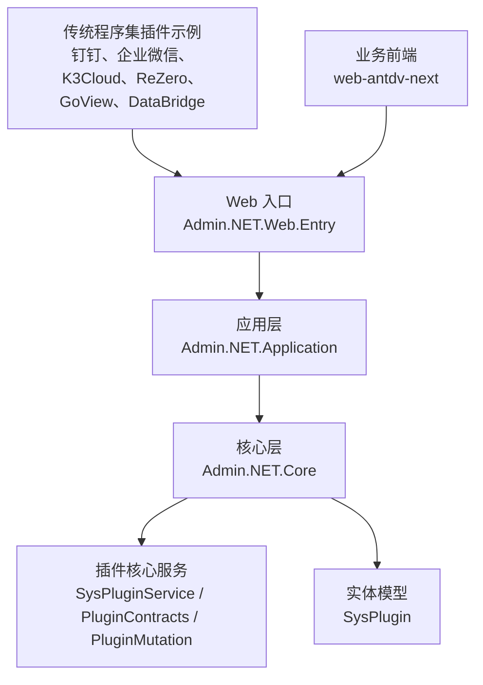
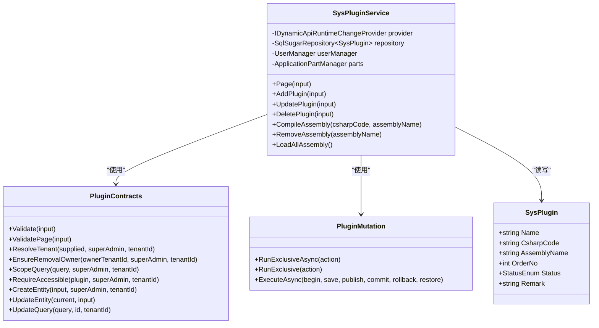
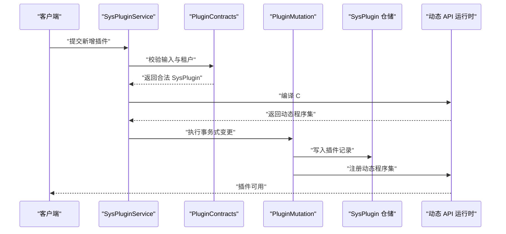
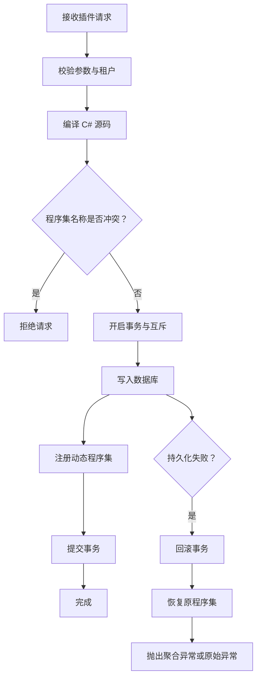
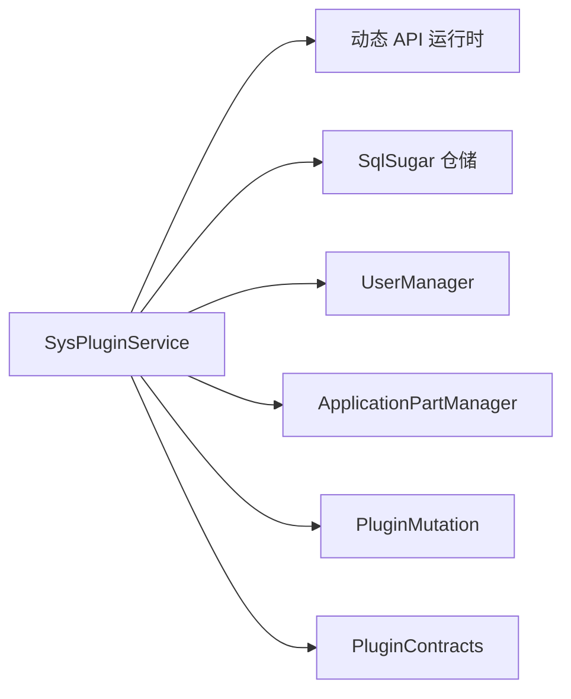

# 插件开发指南

<cite>
**本文引用的文件**
- [SysPluginService.cs](file://Admin.NET/Admin.NET.Core/Service/Plugin/SysPluginService.cs)
- [PluginContracts.cs](file://Admin.NET/Admin.NET.Core/Service/Plugin/PluginContracts.cs)
- [PluginMutation.cs](file://Admin.NET/Admin.NET.Core/Service/Plugin/PluginMutation.cs)
- [SysPlugin.cs](file://Admin.NET/Admin.NET.Core/Entity/SysPlugin.cs)
- [PluginRuntimeTests.cs](file://Admin.NET/Admin.NET.Test/Plugin/PluginRuntimeTests.cs)
- [PluginContractTests.cs](file://Admin.NET/Admin.NET.Test/Plugin/PluginContractTests.cs)
- [Program.cs](file://Admin.NET/Admin.NET.Web.Entry/Program.cs)
- [Startup.cs](file://Admin.NET/Admin.NET.Application/Startup.cs)
- [Startup.cs](file://Admin.NET/Admin.NET.Web.Core/Startup.cs)
- [global.json](file://Admin.NET/global.json)
- [package.json](file://Web/apps/web-antdv-next/package.json)
</cite>

## 目录
1. [引言](#引言)
2. [项目结构](#项目结构)
3. [核心组件](#核心组件)
4. [架构总览](#架构总览)
5. [详细组件分析](#详细组件分析)
6. [依赖关系分析](#依赖关系分析)
7. [性能与并发特性](#性能与并发特性)
8. [测试策略与实践](#测试策略与实践)
9. [前端集成方式](#前端集成方式)
10. [部署、版本管理与升级](#部署版本管理与升级)
11. [常见陷阱与调试优化](#常见陷阱与调试优化)
12. [实际开发示例](#实际开发示例)
13. [结论](#结论)

## 引言
本指南面向需要在 Admin.NET 中从零开始创建自定义插件的开发者。仓库当前已实现“动态代码插件”能力：后端通过运行时编译 C# 代码，将其注册为动态 API 并持久化到系统表；同时存在多个传统程序集插件示例工程（如钉钉、企业微信、金蝶 K3 Cloud、ReZero、GoView、DataBridge），用于展示基于独立程序集的扩展方式。

需要特别区分两类插件：
- 动态代码插件：以 SysPluginService 为核心，通过 API 提交 C# 源码，由运行时编译为程序集并热加载。
- 传统程序集插件：以独立 .NET 项目形式存在，通常包含 Startup 或启动逻辑，随宿主应用加载。

本指南不会把二者混为一谈，也不会声称项目已经固定某个 .NET SDK 版本或支持所有平台的前端运行环境。

**章节来源**
- [SysPluginService.cs:1-264](file://Admin.NET/Admin.NET.Core/Service/Plugin/SysPluginService.cs#L1-L264)

## 项目结构
仓库采用多工程结构，后端位于 `Admin.NET`，业务前端入口为 `Web/apps/web-antdv-next`，插件示例位于 `Admin.NET/Plugins` 下。

**图表来源**
- [Program.cs](file://Admin.NET/Admin.NET.Web.Entry/Program.cs)
- [Startup.cs](file://Admin.NET/Admin.NET.Application/Startup.cs)
- [Startup.cs](file://Admin.NET/Admin.NET.Web.Core/Startup.cs)
- [SysPluginService.cs:1-264](file://Admin.NET/Admin.NET.Core/Service/Plugin/SysPluginService.cs#L1-L264)

**章节来源**
- [Program.cs](file://Admin.NET/Admin.NET.Web.Entry/Program.cs)
- [Startup.cs](file://Admin.NET/Admin.NET.Application/Startup.cs)
- [Startup.cs](file://Admin.NET/Admin.NET.Web.Core/Startup.cs)

## 核心组件
动态插件的核心由以下组件构成：
- `SysPlugin`：系统动态插件实体，保存名称、C# 源码、程序集名、排序、状态和备注。
- `SysPluginService`：对外提供插件分页、新增、更新、删除、动态程序集添加、移除和批量加载等接口。
- `PluginContracts`：输入校验、租户范围控制、实体创建与更新、可访问性检查。
- `PluginMutation`：单进程互斥与事务协调器，保证数据库变更、程序集发布与回滚的一致性。

**图表来源**
- [SysPlugin.cs:1-56](file://Admin.NET/Admin.NET.Core/Entity/SysPlugin.cs#L1-L56)
- [SysPluginService.cs:1-264](file://Admin.NET/Admin.NET.Core/Service/Plugin/SysPluginService.cs#L1-L264)
- [PluginContracts.cs:1-97](file://Admin.NET/Admin.NET.Core/Service/Plugin/PluginContracts.cs#L1-L97)
- [PluginMutation.cs:1-55](file://Admin.NET/Admin.NET.Core/Service/Plugin/PluginMutation.cs#L1-L55)

**章节来源**
- [SysPlugin.cs:1-56](file://Admin.NET/Admin.NET.Core/Entity/SysPlugin.cs#L1-L56)
- [SysPluginService.cs:1-264](file://Admin.NET/Admin.NET.Core/Service/Plugin/SysPluginService.cs#L1-L264)
- [PluginContracts.cs:1-97](file://Admin.NET/Admin.NET.Core/Service/Plugin/PluginContracts.cs#L1-L97)
- [PluginMutation.cs:1-55](file://Admin.NET/Admin.NET.Core/Service/Plugin/PluginMutation.cs#L1-L55)

## 架构总览
动态插件的生命周期如下：
1. 前端或调用方通过插件管理接口提交 C# 源码。
2. `SysPluginService` 校验参数、校验租户、校验程序集名称冲突。
3. 运行时编译源码，得到动态程序集。
4. `PluginMutation` 确保数据库写入、程序集发布、失败恢复三者一致。
5. 启用状态的插件会通过 `IDynamicApiRuntimeChangeProvider` 注册为动态 API。
6. 启动时可通过 `LoadAllAssembly` 重新加载已启用插件。

**图表来源**
- [SysPluginService.cs:1-264](file://Admin.NET/Admin.NET.Core/Service/Plugin/SysPluginService.cs#L1-L264)
- [PluginContracts.cs:1-97](file://Admin.NET/Admin.NET.Core/Service/Plugin/PluginContracts.cs#L1-L97)
- [PluginMutation.cs:1-55](file://Admin.NET/Admin.NET.Core/Service/Plugin/PluginMutation.cs#L1-L55)

## 详细组件分析

### 插件实体：SysPlugin
`SysPlugin` 是动态插件的数据模型，继承租户基类，字段包括：
- `Name`：插件名称，最多 64 字符。
- `CsharpCode`：动态源码，存储为大文本。
- `AssemblyName`：动态程序集名称，最多 512 字符。
- `OrderNo`：排序号。
- `Status`：启用状态。
- `Remark`：备注。

该实体配合 SqlSugar 映射到系统动态插件表，并对名称建立索引。

**章节来源**
- [SysPlugin.cs:1-56](file://Admin.NET/Admin.NET.Core/Entity/SysPlugin.cs#L1-L56)

### 插件服务：SysPluginService
`SysPluginService` 暴露的主要职责包括：
- 分页查询插件列表。
- 新增插件：校验 → 编译源码 → 写入数据库 → 启用时注册程序集。
- 更新插件：校验 → 编译新源码 → 快照旧程序集 → 原子替换。
- 删除插件：快照旧程序集 → 删除记录 → 卸载程序集。
- 添加动态程序集：直接编译 C# 代码并注册，用于临时接口。
- 移除动态程序集：按归属权限卸载程序集。
- 加载全部启用插件：启动后根据数据库重新编译并注册。

关键约束：
- 程序集名称在进程内共享，不能重复。
- 超管与普通租户之间存在严格的隔离。
- 所有写操作通过 `PluginMutation` 加锁，避免并发竞争。

**图表来源**
- [SysPluginService.cs:1-264](file://Admin.NET/Admin.NET.Core/Service/Plugin/SysPluginService.cs#L1-L264)
- [PluginMutation.cs:1-55](file://Admin.NET/Admin.NET.Core/Service/Plugin/PluginMutation.cs#L1-L55)

**章节来源**
- [SysPluginService.cs:1-264](file://Admin.NET/Admin.NET.Core/Service/Plugin/SysPluginService.cs#L1-L264)

### 输入与租户合同：PluginContracts
`PluginContracts` 集中处理：
- 新增、分页、更新的输入校验。
- 租户解析与越权拦截。
- 可访问性检查。
- 实体构建与更新构造。
- 安全更新条件构造，防止 ORM 对象主键被覆盖。

重要规则：
- 非超管不能跨租户操作。
- 没有归属的程序集名称不允许移除宿主程序集。
- 所有租户相关判断都显式传递 `superAdmin` 与 `tenantId`。

**章节来源**
- [PluginContracts.cs:1-97](file://Admin.NET/Admin.NET.Core/Service/Plugin/PluginContracts.cs#L1-L97)

### 并发与事务协调：PluginMutation
`PluginMutation` 提供两个层面的保护：
- 进程级互斥：通过信号量保证同一时刻只有一个插件变更流程执行。
- 三阶段协调：先数据库保存，再发布程序集，最后提交事务；任一阶段失败都会尝试回滚或恢复。

这使“数据库状态”与“运行时程序集集合”保持一致，避免脏加载。

**章节来源**
- [PluginMutation.cs:1-55](file://Admin.NET/Admin.NET.Core/Service/Plugin/PluginMutation.cs#L1-L55)

## 依赖关系分析
动态插件依赖的关键外部能力包括：
- ASP.NET Core 动态 API 运行时：通过 `IDynamicApiController` 标记控制器、通过 `IDynamicApiRuntimeChangeProvider` 注册程序集。
- SqlSugar：用于 `SysPlugin` 的仓储访问与分页。
- UserManager：获取当前用户身份、是否为超管、租户 ID。
- ApplicationPartManager：扫描并快照已注册程序集。

**图表来源**
- [SysPluginService.cs:1-264](file://Admin.NET/Admin.NET.Core/Service/Plugin/SysPluginService.cs#L1-L264)

**章节来源**
- [SysPluginService.cs:1-264](file://Admin.NET/Admin.NET.Core/Service/Plugin/SysPluginService.cs#L1-L264)

## 性能与并发特性
- 并发控制：插件增删改查中的写路径通过 `PluginMutation.RunExclusiveAsync` 和 `RunExclusive` 串行化，避免多实例或多线程并发导致程序集重复注册或状态不一致。
- 程序集快照：更新和删除前会快照当前进程中的程序集，以便失败时恢复。
- 编译成本：每次新增或更新都会编译 C# 源码，应避免频繁提交大体积源码。
- 启动加载：`LoadAllAssembly` 会遍历启用插件并重新编译，适合应用在启动阶段执行一次。
- 租户过滤：分页查询按租户过滤，减少不必要数据扫描。

建议：
- 将大型公共逻辑拆分为普通服务或工具类，不要把所有代码塞进动态插件源码。
- 动态插件更适合快速验证接口、轻量业务逻辑和第三方集成适配层。
- 对高频调用的核心计算逻辑优先考虑静态程序集实现。

[本节为通用性能建议，不直接分析具体文件]

## 测试策略与实践

### 单元测试
适用于输入校验、租户边界、实体转换等纯函数行为。推荐重点覆盖：
- 非法输入。
- 超管与普通租户边界。
- 租户 ID 越权。
- 分页参数合法性。
- 更新条件构造是否正确限制主键和租户。

可参考现有测试工程结构，例如 `Admin.NET.Test/Plugin/PluginContractTests.cs`。

**章节来源**
- [PluginContractTests.cs](file://Admin.NET/Admin.NET.Test/Plugin/PluginContractTests.cs)
- [PluginContracts.cs:1-97](file://Admin.NET/Admin.NET.Core/Service/Plugin/PluginContracts.cs#L1-L97)

### 集成测试
适用于验证插件运行时行为，包括：
- 通过 API 提交 C# 源码。
- 验证动态程序集是否成功注册。
- 验证动态 API 是否可被调用。
- 验证禁用、启用、更新、删除后的运行时状态。

可参考 `Admin.NET.Test/Plugin/PluginRuntimeTests.cs` 中对运行时能力的验证思路。

**章节来源**
- [PluginRuntimeTests.cs](file://Admin.NET/Admin.NET.Test/Plugin/PluginRuntimeTests.cs)
- [SysPluginService.cs:1-264](file://Admin.NET/Admin.NET.Core/Service/Plugin/SysPluginService.cs#L1-L264)

### 运行时测试技巧
- 使用测试数据库或内存仓储隔离真实数据。
- 清理动态程序集注册状态，避免多次测试污染。
- 分别测试新增、更新、删除、编译、移除五个路径。
- 模拟租户场景：超管、同租户、跨租户。
- 对编译失败、程序集冲突、权限不足等异常路径做断言。

[本节为通用测试建议，不直接分析具体文件]

## 前端集成方式
前端业务入口为 `Web/apps/web-antdv-next`，其包管理器、引擎要求和 workspace 配置应以该工程的 `package.json` 为准。根脚本 `pnpm dev`、`pnpm build`、`pnpm lint`、`pnpm check:type` 面向业务应用，不应表述为全 workspace 检查。

插件在前端的典型集成方式：
- 菜单注册：在后端管理界面或通过菜单接口注册插件菜单。
- 路由配置：在前端路由表中增加插件页面路由。
- 组件复用：复用现有业务组件，调用插件提供的 API。
- API 生成：若插件暴露标准 API，可结合代码生成或 SDK 生成前端调用方法。

注意：
- 浏览器流程只要求桌面端验证。
- 前端路由和菜单属于应用层配置，不应误认为后端动态 API 自动产生前端路由。

**章节来源**
- [package.json](file://Web/apps/web-antdv-next/package.json)

## 部署、版本管理与升级

### 动态代码插件部署
- 通过插件管理 API 提交 C# 源码。
- 首次提交后，插件会被编译并注册为动态 API。
- 启用状态下，插件接口参与动态 API 路由。
- 更新时，新版本编译成功后才会替换旧版本程序集。
- 删除时，会从运行时卸载对应程序集。

### 传统程序集插件部署
传统插件示例位于 `Admin.NET/Plugins` 下，例如钉钉、企业微信、K3 Cloud、ReZero、GoView、DataBridge。这类插件通常是独立 .NET 项目，应遵循各自 `.csproj` 的目标框架和依赖说明。

部署要点：
- 将插件程序集复制到宿主应用的插件目录或部署产物中。
- 确保宿主应用能发现并加载插件程序集。
- 插件内部若注册了 API、服务或中间件，需在其 Startup 或启动逻辑中正确注册。

### 版本管理
- 动态插件：以 `Name` 和 `AssemblyName` 作为唯一性约束基础，更新时会替换程序集。
- 传统插件：建议使用语义化版本，并在部署清单中记录版本。
- 升级前应先在测试环境验证编译、运行时加载、API 兼容性和数据迁移。

### 升级策略
- 灰度发布：先启用新插件，观察错误日志与性能指标。
- 回滚机制：保留上一个版本的源码或程序集，出现问题时可快速恢复。
- 兼容性：动态 API 变更应保持向后兼容，避免破坏现有前端调用。

[本节为通用部署建议，不直接分析具体文件]

## 常见陷阱与调试优化

### 常见陷阱
- 程序集名称冲突：进程内程序集名称必须唯一，重复名称会直接拒绝。
- 租户越权：非超管不能操作其他租户的插件，也不能随意移除无归属的程序集。
- 源码过大：动态编译会占用内存和时间，不适合承载重型逻辑。
- 未处理异常：动态编译或程序集注册失败可能抛出聚合异常，需要捕获并提示。
- 前端路由遗漏：后端动态 API 不会自动生成前端路由。
- 依赖注入误解：动态插件中若需要依赖宿主服务，应通过宿主 DI 容器解析，而不是假设源码可直接访问私有服务。

### 调试技巧
- 优先查看插件新增、更新、删除接口的返回值和错误消息。
- 确认插件状态为启用后再验证 API。
- 使用日志输出插件加载、编译、注册过程。
- 对于传统插件，检查其 Startup 或服务注册是否执行。
- 对动态 API，使用 Swagger 或 OpenAPI 工具确认接口是否出现。

### 性能优化
- 拆分逻辑：将稳定、高频逻辑放入普通服务，动态插件只做适配或编排。
- 缓存结果：对读取型逻辑使用缓存，减少数据库或外部系统压力。
- 异步调用：对外部 HTTP、消息队列调用使用异步模式。
- 避免重复编译：只在必要时提交源码，避免频繁触发编译。

[本节为通用实践建议，不直接分析具体文件]

## 实际开发示例

### 示例一：简单工具类插件
目标：提供一个字符串处理或加密解密接口。
步骤：
1. 定义清晰的输入输出 DTO。
2. 编写 C# 源码，实现业务方法。
3. 通过插件管理接口提交源码。
4. 在数据库中确认插件已启用。
5. 调用动态 API 验证功能。

注意事项：
- 源码尽量简洁。
- 错误信息要清晰。
- 不要引入重型依赖。

[本节为概念示例，不直接分析具体文件]

### 示例二：复杂业务服务插件
目标：封装一个跨模块业务流程，例如审批、订单、库存联动。
步骤：
1. 在后端已有服务基础上，通过插件编排业务流程。
2. 使用依赖注入调用宿主服务。
3. 使用事件总线或消息队列解耦子系统。
4. 在插件中记录审计日志和操作日志。
5. 提供分页查询、导出、统计等接口。

注意事项：
- 控制事务范围。
- 合理设计重试与补偿。
- 对敏感数据进行脱敏。

[本节为概念示例，不直接分析具体文件]

### 示例三：第三方系统集成插件
目标：对接钉钉、企业微信、ERP 或其他外部系统。
步骤：
1. 在插件中封装第三方 SDK。
2. 将密钥、地址等配置放在配置中心或配置文件。
3. 实现连接池、超时、重试和熔断。
4. 提供数据同步、回调通知、定时任务等能力。
5. 在前端提供配置页和同步日志页。

注意事项：
- 网络异常要可观测。
- 第三方接口限流要遵守。
- 密钥不得硬编码。

[本节为概念示例，不直接分析具体文件]

## 结论
Admin.NET 的动态插件能力适合快速迭代、灵活扩展的场景，尤其适合临时接口、轻量业务和第三方集成。对于稳定性要求高、性能敏感或逻辑复杂的模块，仍建议放在传统程序集中。无论选择哪种方式，都应重视租户隔离、输入校验、异常处理、并发安全和可测试性。前端方面，应以 `web-antdv-next` 为业务入口，并结合后端 API 进行菜单、路由和组件集成。

[本节为总结性内容，不直接分析具体文件]